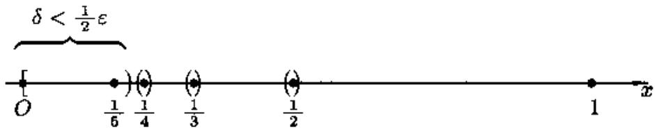
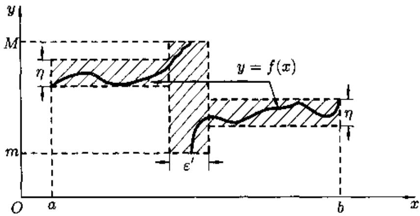
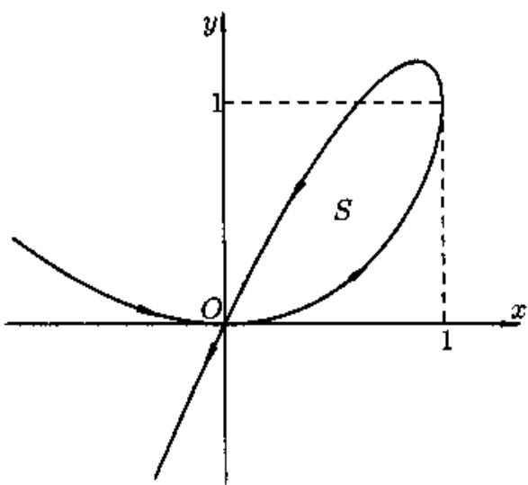

# 数学分析II习题与简解

**版本日期：** 2026-10-11。

**状态：** 图谱90个叶节点完成实质内容；175条导出行归并为163道独立题，另有43道自拟训练题及143道已核原页的陈纪修第三版例题与习题；系统采集未完成，导出所用版次、原题页和数学解析尚待终审。。90个实质知识点、349道独立题目；每题均附答案栏，出处或数学待核事项在相应题目下标示。同一题目跨多个知识点展示不增加独立题数。

## 来源、版本与阶段范围

- **主源与范围：** 阶段边界与层级依同事数学分析II图谱；知识依据为所附陈纪修等《数学分析》第三版上、下册。导出例题章号与谢惠民等《数学分析习题课讲义》下册官方目录高度吻合，但导出所用版次与书页未核。
- **主教材上册：** 数学分析-陈纪修-上册.pdf；SHA-256：`21eaf9ee95202f2f63d8212597fc3d0c6784e4da6a58688e5d6c4bf50a57fe2c`。
- **主教材下册：** 数学分析-陈纪修-下册.pdf；SHA-256：`4ae3dbc448cb886c3ab4cf4c47c9c19454f364d92c34428a743161e403b2b17e`。
- **同事习题导出：** 数学分析2_习题导出.xlsx；SHA-256：`2ec5d34c925be6a35d7bb507746a28cb618daeb4de0ec8ff3e6ca9d3a91a3721`。
- **同事知识图谱与阶段范围：** 数学分析II-2026-10-11-18-50-21.xls；SHA-256：`104150057cd7c53e389c1f43372cedc6e5928721a40f338ee412205a861ae800`。
- 本交付Markdown只保留书目信息和逐条书页/PDF页，不依赖本机PDF链接；教材PDF保存在课程根`资料/`，不随网页资源包分发。

## 目录

- [不定积分](#analysis-ii-g002)
- [定积分](#analysis-ii-g013)
- [定积分的应用](#analysis-ii-g031)
- [反常积分](#analysis-ii-g048)
- [数项级数](#analysis-ii-g055)
- [函数列和函数项级数](#analysis-ii-g066)
- [幂级数](#analysis-ii-g072)
- [傅里叶级数](#analysis-ii-g080)
- [欧几里德空间的极限与连续](#analysis-ii-g087)
- [多元函数微分学](#analysis-ii-g113)

本课共有349道不同来源身份的题目，按直接关联节点展示357条。原书题、同事导出题和自拟题均在出处栏分别标明；全小问同题保存；难度为1—5，来源与解答来源分别列示。

## 课程总览

**图谱路径：** 数学分析II

**知识内容：** [定义、定理与方法](知识点.md#analysis-ii)

所给材料中未找到直接对应的独立未解题。

## 不定积分

**图谱路径：** 数学分析II / 不定积分

**知识内容：** [定义、定理与方法](知识点.md#analysis-ii-g002)

所给材料中未找到直接对应的独立未解题。

### 不定积分的概念与基本积分公式

**图谱路径：** 数学分析II / 不定积分 / 不定积分的概念与基本积分公式

**知识内容：** [定义、定理与方法](知识点.md#analysis-ii-g003)

所给材料中未找到直接对应的独立未解题。

#### 原函数与不定积分

**图谱路径：** 数学分析II / 不定积分 / 不定积分的概念与基本积分公式 / 原函数与不定积分

**知识内容：** [定义、定理与方法](知识点.md#analysis-ii-g004)

<!-- source-exercise:CJX-II-SELF-001 -->
1. 求 $f(x)=3x^2$ 在 $\mathbb R$ 上的所有原函数。

   **答案：** 因 $(x^3)'=3x^2$，任意两个原函数之差在连通区间 $\mathbb R$ 上为常数，故全体为 $x^3+C$。

   **难度：1/5；出处：** 自拟训练题，非教材原题；概念依据：陈纪修等《数学分析》第三版上册，第6章，书页197起、PDF第225页起；本条精确页待核，原题号自拟训练题 001；**解答来源：** 本轮自拟简解。

   **待核状态：** 自拟题待教师终审

   **整理说明：** 用于填补图谱无导出题的叶节点；不计入原书原题规模

<!-- source-exercise:CJX3-II-上-ex6.1.8 -->
2. 已知曲线 $y=f(x)$ 每一点的切线斜率为 $x^2$，且经过 $(3,2)$，求曲线方程。

   **答案：** $f'(x)=x^2$，故 $f(x)=x^3/3+C$。由 $f(3)=2$ 得 $C=-7$，即 $y=x^3/3-7$。

   **难度：2/5；出处：** 陈纪修、於崇华、金路《数学分析》第三版上册，教材例6.1.8，书页209，PDF第229页；已目视核对原页，原题号例6.1.8；**解答来源：** 教材正文解法核对后写成中文简解。

   **待核状态：** 已核原页；教师终审未执行

   **整理说明：** 正文例题；未并入同事导出题；不拆分小问

<!-- source-exercise:CJX3-II-上-hw-6.1-2 -->
3. 曲线 $y=f(x)$ 经过 $(e,-1)$，且任一点的切线斜率等于该点横坐标的倒数，求曲线方程。

   **答案：** 在包含 $e$ 的正半轴上 $f'(x)=1/x$，故 $f(x)=\ln x+C$。代入 $f(e)=-1$ 得 $C=-2$，所以 $y=\ln x-2$（$x>0$）。

   **难度：2/5；出处：** 陈纪修、於崇华、金路《数学分析》第三版上册，教材习题6.1第2题，书页210，PDF第230页；已目视核对原页，原题号习题6.1第2题；**解答来源：** 本轮自拟简解。

   **待核状态：** 已核原页；教师终审未执行

   **整理说明：** 教材习题；未并入同事导出题；不拆分小问

<!-- source-exercise:CJX3-II-上-hw-6.1-3 -->
4. 曲线 $y=f(x)$ 任一点的切线斜率比该点横坐标的立方根少 $1$。(1) 求曲线方程的所有可能形式；(2) 若曲线经过 $(1,1)$，求该曲线方程。

   **答案：** 由 $f'(x)=x^{1/3}-1$，得 (1) $f(x)=\frac34x^{4/3}-x+C$（实立方根）。(2) 代入 $(1,1)$ 得 $C=5/4$，故 $y=\frac34x^{4/3}-x+5/4$。

   **难度：2/5；出处：** 陈纪修、於崇华、金路《数学分析》第三版上册，教材习题6.1第3题，书页210，PDF第230页；已目视核对原页，原题号习题6.1第3题；**解答来源：** 本轮自拟简解。

   **待核状态：** 已核原页；教师终审未执行

   **整理说明：** 教材习题；未并入同事导出题；不拆分小问

   **勘误：** 自拟简解按原题“立方根”积分；应与原书答案核对。

#### 基本积分表

**图谱路径：** 数学分析II / 不定积分 / 不定积分的概念与基本积分公式 / 基本积分表

**知识内容：** [定义、定理与方法](知识点.md#analysis-ii-g005)

<!-- source-exercise:CJX-II-SELF-002 -->
1. 计算 $\int (e^x+\cos x+1/x)\,dx$，并说明定义区间。

   **答案：** 在 $(0,\infty)$ 或 $(-\infty,0)$ 的任一连通分支上，结果为 $e^x+\sin x+\ln|x|+C$；两分支常数可不同。

   **难度：2/5；出处：** 自拟训练题，非教材原题；概念依据：陈纪修等《数学分析》第三版上册，第6章，书页197起、PDF第225页起；本条精确页待核，原题号自拟训练题 002；**解答来源：** 本轮自拟简解。

   **待核状态：** 自拟题待教师终审

   **整理说明：** 用于填补图谱无导出题的叶节点；不计入原书原题规模

<!-- source-exercise:CJX3-II-上-ex6.1.1 -->
2. 求 $\int\sin x\,dx$。

   **答案：** 因为 $(-\cos x)'=\sin x$，故 $\int\sin x\,dx=-\cos x+C$。

   **难度：2/5；出处：** 陈纪修、於崇华、金路《数学分析》第三版上册，教材例6.1.1，书页206，PDF第226页；已目视核对原页，原题号例6.1.1；**解答来源：** 教材正文解法核对后写成中文简解。

   **待核状态：** 已核原页；教师终审未执行

   **整理说明：** 正文例题；未并入同事导出题；不拆分小问

<!-- source-exercise:CJX3-II-上-ex6.1.2 -->
3. 求 $\int x^\alpha dx$（$\alpha\ne-1$，在实值幂函数有定义的区间上）。

   **答案：** 由 $(x^{\alpha+1}/(\alpha+1))'=x^\alpha$，故结果为 $x^{\alpha+1}/(\alpha+1)+C$。

   **难度：2/5；出处：** 陈纪修、於崇华、金路《数学分析》第三版上册，教材例6.1.2，书页207，PDF第227页；已目视核对原页，原题号例6.1.2；**解答来源：** 教材正文解法核对后写成中文简解。

   **待核状态：** 已核原页；教师终审未执行

   **整理说明：** 正文例题；未并入同事导出题；不拆分小问

<!-- source-exercise:CJX3-II-上-ex6.1.3 -->
4. 求 $\int dx/x$（$x\ne0$）。

   **答案：** 在正半轴原函数为 $\ln x$，负半轴为 $\ln(-x)$，合写成 $\ln|x|+C$；两连通分支的常数可独立。

   **难度：2/5；出处：** 陈纪修、於崇华、金路《数学分析》第三版上册，教材例6.1.3，书页207，PDF第227页；已目视核对原页，原题号例6.1.3；**解答来源：** 教材正文解法核对后写成中文简解。

   **待核状态：** 已核原页；教师终审未执行

   **整理说明：** 正文例题；未并入同事导出题；不拆分小问

<!-- source-exercise:CJX3-II-上-ex6.1.4 -->
5. 求 $\int\tan^2x\,dx$。

   **答案：** 用 $\tan^2x=\sec^2x-1$，积分得 $\tan x-x+C$，定义于不含 $\cos x=0$ 的区间。

   **难度：2/5；出处：** 陈纪修、於崇华、金路《数学分析》第三版上册，教材例6.1.4，书页208，PDF第228页；已目视核对原页，原题号例6.1.4；**解答来源：** 教材正文解法核对后写成中文简解。

   **待核状态：** 已核原页；教师终审未执行

   **整理说明：** 正文例题；未并入同事导出题；不拆分小问

<!-- source-exercise:CJX3-II-上-ex6.1.5 -->
6. 求 $\int\sin^2(x/2)\,dx$。

   **答案：** 由 $\sin^2(x/2)=(1-\cos x)/2$，得 $(x-\sin x)/2+C$。

   **难度：2/5；出处：** 陈纪修、於崇华、金路《数学分析》第三版上册，教材例6.1.5，书页208，PDF第228页；已目视核对原页，原题号例6.1.5；**解答来源：** 教材正文解法核对后写成中文简解。

   **待核状态：** 已核原页；教师终审未执行

   **整理说明：** 正文例题；未并入同事导出题；不拆分小问

<!-- source-exercise:CJX3-II-上-ex6.1.6 -->
7. 求 $\displaystyle\int \frac{(x+\sqrt x)(x-2\sqrt x)^2}{\sqrt x}\,dx$（$x>0$）。

   **答案：** 将被积式展开成 $x^{5/2}-3x^2+4x$，逐项积分为 $\frac27x^{7/2}-x^3+2x^2+C$。

   **难度：2/5；出处：** 陈纪修、於崇华、金路《数学分析》第三版上册，教材例6.1.6，书页208–209，PDF第228–229页；已目视核对原页，原题号例6.1.6；**解答来源：** 教材正文解法核对后写成中文简解。

   **待核状态：** 已核原页；教师终审未执行

   **整理说明：** 正文例题；未并入同事导出题；不拆分小问

<!-- source-exercise:CJX3-II-上-ex6.1.7 -->
8. 求 $\int x^4/(1+x^2)\,dx$。

   **答案：** 长除法得 $x^4/(1+x^2)=x^2-1+1/(1+x^2)$，故积分为 $x^3/3-x+\arctan x+C$。

   **难度：2/5；出处：** 陈纪修、於崇华、金路《数学分析》第三版上册，教材例6.1.7，书页209，PDF第229页；已目视核对原页，原题号例6.1.7；**解答来源：** 教材正文解法核对后写成中文简解。

   **待核状态：** 已核原页；教师终审未执行

   **整理说明：** 正文例题；未并入同事导出题；不拆分小问

### 不定积分计算方法

**图谱路径：** 数学分析II / 不定积分 / 不定积分计算方法

**知识内容：** [定义、定理与方法](知识点.md#analysis-ii-g006)

所给材料中未找到直接对应的独立未解题。

#### 换元积分法

**图谱路径：** 数学分析II / 不定积分 / 不定积分计算方法 / 换元积分法

**知识内容：** [定义、定理与方法](知识点.md#analysis-ii-g007)

<!-- source-exercise:CJX-II-SELF-003 -->
1. 用换元法求 $\int 2x\cos(x^2)\,dx$。

   **答案：** 令 $u=x^2$，则 $du=2x\,dx$，积分为 $\int\cos u\,du=\sin(x^2)+C$。

   **难度：1/5；出处：** 自拟训练题，非教材原题；概念依据：陈纪修等《数学分析》第三版上册，第6章，书页197起、PDF第225页起；本条精确页待核，原题号自拟训练题 003；**解答来源：** 本轮自拟简解。

   **待核状态：** 自拟题待教师终审

   **整理说明：** 用于填补图谱无导出题的叶节点；不计入原书原题规模

<!-- source-exercise:CJX3-II-上-ex6.2.1 -->
2. 求 $\int \frac{dx}{x-a}$（$x\ne a$）。

   **答案：** 令 $u=x-a$，则 $du=dx$，故积分为 $\ln|u|+C=\ln|x-a|+C$；每个不跨 $a$ 的区间可有独立常数。

   **难度：2/5；出处：** 陈纪修、於崇华、金路《数学分析》第三版上册，教材例6.2.1，书页211，PDF第231页；已目视核对原页，原题号例6.2.1；**解答来源：** 教材正文解法核对后写成中文简解。

   **待核状态：** 已核原页；教师终审未执行

   **整理说明：** 正文例题；未并入同事导出题；不拆分小问

<!-- source-exercise:CJX3-II-上-ex6.2.2 -->
3. 求 $\int \frac{dx}{x^2+a^2}$（$a\ne0$）。

   **答案：** 取 $u=x/a$，则 $dx=a\,du$，结果为 $\frac1a\arctan(x/a)+C$。对负 $a$ 也可直接求导验证。

   **难度：2/5；出处：** 陈纪修、於崇华、金路《数学分析》第三版上册，教材例6.2.2，书页211，PDF第231页；已目视核对原页，原题号例6.2.2；**解答来源：** 教材正文解法核对后写成中文简解。

   **待核状态：** 已核原页；教师终审未执行

   **整理说明：** 正文例题；未并入同事导出题；不拆分小问

<!-- source-exercise:CJX3-II-上-ex6.2.3 -->
4. 求 $\int \tan x\,dx$。

   **答案：** 在 $\cos x\ne0$ 的每个区间，取 $u=\cos x$，$du=-\sin x\,dx$，得 $-\ln|\cos x|+C$。

   **难度：2/5；出处：** 陈纪修、於崇华、金路《数学分析》第三版上册，教材例6.2.3，书页211，PDF第231页；已目视核对原页，原题号例6.2.3；**解答来源：** 教材正文解法核对后写成中文简解。

   **待核状态：** 已核原页；教师终审未执行

   **整理说明：** 正文例题；未并入同事导出题；不拆分小问

<!-- source-exercise:CJX3-II-上-ex6.2.4 -->
5. 求 $\int\sec x\,dx$。

   **答案：** 乘以 $(\sec x+\tan x)/(\sec x+\tan x)$，分子成为 $(\sec x+\tan x)'$，故结果为 $\ln|\sec x+\tan x|+C$。

   **难度：2/5；出处：** 陈纪修、於崇华、金路《数学分析》第三版上册，教材例6.2.4，书页212，PDF第232页；已目视核对原页，原题号例6.2.4；**解答来源：** 教材正文解法核对后写成中文简解。

   **待核状态：** 已核原页；教师终审未执行

   **整理说明：** 正文例题；未并入同事导出题；不拆分小问

<!-- source-exercise:CJX3-II-上-ex6.2.5 -->
6. 求 $\int dx/[\sqrt x(1+x)]$（$x>0$）。

   **答案：** 令 $u=\sqrt x$，$dx=2u\,du$，化为 $2\int du/(1+u^2)=2\arctan\sqrt x+C$。

   **难度：2/5；出处：** 陈纪修、於崇华、金路《数学分析》第三版上册，教材例6.2.5，书页212，PDF第232页；已目视核对原页，原题号例6.2.5；**解答来源：** 教材正文解法核对后写成中文简解。

   **待核状态：** 已核原页；教师终审未执行

   **整理说明：** 正文例题；未并入同事导出题；不拆分小问

<!-- source-exercise:CJX3-II-上-ex6.2.6 -->
7. 求 $\int\sin(mx)\cos(nx)\,dx$（$m\ne n$，且 $m+n\ne0$）。

   **答案：** 积化和差：$\sin(mx)\cos(nx)=\frac12[\sin((m+n)x)+\sin((m-n)x)]$，故积分为 $-\frac12[\cos((m+n)x)/(m+n)+\cos((m-n)x)/(m-n)]+C$。

   **难度：2/5；出处：** 陈纪修、於崇华、金路《数学分析》第三版上册，教材例6.2.6，书页212，PDF第232页；已目视核对原页，原题号例6.2.6；**解答来源：** 教材正文解法核对后写成中文简解。

   **待核状态：** 已核原页；教师终审未执行

   **整理说明：** 正文例题；未并入同事导出题；不拆分小问

<!-- source-exercise:CJX3-II-上-ex6.2.9 -->
8. 求 $\int x(2x-1)^{100}\,dx$。

   **答案：** 令 $u=2x-1$，则 $x=(u+1)/2,dx=du/2$，故为 $\frac14[u^{102}/102+u^{101}/101]+C$，再代回 $u=2x-1$。

   **难度：2/5；出处：** 陈纪修、於崇华、金路《数学分析》第三版上册，教材例6.2.9，书页214，PDF第234页；已目视核对原页，原题号例6.2.9；**解答来源：** 教材正文解法核对后写成中文简解。

   **待核状态：** 已核原页；教师终审未执行

   **整理说明：** 正文例题；未并入同事导出题；不拆分小问

<!-- source-exercise:CJX3-II-上-hw-6.2-7 -->
9. 分别求 $\int \frac{\cos x}{\sin x+\cos x}\,dx$ 与 $\int \frac{\sin x}{\sin x+\cos x}\,dx$（分母不为零）。

   **答案：** 记两积分为 $I_1,I_2$。由分子相加得 $I_1+I_2=x$；由分子相减得 $I_1-I_2=\int(\cos x-\sin x)/(\sin x+\cos x)dx=\ln|\sin x+\cos x|$。故 $I_1=[x+\ln|\sin x+\cos x|]/2+C_1$，$I_2=[x-\ln|\sin x+\cos x|]/2+C_2$。

   **难度：2/5；出处：** 陈纪修、於崇华、金路《数学分析》第三版上册，教材习题6.2第7题，书页222，PDF第242页；已目视核对原页，原题号习题6.2第7题；**解答来源：** 本轮自拟简解。

   **待核状态：** 已核原页；教师终审未执行

   **整理说明：** 教材习题；未并入同事导出题；不拆分小问

#### 分部积分法

**图谱路径：** 数学分析II / 不定积分 / 不定积分计算方法 / 分部积分法

**知识内容：** [定义、定理与方法](知识点.md#analysis-ii-g008)

<!-- source-exercise:CJX-II-SELF-004 -->
1. 计算 $\int x\ln x\,dx$（$x>0$）。

   **答案：** 取 $u=\ln x$、$dv=x\,dx$，得 $\frac{x^2}{2}\ln x-\frac12\int x\,dx=\frac{x^2}{2}\ln x-\frac{x^2}{4}+C$。

   **难度：2/5；出处：** 自拟训练题，非教材原题；概念依据：陈纪修等《数学分析》第三版上册，第6章，书页197起、PDF第225页起；本条精确页待核，原题号自拟训练题 004；**解答来源：** 本轮自拟简解。

   **待核状态：** 自拟题待教师终审

   **整理说明：** 用于填补图谱无导出题的叶节点；不计入原书原题规模

<!-- source-exercise:CJX3-II-上-ex6.2.11 -->
2. 求 $\int x\cos x\,dx$。

   **答案：** 取 $u=x$、$dv=\cos x\,dx$，则 $v=\sin x$，故为 $x\sin x-\int\sin x\,dx=x\sin x+\cos x+C$。

   **难度：2/5；出处：** 陈纪修、於崇华、金路《数学分析》第三版上册，教材例6.2.11，书页215，PDF第235页；已目视核对原页，原题号例6.2.11；**解答来源：** 教材正文解法核对后写成中文简解。

   **待核状态：** 已核原页；教师终审未执行

   **整理说明：** 正文例题；未并入同事导出题；不拆分小问

<!-- source-exercise:CJX3-II-上-ex6.2.12 -->
3. 求 $\int x^2e^x\,dx$。

   **答案：** 两次分部积分：$I=x^2e^x-2\int xe^x dx=e^x(x^2-2x+2)+C$。

   **难度：2/5；出处：** 陈纪修、於崇华、金路《数学分析》第三版上册，教材例6.2.12，书页215，PDF第235页；已目视核对原页，原题号例6.2.12；**解答来源：** 教材正文解法核对后写成中文简解。

   **待核状态：** 已核原页；教师终审未执行

   **整理说明：** 正文例题；未并入同事导出题；不拆分小问

<!-- source-exercise:CJX3-II-上-ex6.2.13 -->
4. 求 $\int\ln x\,dx$（$x>0$）。

   **答案：** 取 $u=\ln x$、$dv=dx$，得 $x\ln x-\int 1\,dx=x(\ln x-1)+C$。

   **难度：2/5；出处：** 陈纪修、於崇华、金路《数学分析》第三版上册，教材例6.2.13，书页216，PDF第236页；已目视核对原页，原题号例6.2.13；**解答来源：** 教材正文解法核对后写成中文简解。

   **待核状态：** 已核原页；教师终审未执行

   **整理说明：** 正文例题；未并入同事导出题；不拆分小问

<!-- source-exercise:CJX3-II-上-ex6.2.14 -->
5. 求 $\int x\arctan x\,dx$。

   **答案：** 分部积分取 $u=\arctan x$、$dv=x\,dx$，则 $I=\frac{x^2}{2}\arctan x-\frac12\int\frac{x^2}{1+x^2}dx=\frac{1+x^2}{2}\arctan x-\frac{x}{2}+C$。

   **难度：2/5；出处：** 陈纪修、於崇华、金路《数学分析》第三版上册，教材例6.2.14，书页216，PDF第236页；已目视核对原页，原题号例6.2.14；**解答来源：** 教材正文解法核对后写成中文简解。

   **待核状态：** 已核原页；教师终审未执行

   **整理说明：** 正文例题；未并入同事导出题；不拆分小问

### 积分方法的应用

**图谱路径：** 数学分析II / 不定积分 / 积分方法的应用

**知识内容：** [定义、定理与方法](知识点.md#analysis-ii-g009)

所给材料中未找到直接对应的独立未解题。

#### 有理函数的不定积分

**图谱路径：** 数学分析II / 不定积分 / 积分方法的应用 / 有理函数的不定积分

**知识内容：** [定义、定理与方法](知识点.md#analysis-ii-g010)

<!-- source-exercise:CJX-II-SELF-005 -->
1. 求 $\int dx/[x(x+1)]$，注明定义域。

   **答案：** 部分分式 $1/[x(x+1)]=1/x-1/(x+1)$，故在不跨 $-1,0$ 的区间上结果为 $\ln|x|-\ln|x+1|+C$。

   **难度：2/5；出处：** 自拟训练题，非教材原题；概念依据：陈纪修等《数学分析》第三版上册，第6章，书页197起、PDF第225页起；本条精确页待核，原题号自拟训练题 005；**解答来源：** 本轮自拟简解。

   **待核状态：** 自拟题待教师终审

   **整理说明：** 用于填补图谱无导出题的叶节点；不计入原书原题规模

<!-- source-exercise:CJX3-II-上-ex6.3.1 -->
2. 求 $\int(4x^3-13x^2+3x+8)/[(x+1)(x-2)(x-1)^2]\,dx$。

   **答案：** 部分分式为 $1/(x+1)-2/(x-2)+5/(x-1)-1/(x-1)^2$。逐项积分得 $\ln|(x+1)(x-1)^5/(x-2)^2|+1/(x-1)+C$。

   **难度：2/5；出处：** 陈纪修、於崇华、金路《数学分析》第三版上册，教材例6.3.1，书页226，PDF第246页；已目视核对原页，原题号例6.3.1；**解答来源：** 教材正文解法核对后写成中文简解。

   **待核状态：** 已核原页；教师终审未执行

   **整理说明：** 正文例题；未并入同事导出题；不拆分小问

<!-- source-exercise:CJX3-II-上-ex6.3.2 -->
3. 求 $\int(x^4+x^3+3x^2-1)/[(x^2+1)^2(x-1)]\,dx$。

   **答案：** 分解为 $1/(x-1)+1/(x^2+1)+(2x+1)/(x^2+1)^2$。积分为 $\ln|x-1|+\frac32\arctan x-1/(x^2+1)+x/[2(x^2+1)]+C$。

   **难度：2/5；出处：** 陈纪修、於崇华、金路《数学分析》第三版上册，教材例6.3.2，书页226–227，PDF第246–247页；已目视核对原页，原题号例6.3.2；**解答来源：** 教材正文解法核对后写成中文简解。

   **待核状态：** 已核原页；教师终审未执行

   **整理说明：** 正文例题；未并入同事导出题；不拆分小问

#### 三角函数有理式的不定积分

**图谱路径：** 数学分析II / 不定积分 / 积分方法的应用 / 三角函数有理式的不定积分

**知识内容：** [定义、定理与方法](知识点.md#analysis-ii-g011)

<!-- source-exercise:CJX-II-SELF-006 -->
1. 求 $\int dx/(1+\cos x)$。

   **答案：** 在不含 $x=(2k+1)\pi$ 的区间上，$1+\cos x=2\cos^2(x/2)$，故积分为 $\tan(x/2)+C$。

   **难度：2/5；出处：** 自拟训练题，非教材原题；概念依据：陈纪修等《数学分析》第三版上册，第6章，书页197起、PDF第225页起；本条精确页待核，原题号自拟训练题 006；**解答来源：** 本轮自拟简解。

   **待核状态：** 自拟题待教师终审

   **整理说明：** 用于填补图谱无导出题的叶节点；不计入原书原题规模

<!-- source-exercise:CJX3-II-上-ex6.3.7 -->
2. 求 $\int dx/(4+4\sin x+\cos x)$。

   **答案：** 令 $t=\tan(x/2)$，积分化为 $2\int dt/[(3t+5)(t+1)]$，部分分式后得 $\ln|t+1|-\ln|3t+5|+C$；回代 $t=\tan(x/2)$。

   **难度：2/5；出处：** 陈纪修、於崇华、金路《数学分析》第三版上册，教材例6.3.7，书页228–229，PDF第248–249页；已目视核对原页，原题号例6.3.7；**解答来源：** 教材正文解法核对后写成中文简解。

   **待核状态：** 已核原页；教师终审未执行

   **整理说明：** 正文例题；未并入同事导出题；不拆分小问

<!-- source-exercise:CJX3-II-上-ex6.3.8 -->
3. 求 $\int\cot x/(1+\sin x)\,dx$。

   **答案：** 取 $u=\sin x$，则 $\cot x\,dx=du/u$，积分为 $\int du/[u(1+u)]=\ln|u/(1+u)|+C=\ln|\sin x/(1+\sin x)|+C$。

   **难度：2/5；出处：** 陈纪修、於崇华、金路《数学分析》第三版上册，教材例6.3.8，书页229，PDF第249页；已目视核对原页，原题号例6.3.8；**解答来源：** 教材正文解法核对后写成中文简解。

   **待核状态：** 已核原页；教师终审未执行

   **整理说明：** 正文例题；未并入同事导出题；不拆分小问

#### 某些无理根式的不定积分

**图谱路径：** 数学分析II / 不定积分 / 积分方法的应用 / 某些无理根式的不定积分

**知识内容：** [定义、定理与方法](知识点.md#analysis-ii-g012)

<!-- source-exercise:CJX-II-SELF-007 -->
1. 计算 $\int dx/\sqrt{4-x^2}$（$|x|<2$）。

   **答案：** 令 $x=2\sin t$ 且 $t\in(-\pi/2,\pi/2)$，原式变为 $\int dt=\arcsin(x/2)+C$。

   **难度：2/5；出处：** 自拟训练题，非教材原题；概念依据：陈纪修等《数学分析》第三版上册，第6章，书页197起、PDF第225页起；本条精确页待核，原题号自拟训练题 007；**解答来源：** 本轮自拟简解。

   **待核状态：** 自拟题待教师终审

   **整理说明：** 用于填补图谱无导出题的叶节点；不计入原书原题规模

<!-- source-exercise:CJX3-II-上-ex6.2.7 -->
2. 求 $\int\sqrt{a^2-x^2}\,dx$（$a>0,\ |x|<a$）。

   **答案：** 令 $x=a\sin t$，得 $a^2\int\cos^2t\,dt=\frac12[x\sqrt{a^2-x^2}+a^2\arcsin(x/a)]+C$。

   **难度：2/5；出处：** 陈纪修、於崇华、金路《数学分析》第三版上册，教材例6.2.7，书页213，PDF第233页；已目视核对原页，原题号例6.2.7；**解答来源：** 教材正文解法核对后写成中文简解。

   **待核状态：** 已核原页；教师终审未执行

   **整理说明：** 正文例题；未并入同事导出题；不拆分小问

<!-- source-exercise:CJX3-II-上-ex6.2.8 -->
3. 求 $\int dx/\sqrt{x^2-a^2}$ 与 $\int dx/\sqrt{x^2+a^2}$（$a>0$，第一式 $|x|>a$）。

   **答案：** 第一式在各连通分支上可取原函数 $\ln|x+\sqrt{x^2-a^2}|$；第二式原函数为 $\ln|x+\sqrt{x^2+a^2}|$。用 $x=a\sec t$ 或 $x=a\tan t$ 换元后回代，逐项求导亦可核验。

   **难度：2/5；出处：** 陈纪修、於崇华、金路《数学分析》第三版上册，教材例6.2.8，书页213，PDF第233页；已目视核对原页，原题号例6.2.8；**解答来源：** 教材正文解法核对后写成中文简解。

   **待核状态：** 已核原页；教师终审未执行

   **整理说明：** 正文例题；未并入同事导出题；不拆分小问

<!-- source-exercise:CJX3-II-上-ex6.2.10 -->
4. 求 $\int dx/[x^2\sqrt{1+x^2}]$（$x\ne0$）。

   **答案：** 观察 $\frac{d}{dx}[\sqrt{1+x^2}/x]=-\frac{1}{x^2\sqrt{1+x^2}}$，故积分为 $-\sqrt{1+x^2}/x+C$。

   **难度：2/5；出处：** 陈纪修、於崇华、金路《数学分析》第三版上册，教材例6.2.10，书页214，PDF第234页；已目视核对原页，原题号例6.2.10；**解答来源：** 教材正文解法核对后写成中文简解。

   **待核状态：** 已核原页；教师终审未执行

   **整理说明：** 正文例题；未并入同事导出题；不拆分小问

<!-- source-exercise:CJX3-II-上-ex6.3.3 -->
5. 求 $\int x/\sqrt{4x-3}\,dx$（$x>3/4$）。

   **答案：** 令 $t=\sqrt{4x-3}$，则 $x=(t^2+3)/4$、$dx=t\,dt/2$，积分化为 $\frac18\int(t^2+3)dt=\sqrt{4x-3}(2x+3)/12+C$。

   **难度：2/5；出处：** 陈纪修、於崇华、金路《数学分析》第三版上册，教材例6.3.3，书页227，PDF第247页；已目视核对原页，原题号例6.3.3；**解答来源：** 教材正文解法核对后写成中文简解。

   **待核状态：** 已核原页；教师终审未执行

   **整理说明：** 正文例题；未并入同事导出题；不拆分小问

<!-- source-exercise:CJX3-II-上-ex6.3.4 -->
6. 求 $\int dx/[x(\sqrt[3]x-\sqrt x)]$（在被积式有定义的区间）。

   **答案：** 令 $x=t^6$（$t>0$），有 $dx=6t^5dt$，被积式化为 $6/[t^3(1-t)]dt=6(1/t+1/t^2+1/t^3+1/(1-t))dt$。结果为 $6[\ln|t/(t-1)|-1/t-1/(2t^2)]+C$，其中 $t=x^{1/6}$。

   **难度：2/5；出处：** 陈纪修、於崇华、金路《数学分析》第三版上册，教材例6.3.4，书页227，PDF第247页；已目视核对原页，原题号例6.3.4；**解答来源：** 教材正文解法核对后写成中文简解。

   **待核状态：** 已核原页；教师终审未执行

   **整理说明：** 正文例题；未并入同事导出题；不拆分小问

<!-- source-exercise:CJX3-II-上-ex6.3.5 -->
7. 求 $\int\sqrt{1+x}/[x\sqrt{1-x}]\,dx$（$-1<x<1,\ x\ne0$）。

   **答案：** 令 $t=\sqrt{(1+x)/(1-x)}$，被积式化为 $[1/(t-1)-1/(t+1)+2/(t^2+1)]dt$，故为 $\ln|(t-1)/(t+1)|+2\arctan t+C$。

   **难度：2/5；出处：** 陈纪修、於崇华、金路《数学分析》第三版上册，教材例6.3.5，书页227–228，PDF第247–248页；已目视核对原页，原题号例6.3.5；**解答来源：** 教材正文解法核对后写成中文简解。

   **待核状态：** 已核原页；教师终审未执行

   **整理说明：** 正文例题；未并入同事导出题；不拆分小问

<!-- source-exercise:CJX3-II-上-ex6.3.6 -->
8. 求 $\int dx/\sqrt[3]{(x-1)^2(x+1)^4}$（避开分母零点）。

   **答案：** 令 $t=\sqrt[3]{(x+1)/(x-1)}$，化简为 $-\frac32\int t^{-2}dt$，故结果为 $\frac32\sqrt[3]{(x-1)/(x+1)}+C$。

   **难度：2/5；出处：** 陈纪修、於崇华、金路《数学分析》第三版上册，教材例6.3.6，书页228，PDF第248页；已目视核对原页，原题号例6.3.6；**解答来源：** 教材正文解法核对后写成中文简解。

   **待核状态：** 已核原页；教师终审未执行

   **整理说明：** 正文例题；未并入同事导出题；不拆分小问

## 定积分

**图谱路径：** 数学分析II / 定积分

**知识内容：** [定义、定理与方法](知识点.md#analysis-ii-g013)

所给材料中未找到直接对应的独立未解题。

### 定积分概念

**图谱路径：** 数学分析II / 定积分 / 定积分概念

**知识内容：** [定义、定理与方法](知识点.md#analysis-ii-g014)

所给材料中未找到直接对应的独立未解题。

#### 定积分的问题来源与定义

**图谱路径：** 数学分析II / 定积分 / 定积分概念 / 定积分的问题来源与定义

**知识内容：** [定义、定理与方法](知识点.md#analysis-ii-g015)

<!-- source-exercise:CJX-II-XLSX-r155 -->
1. 计算极限$\lim_{n \rightarrow \infty}\left\lbrack \left( 1 + \frac{1}{n} \right)\sin\frac{\pi}{n^{2}} + \left( 1 + \frac{2}{n} \right)\sin\frac{2\pi}{n^{2}} + \ldots + \left( 1 + \frac{n}{n} \right)\sin\frac{n\pi}{n^{2}} \right\rbrack.$

   **答案：** 记表达式为 $a_{n}$ . 由 Taylor 公式, 我们有$\sin\frac{k\pi}{n^{2}} = \frac{k\pi}{n^{2}} + o\left( \left( \frac{k}{n^{2}} \right)^{2} \right) = \frac{k\pi}{n^{2}} + o\left( \frac{1}{n^{2}} \right),k = 1,2,\ldots,n.$因此可计算如下:$\begin{array}{r} \lim_{n \rightarrow \infty}a_{n} = \lim_{n \rightarrow \infty}\left\lbrack \sum_{k = 1}^{n}\left( 1 + \frac{k}{n} \right) \cdot \frac{k\pi}{n^{2}} + o\left( \frac{1}{n} \right) \right\rbrack \\ = \lim_{n \rightarrow \infty}\sum_{k = 1}^{n}\frac{\pi}{n} \cdot \frac{k}{n} \cdot \left( 1 + \frac{k}{n} \right) \\ = \int_{0}^{1}\pi x(1 + x)dx = \frac{5}{6}\pi \end{array}$
从例题10.4.9的积分计算已知 $I_{n} = \int_{0}^{\pi/2}\sin^{n}xdx$ 的表达式为:$I_{2n} = \frac{(2n - 1)!!}{(2n)!!} \cdot \frac{\pi}{2},\quad I_{2n + 1} = \frac{(2n)!!}{(2n + 1)!!}.$
证在 $0 < x < \frac{\pi}{2}$ 时有 $0 < sinx < 1$ , 因此就有 $\sin^{2n + 2}x < \sin^{2n + 1}x < \sin^{2n}x$ . 这样就成立 (积分) 不等式 $I_{2n + 2} < I_{2n + 1} < I_{2n}$ . 利用 (11.28), 得到$I_{2n + 2} = \frac{2n + 1}{2n + 2} \cdot I_{2n} < I_{2n + 1} < I_{2n}.$两边除以 $I_{2n}$ , 并取极限 (即夹逼), 可见确实有$\lim_{n \rightarrow \infty}\frac{I_{2n + 1}}{I_{2n}} = 1.$
再用 (11.28) 代入, 就得到所要的结果:$\lim_{n \rightarrow \infty}\frac{1}{2n + 1} \cdot \left( \frac{(2n)!!}{(2n - 1)!!} \right)^{2} \cdot \frac{2}{\pi} = 1.$

   **难度：1/5；出处：** 同事《数学分析2_习题导出.xlsx》第155行（导出表未标教材原号）；章号与谢惠民、恽自求、易法槐、钱定边《数学分析习题课讲义》下册官方目录高度吻合；导出所用版次、原题身份与书页未核，勿归为所附陈纪修第三版原题；对应课程知识依据：陈纪修等《数学分析》第三版上册，第7章，书页223起、PDF第252页起；本条精确页待核，原题号导出表未标教材原号；**解答来源：** 同事导出原解析；勘误或补充段落为本轮核对。

   **待核状态：** 导出解析待教师数学终审

   **整理说明：** 导出标签为容器，暂挂首个实质子节点；待归类

<!-- source-exercise:CJX-II-XLSX-r156 -->
2. 证明 $\lim_{n \rightarrow \infty}\frac{\sqrt[n]{n!}}{n} = \frac{1}{e}$ .

   **答案：** 取对数后就不难写成积分和式:$\ln\frac{\sqrt[n]{n!}}{n} = \frac{1}{n}ln(n!) - lnn = \frac{1}{n}\sum_{k = 1}^{n}\ln k - \frac{1}{n}\sum_{k = 1}^{n}\ln n = \frac{1}{n}\sum_{k = 1}^{n}\ln\left( \frac{k}{n} \right).$令 $n \rightarrow \infty$ , 注意到上式右端的极限为 $\int_{0}^{1}\ln x\, dx = - 1$ , 便得到$\lim_{n \rightarrow \infty}\frac{\sqrt[n]{n!}}{n} = \frac{1}{e}$证2 由于对数函数单调增加, 因面成立不等式$\sum_{k = 1}^{n - 1}\ln k < \int_{1}^{n}\ln xdx < \sum_{k = 2}^{n}\ln k,$
这就是$ln(n - 1)! < (xlnx - x)|_{1}^{n} = nlnn - n + 1 < lnn!,$整理后得到关于 $n!$ 的双边不等式$e\left( \frac{n}{e} \right)^{n} < n! < ne\left( \frac{n}{e} \right)^{n}.$开 $n$ 次根后取极限, 利用 $\lim_{n \rightarrow \infty}\sqrt[n]{e} = 1,\lim_{n \rightarrow \infty}\sqrt[n]{n} = 1,$ 即可达到目的.

   **难度：1/5；出处：** 同事《数学分析2_习题导出.xlsx》第156行（导出表未标教材原号）；章号与谢惠民、恽自求、易法槐、钱定边《数学分析习题课讲义》下册官方目录高度吻合；导出所用版次、原题身份与书页未核，勿归为所附陈纪修第三版原题；对应课程知识依据：陈纪修等《数学分析》第三版上册，第7章，书页223起、PDF第252页起；本条精确页待核，原题号导出表未标教材原号；**解答来源：** 同事导出原解析；勘误或补充段落为本轮核对。

   **待核状态：** 导出解析待教师数学终审

   **整理说明：** 导出标签为容器，暂挂首个实质子节点；待归类

<!-- source-exercise:CJX-II-XLSX-r157 -->
3. 计算数列 $\{ a_{n}\}$ 的极限, 其中通项为:$a_{n} = \frac{1}{n + 1} + \frac{1}{n + 2} + \ldots + \frac{1}{2n}.$

   **答案：** 这里用定积分方法的计算非常简单:$\begin{array}{r} \lim_{n \rightarrow \infty}a_{n} = \lim_{n \rightarrow \infty}\frac{1}{n}\left( \frac{1}{1 + \frac{1}{n}} + \frac{1}{1 + \frac{2}{n}} + \ldots + \frac{1}{1 + \frac{n}{n}} \right) \\ = \int_{0}^{1}\frac{dx}{1 + x} = ln2 \end{array}$

   **难度：1/5；出处：** 同事《数学分析2_习题导出.xlsx》第157行（导出表未标教材原号）；章号与谢惠民、恽自求、易法槐、钱定边《数学分析习题课讲义》下册官方目录高度吻合；导出所用版次、原题身份与书页未核，勿归为所附陈纪修第三版原题；对应课程知识依据：陈纪修等《数学分析》第三版上册，第7章，书页223起、PDF第252页起；本条精确页待核，原题号导出表未标教材原号；**解答来源：** 同事导出原解析；勘误或补充段落为本轮核对。

   **待核状态：** 导出解析待教师数学终审

   **整理说明：** 导出标签为容器，暂挂首个实质子节点；待归类

### 微积分学基本公式

**图谱路径：** 数学分析II / 定积分 / 微积分学基本公式

**知识内容：** [定义、定理与方法](知识点.md#analysis-ii-g016)

所给材料中未找到直接对应的独立未解题。

#### 牛顿-莱布尼茨公式

**图谱路径：** 数学分析II / 定积分 / 微积分学基本公式 / 牛顿-莱布尼茨公式

**知识内容：** [定义、定理与方法](知识点.md#analysis-ii-g017)

<!-- source-exercise:CJX-II-XLSX-r104 -->
1. 计算 $\int_{0}^{\pi}\frac{dx}{2 + cos2x}$ .

   **答案：** 先求不定积分, 得$\int\frac{dx}{2 + cos2x} = \frac{1}{\sqrt{3}}\arctan\left( \frac{tanx}{\sqrt{3}} \right) + C.$然后用 N.L. 公式, 可以得到$\int_{0}^{\pi}\frac{dx}{2 + cos2x} = \left. \ \frac{1}{\sqrt{3}}\arctan\left( \frac{tanx}{\sqrt{3}} \right) \right|_{0}^{\pi} = 0.$错误分析 由于 $\frac{1}{\sqrt{3}}\arctan\left( \frac{tanx}{\sqrt{3}} \right)$ 在区间 $\lbrack 0,\pi\rbrack$ 上有间断点 $x = \frac{\pi}{2}$ , 因此不能用 N.L. 公式.

   **难度：1/5；出处：** 同事《数学分析2_习题导出.xlsx》第104行（导出表未标教材原号）；章号与谢惠民、恽自求、易法槐、钱定边《数学分析习题课讲义》下册官方目录高度吻合；导出所用版次、原题身份与书页未核，勿归为所附陈纪修第三版原题；对应课程知识依据：陈纪修等《数学分析》第三版上册，第7章，书页223起、PDF第252页起；本条精确页待核，原题号导出表未标教材原号；**解答来源：** 同事导出原解析；勘误或补充段落为本轮核对。

   **待核状态：** 导出解析待教师数学终审

   **整理说明：** 导出标签为容器，暂挂首个实质子节点；待归类

<!-- source-exercise:CJX-II-XLSX-r120 -->
2. 设 $f \in C\lbrack a,b\rbrack$ , 且满足条件$\int_{a}^{b}x^{k}f(x)dx = 0\quad(k = 0,1,\ldots,n),$证明: 函数 $f$ 在 $(a,b)$ 内至少有 $n + 1$ 个不同的零点.

   **答案：** 用数学归纳法. 对于$n = 0$,从$\int_{a}^{b}f(x)\, dx = 0$和$f \in C\lbrack a,b\rbrack$可见 $f$ 在 $(a,b)$ 上或变号, 或恒等于 0 , 因此至少有一个零点.设对于 $n$ 的结论已成立, 我们讨论 $n + 1$ 的情况. 引入辅助函数$F(x) = \int_{a}^{x}f(t)dt,$这时 $F(a) = 0$ 。从 $f$ 满足的条件 $\int_{a}^{b}f(x)\, dx = 0$ 得到 $F(b) = 0$ 。又从分部积分可见对 $k \geq 1$ 有$\begin{array}{r} \int_{a}^{b}x^{k}f(x)dx = \int_{a}^{b}x^{k}dF(x) = x^{k}F(x)|_{a}^{b} - \int_{a}^{b}kx^{k - 1}F(x)dx \\ = - \int_{a}^{b}kx^{k - 1}F(x)dx, \end{array}$
因此有$\int_{a}^{b}x^{k}f(x)dx = 0 \Rightarrow \int_{a}^{b}x^{k - 1}F(x)dx = 0,\quad k = 1,\ldots,n + 1.$根据归纳假设, $F$ 在 $(a,b)$ 内至少有 $n + 1$ 个零点. 将它们记为 $x_{1} < x_{2} < \ldots < x_{n + 1}$ . 由于 $a$ 和 $b$ 又都是 $F$ 的零点, 改记 $a = x_{0}$ , $b = x_{n + 2}$ , 并对 $\lbrack x_{i},x_{i + 1}\rbrack$ , $i = 0,1,\cdots,n + 1$ , 用 $n + 2$ 次 Rolle 定理, 就得到所要求的 $n + 2$ 个零点. 
证2 用反证法. 设有一个 $f$ 满足所有题设条件, 但其零点不超过 $n$ .
这时 $f$ 不会恒等于0, 因此从条件 $\int_{a}^{b}f(x)dx = 0$ 可见 $f$ 在区间 $\lbrack a,b\rbrack$ 内一定变号.利用 $f$ 的所有零点或其中的一部分, 可以作出区间 $\lbrack a,b\rbrack$ 的一个分划$P = \{ x_{0},x_{1},\ldots,x_{k}\},$其中 $x_{0} = a,x_{k} = b$ , 中间的 $k - 1$ 个分点都是 $f$ 的零点, $f$ 在每个子区间上不变号, 而在相邻的子区间上 $f$ 的符号相反.由反证法前提可见 $k - 1 \leq n$ .对于分划 P 可以构造辅助多项式$g(x) = \left( x - x_{1} \right)\left( x - x_{2} \right)\ldots\left( x - x_{k - 1} \right).$
$g$关于分划$P$具有与$f$相同的性质: 即在每个子区间上不变号,而在相邻的子区间上符号相反. 这样就知道 $f \cdot g$ 在整个区间 $\lbrack a,b\rbrack$ 上不变号,因此$\int f(x)g(x)dx > 0.$
另一方面, 由于 $g$ 是次数不超过 $n$ 的多项式, 从题设条件可见上述积分应当等于0, 从而引出矛盾.

   **难度：1/5；出处：** 同事《数学分析2_习题导出.xlsx》第120行（导出表未标教材原号）；章号与谢惠民、恽自求、易法槐、钱定边《数学分析习题课讲义》下册官方目录高度吻合；导出所用版次、原题身份与书页未核，勿归为所附陈纪修第三版原题；对应课程知识依据：陈纪修等《数学分析》第三版上册，第7章，书页223起、PDF第252页起；本条精确页待核，原题号导出表未标教材原号；**解答来源：** 同事导出原解析；勘误或补充段落为本轮核对。

   **待核状态：** 导出解析待教师数学终审

   **整理说明：** 导出标签为容器，暂挂首个实质子节点；待归类

### 可积条件

**图谱路径：** 数学分析II / 定积分 / 可积条件

**知识内容：** [定义、定理与方法](知识点.md#analysis-ii-g018)

所给材料中未找到直接对应的独立未解题。

#### 可积的必要条件

**图谱路径：** 数学分析II / 定积分 / 可积条件 / 可积的必要条件

**知识内容：** [定义、定理与方法](知识点.md#analysis-ii-g019)

<!-- source-exercise:CJX-II-XLSX-r132 -->
1. 设 $f \in R\lbrack a,b\rbrack$ , 则$f$在 $\lbrack a,b\rbrack$上有界.

   **答案：** 若记 $\int_{a}^{b}f(x)\, dx = I$ , 则从可积定义知道, 对于 $\varepsilon = 1$ , 存在一个分划 $P$ , 使得对于从属于这个 $P$ 的任何介点集 $\xi$ , 均成立不等式$\left| \sum_{i = 1}^{n}f(\xi_{i})\Delta x_{i} - I \right| < 1.$以下只要证明 $f$ 在每个 $I_{i} = \lbrack x_{i - 1},x_{i}\rbrack$ 上有界即可. 对于确定的于区间 $I_{i}$ , 固定所有 $\xi_{k}(k \neq i)$ , 就可以从不等式 (10.1) 出发对于 $f(\xi_{i})$ 作出估计下:$\frac{1}{\Delta x_{i}}(I - 1 - \sum_{k \neq i}^{}f(\xi_{k})\Delta x_{k}) < f(\xi_{i}) < \frac{1}{\Delta x_{i}}(I + 1 - \sum_{k \neq i}^{}f(\xi_{k})\Delta x_{k}).$由于 $\xi_{i} \in I_{i} = \lbrack x_{i - 1},x_{i}\rbrack$ 的任意性, 可见 $f$ 在 $I_{i}$ 上有界.为叙述可积的充分必要条件, 需要引入以下概念. 设函数 f 在区间 $\lbrack a,b\rbrack$ 上有界, $P = \{ x_{0},x_{1},\cdots,x_{n - 1},x_{n}\}$ 为 $\lbrack a,b\rbrack$ 的一个分划, 对 $i = 1,\cdots,n$ , 记$M_{i} = sup\{ f(x) \mid x \in \lbrack x_{i - i},x_{i}\rbrack\}\text{与}m_{i} = inf\{ f(x) \mid x \in \lbrack x_{i - i},x_{i}\rbrack\},$称 $\omega_{i} = M_{i} - m_{i}$ 为 $f$ 在 $\lbrack x_{i - 1},x_{i}\rbrack$ 上的振幅, $\sum_{i = 1}^{n}\omega_{i}\Delta x_{i}$ 为 $f$ 的振幅面积.在一般的分析教科书中对下面两个最常用的可积充分必要条件都有证明.

   **难度：1/5；出处：** 同事《数学分析2_习题导出.xlsx》第132行（导出表未标教材原号）；章号与谢惠民、恽自求、易法槐、钱定边《数学分析习题课讲义》下册官方目录高度吻合；导出所用版次、原题身份与书页未核，勿归为所附陈纪修第三版原题；对应课程知识依据：陈纪修等《数学分析》第三版上册，第7章，书页223起、PDF第252页起；本条精确页待核，原题号导出表未标教材原号；**解答来源：** 同事导出原解析；勘误或补充段落为本轮核对。

   **待核状态：** 导出解析待教师数学终审

   **整理说明：** 按题目内容修正导出知识点标签

#### 可积的充要条件

**图谱路径：** 数学分析II / 定积分 / 可积条件 / 可积的充要条件

**知识内容：** [定义、定理与方法](知识点.md#analysis-ii-g020)

<!-- source-exercise:CJX-II-XLSX-r128 -->
1. 若函数 $f$ 在 $\lbrack a,b\rbrack$ 上有界, 则 $f \in R\lbrack a,b\rbrack$ 的充分必要条件是 $f$ 在 $\lbrack a,b\rbrack$ 上几乎处处连续.

   **答案：** 必要性的证明 设 $f \in R\lbrack a,b\rbrack$ , 则从积分的第三充要条件可知, 对于 $\varepsilon,\eta > 0$ 存在分划 $P$ , 使得其中振幅不小于 $\eta$ 的子区间的长度之和小于 $\varepsilon$ . 利用函数在一点的振幅概念 (见5.1.1小节的第5点), 可见 $f$ 的振幅超过 $\eta$ 的不连续点或者落在振幅超过 $\eta$ 的子区间内 (而所有这类子区间的总长度小于 $\varepsilon$ ), 或者是分划 $P$ 的某些分点. 再增加几个长度充分小的开区间来覆盖这些分点, 就可以用总长度小于 $\varepsilon$ 的有限个开区间将所有振幅超过 $\eta$ 的不连续点全部覆盖住.现在取 $\eta_{n} = 1/2^{n},\varepsilon_{n} = \varepsilon/2^{n}$ ,并对每个 $n$ 重复以上过程,就可用总长度不超过 $\varepsilon$ 的至多可列个开区间覆盖 $f$ 的所有不连续点.由于这对每个 $\varepsilon > 0$ 都能做到,因此 $f$ 在 $\lbrack a,b\rbrack$ 上几乎处处连续.

   **难度：1/5；出处：** 同事《数学分析2_习题导出.xlsx》第128行（导出表未标教材原号）；章号与谢惠民、恽自求、易法槐、钱定边《数学分析习题课讲义》下册官方目录高度吻合；导出所用版次、原题身份与书页未核，勿归为所附陈纪修第三版原题；对应课程知识依据：陈纪修等《数学分析》第三版上册，第7章，书页223起、PDF第252页起；本条精确页待核，原题号导出表未标教材原号；**解答来源：** 同事导出原解析；勘误或补充段落为本轮核对。

   **待核状态：** 导出解析待教师数学终审

   **整理说明：** 按题目内容修正导出知识点标签

<!-- source-exercise:CJX-II-XLSX-r129 -->
2. 设函数 $f$ 在区间 $\lbrack a,b\rbrack$ 上有界, 如果 $f$ 的所有不连续点可以用总长度任意小的至多可列个开区间覆盖, 则 $f \in R\lbrack a,b\rbrack$ .

   **答案：** 对于给定的 $\varepsilon,\eta > 0$ , 先用总长度小于 $\varepsilon$ 的有限个或可列个开区间覆盖 $f$ 的所有不连续点. 然后对于每个连续点, 设为 $x_{0}$ , 用一个邻域 $O(x_{0})$ 覆盖, 且要求 $f$ 在这个邻域上的振幅小于 $\eta$ . 由于 $f$ 在点 $x_{0}$ 的连续性, 这是能够满足的.对于每个连续点都取这样的邻域, 于是所有这些邻域和覆盖不连续点的开区间一起就构成为区间 $\lbrack a,b\rbrack$ 的一个开覆盖, 记为 $\{ O_{\alpha}\}$ .利用加强形式的覆盖定理 (即命题 3.5.2), 存在 Lebesgue 数 $\delta$ , 使得在区间 $\lbrack a,b\rbrack$ 中的相距不超过 $\delta$ 的任何两点可以用开覆盖 $\{\mathcal{O}_{\alpha}\}$ 中的某一个开区间同时覆盖.对于区间 $\lbrack a,b\rbrack$ 取细度不超过 $\delta$ 的等距分划 $P$ . 这时每个子区间被开覆盖中的一个开区间所覆盖. 如果子区间是由原来覆盖不连续点的开区间所覆盖, 则这类于区间的总长度必小于 $\varepsilon$ . 而覆盖所有其他子区间的开区间都是原先用于覆盖连续点的邻域, 因此 $f$ 在每一个这类于区间上的振幅小于 $\eta$ .根据可积的第三充分必要条件可知 $f$ 在 $\lbrack a,b\rbrack$ 上可积.

   **难度：1/5；出处：** 同事《数学分析2_习题导出.xlsx》第129行（导出表未标教材原号）；章号与谢惠民、恽自求、易法槐、钱定边《数学分析习题课讲义》下册官方目录高度吻合；导出所用版次、原题身份与书页未核，勿归为所附陈纪修第三版原题；对应课程知识依据：陈纪修等《数学分析》第三版上册，第7章，书页223起、PDF第252页起；本条精确页待核，原题号导出表未标教材原号；**解答来源：** 同事导出原解析；勘误或补充段落为本轮核对。

   **待核状态：** 导出解析待教师数学终审

   **整理说明：** 按题目内容修正导出知识点标签

<!-- source-exercise:CJX-II-XLSX-r130 -->
3. 证明函数$f(x) = \left\{ \begin{matrix} \frac{1}{x} - \lbrack\frac{1}{x}\rbrack, & x \in (0,1\rbrack, \\ 0, & x = 0 \end{matrix} \right.\ $在 $\lbrack 0,1\rbrack$ 上可积.

   **答案：** 给定的 $\varepsilon,\eta > 0$ 取 $n$ 充分大, 使得$\delta = \frac{1}{n + \frac{1}{2}} < \frac{\varepsilon}{2}.$将区间 $\lbrack 0,1\rbrack$ 分成 $\lbrack 0,\delta)$ 和 $\lbrack\delta,1\rbrack$ . $f$ 在 $\lbrack\delta,1\rbrack$ 内的所有间断点是 $\{ 1/i \mid i = 2,\ldots,n\}$ . 用包含于 $(\delta,1\rbrack$ 中的 $n - 1$ 个互不相交的开区间覆盖这些间断点,并要求这些开区间的总长度小于 $\varepsilon/2$ (见图10.2).从[0,1]中挖掉这些子区间与 $\lbrack 0,\delta)$ ,剩余的部分是 $n$ 个闭于区间.因为 $f$ 在这些闭子区间上一致连续,因此我们能够将这些于区间细分为更小的子区间,使 $f$ 在每个子区间上的振幅都小于 $\eta$ 上面所有子区间的端点构成[0,1]的一个分划.其中振幅不小于 $\eta$ 的子区间的长度之和小于 $\varepsilon$ ,由可积的第三充要条件可知 $f \in R\lbrack a,b\rbrack$
这样我们就看到 Riemann 可积函数可以有无限多个不连续点. 不仅如此, 这些不连续点的分布还可能比例题 10.1.1 中的情况复杂得多. 例如, 例题 5.1.4 中的 Riemann 函数以所有的有理数点为间断点, 但它仍然是可积函数 (留作下面的练习题).这里要注意, 虽然有理数在数轴上处处稠密, 但仍然可以用总长度任意小的开区间族来覆盖. 不过这时开区间的个数不是有限个, 而是可列个. 关键是用有理数的可列性, 先将它们记为一个数列 $\{ r_{n}\}$ . 对于给定的 $\varepsilon > 0$ , 用长度 $\frac{1}{2}\varepsilon$ 的开区间覆盖点$r_{1}$ ,用长度 $\frac{1}{4}\varepsilon$ 的开区间覆盖 $r_{2},\cdots$ , 用长度 $\frac{1}{2^{n}}\varepsilon$ 的开区间覆盖 $r_{n}$ , 如此进行下去, 就可以覆盖所有有理数, 而所用的开区间的总长度不超过 $\varepsilon$ .
从可积的第三充分必要条件不难得到下面对于可积函数的很一般的刻画.

   **难度：1/5；出处：** 同事《数学分析2_习题导出.xlsx》第130行（导出表未标教材原号）；章号与谢惠民、恽自求、易法槐、钱定边《数学分析习题课讲义》下册官方目录高度吻合；导出所用版次、原题身份与书页未核，勿归为所附陈纪修第三版原题；对应课程知识依据：陈纪修等《数学分析》第三版上册，第7章，书页223起、PDF第252页起；本条精确页待核，原题号导出表未标教材原号；**解答来源：** 同事导出原解析；勘误或补充段落为本轮核对。

   **待核状态：** 导出解析待教师数学终审

   **整理说明：** 按题目内容修正导出知识点标签

<!-- source-exercise:CJX-II-XLSX-r131 -->
4. 有界函数 $f \in R\lbrack a,b\rbrack$ 的充要条件是 $\forall\varepsilon,\eta > 0$ ,存在 $\lbrack a,b\rbrack$ 的分划 P,使振幅不小于 $\eta$ 的子区间的长度之和小于 $\varepsilon$ .

   **答案：** 设在 $\lbrack a,b\rbrack$ 上有 $m \leq f(x) \leq M$ .先证充分性. 对于 $\varepsilon > 0$ , 取$\varepsilon^{\prime} = \frac{\varepsilon}{2(M - m)},\quad\eta = \frac{\varepsilon}{2(b - a)}.$根据条件, 存在 $\lbrack a,b\rbrack$ 的分划 $P$ , 使振幅不小于 $\eta$ 的子区间的长度之和小于 $\varepsilon^{\prime}$ (参见图10.1). 对 $P$ , 用 $\sum_{}^{\prime}$ 和 $\sum_{}^{''}$ 分别表示在积分和式中对振幅不小于 $\eta$ 的子区间和对振幅小于 $\eta$ 的子区间求和. 我们有$\begin{matrix} \sum_{}^{\prime}\omega_{i}\Delta x_{i} \leq (M - m)\sum_{}^{\prime}\Delta x_{i} \leq (M - m)\varepsilon^{\prime}, \\ \sum_{}^{\prime\prime}\omega_{i}\Delta x_{i} < \eta\sum_{}^{\prime\prime}\Delta x_{i} \leq \eta(b - a). \end{matrix}$
合并得到$\sum\omega_{i}\Delta x_{i} \leq (M - m)\varepsilon^{\prime} + \eta(b - a) < \varepsilon.$由第二可积充要条件可见 $f$ 在 $\lbrack a,b\rbrack$ 上 Riemann 可积.再证必要性. 设 $f$ 在 $\lbrack a,b\rbrack$ 上 Riemann 可积, 则由第二可积充要条件, 对给定的 $\varepsilon,\eta > 0$ , 存在 $\lbrack a,b\rbrack$ 的分划 $P$ , 使 $\sum_{p}^{}\omega_{i}\Delta x_{i} < \varepsilon\eta$ . 表示对振幅不小于 $\eta$ 的子区间求和, 则$\eta\sum_{}^{\prime}\Delta x_{i} \leq \sum_{}^{\prime}\omega_{i}\Delta x_{i} \leq \sum_{P}^{}\omega_{i}\Delta x_{i} < \varepsilon\eta.$
因此 $\sum_{}^{\prime}\Delta x_{i} < \varepsilon$ ,即振幅不小于 $\eta$ 的子区间的长度之和小于$\varepsilon$。

对于有无限多个间断点的函数, 用第三充要条件来讨论其可积性比较容易. 例题

   **难度：1/5；出处：** 同事《数学分析2_习题导出.xlsx》第131行（导出表未标教材原号）；章号与谢惠民、恽自求、易法槐、钱定边《数学分析习题课讲义》下册官方目录高度吻合；导出所用版次、原题身份与书页未核，勿归为所附陈纪修第三版原题；对应课程知识依据：陈纪修等《数学分析》第三版上册，第7章，书页223起、PDF第252页起；本条精确页待核，原题号导出表未标教材原号；**解答来源：** 同事导出原解析；勘误或补充段落为本轮核对。

   **待核状态：** 导出解析待教师数学终审

   **整理说明：** 按题目内容修正导出知识点标签

#### 可积函数类

**图谱路径：** 数学分析II / 定积分 / 可积条件 / 可积函数类

**知识内容：** [定义、定理与方法](知识点.md#analysis-ii-g021)

<!-- source-exercise:CJX-II-SELF-008 -->
1. 证明闭区间上单调递增的有界函数 Riemann 可积。

   **答案：** 对等分长度 $h=(b-a)/n$ 的分割，上下和之差为 $h\sum_i[f(x_i)-f(x_{i-1})]=h[f(b)-f(a)]\to0$；由 Darboux 判据可积。

   **难度：3/5；出处：** 自拟训练题，非教材原题；概念依据：陈纪修等《数学分析》第三版上册，第7章，书页223起、PDF第252页起；本条精确页待核，原题号自拟训练题 008；**解答来源：** 本轮自拟简解。

   **待核状态：** 自拟题待教师终审

   **整理说明：** 用于填补图谱无导出题的叶节点；不计入原书原题规模

### 定积分的性质

**图谱路径：** 数学分析II / 定积分 / 定积分的性质

**知识内容：** [定义、定理与方法](知识点.md#analysis-ii-g022)

所给材料中未找到直接对应的独立未解题。

#### 定积分的基本性质

**图谱路径：** 数学分析II / 定积分 / 定积分的性质 / 定积分的基本性质

**知识内容：** [定义、定理与方法](知识点.md#analysis-ii-g023)

<!-- source-exercise:CJX-II-XLSX-r014 -->
1. 例题 16.2.6 证明：$$\pi=\sum_{n=0}^{\infty}\frac{1}{16^n}\left(\frac{4}{8n+1}-\frac{2}{8n+4}-\frac{1}{8n+5}-\frac{1}{8n+6}\right). \tag{16.14}$$

   **答案：** 证 利用逐项积分可知当 $k>0$ 且 $0<x<1$ 时，逐项积分得到

$$

\begin{aligned}

\int_{0}^{x}\frac{t^{k-1}}{1-t^{8}}\mathrm{d}t

&=\int_{0}^{x}\big(t^{k-1}+t^{k+7}+\dots+t^{k-1+8n}+\dots\big)\mathrm{d}t \\

&=\frac{x^{k}}{k}+\frac{x^{k+8}}{k+8}+\dots+\frac{x^{k+8n}}{k+8n}+\dots

\end{aligned}

$$

令 $x=\sqrt{2}/2$ 代入得到

$$

\int_{0}^{\sqrt{2}/2}\frac{t^{k-1}}{1-t^{8}}\mathrm{d}t

=\frac{1}{2^{k/2}}\sum_{n=0}^{\infty}\frac{1}{16^{n}}\cdot\frac{1}{8n+k}.

$$

将这个结果与所求公式的右边比较，可见已经得到右边的积分形式为：

$$

\int_{0}^{\sqrt{2}/2}\frac{4\sqrt{2}-8x^{3}-4\sqrt{2}x^{4}-8x^{5}}{1-x^{8}}\mathrm{d}x.

$$

这是一个有理函数的定积分，不难按照标准方法计算出它的值等于 $\pi$（已作为第十章的最后一个参考题）。

   **难度：5/5；出处：** 同事《数学分析2_习题导出.xlsx》第14行（导出标注例题 16.2.6）；章号与谢惠民、恽自求、易法槐、钱定边《数学分析习题课讲义》下册官方目录高度吻合；导出所用版次、原题身份与书页未核，勿归为所附陈纪修第三版原题；对应课程知识依据：陈纪修等《数学分析》第三版上册，第7章，书页223起、PDF第252页起；本条精确页待核，原题号导出标注例题 16.2.6；**解答来源：** 同事导出原解析；勘误或补充段落为本轮核对。

   **待核状态：** 导出解析待教师数学终审

   **整理说明：** 导出标签为容器，暂挂首个实质子节点；待归类

<!-- source-exercise:CJX-II-XLSX-r105 -->
2. 设 f 是周期为 T 的可积函数, 证明: 对于任意实数 a, 成立$\int_{a}^{a + T}f(x)dx = \int_{0}^{T}f(x)dx.$

   **答案：** 定义函数 $F(a) = \int_{a}^{a + T}f(x)dx,a \in ( - \infty, + \infty)$ .则$F^{\prime}(a) = \left( \int_{0}^{a + T}f(x)dx - \int_{0}^{a}f(x)dx \right)^{\prime} = f(a + T) - f(a) = 0.$因此 $F(a) \equiv C$ ( $C$ 为常数), 又 $C = F(0) = \int_{0}^{T}f(x)\, dx$ , 所以$\int_{a}^{a + T}f(x)dx = C = \int_{0}^{T}f(x)dx.$错误分析 本题只假定 $f$ 可积, 因此不能在函数 $F(a) = \int_{a}^{a + T}f(x)\, dx$ 中对变动积分限求导.

   **难度：1/5；出处：** 同事《数学分析2_习题导出.xlsx》第105行（导出表未标教材原号）；章号与谢惠民、恽自求、易法槐、钱定边《数学分析习题课讲义》下册官方目录高度吻合；导出所用版次、原题身份与书页未核，勿归为所附陈纪修第三版原题；对应课程知识依据：陈纪修等《数学分析》第三版上册，第7章，书页223起、PDF第252页起；本条精确页待核，原题号导出表未标教材原号；**解答来源：** 同事导出原解析；勘误或补充段落为本轮核对。

   **待核状态：** 导出解析待教师数学终审

   **整理说明：** 导出标签为容器，暂挂首个实质子节点；待归类

<!-- source-exercise:CJX-II-XLSX-r107 -->
3. 设对每个$n \in N_{+}$,$f_{n}(x) \in C\lbrack 0,1\rbrack$且有 $\int_{0}^{1}f_{n}^{2}(x)\, dx =$1,证明:存在 N 和常数 $c_{i},i = 1,2,\cdots,N$ ,使得$\sum_{n = 1}^{N}c_{n}^{2} = 1,\quad\max_{x \in \lbrack 0,1\rbrack}\left| \sum_{n = 1}^{N}c_{n}f_{n}(x) \right| > 100.$

   **答案：** 容易看出题中的 100 换成其他大数都是可以的. 对于积分等式$\int_{0}^{1}\left\lbrack f_{1}^{2}(x) + f_{2}^{2}(x) + \ldots + f_{N}^{2}(x) \right\rbrack dx = N$
的左边用积分第一中值定理, 知道存在$\xi$,使得$f_{1}^{2}(\xi) + f_{2}^{2}(\xi) + \ldots + f_{N}^{2}(\xi) = N.$
将上式左边看成为 $N$ 维Euclid空间中的一个向量$v = \left( f_{1}(\xi),f_{2}(\xi),\ldots,f_{N}(\xi) \right)$
的长度平方, 则这个向量的长度就是$\sqrt{N}$.另一方面, 可以将待定的 $N$ 个数 $c_{1},\cdots,c_{N}$ 看成为一个单位长度的待定向量$c$.这样一来就只要使得$\left| c_{1}f_{1}(\xi) + c_{2}f_{2}(\xi) + \ldots + c_{N}f_{N}(\xi) \right| > 100$就够了. 而上式的左边可以看成是向量 $v$ 与单位向量 $c$ 的内积的绝对值. 为了使它尽可能大, 只要使它们同方向即可. 这时的内积等于向量$v$的长度$\sqrt{N}$. 因此只要取 $N = 10001 > 100^{2}$ 和$c_{i} = \frac{f_{i}(\xi)}{\sqrt{N}},\quad i = 1,2,\ldots,N,$
就可以满足要求.

   **难度：1/5；出处：** 同事《数学分析2_习题导出.xlsx》第107行（导出表未标教材原号）；章号与谢惠民、恽自求、易法槐、钱定边《数学分析习题课讲义》下册官方目录高度吻合；导出所用版次、原题身份与书页未核，勿归为所附陈纪修第三版原题；对应课程知识依据：陈纪修等《数学分析》第三版上册，第7章，书页223起、PDF第252页起；本条精确页待核，原题号导出表未标教材原号；**解答来源：** 同事导出原解析；勘误或补充段落为本轮核对。

   **待核状态：** 导出解析待教师数学终审

   **整理说明：** 导出标签为容器，暂挂首个实质子节点；待归类

<!-- source-exercise:CJX-II-XLSX-r108 -->
4. 设 $f \in C\lbrack 0,2\pi\rbrack$ , 证明$\lim_{n \rightarrow \infty}\int_{0}^{2\pi}f(x)|sinnx|dx = \frac{2}{\pi}\int_{0}^{2\pi}f(x)dx.$

   **答案：** 先将积分区间 $\lbrack 0,2\pi\rbrack$ 划分为 $sinnx$ 的定号区间, 再用第一中值定理:$\begin{array}{r} \int_{0}^{2\pi}f(x)|sinnx|dx = \sum_{k = 1}^{n}{\int_{(2(k - 1)\pi)/n}^{(2k\pi)/n}f}(x)|sinnx|dx \\ = \sum_{k = 1}^{n}f(\xi_{k})\int_{(2(k - 1)\pi)/n}^{(2k\pi)/n}|sinnx|dx, \end{array}$
其中 $\xi_{k} \in (2(k - 1)\pi/n,2k\pi/n),k = 1,2,\cdots,n.$ 又直接计算得到
$\int_{(2(k - 1)\pi)n}^{(2k\pi)/n}|sinnx|dx = \frac{1}{n}\int_{0}^{2\pi}|sint|dt = \frac{4}{n}\int_{0}^{\pi/2}\sin tdt = \frac{4}{n},$
因此有
$\int_{0}^{2\pi}f(x)|sinnx|dx = \frac{4}{n}\sum_{k = 1}^{n}f(\xi_{k}) = \frac{2}{\pi}\left( \sum_{k = 1}^{n}f(\xi_{k}) \cdot \frac{2\pi}{n} \right).$
上式右边的和式, 可看成$\lbrack 0,2\pi\rbrack$上的连续函数$f$在$\lbrack 0,2\pi\rbrack$的$n$等距分划下的一个 Riemann 和. 令 $n \rightarrow \infty$ 就得到所求证的结果.

   **难度：1/5；出处：** 同事《数学分析2_习题导出.xlsx》第108行（导出表未标教材原号）；章号与谢惠民、恽自求、易法槐、钱定边《数学分析习题课讲义》下册官方目录高度吻合；导出所用版次、原题身份与书页未核，勿归为所附陈纪修第三版原题；对应课程知识依据：陈纪修等《数学分析》第三版上册，第7章，书页223起、PDF第252页起；本条精确页待核，原题号导出表未标教材原号；**解答来源：** 同事导出原解析；勘误或补充段落为本轮核对。

   **待核状态：** 导出解析待教师数学终审

   **整理说明：** 导出标签为容器，暂挂首个实质子节点；待归类

<!-- source-exercise:CJX-II-XLSX-r109 -->
5. 设 $f \in C\lbrack a,b\rbrack$ , $g$ 在区间 $\lbrack a,b\rbrack$ 上可微且 $g^{\prime}(x) \leq 0$ , 则有 $\xi \in (a,b)$ , 使成立$\int_{a}^{b}f(x)g(x)dx = g(a)\int_{a}^{\xi}f(x)dx + g(b)\int_{\xi}^{b}f(x)dx.$

   **答案：** 在积分 $\int_{a}^{b}f(x)g(x)\, dx$ 中,令 $dv = f(x)\, dx,u = g(x)$ ,作分部积分:$\begin{array}{r} \int_{a}^{b}f(x)g(x)dx = \left( g(x)\int_{a}^{x}f(t)dt \right)|_{a}^{b} - \int_{a}^{b}g^{\prime}(x)F(x)dx \\ = g(b)\int_{a}^{b}f(x)dx - \int_{a}^{b}g^{\prime}(x)F(x)dx. \end{array}$
注意到变限积分 $F(x) = \int_{a}^{x}f(t)dt$ 的连续性与 $g^{\prime}(x) \leq 0$ ,对右边最后一个积分用积分第一中值定理(及其改进),知道存在 $\xi \in (a,b)$ ,使得成立
$\begin{array}{r} \int_{a}^{b}g^{\prime}(x)F(x)dx = F(\xi)\int_{a}^{b}g^{\prime}(x)dx \\ = \lbrack g(b) - g(a)\rbrack\int_{a}^{\xi}f(x)dx. \end{array}$
因此得到
$\begin{array}{r} \int_{a}^{b}f(x)g(x)dx = g(b)\int_{a}^{b}f(x)dx - \lbrack g(b) - g(a)\rbrack\int_{a}^{\xi}f(x)dx \\ = g(a)\int_{a}^{\xi}f(x)dx + g(b)\int_{\xi}^{b}f(x)dx,\quad\xi \in (a,b). \end{array}$
下一个例题实际上是例题 10.2.7 的一个特例.

   **难度：1/5；出处：** 同事《数学分析2_习题导出.xlsx》第109行（导出表未标教材原号）；章号与谢惠民、恽自求、易法槐、钱定边《数学分析习题课讲义》下册官方目录高度吻合；导出所用版次、原题身份与书页未核，勿归为所附陈纪修第三版原题；对应课程知识依据：陈纪修等《数学分析》第三版上册，第7章，书页223起、PDF第252页起；本条精确页待核，原题号导出表未标教材原号；**解答来源：** 同事导出原解析；勘误或补充段落为本轮核对。

   **待核状态：** 导出解析待教师数学终审

   **整理说明：** 导出标签为容器，暂挂首个实质子节点；待归类

<!-- source-exercise:CJX-II-XLSX-r123 -->
6. 设非负函数 $f \in C\lbrack a,b\rbrack$ , 证明:$\lim_{n \rightarrow \infty}\left( \int_{a}^{b}f^{n}(x)dx \right)^{\frac{1}{n}} = max\{ f(x) \mid x \in \lbrack a,b\rbrack\}.$

   **答案：** 设 $M = max\{ f(x) \mid x \in \lbrack a,b\rbrack\}$ . 由于 $M = 0$ 时等式显然成立, 因此只要考虑 $M > 0$.利用熟知的极限 $\lim_{n \rightarrow \infty}\sqrt[n]{a} = 1(a > 0)$ , 可见若存在区间 $\lbrack\alpha,\beta\rbrack \subseteq \lbrack a,b\rbrack$,使在这个区间上有$f(x) \geq M,$那么由$\left( \int_{a}^{b}f^{n}(x)dx \right)^{\frac{1}{n}} \geq \left( \int_{\alpha}^{\beta}f^{n}(x)dx \right)^{\frac{1}{n}} \geq M(\beta - \alpha)^{\frac{1}{n}} \rightarrow M(n \rightarrow \infty),$问题便解决了. 但 $M$ 是函数 $f$ 的最大值, 因此一般来说 (10.10) 不可能成立. 现在我们退而求其次, 对 $0 < \varepsilon < M$ , 将 (10.10) 中的 $M$ 改为 $M - \varepsilon$ 则不难实现. 下而就是将这个证法写出来而已.证 如果 $f(x) \equiv 0$ , 则所证等式显然成立. 否则, 设 $M = max\{ f(x) \mid x \in \lbrack a,b\rbrack\}$ , 则 $M > 0$ .对$0 < \varepsilon < M,\exists\lbrack\alpha,\beta\rbrack \subseteq \lbrack a,b\rbrack$,使得$M - \varepsilon \leq f(x) \leq M,x \in \lbrack\alpha,\beta\rbrack.$
于是有$\left( \int_{a}^{b}f^{n}(x)dx \right)^{\frac{1}{n}} \geq \left( \int_{\alpha}^{\beta}f^{n}(x)dx \right)^{\frac{1}{n}} \geq (M - \varepsilon)(\beta - \alpha)^{\frac{1}{n}}.$对于不等式$M(b - a)^{\frac{1}{n}} \geq \left( \int_{a}^{b}f^{n}(x)dx \right)^{\frac{1}{n}} \geq (M - \varepsilon)(\beta - \alpha)^{\frac{1}{n}}$利用上、下极限工具就得到
$M \geq {\lim\limits^{―}}_{n \rightarrow \infty}\left( \int_{a}^{b}f^{n}(x)dx \right)^{\frac{1}{n}} \geq {\lim_{―}}_{n \rightarrow \infty}\left( \int_{a}^{b}f^{n}(x)dx \right)^{\frac{1}{n}} \geq M - \varepsilon.$
从 $\varepsilon$ 的任意性可见上、下极限相等且等于 M.
属于积分号下取极限的例题很多. 下面的 Riemann 引理是研究 Fourier 级数的基本工具, 其证明在一般教科书中都可找到.

   **难度：1/5；出处：** 同事《数学分析2_习题导出.xlsx》第123行（导出表未标教材原号）；章号与谢惠民、恽自求、易法槐、钱定边《数学分析习题课讲义》下册官方目录高度吻合；导出所用版次、原题身份与书页未核，勿归为所附陈纪修第三版原题；对应课程知识依据：陈纪修等《数学分析》第三版上册，第7章，书页223起、PDF第252页起；本条精确页待核，原题号导出表未标教材原号；**解答来源：** 同事导出原解析；勘误或补充段落为本轮核对。

   **待核状态：** 导出解析待教师数学终审

   **整理说明：** 导出标签为容器，暂挂首个实质子节点；待归类

<!-- source-exercise:CJX-II-XLSX-r124 -->
7. 证明: $\lim_{n \rightarrow \infty}\int_{0}^{\pi/2}\sin^{n}xdx = 0.$

   **答案：** 按照数列极限的 $\varepsilon - N$ 定义写出证明.对于给定的 $\varepsilon > 0$ ,不妨设 $\varepsilon < \pi$ ,可以将积分分拆如下 (参看图10.3):
$\begin{array}{r} 0 \leq \int_{0}^{\pi/2}\sin^{n}xdx = \int_{0}^{(\pi - \varepsilon)/2}\sin^{n}xdx + \int_{(\pi - \varepsilon)/2}^{\pi/2}\sin^{n}xdx \\ \leq \frac{\pi}{2}\sin^{n}\frac{\pi - \varepsilon}{2} + \frac{\varepsilon}{2}. \end{array}$
由 $0 < sin\frac{\pi - \varepsilon}{2} < 1$ , 可见 $\lim_{n \rightarrow \infty}\sin^{n}\frac{\pi - \varepsilon}{2} = 0$ . 从而对上述 $\varepsilon,\exists N$ , 使 $n > N$ 时, 成立$0 < \frac{\pi}{2}\sin^{n}\frac{\pi - \varepsilon}{2} < \frac{\varepsilon}{2}.$因此 $n > N$ 时,就有 $0 \leq \int_{0}^{\pi/2}\sin^{n}x\, dx < \varepsilon$

   **难度：1/5；出处：** 同事《数学分析2_习题导出.xlsx》第124行（导出表未标教材原号）；章号与谢惠民、恽自求、易法槐、钱定边《数学分析习题课讲义》下册官方目录高度吻合；导出所用版次、原题身份与书页未核，勿归为所附陈纪修第三版原题；对应课程知识依据：陈纪修等《数学分析》第三版上册，第7章，书页223起、PDF第252页起；本条精确页待核，原题号导出表未标教材原号；**解答来源：** 同事导出原解析；勘误或补充段落为本轮核对。

   **待核状态：** 导出解析待教师数学终审

   **整理说明：** 导出标签为容器，暂挂首个实质子节点；待归类

<!-- source-exercise:CJX-II-XLSX-r125 -->
8. 设非负函数$f \in R\lbrack a,b\rbrack$,且存在子区间$\lbrack c,d\rbrack \subset \lbrack a,b\rbrack$,使得在 $\lbrack c,d\rbrack$ 上 $f(x) > 0$ , 则有$\int_{a}^{b}f(x)dx > 0.$

   **答案：** 只要对于 $\lbrack c,d\rbrack = \lbrack a,b\rbrack$ 证明即可, 因此假设在 $\lbrack a,b\rbrack$ 上 $f(x) > 0$ .用反证法. 这时已知 $f$ 在 $\lbrack a,b\rbrack$ 上的定积分非负. 如果有 $\int_{a}^{b}f(x)dx = 0$ , 则可如下导致矛盾. 首先, 从例题10.2.1已知有$\int_{a}^{b}f(x)dx > 0 \Rightarrow \exists\lbrack c,d\rbrack \subset (a,b),\text{使得}f(x) > 0\forall x \in \lbrack c,d\rbrack$对于 $\varepsilon > 0$ ,在 (10.5) 中用 $\varepsilon - f$ 代替 $f$ ,就可以得到$0 = \int_{a}^{b}f(x)dx < \varepsilon(b - a) \Rightarrow \exists\lbrack c,d\rbrack \subset (a,b),\text{使得}0 < f(x) < \varepsilon\forall x \in \lbrack c,d\rbrack.$
当然这时 $f$ 在 $\lbrack c,d\rbrack$ 上的积分也是0. 现在用实数系的闭区间套定理(见 §3.2节). 令 $\varepsilon_{n} = 1/n,n \in N_{+}$ , 改记 $\lbrack c,d\rbrack = \lbrack a_{1},b_{1}\rbrack$ , 并对它归纳地用 (10.6) 得到 $\{\lbrack a_{n},b_{n}\rbrack\}$ , 使得对每个 $n$ , 在区间 $\lbrack a_{n},b_{n}\rbrack$ 上成立不等式$0 < f(x) < \frac{1}{n}.$
根据闭区间套定理, 存在属于每个闭区间的点 $\xi \in (a,b)$ , 也就是说对每个 $n$ 成立$0 < f(\xi) < \frac{1}{n}.$但这样的 $f(\xi)$ 是不存在的,引出矛盾.

   **难度：1/5；出处：** 同事《数学分析2_习题导出.xlsx》第125行（导出表未标教材原号）；章号与谢惠民、恽自求、易法槐、钱定边《数学分析习题课讲义》下册官方目录高度吻合；导出所用版次、原题身份与书页未核，勿归为所附陈纪修第三版原题；对应课程知识依据：陈纪修等《数学分析》第三版上册，第7章，书页223起、PDF第252页起；本条精确页待核，原题号导出表未标教材原号；**解答来源：** 同事导出原解析；勘误或补充段落为本轮核对。

   **待核状态：** 导出解析待教师数学终审

   **整理说明：** 导出标签为容器，暂挂首个实质子节点；待归类

<!-- source-exercise:CJX-II-XLSX-r126 -->
9. 如果$f \in C\lbrack a,b\rbrack$ , $g \in R\lbrack a,b\rbrack$且 $\lbrack a,b\rbrack$上不变号,则有$\eta \in \lbrack m,M\rbrack = f(\lbrack a,b\rbrack)$ 使得成立等式$\int_{a}^{b}f(x)g(x)dx = \eta\int_{a}^{b}g(x)dx,$而且一定存在 $\xi \in (a,b)$ , 使得 $\eta = f(\xi)$ .

   **答案：** 在此没有必要重复积分第一中值定理的经典证明过程, 下面只讨论一个问题: 能否在开区间 $(a,b)$ 内取到中值 $\xi$ .下列三种情况是平凡的, 不需要多讨论.如果积分 $\int_{a}^{0}g(x)\, dx = 0$ , 则从积分第一中值定理可见 (10.3) 左边也等于 0, 于是 $\xi$ 可任取, 结论已成立.如果 $f$ 在 $\lbrack a,b\rbrack$ 上的最小值和最大值相等, 即有 $m = M$ , 则 $f$ 为常值函数, 因此 $\xi$ 也可任取.如果 $m < M$ , 且在等式 (10.3) 中的 $\eta \in (m,M)$ , 则从连续函数的介值性可知存在 $\xi \in (a,b)$ 使得 $f(\xi) = \eta$ .
要讨论的只是以上三种情况之外的问题. 不妨设 $g$ 在区间 $\lbrack a,b\rbrack$ 上非负, 且有 $\int_{a}^{b}g(x)dx > 0$ . 又设 $m < M$ , 且不妨只讨论情况 $\eta = m$ .从例题10.2.1知道存在子区间 $\lbrack c,d\rbrack$ 和 $\mu > 0$ ,使得在 $\lbrack c,d\rbrack$ 上有$g(x) \geq \mu > 0.$又由于 $f(x) - m$ 和 $g(x)$ 在 $\lbrack a,b\rbrack$ 上均非负,因此从等式(10.3)得到$0 = \int_{a}^{b}(f(x) - m)g(x)dx \geq \int_{c}^{d}(f(x) - m)g(x)dx \geq \mu\int_{c}^{d}(f(x) - m)dx \geq 0,$可见上式最右边的积分等于0. 由于 $f \in C\lbrack c,d\rbrack$ , 这只能导致在 $\lbrack c,d\rbrack$ 上成立$f(x) \equiv m.$因此在 $(c,d) \subset (a,b)$ 中任取一点作为中值 $\xi$ 即可.

   **难度：1/5；出处：** 同事《数学分析2_习题导出.xlsx》第126行（导出表未标教材原号）；章号与谢惠民、恽自求、易法槐、钱定边《数学分析习题课讲义》下册官方目录高度吻合；导出所用版次、原题身份与书页未核，勿归为所附陈纪修第三版原题；对应课程知识依据：陈纪修等《数学分析》第三版上册，第7章，书页223起、PDF第252页起；本条精确页待核，原题号导出表未标教材原号；**解答来源：** 同事导出原解析；勘误或补充段落为本轮核对。

   **待核状态：** 导出解析待教师数学终审

   **整理说明：** 导出标签为容器，暂挂首个实质子节点；待归类

<!-- source-exercise:CJX-II-XLSX-r127 -->
10. 设 $f \in R\lbrack a,b\rbrack$ , 且 $I = \int_{a}^{b}f(x)dx > 0$ , 则有子区间 $\lbrack c,d\rbrack \subset \lbrack a,b\rbrack$ 和 $\mu > 0$ , 使在区间 $\lbrack c,d\rbrack$ 上成立 $f(x) \geq \mu$ .

   **答案：** 从积分定义可知, 存在 $\lbrack a,b\rbrack$ 的一个分划 $P = \{ x_{0},x_{1},\cdots,x_{n}\}$ , 使得对从属于 P 的任何介点集 $\xi$ , 成立$\sum_{i = 1}^{n}f(\xi_{i})\Delta x_{i} > \frac{I}{2} > 0.$记 $m_{i} = \inf_{x \in \lbrack x_{i - 1},x_{n}\rbrack}f(x),i = 1,2,\cdots,n,$ 并对于上面的和式取下确界,就得到$\sum_{i = 1}^{n}m_{i}\Delta x_{i} \geq \frac{I}{2} > 0.$显然在和式中至少有一项大于0. 设这一项是第 $k$ 项, 则就可取 $\mu = m_{k}$ , $\lbrack c,d\rbrack = \lbrack x_{k - 1},x_{k}\rbrack$ . 证2 用反证法. 若结论不成立, 则 (由对偶法则) 对子每个 $\mu > 0$ 和每个子区间 $\lbrack c,d\rbrack$ , 存在 $\xi \in \lbrack c,d\rbrack$ , 满足 $f(\xi) < \mu$ . 在 $f$ 的Riemann和式中对于任何分划都取满足这个要求的介点集, 这样就得到 $\int_{a}^{b}f(x)dx \leq \mu(b - a)$ . 由于 $\mu > 0$ 是任意的, 因此只能得到 $\int_{a}^{b}f(x)dx \leq 0$ , 与条件矛盾.

   **难度：1/5；出处：** 同事《数学分析2_习题导出.xlsx》第127行（导出表未标教材原号）；章号与谢惠民、恽自求、易法槐、钱定边《数学分析习题课讲义》下册官方目录高度吻合；导出所用版次、原题身份与书页未核，勿归为所附陈纪修第三版原题；对应课程知识依据：陈纪修等《数学分析》第三版上册，第7章，书页223起、PDF第252页起；本条精确页待核，原题号导出表未标教材原号；**解答来源：** 同事导出原解析；勘误或补充段落为本轮核对。

   **待核状态：** 导出解析待教师数学终审

   **整理说明：** 导出标签为容器，暂挂首个实质子节点；待归类

<!-- source-exercise:CJX-II-XLSX-r152 -->
11. [导出题干缺字，按解析暂补] 证明 $\pi$ 是无理数。

   **答案：** 用反证法. 假定 $\pi$ 是有理数, 则可设 $\pi = \frac{a}{b}$ , 其中 $a,b$ 为正整数. 定义辅助函数$f(x) = \frac{x^{n}(a - bx)^{n}}{n!} = \frac{b^{n}x^{n}(\pi - x)^{n}}{n!}.$这是一个多项式, 其中各项的次数从 $n$ 到 $2n$ . 可以证明: 对每一项求任意阶导数后, 再令 $x = 0$ 代入, 只能得到 0 或者整数. 实际上这里只有三种情况: (1) 该项求导后仍含有因子 $x$ , (2) 该项求导后已经是常数 0, (3) 该项求导后为非零常数. 只需要讨论情况 (3). 假设求导之前该项为 $cx^{k}$ , 则情况 (3) 只能是对该项求 $k$ 阶导数的结果, 这时得到的值是 $k!c$ . 由于 $c$ 是整数除以 $n!$ 得到的有理数, 而 $k \geq n$ , 因此 $k!c$ 一定是整数.这就证明了对任意自然数 $i,f^{(i)}(0)$ 都是整数.
又由 $f(x)$ 的表达式可知 $f(x) = f(\pi - x)$ , 因此对任意自然数 $i,f^{(i)}(\pi) = ( - 1)^{n}f^{(i)}(0)$ 也是整数.然后我们要证明定积分$\int_{0}^{\pi}{f(x)sinxdx}$的值也是整数. 对这个积分用分部积分得到
$\begin{array}{r} \int_{0}^{\pi}f(x)sinxdx = f(x)( - cosx)|_{0}^{\pi} + \int_{0}^{\pi}f^{\prime}(x)cosxdx \\ = f(0) + f(\pi) + f^{\prime}(x)sinx|_{0}^{\pi} - \int_{0}^{\pi}f^{\prime\prime}(x)sinxdx \\ = f(0) + f(\pi) - \int_{0}^{\pi}f^{\prime\prime}(x)sinxdx. \end{array}$
由于 $f$ 为 $2n$ 次多项式, 重复以上过程, 最后的结果是$\int_{0}^{\pi}f(x)sinxdx = f(0) + f(\pi) - f^{\prime\prime}(0) - f^{\prime\prime}(\pi) + \ldots + ( - 1)^{n}f^{(2n)}(0) + ( - 1)^{n}f^{(2n)}(\pi).$
根据前面的分析, 可见左边的积分值是整数.
另一方面,在区间 $\lbrack 0,\pi\rbrack$ 上, $0 \leq a - bx = b(\pi - x) \leq a$ ,因此对 $f(x)$ 有估计式$0 \leq f(x) = \frac{x^{n}(a - bx)^{n}}{n!} \leq \frac{\pi^{n}a^{n}}{n!},$这样就得到对于积分 (11.38) 的估计:$0 < \int_{0}^{\pi}f(x)sinxdx \leq \int_{0}^{\pi}f(x)dx < \frac{\pi^{n + 1}a^{n}}{n!}.$由于当 $n \rightarrow \infty$ 时 $n!$ 是较 $\pi^{n}a^{n}$ 更为高阶的无穷大量, 因此只要取 $n$ 充分大, 上式右边就小于 1. 这与积分 (11.38) 为整数不相容. 因此 $\pi$ 不能是有理数, 而只能是无理数.

   **难度：1/5；出处：** 同事《数学分析2_习题导出.xlsx》第152行（导出表未标教材原号）；章号与谢惠民、恽自求、易法槐、钱定边《数学分析习题课讲义》下册官方目录高度吻合；导出所用版次、原题身份与书页未核，勿归为所附陈纪修第三版原题；对应课程知识依据：陈纪修等《数学分析》第三版上册，第7章，书页223起、PDF第252页起；本条精确页待核，原题号导出表未标教材原号；**解答来源：** 同事导出原解析；勘误或补充段落为本轮核对。

   **待核状态：** 待核原页

   **整理说明：** 导出题干缺主语；解析表明应为证明 π 为无理数，待核PDF原页。; 导出标签为容器，暂挂首个实质子节点；待归类

<!-- source-exercise:CJX-II-XLSX-r154 -->
12. 关于阶乘 n! 有渐近公式:$n! \sim \sqrt{2\pi n}\left( \frac{n}{e} \right)^{n}(n \rightarrow \infty).$

   **答案：** 定义数列$a_{n} = \frac{n!e^{n}}{n^{n + \frac{1}{2}}},\quad n \in N_{+},$则只需证明 $\{ a_{n}\}$ 收敛于 $\sqrt{2\pi}$ . 为此写出其前后项之比$\frac{a_{n}}{a_{n + 1}} = \frac{1}{e}\left( 1 + \frac{1}{n} \right)^{n + \frac{1}{2}}$利用 $f(x) = 1/x$ 下凸, 在 Hadamard 不等式 (例题 11.2.1) 中, 令 $x_{1} = n,x_{2} = n + 1$ 代入, 得到不等式:$\frac{1}{n + \frac{1}{2}} \leq ln\left( 1 + \frac{1}{n} \right) \leq \frac{1}{2}\left( \frac{1}{n} + \frac{1}{n + 1} \right).$将上式乘以 $(n + \frac{1}{2})$ 并作整理, 得到等价的不等式:$0 \leq \left( n + \frac{1}{2} \right)\ln\left( 1 + \frac{1}{n} \right) - 1 \leq \frac{1}{4}\left( \frac{1}{n} - \frac{1}{n + 1} \right).$将它与 (11.33) 作比较, 就有$1 \leq \frac{a_{n}}{a_{n + 1}} \leq e^{\frac{1}{4}\left( \frac{1}{n} - \frac{1}{n + 1} \right)}.$这表明正数列 $\{ a_{n}\}$ 单调减少, 因此收敛, 记其极限为 $\alpha$ . 同时从 (11.35) 的右边不等式又知道另一个正数列 $\{ a_{n}e^{- \frac{1}{4n}}\}$ 单调增加. 由于它的极限也是 $\alpha$ , 这样就证明了$\alpha > 0$.利用 Wallis 公式 (11.27) 或 (11.30),并用 $n! = a_{n} \cdot \frac{n^{n + \frac{1}{2}}}{e^{n}}$ 代入,就有$\sqrt{\pi} = \lim_{n \rightarrow \infty}\frac{(n!)^{2}2^{2n}}{(2n)!\sqrt{n}} = \lim_{n \rightarrow \infty}\frac{a_{n}^{2}}{a_{2n}\sqrt{2}} = \frac{\alpha^{2}}{\alpha\sqrt{2}},$可见极限 $\alpha = \sqrt{2\pi}$

   **难度：1/5；出处：** 同事《数学分析2_习题导出.xlsx》第154行（导出表未标教材原号）；章号与谢惠民、恽自求、易法槐、钱定边《数学分析习题课讲义》下册官方目录高度吻合；导出所用版次、原题身份与书页未核，勿归为所附陈纪修第三版原题；对应课程知识依据：陈纪修等《数学分析》第三版上册，第7章，书页223起、PDF第252页起；本条精确页待核，原题号导出表未标教材原号；**解答来源：** 同事导出原解析；勘误或补充段落为本轮核对。

   **待核状态：** 导出解析待教师数学终审

   **整理说明：** 导出标签为容器，暂挂首个实质子节点；待归类

<!-- source-exercise:CJX-II-XLSX-r161 -->
13. 证明 $\pi(a + b) \leq s \leq \pi\sqrt{2a^{2} + 2b^{2}}$ .

   **答案：** 首先, 不难由 Schwarz 不等式得到上界估计:$\begin{matrix} s = 4\int_{0}^{\pi/2}\sqrt{a^{2}\sin^{2}t + b^{2}\cos^{2}t}dt \\ \leq 4\left( \int_{0}^{\pi/2}(a^{2}\sin^{2}t + b^{2}\cos^{2}t)dt \right)^{\frac{1}{2}}\left( \int_{0}^{\pi/2}dt \right)^{\frac{1}{2}} \\ = 4\left( \frac{\pi}{4}(a^{2} + b^{2}) \right)^{\frac{1}{2}}\left( \frac{\pi}{2} \right)^{\frac{1}{2}} = \pi\sqrt{2a^{2} + 2b^{2}}. \end{matrix}$
然后用 Cauchy 不等式求出被积函数的下界:
$\begin{array}{r} \sqrt{a^{2}\sin^{2}t + b^{2}\cos^{2}t} = \sqrt{a^{2}\sin^{2}t + b^{2}\cos^{2}t} \cdot \sqrt{\sin^{2}t + \cos^{2}t} \\ \geq asint \cdot sint + bcost \cdot cost = a\sin^{2}t + b\cos^{2}t, \end{array}$
对两边积分再乘4就得到积分的下界估计.
$s \geq 4\int_{0}^{\pi/2}(a\sin^{2}t + b\cos^{2}t)dt = \pi(a + b)$

   **难度：1/5；出处：** 同事《数学分析2_习题导出.xlsx》第161行（导出表未标教材原号）；章号与谢惠民、恽自求、易法槐、钱定边《数学分析习题课讲义》下册官方目录高度吻合；导出所用版次、原题身份与书页未核，勿归为所附陈纪修第三版原题；对应课程知识依据：陈纪修等《数学分析》第三版上册，第7章，书页223起、PDF第252页起；本条精确页待核，原题号导出表未标教材原号；**解答来源：** 同事导出原解析；勘误或补充段落为本轮核对。

   **待核状态：** 导出解析待教师数学终审

   **整理说明：** 导出标签为容器，暂挂首个实质子节点；待归类

<!-- source-exercise:CJX-II-XLSX-r162 -->
14. 估计定积分 $I = \int_{100\pi}^{200\pi}\frac{sinx}{x}dx$ 的值.

   **答案：** 将积分区间按 $\pi$ 的整倍数拆开, 就不难证明 $I > 0$ (细节从略). 又利用上面已有的估计式(11.18), 就得到[27]中的答案:$I = \frac{\theta}{50\pi},0 < \theta < 1.$解2 利用被积函数的分母大于 $100\pi$ ,而如下分部积分后会变得更大,就有
$\begin{array}{r} I = \left( - \frac{cosx}{x} - \frac{sinx}{x^{2}} \right)|_{100\pi}^{200\pi} - 2\int_{100\pi}^{200\pi}\frac{sinx}{x^{3}}dx \\ = \frac{1}{200\pi} - 2\int_{100\pi}^{200\pi}\frac{sinx}{x^{3}}dx. \end{array}$
对子右边的积分用积分第二中值定理估计, 就有
$\left| I - \frac{1}{200\pi} \right| \leq \frac{2}{10^{6}\pi^{3}}\left| \int_{100\pi}^{\xi}\sin xdx \right| \leq \frac{4}{10^{6}\pi^{3}} \approx 0.129 \times 10^{- 6}.$
也就是说积分 $I \approx 1/200\pi \approx 0.00159$

   **难度：1/5；出处：** 同事《数学分析2_习题导出.xlsx》第162行（导出表未标教材原号）；章号与谢惠民、恽自求、易法槐、钱定边《数学分析习题课讲义》下册官方目录高度吻合；导出所用版次、原题身份与书页未核，勿归为所附陈纪修第三版原题；对应课程知识依据：陈纪修等《数学分析》第三版上册，第7章，书页223起、PDF第252页起；本条精确页待核，原题号导出表未标教材原号；**解答来源：** 同事导出原解析；勘误或补充段落为本轮核对。

   **待核状态：** 导出解析待教师数学终审

   **整理说明：** 导出标签为容器，暂挂首个实质子节点；待归类

<!-- source-exercise:CJX-II-XLSX-r163 -->
15. 估计积分 $I = \int_{a}^{b}\frac{sinx}{x}\, dx$ 的值, 其中 $0 < a < b$ .

   **答案：** 如果利用 $|sinx| \leq |x|$ , 则只能得到$|I| \leq b - a.$这个估计在 b-a 较大时当然很差.利用积分第一中值定理, 由于因子 $1/x$ 不变号, 就得到:$|I| = \left| sin\xi\int_{a}^{b}\frac{dx}{x} \right| \leq \int_{a}^{b}\frac{dx}{x} = ln\frac{b}{a} = ln\left( 1 + \frac{b - a}{a} \right) < \frac{b}{a} - 1.$如果 $a > 1$ ,则这个估计比(11.17)要好。但是对于 $b - a$ 很大的情况仍然不好。利用积分第二中值定理和因子 $1/x$ 单调非负,就有:$|I| = \left| \frac{1}{a}\int_{a}^{\xi}\sin xdx \right| \leq \frac{1}{a}|cos\xi - cosa| \leq \frac{2}{a}.$如果$a > 1$,则对于 $b - a$很大的情况这个估计明显比前两个要好。观察该被积函数的特性(其图像见图4.2(a)),当积分区间较大时,必须将 $sinx$ 所起的正负抵消的作用考虑进去,而不能如前两个估计那样只利用 $|sinx| \leq |x|$ 和 $|sinx| \leq 1$ 。这就是估计(11.19)优于它们的理由所在。估计 (11.19) 与区间右端无关. 下面一个估计则对任何 $0 \leq a < b$ 都成立:$\left| \int_{a}^{b}\frac{sinx}{x}dx \right| < 3.$这里不妨设 $0 \leq a < 1 < b$ , 否则下面的估计更为简单. 这时将积分拆开, 并利用 (11.17) 和 (11.19) 就得到$|I| \leq \left| \int_{a}^{1}\frac{sinx}{x}dx \right| + \left| \int_{1}^{b}\frac{sinx}{x}dx \right| < 1 + 2 = 3$。

   **难度：1/5；出处：** 同事《数学分析2_习题导出.xlsx》第163行（导出表未标教材原号）；章号与谢惠民、恽自求、易法槐、钱定边《数学分析习题课讲义》下册官方目录高度吻合；导出所用版次、原题身份与书页未核，勿归为所附陈纪修第三版原题；对应课程知识依据：陈纪修等《数学分析》第三版上册，第7章，书页223起、PDF第252页起；本条精确页待核，原题号导出表未标教材原号；**解答来源：** 同事导出原解析；勘误或补充段落为本轮核对。

   **待核状态：** 导出解析待教师数学终审

   **整理说明：** 导出标签为容器，暂挂首个实质子节点；待归类

<!-- source-exercise:CJX-II-XLSX-r164 -->
16. 设有 n 个非负数 $x_{1},\cdots,x_{n}$ 和 n 个正数 $\lambda_{1},\cdots,\lambda_{n}$ ,且 $\lambda_{1} + \cdots + \lambda_{n} = 1$ ,则成立不等式$G_{n} \equiv \prod_{i = 1}^{n}x_{i}^{\lambda_{i}} \leq \sum_{i = 1}^{n}\lambda_{i}x_{i} \equiv A_{n},$其中当且仅当 $x_{1} = x_{2} = \cdots = x_{n}$ 时成立等号.

   **答案：** 只需对 n 个正数 $x_{1},\cdots,x_{n}$ 证明即可. 不妨设已有 $x_{1} \leq \cdots \leq x_{n}$ ,则存在 $k \in \{ 1,\cdots,n - 1\}$ ,使得 $x_{k} \leq G_{n} \leq x_{k + 1}$ . 这时用拟合法得到$\begin{array}{r} \frac{A_{n}}{G_{n}} - 1 = \sum_{i = 1}^{n}\lambda_{i}\left( \frac{x_{i} - G_{n}}{G_{n}} \right) = \sum_{i = 1}^{n}\lambda_{i}\int_{G_{n}}^{x_{i}}\frac{dt}{G_{n}} \\ = - \sum_{i = 1}^{k}\lambda_{i}\int_{x_{i}}^{G_{n}}\frac{dt}{G_{n}} + \sum_{i = k + 1}^{n}\lambda_{i}\int_{G_{n}}^{x_{i}}\frac{dt}{G_{n}}. \end{array}$
又用拟合法无中生有地写出
$\begin{matrix} 0 = lnG_{n} - \sum_{i = 1}^{n}\lambda_{i}\ln x_{i} = \sum_{i = 1}^{n}\lambda_{i}(lnG_{n} - lnx_{i}) = \sum_{i = 1}^{n}{\int_{x_{i}}^{G_{n}}\frac{dt}{t}} \\ = \sum_{i = 1}^{k}{\int_{x_{i}}^{G_{n}}\frac{dt}{t}} - \sum_{i = k + 1}^{n}{\int_{G_{n}}^{x_{i}}\frac{dt}{t}}. \end{matrix}$
将两式相加得到$\frac{A_{n}}{G_{n}} - 1 = \sum_{i = 1}^{k}\lambda_{i}\int_{x_{i}}^{G_{n}}\left( \frac{1}{t} - \frac{1}{G_{n}} \right)dt + \sum_{i = k + 1}^{n}\lambda_{i}\int_{G_{n}}^{x_{i}}\left( \frac{1}{G_{n}} - \frac{1}{t} \right)dt,$由于右边的每一项都非负, 因此就得到 $A_{n} \geq G_{n}$ , 而且可直接看出等号成立的充分必要条件是 $x_{i} = G_{n},i = 1,\cdots,n$ , 也就是 $x_{1} = \cdots = x_{n}$

   **难度：1/5；出处：** 同事《数学分析2_习题导出.xlsx》第164行（导出表未标教材原号）；章号与谢惠民、恽自求、易法槐、钱定边《数学分析习题课讲义》下册官方目录高度吻合；导出所用版次、原题身份与书页未核，勿归为所附陈纪修第三版原题；对应课程知识依据：陈纪修等《数学分析》第三版上册，第7章，书页223起、PDF第252页起；本条精确页待核，原题号导出表未标教材原号；**解答来源：** 同事导出原解析；勘误或补充段落为本轮核对。

   **待核状态：** 导出解析待教师数学终审

   **整理说明：** 导出标签为容器，暂挂首个实质子节点；待归类

<!-- source-exercise:CJX-II-XLSX-r165 -->
17. 设函数 $f \in C\lbrack a,b\rbrack$ 且单调增加,证明$\int_{a}^{b}xf(x)dx \geq \frac{a + b}{2}\int_{a}^{b}f(x)dx.$当 $f$ 非负时, 本题有明显的物理意义: 如果曲线 $y = f(x)$ 单调增加, 则密度均匀的曲边梯形$\{(x,y) \mid a \leq x \leq b,0 \leq y \leq f(x)\}$的质心不可能落在直线 $x = \frac{a + b}{2}$ 的左边.

   **答案：** 因为 $f$ 单调增加, 所以成立$\left( x - \frac{a + b}{2} \right)\left( f(x) - f\left( \frac{a + b}{2} \right) \right) \geq 0.$将上式对 $x$ 从 $a$ 到 $b$ 积分,又利用$\int_{a}^{b}\left( x - \frac{a + b}{2} \right)dx = 0,$就可以得到所要的不等式. 
证2 将 $\lbrack a,b\rbrack$ 分为两个区间, 分别用第一中值定理, 就得到:
$\begin{array}{r} \int_{a}^{b}\left( x - \frac{a + b}{2} \right)f(x)dx \\ \quad\quad = \int_{a}^{\frac{a + b}{2}}\left( x - \frac{a + b}{2} \right)f(x)dx + \int_{\frac{a + b}{2}}^{b}\left( x - \frac{a + b}{2} \right)f(x)dx \\ \quad\quad = f(\xi_{1})\int_{a}^{\frac{a + b}{2}}\left( x - \frac{a + b}{2} \right)dx + f(\xi_{2})\int_{\frac{a + b}{2}}^{b}\left( x - \frac{a + b}{2} \right)dx \\ \quad\quad = \lbrack f(\xi_{2}) - f(\xi_{1})\rbrack \cdot \frac{(b - a)^{2}}{2} \geq 0, \end{array}$
因为其中 $a < \xi_{1} < \frac{1}{2}(a + b) < \xi_{2} < b$ ,而 $f$ 单调增加。

   **难度：1/5；出处：** 同事《数学分析2_习题导出.xlsx》第165行（导出表未标教材原号）；章号与谢惠民、恽自求、易法槐、钱定边《数学分析习题课讲义》下册官方目录高度吻合；导出所用版次、原题身份与书页未核，勿归为所附陈纪修第三版原题；对应课程知识依据：陈纪修等《数学分析》第三版上册，第7章，书页223起、PDF第252页起；本条精确页待核，原题号导出表未标教材原号；**解答来源：** 同事导出原解析；勘误或补充段落为本轮核对。

   **待核状态：** 导出解析待教师数学终审

   **整理说明：** 导出标签为容器，暂挂首个实质子节点；待归类

<!-- source-exercise:CJX-II-XLSX-r166 -->
18. 在 $x > 0$ 时从 $cosx \leq 1$ 出发,从0到 $x$ 积分,得到不等式(命题1.3.6)

   **答案：** $sinx < x.$再对两边从0到 $x$ 积分,得到 $1 - cosx < \frac{x^{2}}{2}$ 将它改写为$cosx > 1 - \frac{x^{2}}{2},$然后再做一次积分得到$sinx > x - \frac{x^{3}}{6}.$即例题8.5.3中的不等式.于是已经有$x - \frac{x^{3}}{6} < sinx < x.$下一次积分后可以得到$1 - \frac{x^{2}}{2} < cosx < 1 - \frac{x^{2}}{2} + \frac{x^{4}}{24}.$

   **难度：1/5；出处：** 同事《数学分析2_习题导出.xlsx》第166行（导出表未标教材原号）；章号与谢惠民、恽自求、易法槐、钱定边《数学分析习题课讲义》下册官方目录高度吻合；导出所用版次、原题身份与书页未核，勿归为所附陈纪修第三版原题；对应课程知识依据：陈纪修等《数学分析》第三版上册，第7章，书页223起、PDF第252页起；本条精确页待核，原题号导出表未标教材原号；**解答来源：** 同事导出原解析；勘误或补充段落为本轮核对。

   **待核状态：** 导出解析待教师数学终审

   **整理说明：** 导出标签为容器，暂挂首个实质子节点；待归类

<!-- source-exercise:CJX-II-XLSX-r167 -->
19. 设 $f$ 在 $\lbrack 0,\infty)$ 上连续可导且严格单调增加, $f(0) = 0,a,b > 0$ ,则有$ab \leq \int_{0}^{a}f(x)dx + \int_{0}^{b}g(y)dy.$其中 $g(y)$ 是 $f(x)$ 的反函数, 面等号当且仅当 $b = f(a)$ 时成立.

   **答案：** 将 (11.11) 右边的两个积分之和记为 $I$ . 利用 $g(f(x)) \equiv x$ , 对其中第二个积分作变量代换 $y = f(x)$ , 即 $x = g(y)$ , 然后分部积分得到:$\begin{array}{r} I = \int_{0}^{a}f(x)dx + \int_{0}^{b}g(y)dy = \int_{0}^{a}f(x)dx + \int_{0}^{g(b)}xdf(x) \\ = \left. \ \int_{0}^{a}f(x)dx + xf(x) \right|_{0}^{g(b)} - \int_{0}^{g(b)}f(x)dx \\ = bg(b) - \int_{a}^{g(b)}f(x)dx, \end{array}$
其中利用了$f(g(b)) = b$.如果 $a = g(b)$,也就是$b = f(a)$,则已经得到 (11.11) 中成立等号的情况 (见图 11.5(c)).在 $a < g(b)$ 时, 对于 (11.12) 中的积分利用 $f(x)$ 在区间 $\lbrack a,g(b)\rbrack$ 上严格单调增加, $f(x) \leq f(g(b)) = b$ , 就得到 $I > bg(b) - \lbrack g(b) - a\rbrack b = ab$ . 在 $a > g(b)$ 时, 类似地可得到$I = bg(b) + \int_{g(b)}^{a}f(x)dx > bg(b) + \lbrack a - g(b)\rbrack b = abw$

   **难度：1/5；出处：** 同事《数学分析2_习题导出.xlsx》第167行（导出表未标教材原号）；章号与谢惠民、恽自求、易法槐、钱定边《数学分析习题课讲义》下册官方目录高度吻合；导出所用版次、原题身份与书页未核，勿归为所附陈纪修第三版原题；对应课程知识依据：陈纪修等《数学分析》第三版上册，第7章，书页223起、PDF第252页起；本条精确页待核，原题号导出表未标教材原号；**解答来源：** 同事导出原解析；勘误或补充段落为本轮核对。

   **待核状态：** 导出解析待教师数学终审

   **整理说明：** 导出标签为容器，暂挂首个实质子节点；待归类

<!-- source-exercise:CJX-II-XLSX-r168 -->
20. 设$f \in C^{1}\lbrack a,b\rbrack$,且$f(a) = 0$ , 证明:$\int_{a}^{b}f^{2}(x)dx \leq \frac{(b - a)^{2}}{2}\int_{a}^{b}\left( f^{\prime}(x) \right)^{2}dx.$

   **答案：** 利用条件$f(a) = 0$可以写出$f(x) = \int_{a}^{x}f^{\prime}(t)dt,$然后用 Schwarz 不等式作如下估计:
$f^{2}(x) = \left( \int_{a}^{x}f^{\prime}(t)dt \right)^{2} \leq \left( \int_{a}^{x}(f^{\prime}(x))^{2}dx \right)(x - a) \leq (x - a)\int_{a}^{b}(f^{\prime}(x))^{2}dx,$
再将两边对 $x$ 从 $a$ 到 $b$ 积分就得到所求的结果.

   **难度：1/5；出处：** 同事《数学分析2_习题导出.xlsx》第168行（导出表未标教材原号）；章号与谢惠民、恽自求、易法槐、钱定边《数学分析习题课讲义》下册官方目录高度吻合；导出所用版次、原题身份与书页未核，勿归为所附陈纪修第三版原题；对应课程知识依据：陈纪修等《数学分析》第三版上册，第7章，书页223起、PDF第252页起；本条精确页待核，原题号导出表未标教材原号；**解答来源：** 同事导出原解析；勘误或补充段落为本轮核对。

   **待核状态：** 导出解析待教师数学终审

   **整理说明：** 导出标签为容器，暂挂首个实质子节点；待归类

<!-- source-exercise:CJX-II-XLSX-r169 -->
21. 设 $f,g \in R\lbrack a,b\rbrack$ , 则$\left( \int_{a}^{b}f(x)g(x)dx \right)^{2} \leq \int_{a}^{b}f^{2}(x)dx\int_{a}^{b}g^{2}(x)dx.$

   **答案：** (用证明Cauchy不等式(命题1.3.5)的同样方法.)如果 $\int_{a}^{b}f^{2}(x)dx$ 与 $\int_{a}^{b}g^{2}(x)dx$ 两个积分中至少有一个不等于0,我们不妨设 $\int_{a}^{b}f^{2}(x)dx \neq 0.$ 由于对一切实数 $\lambda,$ 在 $\lbrack a,b\rbrack$ 上 $(\lambda f(x) - g(x))^{2} \geq 0,$ 因此有$\int_{a}^{b}(\lambda f - g)^{2}dx \geq 0.$将它展开, 得到关于 $\lambda$ 的非负二次三项式$\lambda^{2}\int_{a}^{b}f(x)^{2}dx - 2\lambda\int_{a}^{b}f(x)g(x)dx + \int_{a}^{b}g^{2}(x)dx \geq 0,$因此它的判别式 $\Delta \leq 0$ ,即$\left( \int_{a}^{b}f(x)g(x)dx \right)^{2} - \int_{a}^{b}f^{2}(x)dx\int_{a}^{b}g^{2}(x)dx \leq 0,$移项即得所欲证的不等式.如果积分 $\int_{a}^{b}f^{2}(x)dx = \int_{a}^{b}g^{2}(x)dx = 0$ ,则可以如下证明:$\begin{array}{r} \left| \int_{a}^{b}f(x)g(x)dx \right| \leq \int_{a}^{b}|f(x)g(x)|dx \leq \int_{a}^{b}\frac{f^{2}(x) + g^{2}(x)}{2}dx \\ = \frac{1}{2}\int_{a}^{b}f^{2}(x)dx + \frac{1}{2}\int_{a}^{b}g^{2}(x)dx = 0. \end{array}$
证2 将 $\lbrack a,b\rbrack$ 作等距分划,令 $x_{i} = a + \frac{i}{n}(b - a),i = 0,1,\ldots,n,$ 应用Cauchy不等式(命题1.3.5)得到$\left( \frac{1}{n}\sum_{i = 1}^{n}f(x_{i})g(x_{i}) \right)^{2} \leq \frac{1}{n}\sum_{i = 1}^{n}f^{2}(x_{i}) \cdot \frac{1}{n}\sum_{i = 1}^{n}g^{2}(x_{i}),$令 $n \rightarrow \infty$ ,即得$\left( \int_{a}^{b}f(x)g(x)dx \right)^{2} \leq \int_{a}^{b}f^{2}(x)dx\int_{a}^{b}g^{2}(x)dx.\quad ▫$

   **难度：1/5；出处：** 同事《数学分析2_习题导出.xlsx》第169行（导出表未标教材原号）；章号与谢惠民、恽自求、易法槐、钱定边《数学分析习题课讲义》下册官方目录高度吻合；导出所用版次、原题身份与书页未核，勿归为所附陈纪修第三版原题；对应课程知识依据：陈纪修等《数学分析》第三版上册，第7章，书页223起、PDF第252页起；本条精确页待核，原题号导出表未标教材原号；**解答来源：** 同事导出原解析；勘误或补充段落为本轮核对。

   **待核状态：** 导出解析待教师数学终审

   **整理说明：** 导出标签为容器，暂挂首个实质子节点；待归类

<!-- source-exercise:CJX-II-XLSX-r170 -->
22. 设 $f,p \in R\lbrack a,b\rbrack$ , $m \leq f(x) \leq M$ , $p(x)$ 非负

   **答案：** 且 $\int_{a}^{b}p(x) > 0$ ,则当 $\phi$ 是 $\lbrack m,M\rbrack$ 上的下凸函数时,成立不等式:$\phi\left( \frac{\int_{a}^{b}p(x)f(x)dx}{\int_{a}^{b}p(x)dx} \right) \leq \frac{\int_{a}^{b}p(x)\phi(f(x))dx}{\int_{a}^{b}p(x)dx}.$
若 $\phi$ 为上凸函数则不等式反向.Jensen 不等式包含了很多不等式. 取 $p(x) \equiv 1$ , 就得到$\phi\left( \frac{1}{b - a}\int_{a}^{b}f(t)dt \right) \leq \frac{1}{b - a}\int_{a}^{b}\phi(f(t))dt.$又若 $\int_{a}^{b}p(x)\, dx = 1$ ,并利用 $e^{x}$ 为下凸函数和 $lnx$ 为上凸函数就得到$\exp\left( \int_{a}^{b}p(x)lnf(x)dx \right) \leq \int_{a}^{b}p(x)f(x)dx \leq ln\left( \int_{a}^{b}p(x)expf(x)dx \right).$左边的不等式就是广义的平均值不等式 (命题 8.5.1) 的积分形式.下一个不等式也是 Jensen 不等式的特例. 设 $f \in R\lbrack a,b\rbrack$ , $f(x) \geq m > 0$ , 则成立不等式$\ln\left( \frac{1}{b - a}\int_{a}^{b}f(x)dx \right) \geq \frac{1}{b - a}\int_{a}^{b}\ln f(x)dx.$以上的每个不等式又包含了许多具体的不等式.例如

   **难度：1/5；出处：** 同事《数学分析2_习题导出.xlsx》第170行（导出表未标教材原号）；章号与谢惠民、恽自求、易法槐、钱定边《数学分析习题课讲义》下册官方目录高度吻合；导出所用版次、原题身份与书页未核，勿归为所附陈纪修第三版原题；对应课程知识依据：陈纪修等《数学分析》第三版上册，第7章，书页223起、PDF第252页起；本条精确页待核，原题号导出表未标教材原号；**解答来源：** 同事导出原解析；勘误或补充段落为本轮核对。

   **待核状态：** 导出解析待教师数学终审

   **整理说明：** 导出标签为容器，暂挂首个实质子节点；待归类

<!-- source-exercise:CJX-II-XLSX-r171 -->
23. 设 $f$ 是 $(a,b)$ 上的下凸函数, 则对每一对 $x_{1},x_{2} \in (a,b),x_{1} < x_{2}$ , 有$f\left( \frac{x_{1} + x_{2}}{2} \right) \leq \frac{1}{x_{2} - x_{1}}\int_{x_{1}}^{x_{2}}f(t)dt \leq \frac{f(x_{1}) + f(x_{2})}{2}.$

   **答案：** 从命题8.4.2知道 $f$ 连续, 因此可积性没有问题. 注意到 $\frac{1}{2}(x_{1} + x_{2})$ 不仅是$x_{1}$和$x_{2}$的中点, 同时也是$x_{1} + \lambda(x_{2} - x_{1})$和$x_{2} - \lambda(x_{2} - x_{1})$的中点, 其中$\lambda \in \lbrack 0,1\rbrack$.利用$f$为下凸函数, 则就有不等式$\frac{1}{2}\left\lbrack f(x_{1} + \lambda(x_{2} - x_{1})) + f(x_{2} - \lambda(x_{2} - x_{1})) \right\rbrack \geq f\left( \frac{x_{1} + x_{2}}{2} \right).$将上式两边对$\lambda$从0到1积分,经计算后就可以得到$\frac{1}{x_{2} - x_{1}}\int_{x_{1}}^{x_{2}}f(t)dt \geq f\left( \frac{x_{1} + x_{2}}{2} \right).$另一方面,由 $f$ 是下凸函数又可得到$\begin{array}{r} \frac{1}{x_{2} - x_{1}}\int_{x_{1}}^{x_{2}}f(t)dt = \int_{0}^{1}f(\lambda x_{2} + (1 - \lambda)x_{1})d\lambda \\ \leq \int_{0}^{1}\lbrack\lambda f(x_{2}) + (1 - \lambda)f(x_{1})\rbrack d\lambda = \frac{f(x_{1}) + f(x_{2})}{2}. \end{array}$

   **难度：1/5；出处：** 同事《数学分析2_习题导出.xlsx》第171行（导出表未标教材原号）；章号与谢惠民、恽自求、易法槐、钱定边《数学分析习题课讲义》下册官方目录高度吻合；导出所用版次、原题身份与书页未核，勿归为所附陈纪修第三版原题；对应课程知识依据：陈纪修等《数学分析》第三版上册，第7章，书页223起、PDF第252页起；本条精确页待核，原题号导出表未标教材原号；**解答来源：** 同事导出原解析；勘误或补充段落为本轮核对。

   **待核状态：** 导出解析待教师数学终审

   **整理说明：** 导出标签为容器，暂挂首个实质子节点；待归类

#### 积分中值定理

**图谱路径：** 数学分析II / 定积分 / 定积分的性质 / 积分中值定理

**知识内容：** [定义、定理与方法](知识点.md#analysis-ii-g024)

<!-- source-exercise:CJX-II-XLSX-r007 -->
1. 例题 19.4.1 设 $F$ 是 $\mathbb{R}^n$ 的开集 $G$ 到 $\mathbb{R}^m$ 的可微映射 (向量值函数), $x,y\in G,x\neq y$,证明: 若线段 $\overline{xy}\subset G$, 则 $\forall a\in\mathbb{R}^m,\exists z\in\overline{xy}$, 使得$$a\cdot \big(F(y)-F(x)\big)=a\cdot J_F(z)(y-x). \tag{19.18}$$

   **答案：** 解 定义一元函数

$$

f(\lambda)=a\cdot \big(F(x+\lambda(y-x))-F(x)\big),

$$

则 $f(1)=a\cdot \big(F(y)-F(x)\big),\ f(0)=0$，由一元函数的中值定理得

$$

a\cdot \big(F(y)-F(x)\big)=f(1)-f(0)=f'(\xi)=a\cdot J_F\big(x+\xi(y-x)\big)(y-x),

$$

其中 $0<\xi<1$。令 $z=x+\xi(y-x)$，则 $z\in\overline{xy}$，(19.18) 得证。

   **难度：3/5；出处：** 同事《数学分析2_习题导出.xlsx》第7行（导出标注例题 19.4.1）；章号与谢惠民、恽自求、易法槐、钱定边《数学分析习题课讲义》下册官方目录高度吻合；导出所用版次、原题身份与书页未核，勿归为所附陈纪修第三版原题；对应课程知识依据：陈纪修等《数学分析》第三版上册，第7章，书页223起、PDF第252页起；本条精确页待核，原题号导出标注例题 19.4.1；**解答来源：** 同事导出原解析；勘误或补充段落为本轮核对。

   **待核状态：** 导出解析待教师数学终审

<!-- source-exercise:CJX-II-XLSX-r011 -->
2. 例题16.1.4 当 $x > 0$ 时成立
$\Gamma(x) = \int_{0}^{+ \infty}t^{x - 1}e^{- t}dt = \lim_{n \rightarrow \infty}\frac{n!n^{x}}{x(x + 1)\cdots(x + n)}.$

   **答案：** 证 在广义积分中作变量替换 $t = ln\frac{1}{s}$ , 当 $t$ 从 0 到 $+ \infty$ 时, $s$ 从 1 到 0, 于是得到$\Gamma(x) = \int_{0}^{1}\left( \ln\frac{1}{s} \right)^{x - 1}ds.$
利用
$\ln\frac{1}{s} = \lim_{n \rightarrow \infty}n(1 - s^{\frac{1}{n}}),$
而且右边的极限过程关于 $n$ 单调, 就可以用命题16.1.1得到
$\Gamma(x) = \lim_{n \rightarrow \infty}\int_{0}^{1}\lbrack n(1 - s^{\frac{1}{n}})\rbrack^{x - 1}ds.$
对于右边的积分用变量替换 $s^{\frac{1}{n}} = y$ ,然后分部积分就可以得到所要的结果。

   **难度：5/5；出处：** 同事《数学分析2_习题导出.xlsx》第11行（导出标注例题 16.1.4）；章号与谢惠民、恽自求、易法槐、钱定边《数学分析习题课讲义》下册官方目录高度吻合；导出所用版次、原题身份与书页未核，勿归为所附陈纪修第三版原题；对应课程知识依据：陈纪修等《数学分析》第三版上册，第7章，书页223起、PDF第252页起；本条精确页待核，原题号导出标注例题 16.1.4；**解答来源：** 同事导出原解析；勘误或补充段落为本轮核对。

   **待核状态：** 导出解析待教师数学终审

<!-- source-exercise:CJX-II-XLSX-r106 -->
3. 分析下列错误证明，并指出违反积分中值定理的条件：证明: $\int_{- 1}^{1}x^{2}\, dx = 0$

   **答案：** 因为 $x^{2} = x \cdot x$ ,因此由积分第一中值定理,存在 $\xi \in ( - 1,1)$ ,使$\int_{- 1}^{1}x^{2}dx = \xi\int_{- 1}^{1}xdx = \left. \ \frac{1}{2}\xi \cdot x^{2} \right|_{- 1}^{1} = 0.$错误分析 应用第一中值定理的必要前提是被积函数的两个因子之一在积分区间上不变号, 而本题的上述做法不满足这个条件.

核对：实际上 $\int_{-1}^{1}x^2\,dx=2/3$；不能将变号的 $x$ 用于积分第一中值定理的不变号因子。

   **难度：1/5；出处：** 同事《数学分析2_习题导出.xlsx》第106行（导出表未标教材原号）；章号与谢惠民、恽自求、易法槐、钱定边《数学分析习题课讲义》下册官方目录高度吻合；导出所用版次、原题身份与书页未核，勿归为所附陈纪修第三版原题；对应课程知识依据：陈纪修等《数学分析》第三版上册，第7章，书页223起、PDF第252页起；本条精确页待核，原题号导出表未标教材原号；**解答来源：** 同事导出原解析；勘误或补充段落为本轮核对。

   **待核状态：** 待核原页

   **整理说明：** 原题要求分析错误证明；不能把错误等式当结论。; 按题目内容修正导出知识点标签

### 微积分学基本定理

**图谱路径：** 数学分析II / 定积分 / 微积分学基本定理

**知识内容：** [定义、定理与方法](知识点.md#analysis-ii-g025)

所给材料中未找到直接对应的独立未解题。

#### 变限积分与原函数的存在性

**图谱路径：** 数学分析II / 定积分 / 微积分学基本定理 / 变限积分与原函数的存在性

**知识内容：** [定义、定理与方法](知识点.md#analysis-ii-g026)

<!-- source-exercise:CJX-II-XLSX-r015 -->
1. 例题 16.3.1 (Lebesgue) 证明: 区间上的连续函数必有原函数.

   **答案：** 证 设 $f \in C\lbrack a,b\rbrack$ , 则根据逼近定理知, 存在多项式序列 $\{ P_{n}\}$ 于区间 $\lbrack a,b\rbrack$ 上一致收敛于 $f$ .对每个多项式 $P_{n}$ , 存在多项式 $Q_{n}$ , 使得在 $\lbrack a,b\rbrack$ 上满足 $Q_{n}^{\prime} = P_{n}$ . 同时总可以令 $Q_{n}(a) = 0$ 成立. 这样就得到多项式序列 $\{ Q_{n}\}$ .
以下分两步, 先证明 $\{ Q_{n}\}$ 在 $\lbrack a,b\rbrack$ 上一致收敛, 然后证明其极限函数的导函数就是 $f$ .
(1)根据 $\{ P_{n}\}$ 于 $\lbrack a,b\rbrack$ 上一致收敛, 由 Cauchy 一致收敛准则 (的必要性) 知道, 对于每个 $\varepsilon > 0$ , 存在 $N$ , 使得对于每个 $n \geq N$ 和正整数 $p$ , 对每个 $x \in \lbrack a,b\rbrack$ 同时成立

   **难度：5/5；出处：** 同事《数学分析2_习题导出.xlsx》第15行（导出标注例题 16.3.1）；章号与谢惠民、恽自求、易法槐、钱定边《数学分析习题课讲义》下册官方目录高度吻合；导出所用版次、原题身份与书页未核，勿归为所附陈纪修第三版原题；对应课程知识依据：陈纪修等《数学分析》第三版上册，第7章，书页223起、PDF第252页起；本条精确页待核，原题号导出标注例题 16.3.1；**解答来源：** 同事导出原解析；勘误或补充段落为本轮核对。

   **待核状态：** 导出解析待教师数学终审

   **整理说明：** 按题目内容修正导出知识点标签

<!-- source-exercise:CJX-II-XLSX-r116 -->
2. 设 $F(x) = \int_{0}^{x}\sin\frac{1}{t}dt,$ 求 $F^{\prime}(0)$ .

   **答案：** 由于 $x = 0$ 是被积函数的间断点, 不能用对变动上限求导的方法来求 $F^{\prime}(0)$ , 而只能按照定义来计算导数. 根据定义 $F(0) = 0$ , 而当 $x \neq 0$ 时, 由分部积分公式可以得到$\begin{array}{r} F(x) = \int_{0}^{x}t^{2}dcos\frac{1}{t} = t^{2}\cos\frac{1}{t}|_{0}^{x} - \int_{0}^{x}\cos\frac{1}{t}dt^{2} \\ = x^{2}\cos\frac{1}{x} - \int_{0}^{x}2tcos\frac{1}{t}dt, \end{array}$
按照导数的定义计算极限:$F^{\prime}(0) = \lim_{x \rightarrow 0}\frac{F(x) - F(0)}{x} = \lim_{x \rightarrow 0^{+}}xcos\frac{1}{x} - \lim_{x \rightarrow 0^{+}}\frac{\int_{0}^{x}2tcos\frac{1}{t}dt}{x}.$
右边的第一项极限明显为0. 第二项是 $\frac{0}{0}$ 的不定式, 用 L’Hospital 法则就得到结果是0.因此$F^{\prime}(0) = 0$ .

   **难度：1/5；出处：** 同事《数学分析2_习题导出.xlsx》第116行（导出表未标教材原号）；章号与谢惠民、恽自求、易法槐、钱定边《数学分析习题课讲义》下册官方目录高度吻合；导出所用版次、原题身份与书页未核，勿归为所附陈纪修第三版原题；对应课程知识依据：陈纪修等《数学分析》第三版上册，第7章，书页223起、PDF第252页起；本条精确页待核，原题号导出表未标教材原号；**解答来源：** 同事导出原解析；勘误或补充段落为本轮核对。

   **待核状态：** 导出解析待教师数学终审

   **整理说明：** 导出标签为容器，暂挂首个实质子节点；待归类

<!-- source-exercise:CJX-II-XLSX-r121 -->
3. 设$f \in R\lbrack A,B\rbrack$,$a,b \in (A,B)$是$f$的两个连续点, 证明:$\lim_{h \rightarrow 0}\int_{a}^{b}\frac{f(x + h) - f(x)}{h}dx = f(b) - f(a).$

   **答案：** 要点是利用变量代换改变积分限, 然后利用命题 10.3.2. 计算如下:$\begin{array}{r} \lim_{h \rightarrow 0}\int_{a}^{b}\frac{f(x + h) - f(x)}{h}dx = \lim_{h \rightarrow 0}\frac{1}{h}\left( \int_{a}^{b}f(x + h)dx - \int_{a}^{b}f(x)dx \right) \\ = \lim_{h \rightarrow 0}\frac{1}{h}\left( \int_{a + h}^{b + h}f(x)dx - \int_{a}^{b}f(x)dx \right) \\ = \lim_{h \rightarrow 0}\frac{1}{h}\left( \int_{b}^{b + h}f(x)dx - \int_{a}^{a + h}f(x)dx \right) \\ = f(b) - f(a) \end{array}$

   **难度：1/5；出处：** 同事《数学分析2_习题导出.xlsx》第121行（导出表未标教材原号）；章号与谢惠民、恽自求、易法槐、钱定边《数学分析习题课讲义》下册官方目录高度吻合；导出所用版次、原题身份与书页未核，勿归为所附陈纪修第三版原题；对应课程知识依据：陈纪修等《数学分析》第三版上册，第7章，书页223起、PDF第252页起；本条精确页待核，原题号导出表未标教材原号；**解答来源：** 同事导出原解析；勘误或补充段落为本轮核对。

   **待核状态：** 导出解析待教师数学终审

   **整理说明：** 导出标签为容器，暂挂首个实质子节点；待归类

<!-- source-exercise:CJX-II-XLSX-r122 -->
4. 设 $f \in C\lbrack 0, + \infty),a > 0$ ,证明:$\int_{0}^{a}\left( \int_{0}^{x}f(t)dt \right)dx = \int_{0}^{a}f(x)(a - x)dx.$

   **答案：** 将 $a$ 看成非负变量,等式两边就成为变上限积分. 当$a = 0$时两边都等于 0,然后将两边对 $a$ 求导,右边求导后得到$\left( \int_{0}^{a}f(x)(a - x)dx \right)^{\prime} = \left( a\int_{0}^{a}f(x)dx - \int_{0}^{a}xf(x)dx \right)^{\prime} = \int_{0}^{a}f(x)dx,$与左边求导结果相同, 从 Newton-Leibniz 公式就得到所求的等式.

   **难度：1/5；出处：** 同事《数学分析2_习题导出.xlsx》第122行（导出表未标教材原号）；章号与谢惠民、恽自求、易法槐、钱定边《数学分析习题课讲义》下册官方目录高度吻合；导出所用版次、原题身份与书页未核，勿归为所附陈纪修第三版原题；对应课程知识依据：陈纪修等《数学分析》第三版上册，第7章，书页223起、PDF第252页起；本条精确页待核，原题号导出表未标教材原号；**解答来源：** 同事导出原解析；勘误或补充段落为本轮核对。

   **待核状态：** 导出解析待教师数学终审

   **整理说明：** 导出标签为容器，暂挂首个实质子节点；待归类

<!-- source-exercise:CJX3-II-上-ex7.3.1 -->
5. 设 $F(x)=\int_0^{x^2}\sin\sqrt t\,dt$，求 $F'(x)$。

   **答案：** 由变上限积分求导与链式法则，$F'(x)=2x\sin\sqrt{x^2}=2x\sin|x|$，在 $x=0$ 亦为 $0$。若只讨论 $x\ge0$，才可写成 $2x\sin x$。

   **难度：2/5；出处：** 陈纪修、於崇华、金路《数学分析》第三版上册，教材例7.3.1，书页254，PDF第274页；已目视核对原页，原题号例7.3.1；**解答来源：** 教材正文解法核对后写成中文简解。

   **待核状态：** 已核原页；教师终审未执行

   **整理说明：** 正文例题；未并入同事导出题；不拆分小问

   **勘误：** 教材解答直接写 $2x\sin x$，但题干未限定 $x\ge0$；对负 $x$ 应为 $2x\sin|x|$。

<!-- source-exercise:CJX3-II-上-ex7.3.2 -->
6. 求 $\displaystyle\lim_{x\to0^+}\frac{\int_0^{x^2}\sin\sqrt t\,dt}{x^3}$。

   **答案：** 分子分母同趋零；对 $x>0$ 用 L'Hôpital 法则，分子导数为 $2x\sin x$，分母导数为 $3x^2$，故极限为 $\frac23\lim_{x\to0^+}\sin x/x=2/3$。

   **难度：2/5；出处：** 陈纪修、於崇华、金路《数学分析》第三版上册，教材例7.3.2，书页254，PDF第274页；已目视核对原页，原题号例7.3.2；**解答来源：** 教材正文解法核对后写成中文简解。

   **待核状态：** 已核原页；教师终审未执行

   **整理说明：** 正文例题；未并入同事导出题；不拆分小问

### 定积分的计算

**图谱路径：** 数学分析II / 定积分 / 定积分的计算

**知识内容：** [定义、定理与方法](知识点.md#analysis-ii-g027)

所给材料中未找到直接对应的独立未解题。

#### 换元积分法

**图谱路径：** 数学分析II / 定积分 / 定积分的计算 / 换元积分法

**知识内容：** [定义、定理与方法](知识点.md#analysis-ii-g028)

<!-- source-exercise:CJX-II-XLSX-r112 -->
1. 证明:对任意实数 $a$ 成立恒等式$\int_{0}^{\pi/2}\frac{dx}{1 + \tan^{a}x} \equiv \int_{0}^{\pi/2}\frac{dx}{1 + \cot^{a}x} \equiv \frac{\pi}{4}.$

   **答案：** 容易证明两个积分相等, 因此下面只要计算第一个积分. 从$\frac{1}{1 + \tan^{a}(\frac{\pi}{2} - x)} = \frac{1}{1 + \cot^{a}x} = \frac{\tan^{a}x}{1 + \tan^{a}x} = 1 - \frac{1}{1 + \tan^{a}x},$
可见第一个积分的被积函数减去 $1/2$ 之后关于区间中点为奇函数,于是就可以用命题10.4.5得到
$\int_{0}^{\pi/2}\frac{dx}{1 + \tan^{a}x} = \int_{0}^{\pi/2}\left( \frac{1}{1 + \tan^{a}x} - \frac{1}{2} \right)dx + \int_{0}^{\pi/2}\frac{1}{2}dx = \frac{\pi}{4}.\quad ▫$

   **难度：1/5；出处：** 同事《数学分析2_习题导出.xlsx》第112行（导出表未标教材原号）；章号与谢惠民、恽自求、易法槐、钱定边《数学分析习题课讲义》下册官方目录高度吻合；导出所用版次、原题身份与书页未核，勿归为所附陈纪修第三版原题；对应课程知识依据：陈纪修等《数学分析》第三版上册，第7章，书页223起、PDF第252页起；本条精确页待核，原题号导出表未标教材原号；**解答来源：** 同事导出原解析；勘误或补充段落为本轮核对。

   **待核状态：** 导出解析待教师数学终审

   **整理说明：** 导出标签为容器，暂挂首个实质子节点；待归类

<!-- source-exercise:CJX-II-XLSX-r113 -->
2. 计算 $I = \int_{0}^{1}\frac{ln(1 + x)}{1 + x^{2}}\, dx$ .

   **答案：** 作代换 $x = tant,dx = \sec^{2}tdt,$ 就得到$I = \int_{0}^{1}\frac{ln(1 + x)}{1 + x^{2}}dx = \int_{0}^{\pi/4}\ln(1 + tant)dt.$
为了知道被积函数 $f$ 在积分区间 $\lbrack 0,a\rbrack$ 上是否具有某种对称性, 只需要观察 $f(a - x)$ . 计算得到$\begin{matrix} ln\lbrack 1 + tan(\frac{\pi}{4} - t)\rbrack = ln\left( 1 + \frac{1 - tant}{1 + tant} \right) = ln\frac{2}{1 + tant} \\ = ln2 - ln(1 + tant). \end{matrix}$由此可见$ln(1 + tant) - \frac{1}{2}ln2$关于区间 $\lbrack 0,\frac{\pi}{4}\rbrack$ 的中点是奇函数. 应用命题 10.4.5, 函数 (10.15) 在该区间上的积分为 0, 因此就可得到$I = \int_{0}^{\pi/4}\lbrack ln(1 + tant) - \frac{1}{2}ln2\rbrack dt + \int_{0}^{\pi/4}\frac{1}{2}ln2dt = \frac{\pi}{8}ln2.$下面的恒等式在作代换 $tanx = t$ 之后就得到关于广义积分的恒等式, 很有用处 (见12.5.2小节第一组参考题-1).

   **难度：1/5；出处：** 同事《数学分析2_习题导出.xlsx》第113行（导出表未标教材原号）；章号与谢惠民、恽自求、易法槐、钱定边《数学分析习题课讲义》下册官方目录高度吻合；导出所用版次、原题身份与书页未核，勿归为所附陈纪修第三版原题；对应课程知识依据：陈纪修等《数学分析》第三版上册，第7章，书页223起、PDF第252页起；本条精确页待核，原题号导出表未标教材原号；**解答来源：** 同事导出原解析；勘误或补充段落为本轮核对。

   **待核状态：** 导出解析待教师数学终审

   **整理说明：** 导出标签为容器，暂挂首个实质子节点；待归类

<!-- source-exercise:CJX-II-XLSX-r114 -->
3. 计算 $I = \int_{0}^{\pi}\frac{xsinx}{1 + \cos^{2}x}\, dx$ .

   **答案：** 被积函数中除去因子 $x$ 后的部分关于直线$x = \frac{\pi}{2}$为偶函数. 而因子$x$关于点 $(\frac{\pi}{2},\frac{\pi}{2})$是奇函数. 因此若将因子$x$换为$x - \frac{\pi}{2}$ , 整个被积函数就是关于区间中点的奇函数, 从命题10.4.5知积分为0.这样就有$\begin{array}{r} I = \int_{0}^{\pi}\frac{(x - \frac{\pi}{2})sinx}{1 + \cos^{2}x}dx + \frac{\pi}{2}\int_{0}^{\pi}\frac{sinx}{1 + \cos^{2}x}dx \\ = \frac{\pi}{2}\int_{0}^{\pi}\frac{sinx}{1 + \cos^{2}x}dx, \\ = - \frac{\pi}{2}arctan(cosx)|_{0}^{\pi} = \frac{\pi^{2}}{4}.\quad ▫ \end{array}$

   **难度：1/5；出处：** 同事《数学分析2_习题导出.xlsx》第114行（导出表未标教材原号）；章号与谢惠民、恽自求、易法槐、钱定边《数学分析习题课讲义》下册官方目录高度吻合；导出所用版次、原题身份与书页未核，勿归为所附陈纪修第三版原题；对应课程知识依据：陈纪修等《数学分析》第三版上册，第7章，书页223起、PDF第252页起；本条精确页待核，原题号导出表未标教材原号；**解答来源：** 同事导出原解析；勘误或补充段落为本轮核对。

   **待核状态：** 导出解析待教师数学终审

   **整理说明：** 导出标签为容器，暂挂首个实质子节点；待归类

<!-- source-exercise:CJX-II-XLSX-r115 -->
4. 对任意两个不同时为零的实数 $a,b$,计算$\int_{0}^{\pi}\frac{cosx}{\sqrt{a^{2}\sin^{2}x + b^{2}\cos^{2}x}}dx.$

   **答案：** 由于被积函数关于积分区间的中点 $\frac{\pi}{2}$ 为奇函数, 因此用命题10.4.5即知该积分等于0. 下面两个定积分的计算题是利用对称性的典型例题. 由于被积函数的原函数不是初等函数, 因此不可能用 Newton-Leibniz 公式直接计算.

   **难度：1/5；出处：** 同事《数学分析2_习题导出.xlsx》第115行（导出表未标教材原号）；章号与谢惠民、恽自求、易法槐、钱定边《数学分析习题课讲义》下册官方目录高度吻合；导出所用版次、原题身份与书页未核，勿归为所附陈纪修第三版原题；对应课程知识依据：陈纪修等《数学分析》第三版上册，第7章，书页223起、PDF第252页起；本条精确页待核，原题号导出表未标教材原号；**解答来源：** 同事导出原解析；勘误或补充段落为本轮核对。

   **待核状态：** 导出解析待教师数学终审

   **整理说明：** 导出标签为容器，暂挂首个实质子节点；待归类

<!-- source-exercise:CJX-II-XLSX-r117 -->
5. 在区间 $(0,\pi)$ 上定义 $D_{n}(x) = \frac{\sin\frac{(2n + 1)x}{2}}{2sin\frac{x}{2}},n \in N_{+}$,计算 $\int_{0}^{\pi}D_{n}(x)dx.$

   **答案：** 虽然 $D_{n}(x)$ 在 $x = 0$ 时无定义, 但容易证明 $\lim_{x \rightarrow 0^{+}}D_{n}(x) = (2n + 1)/2,$ 因此 $D_{n}(x)$ 在 $\lbrack 0,\pi\rbrack$ 上可积. 直接对 $D_{n}(x)$ 积分是困难的, 我们作如下变换. 利用三角恒等式$2sin\frac{x}{2}\left( \frac{1}{2} + \sum_{k = 1}^{n}\cos kx \right) = sin\frac{(2n + 1)x}{2},$就可以将 $D_{n}$分解如下:$D_{n}(x) = \frac{1}{2} + \sum_{k = 1}^{n}\cos kx.$逐项积分就得到$\begin{array}{r} \int_{0}^{\pi}D_{n}(x)dx = \int_{0}^{\pi}\left( \frac{1}{2} + \sum_{k = 1}^{n}\cos kx \right)dx \\ = \frac{\pi}{2} + \sum_{k = 1}^{n}{\int_{0}^{\pi}\cos}kxdx = \frac{\pi}{2}.\quad ▫ \end{array}$

   **难度：1/5；出处：** 同事《数学分析2_习题导出.xlsx》第117行（导出表未标教材原号）；章号与谢惠民、恽自求、易法槐、钱定边《数学分析习题课讲义》下册官方目录高度吻合；导出所用版次、原题身份与书页未核，勿归为所附陈纪修第三版原题；对应课程知识依据：陈纪修等《数学分析》第三版上册，第7章，书页223起、PDF第252页起；本条精确页待核，原题号导出表未标教材原号；**解答来源：** 同事导出原解析；勘误或补充段落为本轮核对。

   **待核状态：** 导出解析待教师数学终审

   **整理说明：** 导出标签为容器，暂挂首个实质子节点；待归类

<!-- source-exercise:CJX-II-XLSX-r118 -->
6. 设 $n$ 为大于1的自然数,求 $\int_{0}^{n}(x - \lbrack x\rbrack)dx,$ 其中 $\lbrack x\rbrack$ 表示不超过 $x$ 的最大整数.

   **答案：** 由于被积函数在积分区间上只有有限个间断点, 积分的存在性没有问题. 但由于这有限个间断点是跳跃间断点, 被积函数在整个区间上的原函数不存在 (例题 7.1.1), 需分段计算积分. 在区间 $\lbrack 0,1\rbrack$ 上, $x - \lbrack x\rbrack$ 与函数 $f(x) = x$ 仅在点 $x = 1$ 处有不同的值, 因此它们的可积性和积分值相同, 这样就有$\int_{0}^{1}(x - \lbrack x\rbrack)dx = \int_{0}^{1}xdx = \frac{1}{2}.$又由于 $x - \lbrack x\rbrack$ 是周期为1的周期函数,它在每个长度为1的区间上的积分相同,所以就可以得到$\begin{array}{r} \int_{0}^{n}(x - \lbrack x\rbrack)dx = \left( \int_{0}^{1} + \int_{1}^{2} + \ldots + \int_{n - 1}^{n} \right)(x - \lbrack x\rbrack)dx \\ = n\int_{0}^{1}(x - \lbrack x\rbrack)dx = \frac{n}{2}.\quad ▫ \end{array}$
下面的例题说明, 与计算不定积分一样, 熟练地掌握初等代数或三角函数的运算公式, 对于定积分的计算也是十分重要的.

   **难度：1/5；出处：** 同事《数学分析2_习题导出.xlsx》第118行（导出表未标教材原号）；章号与谢惠民、恽自求、易法槐、钱定边《数学分析习题课讲义》下册官方目录高度吻合；导出所用版次、原题身份与书页未核，勿归为所附陈纪修第三版原题；对应课程知识依据：陈纪修等《数学分析》第三版上册，第7章，书页223起、PDF第252页起；本条精确页待核，原题号导出表未标教材原号；**解答来源：** 同事导出原解析；勘误或补充段落为本轮核对。

   **待核状态：** 导出解析待教师数学终审

   **整理说明：** 导出标签为容器，暂挂首个实质子节点；待归类

<!-- source-exercise:CJX-II-XLSX-r119 -->
7. 计算 $I = \int_{0}^{\pi/2}\sin xlnsinxdx.$

   **答案：** 被积函数在 $x = 0$ 时没有定义, 但是从 $sinx \sim x(x \rightarrow 0^{+})$ 和 $xlnx \rightarrow 0(x \rightarrow 0^{+})$ 可以知道被积函数在$x = 0$右侧有界.如果如下分部积分,则有$I = \int_{0}^{\pi/2}\ln sinxd( - cosx) = - cosx\left. \ lnsinx \right|_{0^{+}}^{\pi/2} + \int_{0}^{\pi/2}\cos xdlnsinx.$由于右边第一项为无穷大, 因此不能解决问题. 克服这个困难的方法也很简单, 只要将上面的 $d( - cosx)$ 改为$d(1 - cosx)$即可.利用$1 - cosx \sim \frac{1}{2}x^{2}(x \rightarrow 0)$,即可计算如下:$\begin{array}{r} I = \int_{0}^{\pi/2}\ln sinxd(1 - cosx) \\ = (1 - cosx)\left. \ lnsinx \right|_{0^{+}}^{\pi/2} - \int_{0}^{\pi/2}(1 - cosx)d(lnsinx) \\ = - \int_{0}^{\pi/2}(1 - cosx) \cdot \frac{cosx}{sinx}dx = - \int_{0}^{\pi/2}\frac{sinxcosx}{1 + cosx}dx \\ = \int_{0}^{\pi/2}( - sinx + \frac{sinx}{1 + cosx})dx \\ = \lbrack cosx - ln(1 + cosx)\rbrack|_{0}^{\pi/2} = ln2 - 1.\quad ▫ \end{array}$
解2从作代换 $x = 2t$ 开始可计算如下:
$\begin{array}{r} \int_{0}^{\pi/2}\sin xlnsinxdx = \int_{0}^{\pi/4}2sin2tlnsin2tdt \\ \quad\quad = 2ln2\int_{0}^{\pi/4}\sin 2tdt + \int_{0}^{\pi/4}2sin2tlnsintdt + \int_{0}^{\pi/4}2sin2tlncostdt \end{array}$
(对第一个积分作代换 2t = x, 对最后一个积分作代换 $s = \frac{\pi}{2} - t$ )
$= ln2 + \int_{0}^{\pi/4}2sin2tlnsintdt + \int_{\pi/4}^{\pi/2}2sin2slnsinsds$
(利用定积分与积分变量无关的特点合并两个积分)
$= ln2 + \int_{0}^{\pi/2}4sintcostlnsintdt$
(对积分再作代换 $sint = u$ )
$\begin{matrix} = ln2 + \int_{0}^{1}4ulnudu \\ = ln2 + 2u^{2}lnu|_{0^{+}}^{1} - \int_{0}^{1}2udu = ln2 - 1 \end{matrix}$

   **难度：1/5；出处：** 同事《数学分析2_习题导出.xlsx》第119行（导出表未标教材原号）；章号与谢惠民、恽自求、易法槐、钱定边《数学分析习题课讲义》下册官方目录高度吻合；导出所用版次、原题身份与书页未核，勿归为所附陈纪修第三版原题；对应课程知识依据：陈纪修等《数学分析》第三版上册，第7章，书页223起、PDF第252页起；本条精确页待核，原题号导出表未标教材原号；**解答来源：** 同事导出原解析；勘误或补充段落为本轮核对。

   **待核状态：** 导出解析待教师数学终审

   **整理说明：** 导出标签为容器，暂挂首个实质子节点；待归类

#### 分部积分法

**图谱路径：** 数学分析II / 定积分 / 定积分的计算 / 分部积分法

**知识内容：** [定义、定理与方法](知识点.md#analysis-ii-g029)

<!-- source-exercise:CJX-II-XLSX-r110 -->
1. 设 m, n 为自然数, 计算含双参数的积分$B(m,n) = \int_{0}^{1}x^{m - 1}(1 - x)^{n - 1}dx.$

   **答案：** 令 $x^{m - 1}dx = dv,(1 - x)^{n - 1} = u,$ 进行分部积分,得到递推公式:$\begin{array}{r} B(m,n) = \frac{x^{m}(1 - x)^{n - 1}}{m}|_{0}^{1} + \frac{n - 1}{m}\int_{0}^{1}x^{m}(1 - x)^{n - 2}dx \\ = \frac{n - 1}{m}B(m + 1,n - 1), \end{array}$
连续应用上述公式, 得到
$\begin{array}{r} B(m,n) = \frac{(n - 1)(n - 2)\cdots(n - (n - 1))}{m(m + 1)\cdots(m + n - 2)}B(m + n - 1,1) \\ = \frac{(n - 1)!}{m(m + 1)\cdots(m + n - 2)}\int_{0}^{1}x^{m + n - 2}dx \\ = \frac{(n - 1)!}{m(m + 1)\cdots(m + n - 2)(m + n - 1)} = \frac{(n - 1)!(m - 1)!}{(m + n - 1)!}. \end{array}$

   **难度：1/5；出处：** 同事《数学分析2_习题导出.xlsx》第110行（导出表未标教材原号）；章号与谢惠民、恽自求、易法槐、钱定边《数学分析习题课讲义》下册官方目录高度吻合；导出所用版次、原题身份与书页未核，勿归为所附陈纪修第三版原题；对应课程知识依据：陈纪修等《数学分析》第三版上册，第7章，书页223起、PDF第252页起；本条精确页待核，原题号导出表未标教材原号；**解答来源：** 同事导出原解析；勘误或补充段落为本轮核对。

   **待核状态：** 导出解析待教师数学终审

   **整理说明：** 按题目内容修正导出知识点标签

<!-- source-exercise:CJX-II-XLSX-r111 -->
2. 计算 $I_{n} = \int_{0}^{\pi/2}\sin^{n}xdx = \int_{0}^{\pi/2}\cos^{n}xdx.$

   **答案：** 两个积分相等可以由换元 $t = \frac{\pi}{2} - x$ 得到. 由定积分的分部积分法,$\begin{array}{r} I_{n} = \int_{0}^{\pi/2}\sin^{n - 1}xd( - cosx) = - \sin^{n - 1}xcosx|_{0}^{\pi/2} + \int_{0}^{\pi/2}\cos xd(\sin^{n - 1}x) \\ = (n - 1)\int_{0}^{\pi/2}\sin^{n - 2}x\cos^{2}xdx = (n - 1)I_{n - 2} - (n - 1)I_{n}, \end{array}$
移项后得递推公式:$I_{n} = \frac{n - 1}{n}I_{n - 2}(n \geq 2).$重复使用上述公式并由于$I_{0} = \int_{0}^{\pi/2}dx = \frac{\pi}{2},\quad I_{1} = \int_{0}^{\pi/2}\sin xdx = 1,$就得到
$I_{n} = \left\{ \begin{matrix} \frac{(n - 1)!!}{n!!}, & n\text{为奇数}; \\ \frac{(n - 1)!!}{n!!} \cdot \frac{\pi}{2}, & n\text{为偶数}. \end{matrix} \right.\ $

   **难度：1/5；出处：** 同事《数学分析2_习题导出.xlsx》第111行（导出表未标教材原号）；章号与谢惠民、恽自求、易法槐、钱定边《数学分析习题课讲义》下册官方目录高度吻合；导出所用版次、原题身份与书页未核，勿归为所附陈纪修第三版原题；对应课程知识依据：陈纪修等《数学分析》第三版上册，第7章，书页223起、PDF第252页起；本条精确页待核，原题号导出表未标教材原号；**解答来源：** 同事导出原解析；勘误或补充段落为本轮核对。

   **待核状态：** 导出解析待教师数学终审

   **整理说明：** 按题目内容修正导出知识点标签

#### 泰勒公式的积分型余项

**图谱路径：** 数学分析II / 定积分 / 定积分的计算 / 泰勒公式的积分型余项

**知识内容：** [定义、定理与方法](知识点.md#analysis-ii-g030)

<!-- source-exercise:CJX-II-XLSX-r153 -->
1. 设 $f(x)$ 在区间 $(x_{0} - r,x_{0} + r)$ 中有 $n + 1$ 阶连续导函数,则对每个 $x \in (x_{0} - r,x_{0} + r)$ 成立

   **答案：** $f(x) = \sum_{k = 0}^{n}\frac{f^{(k)}(x_{0})}{k!}(x - x_{0})^{k} + R_{n}(x),$其中余项$R_{n}(x) = \frac{1}{n!}\int_{x_{0}}^{x}f^{(n + 1)}(t)(x - t)^{n}dt.$证从$R_{n}(x) = f(x) - \sum_{k = 0}^{n}\frac{f^{(k)}(x_{0})}{k!}(x - x_{0})^{k},$可以得到$R_{n}^{(k)}(x_{0}) = 0,k = 1,2,\ldots,n,R_{n}^{(n + 1)}(x) = f^{(n + 1)}(x).$利用逐次分部积分运算就可以有$\begin{array}{r} R_{n}(x) = \int_{x_{0}}^{x}R_{n}^{\prime}(t)dt = (t - x)R_{n}^{\prime}(t)|_{x_{0}}^{x} + \int_{x_{0}}^{x}R_{n}^{\prime\prime}(t)(x - t)dt \\ = \int_{x_{0}}^{x}R_{n}^{\prime\prime}(t)(x - t)dt = \frac{1}{2}\int_{x_{0}}^{x}R_{n}^{\prime\prime\prime}(t)(x - t)^{2}dt \\ = \ldots = \frac{1}{n!}\int_{x_{0}}^{x}R_{n}^{(n + 1)}(t)(x - t)^{n}dt \\ = \frac{1}{n!}\int_{x_{0}}^{x}f^{(n + 1)}(t)(x - t)^{n}dt \end{array}$

   **难度：1/5；出处：** 同事《数学分析2_习题导出.xlsx》第153行（导出表未标教材原号）；章号与谢惠民、恽自求、易法槐、钱定边《数学分析习题课讲义》下册官方目录高度吻合；导出所用版次、原题身份与书页未核，勿归为所附陈纪修第三版原题；对应课程知识依据：陈纪修等《数学分析》第三版上册，第7章，书页223起、PDF第252页起；本条精确页待核，原题号导出表未标教材原号；**解答来源：** 同事导出原解析；勘误或补充段落为本轮核对。

   **待核状态：** 导出解析待教师数学终审

   **整理说明：** 按题目内容修正导出知识点标签

## 定积分的应用

**图谱路径：** 数学分析II / 定积分的应用

**知识内容：** [定义、定理与方法](知识点.md#analysis-ii-g031)

所给材料中未找到直接对应的独立未解题。

### 平面图形的面积

**图谱路径：** 数学分析II / 定积分的应用 / 平面图形的面积

**知识内容：** [定义、定理与方法](知识点.md#analysis-ii-g032)

所给材料中未找到直接对应的独立未解题。

#### 微元法和计算公式

**图谱路径：** 数学分析II / 定积分的应用 / 平面图形的面积 / 微元法和计算公式

**知识内容：** [定义、定理与方法](知识点.md#analysis-ii-g033)

<!-- source-exercise:CJX-II-XLSX-r176 -->
1. 求由 $y^{2} - 2xy + x^{3} = 0$ 所确定的封闭曲线所包围的图形面积.

   **答案：** 为了分析图形的形状, 需要找出 $y$ 随 $x$ 变化的规律. 为此需要引入参数. 令$y = tx$是常用的方法. 这样就可以得到参数方程:$x = 2t - t^{2},y = 2t^{2} - t^{3}.$首先分析$x = x(t)$ 和 $y = y(t)$的变化情况,然后就不难合成 $xOy$ 坐标平面上的曲线。利用这些分析就可以画出题设的曲线图形如图11.2所示。(参看例题8.6.1中对于类似问题的分析。)当变量 $t$ 从0到2时点 $(x(t),y(t))$ 从原点出发又回到原点,

恰好按照逆时针方向描出图中的一条封闭曲线.
对于面积 $S$ 的计算至少有两个方法. 第一个方法是利用直角坐标下的公式. 由于不难从方程直接解出$y_{1,2}(x) = x(1 \pm \sqrt{1 - x}),0 \leq x \leq 1,$
因此就有
$\begin{array}{r} S = \int_{0}^{1}(x + x\sqrt{1 - x})dx - \int_{0}^{1}(x - x\sqrt{1 - x})dx = 2\int_{0}^{1}x\sqrt{1 - x}dx \\ = 2\int_{0}^{1}(1 - t)\sqrt{t}dt = 2\left( \frac{2}{3}t^{3/2} - \frac{2}{5}t^{5/2} \right)|_{0}^{1} = \frac{8}{15}. \end{array}$
第二种方法是用公式 (11.1):
$\begin{array}{r} S = \frac{1}{2}\int_{0}^{2}(xdy - ydx) = \frac{1}{2}\int_{0}^{2}\lbrack(2t - t^{2})d(2t^{2} - t^{3}) - (2t^{2} - t^{3})d(2t - t^{2})\rbrack \\ = \frac{1}{2}\int_{0}^{2}(4t^{2} - 4t^{3} + t^{4})dt = \frac{8}{15} \end{array}$

   **难度：1/5；出处：** 同事《数学分析2_习题导出.xlsx》第176行（导出表未标教材原号）；章号与谢惠民、恽自求、易法槐、钱定边《数学分析习题课讲义》下册官方目录高度吻合；导出所用版次、原题身份与书页未核，勿归为所附陈纪修第三版原题；对应课程知识依据：陈纪修等《数学分析》第三版上册，第7章，书页223起、PDF第252页起；本条精确页待核，原题号导出表未标教材原号；**解答来源：** 同事导出原解析；勘误或补充段落为本轮核对。

   **待核状态：** 导出解析待教师数学终审

   **整理说明：** 导出标签为容器，暂挂首个实质子节点；待归类

<!-- source-exercise:CJX-II-XLSX-r177 -->
2. 求由方程 $x^{2} + xy + y^{2} = 1$ 所确定的图形面积.

   **答案：** 现在用微积分方法计算本题. 这里给出三种计算方法.第一种方法是从方程解出$y_{1,2}(x) = - \frac{x}{2} \pm \sqrt{1 - \frac{3}{4}x^{2}}, - \frac{2}{\sqrt{3}} \leq x \leq \frac{2}{\sqrt{3}},$
然后计算定积分
$\begin{matrix} S = \int_{- 2/\sqrt{3}}^{2/\sqrt{3}}\left\lbrack y_{1}(x) - y_{2}(x) \right\rbrack dx = 2\int_{- 2/\sqrt{3}}^{2/\sqrt{3}}\sqrt{1 - \frac{3}{4}x^{2}}dx \\ = \frac{4}{\sqrt{3}}\int_{- \pi/2}^{\pi/2}\cos^{2}\theta d\theta = \frac{2\pi}{\sqrt{3}}. \end{matrix}$
第二种方法是用极坐标, 用 $x = rcos\theta,y = rsin\theta$ 代入, 得到$r^{2} = \frac{1}{1 + sin\theta cos\theta}.$
用公式 (11.2) 计算定积分:
$\begin{array}{r} S = \frac{1}{2}\int_{0}^{2\pi}r^{2}d\theta = \frac{1}{2}\int_{0}^{2\pi}\frac{d\theta}{1 + \frac{1}{2}sin2\theta} \\ = \int_{0}^{2\pi}\frac{d\phi}{2 + sin\phi} = \frac{2\pi}{\sqrt{3}}. \end{array}$
第三种方法是先将方程左边配方为$x^{2} + xy + y^{2} = \frac{3}{4}x^{2} + (y + \frac{x}{2})^{2} = 1,$然后引入参数方程$x = \frac{2}{\sqrt{3}}cost,y = sint - \frac{1}{\sqrt{3}}cost,0 \leq t \leq 2\pi.$
由于
$\begin{array}{r} x(t)y^{\prime}(t) - y(t)x^{\prime}(t) = \frac{2}{\sqrt{3}}cost(cost + \frac{1}{\sqrt{3}}sint) \\ - (sint - \frac{1}{\sqrt{3}}cost)( - \frac{2}{\sqrt{3}}sint) = \frac{2}{\sqrt{3}}, \end{array}$
因此最后的定积分计算极其简单:$S = \frac{1}{2}\int_{0}^{2\pi}(xdy - ydx) = \frac{1}{2}\int_{0}^{2\pi}\frac{2}{\sqrt{3}}dt = \frac{2\pi}{\sqrt{3}}$

   **难度：1/5；出处：** 同事《数学分析2_习题导出.xlsx》第177行（导出表未标教材原号）；章号与谢惠民、恽自求、易法槐、钱定边《数学分析习题课讲义》下册官方目录高度吻合；导出所用版次、原题身份与书页未核，勿归为所附陈纪修第三版原题；对应课程知识依据：陈纪修等《数学分析》第三版上册，第7章，书页223起、PDF第252页起；本条精确页待核，原题号导出表未标教材原号；**解答来源：** 同事导出原解析；勘误或补充段落为本轮核对。

   **待核状态：** 导出解析待教师数学终审

   **整理说明：** 导出标签为容器，暂挂首个实质子节点；待归类

### 由平行截面面积求体积

**图谱路径：** 数学分析II / 定积分的应用 / 由平行截面面积求体积

**知识内容：** [定义、定理与方法](知识点.md#analysis-ii-g034)

所给材料中未找到直接对应的独立未解题。

#### 计算公式

**图谱路径：** 数学分析II / 定积分的应用 / 由平行截面面积求体积 / 计算公式

**知识内容：** [定义、定理与方法](知识点.md#analysis-ii-g035)

<!-- source-exercise:CJX-II-XLSX-r173 -->
1. 设曲线 $y = f(x)$( $a \leq x \leq b$ )分段光滑. 求曲边梯形$\{(x,y)|0 \leq a \leq x \leq b,0 \leq y \leq f(x)\}$ 绕 $y$ 轴旋转一周得到的旋转体体积.

   **答案：** 由微元法, 对曲边梯形在充分小的区间 $\lbrack x,x + \Delta x\rbrack \subseteq \lbrack a,b\rbrack$ 上的部分, 取 $\xi \in \lbrack x,x + \Delta x\rbrack$ . 我们用过 $(\xi,f(\xi))$ 点平行于 $x$ 轴的直线段代替 $y = f(x)$ 的对应曲线段, 然后将所得到的矩形绕 $y$ 轴旋转一周, 这样得到的旋转体体积为$\Delta V = \pi f(\xi)((x + \Delta x)^{2} - x^{2}) = \pi f(\xi)(2x\Delta x - (\Delta x)^{2}),$
舍弃高阶无穷小量 $\pi f(\xi)(\Delta x)^{2}$ 后在 $\lbrack a,b\rbrack$ 上积分,就得到旋转体体积$V = 2\pi\int_{a}^{b}xf(x)dx.$
解2 由Guldin第二定理, 曲边梯形 $\{(x,y) \mid 0 \leq a \leq x \leq b,0 \leq y \leq f(x)\}$ 绕 $y$ 轴旋转一周得到的旋转体体积等于曲边梯形的质心$x_{c}$绕 $y$ 轴一周所经过的路程 $2\pi x_{c}$ 乘以图形的面积$S$,$V = 2\pi x_{c}S.$将质心公式 (11.3) 中关于 $x_{c}$ 的公式与曲边梯形的面积公式 $S = \int_{a}^{b}f(x)\, dx$ 代入 (11.5), 便得到$V = 2\pi \cdot \frac{\int_{a}^{b}xf(x)dx}{\int_{a}^{b}f(x)dx} \cdot \int_{a}^{b}f(x)dx = 2\pi\int_{a}^{b}xf(x)dx$

   **难度：1/5；出处：** 同事《数学分析2_习题导出.xlsx》第173行（导出表未标教材原号）；章号与谢惠民、恽自求、易法槐、钱定边《数学分析习题课讲义》下册官方目录高度吻合；导出所用版次、原题身份与书页未核，勿归为所附陈纪修第三版原题；对应课程知识依据：陈纪修等《数学分析》第三版上册，第7章，书页223起、PDF第252页起；本条精确页待核，原题号导出表未标教材原号；**解答来源：** 同事导出原解析；勘误或补充段落为本轮核对。

   **待核状态：** 导出解析待教师数学终审

   **整理说明：** 导出标签为容器，暂挂首个实质子节点；待归类

<!-- source-exercise:CJX-II-XLSX-r174 -->
2. 求双曲抛物面$z = x^{2} - y^{2}$与平面$x = 1,z = 0$所围成的立体体积.

   **答案：** x的变化范围是$0 \leq x \leq 1$.对每个固定的$x \in \lbrack 0,1\rbrack$,计算截面积 $A(x)$ 时, $z = x^{2} - y^{2}$ 成为抛物线的方程,其中 $y \in \lbrack -x,x\rbrack$ . 从面得到$\begin{array}{r} A(x) = 2\int_{0}^{x}(x^{2} - y^{2})dy \\ = 2\left( x^{3} - \frac{1}{3}x^{3} \right) = \frac{4}{3}x^{3}. \end{array}$
因此,所求的体积为$V = \frac{4}{3}\int_{0}^{1}x^{3}dx = \frac{1}{3}$
解2 z的变化范围也是 $0 \leq z \leq 1$ ,这可由x = 1 时 $z = 1 - y^{2}$,而 $|y| \leq 1$ 得到。计算 $B(z)$ 时,也应把 z 看作在[0,1]上取值的固定数,于是 $z = x^{2} - y^{2}$ 成为双曲线方程 $y^{2} = x^{2} - z,x \in \lbrack\sqrt{z},1\rbrack$ ,或 $y = \pm \sqrt{x^{2} - z},x \in \lbrack\sqrt{z},1\rbrack$ 。这样, $B(z)$ 便是平而 Z = z 上的上述双曲线与 x = 1 围成的弓形面积,因此利用图形关于 x 轴的对称性,可以计算得到
$\begin{matrix} B(z) = 2\int_{\sqrt{z}}^{1}\sqrt{x^{2} - z}dx = \left( x\sqrt{x^{2} - z} - zln\left( x + \sqrt{x^{2} - z} \right) \right)|_{\sqrt{z}}^{1} \\ = \sqrt{1 - z} - zln\left( 1 + \sqrt{1 - z} \right) + zln\sqrt{z}. \end{matrix}$
因此所求的体积为
$\begin{matrix} V = \int_{0}^{1}B(z)dz \\ = \int_{0}^{1}\sqrt{1 - z}dz - \int_{0}^{1}zln(1 + \sqrt{1 - z})dz + \int_{0}^{1}z\ln\sqrt{z}dz. \end{matrix}$
显然这三个积分的计算要比解1中的计算复杂得多(细节从略),最后结果为
$V = \frac{2}{3} - \frac{5}{24} - \frac{1}{8} = \frac{1}{3}$

   **难度：1/5；出处：** 同事《数学分析2_习题导出.xlsx》第174行（导出表未标教材原号）；章号与谢惠民、恽自求、易法槐、钱定边《数学分析习题课讲义》下册官方目录高度吻合；导出所用版次、原题身份与书页未核，勿归为所附陈纪修第三版原题；对应课程知识依据：陈纪修等《数学分析》第三版上册，第7章，书页223起、PDF第252页起；本条精确页待核，原题号导出表未标教材原号；**解答来源：** 同事导出原解析；勘误或补充段落为本轮核对。

   **待核状态：** 待核原页

   **整理说明：** 题干可能遗漏 z≥0 等封闭区域条件；根据解析取 0≤z≤x²−y²、0≤x≤1，待核原页。; 导出标签为容器，暂挂首个实质子节点；待归类

### 平面曲线的弧长和曲率

**图谱路径：** 数学分析II / 定积分的应用 / 平面曲线的弧长和曲率

**知识内容：** [定义、定理与方法](知识点.md#analysis-ii-g036)

所给材料中未找到直接对应的独立未解题。

#### 弧长

**图谱路径：** 数学分析II / 定积分的应用 / 平面曲线的弧长和曲率 / 弧长

**知识内容：** [定义、定理与方法](知识点.md#analysis-ii-g037)

<!-- source-exercise:CJX-II-XLSX-r175 -->
1. 设曲线方程为$y = \int_{0}^{x}\sqrt{sint}\, dt,0 \leq x \leq \pi,$ 求曲线的长度.

   **答案：** 记方程为 $y = f(x)$ ,由弧长公式计算定积分$\begin{array}{r} l = \int_{0}^{\pi}\sqrt{1 + f^{\prime 2}(x)}dx = \int_{0}^{\pi}\sqrt{1 + sinx}dx \\ \quad = \int_{0}^{\pi}\left( \sin\frac{x}{2} + cos\frac{x}{2} \right)dx\left( \text{作代换}t = \frac{x}{2} \right) \\ \quad = 2\left( \int_{0}^{\pi/2}\sin tdt + \int_{0}^{\pi/2}\cos tdt \right) = 4\int_{0}^{\pi/2}\sin tdt = 4.\square \end{array}$

   **难度：1/5；出处：** 同事《数学分析2_习题导出.xlsx》第175行（导出表未标教材原号）；章号与谢惠民、恽自求、易法槐、钱定边《数学分析习题课讲义》下册官方目录高度吻合；导出所用版次、原题身份与书页未核，勿归为所附陈纪修第三版原题；对应课程知识依据：陈纪修等《数学分析》第三版上册，第7章，书页223起、PDF第252页起；本条精确页待核，原题号导出表未标教材原号；**解答来源：** 同事导出原解析；勘误或补充段落为本轮核对。

   **待核状态：** 导出解析待教师数学终审

   **整理说明：** 导出标签为容器，暂挂首个实质子节点；待归类

#### 曲率

**图谱路径：** 数学分析II / 定积分的应用 / 平面曲线的弧长和曲率 / 曲率

**知识内容：** [定义、定理与方法](知识点.md#analysis-ii-g038)

<!-- source-exercise:CJX-II-SELF-009 -->
1. 求抛物线 $y=x^2$ 在 $x=0$ 处的曲率。

   **答案：** 由 $\kappa=|f''|/(1+f'^2)^{3/2}$，$f'(0)=0$、$f''(0)=2$，故 $\kappa(0)=2$。

   **难度：2/5；出处：** 自拟训练题，非教材原题；概念依据：陈纪修等《数学分析》第三版上册，第7章，书页223起、PDF第252页起；本条精确页待核，原题号自拟训练题 009；**解答来源：** 本轮自拟简解。

   **待核状态：** 自拟题待教师终审

   **整理说明：** 用于填补图谱无导出题的叶节点；不计入原书原题规模

### 旋转曲面的面积

**图谱路径：** 数学分析II / 定积分的应用 / 旋转曲面的面积

**知识内容：** [定义、定理与方法](知识点.md#analysis-ii-g039)

所给材料中未找到直接对应的独立未解题。

#### 微元法和计算方法

**图谱路径：** 数学分析II / 定积分的应用 / 旋转曲面的面积 / 微元法和计算方法

**知识内容：** [定义、定理与方法](知识点.md#analysis-ii-g040)

<!-- source-exercise:CJX-II-XLSX-r172 -->
1. 求上题的旋转体中由曲线 $y = f(x)(a \leq x \leq b)$ 生成的侧面积.

   **答案：** 由以曲代直法, 曲线 $y = f(x)$ 在充分小的区间 $\lbrack x,x + \Delta x\rbrack \subseteq \lbrack a,b\rbrack$ 上的那部分曲线段绕 $y$ 轴旋转一周得到的面积可以用过两点 $(x,f(x))$ 与 $(x + \Delta x,f(x + \Delta x))$ 的直线段绕 $y$ 轴旋转一周得到圆台的侧面积来代替, 即$\begin{array}{r} \Delta S_{\text{侧}} = 2\pi \cdot \frac{1}{2}(x + (x + \Delta x))\sqrt{(\Delta x)^{2} + (\Delta f(x))^{2}} \\ \quad\quad = 2\pi \cdot \frac{1}{2}(x + (x + \Delta x))\sqrt{1 + \left( \frac{\Delta f(x)}{\Delta x} \right)^{2}}\Delta x. \end{array}$
舍弃高阶无穷小量 $\pi\sqrt{1 + \left( \frac{\Delta f(x)}{\Delta x} \right)^{2}}(\Delta x)^{2}$ 后在 $\lbrack a,b\rbrack$ 上积分,得旋转体侧面积 $S_{侧} = 2\pi\int_{a}^{b}x\sqrt{1 + f^{\prime 2}(x)}dx.$
解2 由Guldin第一定理, 所说的侧面积等于曲线段 $y = f(x)(a \leq x \leq b)$ 的质心 $(x_{c},y_{c})$ 绕 $y$ 轴一周所经过的路程 $2\pi x_{c}$ 乘以曲线的弧长 $l$ , 即$S_{\text{侧}} = 2\pi x_{c}l.$
将弧长公式 $l = \int_{a}^{b}\sqrt{1 + (f^{\prime}(x))^{2}}dx$ 与关于 $x_{c}$ 的质心公式(11.4)代入(11.6),便得到$S_{\text{侧}} = 2\pi\int_{a}^{b}x\sqrt{1 + f^{\prime 2}(x)}dx$

   **难度：1/5；出处：** 同事《数学分析2_习题导出.xlsx》第172行（导出表未标教材原号）；章号与谢惠民、恽自求、易法槐、钱定边《数学分析习题课讲义》下册官方目录高度吻合；导出所用版次、原题身份与书页未核，勿归为所附陈纪修第三版原题；对应课程知识依据：陈纪修等《数学分析》第三版上册，第7章，书页223起、PDF第252页起；本条精确页待核，原题号导出表未标教材原号；**解答来源：** 同事导出原解析；勘误或补充段落为本轮核对。

   **待核状态：** 待核原页

   **整理说明：** “上题”缺前题条件；根据解析暂读作曲线绕 y 轴旋转，待核原页。; 导出标签为容器，暂挂首个实质子节点；待归类

### 定积分在物理中的应用

**图谱路径：** 数学分析II / 定积分的应用 / 定积分在物理中的应用

**知识内容：** [定义、定理与方法](知识点.md#analysis-ii-g041)

所给材料中未找到直接对应的独立未解题。

#### 液体静压力

**图谱路径：** 数学分析II / 定积分的应用 / 定积分在物理中的应用 / 液体静压力

**知识内容：** [定义、定理与方法](知识点.md#analysis-ii-g042)

<!-- source-exercise:CJX-II-SELF-010 -->
1. 宽 $w$、高 $H$ 的竖直矩形薄板上边缘恰在液面，求一面所受静水压力；液体密度为 $\rho$。

   **答案：** 深度 $h$ 处压强为 $\rho gh$，微元压力 $\rho ghw\,dh$，积分得 $F=\rho gwH^2/2$。

   **难度：2/5；出处：** 自拟训练题，非教材原题；概念依据：陈纪修等《数学分析》第三版上册，第7章，书页223起、PDF第252页起；本条精确页待核，原题号自拟训练题 010；**解答来源：** 本轮自拟简解。

   **待核状态：** 自拟题待教师终审

   **整理说明：** 用于填补图谱无导出题的叶节点；不计入原书原题规模

#### 引力

**图谱路径：** 数学分析II / 定积分的应用 / 定积分在物理中的应用 / 引力

**知识内容：** [定义、定理与方法](知识点.md#analysis-ii-g043)

<!-- source-exercise:CJX-II-SELF-011 -->
1. 均匀细杆沿 $x\in[a,b]$ 放置，线密度 $\lambda$；求原点质量 $m$ 受杆的引力大小，其中 $0
#### 功与平均功率

**图谱路径：** 数学分析II / 定积分的应用 / 定积分在物理中的应用 / 功与平均功率

**知识内容：** [定义、定理与方法](知识点.md#analysis-ii-g044)

<!-- source-exercise:CJX-II-SELF-012 -->
1. 弹簧满足 $F(x)=kx$，从伸长量 $0$ 拉到 $a$ 需做多少功？

   **答案：** 准静态外力做功 $W=\int_0^a kx\,dx=ka^2/2$；若是弹簧自身做功，符号相反。

   **难度：1/5；出处：** 自拟训练题，非教材原题；概念依据：陈纪修等《数学分析》第三版上册，第7章，书页223起、PDF第252页起；本条精确页待核，原题号自拟训练题 012；**解答来源：** 本轮自拟简解。

   **待核状态：** 自拟题待教师终审

   **整理说明：** 用于填补图谱无导出题的叶节点；不计入原书原题规模

### 定积分的近似计算

**图谱路径：** 数学分析II / 定积分的应用 / 定积分的近似计算

**知识内容：** [定义、定理与方法](知识点.md#analysis-ii-g045)

所给材料中未找到直接对应的独立未解题。

#### 梯形法

**图谱路径：** 数学分析II / 定积分的应用 / 定积分的近似计算 / 梯形法

**知识内容：** [定义、定理与方法](知识点.md#analysis-ii-g046)

<!-- source-exercise:CJX-II-XLSX-r160 -->
1. 设$f \in C^{2}\lbrack 0,h\rbrack$,则存在$\xi \in \lbrack 0,h\rbrack$,使成立$\int_{0}^{h}f(x)dx = \frac{h}{2}\lbrack f(0) + f(h)\rbrack - \frac{1}{12}f^{\prime\prime}(\xi)h^{3}.$

   **答案：** 如下用两次分部积分得到$\begin{array}{r} \int_{0}^{h}f(x)dx = \int_{0}^{h}f(x)\left( x - \frac{h}{2} \right)^{\prime}dx \\ = f(x)\left( x - \frac{h}{2} \right)|_{0}^{h} - \int_{0}^{h}f^{\prime}(x)\left( x - \frac{h}{2} \right)dx \\ = \frac{h}{2}\lbrack f(0) + f(h)\rbrack - \frac{1}{2}\int_{0}^{h}f^{\prime}(x)\lbrack x(x - h)\rbrack^{\prime}dx \\ = \frac{h}{2}\lbrack f(0) + f(h)\rbrack + \frac{1}{2}\int_{0}^{h}f^{\prime\prime}(x)\lbrack x(x - h)\rbrack dx. \end{array}$
由于 $x(x - h)$ 不变号, 对右边的积分用第一中值定理就得到所要的结果:
$\frac{1}{2}\int_{0}^{h}f^{\prime\prime}(x)\lbrack x(x - h)\rbrack dx = \frac{1}{2}f^{\prime\prime}(\xi)\int_{0}^{h}\lbrack x(x - h)\rbrack dx = - \frac{1}{12}f^{\prime\prime}(\xi)h^{3}$

   **难度：1/5；出处：** 同事《数学分析2_习题导出.xlsx》第160行（导出表未标教材原号）；章号与谢惠民、恽自求、易法槐、钱定边《数学分析习题课讲义》下册官方目录高度吻合；导出所用版次、原题身份与书页未核，勿归为所附陈纪修第三版原题；对应课程知识依据：陈纪修等《数学分析》第三版上册，第7章，书页223起、PDF第252页起；本条精确页待核，原题号导出表未标教材原号；**解答来源：** 同事导出原解析；勘误或补充段落为本轮核对。

   **待核状态：** 导出解析待教师数学终审

   **整理说明：** 按题目内容修正导出知识点标签

#### 抛物线法

**图谱路径：** 数学分析II / 定积分的应用 / 定积分的近似计算 / 抛物线法

**知识内容：** [定义、定理与方法](知识点.md#analysis-ii-g047)

<!-- source-exercise:CJX-II-XLSX-r158 -->
1. 若 $p(x)$ 是不超过3次的多项式,则有$\int_{a}^{b}p(x)dx = \frac{1}{6}\lbrack p(a) + 4p\left( \frac{1}{2}(a + b) \right) + p(b)\rbrack(b - a).$

   **答案：** 令 $q(t) = f(a + t(b - a))$ ,就可以将要证明的公式变为等价的$\int_{0}^{1}q(t)dt = \frac{1}{6}\lbrack q(0) + 4q(\frac{1}{2}) + q(1)\rbrack.$
然后利用积分为线性运算, 分别用 $q(t) = 1,t,t^{2},t^{3}$ 代入验算即可.

   **难度：1/5；出处：** 同事《数学分析2_习题导出.xlsx》第158行（导出表未标教材原号）；章号与谢惠民、恽自求、易法槐、钱定边《数学分析习题课讲义》下册官方目录高度吻合；导出所用版次、原题身份与书页未核，勿归为所附陈纪修第三版原题；对应课程知识依据：陈纪修等《数学分析》第三版上册，第7章，书页223起、PDF第252页起；本条精确页待核，原题号导出表未标教材原号；**解答来源：** 同事导出原解析；勘误或补充段落为本轮核对。

   **待核状态：** 导出解析待教师数学终审

   **整理说明：** 按题目内容修正导出知识点标签

<!-- source-exercise:CJX-II-XLSX-r159 -->
2. 设 $f \in C^{4}\lbrack 0,h\rbrack$,则存在$\xi \in \lbrack 0,h\rbrack$,使成立$\int_{0}^{h}f(x)dx = \frac{h}{2}\lbrack f(0) + f(h)\rbrack - \frac{h^{2}}{12}\lbrack f^{\prime}(h) - f^{\prime}(0)\rbrack + \frac{1}{720}f^{(4)}(\xi)h^{5}.$

   **答案：** 从上一例题中推导得到的等式 (11.24) 继续做下去:$\begin{array}{r} \int_{0}^{h}f(x)dx - \frac{h}{2}\lbrack f(0) + f(h)\rbrack = \frac{1}{2}\int_{0}^{h}f^{\prime\prime}(x)\lbrack x(x - h)\rbrack dx, \\ \quad = - \frac{h^{2}}{12}\int_{0}^{h}f^{\prime\prime}(x)dx + \frac{1}{2}\int_{0}^{h}f^{\prime\prime}(x)\left( x^{2} - hx + \frac{h^{2}}{6} \right)dx \\ \quad = - \frac{h^{2}}{12}\lbrack f^{\prime}(h) - f^{\prime}(0)\rbrack + \frac{1}{2}\int_{0}^{h}f^{\prime\prime}(x)\left( \frac{x^{3}}{3} - \frac{hx^{2}}{2} + \frac{h^{2}x}{6} \right)dx \\ \quad = - \frac{h^{2}}{12}\lbrack f^{\prime}(h) - f^{\prime}(0)\rbrack - \frac{1}{2}\int_{0}^{h}f^{\prime\prime\prime}(x)\left( \frac{x^{3}}{3} - \frac{hx^{2}}{2} + \frac{h^{2}x}{6} \right)dx \\ \quad = - \frac{h^{2}}{12}\lbrack f^{\prime}(h) - f^{\prime}(0)\rbrack - \frac{1}{- 2}\int_{0}^{h}f^{\prime\prime\prime}(x)\left( \frac{x^{4}}{12} - \frac{hx^{3}}{6} + \frac{h^{2}x^{2}}{12} \right)^{\prime}dx \\ \quad = - \frac{h^{2}}{12}\lbrack f^{\prime}(h) - f^{\prime}(0)\rbrack + \frac{1}{24}\int_{0}^{h}f^{(4)}(x)(x^{2}(x - h)^{2})dx, \end{array}$
在最后一个积分中, 利用因子$x^{2}(h - x)^{2}$不变号,再用积分第一中值定理就得到所要的等式.

   **难度：1/5；出处：** 同事《数学分析2_习题导出.xlsx》第159行（导出表未标教材原号）；章号与谢惠民、恽自求、易法槐、钱定边《数学分析习题课讲义》下册官方目录高度吻合；导出所用版次、原题身份与书页未核，勿归为所附陈纪修第三版原题；对应课程知识依据：陈纪修等《数学分析》第三版上册，第7章，书页223起、PDF第252页起；本条精确页待核，原题号导出表未标教材原号；**解答来源：** 同事导出原解析；勘误或补充段落为本轮核对。

   **待核状态：** 导出解析待教师数学终审

   **整理说明：** 按题目内容修正导出知识点标签

## 反常积分

**图谱路径：** 数学分析II / 反常积分

**知识内容：** [定义、定理与方法](知识点.md#analysis-ii-g048)

所给材料中未找到直接对应的独立未解题。

### 反常积分概念

**图谱路径：** 数学分析II / 反常积分 / 反常积分概念

**知识内容：** [定义、定理与方法](知识点.md#analysis-ii-g049)

所给材料中未找到直接对应的独立未解题。

#### 无穷积分概念

**图谱路径：** 数学分析II / 反常积分 / 反常积分概念 / 无穷积分概念

**知识内容：** [定义、定理与方法](知识点.md#analysis-ii-g050)

<!-- source-exercise:CJX-II-XLSX-r010 -->
1. 例题 16.1.3 (Euler 积分) 证明: 若 0 < p < 1, 则
$\int_{0}^{+ \infty}\frac{dx}{x^{p}(1 + x)} = \frac{\pi}{sin\pi p}.$

   **答案：** 证 将积分拆开为区间 $\lbrack 0,1\rbrack$ 和 $\lbrack 1, + \infty)$ 上的两个积分.在区间 $(0,1)$ 上 $\frac{1}{x^{p}(1 + x)} = \sum_{n = 0}^{\infty}( - 1)^{n}x^{n - p}$ , 它在 $(0,1)$ 上虽然不一致收敛, 但除去第一项之外, 级数的部分和在 $\lbrack 0,1\rbrack$ 上一致有界, 因此可以根据 Arzela 定理 (即命题 14.2.4) 交换积分与求和的顺序①, 得到
$\begin{aligned} \int_{0}^{1}\frac{dx}{x^{p}(1 + x)} & = \int_{0}^{1}\left( \frac{1}{x^{p}} + \sum_{n = 1}^{\infty}( - 1)^{n}x^{n - p} \right)dx = \frac{1}{1 - p} + \sum_{n = 1}^{\infty}( - 1)^{n}\int_{0}^{1}x^{n - p}dx \\ & = \frac{1}{1 - p} + \sum_{n = 1}^{\infty}\frac{( - 1)^{n}}{n + 1 - p} = \sum_{n = 1}^{\infty}\frac{( - 1)^{n - 1}}{n - p}. \end{aligned}$
对于 $\lbrack 1, + \infty)$ 上的积分可作变量替换变为 $\lbrack 0,1\rbrack$ 上的积分,经同样计算得到
$\begin{aligned} \int_{1}^{+ \infty}\frac{dx}{x^{p}(1 + x)} & = \int_{0}^{1}\frac{dx}{x^{1 - p}(1 + x)} \\ & = \sum_{n = 1}^{\infty}\frac{( - 1)^{n - 1}}{n - (1 + p)} = \frac{1}{p} + \sum_{n = 1}^{\infty}\frac{( - 1)^{n}}{n + p}. \end{aligned}$
合并两个结果得到
$\begin{aligned} \int_{0}^{+ \infty}\frac{dx}{x^{p}(1 + x)} & = \frac{1}{p} + \sum_{n = 1}^{\infty}( - 1)^{n}\left( \frac{1}{p - n} + \frac{1}{p + n} \right) \\ & = \frac{1}{p} + \sum_{n = 1}^{\infty}( - 1)^{n}\frac{2p}{p^{2} - n^{2}}. \end{aligned}$
最后利用余割函数 $cscx$ 的部分分式展开式就得到所求结果. (该公式见15.2.7小节练习题3, 也可以从 $sinx$ 的无穷乘积展开式(13.27)求导得到.)

   **难度：5/5；出处：** 同事《数学分析2_习题导出.xlsx》第10行（导出标注例题 16.1.3）；章号与谢惠民、恽自求、易法槐、钱定边《数学分析习题课讲义》下册官方目录高度吻合；导出所用版次、原题身份与书页未核，勿归为所附陈纪修第三版原题；对应课程知识依据：陈纪修等《数学分析》第三版上册，第8章，书页295起、PDF第325页起；本条精确页待核，原题号导出标注例题 16.1.3；**解答来源：** 同事导出原解析；勘误或补充段落为本轮核对。

   **待核状态：** 导出解析待教师数学终审

   **整理说明：** 导出标签为容器，暂挂首个实质子节点；待归类

<!-- source-exercise:CJX-II-XLSX-r137 -->
2. 证明: 积分 $\int_{0}^{+ \infty}e^{- t^{2}}dt = \frac{\sqrt{\pi}}{2}$ .

   **答案：** 积分的收敛性是明显的. 利用对于每个 $t$ , 数列 $\left\{ \left( 1 - \frac{t^{2}}{n} \right)^{n} \right\}$ 的极限是 $e^{- t^{2}}$ , 我们研究积分$I_{n} = \int_{0}^{\sqrt{n}}\left( 1 - \frac{t^{2}}{n} \right)^{n}dt.$作代换 $t = \sqrt{n}sinx$ ,就有$I_{n} = \sqrt{n}\int_{0}^{\pi/2}\cos^{2n + 1}xdx = \sqrt{n} \cdot \frac{(2n)!!}{(2n + 1)!!} \rightarrow \frac{\sqrt{\pi}}{2}(n \rightarrow \infty).$这里利用了例题 10.4.9 和 Wallis 公式 (11.26). 由于右边的极限值已经是概率积分的数值, 而且又有$\int_{0}^{+ \infty}e^{- t^{2}}dt = \lim_{n \rightarrow \infty}\int_{0}^{\sqrt{n}}e^{- t^{2}}dt,$因此只需要再证明$\lim_{n \rightarrow \infty}\int_{0}^{\sqrt{n}}\left\lbrack e^{- t^{2}} - \left( 1 - \frac{t^{2}}{n} \right)^{n} \right\rbrack dt = 0.$利用关于指数函数的一个不等式 (见例题 8.5.4): 当 $a \geq 1$ 时在区间 $\lbrack 0,a\rbrack$ 上成立$0 \leq e^{- x} - \left( 1 - \frac{x}{a} \right)^{a} \leq \frac{x^{2}}{a}e^{- x}$在其中令 $x = t^{2},a = n,$ 就得到估计式$0 \leq \int_{0}^{\sqrt{n}}\left\lbrack e^{- t^{2}} - \left( 1 - \frac{t^{2}}{n} \right)^{n} \right\rbrack dt \leq \frac{\int_{0}^{\sqrt{n}}t^{4}e^{- t^{2}}dt}{n}.$

   **难度：1/5；出处：** 同事《数学分析2_习题导出.xlsx》第137行（导出表未标教材原号）；章号与谢惠民、恽自求、易法槐、钱定边《数学分析习题课讲义》下册官方目录高度吻合；导出所用版次、原题身份与书页未核，勿归为所附陈纪修第三版原题；对应课程知识依据：陈纪修等《数学分析》第三版上册，第8章，书页295起、PDF第325页起；本条精确页待核，原题号导出表未标教材原号；**解答来源：** 同事导出原解析；勘误或补充段落为本轮核对。

   **待核状态：** 导出解析待教师数学终审

   **整理说明：** 导出标签为容器，暂挂首个实质子节点；待归类

<!-- source-exercise:CJX-II-XLSX-r138 -->
3. 证明: 积分 $\int_{0}^{+ \infty}\frac{sinx}{x}dx = \frac{\pi}{2}$ .

   **答案：** 从例题12.2.3已知这个广义积分为条件收敛.为了计算它的值,要利用在例题10.4.3中已经得到的结果(也有称为Dirichlet积分的):$\int_{0}^{\pi}\frac{sin(n + \frac{1}{2})x}{2sin\frac{x}{2}}dx = \frac{\pi}{2}.$先观察将其分母换为 $x$ 所产生的影响. 用 L’Hospital 法则 (见例题 8.1.1) 可见有$f(x) = \frac{1}{x} - \frac{1}{2sin\frac{x}{2}} = O(x)(x \rightarrow 0),$因此 $f$ 在 $\lbrack 0,\pi\rbrack$ 上常义可积. 应用 Riemann 引理 (例题 10.2.6) 就有$\lim_{n \rightarrow \infty}\int_{0}^{\pi}f(x)sin\left( n + \frac{1}{2} \right)xdx = 0,$并且得到$\lim_{n \rightarrow \infty}\int_{0}^{\pi}\frac{sin(n + \frac{1}{2})x}{x}dx = \lim_{n \rightarrow \infty}\int_{0}^{\pi}\frac{sin(n + \frac{1}{2})x}{2sin\frac{x}{2}}dx = \frac{\pi}{2}.$最后在利用代换得到的等式$\int_{0}^{\pi}\frac{sin(n + \frac{1}{2})x}{x}dx = \int_{0}^{(n + \frac{1}{2})\pi}\frac{sint}{t}dt$的两边令 $n \rightarrow \infty$ ,就得到所要的结果。

   **难度：1/5；出处：** 同事《数学分析2_习题导出.xlsx》第138行（导出表未标教材原号）；章号与谢惠民、恽自求、易法槐、钱定边《数学分析习题课讲义》下册官方目录高度吻合；导出所用版次、原题身份与书页未核，勿归为所附陈纪修第三版原题；对应课程知识依据：陈纪修等《数学分析》第三版上册，第8章，书页295起、PDF第325页起；本条精确页待核，原题号导出表未标教材原号；**解答来源：** 同事导出原解析；勘误或补充段落为本轮核对。

   **待核状态：** 导出解析待教师数学终审

   **整理说明：** 导出标签为容器，暂挂首个实质子节点；待归类

<!-- source-exercise:CJX-II-XLSX-r139 -->
4. 设函数 $f(x)$ 在 $\lbrack 0, + \infty)$ 上连续, 极限 $f( + \infty)$ 存在且有限, 实数 $a,b > 0$ , 计算积分$\int_{0}^{+ \infty}\frac{f(ax) - f(bx)}{x}dx.$

   **答案：** 本题的广义积分的收敛性将在下面的计算过程中建立. 对$0 < r < R < + \infty$ , 由定积分的换元积分法, 成立$\begin{array}{r} \int_{r}^{R}\frac{f(ax) - f(bx)}{x}dx = \int_{r}^{R}\frac{f(ax)}{x}dx - \int_{r}^{R}\frac{f(bx)}{x}dx \\ = \int_{ar}^{aR}\frac{f(x)}{x}dx - \int_{br}^{bR}\frac{f(x)}{x}dx \\ = \int_{ar}^{br}\frac{f(x)}{x}dx - \int_{aR}^{bR}\frac{f(x)}{x}dx. \end{array}$
对上式右边的两个定积分分别应用积分第一中值定理, 得到
$\begin{matrix} \int_{ar}^{br}\frac{f(x)}{x}dx = f(\xi)\int_{ar}^{br}\frac{dx}{x} = f(\xi)ln\frac{b}{a}(ar < \xi < br), \\ \int_{aR}^{bR}\frac{f(x)}{x}dx = f(\eta)\int_{aR}^{bR}\frac{dx}{x} = f(\eta)ln\frac{b}{a}(aR < \eta < bR). \end{matrix}$
在上两式中分别令 $r \rightarrow 0^{+}$ , $R \rightarrow + \infty$ , 注意到这时 $\xi \rightarrow 0^{+}$ , $\eta \rightarrow + \infty$ , 由于 $f(0^{+}) = f(0)$ , $f( + \infty)$ 存在有限, 而且 $\int_{r}^{R}\frac{f(ax) - f(bx)}{x}dx$ 在这时的极限就是 Froullani 积分, 便得到$\int_{0}^{+ \infty}\frac{f(ax) - f(bx)}{x}dx = \lbrack f(0) - f( + \infty)\rbrack ln\frac{b}{a}$

   **难度：1/5；出处：** 同事《数学分析2_习题导出.xlsx》第139行（导出表未标教材原号）；章号与谢惠民、恽自求、易法槐、钱定边《数学分析习题课讲义》下册官方目录高度吻合；导出所用版次、原题身份与书页未核，勿归为所附陈纪修第三版原题；对应课程知识依据：陈纪修等《数学分析》第三版上册，第8章，书页295起、PDF第325页起；本条精确页待核，原题号导出表未标教材原号；**解答来源：** 同事导出原解析；勘误或补充段落为本轮核对。

   **待核状态：** 导出解析待教师数学终审

   **整理说明：** 导出标签为容器，暂挂首个实质子节点；待归类

<!-- source-exercise:CJX-II-XLSX-r140 -->
5. 计算积分 $I = \int_{0}^{\pi/2}\ln sinxdx.$

   **答案：** 这是无界积分, 瑕点为 $x = 0$ . 利用 Cauchy 判别法, 容易验证其收敛性. 先作代换 $x = 2t$ , 得到$I = \int_{0}^{\pi/4}2lnsin2tdt = \frac{\pi}{2}ln2 + \int_{0}^{\pi/4}2lnsintdt + \int_{0}^{\pi/4}2lncostdt,$对右边最后一个积分用代换 $t = \pi/2 - u,$ 得到$\begin{array}{r} I = \frac{\pi}{2}ln2 + \int_{0}^{\pi/4}2lnsintdt + \int_{\pi/4}^{\pi/2}2lnsinudu \\ = \frac{\pi}{2}ln2 + \int_{0}^{\pi/2}2lnsintdt = \frac{\pi}{2}ln2 + 2I, \end{array}$
所以答案为 $I = - \frac{\pi}{2}ln2.$

   **难度：1/5；出处：** 同事《数学分析2_习题导出.xlsx》第140行（导出表未标教材原号）；章号与谢惠民、恽自求、易法槐、钱定边《数学分析习题课讲义》下册官方目录高度吻合；导出所用版次、原题身份与书页未核，勿归为所附陈纪修第三版原题；对应课程知识依据：陈纪修等《数学分析》第三版上册，第8章，书页295起、PDF第325页起；本条精确页待核，原题号导出表未标教材原号；**解答来源：** 同事导出原解析；勘误或补充段落为本轮核对。

   **待核状态：** 导出解析待教师数学终审

   **整理说明：** 导出标签为容器，暂挂首个实质子节点；待归类

<!-- source-exercise:CJX-II-XLSX-r141 -->
6. 计算广义积分 $\int_{0}^{+ \infty}\frac{xlnx}{(1 + x^{2})^{2}}\, dx$ .

   **答案：** 这个广义积分的收敛性是容易判别的, 而且 $x = 0$ 不是瑕点. 为了计算它的值, 可以用与例题12.3.1完全相同的方法, 答案也是0, 同时那里的注解对本题也一样有效, 细节从略.但是由于本题的被积函数的形式, 容易使我们产生用分部积分的想法. 这时用分部积分得到$\begin{array}{r} \int_{0}^{+ \infty}\frac{xlnx}{(1 + x^{2})^{2}}dx = \int_{0}^{+ \infty}\ln xd\left( - \frac{1}{2(1 + x^{2})} \right) \\ = - \frac{lnx}{2(1 + x^{2})}|_{0^{+}}^{+ \infty} + \int_{0}^{+ \infty}\frac{dx}{2x(1 + x^{2})}. \end{array}$
这时右边的第一项当$x \rightarrow 0^{+}$时发散,同时最后一个积分也发散, 出现了$\infty - \infty$ 型的不等式. 造成错误的原因是忽视了运用广义积分分部积分法的条件“ $\int_{a}^{b}u\, dv$ , $\int_{a}^{b}v\, du$ , $uv|_{a}^{b^{-}}$ 中至少要有两个收敛”.

   **难度：1/5；出处：** 同事《数学分析2_习题导出.xlsx》第141行（导出表未标教材原号）；章号与谢惠民、恽自求、易法槐、钱定边《数学分析习题课讲义》下册官方目录高度吻合；导出所用版次、原题身份与书页未核，勿归为所附陈纪修第三版原题；对应课程知识依据：陈纪修等《数学分析》第三版上册，第8章，书页295起、PDF第325页起；本条精确页待核，原题号导出表未标教材原号；**解答来源：** 同事导出原解析；勘误或补充段落为本轮核对。

   **待核状态：** 导出解析待教师数学终审

   **整理说明：** 导出标签为容器，暂挂首个实质子节点；待归类

<!-- source-exercise:CJX-II-XLSX-r142 -->
7. 计算广义积分 $\int_{0}^{1}(lnx)^{n}dx$ $n \in N_{+}$

   **答案：** 这是一个无界积分,$x = 0$是瑕点. 由$\lim_{x \rightarrow 0^{+}}x^{\frac{1}{2}}(lnx)^{n} = 0$,知所求广义积分收敛. 设 $I_{n} = \int_{0}^{1}(lnx)^{n}\, dx$ , 应用分部积分法得$\begin{array}{r} I_{n} = x(lnx)^{n}|_{0}^{1} - \int_{0}^{1}n(lnx)^{n - 1}dx = - n\int_{0}^{1}(lnx)^{n - 1}dx = - nI_{n - 1} \\ = ( - 1)^{2}n(n - 1)I_{n - 2} = \ldots = ( - 1)^{n}n!I_{0} = ( - 1)^{n}n!.\quad ▫ \end{array}$
在广义积分计算中也可以用分部积分, 但这时需要注意, 如果在积分外出现非有限数, 则不能得到正确结果.

   **难度：1/5；出处：** 同事《数学分析2_习题导出.xlsx》第142行（导出表未标教材原号）；章号与谢惠民、恽自求、易法槐、钱定边《数学分析习题课讲义》下册官方目录高度吻合；导出所用版次、原题身份与书页未核，勿归为所附陈纪修第三版原题；对应课程知识依据：陈纪修等《数学分析》第三版上册，第8章，书页295起、PDF第325页起；本条精确页待核，原题号导出表未标教材原号；**解答来源：** 同事导出原解析；勘误或补充段落为本轮核对。

   **待核状态：** 导出解析待教师数学终审

   **整理说明：** 导出标签为容器，暂挂首个实质子节点；待归类

<!-- source-exercise:CJX-II-XLSX-r143 -->
8. 计算广义积分 $I = \int_{0}^{+ \infty}\frac{lnx}{1 + x^{2}}\, dx$ .

   **答案：** 这时的积分以 0 和 +∞ 为奇点, 容易验证其收敛性. 因此可以将积分拆开成两个积分:$\int_{0}^{+ \infty}\frac{lnx}{1 + x^{2}}dx = \int_{0}^{1}\frac{lnx}{1 + x^{2}}dx + \int_{1}^{+ \infty}\frac{lnx}{1 + x^{2}}dx,$然后对上式右边的第二个积分作倒代换, 就得到$\int_{1}^{+ \infty}\frac{lnx}{1 + x^{2}}dx = - \int_{0}^{1}\frac{lnx}{1 + x^{2}}dx,$因此原广义积分等于0.

   **难度：1/5；出处：** 同事《数学分析2_习题导出.xlsx》第143行（导出表未标教材原号）；章号与谢惠民、恽自求、易法槐、钱定边《数学分析习题课讲义》下册官方目录高度吻合；导出所用版次、原题身份与书页未核，勿归为所附陈纪修第三版原题；对应课程知识依据：陈纪修等《数学分析》第三版上册，第8章，书页295起、PDF第325页起；本条精确页待核，原题号导出表未标教材原号；**解答来源：** 同事导出原解析；勘误或补充段落为本轮核对。

   **待核状态：** 导出解析待教师数学终审

   **整理说明：** 导出标签为容器，暂挂首个实质子节点；待归类

<!-- source-exercise:CJX-II-XLSX-r150 -->
9. 设$f(x)$ 在$\lbrack 0, + \infty)$上单调,$\int_{0}^{+ \infty}f(x)dx$ 收敛,则有$\lim_{h \rightarrow 0^{+}}h\sum_{n = 1}^{\infty}f(nh) = \int_{0}^{+ \infty}f(x)dx.$

   **答案：** 不妨假定 $f$ 单调减少. 首先可以证明 $f$ 在 $\lbrack 0, + \infty)$ 上非负. 用反证法. 如果在某点 $x_{0}$ 处有 $f(x_{0}) < 0$ , 则就有$\int_{x_{0}}^{A}f(x)dx \leq f(x_{0})(A - x_{0}) \rightarrow - \infty(A \rightarrow + \infty),$这与无穷限广义积分收敛的条件矛盾.于是,对任意自然数$n$,我们有$\int_{h}^{(n + 1)h}f(x)dx \leq \sum_{k = 1}^{n}hf(kh) = h\sum_{k = 1}^{n}f(kh) \leq \int_{0}^{nh}f(x)dx.$注意到中间的和式作为 $n$ 的函数 (即数列) 为单调增加,且有上界,因此存在极限.令 $n \rightarrow + \infty$ , 得到$\int_{h}^{+ \infty}f(x)dx \leq h\sum_{n = 1}^{\infty}f(nh) \leq \int_{0}^{+ \infty}f(x)dx.$再令 $h \rightarrow 0^{+}$ 即得所要求证的结果.

   **难度：1/5；出处：** 同事《数学分析2_习题导出.xlsx》第150行（导出表未标教材原号）；章号与谢惠民、恽自求、易法槐、钱定边《数学分析习题课讲义》下册官方目录高度吻合；导出所用版次、原题身份与书页未核，勿归为所附陈纪修第三版原题；对应课程知识依据：陈纪修等《数学分析》第三版上册，第8章，书页295起、PDF第325页起；本条精确页待核，原题号导出表未标教材原号；**解答来源：** 同事导出原解析；勘误或补充段落为本轮核对。

   **待核状态：** 导出解析待教师数学终审

   **整理说明：** 导出标签为容器，暂挂首个实质子节点；待归类

<!-- source-exercise:CJX-II-XLSX-r151 -->
10. 设 $f$ 在 $(0,1)$ 上单调, 无界广义积分 $\int_{0}^{1}f(x)dx$ 收敛, 则有$\lim_{n \rightarrow \infty}\frac{f\left( \frac{1}{n} \right) + f\left( \frac{2}{n} \right) + \cdots + f\left( \frac{n - 1}{n} \right)}{n} = \int_{0}^{1}f(x)dx.$

   **答案：** 不妨只讨论 $f$ 单调增加, 则有不等式$\int_{0}^{1 - \frac{1}{n}}f(x)dx \leq \frac{f\left( \frac{1}{n} \right) + f\left( \frac{2}{n} \right) + \cdots + f\left( \frac{n - 1}{n} \right)}{n} \leq \int_{\frac{1}{n}}^{1}f(x)dx.$这里两边的积分中至少有一个是广义积分. 然后令 $n \rightarrow \infty$ 即可.

   **难度：1/5；出处：** 同事《数学分析2_习题导出.xlsx》第151行（导出表未标教材原号）；章号与谢惠民、恽自求、易法槐、钱定边《数学分析习题课讲义》下册官方目录高度吻合；导出所用版次、原题身份与书页未核，勿归为所附陈纪修第三版原题；对应课程知识依据：陈纪修等《数学分析》第三版上册，第8章，书页295起、PDF第325页起；本条精确页待核，原题号导出表未标教材原号；**解答来源：** 同事导出原解析；勘误或补充段落为本轮核对。

   **待核状态：** 导出解析待教师数学终审

   **整理说明：** 导出标签为容器，暂挂首个实质子节点；待归类

<!-- source-exercise:CJX3-II-上-ex8.1.2 -->
11. 讨论 $\int_1^{+\infty}x^{-p}\,dx$ 对 $p\in\mathbb R$ 的敛散性。

   **答案：** $p\ne1$ 时截断积分为 $(A^{1-p}-1)/(1-p)$；$p=1$ 时为 $\ln A$。令 $A\to\infty$，当且仅当 $p>1$ 收敛，此时积分为 $1/(p-1)$。

   **难度：2/5；出处：** 陈纪修、於崇华、金路《数学分析》第三版上册，教材例8.1.2，书页307，PDF第327页；已目视核对原页，原题号例8.1.2；**解答来源：** 教材正文解法核对后写成中文简解。

   **待核状态：** 已核原页；教师终审未执行

   **整理说明：** 正文例题；未并入同事导出题；不拆分小问

<!-- source-exercise:CJX3-II-上-ex8.1.3 -->
12. 讨论 $\int_0^{+\infty}e^{-ax}\,dx$ 对 $a\in\mathbb R$ 的敛散性。

   **答案：** $a>0$ 时积分为 $\lim_{A\to\infty}(1-e^{-aA})/a=1/a$；$a=0$ 时被积函数为 $1$，$a<0$ 时指数增长，均发散。

   **难度：2/5；出处：** 陈纪修、於崇华、金路《数学分析》第三版上册，教材例8.1.3，书页307，PDF第327页；已目视核对原页，原题号例8.1.3；**解答来源：** 教材正文解法核对后写成中文简解。

   **待核状态：** 已核原页；教师终审未执行

   **整理说明：** 正文例题；未并入同事导出题；不拆分小问

<!-- source-exercise:CJX3-II-上-ex8.1.4 -->
13. 计算 $\int_{-\infty}^{+\infty}\frac{dx}{1+x^2}$。

   **答案：** 分别检验两端：$\int_0^\infty(1+x^2)^{-1}dx=[\arctan x]_0^\infty=\pi/2$，负半轴同为 $\pi/2$，故总和为 $\pi$。

   **难度：2/5；出处：** 陈纪修、於崇华、金路《数学分析》第三版上册，教材例8.1.4，书页307–308，PDF第327–328页；已目视核对原页，原题号例8.1.4；**解答来源：** 教材正文解法核对后写成中文简解。

   **待核状态：** 已核原页；教师终审未执行

   **整理说明：** 正文例题；未并入同事导出题；不拆分小问

<!-- source-exercise:CJX3-II-上-ex8.1.8 -->
14. 对非负整数 $n$ 计算 $I_n=\int_0^{+\infty}e^{-x}x^n\,dx$。

   **答案：** $I_0=1$；$n\ge1$ 时分部积分得 $I_n=nI_{n-1}$，端点项因指数衰减消失。归纳得 $I_n=n!$。

   **难度：2/5；出处：** 陈纪修、於崇华、金路《数学分析》第三版上册，教材例8.1.8，书页310，PDF第330页；已目视核对原页，原题号例8.1.8；**解答来源：** 教材正文解法核对后写成中文简解。

   **待核状态：** 已核原页；教师终审未执行

   **整理说明：** 正文例题；未并入同事导出题；不拆分小问

#### 瑕积分概念

**图谱路径：** 数学分析II / 反常积分 / 反常积分概念 / 瑕积分概念

**知识内容：** [定义、定理与方法](知识点.md#analysis-ii-g051)

<!-- source-exercise:CJX-II-SELF-013 -->
1. 判断 $\int_0^1 x^{-p}\,dx$ 对实数 $p$ 的敛散性。

   **答案：** $p\ne1$ 时截断积分为 $(1-\varepsilon^{1-p})/(1-p)$；$\varepsilon\downarrow0$ 后仅 $p<1$ 有限。$p=1$ 时为 $-\ln\varepsilon$，发散。

   **难度：2/5；出处：** 自拟训练题，非教材原题；概念依据：陈纪修等《数学分析》第三版上册，第8章，书页295起、PDF第325页起；本条精确页待核，原题号自拟训练题 013；**解答来源：** 本轮自拟简解。

   **待核状态：** 自拟题待教师终审

   **整理说明：** 用于填补图谱无导出题的叶节点；不计入原书原题规模

<!-- source-exercise:CJX3-II-上-ex8.1.5 -->
2. 讨论 $\int_0^1 x^{-p}\,dx$ 对 $p\in\mathbb R$ 的敛散性。

   **答案：** 截去左端 $\varepsilon$。若 $p\ne1$，积分为 $(1-\varepsilon^{1-p})/(1-p)$；$p=1$ 时为 $-\ln\varepsilon$。故当且仅当 $p<1$ 收敛，值为 $1/(1-p)$。

   **难度：2/5；出处：** 陈纪修、於崇华、金路《数学分析》第三版上册，教材例8.1.5，书页308–309，PDF第328–329页；已目视核对原页，原题号例8.1.5；**解答来源：** 教材正文解法核对后写成中文简解。

   **待核状态：** 已核原页；教师终审未执行

   **整理说明：** 正文例题；未并入同事导出题；不拆分小问

### 反常积分的性质和敛散判别

**图谱路径：** 数学分析II / 反常积分 / 反常积分的性质和敛散判别

**知识内容：** [定义、定理与方法](知识点.md#analysis-ii-g052)

所给材料中未找到直接对应的独立未解题。

#### 无穷积分的性质和敛散判别

**图谱路径：** 数学分析II / 反常积分 / 反常积分的性质和敛散判别 / 无穷积分的性质和敛散判别

**知识内容：** [定义、定理与方法](知识点.md#analysis-ii-g053)

<!-- source-exercise:CJX-II-XLSX-r133 -->
1. 设 $f \in C\lbrack a, + \infty)$ , 且 $\int_{a}^{+ \infty}f(x)dx$ 收敛, 则存在数列 $\{ x_{n}\} \subset \lbrack a, + \infty)$ , 满足条件$\lim_{n \rightarrow \infty}x_{n} = + \infty,\quad\lim_{n \rightarrow \infty}f(x_{n}) = 0.$

   **答案：** 根据 Cauchy 收敛准则, 对 $\varepsilon_{n} = 1/n,n > a$ , 存在 $A_{n} > n$ , 使得$\left| \int_{A_{n}}^{A_{n} + 1}f(x)dx \right| < \frac{1}{n}.$对上述积分用积分第一中值定理, 就有$|f(x_{n})| = \left| \int_{A_{n}}^{A_{n} + 1}f(x)dx \right| < \frac{1}{n},$其中 $x_{n} \in (A_{n},A_{n} + 1)$ .因此 $\{ f(x_{n})\}$ 为无穷小量,而 $\{ x_{n}\}$ 是正无穷大量.

   **难度：1/5；出处：** 同事《数学分析2_习题导出.xlsx》第133行（导出表未标教材原号）；章号与谢惠民、恽自求、易法槐、钱定边《数学分析习题课讲义》下册官方目录高度吻合；导出所用版次、原题身份与书页未核，勿归为所附陈纪修第三版原题；对应课程知识依据：陈纪修等《数学分析》第三版上册，第8章，书页295起、PDF第325页起；本条精确页待核，原题号导出表未标教材原号；**解答来源：** 同事导出原解析；勘误或补充段落为本轮核对。

   **待核状态：** 导出解析待教师数学终审

   **整理说明：** 导出标签为容器，暂挂首个实质子节点；待归类

<!-- source-exercise:CJX-II-XLSX-r134 -->
2. 设无穷限积分 $\int_{a}^{+ \infty}f(x)\, dx$ 收敛, 且被积函数 $f(x)$ 在 $\lbrack a, + \infty)$ 上一致连续, 则$\lim_{x \rightarrow + \infty}f(x) = 0.$

   **答案：** 用反证法. 假设 $\lim_{x \rightarrow + \infty}f(x) = 0$ 不成立, 则 $\exists\varepsilon_{0} > 0$ , 使 $\forall A > a$ , $\exists x_{0} > A$ , 满足 $|f(x_{0})| \geq 2\varepsilon_{0}$ .因为 $f(x)$ 在 $\lbrack a, + \infty)$ 上一致连续,因此对 $\varepsilon_{0} > 0,\exists\delta > 0,\forall x^{\prime},x^{''} \in \lbrack a, + \infty)$ ( $|x^{\prime} - x^{''}| < \delta)$ ,成立 $|f(x^{\prime}) - f(x^{''})| < \varepsilon_{0}$ 。所以当 $x \in (x_{0},x_{0} + \delta)$ 时,有$|f(x)| \geq |f(x_{0})| - |f(x_{0}) - f(x)| > \varepsilon_{0}.$并且 $f(x)$ 与 $f(x_{0})$ 同号. 因此就有$\left| \int_{x_{0}}^{x_{0} + \delta}f(x)dx \right| \geq \varepsilon_{0}\int_{x_{0}}^{x_{0} + \delta}dx = \varepsilon_{0}\delta.$
由于这个不等式右边的 $\varepsilon_{0}\delta$ 是一个固定的正数, 而对于每个 $A > a$ , 都存在 $x_{0} > A$ 满足 (12.9), 因此与无穷限积分的 Cauchy 收敛准则矛盾.

   **难度：1/5；出处：** 同事《数学分析2_习题导出.xlsx》第134行（导出表未标教材原号）；章号与谢惠民、恽自求、易法槐、钱定边《数学分析习题课讲义》下册官方目录高度吻合；导出所用版次、原题身份与书页未核，勿归为所附陈纪修第三版原题；对应课程知识依据：陈纪修等《数学分析》第三版上册，第8章，书页295起、PDF第325页起；本条精确页待核，原题号导出表未标教材原号；**解答来源：** 同事导出原解析；勘误或补充段落为本轮核对。

   **待核状态：** 导出解析待教师数学终审

   **整理说明：** 导出标签为容器，暂挂首个实质子节点；待归类

<!-- source-exercise:CJX-II-XLSX-r135 -->
3. 若无穷限积分 $\int_{a}^{+ \infty}f(x)dx$ 收敛,且 $f(x)$ 单调,则有 $\lim_{x \rightarrow + \infty}xf(x) = 0.$

   **答案：** 不妨设 $f$ 单调减少. 这时与例题12.4.1的证明类似地可以知道 $f$ 非负. 由于广义积分收敛, 对于$\varepsilon > 0$,有正数 $M > a$ , 使得对于任何一对 $A_{1},A_{2} > M$ , 成立不等式$\left| \int_{A_{1}}^{A_{2}}f(t)dt \right| < \varepsilon.$取 $A_{1} = x,A_{2} = 2x$ ,则当 $x > M$ 时,就有$0 \leq 2xf(x) \leq \int_{x}^{2x}f(t)dt < \varepsilon,$即已经得到 $\lim_{x \rightarrow + \infty}xf(x) = 0.$ 下面是无穷限积分 $\int_{a}^{+ \infty}f(x)\, dx$ 收敛时使 $\lim_{x \rightarrow + \infty}f(x) = 0$ 成立的主要结果.

   **难度：1/5；出处：** 同事《数学分析2_习题导出.xlsx》第135行（导出表未标教材原号）；章号与谢惠民、恽自求、易法槐、钱定边《数学分析习题课讲义》下册官方目录高度吻合；导出所用版次、原题身份与书页未核，勿归为所附陈纪修第三版原题；对应课程知识依据：陈纪修等《数学分析》第三版上册，第8章，书页295起、PDF第325页起；本条精确页待核，原题号导出表未标教材原号；**解答来源：** 同事导出原解析；勘误或补充段落为本轮核对。

   **待核状态：** 导出解析待教师数学终审

   **整理说明：** 导出标签为容器，暂挂首个实质子节点；待归类

<!-- source-exercise:CJX-II-XLSX-r136 -->
4. 设无穷限广义积分$\int_{a}^{+ \infty}f(x)\, dx$收敛, 且$\lim_{x \rightarrow + \infty}f(x)$ 有意义, 则它一定等于0.

   **答案：** 若 $f( + \infty)$ 为有限正数或正无穷大, 则都存在 $x_{0} > a$ 和 $c > 0$ , 使得当 $x > x_{0}$ 时成立 $f(x) > c$ . 因此对于 $A > x_{0}$ 有$\begin{array}{r} \int_{a}^{A}f(x)dx > \int_{a}^{x_{0}}f(x)dx + \int_{x_{0}}^{A}f(x)dx \\ \quad\quad > \int_{a}^{x_{0}}f(x)dx + c(A - x_{0}) \rightarrow + \infty(A \rightarrow + \infty). \end{array}$
这与无穷限积分收敛的条件矛盾,可见 $f( + \infty)$ 不可能是有限正数或正无穷大. 同样地可以证明 $f( + \infty)$ 也不可能是负数或负无穷大. 因此得到 $f( + \infty) = 0$
若 $f$ 单调, 则 $f( + \infty)$ 一定有意义, 从而有 $f( + \infty) = 0$ . 但是实际上这时还有更好的结果.

   **难度：1/5；出处：** 同事《数学分析2_习题导出.xlsx》第136行（导出表未标教材原号）；章号与谢惠民、恽自求、易法槐、钱定边《数学分析习题课讲义》下册官方目录高度吻合；导出所用版次、原题身份与书页未核，勿归为所附陈纪修第三版原题；对应课程知识依据：陈纪修等《数学分析》第三版上册，第8章，书页295起、PDF第325页起；本条精确页待核，原题号导出表未标教材原号；**解答来源：** 同事导出原解析；勘误或补充段落为本轮核对。

   **待核状态：** 导出解析待教师数学终审

   **整理说明：** 导出标签为容器，暂挂首个实质子节点；待归类

<!-- source-exercise:CJX-II-XLSX-r144 -->
5. 设 p > 0, 证明广义积分$\int_{0}^{+ \infty}\frac{sinx}{x^{p} + sinx}dx$在 $0 < p \leq \frac{1}{2}$ 时发散, 在 $\frac{1}{2} < p \leq 1$ 时条件收敛, 在 $p > 1$ 时绝对收敛.

   **答案：** 在 $x\downarrow0$ 时，被积函数为 $O(x^{1-p})$（$p<1$）或 $O(1)$（$p\ge1$），故原点不致发散。对充分大的 $x$，写成 $\sin x/x^p-\sin^2x/[x^p(x^p+\sin x)]$。第一项由 Dirichlet 判别对所有 $p>0$ 收敛；第二项为非负，且与 $\sin^2x/x^{2p}$ 渐近等价。因每个周期中 $\sin^2x$ 的积分恒为 $\pi$，第二项当且仅当 $2p>1$ 收敛。因此 $0<p\le1/2$ 时原积分发散，$1/2<p\le1$ 时条件收敛，$p>1$ 时由绝对值与 $x^{-p}$ 比较可知绝对收敛。

   **难度：1/5；出处：** 同事《数学分析2_习题导出.xlsx》第144行（导出表未标教材原号）；章号与谢惠民、恽自求、易法槐、钱定边《数学分析习题课讲义》下册官方目录高度吻合；导出所用版次、原题身份与书页未核，勿归为所附陈纪修第三版原题；对应课程知识依据：陈纪修等《数学分析》第三版上册，第8章，书页295起、PDF第325页起；本条精确页待核，原题号导出表未标教材原号；**解答来源：** 自拟简解，原导出解析错配或截断已排除。

   **待核状态：** 导出解析待教师数学终审

   **整理说明：** 导出标签为容器，暂挂首个实质子节点；待归类；导出解析及插图属于另一题 $\int_0^\infty x/(1+x^6\sin^2x)\,dx$，已排除并据题干另拟简解

<!-- source-exercise:CJX-II-XLSX-r145 -->
6. 讨论广义积分 $\int_{0}^{+ \infty}\frac{sinx}{x^{p}}\, dx(p > 0)$ 的敛散性, 对于收敛的情况还要判别是条件收敛还是绝对收敛.

   **答案：** 当 $0 < p \leq 1$ 时, 由 $0 \leq \lim_{x \rightarrow 0^{+}}\frac{sinx}{x^{p}} \leq 1$ 知 $x = 0$ 不是瑕点.因为 $\left| \int_{0}^{A}\sin xdx \right| \leq 2$ 对每个有限的 $A$ 成立, $\frac{1}{x^{p}}$ 在 $\lbrack 0, + \infty)$ 上单调减少且 $\lim_{x \rightarrow + \infty}\frac{1}{x^{p}} = 0,$ 由Dirichlet判别法知道原广义积分收敛.
下面讨论其绝对收敛性. 如果 $\int_{0}^{+ \infty}\frac{|sinx|}{x^{p}}\, dx$ 收敛, 则 $\int_{1}^{+ \infty}\frac{|sinx|}{x^{p}}\, dx$ 也收敛. 但从
$\frac{|sinx|}{x^{p}} \geq \frac{\sin^{2}x}{x^{p}} = \frac{1}{2}\left( \frac{1}{x^{p}} - \frac{cos2x}{x^{p}} \right)$
而且 $\int_{1}^{+ \infty}\frac{1}{x^{p}}dx$ 发散, $\int_{1}^{+ \infty}\frac{cos2x}{x^{p}}dx$ 收敛, 可见 $\int_{1}^{+ \infty}\frac{|sinx|}{x^{p}}dx$ 发散, 从而积分 $\int_{0}^{+ \infty}\frac{|sinx|}{x^{p}}dx$ 也发散. 因此原广义积分在 $0 < p \leq 1$ 时条件收敛.
当 $p > 1$ 时, $x = 0$ 是瑕点. 分解
$\int_{0}^{+ \infty}\frac{sinx}{x^{p}}dx = \left( \int_{0}^{1} + \int_{1}^{+ \infty} \right)\frac{sinx}{x^{p}}dx = I_{1} + I_{2}.$
对 $I_{2}$ , 由 $\left| \frac{sinx}{x^{p}} \right| \leq \frac{1}{x^{p}}$ 及 $\int_{1}^{+ \infty}\frac{dx}{x^{p}}$ 收敛; 知 $I_{2}$ 绝对收敛.
对 $I_{1}$ , 由 $\frac{sinx}{x^{p}} \sim x^{1 - p}(x \rightarrow 0^{+})$ 知 $I_{1}$ 在 $1 - p > - 1$ , 即 $1 < p < 2$ 时绝对收敛, 在 $1 - p \leq - 1$ , 即 $p \geq 2$ 时发散.
因此, 原广义积分在 $1 < p < 2$ 时绝对收敛, 在 $p \geq 2$ 时发散.

   **难度：1/5；出处：** 同事《数学分析2_习题导出.xlsx》第145行（导出表未标教材原号）；章号与谢惠民、恽自求、易法槐、钱定边《数学分析习题课讲义》下册官方目录高度吻合；导出所用版次、原题身份与书页未核，勿归为所附陈纪修第三版原题；对应课程知识依据：陈纪修等《数学分析》第三版上册，第8章，书页295起、PDF第325页起；本条精确页待核，原题号导出表未标教材原号；**解答来源：** 同事导出原解析；勘误或补充段落为本轮核对。

   **待核状态：** 导出解析待教师数学终审

   **整理说明：** 导出标签为容器，暂挂首个实质子节点；待归类

<!-- source-exercise:CJX-II-XLSX-r146 -->
7. 讨论下列广义积分的敛散性:
$\int_{1}^{+ \infty}\left( \frac{x}{x^{2} + p} - \frac{p}{x + 1} \right)dx;$(2) $\int_{0}^{1}|lnx|^{p}dx;$ (3) $\int_{0}^{+ \infty}\frac{dx}{\sqrt[3]{x^{2}(x - 1)^{2}}};$ (4) $\int_{0}^{+ \infty}\frac{dx}{x^{p}(1 + x^{2})}(p > 0).$

   **答案：** 容易验证, 4 道题的被积函数都在奇点附近不变号, 因此都可用比较判别法和 Cauchy 判别法来解, 并且它们的收敛性就是绝对收敛性.这是一个无穷限积分. 由通分可得$\frac{x}{x^{2} + p} - \frac{p}{x + 1} = \frac{(1 - p)x^{2} + x - p^{2}}{(x^{2} + p)(x + 1)}.$当 $p = 1$ 时,由$\lim_{x \rightarrow + \infty}x^{2} \cdot \frac{x - 1}{(x^{2} + 1)(x + 1)} = 1$及 Cauchy 判别法, 知原广义积分收敛.当 $p \neq 1$ 时, 由$\lim_{x \rightarrow + \infty}x \cdot \frac{(1 - p)x^{2} + x - p^{2}}{(x^{2} + p)(x + 1)} = 1 - p \neq 0$及 Cauchy 判别法, 知原广义积分发散.当 $p = 0$ 时这是常义积分, 而当$p \neq 0$ 时这是瑕积分.当$p > 0$ 时, 瑕点是$x = 0$.这时,$\lim_{x \rightarrow 0^{+}}x^{\frac{1}{2}}|lnx|^{p} = 0$,知 $\int_{0}^{1}|lnx|^{p}dx$ 总是收敛的.当 $p < 0$ 时, 虽然被积函数在 $x = 0$ 处无定义, 但由于 $\lim_{x \rightarrow 0^{+}}|lnx|^{p} = 0$ , 可见 $x = 0$ 并不是瑕点. 这里要注意: 定积分的可积性和积分值与被积函数在有限个点处的值无关, 因此可以采取补充定义的方法来讨论, 而且可积性和积分值与补充定义的具体方法无关.由 $\lim_{x \rightarrow 1^{-}}|lnx|^{p} = + \infty$ 知这时 $x = 1$ 是瑕点.由$|lnx|^{p} = |ln(1 - (1 - x))|^{p} \sim (1 - x)^{p} = \frac{1}{(1 - x)^{- p}}\quad(x \rightarrow 1^{-})$
可知, 原积分在 $- 1 < p < 0$ 时收敛, 而在 $p \leq - 1$ 时发散.此广义积分的瑕点为 $x = 0,1$ . 我们可以分别讨论被积函数在区间 $\lbrack 0,\frac{1}{2}\rbrack$ , $\lbrack\frac{1}{2},1\rbrack,\lbrack 1,\frac{3}{2}\rbrack$ 和 $\lbrack\frac{3}{2}, + \infty)$ 上的积分, 并将在这四个区间上的积分分别记为 $I_{i}$ , $i = 1,2,3,4$ . 这时每个积分只有一个奇点, 而且奇点是积分区间的端点.
记被积函数为 $f(x) = \frac{1}{\sqrt[3]{x^{2}(x - 1)^{2}}}$对 $I_{1}$ , 由 $f(x) \sim x^{- \frac{2}{3}}(x \rightarrow 0^{+})$ , 可知 $I_{1}$ 收敛.
对 $I_{2}$ 和 $I_{3}$ , 由 $f(x) \sim (x - 1)^{- \frac{2}{3}}(x \rightarrow 1)$ , 可知 $I_{2},I_{3}$ 均收敛.最后,由 $f(x) \sim x^{- \frac{4}{3}}(x \rightarrow + \infty)$ ,可知 $I_{4}$ 收敛.因为 $I_{1},I_{2},I_{3},I_{4}$ 都收敛,所以原广义积分收敛.
这是一个无穷限积分, 同时 $x = 0$ 又是瑕点. 下面我们分别讨论被积函数在区间 $\lbrack 0,1\rbrack$ 和 $\lbrack 1, + \infty)$ 上的积分, 并将这两个积分记为 $I_{1}$ 和 $I_{2}$ .对 $I_{1}$ ,由于$\lim_{x \rightarrow 0^{+}}x^{p} \cdot \frac{1}{x^{p}(1 + x^{2})} = 1,$因此 $p < 1$ 时 $I_{1}$ 收敛,而 $p \geq 1$ 时 $I_{1}$ 发散.对 $I_{2}$ ,由于$\lim_{x \rightarrow + \infty}x^{p + 2}\frac{1}{x^{p}(1 + x^{2})} = 1,$而由 $p > 0$ 知 $p + 2 > 1$ , 因此 $I_{2}$ 收敛.
合并以上讨论, 知原广义积分在 $p \geq 1$ 时发散, 在 $0 < p < 1$ 时收敛。
解题 (2) 时, 由于无论 $p$ 取何值, $|lnx|^{p}$ 在 $x = 0$ 处总是无定义的, 因此初学者容易在 $p < 0$ 时, 仍然将 $x = 0$ 当作瑕点. 教学时应该向同学强调, 判别积分区间的一个端点 (或内点) 是不是奇点的根据不是被积函数是否在该点有定义, 而是被积函数是否在该点邻近无界. 例如, 对于$\int_{0}^{+ \infty}\frac{sinx}{x}dx,\quad\int_{0}^{+ \infty}xlnxdx$
等广义积分, $x = 0$ 都不是奇点.
解题 (3) 时, 初学者容易犯的错误是忽略位于积分区间内部的瑕点 $x = 1$ 
此外要注意, 在没有判定收敛性之前, 没有根据写出积分分解的等式. 例如对于题 (3), 等式$\int_{0}^{+ \infty}\frac{dx}{\sqrt[3]{x^{2}(x - 1)^{2}}} = \left( \int_{0}^{\frac{1}{2}} + \int_{\frac{1}{2}}^{1} + \int_{1}^{3/2} + \int_{\frac{3}{2}}^{+ \infty} \right)\frac{dx}{\sqrt[3]{x^{2}(x - 1)^{2}}}$
只有在判定右边每个积分收敛之后才成立, 而不是在此前.

   **难度：1/5；出处：** 同事《数学分析2_习题导出.xlsx》第146行（导出表未标教材原号）；章号与谢惠民、恽自求、易法槐、钱定边《数学分析习题课讲义》下册官方目录高度吻合；导出所用版次、原题身份与书页未核，勿归为所附陈纪修第三版原题；对应课程知识依据：陈纪修等《数学分析》第三版上册，第8章，书页295起、PDF第325页起；本条精确页待核，原题号导出表未标教材原号；**解答来源：** 同事导出原解析；勘误或补充段落为本轮核对。

   **待核状态：** 导出解析待教师数学终审

   **整理说明：** 导出标签为容器，暂挂首个实质子节点；待归类

<!-- source-exercise:CJX-II-XLSX-r149 -->
8. 设 $f$ 在 $\lbrack a, + \infty)(a > 1)$ 上内闭可积, 且已知广义积分$\int_{a}^{+ \infty}xf(x)dx$收敛, 证明: 广义积分 $\int_{a}^{+ \infty}f(x)dx$ 也收敛.

   **答案：** 如果 $f$ 非负, 则可以写出不等式$0 \leq \int_{a}^{A}f(x)dx \leq \int_{a}^{A}xf(x)dx,$其中两个积分作为变上限 $A$ 的函数都是单调增加函数. 由于右边在 $A \rightarrow + \infty$ 时存在极限, 中间的积分作为 $A \in \lbrack a, + \infty)$ 的函数就是有上界的单调增加函数, 因此当 $A \rightarrow + \infty$ 时也有极限. 这就证明了 $f$ 在区间 $\lbrack a, + \infty)$ 上的广义积分收敛. 对于 $f$ 非正情况的讨论是类似的. 这就是比较判别法.但是当 $f$ 为变号函数时, 上面的比较方法不能直接使用①. 这时需要两个新的工具: (1) 广义积分的 Cauchy 收敛准则, (2) 积分第二中值定理.任取 $a < A < A^{\prime}$ ,对于积分$\left| \int_{A}^{A^{\prime}}f(x)dx \right| = \left| \int_{A}^{A^{\prime}}xf(x) \cdot \frac{1}{x}dx \right|,$利用右边积分号下第二个因于 $1/x$ 单调且非负, 就有$\xi \in (A,A^{\prime})$,使得成立$\left| \int_{A}^{A^{\prime}}f(x)dx \right| = \left| \frac{1}{A}\int_{A}^{\xi}xf(x)dx \right|,$然后利用条件就可以使得左边的积分当$A,A^{\prime}$充分大时小于事先给定的 $\varepsilon > 0$ ,因此 $f$ 在 $\lbrack a, + \infty)$ 上广义可积。

   **难度：1/5；出处：** 同事《数学分析2_习题导出.xlsx》第149行（导出表未标教材原号）；章号与谢惠民、恽自求、易法槐、钱定边《数学分析习题课讲义》下册官方目录高度吻合；导出所用版次、原题身份与书页未核，勿归为所附陈纪修第三版原题；对应课程知识依据：陈纪修等《数学分析》第三版上册，第8章，书页295起、PDF第325页起；本条精确页待核，原题号导出表未标教材原号；**解答来源：** 同事导出原解析；勘误或补充段落为本轮核对。

   **待核状态：** 导出解析待教师数学终审

   **整理说明：** 导出标签为容器，暂挂首个实质子节点；待归类

#### 瑕积分的性质与敛散判别

**图谱路径：** 数学分析II / 反常积分 / 反常积分的性质和敛散判别 / 瑕积分的性质与敛散判别

**知识内容：** [定义、定理与方法](知识点.md#analysis-ii-g054)

<!-- source-exercise:CJX-II-XLSX-r147 -->
1. 设 $f$ 在 $\lbrack a,b)$ 上内闭可积, $b$ 为奇点, 广义积分 $\int_{a}^{b}f(x)dx$ 收敛的充分必要条件是存在分解 $f = uv$ , 使得

   **答案：** 函数 $u$ 在 $\lbrack a,b)$ 上单调有界,积分 $\int_{a}^{b}v(x)\, dx$ 收敛.众所周知, Abel 判别法的充分性可以从 Dirichlet 判别法导出, 同时其必要性是平凡的, 因为可以令 $u \equiv 1$ , $v \equiv f$ . 但是应用 Dirichlet 判别法的必要性可以证明, 在 Abel 判别法中的必要性可以加强为: $u(x)$ 不仅单调, 而且 $u(b^{+}) = 0$ (见 [65]).证明是简单的. 设 $f = uv$ 是满足 Dirichlet 判别法条件的分解. 不妨设其中 $u$ 非负. 然后令$u_{1} = \sqrt{u},v_{1} = \sqrt{u}v,$就不难看出 $f = u_{1}v_{1}$ 是满足Abel判别法条件的分解,面且 $u_{1}(b^{+}) = 0$

   **难度：1/5；出处：** 同事《数学分析2_习题导出.xlsx》第147行（导出表未标教材原号）；章号与谢惠民、恽自求、易法槐、钱定边《数学分析习题课讲义》下册官方目录高度吻合；导出所用版次、原题身份与书页未核，勿归为所附陈纪修第三版原题；对应课程知识依据：陈纪修等《数学分析》第三版上册，第8章，书页295起、PDF第325页起；本条精确页待核，原题号导出表未标教材原号；**解答来源：** 同事导出原解析；勘误或补充段落为本轮核对。

   **待核状态：** 导出解析待教师数学终审

   **整理说明：** 按题目内容修正导出知识点标签

<!-- source-exercise:CJX-II-XLSX-r148 -->
2. 设$f$在$\lbrack a,b)$上内闭可积, $b$ 为奇点, 广义积分 $\int_{a}^{b}f(x)dx$ 收敛的充分必要条件是存在分解$f = uv$,使得函数 $u$ 在 $\lbrack a,b)$ 上单调, 且$\lim_{x \rightarrow b^{-}}u(x) = 0$ ;对任何 $b^{\prime} > a$,积分$\int_{a}^{b^{\prime}}v(x)\, dx$ 存在且有界.

   **答案：** 充分性见一般教科书. 下面只对 $b = + \infty$ 情况的必要性给出证明, 对于其他情况的证明是类似的.从广义积分 $\int_{a}^{+ \infty}f(x)\, dx$ 收敛, 根据 Cauchy 收敛准则, 存在 $A_{1} > a$ , 使得对于任何 $B > A \geq A_{1}$ , 成立 $\left| \int_{A}^{B}f(x)\, dx \right| < 1$.归纳地可知, 对于 $n \geq 2$ , 存在 $A_{n} \geq A_{n - 1} + 1$,使得对于任何$B > A \geq A_{n}$,成立 $\left| \int_{A}^{B}f(x)dx \right| < \frac{1}{n^{3}}$ . 这样得到的 $\{ A_{n}\}$ 是严格单调增加的无穷大数列.现在定义$u(x) = \left\{ \begin{matrix} 1, & a \leq x \leq A_{1}, \\ \frac{1}{n}, & A_{n} < x \leq A_{n + 1},n \in N_{+}; \end{matrix} \right.\ $
和$v(x) = \frac{f(x)}{u(x)},a \leq x < + \infty.$这样就有分解 $f = uv$ ,其中函数 $u$ 满足条件 (1) 是明显的,下面只需验证函数 $v$ 满足条件 (2). 容易看出 $v$ 在 $\lbrack a, + \infty)$ 上内闭可积,因此只需要证明它在任何区间 $\lbrack a,A\rbrack$ 上的积分有界.
由于当 $a \leq A \leq A_{1}$ 时 $v(x) = f(x)$ , 因此存在常数 $L > 0$,使得对这样的 $A$ 成立$\left| \int_{a}^{A}v(x)dx \right| < L.$若 $A > A_{1}$,则存在$n$ ,使得 $A_{n} < A \leq A_{n + 1}$ .这时根据定义 (12.3) 和 (12.2), 可以先作分解:$\int_{a}^{A}v(x)dx = \left( \int_{a}^{A_{1}} + \int_{A_{1}}^{A_{2}} + 2\int_{A_{2}}^{A_{3}} + \ldots + (n - 1)\int_{A_{n - 1}}^{A_{n}} + n\int_{A_{n}}^{A} \right)f(x)dx,$然后就不难作出所需要的估计如下:
$\begin{array}{r} \left| \int_{a}^{A}v(x)dx \right| \leq \left| \int_{a}^{A_{1}}f \right| + \left| \int_{A_{1}}^{A_{2}}f \right| + 2\left| \int_{A_{2}}^{A_{3}}f \right| + \ldots + (n - 1)\left| \int_{A_{n - 1}}^{A_{n}}f \right| + n\left| \int_{A_{n}}^{A}f \right| \\ \quad \leq L + 1 + 2 \cdot \frac{1}{2^{3}} + \ldots + (n - 1) \cdot \frac{1}{(n - 1)^{3}} + n \cdot \frac{1}{n^{3}} \\ \quad = L + 1 + \frac{1}{2^{2}} + \ldots + \frac{1}{n^{2}} \\ \quad < L + 1 + \frac{1}{1 \cdot 2} + \ldots + \frac{1}{(n - 1)n} < L + 2.\quad ▫ \end{array}$
下面我们再观察 Abel 判别法.

   **难度：1/5；出处：** 同事《数学分析2_习题导出.xlsx》第148行（导出表未标教材原号）；章号与谢惠民、恽自求、易法槐、钱定边《数学分析习题课讲义》下册官方目录高度吻合；导出所用版次、原题身份与书页未核，勿归为所附陈纪修第三版原题；对应课程知识依据：陈纪修等《数学分析》第三版上册，第8章，书页295起、PDF第325页起；本条精确页待核，原题号导出表未标教材原号；**解答来源：** 同事导出原解析；勘误或补充段落为本轮核对。

   **待核状态：** 导出解析待教师数学终审

   **整理说明：** 按题目内容修正导出知识点标签

## 数项级数

**图谱路径：** 数学分析II / 数项级数

**知识内容：** [定义、定理与方法](知识点.md#analysis-ii-g055)

所给材料中未找到直接对应的独立未解题。

### 级数的敛散性

**图谱路径：** 数学分析II / 数项级数 / 级数的敛散性

**知识内容：** [定义、定理与方法](知识点.md#analysis-ii-g056)

所给材料中未找到直接对应的独立未解题。

#### 定义和性质

**图谱路径：** 数学分析II / 数项级数 / 级数的敛散性 / 定义和性质

**知识内容：** [定义、定理与方法](知识点.md#analysis-ii-g057)

<!-- source-exercise:CJX-II-XLSX-r012 -->
1. 例题 16.2.1 求下列级数的和:
$\frac{1!}{x + 1} + \frac{2!}{(x + 1)(x + 2)} + \ldots + \frac{n!}{(x + 1)(x + 2)\cdots(x + n)} + \ldots.$

   **答案：** 解1(裂项相消法)易见 $x = 1$ 时级数发散.对于 $x \neq 1$ 记级数通项为 $a_{n}$ 从前后两项之间的关系式 $a_{n}(n + x) = na_{n - 1}(a_{0} = 1)$ 出发得到$(n + 1)a_{n} + (x - 1)a_{n} = na_{n - 1},$
可见于 $x \neq 1$ 时有
$a_{n} = \frac{1}{x - 1}\lbrack na_{n - 1} - (n + 1)a_{n}\rbrack,$
从而可以得到级数的第 $n$ 个部分和为
$S_{n} = \frac{1}{x - 1} - \frac{(n + 1)!}{(x - 1)(x + 1)\cdots(x + n)},n = 1,2,\ldots.$
因此问题归结为上式右边第二项的敛散性. 利用 Sapagof 判别法 (命题 13.2.3) 或渐近公式 (13.24) 知第二项当 $x < 1$ 时发散, 而当 $x > 1$ 时收敛于 0. 因此级数当 $x \leq 1$ 时发散, 而当 $x > 1$ 时收敛于和 $1/(x - 1)$ . 
解 2 (逐项积分法) 由敛散性讨论可知只要研究 x > 1 的情况. 级数的通项 (差一个因子 x) 可以写为积分形式:
$\frac{n!}{x(x + 1)\cdots(x + n)} = \int_{0}^{1}(1 - t)^{x - 1}t^{n}dt.$
(这里虽然 $x$ 未必为自然数, 但上册326页的分部积分计算仍有效. 实际上这都是23.3.1小节中Beta函散的特例.)
用逐项积分法计算如下:
$\begin{aligned} S(x) & = x\int_{0}^{1}{\sum_{n = 1}^{\infty}(}1 - t)^{x - 1}t^{n}dt = x\int_{0}^{1}(1 - t)^{x - 2}tdt \\ & = \frac{x}{x - 1}\int_{0}^{1}(1 - t)^{x - 1}dt = \frac{1}{x - 1}. \end{aligned}$
其中逐项积分的合法性当 $x \geq 2$ 时可以用Dini定理知积分号下的函数项级散 $\sum_{n = 1}^{\infty}(1 - t)^{x - 1}t^{n}$ 一致收敛来解决, 但是当 $1 < x < 2$ 时 $\int_{0}^{1}(1 - t)^{x - 2}dx$ 为收敛的瑕积分, 因此需要用命题16.1.1的结论.

   **难度：4/5；出处：** 同事《数学分析2_习题导出.xlsx》第12行（导出标注例题 16.2.1）；章号与谢惠民、恽自求、易法槐、钱定边《数学分析习题课讲义》下册官方目录高度吻合；导出所用版次、原题身份与书页未核，勿归为所附陈纪修第三版原题；对应课程知识依据：陈纪修等《数学分析》第三版下册，第9章，书页3起、PDF第22页起；本条精确页待核，原题号导出标注例题 16.2.1；**解答来源：** 同事导出原解析；勘误或补充段落为本轮核对。

   **待核状态：** 导出解析待教师数学终审

   **整理说明：** 导出标签为容器，暂挂首个实质子节点；待归类

<!-- source-exercise:CJX-II-XLSX-r013 -->
2. 例题 16.2.3 证明: 对于所有正整数 $n,\mathrm{p}=2\mathrm{n}$ 的 $\mathrm{p}$ 级数之和为$$s_{2n}=\sum_{m=1}^{\infty}\frac{1}{(m)^{2n}}=\frac{\bar{\mathrm{B}}_n}{2}\cdot\frac{(2\pi)^{2n}}{(2n)!}, \tag{16.10}$$其中 $\bar{\mathrm{B}}_n\ (n\ge 1)$ 为 Bernoulli 数. 前七个 Bernoulli 数为 $\bar{\mathrm{B}}_1=\frac16,\ \bar{\mathrm{B}}_2=\frac{1}{30},\ \bar{\mathrm{B}}_3=\frac{1}{42},\ \bar{\mathrm{B}}_4=\frac{1}{30},\ \bar{\mathrm{B}}_5=\frac{5}{66},\ \bar{\mathrm{B}}_6=\frac{691}{2730},\ \bar{\mathrm{B}}_7=\frac76$ (见 7.2.3 小节).

   **答案：** 证 从正弦函数的无穷乘积 (见例题 13.4.3)

$$

\sin x = x\left(1-\frac{x^2}{\pi^2}\right)\left(1-\frac{x^2}{2^2\pi^2}\right)\dots

=x\prod_{n=1}^{\infty}\left(1-\frac{x^2}{n^2\pi^2}\right)

$$

出发, 取绝对值后再取对数, 将无穷乘积转化为无穷级数:

$$

\ln|\sin x|=\ln|x|+\sum_{n=1}^{\infty}\ln\left|1-\frac{x^2}{n^2\pi^2}\right|.

$$

对于 $x\neq k\pi\,(k\in\mathbb{Z})$ 的 $x$, 在上式两边求导, 得到 ①

$$

\cot x=\frac1x+\sum_{n=1}^{\infty}\frac{2x}{x^2-n^2\pi^2}. \tag{16.11}

$$

这里逐项求导的合理性不难用 Weierstrass 一致收敛判别法加以验证, 从略. 然后在 $|x|<\pi$ 时作以下运算:

$$

\begin{aligned}

x\cot x &= 1+2\sum_{m=1}^{\infty}\frac{x^2}{x^2-m^2\pi^2}

=1-2\sum_{m=1}^{\infty}\frac{\frac{x^2}{m^2\pi^2}}{1-\frac{x^2}{m^2\pi^2}} \\

&=1-2\sum_{m=1}^{\infty}\sum_{n=1}^{\infty}\left(\frac{x^2}{m^2\pi^2}\right)^n

=1-2\sum_{n=1}^{\infty}\sum_{m=1}^{\infty}\left(\frac{x^2}{m^2\pi^2}\right)^n \\

&=1-2\sum_{n=1}^{\infty}\frac{s_{2n}}{\pi^{2n}}x^{2n},\ |x|<\pi,

\end{aligned}

$$

其中 $s_{2n}=\sum_{m=1}^{\infty}\frac{1}{m^{2n}}$ 即是 $p=2n$ 时的 p 级数的和 (在以上计算中对二重正项级数求和利用了第十三章第一组参考题 9).

另一方面, 从 (14.25) 已经得到公式

$$

x\cot x=1-\sum_{n=1}^{\infty}\frac{\bar{\mathrm{B}}_n 2^{2n}}{(2n)!}x^{2n}. \tag{16.12}

$$

根据幂级数展开式的惟一性就可以得到所要的结果.

   **难度：1/5；出处：** 同事《数学分析2_习题导出.xlsx》第13行（导出标注例题 16.2.3）；章号与谢惠民、恽自求、易法槐、钱定边《数学分析习题课讲义》下册官方目录高度吻合；导出所用版次、原题身份与书页未核，勿归为所附陈纪修第三版原题；对应课程知识依据：陈纪修等《数学分析》第三版下册，第9章，书页3起、PDF第22页起；本条精确页待核，原题号导出标注例题 16.2.3；**解答来源：** 同事导出原解析；勘误或补充段落为本轮核对。

   **待核状态：** 导出解析待教师数学终审

   **整理说明：** 导出标签为容器，暂挂首个实质子节点；待归类

<!-- source-exercise:CJX3-II-下-ex9.1.1 -->
3. 设 $|q|<1$，判断几何级数 $\sum_{n=1}^{\infty}q^{n-1}$ 的敛散性并求和。

   **答案：** 部分和 $S_N=(1-q^N)/(1-q)$，因 $q^N\to0$，级数收敛且和为 $1/(1-q)$。

   **难度：2/5；出处：** 陈纪修、於崇华、金路《数学分析》第三版下册，教材例9.1.1，书页2，PDF第23页；已目视核对原页，原题号例9.1.1；**解答来源：** 教材正文解法核对后写成中文简解。

   **待核状态：** 已核原页；教师终审未执行

   **整理说明：** 正文例题；未并入同事导出题；不拆分小问

<!-- source-exercise:CJX3-II-下-ex9.1.2 -->
4. 判断级数 $\sum_{n=1}^{\infty}(-1)^{n-1}=1-1+1-\cdots$ 的敛散性。

   **答案：** 部分和在奇数 $N$ 时为 $1$、偶数 $N$ 时为 $0$，无极限，故级数发散。

   **难度：2/5；出处：** 陈纪修、於崇华、金路《数学分析》第三版下册，教材例9.1.2，书页3，PDF第24页；已目视核对原页，原题号例9.1.2；**解答来源：** 教材正文解法核对后写成中文简解。

   **待核状态：** 已核原页；教师终审未执行

   **整理说明：** 正文例题；未并入同事导出题；不拆分小问

<!-- source-exercise:CJX3-II-下-hw-9.5-1 -->
5. 讨论十个无穷乘积的敛散性：(1) $\prod_{n\ge1}n^2/(n^2+1)$；(2) $\prod_{n\ge2}\sqrt{(n+1)/(n-1)}$；(3) $\prod_{n\ge3}\cos(\pi/n)$；(4) $\prod_{n\ge1}n\sin(1/n)$；(5) $\prod_{n\ge1}e^{1/n^x}$；(6) $\prod_{n\ge1}(1-x^2/(n^2\pi^2))$；(7) $\prod_{n\ge1}(1+x^n/2^n)$；(8) $\prod_{n\ge1}(1+1/n)^{1/n}$；(9) $\prod_{n\ge1}(1+x/n)e^{-x/n}$；(10) $\prod_{n\ge1}[(1+1/n^p)\cos(\pi/n^q)]$（$p,q>0$）。

   **答案：** 按“收敛”指乘积极限非零：(1) $\sum\ln(1+1/n^2)$ 收敛，乘积非零。(2) 前 $N$ 项为 $\sqrt{N(N+1)/2}\to\infty$，发散。(3) $1-\cos(\pi/n)=O(n^{-2})$，非零收敛。(4) $n\sin(1/n)=1+O(n^{-2})$，非零收敛。(5) 等于 $\exp(\sum n^{-x})$，当且仅当 $x>1$ 非零收敛，其余趋 $+\infty$。(6) 由 $\sum x^2/(n^2\pi^2)$ 收敛，若没有零因子则非零收敛；$x=k\pi$、非零整数 $k$ 时有零因子，乘积为零（常用定义下不称非零收敛）。(7) $|x|<2$ 时非零收敛；$x=-2$ 时零因子出现，其余 $|x|\ge2$ 不趋非零有限值。(8) 对数项 $\ln(1+1/n)/n=O(n^{-2})$，非零收敛。(9) 若 $x$ 非负整数的负数则有零因子；否则尾部对数 $\ln(1+x/n)-x/n=O(n^{-2})$，非零收敛。(10) 若某因子为零则乘积为零；排除此情形后，$\ln|a_n|=n^{-p}-\pi^2/(2n^{2q})+O(n^{-2p}+n^{-4q})$，主项无法同阶抵消，非零收敛当且仅当 $p>1$ 且 $q>1/2$。

   **难度：2/5；出处：** 陈纪修、於崇华、金路《数学分析》第三版下册，教材习题9.5第1题，书页47，PDF第68页；已目视核对原页，原题号习题9.5第1题；**解答来源：** 本轮自拟简解。

   **待核状态：** 已核原页；教师终审未执行

   **整理说明：** 教材习题；未并入同事导出题；不拆分小问

<!-- source-exercise:CJX3-II-下-hw-9.5-2 -->
6. 求三无穷乘积：(1) $\prod_{n=2}^\infty(1-1/n^2)$；(2) $\prod_{n=2}^\infty(1-2/[n(n+1)])$；(3) $\prod_{n=2}^\infty(n^3-1)/(n^3+1)$。

   **答案：** (1) 前 $N$ 项为 $(N+1)/(2N)$，极限 $1/2$。(2) 因子为 $(n-1)(n+2)/[n(n+1)]$，前 $N$ 项 $(N+2)/(3N)$，极限 $1/3$。(3) 因子为 $(n-1)(n^2+n+1)/[(n+1)(n^2-n+1)]$，两部分望远镜相乘，前 $N$ 项为 $2(N^2+N+1)/[3N(N+1)]$，极限 $2/3$。

   **难度：2/5；出处：** 陈纪修、於崇华、金路《数学分析》第三版下册，教材习题9.5第2题，书页47，PDF第68页；已目视核对原页，原题号习题9.5第2题；**解答来源：** 本轮自拟简解。

   **待核状态：** 已核原页；教师终审未执行

   **整理说明：** 教材习题；未并入同事导出题；不拆分小问

<!-- source-exercise:CJX3-II-下-hw-9.5-3 -->
7. 设 $0<x_n<\pi/2$ 且 $\sum x_n^2$ 收敛，证明 $\prod_{n=1}^\infty\cos x_n$ 收敛。

   **答案：** $x_n\to0$，由 $-\ln\cos t\sim t^2/2$，正项级数 $\sum-\ln\cos x_n$ 收敛，因此乘积为 $\exp(\sum\ln\cos x_n)>0$。

   **难度：2/5；出处：** 陈纪修、於崇华、金路《数学分析》第三版下册，教材习题9.5第3题，书页47，PDF第68页；已目视核对原页，原题号习题9.5第3题；**解答来源：** 本轮自拟简解。

   **待核状态：** 已核原页；教师终审未执行

   **整理说明：** 教材习题；未并入同事导出题；不拆分小问

<!-- source-exercise:CJX3-II-下-hw-9.5-4 -->
8. 设 $|a_n|<\pi/4$ 且 $\sum|a_n|$ 收敛，证明 $\prod_{n=1}^\infty\tan(\pi/4+a_n)$ 绝对收敛。

   **答案：** $a_n\to0$，各因子为正；函数 $h(t)=\ln\tan(\pi/4+t)$ 在零附近可微且 $h(0)=0$，故 $|h(a_n)|\le C|a_n|$（尾部）。于是对数级数绝对收敛，乘积收敛到正数。

   **难度：2/5；出处：** 陈纪修、於崇华、金路《数学分析》第三版下册，教材习题9.5第4题，书页47，PDF第68页；已目视核对原页，原题号习题9.5第4题；**解答来源：** 本轮自拟简解。

   **待核状态：** 已核原页；教师终审未执行

   **整理说明：** 教材习题；未并入同事导出题；不拆分小问

<!-- source-exercise:CJX3-II-下-hw-9.5-5 -->
9. 证明两个极限均为零：(1) $\lim_{n\to\infty}(1\cdot3\cdots(2n-1))/(2\cdot4\cdots2n)$；(2) 当 $0<\beta<\alpha$ 时，$\lim_{n\to\infty}\beta(\beta+1)\cdots(\beta+n)/[\alpha(\alpha+1)\cdots(\alpha+n)]$。

   **答案：** (1) 比值等于 $\prod_{k=1}^n(1-1/(2k))$；$\sum 1/(2k)$ 发散，故对数趋 $-\infty$，乘积趋零。(2) 对数是 $\sum_{k=0}^n\ln[1-(\alpha-\beta)/(\alpha+k)]$，小于等于 $-(\alpha-\beta)\sum_{k=0}^n1/(\alpha+k)\to-\infty$，故比值趋零。

   **难度：2/5；出处：** 陈纪修、於崇华、金路《数学分析》第三版下册，教材习题9.5第5题，书页47–48，PDF第68–69页；已目视核对原页，原题号习题9.5第5题；**解答来源：** 本轮自拟简解。

   **待核状态：** 已核原页；教师终审未执行

   **整理说明：** 教材习题；未并入同事导出题；不拆分小问

<!-- source-exercise:CJX3-II-下-hw-9.5-6 -->
10. 设 $|q|<1$，证明 $\prod_{n=1}^\infty(1+q^n)=1/\prod_{n=1}^\infty(1-q^{2n-1})$。

   **答案：** 有限乘积恒等式 $\prod_{n=1}^N(1+q^n)=\prod_{n=1}^N(1-q^{2n})/\prod_{n=1}^N(1-q^n)$。因 $\sum|q|^n<\infty$，相关乘积都非零收敛；取 $N\to\infty$，偶数次因子与全体因子相除，恰消去偶数项，留下奇数项的倒数。

   **难度：2/5；出处：** 陈纪修、於崇华、金路《数学分析》第三版下册，教材习题9.5第6题，书页48，PDF第69页；已目视核对原页，原题号习题9.5第6题；**解答来源：** 本轮自拟简解。

   **待核状态：** 已核原页；教师终审未执行

   **整理说明：** 教材习题；未并入同事导出题；不拆分小问

<!-- source-exercise:CJX3-II-下-hw-9.5-7 -->
11. 设 $a_{2n-1}=-1/\sqrt n$、$a_{2n}=1/\sqrt n+(1/n)(1+1/\sqrt n)$。证明级数 $\sum_{n=1}^\infty a_n$、$\sum_{n=1}^\infty a_n^2$ 均发散，但无穷乘积 $\prod_{n=2}^\infty(1+a_n)$ 收敛。

   **答案：** 逐对相加有 $a_{2n-1}+a_{2n}=1/n+1/n^{3/2}$，故第一系列发散；平方级数至少含 $\sum a_{2n-1}^2=\sum1/n$，也发散。令 $t=1/\sqrt n$，逐对因子 $(1-t)(1+t+t^2+t^3)=1-t^4=1-1/n^2$。第一个未配对因子 $1+a_2=4$，故从 $n=2$ 起的乘积等于 $4\prod_{k=2}^\infty(1-1/k^2)=2$，非零收敛。

   **难度：2/5；出处：** 陈纪修、於崇华、金路《数学分析》第三版下册，教材习题9.5第7题，书页48，PDF第69页；已目视核对原页，原题号习题9.5第7题；**解答来源：** 本轮自拟简解。

   **待核状态：** 已核原页；教师终审未执行

   **整理说明：** 教材习题；未并入同事导出题；不拆分小问

<!-- source-exercise:CJX3-II-下-hw-9.4-2 -->
12. 用 Cauchy 收敛原理证明两级数发散：(1) $1+1/2-1/3+1/4+1/5-1/6+\cdots$；(2) $1-1/2+1/3+1/4-1/5+1/6+1/7-1/8+\cdots$。

   **答案：** 分别按三个连续项分组。两种排列的第 $k$ 组三项都有两个正项与一个负项，组和为正，且渐近于 $1/(3k)$；因此组和级数与调和级数同阶而发散，原级数不满足 Cauchy 尾和准则。

   **难度：2/5；出处：** 陈纪修、於崇华、金路《数学分析》第三版下册，教材习题9.4第2题，书页39，PDF第60页；已目视核对原页，原题号习题9.4第2题；**解答来源：** 本轮自拟简解。

   **待核状态：** 已核原页；教师终审未执行

   **整理说明：** 教材习题；未并入同事导出题；不拆分小问

<!-- source-exercise:CJX3-II-下-hw-9.4-3 -->
13. 设正项级数 $\sum_{n=1}^\infty x_n$ 收敛且 $x_n$ 单调减少。用 Cauchy 准则证明 $nx_n\to0$。

   **答案：** 因 $x_n$ 递减，取 $m=\lfloor n/2\rfloor$，有 $(n-m)x_n\le\sum_{k=m+1}^n x_k$。收敛级数的尾和趋零，且 $n/(n-m)$ 有界，故 $nx_n\to0$。

   **难度：2/5；出处：** 陈纪修、於崇华、金路《数学分析》第三版下册，教材习题9.4第3题，书页39，PDF第60页；已目视核对原页，原题号习题9.4第3题；**解答来源：** 本轮自拟简解。

   **待核状态：** 已核原页；教师终审未执行

   **整理说明：** 教材习题；未并入同事导出题；不拆分小问

<!-- source-exercise:CJX3-II-下-hw-9.4-4 -->
14. 若对任意 $\varepsilon>0$ 与任意正整数 $p$，存在 $N(\varepsilon,p)$ 使所有 $n>N$ 都满足 $|x_{n+1}+\cdots+x_{n+p}|<\varepsilon$，问 $\sum x_n$ 是否必收敛？

   **答案：** 不必。例如 $x_n=1/n$：对每个固定 $p$，任意连续 $p$ 项尾和至多 $p/(n+1)\to0$，但调和级数发散。Cauchy 准则要求同一个 $N$ 对所有 $p$ 同时有效。

   **难度：2/5；出处：** 陈纪修、於崇华、金路《数学分析》第三版下册，教材习题9.4第4题，书页39，PDF第60页；已目视核对原页，原题号习题9.4第4题；**解答来源：** 本轮自拟简解。

   **待核状态：** 已核原页；教师终审未执行

   **整理说明：** 教材习题；未并入同事导出题；不拆分小问

<!-- source-exercise:CJX3-II-下-hw-9.4-5 -->
15. 若 $\sum x_n$ 收敛且 $x_n/y_n\to1$（分母最终非零），问 $\sum y_n$ 是否必收敛？

   **答案：** 不必，因为条件收敛不能用通项渐近等价判敛散。例取 $x_n=(-1)^n/n$，$y_n=(-1)^n/n+1/[n\ln(n+1)]$。则 $x_n/y_n\to1$（扰动与 $1/n$ 比为 $1/\ln(n+1)\to0$），但 $\sum y_n$ 因正扰动级数发散。

   **难度：2/5；出处：** 陈纪修、於崇华、金路《数学分析》第三版下册，教材习题9.4第5题，书页39，PDF第60页；已目视核对原页，原题号习题9.4第5题；**解答来源：** 本轮自拟简解。

   **待核状态：** 已核原页；教师终审未执行

   **整理说明：** 教材习题；未并入同事导出题；不拆分小问

<!-- source-exercise:CJX3-II-下-hw-9.4-9 -->
16. 若数列 $\{nx_n\}$ 收敛，且级数 $\sum_{n=2}^\infty n(x_n-x_{n-1})$ 收敛，证明 $\sum_{n=1}^\infty x_n$ 收敛。

   **答案：** 求和分部得 $\sum_{n=2}^N n(x_n-x_{n-1})=Nx_N-x_1-\sum_{n=1}^{N-1}x_n$。左边与 $Nx_N$ 均有有限极限，故右式中的 $\sum_{n=1}^{N-1}x_n$ 亦有极限。

   **难度：2/5；出处：** 陈纪修、於崇华、金路《数学分析》第三版下册，教材习题9.4第9题，书页39，PDF第60页；已目视核对原页，原题号习题9.4第9题；**解答来源：** 本轮自拟简解。

   **待核状态：** 已核原页；教师终审未执行

   **整理说明：** 教材习题；未并入同事导出题；不拆分小问

<!-- source-exercise:CJX3-II-下-hw-9.4-11 -->
17. 设 $f$ 在 $[-1,1]$ 有二阶连续导数，且 $\lim_{x\to0}f(x)/x=0$。证明 $\sum_{n=1}^\infty f(1/n)$ 绝对收敛。

   **答案：** 极限条件给 $f(0)=f'(0)=0$。Taylor 定理及 $f''$ 在紧区间有界给 $|f(x)|\le Cx^2$（$x$ 接近零），故 $|f(1/n)|\le C/n^2$，绝对收敛。

   **难度：2/5；出处：** 陈纪修、於崇华、金路《数学分析》第三版下册，教材习题9.4第11题，书页39，PDF第60页；已目视核对原页，原题号习题9.4第11题；**解答来源：** 本轮自拟简解。

   **待核状态：** 已核原页；教师终审未执行

   **整理说明：** 教材习题；未并入同事导出题；不拆分小问

<!-- source-exercise:CJX3-II-下-hw-9.3-5 -->
18. 利用 $1/(n+1)<\int_n^{n+1}dx/x<1/n$ 证明 Euler 常数 $\gamma=\lim_{n\to\infty}(1+1/2+\cdots+1/n-\ln n)$ 存在。

   **答案：** 令 $a_n=H_n-\ln n$。因 $\ln(1+1/n)>1/(n+1)$，$a_{n+1}-a_n=1/(n+1)-\ln(1+1/n)<0$；积分比较又给 $H_n\ge\ln(n+1)>\ln n$，故 $a_n>0$。正下界与单调下降推出收敛。

   **难度：2/5；出处：** 陈纪修、於崇华、金路《数学分析》第三版下册，教材习题9.3第5题，书页25，PDF第46页；已目视核对原页，原题号习题9.3第5题；**解答来源：** 本轮自拟简解。

   **待核状态：** 已核原页；教师终审未执行

   **整理说明：** 教材习题；未并入同事导出题；不拆分小问

<!-- source-exercise:CJX3-II-下-hw-9.2-1 -->
19. 求五数列的上极限与下极限：(1) $x_n=\frac{n}{2n+1}\cos(2n\pi/5)$；(2) $x_n=n+(-1)^n(n^2+1)/n$；(3) $x_n=-n[(-1)^n+2]$；(4) $x_n=\sqrt[n]{n+1}+\sin(n\pi/3)$；(5) $x_n=2(-1)^{n+1}+3(-1)^{n(n-1)/2}$。

   **答案：** (1) 周期五子列给上极限 $1/2$、下极限 $-(1+\sqrt5)/8$。(2) 偶子列趋 $+\infty$，奇子列趋 $0$，故分别为 $+\infty,0$。(3) 奇偶子列均趋 $-\infty$，两者皆 $-\infty$。(4) 根式趋 $1$，正弦周期最大最小为 $\pm\sqrt3/2$，故分别为 $1+\sqrt3/2,1-\sqrt3/2$。(5) 按 $n\bmod4$ 的值依次为 $5,-5,-1,1$，故分别为 $5,-5$。

   **难度：2/5；出处：** 陈纪修、於崇华、金路《数学分析》第三版下册，教材习题9.2第1题，书页14，PDF第35页；已目视核对原页，原题号习题9.2第1题；**解答来源：** 本轮自拟简解。

   **待核状态：** 已核原页；教师终审未执行

   **整理说明：** 教材习题；未并入同事导出题；不拆分小问

<!-- source-exercise:CJX3-II-下-hw-9.2-2 -->
20. 证明：(1) $\limsup(-x_n)=-\liminf x_n$；(2) 对常数 $c$，$\limsup(cx_n)=c\limsup x_n$ 当 $c>0$，而当 $c<0$ 等于 $c\liminf x_n$。

   **答案：** 令 $U_N=\sup_{n\ge N}x_n$、$L_N=\inf_{n\ge N}x_n$。则 $\sup_{n\ge N}(-x_n)=-L_N$；乘正数保序、乘负数反序，逐式对 $N\to\infty$ 取极限即得（含扩展实数情形）。

   **难度：2/5；出处：** 陈纪修、於崇华、金路《数学分析》第三版下册，教材习题9.2第2题，书页14，PDF第35页；已目视核对原页，原题号习题9.2第2题；**解答来源：** 本轮自拟简解。

   **待核状态：** 已核原页；教师终审未执行

   **整理说明：** 教材习题；未并入同事导出题；不拆分小问

<!-- source-exercise:CJX3-II-下-hw-9.2-3 -->
21. 证明：(1) $\liminf(x_n+y_n)\ge\liminf x_n+\liminf y_n$；(2) 若 $x_n\to x$，则 $\liminf(x_n+y_n)=x+\liminf y_n$。

   **答案：** (1) 对每个 $N$，$\inf_{n\ge N}(x_n+y_n)\ge\inf_{n\ge N}x_n+\inf_{n\ge N}y_n$，再取极限。(2) 对任意 $\varepsilon>0$，尾部 $x-\varepsilon\le x_n\le x+\varepsilon$，将 $x_n+y_n$ 夹在 $y_n+x\pm\varepsilon$ 之间，取下极限再令 $\varepsilon\downarrow0$。

   **难度：2/5；出处：** 陈纪修、於崇华、金路《数学分析》第三版下册，教材习题9.2第3题，书页14，PDF第35页；已目视核对原页，原题号习题9.2第3题；**解答来源：** 本轮自拟简解。

   **待核状态：** 已核原页；教师终审未执行

   **整理说明：** 教材习题；未并入同事导出题；不拆分小问

<!-- source-exercise:CJX3-II-下-hw-9.2-4 -->
22. 若 $x_n\to x$ 且 $-\infty<x<0$，证明 $\limsup(x_ny_n)=x\liminf y_n$、$\liminf(x_ny_n)=x\limsup y_n$。

   **答案：** 充分大的 $n$ 有 $x_n<0$。若 $y_n$ 有界，则 $x_ny_n-xy_n=(x_n-x)y_n\to0$，负常数乘法交换上、下极限，结论成立。若 $y_n$ 无界，可用 $x\pm\varepsilon<0$ 夹住尾部 $x_n$，分别处理正负尾项，再令 $\varepsilon\downarrow0$；扩展实数意义下同样成立。

   **难度：2/5；出处：** 陈纪修、於崇华、金路《数学分析》第三版下册，教材习题9.2第4题，书页14，PDF第35页；已目视核对原页，原题号习题9.2第4题；**解答来源：** 本轮自拟简解。

   **待核状态：** 已核原页；教师终审未执行

   **整理说明：** 教材习题；未并入同事导出题；不拆分小问

<!-- source-exercise:CJX3-II-下-hw-9.1-1 -->
23. 讨论九个级数的敛散性；收敛时求和：(1) $\sum_{n=1}^\infty1/[n(n+2)]$；(2) $\sum_{n=1}^\infty2n/(3n+1)$；(3) $\sum_{n=1}^\infty1/[n(n+1)(n+2)]$；(4) $\sum_{n=1}^\infty(2^{-n}-3^{-n})$；(5) $\sum_{n=1}^\infty n^{-1/n}$；(6) $\sum_{n=1}^\infty(5^{n-1}+4^{n+1})/3^{2n}$；(7) $\sum_{n=1}^\infty(\sqrt{n+2}-2\sqrt{n+1}+\sqrt n)$；(8) $\sum_{n=1}^\infty(2n-1)/3^n$；(9) $\sum_{n=0}^\infty q^n\cos(n\theta)$，$|q|<1$。

   **答案：** (1) 用 $1/[n(n+2)]=[1/n-1/(n+2)]/2$，和为 $3/4$。(2) 通项趋 $2/3$，发散。(3) 望远镜拆分后和为 $1/4$。(4) 两几何级数相减，和为 $1/2$。(5) 通项 $n^{-1/n}\to1$，发散。(6) 两几何级数分别和为 $1/4$、$16/5$，总和 $69/20$。(7) 令 $d_n=\sqrt{n+1}-\sqrt n$，通项为 $d_{n+1}-d_n$，和为 $1-\sqrt2$。(8) 用 $\sum nr^n=r/(1-r)^2$，和为 $1$。(9) 取 $\sum(qe^{i\theta})^n$ 的实部，和为 $(1-q\cos\theta)/(1-2q\cos\theta+q^2)$。

   **难度：2/5；出处：** 陈纪修、於崇华、金路《数学分析》第三版下册，教材习题9.1第1题，书页7，PDF第28页；已目视核对原页，原题号习题9.1第1题；**解答来源：** 本轮自拟简解。

   **待核状态：** 已核原页；教师终审未执行

   **整理说明：** 教材习题；未并入同事导出题；不拆分小问

<!-- source-exercise:CJX3-II-下-hw-9.1-2 -->
24. 求实数 $x$ 的范围，使下列级数收敛：(1) $\sum_{n=1}^\infty(1-x)^{-n}$；(2) $\sum_{n=1}^\infty e^{nx}$；(3) $\sum_{n=1}^\infty x^n(1-x)$。

   **答案：** (1) 几何比为 $1/(1-x)$，需 $|1-x|>1$，即 $x<0$ 或 $x>2$。(2) 需 $e^x<1$，即 $x<0$。(3) $|x|<1$ 时收敛；$x=1$ 时各项为零；其余情形通项不趋零，故范围 $(-1,1]$。

   **难度：2/5；出处：** 陈纪修、於崇华、金路《数学分析》第三版下册，教材习题9.1第2题，书页7，PDF第28页；已目视核对原页，原题号习题9.1第2题；**解答来源：** 本轮自拟简解。

   **待核状态：** 已核原页；教师终审未执行

   **整理说明：** 教材习题；未并入同事导出题；不拆分小问

<!-- source-exercise:CJX3-II-下-hw-9.1-3 -->
25. 求八进制无限循环小数 $(36.07360736\cdots)_8$ 的值。

   **答案：** 整数部分 $(36)_8=30$；四位循环节 $(0736)_8=478$，小数部分为 $478/(8^4-1)=478/4095$，故十进制值为 $30+478/4095$。

   **难度：2/5；出处：** 陈纪修、於崇华、金路《数学分析》第三版下册，教材习题9.1第3题，书页7，PDF第28页；已目视核对原页，原题号习题9.1第3题；**解答来源：** 本轮自拟简解。

   **待核状态：** 已核原页；教师终审未执行

   **整理说明：** 教材习题；未并入同事导出题；不拆分小问

<!-- source-exercise:CJX3-II-下-hw-9.1-4 -->
26. 设 $x_n=\int_0^1 t^2(1-t)^n\,dt$，求 $\sum_{n=1}^\infty x_n$。

   **答案：** 各项非负，可交换求和与积分：$\sum_{n\ge1}x_n=\int_0^1t^2\sum_{n\ge1}(1-t)^n dt=\int_0^1t(1-t)\,dt=1/6$；$t=0$ 为单点，不影响积分。

   **难度：2/5；出处：** 陈纪修、於崇华、金路《数学分析》第三版下册，教材习题9.1第4题，书页7，PDF第28页；已目视核对原页，原题号习题9.1第4题；**解答来源：** 本轮自拟简解。

   **待核状态：** 已核原页；教师终审未执行

   **整理说明：** 教材习题；未并入同事导出题；不拆分小问

<!-- source-exercise:CJX3-II-下-hw-9.1-5 -->
27. 设两抛物线 $l_n:y=nx^2+1/n$ 与 $l'_n:y=(n+1)x^2+1/(n+1)$ 的交点横坐标绝对值为 $a_n$，围成的面积为 $S_n$。(1) 求 $S_n$；(2) 求 $\sum_{n=1}^\infty S_n/a_n$。

   **答案：** 相减得 $a_n^2=1/[n(n+1)]$。两曲线在 $|x|\le a_n$ 的纵差为 $a_n^2-x^2$，故 (1) $S_n=\int_{-a_n}^{a_n}(a_n^2-x^2)\,dx=4a_n^3/3$。(2) $S_n/a_n=4/[3n(n+1)]$，望远镜求和得 $4/3$。

   **难度：2/5；出处：** 陈纪修、於崇华、金路《数学分析》第三版下册，教材习题9.1第5题，书页7，PDF第28页；已目视核对原页，原题号习题9.1第5题；**解答来源：** 本轮自拟简解。

   **待核状态：** 已核原页；教师终审未执行

   **整理说明：** 教材习题；未并入同事导出题；不拆分小问

### 正项级数

**图谱路径：** 数学分析II / 数项级数 / 正项级数

**知识内容：** [定义、定理与方法](知识点.md#analysis-ii-g058)

所给材料中未找到直接对应的独立未解题。

#### 正项级数敛散性的一般判别原则

**图谱路径：** 数学分析II / 数项级数 / 正项级数 / 正项级数敛散性的一般判别原则

**知识内容：** [定义、定理与方法](知识点.md#analysis-ii-g059)

<!-- source-exercise:CJX-II-XLSX-r027 -->
1. 例题13.4.2 设 $\{ a_{n}\}$ 为单调减少的正数数列, 则 $\lim_{n \rightarrow \infty}a_{n} = 0$ 的充分必要条件是级数 $\sum_{n = 1}^{\infty}\left( 1 - \frac{a_{n + 1}}{a_{n}} \right)$ 发散.

   **答案：** 证 将题中的级数通项记为 $b_{n}$ . 从条件知 $0 < 1 - b_{n} = \frac{a_{n + 1}}{a_{n}} < 1$ , $n = 1,2,\cdots$ . 与上题一样将数列 $\{ a_{n}\}$ 的极限与一个无穷乘积联系起来:$\lim_{n \rightarrow \infty}a_{n} = a_{1}\prod_{n = 1}^{}(1 - b_{n}).$
但是要注意: 目前关心的是右边的无穷乘积是否发散于 0. 易见有等价关系:
$\lim_{n \rightarrow \infty}a_{n} = 0 \Leftrightarrow \prod_{n = 1}^{\infty}(1 - b_{n})\text{发散于}0 \Leftrightarrow \sum_{n = 1}^{\infty}\lbrack - ln(1 - b_{n})\rbrack = + \infty.$
现在只需要证明以下两个正项级数同时发散:

   **难度：4/5；出处：** 同事《数学分析2_习题导出.xlsx》第27行（导出标注例题 13.4.2）；章号与谢惠民、恽自求、易法槐、钱定边《数学分析习题课讲义》下册官方目录高度吻合；导出所用版次、原题身份与书页未核，勿归为所附陈纪修第三版原题；对应课程知识依据：陈纪修等《数学分析》第三版下册，第9章，书页3起、PDF第22页起；本条精确页待核，原题号导出标注例题 13.4.2；**解答来源：** 同事导出原解析；勘误或补充段落为本轮核对。

   **待核状态：** 导出解析待教师数学终审

<!-- source-exercise:CJX-II-XLSX-r034 -->
2. 例题13.2.7 (Carleman 不等式) 设 $\sum_{n = 1}^{\infty}a_{n}$ 为收敛的正项级数, 则成立
$\sum_{n = 1}^{\infty}\sqrt[n]{a_{1}a_{2}\cdots a_{n}} \leq e\sum_{n = 1}^{\infty}a_{n},$
其中右边的系数 e 不能再改进.

   **答案：** 证 对部分和估计如下 (其中利用的不等式 $\left( \frac{n + 1}{e} \right)^{n} < n!$ 见上册46页):$\begin{aligned} \sum_{n = 1}^{N}\sqrt[n]{a_{1}a_{2}\cdots a_{n}} & = \sum_{n = 1}^{N}\frac{\sqrt[n]{(a_{1})(2a_{2})\cdots(na_{n})}}{\sqrt[n]{n!}} \leq \sum_{n = 1}^{N}\frac{a_{1} + 2a_{2} + \cdots + na_{n}}{n\sqrt[n]{n!}} \\ & \leq e\sum_{n = 1}^{N}\frac{a_{1} + 2a_{2} + \cdots + na_{n}}{n(n + 1)} = e\sum_{n = 1}^{N}\frac{1}{n(n + 1)}\sum_{k = 1}^{n}ka_{k} \\ & = e\sum_{k = 1}^{N}ka_{k}\sum_{n = k}^{N}\frac{1}{n(n + 1)} = e\sum_{k = 1}^{N}ka_{k}\left( \frac{1}{k} - \frac{1}{N + 1} \right) \\ & \leq e\sum_{k = 1}^{N}a_{k}, \end{aligned}$
然后令 $N \rightarrow \infty$ 即可得到 Carleman 不等式. 最后, 对于每个 N 构造一个数列: $a_{n} = 1/n,n = 1,2,\cdots,N$ , 而 $a_{n} = 0\forall n > N$ , 然后作出由 $\{ a_{n}\}$ 得到的两个级数和之比, 令 $N \rightarrow \infty$ , 且用 Stolz 定理 (即命题 2.4.3), 就有
$\lim_{N \rightarrow \infty}\frac{\sum_{n = 1}^{N}\sqrt[n]{a_{1}a_{2}\cdots a_{n}}}{\sum_{n = 1}^{N}a_{n}} = \lim_{N \rightarrow \infty}\frac{N}{\sqrt[N]{N!}} = e.$
这表明不等式右边的系数 e 不能再改进.

   **难度：5/5；出处：** 同事《数学分析2_习题导出.xlsx》第34行（导出标注例题 13.2.7）；章号与谢惠民、恽自求、易法槐、钱定边《数学分析习题课讲义》下册官方目录高度吻合；导出所用版次、原题身份与书页未核，勿归为所附陈纪修第三版原题；对应课程知识依据：陈纪修等《数学分析》第三版下册，第9章，书页3起、PDF第22页起；本条精确页待核，原题号导出标注例题 13.2.7；**解答来源：** 同事导出原解析；勘误或补充段落为本轮核对。

   **待核状态：** 导出解析待教师数学终审

<!-- source-exercise:CJX-II-XLSX-r035 -->
3. 例题 13.2.6 若正项级数 $\sum_{n = 1}^{\infty}\frac{1}{a_{n}}$ 收敛, 证明: 级数 $\sum_{n = 1}^{\infty}\frac{n}{a_{1} + a_{2} + \cdots + a_{n}}$ 也收敛.

   **答案：** 令 $S_n=a_1+\cdots+a_n$，并设 $B_k=\sum_{j=2^{k-1}+1}^{2^k}1/a_j$。对 $2^k\le n<2^{k+1}$，Cauchy–Schwarz 给 $S_n\ge\sum_{j=2^{k-1}+1}^{2^k}a_j\ge 2^{2k-2}/B_k$，故 $n/S_n\le 2^{3-k}B_k$。这一块至多有 $2^k$ 项，其和不超过 $8B_k$。由于 $\sum_k B_k\le\sum_n1/a_n<\infty$，原级数收敛；初始有限项不影响结论。

   **难度：4/5；出处：** 同事《数学分析2_习题导出.xlsx》第35行（导出标注例题 13.2.6）；章号与谢惠民、恽自求、易法槐、钱定边《数学分析习题课讲义》下册官方目录高度吻合；导出所用版次、原题身份与书页未核，勿归为所附陈纪修第三版原题；对应课程知识依据：陈纪修等《数学分析》第三版下册，第9章，书页3起、PDF第22页起；本条精确页待核，原题号导出标注例题 13.2.6；**解答来源：** 自拟简解，原导出解析错配或截断已排除。

   **待核状态：** 导出解析待教师数学终审

   **整理说明：** 导出解析截断或不充分；本轮按题干重写简解

<!-- source-exercise:CJX-II-XLSX-r036 -->
4. 例题13.2.5 设 $\sum_{n = 1}^{\infty}a_{n}$ 为正项级数, $\{ S_{n}\}$ 为其部分和数列, $p > 1$ , 证明: 无论 $\sum_{n = 1}^{\infty}a_{n}$ 收敛与否, 级数 $\sum_{n = 1}^{\infty}\frac{a_{n}}{S_{n}^{p}}$ 总是收敛的.

   **答案：** 证 这里的出发点是 $\frac{a_{n}}{S_{n}^{p}} = \frac{S_{n} - S_{n - 1}}{S_{n}^{p}}$ . 设 $0 < a < b$ , 对函数 $x^{1 - p}$ 在区间 $\lbrack a,b\rbrack$ 上用 Lagrange 微分中值定理, 可知存在 $a < \xi < b$ , 值成立$\frac{1}{a^{p - 1}} - \frac{1}{b^{p - 1}} = \frac{(p - 1)}{\xi^{p}} \cdot (b - a) > (p - 1) \cdot \frac{b - a}{b^{p}}.$
用 $a = S_{n - 1},b = S_{n}$ 代入,得到不等式
$\frac{a_{n}}{S_{n}^{p}} = \frac{S_{n} - S_{n - 1}}{S_{n}^{p}} < \frac{1}{p - 1}\left( \frac{1}{S_{n - 1}^{p - 1}} - \frac{1}{S_{n}^{p - 1}} \right).$
由此可以作出级数 $\sum_{n = 1}^{\infty}\frac{a_{n}}{S_{n}^{p}}$ 的部分和数列的上界估计:
$\begin{matrix} \sum_{k = 1}^{n}\frac{a_{k}}{S_{k}^{p}} = \frac{1}{a_{1}^{p - 1}} + \sum_{k = 2}^{n}\frac{a_{k}}{S_{k}^{p}} < \frac{1}{a_{1}^{p - 1}} + \frac{1}{p - 1}\sum_{k = 2}^{n}\left( \frac{1}{S_{k - 1}^{p - 1}} - \frac{1}{S_{k}^{p - 1}} \right) \\ < \frac{1}{a_{1}^{p - 1}} + \frac{1}{p - 1} \cdot \frac{1}{a_{1}^{p - 1}} = \frac{p}{p - 1} \cdot \frac{1}{a_{1}^{p - 1}}, \end{matrix}$
因此级数 $\sum_{n = 1}^{\infty}\frac{a_{n}}{S_{n}^{p}}$ 收敛.

   **难度：4/5；出处：** 同事《数学分析2_习题导出.xlsx》第36行（导出标注例题 13.2.5）；章号与谢惠民、恽自求、易法槐、钱定边《数学分析习题课讲义》下册官方目录高度吻合；导出所用版次、原题身份与书页未核，勿归为所附陈纪修第三版原题；对应课程知识依据：陈纪修等《数学分析》第三版下册，第9章，书页3起、PDF第22页起；本条精确页待核，原题号导出标注例题 13.2.5；**解答来源：** 同事导出原解析；勘误或补充段落为本轮核对。

   **待核状态：** 导出解析待教师数学终审

<!-- source-exercise:CJX-II-XLSX-r037 -->
5. 例题13.2.4问:在什么条件下数列 $\{ a_{n}\}$ 为无穷小量,其中
$a_{n} = \left( \frac{\alpha}{n} \right) = \frac{\alpha(\alpha - 1)\cdots(\alpha - n + 1)}{n!},n = 1,2,\ldots.$

   **答案：** 证 从定义可见, 若参数 $\alpha$ 为非负整数, 则数列至多只有前有限项不等于 0 , 因此是无穷小量. 否则, 只需讨论 $\{|a_{n}|\}$ . 从$\frac{\left| a_{n + 1} \right|}{\left| a_{n} \right|} = \frac{n - \alpha}{n + 1} = 1 - \frac{\alpha + 1}{n + 1}$
可见当 $\alpha \leq - 1$ 时有 $|a_{n + 1}| \geq |a_{n}|$ , 因此数列不可能趋于0.
当 $\alpha > - 1$ 时 $\{|a_{n}|\}$ 当 $n$ 充分大时单调减少. 利用命题13.2.3, 从
$1 - \frac{|a_{n + 1}|}{|a_{n}|} = \frac{\alpha + 1}{n + 1}\text{和}\sum_{n = 1}^{\infty}\frac{\alpha + 1}{n + 1}$
发散可知 $\lim_{n \rightarrow \infty}a_{n} = 0.$

   **难度：3/5；出处：** 同事《数学分析2_习题导出.xlsx》第37行（导出标注例题 13.2.4）；章号与谢惠民、恽自求、易法槐、钱定边《数学分析习题课讲义》下册官方目录高度吻合；导出所用版次、原题身份与书页未核，勿归为所附陈纪修第三版原题；对应课程知识依据：陈纪修等《数学分析》第三版下册，第9章，书页3起、PDF第22页起；本条精确页待核，原题号导出标注例题 13.2.4；**解答来源：** 同事导出原解析；勘误或补充段落为本轮核对。

   **待核状态：** 导出解析待教师数学终审

<!-- source-exercise:CJX-II-XLSX-r040 -->
6. 例题 13.2.3 讨论下列级数的敛散性:
(1) $\sum_{n = 1}^{\infty}\left( \frac{(2n - 1)!!}{(2n)!!} \right)^{k}$
(2) $\sum_{n = 1}^{\infty}n!\left( \frac{a}{n} \right)^{n}(a > 0)$
(3) $\sum_{n = 1}^{\infty}\left\lbrack e - \left( 1 + \frac{1}{n} \right)^{n} \right\rbrack$ .

   **答案：** (1) 解 (1) 利用关于阶乘的 Wallis 公式知道有 $\frac{(2n)!!}{(2n - 1)!!} \sim \sqrt{\pi n}$ (即公式 (11.29)), 因此该级数的通项 $a_{n}$ 与级数 $\sum_{n = 1}^{\infty}\frac{1}{(\pi n)^{k/2}}$ 的通项为等价无穷小量. 从而知道级数当 $k \leq 2$ 时发散, 而当 $k > 2$ 时收敛.

(2) (2)根据 Stirling 公式 (11.32), 可见成立$a_{n} = n!\left( \frac{a}{n} \right)^{n} \sim \left( \frac{a}{c} \right)^{n}\sqrt{2\pi n} = b_{n}.$
若 $a \geq e$ , 则可看出数列 $\{ b_{n}\}$ 不是无穷小量, 因此级数 $\sum b_{n}$ 以及 $\sum a_{n}$ 均发散. 否则, 可以取 $r \in \left( \frac{a}{e},1 \right)$ , 并看出
$\lim_{n \rightarrow \infty}\frac{a_{n}}{r^{n}} = 0,$
因此从几何级数 $\sum_{n = 1}^{\infty}r^{n}(0 < r < 1)$ 收敛知 $\sum_{n = 1}^{\infty}a_{n}$ 收敛.

(3) (3)利用 Taylor 公式即可得到$e - \left( 1 + \frac{1}{n} \right)^{n} = \frac{e}{2n} + O\left( \frac{1}{n^{2}} \right)$
(见上册 230 页例题 8.1.4 之解 2), 因此知级数发散.

   **难度：3/5；出处：** 同事《数学分析2_习题导出.xlsx》第40行（导出标注例题 13.2.3）；章号与谢惠民、恽自求、易法槐、钱定边《数学分析习题课讲义》下册官方目录高度吻合；导出所用版次、原题身份与书页未核，勿归为所附陈纪修第三版原题；对应课程知识依据：陈纪修等《数学分析》第三版下册，第9章，书页3起、PDF第22页起；本条精确页待核；另含导出行39、38，原题号导出标注例题 13.2.3；**解答来源：** 同事导出原解析；勘误或补充段落为本轮核对。

   **合并出处：** 同事《数学分析2_习题导出.xlsx》第39行（导出表未标教材原号）；章号与谢惠民、恽自求、易法槐、钱定边《数学分析习题课讲义》下册官方目录高度吻合；导出所用版次、原题身份与书页未核，勿归为所附陈纪修第三版原题；对应课程知识依据：陈纪修等《数学分析》第三版下册，第9章，书页3起、PDF第22页起；本条精确页待核；同事《数学分析2_习题导出.xlsx》第38行（导出表未标教材原号）；章号与谢惠民、恽自求、易法槐、钱定边《数学分析习题课讲义》下册官方目录高度吻合；导出所用版次、原题身份与书页未核，勿归为所附陈纪修第三版原题；对应课程知识依据：陈纪修等《数学分析》第三版下册，第9章，书页3起、PDF第22页起；本条精确页待核

   **待核状态：** 导出解析待教师数学终审

<!-- source-exercise:CJX-II-XLSX-r042 -->
7. 例题 13.2.1 讨论 p 级数的敛散性.

   **答案：** 证1 对于 $p \leqslant 1$ 只需讨论 $p = 1$ , 即调和级数. 利用微分中值定理, 有$$\ln \left(1 + \frac {1}{n}\right) = \ln (n + 1) - \ln n = \frac {1}{n + \theta} < \frac {1}{n},
$$其中 $0 < \theta < 1$ ,因此对调和级数的部分和有估计(参见上册43页):$$
\sum_ {n = 1} ^ {N} \frac {1}{n} > \ln 2 + (\ln 3 - \ln 2) + \dots + (\ln (N + 1) - \ln N) = \ln (N + 1),
$$可见级数发散. 对于 $p > 1$ 同样有$$
\frac {1}{n ^ {p - 1}} - \frac {1}{(n + 1) ^ {p - 1}} = \frac {p - 1}{(n + \theta) ^ {p}} > \frac {p - 1}{(n + 1) ^ {p}},
$$其中 $0 < \theta < 1$ ,因此有估计$$
\begin{array}{r l} \sum_ {n = 1} ^ {N} \frac {1}{n ^ {p}} < 1 + \frac {1}{p - 1} & \left[ \left(1 - \frac {1}{2 ^ {p - 1}}\right) + \dots + \left(\frac {1}{(N - 1) ^ {p - 1}} - \frac {1}{N ^ {p - 1}}\right) \right] \\ & = 1 + \frac {1}{p - 1} \left(1 - \frac {1}{N ^ {p - 1}}\right) < 1 + \frac {1}{p - 1} = \frac {p}{p - 1}, \end{array}
$$可见级数收敛. 
证2 对于 $p \leq 1$ 只需证明 $p = 1$ 时调和级数发散. 用反证法. 若调和级数收敛, 其和为 $S$, 则
$\begin{aligned} S & = \left( 1 + \frac{1}{3} + \ldots + \frac{1}{2n - 1} + \ldots \right) + \left( \frac{1}{2} + \frac{1}{4} + \ldots + \frac{1}{2n} + \ldots \right) \\ & = \left( 1 + \frac{1}{3} + \ldots + \frac{1}{2n - 1} + \ldots \right) + \frac{1}{2}\left( 1 + \frac{1}{2} + \ldots + \frac{1}{n} + \ldots \right) \\ & = \left( 1 + \frac{1}{3} + \ldots + \frac{1}{2n - 1} + \ldots \right) + \frac{S}{2}, \end{aligned}$
因此得到
$1 + \frac{1}{3} + \ldots + \frac{1}{2n - 1} + \ldots = \frac{S}{2} = \frac{1}{2} + \frac{1}{4} + \ldots + \frac{1}{2n} + \ldots.$
但从 $1 > \frac{1}{2},\frac{1}{3} > \frac{1}{4},\cdots,\frac{1}{2n - 1} > \frac{1}{2n},\cdots$ ,可见这不可能成立.
再讨论 $p > 1$ ,这时级数的部分和数列 $\{ S_{n}\}$ 满足条件 $S_{2N} < S_{2N + 1}$ 以及
$\begin{aligned} S_{2N + 1} & = 1 + \left( \frac{1}{2^{p}} + \ldots + \frac{1}{(2N)^{p}} \right) + \left( \frac{1}{3^{p}} + \ldots + \frac{1}{(2N + 1)^{p}} \right) \\ & < 1 + 2\left( \frac{1}{2^{p}} + \ldots + \frac{1}{(2N)^{p}} \right) = 1 + 2^{1 - p}\left( 1 + \frac{1}{2^{p}} + \ldots + \frac{1}{N^{p}} \right) \\ & < 1 + 2^{1 - p}S_{2N + 1}, \end{aligned}$
因此部分和数列 $\{ S_{n}\}$ 以 $1/(1 - 2^{1 - p})$ 为上界,可见级数收敛.

   **难度：3/5；出处：** 同事《数学分析2_习题导出.xlsx》第42行（导出标注例题 13.2.1）；章号与谢惠民、恽自求、易法槐、钱定边《数学分析习题课讲义》下册官方目录高度吻合；导出所用版次、原题身份与书页未核，勿归为所附陈纪修第三版原题；对应课程知识依据：陈纪修等《数学分析》第三版下册，第9章，书页3起、PDF第22页起；本条精确页待核，原题号导出标注例题 13.2.1；**解答来源：** 同事导出原解析；勘误或补充段落为本轮核对。

   **待核状态：** 导出解析待教师数学终审

<!-- source-exercise:CJX3-II-下-ex9.1.3 -->
8. 讨论 $p$ 级数 $\sum_{n=1}^{\infty}n^{-p}$（$p>0$）的敛散性。

   **答案：** 由积分判别法，$\sum n^{-p}$ 与 $\int_1^\infty x^{-p}dx$ 同敛散，故 $p>1$ 收敛、$0<p\le1$ 发散。

   **难度：2/5；出处：** 陈纪修、於崇华、金路《数学分析》第三版下册，教材例9.1.3，书页3，PDF第24页；已目视核对原页，原题号例9.1.3；**解答来源：** 教材正文解法核对后写成中文简解。

   **待核状态：** 已核原页；教师终审未执行

   **整理说明：** 正文例题；未并入同事导出题；不拆分小问

<!-- source-exercise:CJX3-II-下-hw-9.3-1 -->
9. 讨论十七个正项级数的敛散性：(1) $\sum_{n\ge1}4n/(n^4+1)$；(2) $\sum_{n\ge1}2n^2/(n^3+3n)$；(3) $\sum_{n\ge2}1/(\ln n)^2$；(4) $\sum_{n\ge1}1/n!$；(5) $\sum_{n\ge1}(\ln n)/n^2$；(6) $\sum_{n\ge1}(1-\cos(\pi/n))$；(7) $\sum_{n\ge1}1/n^{1/n}$；(8) $\sum_{n\ge1}(n^{1/n}-1)$；(9) $\sum_{n\ge1}n^2/2^n$；(10) $\sum_{n\ge1}[2+(-1)^n]^n/2^{2n+1}$；(11) $\sum_{n\ge1}n^2e^{-n}$；(12) $\sum_{n\ge1}2^nn!/n^n$；(13) $\sum_{n\ge1}(\sqrt{n^2+1}-\sqrt{n^2-1})$；(14) $\sum_{n\ge1}(2n-\sqrt{n^2+1}-\sqrt{n^2-1})$；(15) $\sum_{n\ge2}\ln[(n^2+1)/(n^2-1)]$；(16) $\sum_{n\ge3}-\ln\cos(\pi/n)$；(17) $\sum_{n\ge1}a^n/\prod_{k=1}^n(1+a^k)$（$a>0$）。

   **答案：** (1) 与 $4/n^3$ 等价，收敛；(2) 与 $2/n$ 等价，发散；(3) 最终大于 $1/n$，发散；(4) 比值趋零，收敛；(5) 积分判别 $\int_1^\infty(\ln x)/x^2dx<\infty$，收敛；(6) 通项与 $\pi^2/(2n^2)$ 等价，收敛；(7) 通项趋 $1$，发散；(8) $n^{1/n}-1\sim(\ln n)/n$，发散；(9) 多项式乘几何因子，收敛；(10) 偶数项至多 $(3/4)^n/2$、奇数项至多 $(1/4)^n/2$，收敛；(11) 比值趋 $e^{-1}<1$，收敛；(12) 相邻项比趋 $2/e<1$，收敛；(13) 有理化得 $2/[\sqrt{n^2+1}+\sqrt{n^2-1}]\sim1/n$，发散；(14) 二项展开得通项 $\sim1/(4n^3)$，收敛；(15) 对数通项 $\sim2/n^2$，收敛；(16) $-\ln\cos(\pi/n)\sim\pi^2/(2n^2)$，收敛；(17) 相邻项比为 $a/(1+a^{n+1})$，当 $0<a<1,a=1,a>1$ 时极限分别为 $a,1/2,0$，均小于 $1$，故收敛。

   **难度：2/5；出处：** 陈纪修、於崇华、金路《数学分析》第三版下册，教材习题9.3第1题，书页24，PDF第45页；已目视核对原页，原题号习题9.3第1题；**解答来源：** 本轮自拟简解。

   **待核状态：** 已核原页；教师终审未执行

   **整理说明：** 教材习题；未并入同事导出题；不拆分小问

<!-- source-exercise:CJX3-II-下-hw-9.3-2 -->
10. 利用级数收敛的必要条件证明：(1) $\lim_{n\to\infty}n^n/(n!)^2=0$；(2) $\lim_{n\to\infty}(2n)!/2^{n(n+1)}=0$。

   **答案：** (1) 相邻项比为 $(1+1/n)^n/(n+1)\to0$，正项数列最终按比值小于 $1/2$ 递减，故趋零。(2) 相邻项比为 $(2n+2)(2n+1)/2^{2n+2}\to0$，同理趋零。也可指出相应正项级数由比值判别收敛，通项必趋零。

   **难度：2/5；出处：** 陈纪修、於崇华、金路《数学分析》第三版下册，教材习题9.3第2题，书页24，PDF第45页；已目视核对原页，原题号习题9.3第2题；**解答来源：** 本轮自拟简解。

   **待核状态：** 已核原页；教师终审未执行

   **整理说明：** 教材习题；未并入同事导出题；不拆分小问

<!-- source-exercise:CJX3-II-下-hw-9.3-6 -->
11. 设 $\sum x_n,\sum y_n$ 为正项级数。若 $x_n/y_n\to0$ 或 $x_n/y_n\to+\infty$，分别说明两级数敛散的蕴含关系。

   **答案：** 若比值趋零，则最终 $x_n\le y_n$：$\sum y_n$ 收敛推出 $\sum x_n$ 收敛，$\sum x_n$ 发散推出 $\sum y_n$ 发散。若比值趋 $+\infty$，交换两序列角色：$\sum x_n$ 收敛推出 $\sum y_n$ 收敛，$\sum y_n$ 发散推出 $\sum x_n$ 发散；其他方向不能断定。

   **难度：2/5；出处：** 陈纪修、於崇华、金路《数学分析》第三版下册，教材习题9.3第6题，书页25，PDF第46页；已目视核对原页，原题号习题9.3第6题；**解答来源：** 本轮自拟简解。

   **待核状态：** 已核原页；教师终审未执行

   **整理说明：** 教材习题；未并入同事导出题；不拆分小问

<!-- source-exercise:CJX3-II-下-hw-9.3-7 -->
12. 设正项级数 $\sum x_n$ 收敛，问 $\sum x_n^2$ 是否收敛？反之如何？

   **答案：** 若 $\sum x_n$ 收敛，则 $x_n\to0$，最终 $0<x_n<1$，故 $x_n^2\le x_n$，平方级数收敛。逆命题不成立：取 $x_n=1/n$，有 $\sum x_n^2$ 收敛而 $\sum x_n$ 发散。

   **难度：2/5；出处：** 陈纪修、於崇华、金路《数学分析》第三版下册，教材习题9.3第7题，书页25，PDF第46页；已目视核对原页，原题号习题9.3第7题；**解答来源：** 本轮自拟简解。

   **待核状态：** 已核原页；教师终审未执行

   **整理说明：** 教材习题；未并入同事导出题；不拆分小问

<!-- source-exercise:CJX3-II-下-hw-9.3-8 -->
13. 设正项级数 $\sum x_n$ 收敛。(1) 证明 $p>1/2$ 时 $\sum\sqrt{x_n}/n^p$ 收敛；(2) 问 $0<p\le1/2$ 时是否仍必收敛？

   **答案：** (1) Cauchy–Schwarz 给 $\sum\sqrt{x_n}/n^p\le(\sum x_n)^{1/2}(\sum n^{-2p})^{1/2}<\infty$。(2) 不必：取 $x_n=1/[n(\ln n)^2]$（$n\ge2$），则原级数收敛，但所问级数为 $\sum 1/[n^{p+1/2}\ln n]$，在 $p\le1/2$ 发散。

   **难度：2/5；出处：** 陈纪修、於崇华、金路《数学分析》第三版下册，教材习题9.3第8题，书页25，PDF第46页；已目视核对原页，原题号习题9.3第8题；**解答来源：** 本轮自拟简解。

   **待核状态：** 已核原页；教师终审未执行

   **整理说明：** 教材习题；未并入同事导出题；不拆分小问

<!-- source-exercise:CJX3-II-下-hw-9.3-9 -->
14. 设 $f$ 在 $[1,\infty)$ 单调增加且 $\lim_{x\to\infty}f(x)=A$。(1) 证明 $\sum_{n=1}^\infty[f(n+1)-f(n)]$ 收敛并求和；(2) 若还二阶可导且 $f''(x)<0$，证明 $\sum_{n=1}^\infty f'(n)$ 收敛。

   **答案：** (1) 前 $N$ 项望远镜和为 $f(N+1)-f(1)\to A-f(1)$。(2) $f'$ 非负且递减；对 $n\ge2$，$f'(n)\le\int_{n-1}^n f'(x)dx=f(n)-f(n-1)$，与(1)比较即收敛。

   **难度：2/5；出处：** 陈纪修、於崇华、金路《数学分析》第三版下册，教材习题9.3第9题，书页25，PDF第46页；已目视核对原页，原题号习题9.3第9题；**解答来源：** 本轮自拟简解。

   **待核状态：** 已核原页；教师终审未执行

   **整理说明：** 教材习题；未并入同事导出题；不拆分小问

<!-- source-exercise:CJX3-II-下-hw-9.3-10 -->
15. 设 $a_n=\int_0^{\pi/4}\tan^n x\,dx$。(1) 求 $\sum_{n=1}^\infty(a_n+a_{n+2})/n$；(2) 对任意 $\lambda>0$，证明 $\sum_{n=1}^\infty a_n/n^\lambda$ 收敛。

   **答案：** (1) $a_n+a_{n+2}=\int_0^{\pi/4}\tan^n x\sec^2x\,dx=\int_0^1t^n dt=1/(n+1)$，故级数为 $\sum1/[n(n+1)]=1$。(2) 令 $t=\tan x$，$a_n=\int_0^1t^n/(1+t^2)dt\le1/(n+1)$，与 $p$ 级数比较即得。

   **难度：2/5；出处：** 陈纪修、於崇华、金路《数学分析》第三版下册，教材习题9.3第10题，书页25，PDF第46页；已目视核对原页，原题号习题9.3第10题；**解答来源：** 本轮自拟简解。

   **待核状态：** 已核原页；教师终审未执行

   **整理说明：** 教材习题；未并入同事导出题；不拆分小问

<!-- source-exercise:CJX3-II-下-hw-9.3-11 -->
16. 设 $x_n>0$ 且 $x_{n+1}/x_n>1-1/n$（$n=1,2,\ldots$），证明 $\sum_{n=1}^\infty x_n$ 发散。

   **答案：** 对 $n\ge2$，逐项相乘得 $x_{n+1}>x_2\prod_{k=2}^n(k-1)/k=x_2/n$。因此尾项比调和级数通项有正下界倍数，原级数发散。

   **难度：2/5；出处：** 陈纪修、於崇华、金路《数学分析》第三版下册，教材习题9.3第11题，书页25，PDF第46页；已目视核对原页，原题号习题9.3第11题；**解答来源：** 本轮自拟简解。

   **待核状态：** 已核原页；教师终审未执行

   **整理说明：** 教材习题；未并入同事导出题；不拆分小问

<!-- source-exercise:CJX3-II-下-hw-9.3-12 -->
17. 设正项级数 $\sum x_n$ 发散。证明存在发散的正项级数 $\sum y_n$，使 $y_n/x_n\to0$。

   **答案：** 把整数依次分成连续有限块，使第 $k$ 块中 $\sum x_n\ge1$（正项发散保证可选）。在第 $k$ 块令 $y_n=x_n/k$。则 $y_n/x_n=1/k\to0$，而每块 $\sum y_n\ge1/k$，故 $\sum y_n$ 发散。

   **难度：2/5；出处：** 陈纪修、於崇华、金路《数学分析》第三版下册，教材习题9.3第12题，书页25，PDF第46页；已目视核对原页，原题号习题9.3第12题；**解答来源：** 本轮自拟简解。

   **待核状态：** 已核原页；教师终审未执行

   **整理说明：** 教材习题；未并入同事导出题；不拆分小问

<!-- source-exercise:CJX3-II-下-hw-9.3-13 -->
18. 设正项级数 $\sum x_n$ 发散，$S_n=\sum_{k=1}^n x_k$。证明 $\sum_{n=1}^\infty x_n/S_n^2$ 收敛。

   **答案：** 第 1 项有限。对 $n\ge2$，因 $S_{n-1}\le S_n$，有 $x_n/S_n^2\le x_n/(S_{n-1}S_n)=1/S_{n-1}-1/S_n$。右边望远镜求和有上界 $1/S_1$，故收敛。

   **难度：2/5；出处：** 陈纪修、於崇华、金路《数学分析》第三版下册，教材习题9.3第13题，书页25，PDF第46页；已目视核对原页，原题号习题9.3第13题；**解答来源：** 本轮自拟简解。

   **待核状态：** 已核原页；教师终审未执行

   **整理说明：** 教材习题；未并入同事导出题；不拆分小问

<!-- source-exercise:CJX3-II-下-hw-9.3-14 -->
19. 设 $a_n$ 是 Fibonacci 数列（$a_1=a_2=1$），证明 $\sum_{n=1}^\infty a_n/2^n$ 收敛并求和。

   **答案：** 生成函数 $A(z)=\sum_{n\ge1}a_nz^n$ 满足 $A=z+zA+z^2A$，故 $A=z/(1-z-z^2)$；其收敛半径为 $(\sqrt5-1)/2>1/2$，代 $z=1/2$ 得和 $2$。

   **难度：2/5；出处：** 陈纪修、於崇华、金路《数学分析》第三版下册，教材习题9.3第14题，书页25，PDF第46页；已目视核对原页，原题号习题9.3第14题；**解答来源：** 本轮自拟简解。

   **待核状态：** 已核原页；教师终审未执行

   **整理说明：** 教材习题；未并入同事导出题；不拆分小问

#### 比式判别法和根式判别法

**图谱路径：** 数学分析II / 数项级数 / 正项级数 / 比式判别法和根式判别法

**知识内容：** [定义、定理与方法](知识点.md#analysis-ii-g060)

<!-- source-exercise:CJX-II-XLSX-r040 -->
1. 例题 13.2.3 讨论下列级数的敛散性:
(1) $\sum_{n = 1}^{\infty}\left( \frac{(2n - 1)!!}{(2n)!!} \right)^{k}$
(2) $\sum_{n = 1}^{\infty}n!\left( \frac{a}{n} \right)^{n}(a > 0)$
(3) $\sum_{n = 1}^{\infty}\left\lbrack e - \left( 1 + \frac{1}{n} \right)^{n} \right\rbrack$ .

   **答案：** (1) 解 (1) 利用关于阶乘的 Wallis 公式知道有 $\frac{(2n)!!}{(2n - 1)!!} \sim \sqrt{\pi n}$ (即公式 (11.29)), 因此该级数的通项 $a_{n}$ 与级数 $\sum_{n = 1}^{\infty}\frac{1}{(\pi n)^{k/2}}$ 的通项为等价无穷小量. 从而知道级数当 $k \leq 2$ 时发散, 而当 $k > 2$ 时收敛.

(2) (2)根据 Stirling 公式 (11.32), 可见成立$a_{n} = n!\left( \frac{a}{n} \right)^{n} \sim \left( \frac{a}{c} \right)^{n}\sqrt{2\pi n} = b_{n}.$
若 $a \geq e$ , 则可看出数列 $\{ b_{n}\}$ 不是无穷小量, 因此级数 $\sum b_{n}$ 以及 $\sum a_{n}$ 均发散. 否则, 可以取 $r \in \left( \frac{a}{e},1 \right)$ , 并看出
$\lim_{n \rightarrow \infty}\frac{a_{n}}{r^{n}} = 0,$
因此从几何级数 $\sum_{n = 1}^{\infty}r^{n}(0 < r < 1)$ 收敛知 $\sum_{n = 1}^{\infty}a_{n}$ 收敛.

(3) (3)利用 Taylor 公式即可得到$e - \left( 1 + \frac{1}{n} \right)^{n} = \frac{e}{2n} + O\left( \frac{1}{n^{2}} \right)$
(见上册 230 页例题 8.1.4 之解 2), 因此知级数发散.

   **难度：3/5；出处：** 同事《数学分析2_习题导出.xlsx》第40行（导出标注例题 13.2.3）；章号与谢惠民、恽自求、易法槐、钱定边《数学分析习题课讲义》下册官方目录高度吻合；导出所用版次、原题身份与书页未核，勿归为所附陈纪修第三版原题；对应课程知识依据：陈纪修等《数学分析》第三版下册，第9章，书页3起、PDF第22页起；本条精确页待核；另含导出行39、38，原题号导出标注例题 13.2.3；**解答来源：** 同事导出原解析；勘误或补充段落为本轮核对。

   **合并出处：** 同事《数学分析2_习题导出.xlsx》第39行（导出表未标教材原号）；章号与谢惠民、恽自求、易法槐、钱定边《数学分析习题课讲义》下册官方目录高度吻合；导出所用版次、原题身份与书页未核，勿归为所附陈纪修第三版原题；对应课程知识依据：陈纪修等《数学分析》第三版下册，第9章，书页3起、PDF第22页起；本条精确页待核；同事《数学分析2_习题导出.xlsx》第38行（导出表未标教材原号）；章号与谢惠民、恽自求、易法槐、钱定边《数学分析习题课讲义》下册官方目录高度吻合；导出所用版次、原题身份与书页未核，勿归为所附陈纪修第三版原题；对应课程知识依据：陈纪修等《数学分析》第三版下册，第9章，书页3起、PDF第22页起；本条精确页待核

   **待核状态：** 导出解析待教师数学终审

<!-- source-exercise:CJX-II-XLSX-r041 -->
2. 例题 13.2.2 讨论下列级数的敛散性:
(1)$\sum_{n = 1}^{\infty}\frac{1}{3^{lnn}}$ ; (2) $\sum_{n = 2}^{\infty}\frac{1}{(lnn)^{lnn}}$ ; (3) $\sum_{n = 3}^{\infty}\frac{1}{(lnn)^{lnlnn}}$ .

   **答案：** 解 只要知道对于任何两个正数 $a,b > 0$ 均成立$a^{lnb} = \left( e^{lna} \right)^{lnb} = e^{lnalnb} = \left( e^{lnb} \right)^{lna} = b^{lna},$
就不难解决前两题. 在题 (1) 中, 利用 $3^{lnn} = n^{ln3}$ 和 $ln3 > 1$ , 可见这个级数本身就是 $p > 1$ 的 $p$ 级数, 因此收敛. 对于题 (2), 利用 $(lnn)^{lnn} = n^{lnlnn}$ 和当 $n$ 充分大时有 $n^{lnlnn} > n^{2}$ , 就可用 $\sum_{n = 1}^{\infty}\frac{1}{n^{2}}$ 为比较级数而知其收敛. 类似地可以在题 (3) 中有 $(lnn)^{lnlnn} = e^{(lnlnn)^{2}} < e^{lnn} = n$ , 因此可从 $\sum_{n = 1}^{\infty}\frac{1}{n}$ 的发散性知其发散

   **难度：3/5；出处：** 同事《数学分析2_习题导出.xlsx》第41行（导出标注例题 13.2.2）；章号与谢惠民、恽自求、易法槐、钱定边《数学分析习题课讲义》下册官方目录高度吻合；导出所用版次、原题身份与书页未核，勿归为所附陈纪修第三版原题；对应课程知识依据：陈纪修等《数学分析》第三版下册，第9章，书页3起、PDF第22页起；本条精确页待核，原题号导出标注例题 13.2.2；**解答来源：** 同事导出原解析；勘误或补充段落为本轮核对。

   **待核状态：** 导出解析待教师数学终审

<!-- source-exercise:CJX3-II-下-hw-9.3-3 -->
3. 用 Raabe 判别法判断：(1) $\sum_{n=1}^\infty n!/[(a+1)(a+2)\cdots(a+n)]$（$a>0$）；(2) $\sum_{n=1}^\infty 3^{-\ln n}$；(3) $\sum_{n=1}^\infty(1/2)^{1+1/2+\cdots+1/n}$。

   **答案：** (1) 通项与常数倍 $n^{-a}$ 渐近等价，故 $a>1$ 收敛、$0<a\le1$ 发散。(2) $3^{-\ln n}=n^{-\ln3}$，因 $\ln3>1$ 收敛。(3) 调和数 $H_n=\ln n+\gamma+o(1)$，故项与常数倍 $n^{-\ln2}$ 等价；$\ln2<1$，发散。

   **难度：2/5；出处：** 陈纪修、於崇华、金路《数学分析》第三版下册，教材习题9.3第3题，书页24–25，PDF第45–46页；已目视核对原页，原题号习题9.3第3题；**解答来源：** 本轮自拟简解。

   **待核状态：** 已核原页；教师终审未执行

   **整理说明：** 教材习题；未并入同事导出题；不拆分小问

<!-- source-exercise:CJX3-II-下-hw-9.3-4 -->
4. 判断下列正项级数：(1) $\sum_{n=1}^\infty\int_0^{1/n}\sqrt{x/(1-x)}\,dx$；(2) $\sum_{n=1}^\infty\int_{n\pi}^{2n\pi}\sin^2x/x^2\,dx$；(3) $\sum_{n=1}^\infty\int_0^{1/n}\ln(1+x)\,dx$。

   **答案：** (1) 小 $x$ 时被积式 $O(\sqrt x)$，各项 $O(n^{-3/2})$，收敛。(2) 区间内 $x^2\le4n^2\pi^2$，而该长度 $n\pi$ 的区间上 $\int\sin^2x\,dx=n\pi/2$，故各项至少 $1/(8\pi n)$，发散。(3) $0\le\ln(1+x)\le x$，各项不超过 $1/(2n^2)$，收敛。

   **难度：2/5；出处：** 陈纪修、於崇华、金路《数学分析》第三版下册，教材习题9.3第4题，书页25，PDF第46页；已目视核对原页，原题号习题9.3第4题；**解答来源：** 本轮自拟简解。

   **待核状态：** 已核原页；教师终审未执行

   **整理说明：** 教材习题；未并入同事导出题；不拆分小问

#### 积分判别法和其他判别法

**图谱路径：** 数学分析II / 数项级数 / 正项级数 / 积分判别法和其他判别法

**知识内容：** [定义、定理与方法](知识点.md#analysis-ii-g061)

<!-- source-exercise:CJX-II-SELF-014 -->
1. 用积分判别法判断 $\sum_{n=2}^{\infty}1/[n(\ln n)^p]$ 的敛散性。

   **答案：** $f(x)=1/[x(\ln x)^p]$ 最终单调递减；令 $u=\ln x$，$\int_2^\infty f(x)\,dx=\int_{\ln2}^\infty u^{-p}\,du$，当且仅当 $p>1$ 收敛。

   **难度：3/5；出处：** 自拟训练题，非教材原题；概念依据：陈纪修等《数学分析》第三版下册，第9章，书页3起、PDF第22页起；本条精确页待核，原题号自拟训练题 014；**解答来源：** 本轮自拟简解。

   **待核状态：** 自拟题待教师终审

   **整理说明：** 用于填补图谱无导出题的叶节点；不计入原书原题规模

### 一般项级数

**图谱路径：** 数学分析II / 数项级数 / 一般项级数

**知识内容：** [定义、定理与方法](知识点.md#analysis-ii-g062)

所给材料中未找到直接对应的独立未解题。

#### 交错级数

**图谱路径：** 数学分析II / 数项级数 / 一般项级数 / 交错级数

**知识内容：** [定义、定理与方法](知识点.md#analysis-ii-g063)

<!-- source-exercise:CJX-II-XLSX-r030 -->
1. 例题13.3.4 证明级数 $\sum_{n = 1}^{\infty}\frac{( - 1)^{\lbrack\sqrt{n}\rbrack}}{n}$ 收敛.

   **答案：** 解 将级数中相邻的同号项合并, 从而组成一个交错级数 $\sum_{n = 1}^{\infty}( - 1)^{n}a_{n}$ , 其中$\begin{aligned} a_{n} & = \frac{1}{n^{2}} + \frac{1}{n^{2} + 1} + \ldots + \frac{1}{(n + 1)^{2} - 1} \\ & = \frac{1}{n^{2}}\sum_{k = 0}^{2n}\frac{1}{1 + k/n^{2}} = \frac{1}{n^{2}}\sum_{k = 0}^{2n}\left\lbrack 1 - \frac{k}{n^{2}} + O\left( \frac{k^{2}}{n^{4}} \right) \right\rbrack \\ & = \frac{1}{n^{2}}\left\lbrack (2n + 1) - \frac{2n + 1}{n} + O\left( \frac{1}{n} \right) \right\rbrack = \frac{2}{n} - \frac{1}{n^{2}} + O\left( \frac{1}{n^{3}} \right). \end{aligned}$
由此即可知 $\{ a_{n}\}$ 为无穷小量,且至少当 $n$ 充分大时单调减少:
$a_{n} - a_{n + 1} = \frac{2}{n^{2}} + O\left( \frac{1}{n^{3}} \right).$
这表明原级数加括号后得到的级数收敛. 由于括号中的项符号相同, 所以可推知原级数收敛 (见命题 13.3.2).

   **难度：4/5；出处：** 同事《数学分析2_习题导出.xlsx》第30行（导出标注例题 13.3.4）；章号与谢惠民、恽自求、易法槐、钱定边《数学分析习题课讲义》下册官方目录高度吻合；导出所用版次、原题身份与书页未核，勿归为所附陈纪修第三版原题；对应课程知识依据：陈纪修等《数学分析》第三版下册，第9章，书页3起、PDF第22页起；本条精确页待核，原题号导出标注例题 13.3.4；**解答来源：** 同事导出原解析；勘误或补充段落为本轮核对。

   **待核状态：** 导出解析待教师数学终审

<!-- source-exercise:CJX-II-XLSX-r033 -->
2. 例题13.3.1问:级数 $\sum_{n = 1}^{\infty}\frac{( - 1)^{n}}{\sqrt{n}}$ 和 $\sum_{n = 2}^{\infty}\frac{( - 1)^{n}}{\sqrt{n} + ( - 1)^{n}}$ 是否同敛散?

   **答案：** 解 第一个级数是典型的 Leibniz 型级数, 因此收敛. 但第二个级数是发散的. 虽然它是交错级数, 同时它的通项与第一个级数的通项是等价无穷小量, 但并不满足通项绝对值单调的条件, 因此不能用 Leibniz 判别法.证明第二个级数发散的方法很多. 例如研究由两个级数通项之差构成的第三个级数: $\sum_{n = 2}^{\infty}c_{n}$ , 其中
$c_{n} = \frac{( - 1)^{n}}{\sqrt{n}} - \frac{( - 1)^{n}}{\sqrt{n} + ( - 1)^{n}} = \frac{1}{\sqrt{n}(\sqrt{n} + ( - 1)^{n})} \sim \frac{1}{n},$
可见这个级数是发散的正项级数, 因此第二个级数一定发散.

   **难度：3/5；出处：** 同事《数学分析2_习题导出.xlsx》第33行（导出标注例题 13.3.1）；章号与谢惠民、恽自求、易法槐、钱定边《数学分析习题课讲义》下册官方目录高度吻合；导出所用版次、原题身份与书页未核，勿归为所附陈纪修第三版原题；对应课程知识依据：陈纪修等《数学分析》第三版下册，第9章，书页3起、PDF第22页起；本条精确页待核，原题号导出标注例题 13.3.1；**解答来源：** 同事导出原解析；勘误或补充段落为本轮核对。

   **待核状态：** 导出解析待教师数学终审

<!-- source-exercise:CJX3-II-下-hw-9.4-6 -->
3. 设 $x_n\ge0$ 且 $x_n\to0$，问交错级数 $\sum_{n=1}^\infty(-1)^{n+1}x_n$ 是否必收敛？

   **答案：** 不必，单调性不可省。取 $x_{2k-1}=1/\sqrt{k}$、$x_{2k}=0$，则 $x_n\to0$，但交错级数等于发散的 $\sum_{k\ge1}1/\sqrt{k}$。

   **难度：2/5；出处：** 陈纪修、於崇华、金路《数学分析》第三版下册，教材习题9.4第6题，书页39，PDF第60页；已目视核对原页，原题号习题9.4第6题；**解答来源：** 本轮自拟简解。

   **待核状态：** 已核原页；教师终审未执行

   **整理说明：** 教材习题；未并入同事导出题；不拆分小问

<!-- source-exercise:CJX3-II-下-hw-9.4-7 -->
4. 设正项数列 $x_n$ 单调减少，且 $\sum_{n=1}^\infty(-1)^n x_n$ 发散。问 $\sum_{n=1}^\infty[1/(1+x_n)]^n$ 是否收敛？

   **答案：** 若 $x_n\to0$，Leibniz 判别使前一交错级数收敛，与题设矛盾；故 $x_n\downarrow L>0$。充分大的 $n$ 有 $x_n\ge L/2$，于是 $[1/(1+x_n)]^n\le[1/(1+L/2)]^n$，由几何比较得收敛。

   **难度：2/5；出处：** 陈纪修、於崇华、金路《数学分析》第三版下册，教材习题9.4第7题，书页39，PDF第60页；已目视核对原页，原题号习题9.4第7题；**解答来源：** 本轮自拟简解。

   **待核状态：** 已核原页；教师终审未执行

   **整理说明：** 教材习题；未并入同事导出题；不拆分小问

<!-- source-exercise:CJX3-II-下-hw-9.4-13 -->
5. 设 $x_n>0$ 且 $\lim_{n\to\infty}n(x_n/x_{n+1}-1)>0$，证明 $\sum_{n=1}^\infty(-1)^{n+1}x_n$ 收敛。

   **答案：** 存在 $c>0$ 与 $N$，使 $n\ge N$ 时 $x_n/x_{n+1}\ge1+c/n>1$，故尾部 $x_n$ 单调下降。由 $\prod_{k=N}^n(1+c/k)\to\infty$ 可知 $x_n\to0$；Leibniz 判别给交错级数收敛。

   **难度：2/5；出处：** 陈纪修、於崇华、金路《数学分析》第三版下册，教材习题9.4第13题，书页39，PDF第60页；已目视核对原页，原题号习题9.4第13题；**解答来源：** 本轮自拟简解。

   **待核状态：** 已核原页；教师终审未执行

   **整理说明：** 教材习题；未并入同事导出题；不拆分小问

#### 绝对收敛级数及其性质

**图谱路径：** 数学分析II / 数项级数 / 一般项级数 / 绝对收敛级数及其性质

**知识内容：** [定义、定理与方法](知识点.md#analysis-ii-g064)

<!-- source-exercise:CJX-II-XLSX-r019 -->
1. 例题 13.3.2 分析数列 $\displaystyle\left\{\binom{\alpha}{n}\right\}$ 的渐近性态，并用于讨论级数 $\displaystyle\sum_{n=1}^{\infty}\binom{\alpha}{n}$ 的敛散性，其中$\alpha$ 不是非负整数，$\displaystyle\binom{\alpha}{n}=\frac{\alpha(\alpha-1)\cdots(\alpha-n+1)}{n!},\ n=1,2,\dots.$

   **答案：** 解（从例题13.2.4已知当 $\alpha>-1$ 时该数列为无穷小量.）对于给定的 $\alpha$，取 $m>|\alpha+1|$，则对于 $n>m$ 可分析如下，其中出现的 $C_1$ 等均为常数：

$$

\begin{aligned}

\left|\binom{\alpha}{n}\right| &= C_1\frac{[m-(\alpha+1)]\cdots[n-(\alpha+1)]}{m\cdots n}=C_1\prod_{k=m}^{n}\left(1-\frac{\alpha+1}{k}\right) \\

&= \exp\left[C_2+\sum_{k=m}^{n}\ln\left(1-\frac{\alpha+1}{k}\right)\right] \\

&= \exp\left[C_2-(\alpha+1)\sum_{k=m}^{n}\frac{1}{k}+\sum_{k=m}^{n}O\left(\frac{1}{k^2}\right)\right]^{(1)} \\

&= \exp\left[C_3-(\alpha+1)\ln n+o(1)\right] \\

&\sim \frac{C}{n^{\alpha+1}},

\end{aligned}

\tag{13.24}

$$

其中利用了关于调和级数前 n 项的渐近性态（上册43页）和级数 $\displaystyle\sum_{n=1}^{\infty}\frac{1}{n^2}$ 收敛的知识. 最后出现的正常数 $C$ 将在后面用其他方法确定（见(13.41)）.

将此结果用于级数，就可知 $\alpha>0$ 是级数绝对收敛的充分必要条件，而当 $\alpha\le -1$ 时级数通项不趋于 0，因此级数发散. 当 $-1<\alpha<0$ 时在例题 13.2.4 中已知级数为 Leibniz 型的交错级数，因此为条件收敛.

   **难度：4/5；出处：** 同事《数学分析2_习题导出.xlsx》第19行（导出标注例题 13.3.2）；章号与谢惠民、恽自求、易法槐、钱定边《数学分析习题课讲义》下册官方目录高度吻合；导出所用版次、原题身份与书页未核，勿归为所附陈纪修第三版原题；对应课程知识依据：陈纪修等《数学分析》第三版下册，第10章，书页49起、PDF第70页起；本条精确页待核；另含导出行32，原题号导出标注例题 13.3.2；**解答来源：** 同事导出原解析；勘误或补充段落为本轮核对。

   **合并出处：** 同事《数学分析2_习题导出.xlsx》第32行（导出标注例题 13.3.2）；章号与谢惠民、恽自求、易法槐、钱定边《数学分析习题课讲义》下册官方目录高度吻合；导出所用版次、原题身份与书页未核，勿归为所附陈纪修第三版原题；对应课程知识依据：陈纪修等《数学分析》第三版下册，第9章，书页3起、PDF第22页起；本条精确页待核

   **待核状态：** 导出解析待教师数学终审

   **整理说明：** 导出标签为容器，暂挂首个实质子节点；待归类；同一导出例题的异文已归并，保留全部知识点关联

<!-- source-exercise:CJX-II-XLSX-r028 -->
2. 例题13.4.1 若 $\alpha$ 不是非负整数, 则存在非零常数 $C$ , 使得
$\left| \left( \frac{\alpha}{n} \right) \right| = \left| \frac{\alpha(\alpha - 1)\cdots(\alpha - n + 1)}{n!} \right| \sim \frac{C}{n^{1 + \alpha}}.$

   **答案：** 证 引入记号$a_{n} = \left| \left( \frac{\alpha}{n} \right) \right| \cdot n^{1 + \alpha},$
则只要证明 $\{ a_{n}\}$ 有非零极限. 注意关于 $\alpha$ 的条件使得 $a_{n} \neq 0,n = 1,2,\cdots$ .
恰如数列与无穷级数的联系一样, 对于任意给定的一个非零数列 $\{ a_{n}\}$ , 不难写出一个无穷乘积, 使得它的部分乘积数列就是 $\{ a_{n}\}$ , 从而就有

   **难度：4/5；出处：** 同事《数学分析2_习题导出.xlsx》第28行（导出标注例题 13.4.1）；章号与谢惠民、恽自求、易法槐、钱定边《数学分析习题课讲义》下册官方目录高度吻合；导出所用版次、原题身份与书页未核，勿归为所附陈纪修第三版原题；对应课程知识依据：陈纪修等《数学分析》第三版下册，第9章，书页3起、PDF第22页起；本条精确页待核，原题号导出标注例题 13.4.1；**解答来源：** 同事导出原解析；勘误或补充段落为本轮核对。

   **待核状态：** 导出解析待教师数学终审

<!-- source-exercise:CJX-II-XLSX-r029 -->
3. 例题13.3.5设 $\sum_{n = 1}^{\infty}a_{n}$ 是 $\sum_{n = 1}^{\infty}\frac{( - 1)^{n - 1}}{n}$ 的一个重排, 其中 $\{ a_{n}\}$ 中正项之间的顺序以及负项之间的顺序与重排之前相同, 又设在 $\sum_{n = 1}^{\infty}a_{n}$ 的前 $n$ 项中有 $p_{n}$ 个正项, 且存在极限 $\lim_{n \rightarrow \infty}\frac{p_{n}}{n} = p$ , 证明 $\sum_{n = 1}^{\infty}a_{n} = ln2 + \frac{1}{2}\ln\left( \frac{p}{1 - p} \right)$ (当 $p = 0,1$ 时将右边的表达式理解为它在 (0,1) 两端的广义极限 $- \infty$ 和 $+ \infty$ ).

   **答案：** 证 直接计算 $\sum_{n = 1}^{\infty}a_{n}$ 的部分和数列如下:$\begin{aligned} S_{n} & = \left( 1 + \frac{1}{3} + \ldots + \frac{1}{2p_{n} - 1} \right) - \left( \frac{1}{2} + \frac{1}{4} + \ldots + \frac{1}{2(n - p_{n})} \right) \\ & = \left( 1 + \frac{1}{2} + \ldots + \frac{1}{2p_{n}} \right) - \frac{1}{2}\left( 1 + \frac{1}{2} + \ldots + \frac{1}{p_{n}} \right) \\ & \quad - \frac{1}{2}\left( 1 + \frac{1}{2} + \ldots + \frac{1}{n - p_{n}} \right), \end{aligned}$
然后利用上册 43 页末的渐近等式
$1 + \frac{1}{2} + \ldots + \frac{1}{n} = lnn + \gamma + o(1),$
其中 $\gamma$ 为Euler常数,就可得到
$\begin{aligned} S_{n} & = \lbrack ln(2p_{n}) + \gamma + o(1)\rbrack - \frac{1}{2}\lbrack lnp_{n} + \gamma + o(1)\rbrack - \frac{1}{2}\lbrack ln(n - p_{n}) + \gamma + o(1)\rbrack \\ & = ln2 + \frac{1}{2}\ln\left( \frac{p_{n}}{n - p_{n}} \right) + o(1) = ln2 + \frac{1}{2}\ln\left( \frac{p_{n}/n}{1 - p_{n}/n} \right) + o(1), \end{aligned}$
令 $n \rightarrow \infty$ 可见结论为真.

   **难度：5/5；出处：** 同事《数学分析2_习题导出.xlsx》第29行（导出标注例题 13.3.5）；章号与谢惠民、恽自求、易法槐、钱定边《数学分析习题课讲义》下册官方目录高度吻合；导出所用版次、原题身份与书页未核，勿归为所附陈纪修第三版原题；对应课程知识依据：陈纪修等《数学分析》第三版下册，第9章，书页3起、PDF第22页起；本条精确页待核，原题号导出标注例题 13.3.5；**解答来源：** 同事导出原解析；勘误或补充段落为本轮核对。

   **待核状态：** 导出解析待教师数学终审

<!-- source-exercise:CJX3-II-下-hw-9.4-1 -->
4. 讨论十二个任意项级数的敛散性，并区分绝对与条件收敛：(1) $1-1/2!+1/3-1/4!+1/5-\cdots$；(2) $\sum_{n\ge1}(-1)^{n+1}/(n+x)$（$x\ne-n$）；(3) $\sum_{n\ge1}(-1)^{n+1}\sin(x/n)$；(4) $\sum_{n\ge1}(-1)^{n+1}/n^{1/n}$；(5) $\sum_{n\ge2}(-1)^n(\ln n)^2/n$；(6) $\sum_{n\ge1}\cos(n\pi/3)/\sqrt n$；(7) $\sum_{n\ge1}(-1)^{n+1}4^n\sin^{2n}x/n$；(8) $\sum_{n\ge1}\sin((n+1)x)\cos((n-1)x)/n^p$；(9) $\sum_{n\ge1}(-1)^{n+1}n^2x^n/2^n$；(10) $\sum_{n\ge1}(-1)^{n+1}\ln(2+1/n)/\sqrt{(3n-2)(3n+2)}$；(11) $\sum_{n\ge2}x^n/[n^p(\ln n)^q]$；(12) $\sum_{n\ge1}(-1)^{n+1}a/[n(1+a^n)]$（$a>0$）。

   **答案：** (1) 正奇数项相当于奇数调和级数，负偶数阶乘项绝对可和，故发散。(2) 对允许的任意固定 $x$，尾项相当于交错调和项，条件收敛，绝对级数发散。(3) $x=0$ 时零级数；$x\ne0$ 时 $\sin(x/n)=x/n+O(n^{-3})$，条件收敛而不绝对。(4) $n^{-1/n}\to1$，发散。(5) $(\ln n)^2/n$ 最终递减至零，交错收敛；绝对级数由积分判别发散。(6) $\cos(n\pi/3)$ 部分和有界，Dirichlet 判别给收敛；$|\cos(n\pi/3)|\ge1/2$，绝对发散。(7) 记 $r=4\sin^2x$：$r<1$ 时绝对收敛，$r=1$ 时条件收敛，$r>1$ 时通项不趋零。(8) 积化和差为 $[\sin(2nx)+\sin(2x)]/(2n^p)$；若 $\sin2x=0$，各项恒零；否则 $p>1$ 时绝对收敛，$p\le1$ 时常值项的级数发散（$p\le0$ 通项也不趋零）。(9) $|x|<2$ 时绝对收敛，$|x|\ge2$ 时通项不趋零。(10) 项的模与 $\ln2/(3n)$ 等价且最终递减，故条件收敛。(11) $|x|<1$ 时绝对收敛，$|x|>1$ 时发散；$x=1$ 时收敛当且仅当 $p>1$ 或 $p=1,q>1$；$x=-1$ 时若 $p>0$ 或 $p=0,q>0$ 则交错收敛，其中绝对收敛条件同 $x=1$，其余参数发散。(12) $a>1$ 时绝对收敛；$0<a\le1$ 时因系数趋正数且按 $1/n$ 衰减，条件收敛。

   **难度：2/5；出处：** 陈纪修、於崇华、金路《数学分析》第三版下册，教材习题9.4第1题，书页38，PDF第59页；已目视核对原页，原题号习题9.4第1题；**解答来源：** 本轮自拟简解。

   **待核状态：** 已核原页；教师终审未执行

   **整理说明：** 教材习题；未并入同事导出题；不拆分小问

<!-- source-exercise:CJX3-II-下-hw-9.4-14 -->
5. 已知 $H_n-\ln n\to\gamma$。求重排级数 $1+1/3-1/2+1/5+1/7-1/4+1/9+1/11-1/6+\cdots$ 的和。

   **答案：** 前 $k$ 组取到正项 $1/(4k-1)$ 与负项 $-1/(2k)$，部分和为 $H_{4k}-\tfrac12H_{2k}-\tfrac12H_k$。代 $H_m=\ln m+\gamma+o(1)$，极限为 $\ln4-\frac12\ln2=\frac32\ln2$；常数 $\gamma$ 相消。

   **难度：2/5；出处：** 陈纪修、於崇华、金路《数学分析》第三版下册，教材习题9.4第14题，书页39，PDF第60页；已目视核对原页，原题号习题9.4第14题；**解答来源：** 本轮自拟简解。

   **待核状态：** 已核原页；教师终审未执行

   **整理说明：** 教材习题；未并入同事导出题；不拆分小问

<!-- source-exercise:CJX3-II-下-hw-9.4-15 -->
6. 用 Cauchy 乘积证明：(1) $(\sum_{n=0}^\infty1/n!)(\sum_{n=0}^\infty(-1)^n/n!)=1$；(2) 对 $|q|<1$，$(\sum_{n=0}^\infty q^n)^2=\sum_{n=0}^\infty(n+1)q^n=1/(1-q)^2$。

   **答案：** (1) 两级数绝对收敛，乘积第 $n$ 系数为 $n!^{-1}\sum_{k=0}^n(-1)^k\binom nk$，$n=0$ 为 $1$、$n\ge1$ 为零。(2) 第 $n$ 系数有 $n+1$ 个 $q^kq^{n-k}=q^n$，由几何级数和得右端。

   **难度：2/5；出处：** 陈纪修、於崇华、金路《数学分析》第三版下册，教材习题9.4第15题，书页39，PDF第60页；已目视核对原页，原题号习题9.4第15题；**解答来源：** 本轮自拟简解。

   **待核状态：** 已核原页；教师终审未执行

   **整理说明：** 教材习题；未并入同事导出题；不拆分小问

#### Dirichlet判别法和Abel判别法

**图谱路径：** 数学分析II / 数项级数 / 一般项级数 / Dirichlet判别法和Abel判别法

**知识内容：** [定义、定理与方法](知识点.md#analysis-ii-g065)

<!-- source-exercise:CJX-II-XLSX-r031 -->
1. 例题 13.3.3 设数列 $\{ a_{n}\}$ 单调减少趋于零,且级数 $\sum_{n = 1}^{\infty}a_{n}$ 发散,证明级数 $\sum_{n = 1}^{\infty}a_{n}sinnx$ 当 $x \neq k\pi,k = 0, \pm 1, \pm 2,\cdots$ 时条件收敛.

   **答案：** 证 只需讨论 $0 < x < \pi$ . 由 Dirichlet 判别法, 只需要证明级数 $\sum_{n = 1}^{\infty}\sin nx$ 的部分和数列有界. 事实上, 对任意正整数 $n$ , 利用三角恒等式$2sin\frac{x}{2}(sinx + sin2x + \ldots + sinnx) = cos\frac{x}{2} - cos\frac{(2n + 1)x}{2},$
就可得到估计
$|sinx + sin2x + \ldots + sinnx| \leq \frac{1}{\sin\frac{x}{2}}.$
① 当 $k \geq m$ 时, $\frac{|\alpha + 1|}{k} \leq \frac{|\alpha + 1|}{m}$ . 利用 $ln(1 - t) + t \sim - \frac{t^{2}}{2}(t \rightarrow 0)$ , 可见这里的 $O\left( \frac{1}{k^{2}} \right)$ 对于 $\frac{1}{k^{2}}$ 之比是一个与 $k$ 无关的有界量.
这就证明了 $\sum_{n = 1}^{\infty}\sin nx$ 的部分和数列有界, 所以级数 $\sum_{n = 1}^{\infty}a_{n}sinnx$ 收敛.
另一方面,利用 $|a_{n}sinnx| \geq a_{n}\sin^{2}nx = \frac{1}{2}(a_{n} - a_{n}cos2nx)$ ,仿上可以证明级数 $\sum_{n = 1}^{\infty}a_{n}cos2nx$ 收敛,因而由题设级数 $\sum_{n = 1}^{\infty}a_{n}$ 发散知级数 $\sum_{n = 1}^{\infty}\frac{1}{2}(a_{n} - a_{n}cos2nx)$ 发散,因此由比较判别法知级数 $\sum_{n = 1}^{\infty}|a_{n}sinnx|$ 发散,这就证明了原来的级数 $\sum_{n = 1}^{\infty}a_{n}sinnx$ 条件收敛.

   **难度：4/5；出处：** 同事《数学分析2_习题导出.xlsx》第31行（导出标注例题 13.3.3）；章号与谢惠民、恽自求、易法槐、钱定边《数学分析习题课讲义》下册官方目录高度吻合；导出所用版次、原题身份与书页未核，勿归为所附陈纪修第三版原题；对应课程知识依据：陈纪修等《数学分析》第三版下册，第9章，书页3起、PDF第22页起；本条精确页待核，原题号导出标注例题 13.3.3；**解答来源：** 同事导出原解析；勘误或补充段落为本轮核对。

   **待核状态：** 导出解析待教师数学终审

<!-- source-exercise:CJX3-II-下-hw-9.4-8 -->
2. 若级数 $\sum x_n/n^{\alpha_0}$ 收敛，证明对每个 $\alpha>\alpha_0$，$\sum x_n/n^\alpha$ 也收敛。

   **答案：** 令 $a_n=x_n/n^{\alpha_0}$、$b_n=n^{-(\alpha-\alpha_0)}$。$\sum a_n$ 收敛，$b_n$ 单调有界且趋零；由 Abel 判别或分部求和，$\sum a_nb_n=\sum x_n/n^\alpha$ 收敛，不要求 $a_n$ 同号。

   **难度：2/5；出处：** 陈纪修、於崇华、金路《数学分析》第三版下册，教材习题9.4第8题，书页39，PDF第60页；已目视核对原页，原题号习题9.4第8题；**解答来源：** 本轮自拟简解。

   **待核状态：** 已核原页；教师终审未执行

   **整理说明：** 教材习题；未并入同事导出题；不拆分小问

<!-- source-exercise:CJX3-II-下-hw-9.4-10 -->
3. 若 $\sum_{n=2}^\infty(x_n-x_{n-1})$ 绝对收敛，且 $\sum_{n=1}^\infty y_n$ 收敛，证明 $\sum_{n=1}^\infty x_ny_n$ 收敛。

   **答案：** 第一条件说明 $x_n$ 有有限极限且总变差 $\sum|\Delta x_n|<\infty$。对乘积用 Abel 求和：$Y_N=\sum_{k=1}^N y_k$ 有界，尾和可写成端点项加 $\sum Y_k(x_k-x_{k+1})$；后者绝对收敛，故乘积级数收敛。

   **难度：2/5；出处：** 陈纪修、於崇华、金路《数学分析》第三版下册，教材习题9.4第10题，书页39，PDF第60页；已目视核对原页，原题号习题9.4第10题；**解答来源：** 本轮自拟简解。

   **待核状态：** 已核原页；教师终审未执行

   **整理说明：** 教材习题；未并入同事导出题；不拆分小问

<!-- source-exercise:CJX3-II-下-hw-9.4-12 -->
4. 已知任意项级数 $\sum x_n$ 发散，证明 $\sum_{n=1}^\infty(1+1/n)x_n$ 也发散。

   **答案：** 反证后一级数收敛，令 $y_n=(1+1/n)x_n$。则 $x_n=y_n-y_n/(n+1)$；由收敛级数 $\sum y_n$ 的 Abel 判别，$\sum y_n/(n+1)$ 也收敛，从而 $\sum x_n$ 收敛，矛盾。

   **难度：2/5；出处：** 陈纪修、於崇华、金路《数学分析》第三版下册，教材习题9.4第12题，书页39，PDF第60页；已目视核对原页，原题号习题9.4第12题；**解答来源：** 本轮自拟简解。

   **待核状态：** 已核原页；教师终审未执行

   **整理说明：** 教材习题；未并入同事导出题；不拆分小问

## 函数列和函数项级数

**图谱路径：** 数学分析II / 函数列和函数项级数

**知识内容：** [定义、定理与方法](知识点.md#analysis-ii-g066)

所给材料中未找到直接对应的独立未解题。

### 一致收敛性

**图谱路径：** 数学分析II / 函数列和函数项级数 / 一致收敛性

**知识内容：** [定义、定理与方法](知识点.md#analysis-ii-g067)

所给材料中未找到直接对应的独立未解题。

#### 函数列及其一致收敛性

**图谱路径：** 数学分析II / 函数列和函数项级数 / 一致收敛性 / 函数列及其一致收敛性

**知识内容：** [定义、定理与方法](知识点.md#analysis-ii-g068)

<!-- source-exercise:CJX-II-XLSX-r009 -->
1. 例题16.1.2利用 $\lim_{n \rightarrow \infty}\left( 1 + \frac{x^{2}}{n} \right)^{- n} = e^{- x^{2}}(x \geq 0)$ 证明: $\int_{0}^{+ \infty}e^{- x^{2}}dx = \frac{\sqrt{\pi}}{2}.$

   **答案：** 解 用平均值不等式可以看出$\left( 1 + \frac{x^{2}}{n} \right)^{n} = 1 \cdot \left( 1 + \frac{x^{2}}{n} \right)^{n} \leq \left( \frac{1 + n(1 + x^{2}/n)}{n + 1} \right)^{n + 1} = \left( 1 + \frac{x^{2}}{n + 1} \right)^{n + 1},$
因此在区间 $\lbrack 0, + \infty)$ 上函数列 $\left\{ \left( 1 + \frac{x^{2}}{n} \right)^{- n} \right\}$ 单调减少收敛于极限函数 $e^{- x^{2}}$ . 应用命题16.1.1即有
$\lim_{n \rightarrow \infty}\int_{0}^{\infty}\left( 1 + \frac{x^{2}}{n} \right)^{- n}dx = \int_{0}^{+ \infty}e^{- x^{2}}dx.$
用变量替换 $x = \sqrt{n}tant$ 计算左边极限号下的积分如下:
$\begin{aligned} \int_{0}^{+ \infty}\left( 1 + \frac{x^{2}}{n} \right)^{- n}dx & = \sqrt{n}\int_{0}^{\pi/2}\cos^{2n - 2}tdt \\ & = \frac{\sqrt{n}\pi}{2} \cdot \frac{(2n - 3)!!}{(2n - 2)!!} \sim \frac{\sqrt{n}\pi}{2} \cdot \frac{1}{\sqrt{n\pi}} = \frac{\sqrt{\pi}}{2}, \end{aligned}$
这里最后一步利用了 Wallis 公式 (11.29).

   **难度：4/5；出处：** 同事《数学分析2_习题导出.xlsx》第9行（导出标注例题 16.1.2）；章号与谢惠民、恽自求、易法槐、钱定边《数学分析习题课讲义》下册官方目录高度吻合；导出所用版次、原题身份与书页未核，勿归为所附陈纪修第三版原题；对应课程知识依据：陈纪修等《数学分析》第三版下册，第10章，书页49起、PDF第70页起；本条精确页待核，原题号导出标注例题 16.1.2；**解答来源：** 同事导出原解析；勘误或补充段落为本轮核对。

   **待核状态：** 导出解析待教师数学终审

   **整理说明：** 导出标签为容器，暂挂首个实质子节点；待归类

<!-- source-exercise:CJX-II-XLSX-r017 -->
2. 例题 13.4.3 (Euler) 对所有 $x$ 值成立$$\sin x = x\left(1-\frac{x^2}{\pi^2}\right)\left(1-\frac{x^2}{2^2\pi^2}\right)\cdots=x\prod_{n=1}^{\infty}\left(1-\frac{x^2}{n^2\pi^2}\right). \tag{13.30}$$

   **答案：** 证 可以看出当 $x$ 为 $\pi$ 的整数倍时两边为0。以下只需要讨论 $x$ 不是 $\pi$ 的整数倍的情况，这时容易验证右边的无穷乘积收敛。

不难发现 $\sin(2n+1)\phi$ 可展开为 $\sin\phi$ 的 $2n+1$ 次多项式，且只含奇次幂项，因此可写成

$$

\sin(2n+1)\phi=\sin\phi\,P(\sin^2\phi), \tag{13.31}

$$

其中 $P(u)$ 为 $u$ 的 $n$ 次多项式。将右边的 $\sin\phi$ 除到左边并令 $\phi\to0$，就可以定出 $P(0)=2n+1$。又利用 $\phi_k=\frac{k\pi}{2n+1}\ (k=1,2,\dots,n)$ 使 (13.31) 左边为 0，因此 $\sin^2\phi_k\ (k=1,2,\dots,n)$ 恰好是多项式 $P(u)$ 的所有根，这样就完全确定了多项式 $P(u)$。将所得表达式代入 (13.31) 的右边，并令 $x=(2n+1)\phi$，得到

$$

\sin x=(2n+1)\sin\frac{x}{2n+1}\prod_{k=1}^{n}\left(1-\frac{\sin^2\frac{x}{2n+1}}{\sin^2\frac{k\pi}{2n+1}}\right). \tag{13.32}

$$

以下采用与命题 2.5.2(上册 40 页) 中完全类似的方法.(差别只在于那里是级数，而这里是乘积.) 固定 $m$，令 $n>m$，并将上式右边分解为

$$

\sin x=U_m\cdot V_m, \tag{13.33}

$$

其中

$$

U_m=(2n+1)\sin\frac{x}{2n+1}\prod_{k=1}^{m}\left(1-\frac{\sin^2\frac{x}{2n+1}}{\sin^2\frac{k\pi}{2n+1}}\right), \tag{13.34}

$$

$$

V_m=\prod_{k=m+1}^{n}\left(1-\frac{\sin^2\frac{x}{2n+1}}{\sin^2\frac{k\pi}{2n+1}}\right). \tag{13.35}

$$

在 (13.33) 中令 $n\to\infty$，这时左边与 $n$ 无关，从 (13.34) 得到

$$

\lim_{n\to\infty}U_m=x\prod_{k=1}^{m}\left(1-\frac{x^2}{k^2\pi^2}\right), \tag{13.36}

$$

因此第二个因子 $V_m$ 的极限也存在．但这里重要的是对这个极限的估计．利用(13.35)，$|\sin x|\le |x|$ 以及 Jordan 不等式（见上册 253 页例题 8.5.6）可以得到

$$

\sin^2\frac{x}{2n+1}\le \frac{x^2}{(2n+1)^2},

$$

$$

\sin^2\frac{k\pi}{2n+1}\ge \frac{4}{\pi^2}\cdot\frac{k^2\pi^2}{(2n+1)^2},\ k=1,2,\dots,n,

$$

从而有对于 $V_m$ 的估计：

$$

1>\prod_{k=m+1}^{n}\left(1-\frac{\sin^2\frac{x}{2n+1}}{\sin^2\frac{k\pi}{2n+1}}\right)\ge\prod_{k=m+1}^{n}\left(1-\frac{x^2}{4k^2}\right)>\prod_{k=m+1}^{\infty}\left(1-\frac{x^2}{4k^2}\right).

$$

这样就得到对于极限 $\lim\limits_{n\to\infty}V_m$ 的估计：

$$

1\ge \lim_{n\to\infty}V_m=\frac{\sin x}{\lim\limits_{n\to\infty}U_m}=\frac{\sin x}{x\prod_{k=1}^{m}\left(1-\frac{x^2}{k^2\pi^2}\right)}\ge\prod_{k=m+1}^{\infty}\left(1-\frac{x^2}{4k^2}\right).

$$

最后，利用上式右边是一个收敛无穷乘积的余项，因此当 $m\to\infty$ 时极限为 1，这样就从数列极限的夹逼定理得到所要的展开式。

   **难度：5/5；出处：** 同事《数学分析2_习题导出.xlsx》第17行（导出标注例题 13.4.3）；章号与谢惠民、恽自求、易法槐、钱定边《数学分析习题课讲义》下册官方目录高度吻合；导出所用版次、原题身份与书页未核，勿归为所附陈纪修第三版原题；对应课程知识依据：陈纪修等《数学分析》第三版下册，第10章，书页49起、PDF第70页起；本条精确页待核，原题号导出标注例题 13.4.3；**解答来源：** 同事导出原解析；勘误或补充段落为本轮核对。

   **待核状态：** 导出解析待教师数学终审

   **整理说明：** 导出标签为容器，暂挂首个实质子节点；待归类

<!-- source-exercise:CJX-II-XLSX-r018 -->
3. 例题 13.4.4 对于 $x \neq 0,-1,-2,\dots$，定义$$\Gamma(x)=\frac{1}{x}\prod_{n=1}^{\infty}\frac{\left(1+\frac{1}{n}\right)^x}{1+\frac{x}{n}}. \tag{13.37}$$

   **答案：** 从 $\frac{\left(1+\frac{1}{n}\right)^x}{1+\frac{x}{n}}=1+\frac{x(x-1)}{2n^2}+o\left(\frac{1}{n^2}\right)$ 可知定义中的无穷乘积绝对收敛，因此 $\Gamma$ 函数的上述定义是有意义的.

写出上述无穷乘积的部分乘积

$$

\frac{(n+1)^x}{x(1+x)\left(1+\frac{x}{2}\right)\cdots\left(1+\frac{x}{n}\right)}=\left(\frac{n+1}{n}\right)^x\frac{n!\,n^x}{x(x+1)\cdots(x+n)},

$$

即有 Euler-Gauss 公式

$$

\Gamma(x)=\lim_{n\to\infty}\frac{n!\,n^x}{x(x+1)\cdots(x+n)}. \tag{13.38}

$$

由此就有

$$

\frac{\Gamma(x+1)}{\Gamma(x)}=\lim_{n\to\infty}\frac{nx}{x+n+1}=x,

$$

即 $\Gamma(x+1)=x\Gamma(x)$. 从 $\Gamma(1)=1$ 可见有 $\Gamma(n+1)=n!$. 利用在上册43页处引进的 Euler 常数

$$

\gamma=\lim_{n\to\infty}\left(1+\frac12+\dots+\frac1n-\ln(1+n)\right).

$$

可见有

$$

e^{\gamma x}=\prod_{n=1}^{\infty}\frac{e^{x/n}}{\left(1+\frac1n\right)^x}.

$$

将它与 $\Gamma$ 函数的乘积定义结合，就得到 $\Gamma$ 函数的 Weierstrass 公式

$$

\frac{1}{\Gamma(x+1)}=e^{\gamma x}\prod_{n=1}^{\infty}\left(1+\frac{x}{n}\right)e^{-\frac{x}{n}}. \tag{13.39}

$$

又利用

$$

\Gamma(1-x)=-x\Gamma(-x)=\prod_{n=1}^{\infty}\frac{\left(1+\frac1n\right)^{-x}}{1-\frac{x}{n}},

$$

与 (13.37) 一起就得到 $\Gamma$ 函数的余元公式:

$$

\Gamma(x)\Gamma(1-x)=\frac{\pi}{\sin\pi x}, \tag{13.40}

$$

这里利用了正弦函数的无穷乘积公式 (13.30)，并在其中将 $x$ 换为 $\pi x$。若令 $x=\frac12$ 代入，就得到 $\Gamma\left(\frac12\right)=\sqrt{\pi}$（这也可从 Euler-Gauss 公式 (13.38) 和 Wallis 公式 (11.29) 得到）。

   **难度：5/5；出处：** 同事《数学分析2_习题导出.xlsx》第18行（导出标注例题 13.4.4）；章号与谢惠民、恽自求、易法槐、钱定边《数学分析习题课讲义》下册官方目录高度吻合；导出所用版次、原题身份与书页未核，勿归为所附陈纪修第三版原题；对应课程知识依据：陈纪修等《数学分析》第三版下册，第10章，书页49起、PDF第70页起；本条精确页待核，原题号导出标注例题 13.4.4；**解答来源：** 同事导出原解析；勘误或补充段落为本轮核对。

   **待核状态：** 导出解析待教师数学终审

   **整理说明：** 导出标签为容器，暂挂首个实质子节点；待归类

<!-- source-exercise:CJX-II-XLSX-r019 -->
4. 例题 13.3.2 分析数列 $\displaystyle\left\{\binom{\alpha}{n}\right\}$ 的渐近性态，并用于讨论级数 $\displaystyle\sum_{n=1}^{\infty}\binom{\alpha}{n}$ 的敛散性，其中$\alpha$ 不是非负整数，$\displaystyle\binom{\alpha}{n}=\frac{\alpha(\alpha-1)\cdots(\alpha-n+1)}{n!},\ n=1,2,\dots.$

   **答案：** 解（从例题13.2.4已知当 $\alpha>-1$ 时该数列为无穷小量.）对于给定的 $\alpha$，取 $m>|\alpha+1|$，则对于 $n>m$ 可分析如下，其中出现的 $C_1$ 等均为常数：

$$

\begin{aligned}

\left|\binom{\alpha}{n}\right| &= C_1\frac{[m-(\alpha+1)]\cdots[n-(\alpha+1)]}{m\cdots n}=C_1\prod_{k=m}^{n}\left(1-\frac{\alpha+1}{k}\right) \\

&= \exp\left[C_2+\sum_{k=m}^{n}\ln\left(1-\frac{\alpha+1}{k}\right)\right] \\

&= \exp\left[C_2-(\alpha+1)\sum_{k=m}^{n}\frac{1}{k}+\sum_{k=m}^{n}O\left(\frac{1}{k^2}\right)\right]^{(1)} \\

&= \exp\left[C_3-(\alpha+1)\ln n+o(1)\right] \\

&\sim \frac{C}{n^{\alpha+1}},

\end{aligned}

\tag{13.24}

$$

其中利用了关于调和级数前 n 项的渐近性态（上册43页）和级数 $\displaystyle\sum_{n=1}^{\infty}\frac{1}{n^2}$ 收敛的知识. 最后出现的正常数 $C$ 将在后面用其他方法确定（见(13.41)）.

将此结果用于级数，就可知 $\alpha>0$ 是级数绝对收敛的充分必要条件，而当 $\alpha\le -1$ 时级数通项不趋于 0，因此级数发散. 当 $-1<\alpha<0$ 时在例题 13.2.4 中已知级数为 Leibniz 型的交错级数，因此为条件收敛.

   **难度：4/5；出处：** 同事《数学分析2_习题导出.xlsx》第19行（导出标注例题 13.3.2）；章号与谢惠民、恽自求、易法槐、钱定边《数学分析习题课讲义》下册官方目录高度吻合；导出所用版次、原题身份与书页未核，勿归为所附陈纪修第三版原题；对应课程知识依据：陈纪修等《数学分析》第三版下册，第10章，书页49起、PDF第70页起；本条精确页待核；另含导出行32，原题号导出标注例题 13.3.2；**解答来源：** 同事导出原解析；勘误或补充段落为本轮核对。

   **合并出处：** 同事《数学分析2_习题导出.xlsx》第32行（导出标注例题 13.3.2）；章号与谢惠民、恽自求、易法槐、钱定边《数学分析习题课讲义》下册官方目录高度吻合；导出所用版次、原题身份与书页未核，勿归为所附陈纪修第三版原题；对应课程知识依据：陈纪修等《数学分析》第三版下册，第9章，书页3起、PDF第22页起；本条精确页待核

   **待核状态：** 导出解析待教师数学终审

   **整理说明：** 导出标签为容器，暂挂首个实质子节点；待归类；同一导出例题的异文已归并，保留全部知识点关联

<!-- source-exercise:CJX-II-XLSX-r054 -->
5. 例题14.1.9(Visser定理)在区间 $\lbrack - 1,1\rbrack$ 上定义函数列 $\{ a_{n}(x)\}$ 如下:
$a_{1}(x) \equiv 0,a_{n + 1}(x) = a_{n}(x) + \frac{1}{2}\left( x^{2} - a_{n}^{2}(x) \right),n = 1,2,\ldots.$

   **答案：** 证明: $\{ a_{n}(x)\}$ 是在区间 $\lbrack - 1,1\rbrack$ 上一致收敛于 $|x|$ 的多项式序列.分析 从对称性可见只需在区间 $\lbrack 0,1\rbrack$ 上讨论. 不难知道本题中由迭代得到的多项式序列 $\{ a_{n}(x)\}$ 是在 $\lbrack 0,1\rbrack$ 上的严格单调增加的连续函数列, 且收敛于极限函数 $a(x) = x$ . 因此用 Dini 定理就知道结论成立.

   **难度：4/5；出处：** 同事《数学分析2_习题导出.xlsx》第54行（导出标注例题 14.1.9）；章号与谢惠民、恽自求、易法槐、钱定边《数学分析习题课讲义》下册官方目录高度吻合；导出所用版次、原题身份与书页未核，勿归为所附陈纪修第三版原题；对应课程知识依据：陈纪修等《数学分析》第三版下册，第10章，书页49起、PDF第70页起；本条精确页待核，原题号导出标注例题 14.1.9；**解答来源：** 同事导出原解析；勘误或补充段落为本轮核对。

   **待核状态：** 导出解析待教师数学终审

#### 函数项级数及其一致收敛性

**图谱路径：** 数学分析II / 函数列和函数项级数 / 一致收敛性 / 函数项级数及其一致收敛性

**知识内容：** [定义、定理与方法](知识点.md#analysis-ii-g069)

<!-- source-exercise:CJX-II-XLSX-r056 -->
1. 例题14.1.6 求 $\sum_{n = 1}^{\infty}n\left( x + \frac{1}{n} \right)^{n}$ 的收敛域, 并讨论其一致收敛性.

   **答案：** 解 (1) 先求收敛域. 当 $x = 0$ 时级数显然收敛. 当 $x \neq 0$ 时, 观察通项的绝对值:$\left| n\left( x + \frac{1}{n} \right)^{n} \right| = n|x|^{n}\left| \left( 1 + \frac{1}{nx} \right)^{n} \right| \sim n|x|^{n}e^{\frac{1}{x}},$
因而原级数当 $|x| < 1$ 时收敛, 当 $|x| \geq 1$ 时发散, 级数的收敛域是 $( - 1,1)$ .
(2)函数项级数一致收敛的一个必要条件是其通项一致收敛于 0. 但本题的级数通项不满足这个条件. 这用对角线判别法就可以知道: 对每个正整数 $n$ , 取 $x_{n} = 1 - \frac{1}{n} \in ( - 1,1)$ , 则就有
$n\left( x_{n} + \frac{1}{n} \right)^{n} = n \rightarrow + \infty.$
因此所论级数在 $( - 1,1)$ 上不一致收敛.

   **难度：4/5；出处：** 同事《数学分析2_习题导出.xlsx》第56行（导出标注例题 14.1.6）；章号与谢惠民、恽自求、易法槐、钱定边《数学分析习题课讲义》下册官方目录高度吻合；导出所用版次、原题身份与书页未核，勿归为所附陈纪修第三版原题；对应课程知识依据：陈纪修等《数学分析》第三版下册，第10章，书页49起、PDF第70页起；本条精确页待核，原题号导出标注例题 14.1.6；**解答来源：** 同事导出原解析；勘误或补充段落为本轮核对。

   **待核状态：** 导出解析待教师数学终审

<!-- source-exercise:CJX-II-XLSX-r057 -->
2. 例题14.1.5 证明函数项级数 $\sum_{n = 1}^{\infty}( - 1)^{n}x^{n}(1 - x)$ 在 $\lbrack 0,1\rbrack$ 上绝对收敛且一致收敛, 但不绝对一致收敛.

   **答案：** 证 (1) $\sum_{n = 1}^{\infty}( - 1)^{n}x^{n}(1 - x)$在 $\lbrack 0,1\rbrack$ 上绝对收敛: 实际上每项取绝对值之后的级数 $\sum_{n = 1}^{\infty}x^{n}(1 - x)$ 的部分和函数列为 $\{ x - x^{n + 1}\}$ , 因此在 $\lbrack 0,1\rbrack$ 上处处收敛.(2)$\sum_{n = 1}^{\infty}( - 1)^{n}x^{n}(1 - x)$在 $\lbrack 0,1\rbrack$ 上不绝对一致收敛: 从 (1) 可见取绝对值后级数 $\sum_{n = 1}^{\infty}x^{n}(1 - x)$ 的和函数为 $S(x) = x,x \in \lbrack 0,1),S(1) = 0$ , 它在点 $x = 1$ 的左侧不连续, 而级数通项在 $\lbrack 0,1\rbrack$ 上连续, 因此该级数在 $\lbrack 0,1\rbrack$ 上不一致收敛.
(3)$\sum_{n = 1}^{\infty}( - 1)^{n}x^{n}(1 - x)$在 $\lbrack 0,1\rbrack$ 上一致收敛: 直接计算出余项
$R_{n}(x) = \sum_{k = n + 1}^{\infty}( - 1)^{k}x^{k}(1 - x) = \frac{( - 1)^{n + 1}x^{n + 1}(1 - x)}{1 + x},$
因此有估计 (其中利用了算术平均值-几何平均值不等式):
$\begin{aligned} |R_{n}(x)| & \leq (1 - x)x^{n + 1} = \frac{1}{n + 1}\lbrack(n + 1)(1 - x)x^{n + 1}\rbrack \\ & \leq \frac{1}{n + 1}\left( \frac{n + 1}{n + 2} \right)^{n + 2} < \frac{1}{n + 1} \rightarrow 0, \end{aligned}$
可见级数于 $\lbrack 0,1\rbrack$ 上一致收敛.

   **难度：4/5；出处：** 同事《数学分析2_习题导出.xlsx》第57行（导出标注例题 14.1.5）；章号与谢惠民、恽自求、易法槐、钱定边《数学分析习题课讲义》下册官方目录高度吻合；导出所用版次、原题身份与书页未核，勿归为所附陈纪修第三版原题；对应课程知识依据：陈纪修等《数学分析》第三版下册，第10章，书页49起、PDF第70页起；本条精确页待核，原题号导出标注例题 14.1.5；**解答来源：** 同事导出原解析；勘误或补充段落为本轮核对。

   **待核状态：** 导出解析待教师数学终审

<!-- source-exercise:CJX-II-XLSX-r058 -->
3. 例题14.1.4 (Bendixon 判别法) 设 $\sum_{n = 1}^{\infty}u_{n}(x)$ 为 $\lbrack a,b\rbrack$ 上的可微函数项级数,且 $\sum_{n = 1}^{\infty}u_{n}^{\prime}(x)$ 的部分和函数列在 $\lbrack a,b\rbrack$ 上一致有界,证明:如果 $\sum_{n = 1}^{\infty}u_{n}(x)$ 在 $\lbrack a,b\rbrack$ 上收敛,则必在 $\lbrack a,b\rbrack$ 上一致收敛.

   **答案：** 证 由题设, 存在正常数 $C$ , 使得对每个正整数 $n$ 和每个 $x \in \lbrack a,b\rbrack$ , 同时成立不等式$\left| \sum_{k = 1}^{n}u_{k}^{\prime}(x) \right| \leq C.$
对任意给定的 $\varepsilon > 0$ ,取区间 $\lbrack a,b\rbrack$ 的等距分划 $\{ x_{0},x_{1},\cdots,x_{m}\}$ ,其中 m 充分大,使分划的细度 $\Delta x_{i} = \frac{b - a}{m} < \frac{\varepsilon}{4C}$ .
由于函数项级数 $\sum_{n = 1}^{\infty}u_{n}(x)$ 在 $\lbrack a,b\rbrack$ 处处收敛, 因此从 Cauchy 收敛准则知, 存在 $N$ , 使 $n > N$ 时, 对任意正整数 $p$ 和分划的每个分点 $x_{i}$ , 同时成立
$\left| \sum_{k = n + 1}^{n + p}u_{k}(x_{i}) \right| < \frac{\varepsilon}{2},i = 0,1,\ldots,m.$
现在对于任意的 $x \in \lbrack a,b\rbrack$ , 不妨设 $x \in \lbrack x_{i - 1},x_{i}\rbrack$ , 就可以作出估计:
$\begin{aligned} & \left| \sum_{k = n + 1}^{n + p}u_{k}(x) \right| = \left| \sum_{k = n + 1}^{n + p}u_{k}(x_{i}) + \sum_{k = n + 1}^{n + p}(u_{k}(x) - u_{k}(x_{i})) \right| \\ & \quad\quad \leq \left| \sum_{k = n + 1}^{n + p}u_{k}(x_{i}) \right| + \left| \sum_{k = n + 1}^{n + p}u_{k}^{\prime}(\xi_{i}) \right| \cdot |x - x_{i}| \\ & \quad\quad < \frac{\varepsilon}{2} + 2C|x - x_{i}| \leq \frac{\varepsilon}{2} + \frac{\varepsilon}{2} = \varepsilon, \end{aligned}$
其中在 $\lbrack x,x_{i}\rbrack$ 上对 $\sum_{k = n + 1}^{n + p}\lbrack u_{k}(x) - u_{k}(x_{i})\rbrack$ 用微分中值定理, $\xi_{i} \in (x,x_{i})$ . 这表明 $\sum_{n = 1}^{\infty}u_{n}(x)$ 在 $\lbrack a,b\rbrack$ 上满足 Cauchy 一致收敛准则, 从而在 $\lbrack a,b\rbrack$ 上一致收敛.

   **难度：4/5；出处：** 同事《数学分析2_习题导出.xlsx》第58行（导出标注例题 14.1.4）；章号与谢惠民、恽自求、易法槐、钱定边《数学分析习题课讲义》下册官方目录高度吻合；导出所用版次、原题身份与书页未核，勿归为所附陈纪修第三版原题；对应课程知识依据：陈纪修等《数学分析》第三版下册，第10章，书页49起、PDF第70页起；本条精确页待核，原题号导出标注例题 14.1.4；**解答来源：** 同事导出原解析；勘误或补充段落为本轮核对。

   **待核状态：** 导出解析待教师数学终审

<!-- source-exercise:CJX-II-XLSX-r059 -->
4. 例题14.1.3 设对每个 $n$ , 函数 $u_{n}(x)$ 在 $x = c$ 处左连续, 又已知 $\sum_{n = 1}^{\infty}u_{n}(c)$ 发散.证明: 对任意正数 $\delta > 0$ , $\sum_{n = 1}^{\infty}u_{n}(x)$ 在区间 $(c - \delta,c)$ 上必不一致收敛.

   **答案：** 证 用反证法. 设有 $\delta > 0$ , 使 $\sum_{n = 1}^{\infty}u_{n}(x)$ 在区间 $(c - \delta,c)$ 上一致收敛, 这就是 $\forall\varepsilon > 0,\exists N > 0$ , 当 $n \geq N$ 时, 对每个正整数 $p$ 和每个 $x \in (c - \delta,c)$ , 成立

   **难度：4/5；出处：** 同事《数学分析2_习题导出.xlsx》第59行（导出标注例题 14.1.3）；章号与谢惠民、恽自求、易法槐、钱定边《数学分析习题课讲义》下册官方目录高度吻合；导出所用版次、原题身份与书页未核，勿归为所附陈纪修第三版原题；对应课程知识依据：陈纪修等《数学分析》第三版下册，第10章，书页49起、PDF第70页起；本条精确页待核，原题号导出标注例题 14.1.3；**解答来源：** 同事导出原解析；勘误或补充段落为本轮核对。

   **待核状态：** 导出解析待教师数学终审

<!-- source-exercise:CJX3-II-下-ex10.1.1 -->
5. 分别求下列函数项级数的收敛域；对可直接求和者写出和函数：(1) $\sum_{n=1}^\infty x^n$；(2) $\sum_{n=1}^\infty x^n/n$；(3) $\sum_{n=1}^\infty x^n/n^2$；(4) $\sum_{n=1}^\infty n!x^n$；(5) $\sum_{n=1}^\infty e^{-nx}$。

   **答案：** (1) $(-1,1)$，和 $x/(1-x)$。(2) $[-1,1)$：内部绝对收敛，$x=-1$ 交错收敛，$x=1$ 发散。(3) $[-1,1]$，两端绝对收敛。(4) 仅 $x=0$：若 $x\ne0$，项比值模约为 $(n+1)|x|\to\infty$。(5) $(0,\infty)$，和 $e^{-x}/(1-e^{-x})=1/(e^x-1)$。

   **难度：2/5；出处：** 陈纪修、於崇华、金路《数学分析》第三版下册，教材例10.1.1，书页49–50，PDF第70–71页；已目视核对原页，原题号例10.1.1；**解答来源：** 教材正文解法核对后写成中文简解。

   **待核状态：** 已核原页；教师终审未执行

   **整理说明：** 正文例题；未并入同事导出题；不拆分小问

#### 函数项级数的一致收敛性判别原则

**图谱路径：** 数学分析II / 函数列和函数项级数 / 一致收敛性 / 函数项级数的一致收敛性判别原则

**知识内容：** [定义、定理与方法](知识点.md#analysis-ii-g070)

<!-- source-exercise:CJX-II-XLSX-r055 -->
1. 例题14.1.8 设 $\{ b_{n}\}$ 为单调减少的非负数列, 证明: 级数 $\sum_{n = 1}^{\infty}b_{n}sinnx$ 在 $( - \infty, + \infty)$ 上一致收敛的充分必要条件是 $b_{n} = o\left( \frac{1}{n} \right)$ .

   **答案：** 证 为方便起见引入下列记号, 其中 $n < p$ :$S_{n,p} = b_{n}sinnx + \ldots + b_{p}sinpx,$
先证必要性. 此时只需考虑区间 (0,1). 设级数在这个区间上一致收敛, 则对于 $\varepsilon > 0$ , 存在 $N$ , 使得对于任意的 $p > n > N$ , 不等式 $|S_{n,p}| < \varepsilon$ 对所有 $x \in (0,1)$ 同时成立.
取 $p = 2n - 1,x = \frac{\pi}{4n}$ , 这时在和式
$S_{n,2n - 1} = b_{n}sinnx + \ldots + b_{2n - 1}sin(2n - 1)x$
中的每个正弦函数的自变量都在区间 $\lbrack\frac{\pi}{4},\frac{\pi}{2}\rbrack$ 中, 因此就有
$b_{2n}nsin\frac{\pi}{4} < b_{2n}\lbrack sinnx + \ldots + sin(2n - 1)x\rbrack \leq S_{n,2n - 1} < \varepsilon,$
可见 $b_{n} = o\left( \frac{1}{n} \right)$ 成立.
再证充分性. 显然只要证明级数在区间 $\lbrack 0,\pi\rbrack$ 上一致收敛. 这时对 $S_{n,p}$ 的估计将随 $x$ 取不同值而采用不同的方法, 但最后综合起来的估计则与 $x$ 无关.
从非负无穷小量 $\{ nb_{n}\}$ 可以合理地定义一个新的单调减少数列:
$\mu_{n} = \max_{m \geq n}\{ mb_{m}\},n = 1,2,\ldots,$
且有 $\mu_{n} \rightarrow 0$ . 以下分三种情况估计 $S_{n,p}$ :
(1)若 $x \leq \frac{\pi}{p}$ , 则在 $S_{n,p}$ 中的每一个正弦函数的自变量都在 $\lbrack 0,\pi\rbrack$ 内, 再利用 $sin\theta \leq \theta\forall\theta \in \lbrack 0,\pi\rbrack$ , 就得到
$\left| S_{n,p} \right| = S_{n,p} \leq b_{n}nx + \ldots b_{p}px \leq p\mu_{n}x \leq \pi\mu_{n}.$
(2)若 $x \geq \frac{\pi}{n}$ , 则利用三角变换 (见例题 13.3.3), Jordan 不等式 $sin\theta \geq \frac{2}{\pi}\theta\forall\theta \in \lbrack 0,\frac{\pi}{2}\rbrack$ (例题 8.5.6) 和 $\frac{x}{2} \leq \frac{\pi}{2}$ , 可以对于任意 $r \geq n$ 估计出
$|sinnx + \ldots + sinrx| \leq \frac{1}{sin(x/2)} \leq \frac{\pi}{x} \leq n,$
然后从 Abel 变换和 $\{ b_{n}\}$ 的非负单调性 (见 (13.22)) 得到
$\left| S_{n,p} \right| \leq \frac{\pi}{x} \cdot b_{n} \leq nb_{n} \leq \mu_{n}.$
(3)若 $\frac{\pi}{p} < x < \frac{\pi}{n}$ , 则需同时使用以上两种方法. 分拆 $S_{n,p} = S_{n,k} + S_{k + 1,p}$ , 其中取 $k = \lbrack\pi/x\rbrack$ (使得 $n \leq k < p$ ), 并分别用前面的两种方法估计, 就得到
$\left| S_{n,p} \right| \leq \left| S_{n,k} \right| + \left| S_{k + 1,p} \right| \leq \pi\mu_{n} + \mu_{k + 1} \leq \mu_{n}(\pi + 1),$
其中利用了 $kx \leq \pi < (k + 1)x$ 和 $\mu_{k + 1} \leq \mu_{n}$ .
合并 (1)-(3), 就得到估计式 $|S_{n,p}| \leq \mu_{n}(\pi + 1)$ 对于任意 $p > n$ 和 $x \in \lbrack 0,\pi\rbrack$ 同时成立. 由于 $\mu_{n} \rightarrow 0$ , 可见级数一数收敛.

   **难度：5/5；出处：** 同事《数学分析2_习题导出.xlsx》第55行（导出标注例题 14.1.8）；章号与谢惠民、恽自求、易法槐、钱定边《数学分析习题课讲义》下册官方目录高度吻合；导出所用版次、原题身份与书页未核，勿归为所附陈纪修第三版原题；对应课程知识依据：陈纪修等《数学分析》第三版下册，第10章，书页49起、PDF第70页起；本条精确页待核，原题号导出标注例题 14.1.8；**解答来源：** 同事导出原解析；勘误或补充段落为本轮核对。

   **待核状态：** 导出解析待教师数学终审

<!-- source-exercise:CJX-II-XLSX-r060 -->
2. 例题 14.1.2 绝对一致收敛的函数项级数的一致收敛性不一定能够用 Weierstrass 判别法来判定: 观察非负函数项级数 $\sum_{n = 1}^{\infty}u_{n}(x)$ ,其中对 $n = 1,2,\cdots$ 令
$u_{n}(x) = \left\{ \begin{matrix} \frac{1}{n}, & \frac{1}{n + 1} \leq x < \frac{1}{n}, \\ 0, & x\text{为区间}\lbrack 0,1\rbrack\text{中的其他值}. \end{matrix} \right.\ $

   **答案：** 容易看出, 对于区间 [0,1] 中的每个 $x$ , 在级数的无限项中至多只有一项不是 0, 因此级数处处收敛. 又可以看出对余项的估计 $R_{n}(x) = \sum_{k = n + 1}^{\infty}u_{k}(x) \leq \frac{1}{n + 1}$ 在 [0,1] 上一致成立, 因此级数在 [0,1] 上一致收敛. 但是从 $\sup_{x \in \lbrack 0,1\rbrack}u_{n}(x) = \frac{1}{n}$ ( $n = 1,2,\cdots$ ) 和调和级数发散可知, 用 Weierstrass 判别法一定不成功.

   **难度：4/5；出处：** 同事《数学分析2_习题导出.xlsx》第60行（导出标注例题 14.1.2）；章号与谢惠民、恽自求、易法槐、钱定边《数学分析习题课讲义》下册官方目录高度吻合；导出所用版次、原题身份与书页未核，勿归为所附陈纪修第三版原题；对应课程知识依据：陈纪修等《数学分析》第三版下册，第10章，书页49起、PDF第70页起；本条精确页待核，原题号导出标注例题 14.1.2；**解答来源：** 同事导出原解析；勘误或补充段落为本轮核对。

   **待核状态：** 导出解析待教师数学终审

#### 一致收敛的函数列和函数项级数的性质

**图谱路径：** 数学分析II / 函数列和函数项级数 / 一致收敛性 / 一致收敛的函数列和函数项级数的性质

**知识内容：** [定义、定理与方法](知识点.md#analysis-ii-g071)

<!-- source-exercise:CJX-II-SELF-015 -->
1. 设 $f_n(x)=x^2+1/n$，$x\in[0,1]$。证明其极限与积分可交换。

   **答案：** $\sup_{[0,1]}|f_n-x^2|=1/n\to0$，故一致收敛；于是 $\lim_n\int_0^1f_n=\int_0^1x^2dx=1/3$。

   **难度：2/5；出处：** 自拟训练题，非教材原题；概念依据：陈纪修等《数学分析》第三版下册，第10章，书页49起、PDF第70页起；本条精确页待核，原题号自拟训练题 015；**解答来源：** 本轮自拟简解。

   **待核状态：** 自拟题待教师终审

   **整理说明：** 用于填补图谱无导出题的叶节点；不计入原书原题规模

## 幂级数

**图谱路径：** 数学分析II / 幂级数

**知识内容：** [定义、定理与方法](知识点.md#analysis-ii-g072)

所给材料中未找到直接对应的独立未解题。

### 幂级数的相关概念

**图谱路径：** 数学分析II / 幂级数 / 幂级数的相关概念

**知识内容：** [定义、定理与方法](知识点.md#analysis-ii-g073)

所给材料中未找到直接对应的独立未解题。

#### 幂级数的收敛区间

**图谱路径：** 数学分析II / 幂级数 / 幂级数的相关概念 / 幂级数的收敛区间

**知识内容：** [定义、定理与方法](知识点.md#analysis-ii-g074)

<!-- source-exercise:CJX-II-XLSX-r052 -->
1. 例题14.3.2(超几何级数)设 $\alpha,\beta,\gamma$ 均不取负整数或0,确定幂级数
$1 + \sum_{n = 1}^{\infty}\frac{\alpha(\alpha + 1)\cdots(\alpha + n - 1)\beta(\beta + 1)\cdots(\beta + n - 1)}{n!\gamma(\gamma + 1)\cdots(\gamma + n - 1)}x^{n}$
的收敛域.

   **答案：** 解 易见收敛半径为 1, 因此只要讨论 $x = \pm 1$ 时级数的收敛性.引用 (13.24) 或 (13.41), 存在常数 $C \neq 0$ , 使得通项的绝对值有渐近公式:
$\left| \frac{\alpha(\alpha + 1)\cdots(\alpha + n - 1)\beta(\beta + 1)\cdots(\beta + n - 1)}{n!\gamma(\gamma + 1)\cdots(\gamma + n - 1)} \right| \sim \frac{C}{n^{1 + \gamma - \alpha - \beta}}.$
由此可见, $\gamma - \alpha - \beta > 0$ 是级数于两端绝对收敛的充分必要条件,而 $\gamma - \alpha - \beta \leq - 1$ 时级数通项不是无穷小量,因此都发散。
当 $- 1 < \gamma - \alpha - \beta \leq 0$ 时, 在 $x = 1$ 处级数当 $n$ 充分大时为正项级数, 因此发散. 而当 $x = - 1$ 时级数当 $n$ 充分大时为通项趋于 0 的交错级数. 从前后项之比的分析
$\frac{a_{n + 1}}{a_{n}} = 1 + \frac{\alpha + \beta - \gamma - 1}{n} + O\left( \frac{1}{n^{2}} \right),$
可见当 n 充分大时通项绝对值单调减少, 因此条件收敛.

   **难度：5/5；出处：** 同事《数学分析2_习题导出.xlsx》第52行（导出标注例题 14.3.2）；章号与谢惠民、恽自求、易法槐、钱定边《数学分析习题课讲义》下册官方目录高度吻合；导出所用版次、原题身份与书页未核，勿归为所附陈纪修第三版原题；对应课程知识依据：陈纪修等《数学分析》第三版下册，第10章，书页61起、PDF第82页起；本条精确页待核，原题号导出标注例题 14.3.2；**解答来源：** 同事导出原解析；勘误或补充段落为本轮核对。

   **待核状态：** 导出解析待教师数学终审

<!-- source-exercise:CJX-II-XLSX-r053 -->
2. 例题14.3.1 确定幂级数 $1 + \sum_{n = 1}^{\infty}\left( \frac{\alpha}{n} \right)x^{n}$ 的收敛域, 其中
$\left( \frac{\alpha}{n} \right) = \frac{\alpha(\alpha - 1)\cdots(\alpha - n + 1)}{n!},n = 1,2,\ldots.$

   **答案：** 解 若 $\alpha$ 为非负整数, 则级数只有有限个非零项, 因此收敛域为 $( - \infty, + \infty)$ . 否则从 $|a_{n + 1}/a_{n}| \rightarrow 1$ 可见收敛半径 $R = 1$ . 以下只需讨论两个端点 $x = \pm 1$ . 对于 $x = 1$ 的讨论已见例题13.3.2, 结论为: 当 $\alpha \leq - 1$ 时级数发散, 且其通项不趋于0; 当 $\alpha > 0$ 时绝对收敛; 当 $- 1 < \alpha < 0$ 时条件收敛.当 $x = - 1$ 时, 前两种情况的结论不变, 而当 $- 1 < \alpha < 0$ 时级数不再是交错级数, 因此也是发散的.

   **难度：4/5；出处：** 同事《数学分析2_习题导出.xlsx》第53行（导出标注例题 14.3.1）；章号与谢惠民、恽自求、易法槐、钱定边《数学分析习题课讲义》下册官方目录高度吻合；导出所用版次、原题身份与书页未核，勿归为所附陈纪修第三版原题；对应课程知识依据：陈纪修等《数学分析》第三版下册，第10章，书页61起、PDF第82页起；本条精确页待核，原题号导出标注例题 14.3.1；**解答来源：** 同事导出原解析；勘误或补充段落为本轮核对。

   **待核状态：** 导出解析待教师数学终审

#### 幂级数的性质

**图谱路径：** 数学分析II / 幂级数 / 幂级数的相关概念 / 幂级数的性质

**知识内容：** [定义、定理与方法](知识点.md#analysis-ii-g075)

<!-- source-exercise:CJX-II-SELF-016 -->
1. 对 $|x|<1$，逐项求导 $\sum_{n=0}^{\infty}x^n$ 并写出和函数。

   **答案：** 在每个 $|x|\le r<1$ 上可逐项求导，得 $\sum_{n=1}^{\infty}nx^{n-1}=1/(1-x)^2$。

   **难度：2/5；出处：** 自拟训练题，非教材原题；概念依据：陈纪修等《数学分析》第三版下册，第10章，书页61起、PDF第82页起；本条精确页待核，原题号自拟训练题 016；**解答来源：** 本轮自拟简解。

   **待核状态：** 自拟题待教师终审

   **整理说明：** 用于填补图谱无导出题的叶节点；不计入原书原题规模

#### 幂级数的运算

**图谱路径：** 数学分析II / 幂级数 / 幂级数的相关概念 / 幂级数的运算

**知识内容：** [定义、定理与方法](知识点.md#analysis-ii-g076)

<!-- source-exercise:CJX-II-XLSX-r049 -->
1. 例题14.3.5 求 $1 + \sum_{n = 1}^{\infty}\frac{(2n - 1)!!}{(2n)!!}x^{n}$ 的和函数.

   **答案：** 解 用 Wallis 公式 (11.29) 容易确定收敛域为 $\lbrack - 1,1)$ .设和函数为 $S(x)$ . 并在 $( - 1,1)$ 中试用逐项求导, 得到
$\begin{aligned} S^{\prime}(x) & = \sum_{n = 1}^{\infty}\frac{(2n - 1)!!}{(2n)!!} \cdot nx^{n - 1} = \frac{1}{2}\left( 1 + \sum_{n = 1}^{\infty}\frac{(2n + 1)!!}{(2n)!!}x^{n} \right) \\ & = \frac{1}{2}\left( 1 + \sum_{n = 1}^{\infty}\frac{(2n - 1)!!}{(2n)!!} \cdot (2n + 1)x^{n} \right) = \frac{1}{2}S(x) + xS^{\prime}(x). \end{aligned}$
因此 $S(x)$ 在 $( - 1,1)$ 中满足微分方程
$(1 - x)S^{\prime}(x) = \frac{1}{2}S(x).$
这时可以看出在区间 $( - 1,1)$ 上成立恒等式:
$\lbrack\sqrt{1 - x}S(x)\rbrack^{\prime} = \frac{1}{\sqrt{1 - x}}\lbrack(1 - x)S^{\prime}(x) - \frac{1}{2}S(x)\rbrack \equiv 0.$
因此 $\sqrt{1 - x}S(x)$ 在 $( - 1,1)$ 上为常值函数. 再利用 $S(0) = 1$ , 就得到

   **难度：4/5；出处：** 同事《数学分析2_习题导出.xlsx》第49行（导出标注例题 14.3.5）；章号与谢惠民、恽自求、易法槐、钱定边《数学分析习题课讲义》下册官方目录高度吻合；导出所用版次、原题身份与书页未核，勿归为所附陈纪修第三版原题；对应课程知识依据：陈纪修等《数学分析》第三版下册，第10章，书页61起、PDF第82页起；本条精确页待核，原题号导出标注例题 14.3.5；**解答来源：** 同事导出原解析；勘误或补充段落为本轮核对。

   **待核状态：** 导出解析待教师数学终审

<!-- source-exercise:CJX-II-XLSX-r050 -->
2. 例题14.3.4 求 $\sum_{n = 2}^{\infty}( - 1)^{n}\frac{x^{n}}{n(n - 1)}$ 的和函数.

   **答案：** 解 求出级数的收敛半径为 1, 又可判定级数于 $x = \pm 1$ 均收敛, 因此级数的收敛域是 $\lbrack - 1,1\rbrack$ .可以看出两次逐项求导后可以得到易于求和的级数. 设和函数为 $S(x)$ , 则在 $( - 1,1)$ 中得到
$S^{\prime}(x) = \sum_{n = 2}^{\infty}( - 1)^{n}\frac{x^{n - 1}}{n - 1}$
和
$S^{\prime\prime}(x) = \sum_{n = 2}^{\infty}( - 1)^{n}x^{n - 2} = \sum_{n = 0}^{\infty}( - 1)^{n}x^{n} = \frac{1}{1 + x}.$
因为 $S^{\prime}(0) = 0$ ,所以 $S^{\prime}(x) = \int_{0}^{x}S^{\prime\prime}(t)dt = \int_{0}^{x}\frac{dt}{1 + t} = ln(1 + x),x \in ( - 1,1).$
再由 $S(0) = 0$ ,得 $S(x) = \int_{0}^{x}\ln(1 + t)dt = (x + 1)ln(1 + x) - x,x \in ( - 1,1).$
最后, 由 Abel 第二定理知道 $S(x)$ 在 $\lbrack - 1,1\rbrack$ 上连续, 因此上面所得的表达式对 $x = 1$ 也成立. 但对于 $x = - 1$ 则需求极限
$S( - 1) = \lim_{x \rightarrow - 1^{+}}\lbrack(x + 1)ln(1 + x) - x\rbrack = 1.$

   **难度：3/5；出处：** 同事《数学分析2_习题导出.xlsx》第50行（导出标注例题 14.3.4）；章号与谢惠民、恽自求、易法槐、钱定边《数学分析习题课讲义》下册官方目录高度吻合；导出所用版次、原题身份与书页未核，勿归为所附陈纪修第三版原题；对应课程知识依据：陈纪修等《数学分析》第三版下册，第10章，书页61起、PDF第82页起；本条精确页待核，原题号导出标注例题 14.3.4；**解答来源：** 同事导出原解析；勘误或补充段落为本轮核对。

   **待核状态：** 导出解析待教师数学终审

<!-- source-exercise:CJX-II-XLSX-r051 -->
3. 例题14.3.3 求 $\sum_{n = 0}^{\infty}\frac{2n + 1}{2^{n + 1}}x^{2n}$ 的和函数.

   **答案：** 解 当然首先需要确定级数的收敛域, 这就是和函数的定义域. 然后可以有不同的方法做. 下而只给出提示, 细节从略.方法 1: 由 $(2n + 1)x^{2n} = (x^{2n + 1})^{\prime}$ 出发可以试用逐项积分法求解.
方法 2: 改写级数为
$\sum_{n = 0}^{\infty}\frac{2n + 1}{2^{n + 1}}x^{2n} = \sum_{n = 0}^{\infty}n\left( \frac{x^{2}}{2} \right)^{n} + \frac{1}{2}\sum_{n = 0}^{\infty}\left( \frac{x^{2}}{2} \right)^{n},$
然后作代换 $y = x^{2}/2$ 并利用在 $|y| < 1$ 时的恒等式
$\frac{1}{1 - y} = \sum_{n = 0}^{\infty}y^{n},\quad\frac{1}{(1 - y)^{2}} = \sum_{n = 1}^{\infty}ny^{n}$
就可以计算出和函数.

   **难度：3/5；出处：** 同事《数学分析2_习题导出.xlsx》第51行（导出标注例题 14.3.3）；章号与谢惠民、恽自求、易法槐、钱定边《数学分析习题课讲义》下册官方目录高度吻合；导出所用版次、原题身份与书页未核，勿归为所附陈纪修第三版原题；对应课程知识依据：陈纪修等《数学分析》第三版下册，第10章，书页61起、PDF第82页起；本条精确页待核，原题号导出标注例题 14.3.3；**解答来源：** 同事导出原解析；勘误或补充段落为本轮核对。

   **待核状态：** 导出解析待教师数学终审

<!-- source-exercise:CJX-II-XLSX-r093 -->
4. 例题16.2.5 求三角级数 $\sum_{n = 1}^{\infty}\frac{cosnx}{n}$ 的和函数①.

   **答案：** 解 从函数项级数的敛散性判别法可以知道级数在 $x \neq 2k\pi(k \in Z)$ 时收敛, 因此只需求 $(0,2\pi)$ 上的和函数 $S$ . 又从内闭一致收敛知 $S$ 连续.以 $x$ 为参数, 另行引入变量 $\alpha \in ( - 1,1)$ , 由 Abel 第二定理有
$S(x) = \lim_{\alpha \rightarrow 1^{-}}f(\alpha),$
其中
$f(\alpha) = \sum_{n = 1}^{\infty}\frac{cosnx}{n}\alpha^{n}.$
为简明起见在 $f(\alpha)$ 中没有指出与参数 $x$ 的依赖关系. 在 $( - 1,1)$ 内将此幂级数对 $\alpha$ 逐项求导, 并用 Euler 公式计算如下:
$\begin{aligned} f^{\prime}(\alpha) & = \sum_{n = 1}^{\infty}\alpha^{n - 1}cosnx = Re\sum_{n = 1}^{\infty}\alpha^{n - 1}e^{inx} \\ & = Re\frac{e^{ix}}{1 - \alpha e^{ix}} = \frac{cosx - \alpha}{1 - 2\alpha cosx + \alpha^{2}}. \end{aligned}$
然后再利用 $f(0) = 0$ 求积得到
$f(\alpha) = - \frac{1}{2}ln(1 - 2\alpha cosx + \alpha^{2}), - 1 < \alpha < 1.$
最后就有:
$S(x) = \lim_{\alpha \rightarrow 1^{-}}f(\alpha) = f(1) = - \frac{1}{2}ln2(1 - cosx) = - ln2 - ln|sin\frac{x}{2}|.\quad ▫$
注 由所得的等式
$ln|sin\frac{x}{2}| = - ln2 - \sum_{n = 1}^{\infty}\frac{cosnx}{n}$
出发, 可以利用命题 16.1.2 逐项积分, 或者利用 Fourier 级数的逐项积分定理 (命题 15.2.9) 得到 Euler 积分 (命题 12.3.4) 的值:
$\int_{0}^{\pi/2}\ln sinxdx = - \frac{\pi}{2}ln2,$
从而对该积分的计算提供了一种级数解法.

   **难度：4/5；出处：** 同事《数学分析2_习题导出.xlsx》第93行（导出标注例题 16.2.5）；章号与谢惠民、恽自求、易法槐、钱定边《数学分析习题课讲义》下册官方目录高度吻合；导出所用版次、原题身份与书页未核，勿归为所附陈纪修第三版原题；对应课程知识依据：陈纪修等《数学分析》第三版下册，第10章，书页61起、PDF第82页起；本条精确页待核，原题号导出标注例题 16.2.5；**解答来源：** 同事导出原解析；勘误或补充段落为本轮核对。

   **待核状态：** 导出解析待教师数学终审

<!-- source-exercise:CJX-II-XLSX-r095 -->
5. 例题 16.2.4
(1) 求 Leibniz 型级数的和 $S = 1 - \frac{1}{2} + \cdots + \frac{( - 1)^{n - 1}}{n} + \cdots$ ;
(2) 令 $a_{n} = 1 - \frac{1}{2} + \cdots + \frac{( - 1)^{n - 1}}{n} - ln2,n = 1,2,\cdots$ , 求 $\sum_{n = 1}^{\infty}a_{n}$ 的和.

   **答案：** (1) 解 (1) 用 Abel 方法. 根据 Abel 第二定理, 有 $S = \lim_{x \rightarrow 1^{-}}S(x)$ , 其中$S(x) = x - \frac{x^{2}}{2} + \ldots + \frac{( - 1)^{n - 1}x^{n}}{n} + \ldots.$
对上式右边的幂级数在 $( - 1,1)$ 内逐项求导得到
$S^{\prime}(x) = 1 - x + \ldots + ( - 1)^{n - 1}x^{n - 1} + \ldots = \frac{1}{1 + x},$
又利用 $S(0) = 0$ ,因此可以求出
$S(x) = \int_{0}^{x}\frac{1}{1 + t}dt = ln(1 + x), - 1 < x < 1.$
从而得到
$S = \lim_{x \rightarrow 1^{-}}ln(1 + x) = ln2.$

(2) 从 (1) 可见 $a_{n}$ 就是该级数的第 $n$ 个余项 (再乘以 $- 1$ ), 因此可以得到 $a_{n} = \int_{0}^{1}\frac{( - 1)^{n + 1}x^{n}}{1 + x}\, dx$ , 再用 $\sum\int = \int\sum$ 即可得到 $\sum_{n = 1}^{\infty}a_{n} = ln2 - \frac{1}{2}$ .

   **难度：3/5；出处：** 同事《数学分析2_习题导出.xlsx》第95行（导出标注例题 16.2.4）；章号与谢惠民、恽自求、易法槐、钱定边《数学分析习题课讲义》下册官方目录高度吻合；导出所用版次、原题身份与书页未核，勿归为所附陈纪修第三版原题；对应课程知识依据：陈纪修等《数学分析》第三版下册，第10章，书页61起、PDF第82页起；本条精确页待核；另含导出行94，原题号导出标注例题 16.2.4；**解答来源：** 同事导出原解析；勘误或补充段落为本轮核对。

   **合并出处：** 同事《数学分析2_习题导出.xlsx》第94行（导出标注例题 16.2.4）；章号与谢惠民、恽自求、易法槐、钱定边《数学分析习题课讲义》下册官方目录高度吻合；导出所用版次、原题身份与书页未核，勿归为所附陈纪修第三版原题；对应课程知识依据：陈纪修等《数学分析》第三版下册，第10章，书页61起、PDF第82页起；本条精确页待核

   **待核状态：** 导出解析待教师数学终审

### 函数的幂级数展开

**图谱路径：** 数学分析II / 幂级数 / 函数的幂级数展开

**知识内容：** [定义、定理与方法](知识点.md#analysis-ii-g077)

所给材料中未找到直接对应的独立未解题。

#### 泰勒级数

**图谱路径：** 数学分析II / 幂级数 / 函数的幂级数展开 / 泰勒级数

**知识内容：** [定义、定理与方法](知识点.md#analysis-ii-g078)

<!-- source-exercise:CJX-II-SELF-017 -->
1. 求 $e^x$ 在 $0$ 处的三阶 Taylor 多项式及四阶 Lagrange 余项。

   **答案：** $P_3(x)=1+x+x^2/2+x^3/6$；存在介于 $0$ 与 $x$ 的 $\xi$ 使 $R_3(x)=e^\xi x^4/24$。

   **难度：2/5；出处：** 自拟训练题，非教材原题；概念依据：陈纪修等《数学分析》第三版下册，第10章，书页61起、PDF第82页起；本条精确页待核，原题号自拟训练题 017；**解答来源：** 本轮自拟简解。

   **待核状态：** 自拟题待教师终审

   **整理说明：** 用于填补图谱无导出题的叶节点；不计入原书原题规模

#### 初等函数的幂级数展开方法

**图谱路径：** 数学分析II / 幂级数 / 函数的幂级数展开 / 初等函数的幂级数展开方法

**知识内容：** [定义、定理与方法](知识点.md#analysis-ii-g079)

<!-- source-exercise:CJX-II-XLSX-r008 -->
1. 例题 16.1.1 出现在一系列应用问题中的积分$$E(k)=\int_{0}^{\pi/2}\sqrt{1-k^{2}\sin^{2}\phi}\,\mathrm{d}\phi \tag{16.3}$$称为第二类完全椭圆积分, 其中 $k\in(0,1)$ 为参数. 试将 $E(k)$ 展开为 $k$ 的幂级数, 并利用它研究椭圆周长近似公式$$s_{1}=\frac{\pi}{2}\big[a+b+\sqrt{2(a^{2}+b^{2})}\big] \tag{16.4}$$当椭圆偏心率充分小时的误差的渐近性态, 其中 $a>b>0$ 为椭圆的长半轴和短半轴, 偏心率 $\varepsilon=\sqrt{a^{2}-b^{2}}/a$ (公式 (16.4) 来自上册 356 页的例题 11.3.3).

   **答案：** 解 除了 $\mathrm{k}=0,1$ 之外这个积分的被积函数没有初等原函数 (参见上册 297 页), 但要将 $\mathrm{E(k)}$ 展开为幂级数则是容易的. 在 $(1-x)^{1/2}$ 的 Maclaurin 级数中令 $x=k^{2}\sin^{2}\phi$ 代入, 就得到

$$

(1-k^{2}\sin^{2}\phi)^{1/2}=1-\sum_{n=1}^{\infty}\frac{(2n-3)!!}{2^{n}n!}k^{2n}\sin^{2n}\phi,\,0\le k<1.

$$

以 $k$ 为参数, 以 $\phi\in[0,\pi/2]$ 为自变量, 这是同号函数项级数, 从 Dini 定理可知一致收敛, 因此可以逐项积分, 这样就得到所要的展开式:

$$

E(k)=\frac{\pi}{2}\left(1-\sum_{n=1}^{\infty}\left[\frac{(2n-1)!!}{(2n)!!}\right]^{2}\cdot\frac{k^{2n}}{2n-1}\right).

$$

椭圆周长可以表示为

$$

s=4a\int_{0}^{\pi/2}\sqrt{1-\varepsilon^{2}\sin^{2}\phi}\,\mathrm{d}\phi=4aE(\varepsilon),\,0<\varepsilon<1,

$$

因此就有

$$

\begin{aligned}

s&=2\pi a\left(1-\frac14\varepsilon^{2}-\frac{3}{64}\varepsilon^{4}-\frac{5}{256}\varepsilon^{6}-\frac{175}{16384}\varepsilon^{8}\right.\\

&\quad\left.-\frac{441}{65536}\varepsilon^{10}-\frac{4851}{1048576}\varepsilon^{12}\right)+O(\varepsilon^{14})\quad(\varepsilon\to0). \tag{16.5}

\end{aligned}

$$

同时将近似计算公式 (16.4) 右边按 $\varepsilon$ 展开, 并与上式比较得到:

$$

s_1=s-2\pi a\left(\frac{5}{16384}\varepsilon^{8}\right)+O(\varepsilon^{10})\quad(\varepsilon\to0).

$$

   **难度：4/5；出处：** 同事《数学分析2_习题导出.xlsx》第8行（导出标注例题 16.1.1）；章号与谢惠民、恽自求、易法槐、钱定边《数学分析习题课讲义》下册官方目录高度吻合；导出所用版次、原题身份与书页未核，勿归为所附陈纪修第三版原题；对应课程知识依据：陈纪修等《数学分析》第三版下册，第10章，书页61起、PDF第82页起；本条精确页待核，原题号导出标注例题 16.1.1；**解答来源：** 同事导出原解析；勘误或补充段落为本轮核对。

   **待核状态：** 导出解析待教师数学终审

   **整理说明：** 按题目内容修正导出知识点标签

<!-- source-exercise:CJX-II-XLSX-r043 -->
2. 例题 14.4.6 求 $f(x) = e^{x}sinx$ 的 Maclaurin 级数展开式.

   **答案：** 解 如果用间接展开法, 则需要将 $e^{x}$ 与 $sinx$ 的 Maclaurin 级数展开式相乘, 运算将较为复杂. 因此我们采用直接展开法. 首先, 可用数学归纳法证明公式 $f^{(n)}(x) = (\sqrt{2})^{n}e^{x}sin(x + \frac{n\pi}{4})$ , 由此得到$f^{(n)}(0) = (\sqrt{2})^{n}\sin\frac{\pi\pi}{4},n = 1,2,3,\ldots.$
这样就得到所求的 Maclaurin 级数为

   **难度：4/5；出处：** 同事《数学分析2_习题导出.xlsx》第43行（导出标注例题 14.4.6）；章号与谢惠民、恽自求、易法槐、钱定边《数学分析习题课讲义》下册官方目录高度吻合；导出所用版次、原题身份与书页未核，勿归为所附陈纪修第三版原题；对应课程知识依据：陈纪修等《数学分析》第三版下册，第10章，书页61起、PDF第82页起；本条精确页待核，原题号导出标注例题 14.4.6；**解答来源：** 同事导出原解析；勘误或补充段落为本轮核对。

   **待核状态：** 导出解析待教师数学终审

<!-- source-exercise:CJX-II-XLSX-r044 -->
3. 例题14.4.5 设 $a$ 不是 $\pi$ 的整倍数, 求函数 $\frac{xsina}{1 - 2xcosa + x^{2}}$ 的Maclaurin级数展开式.

   **答案：** 由几何级数可得 $\sum_{n=1}^{\infty}x^ne^{ina}=xe^{ia}/(1-xe^{ia})$，在 $|x|<1$ 成立。取虚部并有理化分母，得到 $\frac{x\sin a}{1-2x\cos a+x^2}=\sum_{n=1}^{\infty}(\sin na)x^n$。因 $a$ 不是 $\pi$ 的整倍数，$\sin a\ne0$；分母在单位圆上有零点 $e^{\pm ia}$，故该 Maclaurin 级数收敛半径为 $1$。

   **难度：3/5；出处：** 同事《数学分析2_习题导出.xlsx》第44行（导出标注例题 14.4.5）；章号与谢惠民、恽自求、易法槐、钱定边《数学分析习题课讲义》下册官方目录高度吻合；导出所用版次、原题身份与书页未核，勿归为所附陈纪修第三版原题；对应课程知识依据：陈纪修等《数学分析》第三版下册，第10章，书页61起、PDF第82页起；本条精确页待核，原题号导出标注例题 14.4.5；**解答来源：** 自拟简解，原导出解析错配或截断已排除。

   **待核状态：** 导出解析待教师数学终审

   **整理说明：** 导出解析截断或不充分；本轮按题干重写简解

<!-- source-exercise:CJX-II-XLSX-r045 -->
4. 例题14.4.4 求函数 $f(x) = \ln^{2}(1 + x)$ 的Maclaurin级数展开式.

   **答案：** 解 用级数乘法即可得到在 $( - 1,1)$ 中成立幂级数展开式:$\ln^{2}(1 + x) = 2\sum_{n = 2}^{\infty}\frac{( - 1)^{n}}{n}\left( 1 + \frac{1}{2} + \frac{1}{3} + \ldots + \frac{1}{n - 1} \right)x^{n}.$
当 $x = 1$ 时右边级数收敛, 从Abel第二定理知该展开式在 $x = 1$ 时仍成立.

   **难度：4/5；出处：** 同事《数学分析2_习题导出.xlsx》第45行（导出标注例题 14.4.4）；章号与谢惠民、恽自求、易法槐、钱定边《数学分析习题课讲义》下册官方目录高度吻合；导出所用版次、原题身份与书页未核，勿归为所附陈纪修第三版原题；对应课程知识依据：陈纪修等《数学分析》第三版下册，第10章，书页61起、PDF第82页起；本条精确页待核，原题号导出标注例题 14.4.4；**解答来源：** 同事导出原解析；勘误或补充段落为本轮核对。

   **待核状态：** 导出解析待教师数学终审

<!-- source-exercise:CJX-II-XLSX-r046 -->
5. 例题14.4.3 求 $f(x) = \frac{1}{1 + x + x^{2}}$ 在 (1) $x_{0} = 0$ 和 (2) $x_{0} = - \frac{1}{2}$ 处的幂级数展开式.

   **答案：** 解 (1) 这时可以如下计算:$\begin{aligned} f(x) & = \frac{1}{1 + x + x^{2}} = \frac{1 - x}{1 - x^{3}} = (1 - x)\sum_{n = 0}^{\infty}x^{3n} = \sum_{n = 0}^{\infty}x^{3n} - \sum_{n = 0}^{\infty}x^{3n + 1} \\ & = (1 + x^{3} + x^{6} + \ldots + x^{3n} + \ldots) - (x + x^{4} + x^{7} + x^{3n + 1} + \ldots) \\ & = 1 - x + x^{3} - x^{4} + \ldots + x^{3n} - x^{3n + 1} + \ldots,x \in ( - 1,1). \end{aligned}$
这就是所求的幂级数展开式.
(2)为了将函数 $f$ 展开成关于 $x + \frac{1}{2}$ 的乘幂的幂级数, 可计算如下:
$\begin{aligned} f(x) & = \frac{1}{1 + x + x^{2}} = \frac{1}{\frac{3}{4} + \left( x + \frac{1}{2} \right)^{2}} = \frac{4}{3} \cdot \frac{1}{1 + \frac{4}{3}\left( x + \frac{1}{2} \right)^{2}} \\ & = \frac{4}{3}\sum_{n = 0}^{\infty}( - 1)^{n}\left\lbrack \frac{4}{3}\left( x + \frac{1}{2} \right)^{2} \right\rbrack^{n} \\ & = \frac{4}{3}\sum_{n = 0}^{\infty}( - \frac{4}{3})^{n}\left( x + \frac{1}{2} \right)^{2n}. \end{aligned}$
其中应用了上一节中列举的基本公式之1, 即关于 $\frac{1}{1 - x}$ 的幂级数展开式. 从以上计算过程不难看出级数展开式的有限范围为 $\left| \frac{2}{\sqrt{3}}\left( x + \frac{1}{2} \right) \right| < 1$ , 即是 $x \in ( - \frac{1}{2} - \frac{\sqrt{3}}{2}, - \frac{1}{2} + \frac{\sqrt{3}}{2})$ . $▫$
注 如果注意到
$\sin\frac{2(n + 1)\pi}{3} = \left\{ \begin{matrix} \frac{\sqrt{3}}{2}, & n = 3k, \\ - \frac{\sqrt{3}}{2}, & n = 3k + 1,k = 0,1,2,\ldots, \\ 0, & n = 3k + 2, \end{matrix} \right.\ $
则可以将(1)的幂级数展开式改写为
$f(x) = \frac{2}{\sqrt{3}}\sum_{n = 0}^{\infty}\sin\frac{2(n + 1)\pi}{3}x^{n},x \in ( - 1,1).$

   **难度：3/5；出处：** 同事《数学分析2_习题导出.xlsx》第46行（导出标注例题 14.4.3）；章号与谢惠民、恽自求、易法槐、钱定边《数学分析习题课讲义》下册官方目录高度吻合；导出所用版次、原题身份与书页未核，勿归为所附陈纪修第三版原题；对应课程知识依据：陈纪修等《数学分析》第三版下册，第10章，书页61起、PDF第82页起；本条精确页待核，原题号导出标注例题 14.4.3；**解答来源：** 同事导出原解析；勘误或补充段落为本轮核对。

   **待核状态：** 导出解析待教师数学终审

<!-- source-exercise:CJX-II-XLSX-r047 -->
6. 例题14.4.2 现在求正弦和余弦之外的四个三角函数的 Maclaurin 展开式 (其中 $cotx$ 和 $cscx$ 是在乘以因子 $x$ 之后的 Maclaurin 展开式).

   **答案：** 令 $T=\tan x$、$S=\sec x$。由 $T'=1+T^2$、$S'=ST$ 及 $T(0)=0,S(0)=1$ 可逐项递推系数，得到 $\tan x=x+x^3/3+2x^5/15+17x^7/315+\cdots$，$\sec x=1+x^2/2+5x^4/24+61x^6/720+\cdots$，均在 $|x|<\pi/2$ 收敛。另由 $\sin x=x-x^3/6+x^5/120-\cdots$ 作形式幂级数除法，得 $x\cot x=1-x^2/3-x^4/45-2x^6/945+\cdots$，$x\csc x=1+x^2/6+7x^4/360+31x^6/15120+\cdots$，在 $|x|<\pi$ 收敛；再除以 $x$ 即得 $\cot x,\csc x$ 在穿孔邻域的 Laurent 展开。

   **难度：4/5；出处：** 同事《数学分析2_习题导出.xlsx》第47行（导出标注例题 14.4.2）；章号与谢惠民、恽自求、易法槐、钱定边《数学分析习题课讲义》下册官方目录高度吻合；导出所用版次、原题身份与书页未核，勿归为所附陈纪修第三版原题；对应课程知识依据：陈纪修等《数学分析》第三版下册，第10章，书页61起、PDF第82页起；本条精确页待核，原题号导出标注例题 14.4.2；**解答来源：** 自拟简解，原导出解析错配或截断已排除。

   **待核状态：** 导出解析待教师数学终审

   **整理说明：** 导出解析截断或不充分；本轮按题干重写简解

<!-- source-exercise:CJX-II-XLSX-r048 -->
7. 例题 14.4.1 用间接法求 $arctanx$ 与 $arcsinx$ 的 Maclaurin 级数展开式.

   **答案：** 证 (1) 由于 $(arctanx)^{\prime} = \frac{1}{(1 + x^{2})} = \sum_{n = 0}^{\infty}( - 1)^{n}x^{2n},x \in ( - 1,1)$ , 用逐项积分就得到$arctanx = x - \frac{x^{3}}{3} + \ldots + \frac{( - 1)^{n}x^{2n + 1}}{2n + 1} + \ldots,x \in ( - 1,1).$
(2)由于 $(arcsinx)^{\prime} = \frac{1}{\sqrt{1 - x^{2}}} = 1 + \sum_{n = 1}^{\infty}\frac{(2n - 1)!!}{(2n)!!}x^{2n},x \in ( - 1,1)$ , 用逐项积分就得到
$arcsinx = x + \frac{x^{3}}{6} + \ldots + \frac{(2n - 1)!!}{(2n)!!(2n + 1)}x^{2n + 1} + \ldots,x \in ( - 1,1).$

   **难度：3/5；出处：** 同事《数学分析2_习题导出.xlsx》第48行（导出标注例题 14.4.1）；章号与谢惠民、恽自求、易法槐、钱定边《数学分析习题课讲义》下册官方目录高度吻合；导出所用版次、原题身份与书页未核，勿归为所附陈纪修第三版原题；对应课程知识依据：陈纪修等《数学分析》第三版下册，第10章，书页61起、PDF第82页起；本条精确页待核，原题号导出标注例题 14.4.1；**解答来源：** 同事导出原解析；勘误或补充段落为本轮核对。

   **待核状态：** 导出解析待教师数学终审

## 傅里叶级数

**图谱路径：** 数学分析II / 傅里叶级数

**知识内容：** [定义、定理与方法](知识点.md#analysis-ii-g080)

所给材料中未找到直接对应的独立未解题。

### 以2π为周期的函数的傅里叶级数展开

**图谱路径：** 数学分析II / 傅里叶级数 / 以2π为周期的函数的傅里叶级数展开

**知识内容：** [定义、定理与方法](知识点.md#analysis-ii-g081)

所给材料中未找到直接对应的独立未解题。

#### 三角级数，正交函数系

**图谱路径：** 数学分析II / 傅里叶级数 / 以2π为周期的函数的傅里叶级数展开 / 三角级数，正交函数系

**知识内容：** [定义、定理与方法](知识点.md#analysis-ii-g082)

<!-- source-exercise:CJX-II-XLSX-r025 -->
1. 例题15.1.2 求函数 $f$ 的Fourier级数, 其中 $x \in ( - \pi,\pi)$ 时, $f(x) = x^{3}$ .

   **答案：** 解1 利用Euler公式 $e^{i\theta} = cos\theta + isin\theta$ 在复数域进行计算往往是很有效的方法.对本题可以计算如下:$\begin{aligned} \frac{1}{\pi}\int_{- \pi}^{\pi}x^{3}(cosnx + isinnx)dx & = \frac{1}{\pi}\int_{- \pi}^{\pi}x^{3}e^{inx}dx \\ & = \frac{1}{\pi}\left( \frac{x^{3}}{in}e^{inx} - \frac{3x^{2}}{(in)^{2}}e^{inx} + \frac{6x}{(in)^{3}}e^{inx} - \frac{6}{(in)^{4}}e^{inx} \right)|_{- \pi}^{\pi} \\ & = i\frac{2( - 1)^{n}}{\pi}\left( - \frac{\pi^{3}}{n} + \frac{6\pi}{n^{3}} \right) = i( - 1)^{n - 1}\left( \frac{2\pi^{2}}{n} - \frac{12}{n^{3}} \right). \end{aligned}$
于是所求的Fourier级数为
$\sum_{n = 1}^{\infty}( - 1)^{n - 1}\left( \frac{2\pi^{2}}{n} - \frac{12}{n^{3}} \right)sinnx.\quad ▫$
解2 这里的工具是命题15.1.2. 先用公式(15.2)直接计算出在 $( - \pi,\pi)$ 上函数 $x$ 的Fourier级数:

   **难度：4/5；出处：** 同事《数学分析2_习题导出.xlsx》第25行（导出标注例题 15.1.2）；章号与谢惠民、恽自求、易法槐、钱定边《数学分析习题课讲义》下册官方目录高度吻合；导出所用版次、原题身份与书页未核，勿归为所附陈纪修第三版原题；对应课程知识依据：陈纪修等《数学分析》第三版下册，第16章，精确书页/PDF页待核；本条精确页待核，原题号导出标注例题 15.1.2；**解答来源：** 同事导出原解析；勘误或补充段落为本轮核对。

   **待核状态：** 导出解析待教师数学终审

   **整理说明：** 导出标签为容器，暂挂首个实质子节点；待归类

<!-- source-exercise:CJX-II-XLSX-r026 -->
2. 例题15.1.1 证明: 三角多项式 $P_{n}(x) = \sum_{k = 0}^{n}\left( A_{k}coskx + B_{k}sinkx \right)$ 的Fourier级数就是其本身.

   **答案：** 三角函数系在 $[-\pi,\pi]$ 上正交。把 $P_n$ 分别乘以 $1,\cos jx,\sin jx$ 后积分，可得其 Fourier 系数正是多项式中的 $A_j,B_j$（常数项按 $a_0/2$ 约定调整），其余次数的系数全为零。因此 Fourier 级数就是 $P_n$ 本身。

   **难度：2/5；出处：** 同事《数学分析2_习题导出.xlsx》第26行（导出标注例题 15.1.1）；章号与谢惠民、恽自求、易法槐、钱定边《数学分析习题课讲义》下册官方目录高度吻合；导出所用版次、原题身份与书页未核，勿归为所附陈纪修第三版原题；对应课程知识依据：陈纪修等《数学分析》第三版下册，第16章，精确书页/PDF页待核；本条精确页待核，原题号导出标注例题 15.1.1；**解答来源：** 自拟简解，原导出解析错配或截断已排除。

   **待核状态：** 导出解析待教师数学终审

   **整理说明：** 导出解析截断或不充分；本轮按题干重写简解

<!-- source-exercise:CJX3-II-下-ex16.1.1 -->
3. 求 $2\pi$ 周期延拓函数 $f(x)=1$（$-\pi\le x<0$）、$f(x)=0$（$0\le x<\pi$）的 Fourier 级数。

   **答案：** $a_0=1$，$a_n=0$，$b_n=[(-1)^n-1]/(n\pi)$。故级数为 $\frac12-\frac2\pi\sum_{k=0}^{\infty}\sin((2k+1)x)/(2k+1)$；在跳跃点收敛到 $1/2$。

   **难度：2/5；出处：** 陈纪修、於崇华、金路《数学分析》第三版下册，教材例16.1.1，书页344，PDF第365页；已目视核对原页，原题号例16.1.1；**解答来源：** 教材正文解法核对后写成中文简解。

   **待核状态：** 已核原页；教师终审未执行

   **整理说明：** 正文例题；未并入同事导出题；不拆分小问

#### 收敛定理

**图谱路径：** 数学分析II / 傅里叶级数 / 以2π为周期的函数的傅里叶级数展开 / 收敛定理

**知识内容：** [定义、定理与方法](知识点.md#analysis-ii-g083)

<!-- source-exercise:CJX-II-XLSX-r016 -->
1. 例题16.3.2 (Riemann引理) 设 $f \in R\lbrack a,b\rbrack$ , 则
$\lim_{p \rightarrow + \infty}\int_{a}^{b}f(x)sinpxdx = \lim_{p \rightarrow + \infty}\int_{a}^{b}f(x)cospxdx = 0.$

   **答案：** 证 只证第一个即可. 对于可积函数 $f$ 与任意给定的 $\varepsilon > 0$ , 存在连续函数 $g \in C\lbrack a,b\rbrack$ , 使得$\int_{a}^{b}|f(x) - g(x)|dx < \varepsilon$
(见 10.5.2 小节第一组参考题 5).
根据逼近定理, 对于 $g$ 存在于 $\lbrack a,b\rbrack$ 上一致逼近 $g$ 的多项式 $P$ , 满足
$\begin{aligned} & \int_{a}^{b}|g(x) - P(x)|dx < \varepsilon. \\ & \text{因此就有} \\ & \int_{a}^{b}|f(x) - P(x)|dx \leq \int_{a}^{b}|f(x) - g(x)|dx + \int_{a}^{b}|g(x) - P(x)|dx < 2\varepsilon. \\ & \text{然后从} \\ & \left| \int_{a}^{b}f(x)sinpxdx \right| \leq \left| \int_{a}^{b}\lbrack f(x) - P(x)\rbrack sinpxdx \right| + \left| \int_{a}^{b}P(x)sinpxdx \right| \\ & \quad \leq \int_{a}^{b}|f(x) - P(x)|dx + \left| \int_{a}^{b}P(x)sinpxdx \right| \end{aligned}$
可见, 只需要对于多项式证明引理的结论就够了, 然而对于连续可微函数的 Riemann 引理的证明特别容易, 只需要用分部积分法即可, 以下从略.

   **难度：4/5；出处：** 同事《数学分析2_习题导出.xlsx》第16行（导出标注例题 16.3.2）；章号与谢惠民、恽自求、易法槐、钱定边《数学分析习题课讲义》下册官方目录高度吻合；导出所用版次、原题身份与书页未核，勿归为所附陈纪修第三版原题；对应课程知识依据：陈纪修等《数学分析》第三版下册，第16章，精确书页/PDF页待核；本条精确页待核，原题号导出标注例题 16.3.2；**解答来源：** 同事导出原解析；勘误或补充段落为本轮核对。

   **待核状态：** 导出解析待教师数学终审

   **整理说明：** 按题目内容修正导出知识点标签

<!-- source-exercise:CJX-II-XLSX-r020 -->
2. 例题15.2.4设数列 $\{ b_{n}\}$ 单调收敛于0,且已知 $f(x) = \sum_{n = 1}^{\infty}b_{n}sinnx$ 于 $\lbrack - \pi,\pi\rbrack$ 上可积,则 $\sum_{n = 1}^{\infty}b_{n}sinnx$ 是 $f$ 的Fourier级数.

   **答案：** 证 由于 f 于 $x \neq 0$ 时连续, 只需讨论 x = 0 为瑕点时的情况. 利用广义积分的 Abel 判别法可知积分 $\int_{- \pi}^{\pi}f(x)cosnx\, dx$ 和 $\int_{- \pi}^{\pi}f(x)sinnx\, dx$ 均收敛. 由于 f 为奇函数, 因此就得到 $a_{n} = 0,n = 0,1,\cdots$ . 以下只要证明 $b_{n} = 2\int_{0}^{\pi}f(x)sinnx\, dx,n = 1,2,\cdots$ .写出
$2\int_{0}^{\pi}f(x)sinnxdx = 2\int_{0}^{\pi}\left( \sum_{k = 1}^{\infty}b_{k}sinkxsinnx \right)dx,$
从 $\{ b_{k}\}$ 单调收敛于0, 又用三角变换和Jordan不等式可知对任意 $m \geq 1$ 有
$\left| \sum_{k = 1}^{m}\sin kxsinnx \right| \leq \left| \frac{sinnx}{sin(x/2)} \right| \leq \left| \frac{nx}{x/\pi} \right| = n\pi,$
因此从Dirichlet一致收敛判别法知道积分号下的级数在 $\lbrack 0,\pi\rbrack$ 上一致收敛,用逐项积分计算就可以得到所求的结果.

   **难度：5/5；出处：** 同事《数学分析2_习题导出.xlsx》第20行（导出标注例题 15.2.4）；章号与谢惠民、恽自求、易法槐、钱定边《数学分析习题课讲义》下册官方目录高度吻合；导出所用版次、原题身份与书页未核，勿归为所附陈纪修第三版原题；对应课程知识依据：陈纪修等《数学分析》第三版下册，第16章，精确书页/PDF页待核；本条精确页待核，原题号导出标注例题 15.2.4；**解答来源：** 同事导出原解析；勘误或补充段落为本轮核对。

   **待核状态：** 导出解析待教师数学终审

   **整理说明：** 按题目内容修正导出知识点标签

<!-- source-exercise:CJX-II-XLSX-r021 -->
3. 例题15.2.3 设数列 $\{ b_{n}\}$ 单调收敛于0, 且已知级数 $\sum_{n = 1}^{\infty}\frac{b_{n}}{n}$ 收敛, 则函数 $f(x) = \sum_{n = 1}^{\infty}b_{n}sinnx$ 于区间 $\lbrack - \pi,\pi\rbrack$ 上可积和绝对可积.

   **答案：** 证 从函数项级数的 Dirichlet 一致收敛判别法知道 $f$ 在 $x \neq 0$ 时连续, 因此只有 $x = 0$ 有可能是瑕点. 以下只需要证明 $x = 0$ 为瑕点时 $|f|$ 在 $\lbrack 0,\pi\rbrack$ 上广义可积. 为此将下列积分作分拆:$\int_{\pi/(n + 1)}^{\pi}|f(x)|dx = \sum_{k = 1}^{n}{\int_{\pi/(k + 1)}^{\pi/k}|}f(x)|dx.$
对于 $\pi/(k + 1) \leq x \leq \pi/k$ 时的函数 $f$ 作估计如下:
$|f(x)| \leq \left| \sum_{i = 1}^{k}b_{i}sinix \right| + \left| \sum_{i = k + 1}^{\infty}b_{i}sinix \right|,$
其中右边第一项不超过 $S_{k} = b_{1} + \cdots + b_{k}$ ,而第二项可利用 $\{ b_{n}\}$ 非负单调减少的条件和Abel 变换 (13.20) 估计如下 (参见例题 14.1.7):
$\left| \sum_{i = k + 1}^{\infty}b_{i}sinix \right| \leq \frac{b_{k + 1}}{|sinx/2|} \leq \frac{b_{k + 1}}{|x/\pi|} \leq (k + 1)b_{k + 1} \leq (k + 1)b_{k},$
因此就有
$\int_{\pi/(k + 1)}^{\pi/k}|f(x)|dx \leq \lbrack S_{k} + (k + 1)b_{k}\rbrack \cdot \frac{\pi}{k(k + 1)} = \pi\left\lbrack \frac{S_{k}}{k(k + 1)} + \frac{b_{k}}{k} \right\rbrack.$
令 $k = 1,\cdots,n$ 代入并相加, 就得到
$\int_{\pi/(n + 1)}^{\pi}|f(x)|dx \leq \pi\sum_{k = 1}^{n}\frac{S_{k}}{k(k + 1)} + \pi\sum_{k = 1}^{n}\frac{b_{k}}{k}.$
对右边第一项利用例题13.2.7中的类似方法可以得到
$\sum_{k = 1}^{n}\frac{S_{k}}{k(k + 1)} = \sum_{k = 1}^{n}\frac{1}{k(k + 1)}\sum_{i = 1}^{k}b_{i} = \sum_{i = 1}^{n}b_{i}\sum_{k = i}^{n}\frac{1}{k(k + 1)} = \sum_{i = 1}^{n}\frac{b_{i}}{i} - \frac{S_{n}}{n + 1},$
从 $b_{n} \rightarrow 0$ 可见右边第二项当 $n \rightarrow \infty$ 时也趋于0,因此有
$\sum_{n = 1}^{\infty}\frac{S_{n}}{n(n + 1)} = \sum_{n = 1}^{\infty}\frac{b_{n}}{n},$
并最后估计得到
$\int_{\pi/(n + 1)}^{\pi}|f(x)|dx \leq 2\pi\sum_{n = 1}^{\infty}\frac{b_{n}}{n},$
因此积分 $\int_{0}^{\pi}|f(x)|dx$ 收敛.

   **难度：5/5；出处：** 同事《数学分析2_习题导出.xlsx》第21行（导出标注例题 15.2.3）；章号与谢惠民、恽自求、易法槐、钱定边《数学分析习题课讲义》下册官方目录高度吻合；导出所用版次、原题身份与书页未核，勿归为所附陈纪修第三版原题；对应课程知识依据：陈纪修等《数学分析》第三版下册，第16章，精确书页/PDF页待核；本条精确页待核，原题号导出标注例题 15.2.3；**解答来源：** 同事导出原解析；勘误或补充段落为本轮核对。

   **待核状态：** 导出解析待教师数学终审

   **整理说明：** 按题目内容修正导出知识点标签

<!-- source-exercise:CJX-II-XLSX-r022 -->
4. 例题15.2.2 求级数 $\sum_{n = 1}^{\infty}\frac{1}{n^{4}}$ 与 $\sum_{n = 1}^{\infty}\frac{1}{n^{6}}$ 的和.

   **答案：** 解 由例题15.1.2以及收敛性定理, 我们有$x^{2} = \frac{\pi^{2}}{3} + 4\sum_{n = 1}^{\infty}\frac{( - 1)^{n}}{n^{2}}cosnx,x \in \lbrack - \pi,\pi\rbrack,$
用 $x = \pi$ 代入就得到 $\sum_{n = 1}^{\infty}\frac{1}{n^{2}} = \frac{\pi^{2}}{6}$ . 然后利用
$a_{0} = \frac{2\pi^{2}}{3},a_{n} = \frac{4 \cdot ( - 1)^{n}}{n^{2}},b_{n} = 0,n = 1,2,\ldots,$
由 Parseval 等式, 就得到
$\frac{1}{\pi}\int_{- \pi}^{\pi}x^{4}dx = \frac{1}{2}\left( \frac{2\pi^{2}}{3} \right)^{2} + \sum_{n = 1}^{\infty}\frac{16}{n^{4}}.$
由此解得
$\sum_{n = 1}^{\infty}\frac{1}{n^{4}} = \frac{\pi^{4}}{90}.$
同样, 对 $f(x) = x^{3}$ , $x \in ( - \pi,\pi)$ 的 Fourier 展开式
$x^{3} = 2\sum_{n = 1}^{\infty}( - 1)^{n}(6 - \pi^{2}n^{2})\frac{sinnx}{n^{3}},x \in ( - \pi,\pi)$
应用 Parseval 等式, 可以得到
$\frac{1}{\pi}\int_{- \pi}^{\pi}x^{6}dx = \sum_{n = 1}^{\infty}\left( 2 \cdot ( - 1)^{n}(6 - \pi^{2}n^{2})\frac{1}{n^{3}} \right)^{2},$
整理后得到
$\frac{2}{7}\pi^{6} = \sum_{n = 1}^{\infty}\left( \frac{4\pi^{4}}{n^{2}} - \frac{48\pi^{2}}{n^{4}} + \frac{144}{n^{6}} \right),$
再利用 $\sum_{n = 1}^{\infty}\frac{1}{n^{4}} = \frac{\pi^{4}}{90}$ 与 $\sum_{n = 1}^{\infty}\frac{1}{n^{2}} = \frac{\pi^{2}}{6}$ , 即可解得 $\sum_{n = 1}^{\infty}\frac{1}{n^{6}} = \frac{\pi^{6}}{945}$ .例题15.1.2之解3 在学了Fourier级数的逐项积分定理后可以如下求出在区间 $( - \pi,\pi)$ 上函数 $x^{3}$ 的Fourier级数,并同时确定其收敛性.
第一步与过去一样, 先求出 (15.12). 然后逐项积分得到等式
$x^{2} = \sum_{n = 1}^{\infty}( - 1)^{n - 1}\frac{4}{n^{2}}(1 - cosnx),$
其中的常数项虽是个无穷级数,但可以不必去管它,只需直接接照公式(15.1) $(n = 0)$ 就可以得到所要的常数项 $\frac{1}{2\pi}\int_{- \pi}^{\pi}x^{2}dx = \frac{\pi^{2}}{3}$ ,因此就得到Fourier余弦级数展开式
$x^{2} = \frac{\pi^{2}}{3} + 4\sum_{n = 1}^{\infty}\frac{( - 1)^{n}}{n^{2}}cosnx.$
再用逐项积分方法得到等式
$x^{3} = \pi^{2}x + 12\sum_{n = 1}^{\infty}\frac{( - 1)^{n}}{n^{3}}sinnx.$
在第一项中将 $x$ 用它的Fourier级数代替, 就得到与解1相同的答案.

   **难度：4/5；出处：** 同事《数学分析2_习题导出.xlsx》第22行（导出标注例题 15.2.2）；章号与谢惠民、恽自求、易法槐、钱定边《数学分析习题课讲义》下册官方目录高度吻合；导出所用版次、原题身份与书页未核，勿归为所附陈纪修第三版原题；对应课程知识依据：陈纪修等《数学分析》第三版下册，第16章，精确书页/PDF页待核；本条精确页待核，原题号导出标注例题 15.2.2；**解答来源：** 同事导出原解析；勘误或补充段落为本轮核对。

   **待核状态：** 导出解析待教师数学终审

   **整理说明：** 按题目内容修正导出知识点标签

<!-- source-exercise:CJX-II-XLSX-r023 -->
5. 例题15.2.1(Gibbs现象)记 $\{ S_{n}\}$ 是Fourier级数(15.19)的部分和函数列, $S(x) = \frac{\pi - x}{2}$ 为该级数在区间 $(0,2\pi)$ 上的和函数,则有
$\lim_{n \rightarrow \infty}\max_{0 \leq x \leq \pi}\left\{ S_{n}(x) - S(x) \right\} = \int_{0}^{\pi}\frac{sint}{t}dt - \frac{\pi}{2} \approx \frac{\pi}{2} \times 0.17898.$

   **答案：** 证 研究误差 $\varepsilon_{n}(x) = S_{n}(x) - S(x)$ 在 $x = 0$ 右侧的性态. 直接计算得到$\frac{d\varepsilon_{n}(x)}{dx} = \frac{1}{2} + \sum_{k = 1}^{n}\cos kx,$
因此就有(参见上册322页)
$\frac{d\varepsilon_{n}(x)}{dx} = D_{n}(x) = \frac{sin(n + \frac{1}{2})x}{2sin\frac{1}{2}x}.$
可以看出误差 $\varepsilon_{n}(x)$ 的极值点为 $x_{n}^{(m)} = \pi m/(n + \frac{1}{2}),m = 1,2,\cdots,2n.$ 其中当 m 为奇数时是极大值点 $^{①}$ ,当 m 为偶数时是极小值点(参见图 15.3).
直接计算在这些极值点上的误差值:
$\begin{aligned} \varepsilon_{n}(x_{n}^{(m)}) & = S_{n}(x_{n}^{(m)}) - S(x_{n}^{(m)}) = \sum_{k = 1}^{n}\frac{sin(kx_{n}^{(m)})}{k} - \frac{\pi - x_{n}^{(m)}}{2} \\ & = \left( \sum_{k = 1}^{n}\frac{sin(kx_{n}^{(m)})}{kx_{n}^{(m)}} \cdot \frac{\pi m}{n} \right) \cdot \left( \frac{n}{n + 1/2} \right) - \frac{\pi}{2} + \frac{\pi m}{2n + 1} \\ & = \left( \sum_{k = 1}^{n}\frac{sin(kx_{n}^{(m)})}{kx_{n}^{(m)}} \cdot \frac{\pi m}{n} \right) - \frac{\pi}{2} + O\left( \frac{1}{n} \right). \end{aligned}$
由于右边第一项可看作为 Riemann 积分和式, 因此当 $n \rightarrow \infty$ 时就得到
$\lim_{n \rightarrow \infty}\varepsilon_{n}(x_{n}^{(m)}) = \int_{0}^{m\pi}\frac{sint}{t}dt - \frac{\pi}{2}.$
容易知道当 $m = 1$ 时的极限值最大②,即得到
$\int_{0}^{\pi}\frac{sint}{t} - \frac{\pi}{2} = \frac{\pi}{2} \times 0.17898.$

   **难度：5/5；出处：** 同事《数学分析2_习题导出.xlsx》第23行（导出标注例题 15.2.1）；章号与谢惠民、恽自求、易法槐、钱定边《数学分析习题课讲义》下册官方目录高度吻合；导出所用版次、原题身份与书页未核，勿归为所附陈纪修第三版原题；对应课程知识依据：陈纪修等《数学分析》第三版下册，第16章，精确书页/PDF页待核；本条精确页待核，原题号导出标注例题 15.2.1；**解答来源：** 同事导出原解析；勘误或补充段落为本轮核对。

   **待核状态：** 导出解析待教师数学终审

   **整理说明：** 按题目内容修正导出知识点标签

<!-- source-exercise:CJX-II-XLSX-r096 -->
6. 例题 16.2.2 (Euler) 求级数 $1 + \frac{1}{4} + \frac{1}{9} + \cdots + \frac{1}{n^{2}} + \cdots$ 的和.

   **答案：** 在 $[-\pi,\pi]$ 将 $f(x)=x^2$ 展成 Fourier 级数。直接分部积分给 $a_0/2=\pi^2/3$、$a_n=4(-1)^n/n^2$、$b_n=0$，故 $x^2=\pi^2/3+4\sum_{n=1}^{\infty}(-1)^n\cos(nx)/n^2$。级数绝对收敛，在 $x=\pi$ 代入可得 $\pi^2=\pi^2/3+4\sum_{n=1}^{\infty}1/n^2$，所以 $\sum_{n=1}^{\infty}1/n^2=\pi^2/6$。

   **难度：4/5；出处：** 同事《数学分析2_习题导出.xlsx》第96行（导出标注例题 16.2.2）；章号与谢惠民、恽自求、易法槐、钱定边《数学分析习题课讲义》下册官方目录高度吻合；导出所用版次、原题身份与书页未核，勿归为所附陈纪修第三版原题；对应课程知识依据：陈纪修等《数学分析》第三版下册，第16章，精确书页/PDF页待核；本条精确页待核，原题号导出标注例题 16.2.2；**解答来源：** 自拟简解，原导出解析错配或截断已排除。

   **待核状态：** 导出解析待教师数学终审

   **整理说明：** 按题目内容修正导出知识点标签；导出解析截断或不充分；本轮按题干重写简解

### 以2l为周期的函数的傅里叶级数展开

**图谱路径：** 数学分析II / 傅里叶级数 / 以2l为周期的函数的傅里叶级数展开

**知识内容：** [定义、定理与方法](知识点.md#analysis-ii-g084)

所给材料中未找到直接对应的独立未解题。

#### 奇函数和偶函数的傅里叶级数

**图谱路径：** 数学分析II / 傅里叶级数 / 以2l为周期的函数的傅里叶级数展开 / 奇函数和偶函数的傅里叶级数

**知识内容：** [定义、定理与方法](知识点.md#analysis-ii-g085)

<!-- source-exercise:CJX-II-XLSX-r024 -->
1. 例题15.1.3 设 $f$ 为 $(0,\frac{\pi}{2})$ 上的可积和绝对可积函数. 问: 如何将 $f$ 延拓到区间 $( - \pi,\pi)$ 上, 使其Fourier级数具有如下的形式:
$\sum_{n = 1}^{\infty}a_{2n - 1}cos(2n - 1)x.$

   **答案：** 解 由题意要求 $a_{2n} = 0$ ,从公式 $a_{2n} = \frac{2}{\pi}\int_{0}^{\pi}f(x)cos2nx\, dx$ 可见,由于 $cos2nx$ 在 $\lbrack 0,\pi\rbrack$ 上关于其中点为偶函数,根据上册324页命题10.4.5,只要有 $f(x) = - f(\pi - x)$ 成立就可以使上述积分为0。这决定了 $f$ 在 $(\frac{\pi}{2},\pi)$ 上的延拓。定义 $f(0) = f(\frac{\pi}{2}) = 0$ ,然后用偶延拓 $f( - x) = f(x)$ 将 $f$ 延拓到 $(\pi,0)$ 上即可。小结 将 $f$ 以如下方式延拓:$F(x) = \left\{ \begin{matrix} f(x), & x \in (0,\frac{\pi}{2}), \\ - f(\pi - x), & x \in (\frac{\pi}{2},\pi), \\ 0, & x = 0,\frac{\pi}{2}, \\ f( - x), & x \in ( - \pi,0). \end{matrix} \right.\ $

   **难度：4/5；出处：** 同事《数学分析2_习题导出.xlsx》第24行（导出标注例题 15.1.3）；章号与谢惠民、恽自求、易法槐、钱定边《数学分析习题课讲义》下册官方目录高度吻合；导出所用版次、原题身份与书页未核，勿归为所附陈纪修第三版原题；对应课程知识依据：陈纪修等《数学分析》第三版下册，第16章，精确书页/PDF页待核；本条精确页待核，原题号导出标注例题 15.1.3；**解答来源：** 同事导出原解析；勘误或补充段落为本轮核对。

   **待核状态：** 导出解析待教师数学终审

<!-- source-exercise:CJX3-II-下-ex16.1.2 -->
2. 把 $f(x)=x$（$0<x<\pi$）分别作偶延拓和奇延拓，求相应余弦级数和正弦级数。

   **答案：** 偶延拓为 $|x|$，$a_0=\pi$，$a_n=2[(-1)^n-1]/(\pi n^2)$，故 $|x|\sim\pi/2-(4/\pi)\sum_{k\ge0}\cos((2k+1)x)/(2k+1)^2$。奇延拓为 $x$，$b_n=2(-1)^{n+1}/n$，故 $x\sim2\sum_{n\ge1}(-1)^{n+1}\sin(nx)/n$（内部点成立；端点和为零）。

   **难度：2/5；出处：** 陈纪修、於崇华、金路《数学分析》第三版下册，教材例16.1.2，书页345–346，PDF第366–367页；已目视核对原页，原题号例16.1.2；**解答来源：** 教材正文解法核对后写成中文简解。

   **待核状态：** 已核原页；教师终审未执行

   **整理说明：** 正文例题；未并入同事导出题；不拆分小问

#### 收敛定理

**图谱路径：** 数学分析II / 傅里叶级数 / 以2l为周期的函数的傅里叶级数展开 / 收敛定理

**知识内容：** [定义、定理与方法](知识点.md#analysis-ii-g086)

<!-- source-exercise:CJX-II-SELF-018 -->
1. 把 $f(x)=x$ 在 $(-l,l)$ 作 $2l$ 周期延拓，求其 Fourier 级数在端点 $x=l$ 的收敛值。

   **答案：** 周期延拓在 $l$ 的左、右极限为 $l$ 与 $-l$；分段光滑收敛定理给平均值 $0$。

   **难度：2/5；出处：** 自拟训练题，非教材原题；概念依据：陈纪修等《数学分析》第三版下册，第16章，精确书页/PDF页待核；本条精确页待核，原题号自拟训练题 018；**解答来源：** 本轮自拟简解。

   **待核状态：** 自拟题待教师终审

   **整理说明：** 用于填补图谱无导出题的叶节点；不计入原书原题规模

## 欧几里德空间的极限与连续

**图谱路径：** 数学分析II / 欧几里德空间的极限与连续

**知识内容：** [定义、定理与方法](知识点.md#analysis-ii-g087)

所给材料中未找到直接对应的独立未解题。

### 欧几里德空间的基本结构

**图谱路径：** 数学分析II / 欧几里德空间的极限与连续 / 欧几里德空间的基本结构

**知识内容：** [定义、定理与方法](知识点.md#analysis-ii-g088)

所给材料中未找到直接对应的独立未解题。

#### n维欧几里德空间

**图谱路径：** 数学分析II / 欧几里德空间的极限与连续 / 欧几里德空间的基本结构 / n维欧几里德空间

**知识内容：** [定义、定理与方法](知识点.md#analysis-ii-g089)

<!-- source-exercise:CJX-II-SELF-019 -->
1. 在 $\mathbb R^3$ 中，若 $x_k=(1/k,(-1)^k/k,2+1/k)$，求极限。

   **答案：** 各坐标分别趋于 $0,0,2$，有限维坐标收敛等价于向量收敛，故极限为 $(0,0,2)$。

   **难度：1/5；出处：** 自拟训练题，非教材原题；概念依据：陈纪修等《数学分析》第三版下册，第11章，书页98起、PDF第119页起；本条精确页待核，原题号自拟训练题 019；**解答来源：** 本轮自拟简解。

   **待核状态：** 自拟题待教师终审

   **整理说明：** 用于填补图谱无导出题的叶节点；不计入原书原题规模

<!-- source-exercise:CJX3-II-下-hw-11.1-3 -->
2. 设 $\mathbb R^n$ 中 $x_k\to x$、$y_k\to y$，证明对任意实数 $\alpha,\beta$，$\alpha x_k+\beta y_k\to\alpha x+\beta y$。

   **答案：** 估计 $\|\alpha x_k+\beta y_k-(\alpha x+\beta y)\|\le|\alpha|\|x_k-x\|+|\beta|\|y_k-y\|\to0$。

   **难度：2/5；出处：** 陈纪修、於崇华、金路《数学分析》第三版下册，教材习题11.1第3题，书页106，PDF第127页；已目视核对原页，原题号习题11.1第3题；**解答来源：** 本轮自拟简解。

   **待核状态：** 已核原页；教师终审未执行

   **整理说明：** 教材习题；未并入同事导出题；不拆分小问

#### 内积

**图谱路径：** 数学分析II / 欧几里德空间的极限与连续 / 欧几里德空间的基本结构 / 内积

**知识内容：** [定义、定理与方法](知识点.md#analysis-ii-g090)

<!-- source-exercise:CJX-II-SELF-020 -->
1. 求向量 $(1,2,-1)$ 与 $(2,0,3)$ 的内积，并判断是否正交。

   **答案：** 内积为 $1\cdot2+2\cdot0+(-1)\cdot3=-1$，不为零，故不正交。

   **难度：1/5；出处：** 自拟训练题，非教材原题；概念依据：陈纪修等《数学分析》第三版下册，第11章，书页98起、PDF第119页起；本条精确页待核，原题号自拟训练题 020；**解答来源：** 本轮自拟简解。

   **待核状态：** 自拟题待教师终审

   **整理说明：** 用于填补图谱无导出题的叶节点；不计入原书原题规模

#### 范数

**图谱路径：** 数学分析II / 欧几里德空间的极限与连续 / 欧几里德空间的基本结构 / 范数

**知识内容：** [定义、定理与方法](知识点.md#analysis-ii-g091)

<!-- source-exercise:CJX-II-SELF-021 -->
1. 求 $\|(3,4)\|_2$，并验证其与 $(0,0)$ 的距离。

   **答案：** Euclid 范数为 $\sqrt{3^2+4^2}=5$；距离定义 $d(x,0)=\|x-0\|_2$，故亦为 $5$。

   **难度：1/5；出处：** 自拟训练题，非教材原题；概念依据：陈纪修等《数学分析》第三版下册，第11章，书页98起、PDF第119页起；本条精确页待核，原题号自拟训练题 021；**解答来源：** 本轮自拟简解。

   **待核状态：** 自拟题待教师终审

   **整理说明：** 用于填补图谱无导出题的叶节点；不计入原书原题规模

#### 距离

**图谱路径：** 数学分析II / 欧几里德空间的极限与连续 / 欧几里德空间的基本结构 / 距离

**知识内容：** [定义、定理与方法](知识点.md#analysis-ii-g092)

<!-- source-exercise:CJX-II-SELF-022 -->
1. 证明点到非空集合的距离函数 $d(x,E)$ 是 $1$-Lipschitz。

   **答案：** 对任意 $z\in E$，$d(x,E)\le\|x-z\|\le\|x-y\|+\|y-z\|$；对 $z$ 取下确界，再交换 $x,y$，得 $|d(x,E)-d(y,E)|\le\|x-y\|$。

   **难度：3/5；出处：** 自拟训练题，非教材原题；概念依据：陈纪修等《数学分析》第三版下册，第11章，书页98起、PDF第119页起；本条精确页待核，原题号自拟训练题 022；**解答来源：** 本轮自拟简解。

   **待核状态：** 自拟题待教师终审

   **整理说明：** 用于填补图谱无导出题的叶节点；不计入原书原题规模

<!-- source-exercise:CJX3-II-下-hw-11.3-4 -->
2. 对非空 $A\subset\mathbb R^n$ 定义 $d(x,A)=\inf_{y\in A}\|x-y\|$。(1) 证明 $d(x,A)=0$ 当且仅当 $x\in\overline A$；(2) 证明 $|d(x,A)-d(x',A)|\le\|x-x'\|$；(3) 若 $A$ 紧，证明 $\{x:d(x,A)\le c\}$ 对每个 $c>0$ 都紧。

   **答案：** (1) $d=0$ 等价于任意小球与 $A$ 相交，即 $x\in\overline A$。(2) 对任意 $y\in A$ 用三角不等式，取下确界并交换 $x,x'$。(3) 由(2)距离函数连续，故子水平集闭；$A$ 紧因而有界，若 $d(x,A)\le c$ 则 $\|x\|\le\sup_{y\in A}\|y\|+c$，故集有界，在 $\mathbb R^n$ 中闭且有界即紧。

   **难度：2/5；出处：** 陈纪修、於崇华、金路《数学分析》第三版下册，教材习题11.3第4题，书页118，PDF第139页；已目视核对原页，原题号习题11.3第4题；**解答来源：** 本轮自拟简解。

   **待核状态：** 已核原页；教师终审未执行

   **整理说明：** 教材习题；未并入同事导出题；不拆分小问

<!-- source-exercise:CJX3-II-下-hw-11.1-1 -->
3. 证明 Euclid 距离满足正定性、对称性与三角不等式。

   **答案：** $d(x,y)=\|x-y\|\ge0$ 且等号仅当 $x=y$；由 $\|x-y\|=\|y-x\|$ 得对称性；写 $x-z=(x-y)+(y-z)$ 并用范数三角不等式，得 $d(x,z)\le d(x,y)+d(y,z)$。

   **难度：2/5；出处：** 陈纪修、於崇华、金路《数学分析》第三版下册，教材习题11.1第1题，书页106，PDF第127页；已目视核对原页，原题号习题11.1第1题；**解答来源：** 本轮自拟简解。

   **待核状态：** 已核原页；教师终审未执行

   **整理说明：** 教材习题；未并入同事导出题；不拆分小问

<!-- source-exercise:CJX3-II-下-hw-11.1-2 -->
4. 证明：若 $\mathbb R^n$ 中点列 $\{x_k\}$ 收敛，则极限唯一。

   **答案：** 若 $x_k\to a$ 且 $x_k\to b$，则 $\|a-b\|\le\|a-x_k\|+\|x_k-b\|\to0$，故 $a=b$。

   **难度：2/5；出处：** 陈纪修、於崇华、金路《数学分析》第三版下册，教材习题11.1第2题，书页106，PDF第127页；已目视核对原页，原题号习题11.1第2题；**解答来源：** 本轮自拟简解。

   **待核状态：** 已核原页；教师终审未执行

   **整理说明：** 教材习题；未并入同事导出题；不拆分小问

<!-- source-exercise:CJX3-II-下-hw-11.1-12 -->
5. 举例说明：若点列相邻两项距离 $\|x_{k+1}-x_k\|\to0$，点列不一定收敛。

   **答案：** 取实数点列 $x_k=\sum_{j=1}^k1/j$，有 $|x_{k+1}-x_k|=1/(k+1)\to0$，但调和部分和发散至无穷，故点列不收敛。

   **难度：2/5；出处：** 陈纪修、於崇华、金路《数学分析》第三版下册，教材习题11.1第12题，书页107，PDF第128页；已目视核对原页，原题号习题11.1第12题；**解答来源：** 本轮自拟简解。

   **待核状态：** 已核原页；教师终审未执行

   **整理说明：** 教材习题；未并入同事导出题；不拆分小问

### 欧几里德空间中的点集

**图谱路径：** 数学分析II / 欧几里德空间的极限与连续 / 欧几里德空间中的点集

**知识内容：** [定义、定理与方法](知识点.md#analysis-ii-g093)

所给材料中未找到直接对应的独立未解题。

#### 邻域与点的分类

**图谱路径：** 数学分析II / 欧几里德空间的极限与连续 / 欧几里德空间中的点集 / 邻域与点的分类

**知识内容：** [定义、定理与方法](知识点.md#analysis-ii-g094)

<!-- source-exercise:CJX-II-XLSX-r103 -->
1. 例题 17.1.1 证明集合 S 的导集的聚点是 S 的聚点, 即 $(S^{d})^{d} \subset S^{d}$ .

   **答案：** 证 设 $x \in (S^{d})^{d}$ ,则 $\exists S$ 的相异聚点 $x_{n}(n = 1,2,\cdots)$ , $x_{n} \neq x$ ,且 $x_{n} \rightarrow x$ 。从而 $\forall\delta > 0,\exists N$ ,当 n > N 时, $x_{n} \in O_{\delta}(x)$ 。设 $n_{0} > N$ ,由于 $x_{n_{0}}$ 为 S 的聚点,于是在 $O_{\delta - |x - x_{n_{0}}|}(x_{n_{0}})$ 中含有无穷多个 S 中异于 $x_{n_{0}}$ 的点。显然 $O_{\delta - |x - x_{n_{0}}|}(x_{n_{0}}) \subset O_{\delta}(x)$ ,所以 $O_{\delta}(x)$ 中有无穷多个异于 x 的 S 中的点,由等价定义 (1) 知 x 为 S 的聚点。

   **难度：4/5；出处：** 同事《数学分析2_习题导出.xlsx》第103行（导出标注例题 17.1.1）；章号与谢惠民、恽自求、易法槐、钱定边《数学分析习题课讲义》下册官方目录高度吻合；导出所用版次、原题身份与书页未核，勿归为所附陈纪修第三版原题；对应课程知识依据：陈纪修等《数学分析》第三版下册，第11章，书页98起、PDF第119页起；本条精确页待核，原题号导出标注例题 17.1.1；**解答来源：** 同事导出原解析；勘误或补充段落为本轮核对。

   **待核状态：** 导出解析待教师数学终审

<!-- source-exercise:CJX3-II-下-hw-11.1-5 -->
2. 求下列点集的全部聚点：(1) $S=\{(-1)^k k/(k+1):k=1,2,\ldots\}$；(2) $S=\{(\cos(2k\pi/5),\sin(2k\pi/5)):k=1,2,\ldots\}$；(3) $S=\{(x,y):(x^2+y^2)(y^2-x^2+1)\le0\}$。

   **答案：** (1) 偶、奇子列分别趋于 $1,-1$，聚点恰为二者。(2) 点集只有五个不同点，故无聚点。(3) $S=\{(0,0)\}\cup\{x^2-y^2\ge1\}$；原点孤立，闭区域 $\{x^2-y^2\ge1\}$ 中每点均可由同区域不同点逼近，故导集正是该闭区域。

   **难度：2/5；出处：** 陈纪修、於崇华、金路《数学分析》第三版下册，教材习题11.1第5题，书页106，PDF第127页；已目视核对原页，原题号习题11.1第5题；**解答来源：** 本轮自拟简解。

   **待核状态：** 已核原页；教师终审未执行

   **整理说明：** 教材习题；未并入同事导出题；不拆分小问

<!-- source-exercise:CJX3-II-下-hw-11.1-6 -->
3. 证明：$x$ 为 $S\subset\mathbb R^n$ 的聚点，当且仅当存在互异点列 $x_k\in S\setminus\{x\}$，使 $x_k\to x$。

   **答案：** 若 $x$ 为聚点，在每个 $B_{1/k}(x)$ 中取不同于 $x$ 且不同于此前有限个所选点的 $x_k\in S$，即可得收敛点列；反向由 $x_k\to x$ 知任意邻域有 $S$ 中异于 $x$ 的点。

   **难度：2/5；出处：** 陈纪修、於崇华、金路《数学分析》第三版下册，教材习题11.1第6题，书页106，PDF第127页；已目视核对原页，原题号习题11.1第6题；**解答来源：** 本轮自拟简解。

   **待核状态：** 已核原页；教师终审未执行

   **整理说明：** 教材习题；未并入同事导出题；不拆分小问

<!-- source-exercise:CJX3-II-下-hw-11.1-7 -->
4. 若 $U\subset\mathbb R^n$ 为开集，是否 $U$ 的每一点都是它的聚点？对于闭集又如何？

   **答案：** 当 $n\ge1$，开集每点均含一个小球，其中有无穷多个其他点，故都是聚点。闭集则不一定，例如 $\{0\}$ 是闭集，$0$ 是孤立点而非聚点。

   **难度：2/5；出处：** 陈纪修、於崇华、金路《数学分析》第三版下册，教材习题11.1第7题，书页106，PDF第127页；已目视核对原页，原题号习题11.1第7题；**解答来源：** 本轮自拟简解。

   **待核状态：** 已核原页；教师终审未执行

   **整理说明：** 教材习题；未并入同事导出题；不拆分小问

<!-- source-exercise:CJX3-II-下-hw-11.1-14 -->
5. 用定义证明 $S=\{0\}\cup\{1/k:k=1,2,\ldots\}$ 是 $\mathbb R$ 中的紧集。

   **答案：** 任取 $S$ 的开覆盖，取其中一个开集 $U$ 含 $0$。存在 $\varepsilon>0$ 使 $(-\varepsilon,\varepsilon)\subset U$，故所有足够大的 $1/k$ 都在 $U$ 中；剩下有限点各选一个覆盖成员，构成有限子覆盖。

   **难度：2/5；出处：** 陈纪修、於崇华、金路《数学分析》第三版下册，教材习题11.1第14题，书页107，PDF第128页；已目视核对原页，原题号习题11.1第14题；**解答来源：** 本轮自拟简解。

   **待核状态：** 已核原页；教师终审未执行

   **整理说明：** 教材习题；未并入同事导出题；不拆分小问

#### 开集与闭集

**图谱路径：** 数学分析II / 欧几里德空间的极限与连续 / 欧几里德空间中的点集 / 开集与闭集

**知识内容：** [定义、定理与方法](知识点.md#analysis-ii-g095)

<!-- source-exercise:CJX-II-XLSX-r099 -->
1. 例题17.2.2 设 $S$ 为 $R^{n}$ 中的集合, 若 $S$ 既开且闭, 则 $S = R^{n}$ 或 $S = \varnothing$ .

   **答案：** 证1 因 $S$ 是闭集, 故 $R^{n} - S$ 是开集. 于是 $R^{n} = S \cup (R^{n} - S)$ 是两个不相交开集的并. 由 $R^{n}$ 的连通性可知 $S$ 与 $R^{n} - S$ 中至少有一为空集, 故 $S = R^{n}$ 或 $S = \varnothing$ . $▫$证2(不用连通性概念的证明)首先证明 $\partial S = \varnothing$ 。因为 $S$ 开, $S$ 内的点都是内点,所以 $S$ 内无 $S$ 的边界点。同理 $R^{n} - S$ 内也无 $S$ 的边界点,因此 $\partial S = \varnothing$ 。如果 $S$ 与 $R^{n} - S$ 均非空,则存在 $x \in S,y \in R^{n} - S$ 。设 $L$ 是联结 $x$ 与 $y$ 的直线段,则 $L$ 是有界闭集。设 $z$ 是 $L$ 的中点,则 $z \in S$ 或 $z \in R^{n} - S$ 。因而 $L$ 有子直线段 $L_{1}$ 分别以 $S$ 与 $R^{n} - S$ 中的点为其端点,依此可构造由 $L$ 的子直线段组成的有界非空闭集套 $L \supset L_{1} \supset \ldots \supset L_{i} \supset \ldots$ ,其集合半径趋于零,且两端点分别为 $S$ 与 $R^{n} - S$ 中的点。由闭集套定理,存在惟一的点 $p$ 属于所有的直线段。由边界点的定义可见 $p \in \partial S$ ,与 $\partial S = \varnothing$ 矛盾。

   **难度：4/5；出处：** 同事《数学分析2_习题导出.xlsx》第99行（导出标注例题 17.2.2）；章号与谢惠民、恽自求、易法槐、钱定边《数学分析习题课讲义》下册官方目录高度吻合；导出所用版次、原题身份与书页未核，勿归为所附陈纪修第三版原题；对应课程知识依据：陈纪修等《数学分析》第三版下册，第11章，书页98起、PDF第119页起；本条精确页待核，原题号导出标注例题 17.2.2；**解答来源：** 同事导出原解析；勘误或补充段落为本轮核对。

   **待核状态：** 导出解析待教师数学终审

<!-- source-exercise:CJX-II-XLSX-r100 -->
2. 例题 17.2.1 (闭集套定理) 设 $\{ D_{k}\}$ 是一列非空闭集, 它满足:
(1)$D_{k + 1} \subset D_{k},k = 1,2,\ldots,$
【知识点】闭集套定理
【难度】4
【分类】例题
【解析】证 1 (用凝聚定理) 在每个 $D_{k}$ 中任取一点 $x_{k}$ ,则 $\{ x_{k},k = 1,2,\cdots\}$ 为一有界无穷点列,由凝聚定理存在 x 及 $\{ x_{k}\}$ 的子列 $\{ x_{k_{i}},i = 1,2,\cdots\}$ 使得
$x_{k_{i}} \rightarrow x(i \rightarrow \infty).$
下面证 x 为 $D_{k}(k = 1,2,\cdots)$ 的公共点. 事实上, $\forall k_{0} \in N_{+}$ , 当 $k_{i} \geq k_{0}$ 时
$x_{k_{i}} \in D_{k_{i}} \subset D_{k_{0}}.$
令 $i \rightarrow + \infty$ ,由于 $D_{k_{0}}$ 是闭集,则 $x \in D_{k_{0}}$ .
下证惟一性. 用反证法, 若存在两个公共点 $x,x^{\ast}$ , 记 $d = |x - x^{\ast}|$ , 则 $d > 0$ , 由于 $\delta_{k} \rightarrow 0$ , 于是 $\exists K$ , 当 $k > K$ 时, $\delta_{k} < d$ , 此与 $x,x^{\ast} \in D_{k}$ 矛盾. 

例题 17.2.1 (闭集套定理) 设 $\{ D_{k}\}$ 是一列非空闭集, 它满足:
(2)$D_{k}$ 的直径 $\delta_{k} = \sup_{x,y \in D_{k}}|x - y| \rightarrow 0\quad(k \rightarrow \infty),$ 则这列闭集 $D_{k}(k = 1,2,\ldots)$ 存在惟一的公共点.

   **答案：** 证2(用Cauchy收敛准则)在每个 $D_{k}$ 中取一点 $x_{k}$ ,则$\left| x_{k} - x_{l} \right| \leq max\left\{ \delta_{k},\delta_{l} \right\}.$
由 Cauchy 收敛准则知存在 $x$ , 使得 $x_{k} \rightarrow x$ . 又 $\forall k_{0} \in N_{+}$ , 当 $k > k_{0}$ 时
$x_{k} \in D_{k} \subset D_{k_{0}}.$
令 $k \rightarrow \infty$ , 则 $x \in D_{k_{0}}$ , 即 $x$ 为 $D_{k}(k \geq 1)$ 的公共点. 惟一性的证明同证 1.

   **难度：4/5；出处：** 同事《数学分析2_习题导出.xlsx》第100行（导出标注例题 17.2.1）；章号与谢惠民、恽自求、易法槐、钱定边《数学分析习题课讲义》下册官方目录高度吻合；导出所用版次、原题身份与书页未核，勿归为所附陈纪修第三版原题；对应课程知识依据：陈纪修等《数学分析》第三版下册，第11章，书页98起、PDF第119页起；本条精确页待核，原题号导出标注例题 17.2.1；**解答来源：** 同事导出原解析；勘误或补充段落为本轮核对。

   **待核状态：** 导出解析待教师数学终审

<!-- source-exercise:CJX-II-XLSX-r102 -->
3. 例题17.1.2 设 $S$ 为 $R^{n}$ 中的一个集合, 则 $\partial S$ 为闭集.

   **答案：** 证1(按定义证) 设 $x \in (\partial S)^{c}$ , 即 $\partial S$ 的余集, 则 $x$ 只能是 $S$ 的内点或外点. 若 $x \in intS$ , 则 $\exists\delta > 0$ , 使得 $O_{\delta}(x) \subset S$ , 由内点定义知 $O_{\delta}(x) \subset intS$ , 从而 $O_{\delta}(x) \subset (\partial S)^{c}$ ;若 $x$ 是 $S$ 的外点,则 $\exists\delta > 0$ ,使得 $O_{\delta}(x) \cap S = \varnothing$ ,因此 $O_{\delta}(x) \subset S^{c}$ ,而 $O_{\delta}(x)$ 本身是开集,这说明 $O_{\delta}(x)$ 中的点都不是 $S$ 的边界点,即 $O_{\delta}(x) \subset (\partial S)^{c}$ 。由定义知 $(\partial S)^{c}$ 为开集,即 $\partial S$ 为闭集。 $▫$
证 2 (证 $(\partial S)^{d} \subset \partial S$ ) 设 $x \in (\partial S)^{d}$ ,由聚点的等价定义 (2) 知存在相异点列 $\{ x_{n}\} \subset \partial S,x_{n} \neq x,n = 1,2,\cdots$ ,使得 $x_{n} \rightarrow x$ ,于是 $\forall\delta > 0,\exists N,$ 当 $n > N$ 时 $x_{n} \in O_{\delta}(x)$ , 取 $n_{0} > N$ , 由于 $x_{n_{0}} \in \partial S$ , 则由边界点的定义知 $O_{\delta - |x_{n_{0}} - x|}(x_{n_{0}}) \subset O_{\delta}(x)$ 中有 $S$ 中的点, 也有不在 $S$ 中的点, 所以 $x \in \partial S$ . $▫$
证3 (证 $\partial(\partial S) \subset \partial S$ ) 设 $x \in \partial(\partial S)$ , 则 $\forall\delta > 0$ , 在 $O_{\delta/2}(x)$ 中有 $\partial S$ 的点 $y$ . 又由边界点定义, 在 $O_{\delta/2}(y)$ 中既有属于 $S$ 的点, 也有不属于 $S$ 的点. 由于 $O_{\delta/2}(y) \subset O_{\delta}(x)$ , 因此 $O_{\delta}(x)$ 中既有属于 $S$ 的点, 也有不属于 $S$ 的点, 于是 $x \in \partial S$ .

   **难度：4/5；出处：** 同事《数学分析2_习题导出.xlsx》第102行（导出标注例题 17.1.2）；章号与谢惠民、恽自求、易法槐、钱定边《数学分析习题课讲义》下册官方目录高度吻合；导出所用版次、原题身份与书页未核，勿归为所附陈纪修第三版原题；对应课程知识依据：陈纪修等《数学分析》第三版下册，第11章，书页98起、PDF第119页起；本条精确页待核，原题号导出标注例题 17.1.2；**解答来源：** 同事导出原解析；勘误或补充段落为本轮核对。

   **待核状态：** 导出解析待教师数学终审

<!-- source-exercise:CJX3-II-下-ex11.1.1 -->
4. 在 $\mathbb R^2$ 中设 $S=\{(x,y):1\le x^2+y^2<4\}$，求 $S$ 的内部、边界、导集及闭包。

   **答案：** 内部为 $1<x^2+y^2<4$；边界是 $x^2+y^2=1$ 与 $x^2+y^2=4$ 两圆之并；该集合无孤立点，导集即闭包，均为 $1\le x^2+y^2\le4$。

   **难度：2/5；出处：** 陈纪修、於崇华、金路《数学分析》第三版下册，教材例11.1.1，书页101，PDF第122页；已目视核对原页，原题号例11.1.1；**解答来源：** 教材正文解法核对后写成中文简解。

   **待核状态：** 已核原页；教师终审未执行

   **整理说明：** 正文例题；未并入同事导出题；不拆分小问

<!-- source-exercise:CJX3-II-下-ex11.1.2 -->
5. 证明 $\mathbb R^n$ 中任一开球是开集。

   **答案：** 若 $q\in B_r(a)$，取 $\varepsilon=r-\|q-a\|>0$。对 $x\in B_\varepsilon(q)$，三角不等式给 $\|x-a\|\le\|x-q\|+\|q-a\|<r$，故该小球包含于 $B_r(a)$。

   **难度：2/5；出处：** 陈纪修、於崇华、金路《数学分析》第三版下册，教材例11.1.2，书页101，PDF第122页；已目视核对原页，原题号例11.1.2；**解答来源：** 教材正文解法核对后写成中文简解。

   **待核状态：** 已核原页；教师终审未执行

   **整理说明：** 正文例题；未并入同事导出题；不拆分小问

<!-- source-exercise:CJX3-II-下-hw-11.1-4 -->
6. 求下列 $\mathbb R^2$ 集合的内部、边界与闭包：(1) $S=\{(x,y):x>0,\ y\ne0\}$；(2) $S=\{(x,y):0<x^2+y^2\le1\}$；(3) $S=\{(x,y):0<x\le1,\ y=\sin(1/x)\}$。

   **答案：** (1) 内部为 $S$，闭包为 $\{x\ge0\}$，边界为 $\{x=0\}\cup\{x\ge0,y=0\}$。(2) 内部为 $0<r^2<1$，闭包为 $r^2\le1$，边界为 $\{0\}\cup\{r^2=1\}$。(3) 内部为空，闭包为原图像并上 $\{0\}\times[-1,1]$，因内部为空，边界等于闭包。

   **难度：2/5；出处：** 陈纪修、於崇华、金路《数学分析》第三版下册，教材习题11.1第4题，书页106，PDF第127页；已目视核对原页，原题号习题11.1第4题；**解答来源：** 本轮自拟简解。

   **待核状态：** 已核原页；教师终审未执行

   **整理说明：** 教材习题；未并入同事导出题；不拆分小问

<!-- source-exercise:CJX3-II-下-hw-11.1-8 -->
7. 证明 $S\subset\mathbb R^n$ 的所有内点组成的集合 $S^\circ$ 是开集。

   **答案：** 若 $x\in S^\circ$，存在 $r>0$ 使 $B_r(x)\subset S$。对任意 $y\in B_r(x)$，取 $\varepsilon=r-\|x-y\|>0$，则 $B_\varepsilon(y)\subset B_r(x)\subset S$，故 $y\in S^\circ$。于是 $B_r(x)\subset S^\circ$。

   **难度：2/5；出处：** 陈纪修、於崇华、金路《数学分析》第三版下册，教材习题11.1第8题，书页106，PDF第127页；已目视核对原页，原题号习题11.1第8题；**解答来源：** 本轮自拟简解。

   **待核状态：** 已核原页；教师终审未执行

   **整理说明：** 教材习题；未并入同事导出题；不拆分小问

<!-- source-exercise:CJX3-II-下-hw-11.1-9 -->
8. 证明 $S\subset\mathbb R^n$ 的闭包 $\overline S=S\cup S'$ 是闭集，其中 $S'$ 是聚点集。

   **答案：** 若 $x\notin\overline S$，则存在邻域 $B_r(x)$ 与 $S$ 不交；对 $y\in B_{r/2}(x)$，小球 $B_{r/2}(y)$ 亦与 $S$ 不交，所以 $y\notin\overline S$。故补集开，闭包闭。

   **难度：2/5；出处：** 陈纪修、於崇华、金路《数学分析》第三版下册，教材习题11.1第9题，书页106，PDF第127页；已目视核对原页，原题号习题11.1第9题；**解答来源：** 本轮自拟简解。

   **待核状态：** 已核原页；教师终审未执行

   **整理说明：** 教材习题；未并入同事导出题；不拆分小问

<!-- source-exercise:CJX3-II-下-hw-11.1-10 -->
9. 设 $E,F\subset\mathbb R^n$，$E$ 开、$F$ 闭。证明 $E\setminus F$ 开、$F\setminus E$ 闭。

   **答案：** $E\setminus F=E\cap F^c$ 是两个开集之交；$F\setminus E=F\cap E^c$ 是两个闭集之交。

   **难度：2/5；出处：** 陈纪修、於崇华、金路《数学分析》第三版下册，教材习题11.1第10题，书页107，PDF第128页；已目视核对原页，原题号习题11.1第10题；**解答来源：** 本轮自拟简解。

   **待核状态：** 已核原页；教师终审未执行

   **整理说明：** 教材习题；未并入同事导出题；不拆分小问

#### 有界集与区域

**图谱路径：** 数学分析II / 欧几里德空间的极限与连续 / 欧几里德空间中的点集 / 有界集与区域

**知识内容：** [定义、定理与方法](知识点.md#analysis-ii-g096)

<!-- source-exercise:CJX-II-SELF-023 -->
1. 判断单位开球 $B_1(0)\subset\mathbb R^n$ 是否有界、是否为区域。

   **答案：** 由 $\|x\|<1$ 可知有界；开球是开集且任意两点的线段仍在球内，故凸、道路连通，从而是区域。

   **难度：2/5；出处：** 自拟训练题，非教材原题；概念依据：陈纪修等《数学分析》第三版下册，第11章，书页98起、PDF第119页起；本条精确页待核，原题号自拟训练题 023；**解答来源：** 本轮自拟简解。

   **待核状态：** 自拟题待教师终审

   **整理说明：** 用于填补图谱无导出题的叶节点；不计入原书原题规模

### 连通与道路连通

**图谱路径：** 数学分析II / 欧几里德空间的极限与连续 / 连通与道路连通

**知识内容：** [定义、定理与方法](知识点.md#analysis-ii-g097)

所给材料中未找到直接对应的独立未解题。

#### 连通集

**图谱路径：** 数学分析II / 欧几里德空间的极限与连续 / 连通与道路连通 / 连通集

**知识内容：** [定义、定理与方法](知识点.md#analysis-ii-g098)

<!-- source-exercise:CJX-II-SELF-024 -->
1. 证明两个互不相交的非空开区间的并不是连通集。

   **答案：** 设两区间为 $I,J$。它们在 $I\cup J$ 中都相对开，且互为补集；因此该并集分解为两个非空、互不相交的相对开集，不连通。

   **难度：2/5；出处：** 自拟训练题，非教材原题；概念依据：陈纪修等《数学分析》第三版下册，第11章，书页98起、PDF第119页起；本条精确页待核，原题号自拟训练题 024；**解答来源：** 本轮自拟简解。

   **待核状态：** 自拟题待教师终审

   **整理说明：** 用于填补图谱无导出题的叶节点；不计入原书原题规模

#### 道路连通集

**图谱路径：** 数学分析II / 欧几里德空间的极限与连续 / 连通与道路连通 / 道路连通集

**知识内容：** [定义、定理与方法](知识点.md#analysis-ii-g099)

<!-- source-exercise:CJX-II-SELF-025 -->
1. 构造单位圆盘任意两点之间一条盘内道路。

   **答案：** 对 $x,y$ 在闭单位圆盘内取 $\gamma(t)=(1-t)x+ty$；由范数三角不等式 $\|\gamma(t)\|\le(1-t)\|x\|+t\|y\|\le1$。

   **难度：2/5；出处：** 自拟训练题，非教材原题；概念依据：陈纪修等《数学分析》第三版下册，第11章，书页98起、PDF第119页起；本条精确页待核，原题号自拟训练题 025；**解答来源：** 本轮自拟简解。

   **待核状态：** 自拟题待教师终审

   **整理说明：** 用于填补图谱无导出题的叶节点；不计入原书原题规模

#### 区域的连通性

**图谱路径：** 数学分析II / 欧几里德空间的极限与连续 / 连通与道路连通 / 区域的连通性

**知识内容：** [定义、定理与方法](知识点.md#analysis-ii-g100)

<!-- source-exercise:CJX-II-SELF-026 -->
1. 说明开连通集 $\Omega\subset\mathbb R^n$ 内的任意两点为何可用折线连接。

   **答案：** 固定 $a\in\Omega$，令 $A$ 为可与 $a$ 用有限折线连接的点集。由 $\Omega$ 开，每个小球内可继续接一段线，故 $A$ 在 $\Omega$ 中开；同理补集也开。由连通性及 $A\ne\varnothing$ 得 $A=\Omega$。

   **难度：4/5；出处：** 自拟训练题，非教材原题；概念依据：陈纪修等《数学分析》第三版下册，第11章，书页98起、PDF第119页起；本条精确页待核，原题号自拟训练题 026；**解答来源：** 本轮自拟简解。

   **待核状态：** 自拟题待教师终审

   **整理说明：** 用于填补图谱无导出题的叶节点；不计入原书原题规模

### 紧性与完备性定理

**图谱路径：** 数学分析II / 欧几里德空间的极限与连续 / 紧性与完备性定理

**知识内容：** [定义、定理与方法](知识点.md#analysis-ii-g101)

所给材料中未找到直接对应的独立未解题。

#### 闭集套定理

**图谱路径：** 数学分析II / 欧几里德空间的极限与连续 / 紧性与完备性定理 / 闭集套定理

**知识内容：** [定义、定理与方法](知识点.md#analysis-ii-g102)

<!-- source-exercise:CJX-II-SELF-027 -->
1. 设非空闭区间 $I_{n+1}\subset I_n$ 且 $|I_n|\to0$，证明 $\bigcap_n I_n$ 恰有一点。

   **答案：** 区间套定理或紧性给交集非空；若 $x,y$ 均在交集中，则 $|x-y|\le|I_n|$ 对一切 $n$ 成立，取极限得 $x=y$。

   **难度：3/5；出处：** 自拟训练题，非教材原题；概念依据：陈纪修等《数学分析》第三版下册，第11章，书页98起、PDF第119页起；本条精确页待核，原题号自拟训练题 027；**解答来源：** 本轮自拟简解。

   **待核状态：** 自拟题待教师终审

   **整理说明：** 用于填补图谱无导出题的叶节点；不计入原书原题规模

<!-- source-exercise:CJX3-II-下-hw-11.1-11 -->
2. 证明 Cantor 闭区域套定理：非空闭集 $F_{k+1}\subset F_k\subset\mathbb R^n$ 且 $\operatorname{diam}F_k\to0$ 时，其交集恰含一点。

   **答案：** 任选 $x_k\in F_k$。对 $m\ge k$ 有 $x_m,x_k\in F_k$，故 $\|x_m-x_k\|\le\operatorname{diam}F_k\to0$；完备性给 $x_k\to x$。每个 $F_k$ 闭且包含尾序列，故 $x\in\cap_kF_k$。两交点的距离不超过所有直径，故唯一。

   **难度：2/5；出处：** 陈纪修、於崇华、金路《数学分析》第三版下册，教材习题11.1第11题，书页107，PDF第128页；已目视核对原页，原题号习题11.1第11题；**解答来源：** 本轮自拟简解。

   **待核状态：** 已核原页；教师终审未执行

   **整理说明：** 教材习题；未并入同事导出题；不拆分小问

<!-- source-exercise:CJX3-II-下-ex11.1.3 -->
3. 证明：任意三角形的三条中线交于一点。

   **答案：** 设顶点向量为 $A,B,C$，三条中线共同经过 $G=(A+B+C)/3$：例如边 $BC$ 中点为 $M=(B+C)/2$，有 $G=A/3+2M/3$，所以 $G$ 在从 $A$ 到 $M$ 的中线上；其余两条同理。

   **难度：2/5；出处：** 陈纪修、於崇华、金路《数学分析》第三版下册，教材例11.1.3，书页103，PDF第124页；已目视核对原页，原题号例11.1.3；**解答来源：** 教材正文解法核对后写成中文简解。

   **待核状态：** 已核原页；教师终审未执行

   **整理说明：** 正文例题；未并入同事导出题；不拆分小问

#### 有限覆盖定理

**图谱路径：** 数学分析II / 欧几里德空间的极限与连续 / 紧性与完备性定理 / 有限覆盖定理

**知识内容：** [定义、定理与方法](知识点.md#analysis-ii-g103)

<!-- source-exercise:CJX-II-SELF-028 -->
1. 证明闭区间 $[a,b]$ 的任意开覆盖有有限子覆盖。

   **答案：** 设 $S$ 为从 $a$ 起可由有限个覆盖成员覆盖到的右端点集合，令 $c=\sup S$。若 $c<b$，取包含 $c$ 的开集及其邻域，可将有限覆盖延伸到 $c$ 右侧，矛盾；故覆盖到 $b$。

   **难度：4/5；出处：** 自拟训练题，非教材原题；概念依据：陈纪修等《数学分析》第三版下册，第11章，书页98起、PDF第119页起；本条精确页待核，原题号自拟训练题 028；**解答来源：** 本轮自拟简解。

   **待核状态：** 自拟题待教师终审

   **整理说明：** 用于填补图谱无导出题的叶节点；不计入原书原题规模

#### 致密性定理

**图谱路径：** 数学分析II / 欧几里德空间的极限与连续 / 紧性与完备性定理 / 致密性定理

**知识内容：** [定义、定理与方法](知识点.md#analysis-ii-g104)

<!-- source-exercise:CJX-II-SELF-029 -->
1. 说明有界序列 $x_n\in\mathbb R^n$ 一定有收敛子列。

   **答案：** 依次对第一、第二直至第 $n$ 个坐标使用一维 Bolzano–Weierstrass 定理并取嵌套子列；最后子列每个坐标均收敛，故向量收敛。

   **难度：3/5；出处：** 自拟训练题，非教材原题；概念依据：陈纪修等《数学分析》第三版下册，第11章，书页98起、PDF第119页起；本条精确页待核，原题号自拟训练题 029；**解答来源：** 本轮自拟简解。

   **待核状态：** 自拟题待教师终审

   **整理说明：** 用于填补图谱无导出题的叶节点；不计入原书原题规模

<!-- source-exercise:CJX3-II-下-hw-11.1-15 -->
2. 用 Heine–Borel 定理证明：$\mathbb R^n$ 中有界无限点集必有聚点。

   **答案：** 反设有界无限集 $S$ 无聚点，则对每个 $x$ 可取开球 $B_x$，使其与 $S$ 至多交于一个点。闭包 $\overline S$ 是闭且有界的紧集，故覆盖 $\{B_x\}$ 有有限子覆盖，推出 $S$ 只有有限点，矛盾。

   **难度：2/5；出处：** 陈纪修、於崇华、金路《数学分析》第三版下册，教材习题11.1第15题，书页107，PDF第128页；已目视核对原页，原题号习题11.1第15题；**解答来源：** 本轮自拟简解。

   **待核状态：** 已核原页；教师终审未执行

   **整理说明：** 教材习题；未并入同事导出题；不拆分小问

#### 勒贝格数定理

**图谱路径：** 数学分析II / 欧几里德空间的极限与连续 / 紧性与完备性定理 / 勒贝格数定理

**知识内容：** [定义、定理与方法](知识点.md#analysis-ii-g105)

<!-- source-exercise:CJX-II-SELF-030 -->
1. 求紧区间 $[0,1]$ 的开覆盖 $\{(-1,0.6),(0.4,2)\}$ 的一个 Lebesgue 数下界。

   **答案：** 取 $\delta=0.1$。直径小于 $0.1$ 的非空子集若有点小于 $0.5$，其所有点小于 $0.6$，落在第一个开集；否则所有点大于 $0.4$，落在第二个。

   **难度：3/5；出处：** 自拟训练题，非教材原题；概念依据：陈纪修等《数学分析》第三版下册，第11章，书页98起、PDF第119页起；本条精确页待核，原题号自拟训练题 030；**解答来源：** 本轮自拟简解。

   **待核状态：** 自拟题待教师终审

   **整理说明：** 用于填补图谱无导出题的叶节点；不计入原书原题规模

#### 紧性等价刻画

**图谱路径：** 数学分析II / 欧几里德空间的极限与连续 / 紧性与完备性定理 / 紧性等价刻画

**知识内容：** [定义、定理与方法](知识点.md#analysis-ii-g106)

<!-- source-exercise:CJX-II-XLSX-r097 -->
1. 例题17.2.4 设 $S_{1},S_{2}$ 都是 $R^{n}$ 中的有界闭集, $S_{1} \cap S_{2} = \varnothing$ , 证明存在两个开集 $O_{1}$ 和 $O_{2}$ , 使得 $S_{i} \subset O_{i},i = 1,2$ , 且 $O_{1} \cap O_{2} = \varnothing$ .

   **答案：** 分析 若 $S_{1}$ 与 $S_{2}$ 只是两个单点集 $\{ x_{1}\}$ 与 $\{ x_{2}\}$ , 则 $d = d(x_{1},x_{2}) > 0$ , 令$O_{i} = \{ x \in R^{n} \mid d(x,x_{i}) < d/3\},i = 1,2,$
则 $O_{i}$ 为开集, $O_{i} \supset S_{i},i = 1,2$ , 且 $O_{1} \cap O_{2} = \varnothing$ . 由此启发我们对一般的有界闭集把证明分成两部分.
证 第一步: 证明 $d = d(S_{1},S_{2}) > 0$ .
用反证法. 若 $d(S_{1},S_{2}) = 0$ , 则由 $d(S_{1},S_{2})$ 的定义, $\exists x_{n} \in S_{1},y_{n} \in S_{2}$ , 使得
$\lim_{n \rightarrow \infty}|x_{n} - y_{n}| = 0.$
由 $S_{1},S_{2}$ 有界及凝聚定理知, $\{ x_{n}\},\{ y_{n}\}$ 都有收敛子列, 不妨设 $x_{n} \rightarrow x$ , $y_{n} \rightarrow y$ . 由 $S_{1},S_{2}$ 闭知 $x \in S_{1},y \in S_{2}$ . 在 (17.1) 中令 $n \rightarrow \infty$ 得 $x = y$ , 此与 $S_{1} \cap S_{2} = \varnothing$ 矛盾.
第二步: 直接定义
$O_{i} = \{ x \in R^{n} \mid d(x,S_{i}) < d/3\},i = 1,2,$
则 $O_{i}$ 为开集, $O_{i} \supset S_{i},i = 1,2$ , 且 $O_{1} \cap O_{2} = \varnothing$ .
还有一种更有启发性(可用于下面第一组参考题的第5题)的构造 $O_{1},O_{2}$ 的办法是定义
$O_{1} = \bigcup_{x \in S_{1}}O_{d_{x}/3}(x),\quad O_{2} = \bigcup_{y \in S_{2}}O_{d_{y}/3}(y),$
其中 $d_{x}$ 是 $x \in S_{1}$ 到 $S_{2}$ 的距离, $d_{y}$ 是 $y \in S_{2}$ 到 $S_{1}$ 的距离.

   **难度：4/5；出处：** 同事《数学分析2_习题导出.xlsx》第97行（导出标注例题 17.2.4）；章号与谢惠民、恽自求、易法槐、钱定边《数学分析习题课讲义》下册官方目录高度吻合；导出所用版次、原题身份与书页未核，勿归为所附陈纪修第三版原题；对应课程知识依据：陈纪修等《数学分析》第三版下册，第11章，书页98起、PDF第119页起；本条精确页待核，原题号导出标注例题 17.2.4；**解答来源：** 同事导出原解析；勘误或补充段落为本轮核对。

   **待核状态：** 导出解析待教师数学终审

<!-- source-exercise:CJX-II-XLSX-r098 -->
2. 例题 17.2.3 按 $(1) \Rightarrow (2) \Rightarrow (3) \Rightarrow (1)$ 的次序证明以下三个命题的等价性.
(1)$S$ 是紧集;
(2)$S$ 的任一无限子集必有聚点在 $S$ 中;
(3)$S$ 是有界闭集.

   **答案：** 证 (1) $\Rightarrow$ (2). 用反证法. 设 $F$ 是 $S$ 的无限子集, $\forall x \in S$ , 它都不是 $F$ 的聚点 (这其中有两种可能, 一是 $F$ 没有聚点, 二是 $F$ 有聚点但不在 $S$ 中). 由聚点的定义 $\exists\delta_{x} > 0$ , 使得在 $O_{\delta_{x}}(x)$ 中没有异于 $x$ 的 $F$ 的点. 由于 $\bigcup_{x \in S}O_{\delta_{x}}(x) \supset S \supset F$ 以及 $S$ 是紧集, 从而存在有限个 $O_{\delta_{1}}(x_{1}),\cdots,O_{\delta_{k}}(x_{k})$ 满足$\underset{i = 1}{\bigcup^{k}}O_{\delta_{i}}(x_{i}) \supset S \supset F.$
由此可看出 F 是有限集, 与 F 是无限集矛盾.
(2)$\Rightarrow$ (3). 由已知条件知 $S^{d} \subset S$ , 从而 $S$ 闭. 下面用反证法证明 $S$ 有界, 若不然在 $S$ 中有子列 $\{ x_{k}\}$ 满足 $|x_{k}| \rightarrow \infty(k \rightarrow \infty)$ , 可见 $\{ x_{k}\}$ 没有聚点, 与已知条件矛盾.
(3)$\Rightarrow$ (1). 用闭矩形套定理. 其详细证明在很多教科书中都有, 从略.

   **难度：5/5；出处：** 同事《数学分析2_习题导出.xlsx》第98行（导出标注例题 17.2.3）；章号与谢惠民、恽自求、易法槐、钱定边《数学分析习题课讲义》下册官方目录高度吻合；导出所用版次、原题身份与书页未核，勿归为所附陈纪修第三版原题；对应课程知识依据：陈纪修等《数学分析》第三版下册，第11章，书页98起、PDF第119页起；本条精确页待核，原题号导出标注例题 17.2.3；**解答来源：** 同事导出原解析；勘误或补充段落为本轮核对。

   **待核状态：** 导出解析待教师数学终审

<!-- source-exercise:CJX-II-XLSX-r101 -->
3. 例题 17.1.3 紧集的闭子集是紧集.

   **答案：** 证 设 E 是一个紧集, F 是 E 的闭子集. 设 $\{ O_{\lambda}\}_{\lambda \in I}$ 是 F 的任一开覆盖, 由于 $F^{c} = R^{n} - F$ 是开集, 则 $\{ O_{\lambda}\}_{\lambda \in I}$ 与 $F^{c}$ 一起形成紧集 E 的一个开覆盖, 由紧集的定义知在 $\{ O_{\lambda}\}_{\lambda \in I}$ 与 $F^{c}$ 中存在有限个开集形成 E 的一个有限覆盖, 记这有限个开集为 $O_{1},\cdots,O_{k}$ , 不妨设 $F^{c} = O_{k}$ . 由于 $F \subset E$ , 则$\left( \underset{i = 1}{\bigcup^{k - 1}}O_{i} \right) \cup F^{c} \supset E \supset F.$
但 $F^{c} \cap F = \varnothing$ , 所以
$(\underset{i = 1}{\bigcup^{k - 1}}O_{i}) \supset F,$
由紧集的定义知 F 为紧集.

   **难度：4/5；出处：** 同事《数学分析2_习题导出.xlsx》第101行（导出标注例题 17.1.3）；章号与谢惠民、恽自求、易法槐、钱定边《数学分析习题课讲义》下册官方目录高度吻合；导出所用版次、原题身份与书页未核，勿归为所附陈纪修第三版原题；对应课程知识依据：陈纪修等《数学分析》第三版下册，第11章，书页98起、PDF第119页起；本条精确页待核，原题号导出标注例题 17.1.3；**解答来源：** 同事导出原解析；勘误或补充段落为本轮核对。

   **待核状态：** 导出解析待教师数学终审

<!-- source-exercise:CJX3-II-下-hw-11.1-13 -->
4. 若 $E,F\subset\mathbb R^n$ 均为紧集，证明 $E\cap F$ 与 $E\cup F$ 也为紧集。

   **答案：** Euclid 空间中紧等价于闭且有界；有限并及交均闭且有界，故都紧。空交集按定义也紧。

   **难度：2/5；出处：** 陈纪修、於崇华、金路《数学分析》第三版下册，教材习题11.1第13题，书页107，PDF第128页；已目视核对原页，原题号习题11.1第13题；**解答来源：** 本轮自拟简解。

   **待核状态：** 已核原页；教师终审未执行

   **整理说明：** 教材习题；未并入同事导出题；不拆分小问

### 多元函数极限与连续

**图谱路径：** 数学分析II / 欧几里德空间的极限与连续 / 多元函数极限与连续

**知识内容：** [定义、定理与方法](知识点.md#analysis-ii-g107)

所给材料中未找到直接对应的独立未解题。

#### 全面极限

**图谱路径：** 数学分析II / 欧几里德空间的极限与连续 / 多元函数极限与连续 / 全面极限

**知识内容：** [定义、定理与方法](知识点.md#analysis-ii-g108)

<!-- source-exercise:CJX-II-XLSX-r088 -->
1. 例题18.1.5 证明
$\lim_{(x,y) \rightarrow ( + \infty, + \infty)}\left( \frac{xy}{x^{2} + y^{2}} \right)^{x^{2}} = 0.$

   **答案：** 证 此题底数的极限并不存在, 但可用夹逼方法. 注意到 $x > 0$ , $y > 0$ 时$0 < \frac{xy}{x^{2} + y^{2}} \leq \frac{1}{2},$
所以
$0 < \left( \frac{xy}{x^{2} + y^{2}} \right)^{x^{2}} \leq \left( \frac{1}{2} \right)^{x^{2}}.$
由于 $\lim_{(x,y) \rightarrow ( + \infty, + \infty)}\left( \frac{1}{2} \right)^{x^{2}} = 0,$ 从而有
$\lim_{(x,y) \rightarrow ( + \infty, + \infty)}\left( \frac{xy}{x^{2} + y^{2}} \right)^{x^{2}} = 0.$

   **难度：3/5；出处：** 同事《数学分析2_习题导出.xlsx》第88行（导出标注例题 18.1.5）；章号与谢惠民、恽自求、易法槐、钱定边《数学分析习题课讲义》下册官方目录高度吻合；导出所用版次、原题身份与书页未核，勿归为所附陈纪修第三版原题；对应课程知识依据：陈纪修等《数学分析》第三版下册，第11章，书页98起、PDF第119页起；本条精确页待核，原题号导出标注例题 18.1.5；**解答来源：** 同事导出原解析；勘误或补充段落为本轮核对。

   **待核状态：** 导出解析待教师数学终审

<!-- source-exercise:CJX-II-XLSX-r089 -->
2. 例题18.1.4 求极限
$\lim_{(x,y) \rightarrow (0,0)}(x^{2} + y^{2})^{xy}.$

   **答案：** 解 先求其对数的极限 $\lim_{(x,y) \rightarrow (0,0)}xyln(x^{2} + y^{2})$ 由于$\left| xyln(x^{2} + y^{2}) \right| \leq r^{2}\ln r^{2} \rightarrow 0\quad(r \rightarrow 0^{+}),$
所以
$\lim_{(x,y) \rightarrow (0,0)}xyln(x^{2} + y^{2}) = 0,$
故
$\lim_{(x,y) \rightarrow (0,0)}(x^{2} + y^{2})^{xy} = 1.$

   **难度：3/5；出处：** 同事《数学分析2_习题导出.xlsx》第89行（导出标注例题 18.1.4）；章号与谢惠民、恽自求、易法槐、钱定边《数学分析习题课讲义》下册官方目录高度吻合；导出所用版次、原题身份与书页未核，勿归为所附陈纪修第三版原题；对应课程知识依据：陈纪修等《数学分析》第三版下册，第11章，书页98起、PDF第119页起；本条精确页待核，原题号导出标注例题 18.1.4；**解答来源：** 同事导出原解析；勘误或补充段落为本轮核对。

   **待核状态：** 导出解析待教师数学终审

<!-- source-exercise:CJX-II-XLSX-r090 -->
3. 例题18.1.3 求 $\lim_{(x,y) \rightarrow (0,0)}f(x,y)$ ,其中
$f(x,y) = \left\{ \begin{matrix} \frac{sinxy}{x}, & \text{当}x \neq 0, \\ y, & \text{当}x = 0,y \neq 0. \end{matrix} \right.\ $

   **答案：** 解 由于$|f(x,y)| = \left\{ \begin{matrix} |\frac{sinxy}{x}| \leq |y|, & \text{当}x \neq 0, \\ |y|, & \text{当}x = 0,y \neq 0, \end{matrix} \right.\ $
所以
$\lim_{(x,y) \rightarrow (0,0)}|f(x,y)| \leq \lim_{(x,y) \rightarrow (0,0)}|y| = 0.$
于是
$\lim_{(x,y) \rightarrow (0,0)}f(x,y) = 0.\quad$

   **难度：3/5；出处：** 同事《数学分析2_习题导出.xlsx》第90行（导出标注例题 18.1.3）；章号与谢惠民、恽自求、易法槐、钱定边《数学分析习题课讲义》下册官方目录高度吻合；导出所用版次、原题身份与书页未核，勿归为所附陈纪修第三版原题；对应课程知识依据：陈纪修等《数学分析》第三版下册，第11章，书页98起、PDF第119页起；本条精确页待核，原题号导出标注例题 18.1.3；**解答来源：** 同事导出原解析；勘误或补充段落为本轮核对。

   **待核状态：** 导出解析待教师数学终审

<!-- source-exercise:CJX-II-XLSX-r091 -->
4. 例题18.1.2 求 $\lim_{(x,y) \rightarrow (0,0)}\frac{sin(x^{3} + y^{3})}{x^{2} + y^{2}}.$

   **答案：** 解 由于$\left| sin(x^{3} + y^{3}) \right| \leq |x|^{3} + |y|^{3} \leq (|x| + |y|)(x^{2} + y^{2}),$
从而
$\lim_{(x,y) \rightarrow (0,0)}|\frac{sin(x^{3} + y^{3})}{x^{2} + y^{2}}| \leq \lim_{(x,y) \rightarrow (0,0)}(|x| + |y|) = 0.$
所以
$\lim_{(x,y) \rightarrow (0,0)}\frac{sin(x^{3} + y^{3})}{x^{2} + y^{2}} = 0.$

   **难度：2/5；出处：** 同事《数学分析2_习题导出.xlsx》第91行（导出标注例题 18.1.2）；章号与谢惠民、恽自求、易法槐、钱定边《数学分析习题课讲义》下册官方目录高度吻合；导出所用版次、原题身份与书页未核，勿归为所附陈纪修第三版原题；对应课程知识依据：陈纪修等《数学分析》第三版下册，第11章，书页98起、PDF第119页起；本条精确页待核，原题号导出标注例题 18.1.2；**解答来源：** 同事导出原解析；勘误或补充段落为本轮核对。

   **待核状态：** 导出解析待教师数学终审

<!-- source-exercise:CJX-II-XLSX-r092 -->
5. 例题18.1.1 求 $\lim_{(x,y) \rightarrow (0,0)}\frac{x^{3} + y^{3}}{x^{2} + y^{2}}.$

   **答案：** 分析 直观上看分子的多项式次数高于分母的多项式次数, 极限应该是 0. 这种题目一般用极坐标代换后可化为一个有界量与无穷小量的乘积.解 令 $x = rcos\theta,y = rsin\theta,$ 则
$\lim_{(x,y) \rightarrow (0,0)}\frac{x^{3} + y^{3}}{x^{2} + y^{2}} = \lim_{r \rightarrow 0}r(\cos^{3}\theta + \sin^{3}\theta) = 0.$

   **难度：2/5；出处：** 同事《数学分析2_习题导出.xlsx》第92行（导出标注例题 18.1.1）；章号与谢惠民、恽自求、易法槐、钱定边《数学分析习题课讲义》下册官方目录高度吻合；导出所用版次、原题身份与书页未核，勿归为所附陈纪修第三版原题；对应课程知识依据：陈纪修等《数学分析》第三版下册，第11章，书页98起、PDF第119页起；本条精确页待核，原题号导出标注例题 18.1.1；**解答来源：** 同事导出原解析；勘误或补充段落为本轮核对。

   **待核状态：** 导出解析待教师数学终审

<!-- source-exercise:CJX3-II-下-ex11.2.2 -->
6. 设 $f(x,y)=(x+y)\sin\!\bigl(y/(x^2+y^2)\bigr)$（$(x,y)\ne(0,0)$），证明 $\lim_{(x,y)\to(0,0)}f(x,y)=0$。

   **答案：** 利用 $|\sin|\le1$，有 $|f(x,y)|\le|x|+|y|\to0$；夹逼即得极限。

   **难度：2/5；出处：** 陈纪修、於崇华、金路《数学分析》第三版下册，教材例11.2.2，书页108，PDF第129页；已目视核对原页，原题号例11.2.2；**解答来源：** 教材正文解法核对后写成中文简解。

   **待核状态：** 已核原页；教师终审未执行

   **整理说明：** 正文例题；未并入同事导出题；不拆分小问

<!-- source-exercise:CJX3-II-下-ex11.2.3 -->
7. 设 $f(x,y)=xy/(x^2+y^2)$（$(x,y)\ne(0,0)$），判断原点处的二重极限。

   **答案：** 沿坐标轴趋近，$f=0$；沿 $y=x$ 趋近，$f=1/2$。两条路径所得极限不同，故二重极限不存在。

   **难度：2/5；出处：** 陈纪修、於崇华、金路《数学分析》第三版下册，教材例11.2.3，书页108，PDF第129页；已目视核对原页，原题号例11.2.3；**解答来源：** 教材正文解法核对后写成中文简解。

   **待核状态：** 已核原页；教师终审未执行

   **整理说明：** 正文例题；未并入同事导出题；不拆分小问

<!-- source-exercise:CJX3-II-下-hw-11.2-1 -->
8. 确定函数的自然定义域：(1) $\ln(y-x)+x/\sqrt{1-x^2-y^2}$；(2) $1/\sqrt x+1/\sqrt y+1/\sqrt z$；(3) $\sqrt{R^2-x^2-y^2-z^2}+\sqrt{x^2+y^2+z^2-r^2}$（$R>r$）；(4) $\arcsin[z/(x^2+y^2)]$。

   **答案：** (1) $y>x$ 且 $x^2+y^2<1$。(2) $x,y,z>0$。(3) $r^2\le x^2+y^2+z^2\le R^2$。(4) $x^2+y^2>0$ 且 $|z|\le x^2+y^2$。

   **难度：2/5；出处：** 陈纪修、於崇华、金路《数学分析》第三版下册，教材习题11.2第1题，书页114，PDF第135页；已目视核对原页，原题号习题11.2第1题；**解答来源：** 本轮自拟简解。

   **待核状态：** 已核原页；教师终审未执行

   **整理说明：** 教材习题；未并入同事导出题；不拆分小问

<!-- source-exercise:CJX3-II-下-hw-11.2-2 -->
9. 若 $f(y/x)=x^3/(x^2+y^2)^{3/2}$（$x>0$），求 $f(t)$。

   **答案：** 令 $t=y/x$；因 $x>0$，$(x^2+y^2)^{3/2}=x^3(1+t^2)^{3/2}$，故 $f(t)=(1+t^2)^{-3/2}$。

   **难度：2/5；出处：** 陈纪修、於崇华、金路《数学分析》第三版下册，教材习题11.2第2题，书页114，PDF第135页；已目视核对原页，原题号习题11.2第2题；**解答来源：** 本轮自拟简解。

   **待核状态：** 已核原页；教师终审未执行

   **整理说明：** 教材习题；未并入同事导出题；不拆分小问

<!-- source-exercise:CJX3-II-下-hw-11.2-3 -->
10. 若 $z(x,y)=\sqrt y+f(\sqrt x-1)$，且 $y=4$ 时 $z=x+1$，求 $f(t)$ 及 $z(x,y)$。

   **答案：** 令 $t=\sqrt x-1$，则 $t\ge-1$ 且 $2+f(t)=(t+1)^2+1$，故 $f(t)=t^2+2t$。代回得 $z(x,y)=\sqrt y+x-1$（$x,y\ge0$）。

   **难度：2/5；出处：** 陈纪修、於崇华、金路《数学分析》第三版下册，教材习题11.2第3题，书页114，PDF第135页；已目视核对原页，原题号习题11.2第3题；**解答来源：** 本轮自拟简解。

   **待核状态：** 已核原页；教师终审未执行

   **整理说明：** 教材习题；未并入同事导出题；不拆分小问

<!-- source-exercise:CJX3-II-下-hw-11.2-4 -->
11. 判断下列函数在 $(0,0)$ 的二重极限是否存在：(1) $(x-y)/(x+y)$；(2) $xy/(x^2+y^2)$；(3) $f(x,y)=1$ 当 $0<y<x^2$、其余点为 $0$；(4) $x^3y^3/(x^4+y^8)$。

   **答案：** (1) 沿 $y=0$ 为 $1$，沿 $x=0$ 为 $-1$，不存在。(2) 沿轴为 $0$、沿 $y=x$ 为 $1/2$，不存在。(3) 沿 $y=x^2/2$ 为 $1$、沿 $y=0$ 为 $0$，不存在。(4) 对 $y\ne0$ 令 $u=|x|/y^2$，绝对值为 $|y|u^3/(u^4+1)\le C|y|\to0$；$y=0$ 时亦为零，故极限为 $0$。

   **难度：2/5；出处：** 陈纪修、於崇华、金路《数学分析》第三版下册，教材习题11.2第4题，书页114，PDF第135页；已目视核对原页，原题号习题11.2第4题；**解答来源：** 本轮自拟简解。

   **待核状态：** 已核原页；教师终审未执行

   **整理说明：** 教材习题；未并入同事导出题；不拆分小问

<!-- source-exercise:CJX3-II-下-hw-11.2-5 -->
12. 对多元函数证明极限的唯一性、局部有界性、局部保序性和局部夹逼性。

   **答案：** 唯一性：若同时趋于 $A,B$，三角不等式给 $|A-B|\le|f-A|+|f-B|\to0$。局部有界：取 $\varepsilon=1$ 即在去心邻域有 $|f|\le|A|+1$。保序：若邻域中 $f\le g$ 且两极限存在，则取极限得 $A\le B$。夹逼：若 $g\le f\le h$ 且 $g,h$ 同趋 $L$，则 $\max(|g-L|,|h-L|)$ 控制 $|f-L|$，故 $f\to L$。

   **难度：2/5；出处：** 陈纪修、於崇华、金路《数学分析》第三版下册，教材习题11.2第5题，书页114，PDF第135页；已目视核对原页，原题号习题11.2第5题；**解答来源：** 本轮自拟简解。

   **待核状态：** 已核原页；教师终审未执行

   **整理说明：** 教材习题；未并入同事导出题；不拆分小问

<!-- source-exercise:CJX3-II-下-hw-11.2-6 -->
13. 证明多元函数极限的四则运算法则：若 $f(x)\to A$、$g(x)\to B$，则和、差、积的极限分别为 $A\pm B,AB$；若 $B\ne0$，商的极限为 $A/B$。

   **答案：** 和差由三角不等式。乘积写 $fg-AB=(f-A)g+A(g-B)$，利用 $g$ 在去心邻域有界。若 $B\ne0$，邻域中 $|g|\ge|B|/2$，于是 $1/g-1/B=(B-g)/(Bg)\to0$，再用乘积法则。

   **难度：2/5；出处：** 陈纪修、於崇华、金路《数学分析》第三版下册，教材习题11.2第6题，书页114，PDF第135页；已目视核对原页，原题号习题11.2第6题；**解答来源：** 本轮自拟简解。

   **待核状态：** 已核原页；教师终审未执行

   **整理说明：** 教材习题；未并入同事导出题；不拆分小问

<!-- source-exercise:CJX3-II-下-hw-11.2-7 -->
14. 求八个极限：(1) $(x,y)\to(0,1)$ 时 $(1-xy)/(x^2+y^2)$；(2) $(x,y)\to(0,0)$ 时 $(1+x^2+y^2)/(x^2+y^2)$；(3) $(x,y)\to(0,0)$ 时 $[\sqrt{1+xy}-1]/(xy)$；(4) $(x,y)\to(0,0)$ 时 $(x^2+y^2)/[\sqrt{1+x^2+y^2}-1]$；(5) $(x,y)\to(0,0)$ 时 $\ln(x^2+e^{y^2})/(x^2+y^2)$；(6) $(x,y)\to(0,0)$ 时 $\sin(x^3+y^3)/(x^2+y^2)$；(7) $(x,y)\to(0,0)$ 时 $[1-\cos(x^2+y^2)]/[(x^2+y^2)x^2y^2]$；(8) $x,y\to+\infty$ 时 $(x^2+y^2)e^{-(x+y)}$。

   **答案：** (1) 直接代入为 $1$。(2) 以正无穷发散。(3) 有理化后为 $1/[\sqrt{1+xy}+1]\to1/2$。(4) 有理化后为 $\sqrt{1+x^2+y^2}+1\to2$。(5) 令 $r^2=x^2+y^2$，$x^2+e^{y^2}=1+r^2+O(r^4)$，故商趋 $1$。(6) 分子为 $O(r^3)$，商趋 $0$。(7) 令 $t=r^2$，$1-\cos t\sim t^2/2$，故原式与 $r^2/(2x^2y^2)=(1/x^2+1/y^2)/2$ 等价，趋 $+\infty$（在定义域内）。(8) 令 $s=x+y\to\infty$，有 $x^2+y^2\le s^2$，故上界 $s^2e^{-s}\to0$。

   **难度：2/5；出处：** 陈纪修、於崇华、金路《数学分析》第三版下册，教材习题11.2第7题，书页114，PDF第135页；已目视核对原页，原题号习题11.2第7题；**解答来源：** 本轮自拟简解。

   **待核状态：** 已核原页；教师终审未执行

   **整理说明：** 教材习题；未并入同事导出题；不拆分小问

<!-- source-exercise:CJX3-II-下-ex11.2.4 -->
15. 设 $f(x,y)=(y^2-x)^2/(y^4+x^2)$（$(x,y)\ne(0,0)$）。说明函数沿过原点的任意直线趋近时极限相同，但原点的二重极限不存在。

   **答案：** 沿 $y=mx$，$f=(m^2x^2-x)^2/(m^4x^4+x^2)\to1$；沿 $x=0$ 亦恒为 $1$。但沿抛物线 $x=y^2$，分子为零，极限为 $0$。故二重极限不存在。

   **难度：2/5；出处：** 陈纪修、於崇华、金路《数学分析》第三版下册，教材例11.2.4，书页109，PDF第130页；已目视核对原页，原题号例11.2.4；**解答来源：** 教材正文解法核对后写成中文简解。

   **待核状态：** 已核原页；教师终审未执行

   **整理说明：** 正文例题；未并入同事导出题；不拆分小问

<!-- source-exercise:CJX3-II-下-ex11.2.8 -->
16. 求 $\lim_{(x,y)\to(1,0)}\ln(x+e^y)/\sqrt{x^2+y^2}$。

   **答案：** 分子、分母在 $(1,0)$ 处连续且分母非零，代入得 $\ln(1+e^0)/\sqrt{1}= \ln2$。

   **难度：2/5；出处：** 陈纪修、於崇华、金路《数学分析》第三版下册，教材例11.2.8，书页111，PDF第132页；已目视核对原页，原题号例11.2.8；**解答来源：** 教材正文解法核对后写成中文简解。

   **待核状态：** 已核原页；教师终审未执行

   **整理说明：** 正文例题；未并入同事导出题；不拆分小问

<!-- source-exercise:CJX3-II-下-ex11.2.9 -->
17. 求 $\lim_{(x,y)\to(0,0)}\sin((y+1)\sqrt{x^2+y^2})/\sqrt{x^2+y^2}$。

   **答案：** 置 $r=\sqrt{x^2+y^2}$，表达式等于 $\sin((y+1)r)/((y+1)r)\cdot(y+1)$。当 $(x,y)\to0$ 时两因子分别趋于 $1$，故极限为 $1$。

   **难度：2/5；出处：** 陈纪修、於崇华、金路《数学分析》第三版下册，教材例11.2.9，书页111–112，PDF第132–133页；已目视核对原页，原题号例11.2.9；**解答来源：** 教材正文解法核对后写成中文简解。

   **待核状态：** 已核原页；教师终审未执行

   **整理说明：** 正文例题；未并入同事导出题；不拆分小问

#### 累次极限

**图谱路径：** 数学分析II / 欧几里德空间的极限与连续 / 多元函数极限与连续 / 累次极限

**知识内容：** [定义、定理与方法](知识点.md#analysis-ii-g109)

<!-- source-exercise:CJX-II-SELF-031 -->
1. 比较 $f(x,y)=xy/(x^2+y^2)$ 在 $(0,0)$ 附近的两种累次极限及全面极限。

   **答案：** 固定 $x\ne0$ 令 $y\to0$ 得 $0$，再令 $x\to0$ 仍为 $0$；反序亦为 $0$。但沿 $y=x$ 函数值恒为 $1/2$，故全面极限不存在。

   **难度：3/5；出处：** 自拟训练题，非教材原题；概念依据：陈纪修等《数学分析》第三版下册，第11章，书页98起、PDF第119页起；本条精确页待核，原题号自拟训练题 031；**解答来源：** 本轮自拟简解。

   **待核状态：** 自拟题待教师终审

   **整理说明：** 用于填补图谱无导出题的叶节点；不计入原书原题规模

<!-- source-exercise:CJX3-II-下-hw-11.2-8 -->
2. 讨论三函数在原点的二重极限与两个累次极限：(1) $f=x^2y^2/[x^2y^2+(x-y)^2]$；(2) $f=[x^2(1+x^2)-y^2(1+y^2)]/(x^2+y^2)$；(3) $f=x\sin(1/y)+y\sin(1/x)$，按式子各自的自然定义域趋近。

   **答案：** (1) 沿 $y=x$ 值为 $1$、沿 $y=0$ 值为 $0$，二重极限不存在；固定一个变量先令另一个趋零均得 $0$，故两累次极限皆为 $0$。(2) 沿 $y=0$ 趋 $1$、沿 $x=0$ 趋 $-1$，二重极限不存在；先 $x\to0$ 后 $y\to0$ 为 $-1$，反序为 $1$。(3) $|f|\le|x|+|y|\to0$，二重极限为 $0$；固定非零一个变量时另一个变量趋零产生 $\sin(1/t)$ 的振荡，因此两个累次极限均不存在。

   **难度：2/5；出处：** 陈纪修、於崇华、金路《数学分析》第三版下册，教材习题11.2第8题，书页114–115，PDF第135–136页；已目视核对原页，原题号习题11.2第8题；**解答来源：** 本轮自拟简解。

   **待核状态：** 已核原页；教师终审未执行

   **整理说明：** 教材习题；未并入同事导出题；不拆分小问

<!-- source-exercise:CJX3-II-下-ex11.2.5 -->
3. 设 $f(x,y)=(x^2+y^2)\sin(1/x)\cos(1/y)$（$xy\ne0$），并在坐标轴上定义为 $0$。证明原点的二重极限存在，但两个累次极限不存在。

   **答案：** $|f(x,y)|\le x^2+y^2\to0$，故二重极限为零。固定非零 $y$ 且 $\cos(1/y)\ne0$ 时，$x\to0$ 的表达式保留 $y^2\sin(1/x)\cos(1/y)$ 的振荡，内层极限不存在；交换变量同理。

   **难度：2/5；出处：** 陈纪修、於崇华、金路《数学分析》第三版下册，教材例11.2.5，书页109，PDF第130页；已目视核对原页，原题号例11.2.5；**解答来源：** 教材正文解法核对后写成中文简解。

   **待核状态：** 已核原页；教师终审未执行

   **整理说明：** 正文例题；未并入同事导出题；不拆分小问

<!-- source-exercise:CJX3-II-下-ex11.2.6 -->
4. 设 $f(x,y)=y\sin(1/x)$（$xy\ne0$），坐标轴上取值 $0$。说明二重极限存在、两个累次极限中恰有一个不存在。

   **答案：** 由 $|f|\le|y|$ 得二重极限为零。先令 $y\to0$ 时，对固定 $x$ 内层极限为零，再令 $x\to0$ 仍为零；先令 $x\to0$ 时，固定非零 $y$ 的 $y\sin(1/x)$ 振荡，内层极限不存在。

   **难度：2/5；出处：** 陈纪修、於崇华、金路《数学分析》第三版下册，教材例11.2.6，书页109–110，PDF第130–131页；已目视核对原页，原题号例11.2.6；**解答来源：** 教材正文解法核对后写成中文简解。

   **待核状态：** 已核原页；教师终审未执行

   **整理说明：** 正文例题；未并入同事导出题；不拆分小问

#### 多元函数连续性

**图谱路径：** 数学分析II / 欧几里德空间的极限与连续 / 多元函数极限与连续 / 多元函数连续性

**知识内容：** [定义、定理与方法](知识点.md#analysis-ii-g110)

<!-- source-exercise:CJX-II-XLSX-r071 -->
1. 例题19.2.3 设 $f(x,y) = |x - y|\varphi(x,y)$ , 其中 $\varphi(x,y)$ 在 $(0,0)$ 点的一个邻域上有定义, 要求给函数 $\varphi(x,y)$ 加上适当的条件, 使得
(1) $f(x,y)$ 在 $(0,0)$ 点连续;
(2) $f(x,y)$ 在 $(0,0)$ 点存在偏导数;
(3) $f(x,y)$ 在 $(0,0)$ 点可微.

   **答案：** (1) 解 (1) 由于 $f(0,0) = 0$ ,而在 $(0,0)$ 点附近$|f(x,y)| \leq 2\sqrt{x^{2} + y^{2}}|\varphi(x,y)|,$
于是当
$\lim_{(x,y) \rightarrow (0,0)}\sqrt{x^{2} + y^{2}}\varphi(x,y) = 0$
时, $f(x,y)$ 在 $(0,0)$ 点连续.
特别地当 $\varphi(x,y)$ 在 $(0,0)$ 点附近有界时 $f(x,y)$ 在 $(0,0)$ 点连续.

(2) 证(2)由于单侧导数$\begin{aligned} \left( \frac{\partial f}{\partial x} \right)_{\pm}(0,0) & = \lim_{x \rightarrow 0^{\pm}}\frac{f(x,0) - f(0,0)}{x} \\ & = \lim_{x \rightarrow 0^{\pm}}\frac{\pm x\varphi(x,0)}{x} = \pm \lim_{x \rightarrow 0^{\pm}}\varphi(x,0), \end{aligned}$
从而当 $\lim_{x \rightarrow 0^{+}}\varphi(x,0) = - \lim_{x \rightarrow 0^{-}}\varphi(x,0)$ 时, $\frac{\partial f}{\partial x}(0,0) = \lim_{x \rightarrow 0^{+}}\varphi(x,0).$
同理当 $\lim_{y \rightarrow 0^{+}}\varphi(0,y) = - \lim_{y \rightarrow 0^{-}}\varphi(0,y)$ 时, $\frac{\partial f}{\partial y}(0,0) = \lim_{y \rightarrow 0^{+}}\varphi(0,y).$
特别地当 $\lim_{(x,y) \rightarrow (0,0)}\varphi(x,y) = 0$ 时, $\frac{\partial f}{\partial x}(0,0) = \frac{\partial f}{\partial y}(0,0) = 0.$

(3) 证(3)由于$\begin{aligned} & f(x,y) - \frac{\partial f}{\partial x}(0,0)x - \frac{\partial f}{\partial y}(0,0)y \\ & = |x - y|\varphi(x,y) - \lbrack\lim_{x \rightarrow 0^{+}}\varphi(x,0)\rbrack x - \lbrack\lim_{y \rightarrow 0^{+}}\varphi(0,y)\rbrack y \\ & = \left\{ \begin{matrix} \lbrack\varphi(x,y) - \lim_{x \rightarrow 0^{+}}\varphi(x,0)\rbrack x - \lbrack\varphi(x,y) + \lim_{y \rightarrow 0^{+}}\varphi(0,y)\rbrack y, & \text{若}x > y, \\ - \lbrack\varphi(x,y) + \lim_{x \rightarrow 0^{+}}\varphi(x,0)\rbrack x + \lbrack\varphi(x,y) - \lim_{y \rightarrow 0^{+}}\varphi(0,y)\rbrack y, & \text{若}x < y, \end{matrix} \right.\ \end{aligned}$
由此可以推出,当
$\lim_{(x,y) \rightarrow (0,0)}\varphi(x,y) = 0$
时 $\frac{\partial f}{\partial x}(0,0) = \frac{\partial f}{\partial y}(0,0) = 0$ 且 $f(x,y)$ 在 $(0,0)$ 点可微.

   **难度：4/5；出处：** 同事《数学分析2_习题导出.xlsx》第71行（导出标注例题 19.2.3）；章号与谢惠民、恽自求、易法槐、钱定边《数学分析习题课讲义》下册官方目录高度吻合；导出所用版次、原题身份与书页未核，勿归为所附陈纪修第三版原题；对应课程知识依据：陈纪修等《数学分析》第三版下册，第11章，书页98起、PDF第119页起；本条精确页待核；另含导出行70、69，原题号导出标注例题 19.2.3；**解答来源：** 同事导出原解析；勘误或补充段落为本轮核对。

   **合并出处：** 同事《数学分析2_习题导出.xlsx》第70行（导出标注例题 19.2.3）；章号与谢惠民、恽自求、易法槐、钱定边《数学分析习题课讲义》下册官方目录高度吻合；导出所用版次、原题身份与书页未核，勿归为所附陈纪修第三版原题；对应课程知识依据：陈纪修等《数学分析》第三版下册，第12章，书页120起、PDF第141页起；本条精确页待核；同事《数学分析2_习题导出.xlsx》第69行（导出标注例题 19.2.3）；章号与谢惠民、恽自求、易法槐、钱定边《数学分析习题课讲义》下册官方目录高度吻合；导出所用版次、原题身份与书页未核，勿归为所附陈纪修第三版原题；对应课程知识依据：陈纪修等《数学分析》第三版下册，第12章，书页120起、PDF第141页起；本条精确页待核

   **待核状态：** 导出解析待教师数学终审

<!-- source-exercise:CJX-II-XLSX-r074 -->
2. 例题 19.2.2 设 $f(x,y) = \sqrt{|xy|}$ ,证明:
(1) $f(x,y)$ 在 $(0,0)$ 点连续;
(2) $\frac{\partial f}{\partial x}(0,0),\frac{\partial f}{\partial y}(0,0)$ 都存在;
(3) $f(x,y)$ 在 $(0,0)$ 点不可微.

   **答案：** (1) 证 (1) 由于 $|\Delta f| = |\Delta x|^{1/2}|\Delta y|^{1/2}$ , 于是$\lim_{(\Delta x,\Delta y) \rightarrow (0,0)}f(x,y) = \lim_{(\Delta x,\Delta y) \rightarrow (0,0)}(f(0,0) + \Delta f) = 0 = f(0,0).$

(2) 证(2)直接按定义计算得$\frac{\partial f}{\partial x}(0,0) = \lim_{\Delta x \rightarrow 0}\frac{f(\Delta x,0) - f(0,0)}{\Delta x} = 0,$
$\frac{\partial f}{\partial y}(0,0) = \lim_{\Delta y \rightarrow 0}\frac{f(0,\Delta y) - f(0,0)}{\Delta y} = 0.$

(3) 证(3)由于$\Delta f - f_{x}(0,0)\Delta x - f_{y}(0,0)\Delta y = |\Delta x|^{1/2}|\Delta y|^{1/2},$
取 $\Delta x = \Delta y \rightarrow 0$ ,则
$\frac{\Delta f - f_{x}(0,0)\Delta x - f_{y}(0,0)\Delta y}{r} = \frac{|\Delta x|^{1/2}|\Delta y|^{1/2}}{\sqrt{(\Delta x)^{2} + (\Delta y)^{2}}} \rightarrow \frac{1}{\sqrt{2}} \neq 0,$
所以 $f(x,y)$ 在 $(0,0)$ 点不可微.

   **难度：3/5；出处：** 同事《数学分析2_习题导出.xlsx》第74行（导出标注例题 19.2.2）；章号与谢惠民、恽自求、易法槐、钱定边《数学分析习题课讲义》下册官方目录高度吻合；导出所用版次、原题身份与书页未核，勿归为所附陈纪修第三版原题；对应课程知识依据：陈纪修等《数学分析》第三版下册，第11章，书页98起、PDF第119页起；本条精确页待核；另含导出行73、72，原题号导出标注例题 19.2.2；**解答来源：** 同事导出原解析；勘误或补充段落为本轮核对。

   **合并出处：** 同事《数学分析2_习题导出.xlsx》第73行（导出标注例题 19.2.2）；章号与谢惠民、恽自求、易法槐、钱定边《数学分析习题课讲义》下册官方目录高度吻合；导出所用版次、原题身份与书页未核，勿归为所附陈纪修第三版原题；对应课程知识依据：陈纪修等《数学分析》第三版下册，第12章，书页120起、PDF第141页起；本条精确页待核；同事《数学分析2_习题导出.xlsx》第72行（导出标注例题 19.2.2）；章号与谢惠民、恽自求、易法槐、钱定边《数学分析习题课讲义》下册官方目录高度吻合；导出所用版次、原题身份与书页未核，勿归为所附陈纪修第三版原题；对应课程知识依据：陈纪修等《数学分析》第三版下册，第12章，书页120起、PDF第141页起；本条精确页待核

   **待核状态：** 导出解析待教师数学终审

<!-- source-exercise:CJX-II-XLSX-r078 -->
3. 例题18.2.8 设 $E \subset \mathbb{R}^{n}$ , $f(x)$ 定义在 $E$ 上. 对于点 $a$ 的邻域 $O_{\delta}(a)$ 定义 $f$ 在这个邻域上的振幅为
$\omega_{f}(a,\delta) = \sup_{x \in O_{\delta}(a)}\{ f(x)\} - \inf_{x \in O_{\delta}(a)}\{ f(x)\}.$
然后令
$\omega_{f}(a) = \lim_{\delta \rightarrow 0^{+}}\omega_{f}(a,\delta),$
称为函数 f 在点 a 的振幅. 证明:
(1)若 $f(x)$ 在 $E$ 上有界, 则 $\forall a \in E,\omega_{f}(a)$ 存在;
(2)$f(x)$ 在 $a$ 点连续的充要条件是 $\omega_{f}(a) = 0$ .

   **答案：** 证 (1) 对固定的 $a \in E$ , 由定义知 $\sup_{x \in O_{\delta}(a)}\{ f(x)\}$ 与 $\inf_{x \in O_{\delta}(a)}\{ f(x)\}$ 分别是 $\delta$ 的单调增加与单调减少函数. 由 $f(x)$ 的有界性, 知当 $\delta$ 充分小时, $\sup_{x \in O_{\delta}(a)}\{ f(x)\}$ $\sup_{x \in O_{\delta}(a)}\left\{ f(x) \right\}$
与 $\inf_{x \in O_{\delta}(a)}\{ f(x)\}$ 都是 $\delta$ 的有界函数,于是 $\omega_{f}(a,\delta)$ 是 $\delta$ 的单调增加有界函数,从而 $\lim_{\delta \rightarrow 0^{+}}\omega_{f}(a,\delta)$ 存在.
(2)若 $f(x)$ 在 $a$ 点连续, 则 $\forall\varepsilon > 0,\exists\delta > 0$ , 当 $x \in O_{\delta}(a)$ 时, $|f(x) - f(a)| < \varepsilon$ . 此时应有
$\omega_{f}(a,\delta) \leq \sup_{x \in O_{\delta}(a)}\left\{ f(x) \right\} - f(a) + f(a) - \inf_{x \in O_{\delta}(a)}\left\{ f(x) \right\} \leq 2\varepsilon,$
于是
$\omega_{f}(a) = \lim_{\delta \rightarrow 0^{+}}\omega_{f}(a,\delta) = 0.$
反之, 若 $\lim_{\delta \rightarrow 0^{+}}\omega_{f}(a,\delta) = 0.$ 则 $\forall\varepsilon > 0,\exists\delta_{0} > 0,$ 当 $\delta \leq \delta_{0}$ 时
$\sup_{x \in O_{\delta}(a)}\left\{ f(x) \right\} - \inf_{x \in O_{\delta}(a)}\left\{ f(x) \right\} = \omega_{f}(a,\delta) < \varepsilon,$
于是当 $x \in O_{\delta_{0}}(a)$ 时
$|f(x) - f(a)| \leq \sup_{x \in O_{\delta_{0}}(a)}\left\{ f(x) \right\} - \inf_{x \in O_{\delta_{0}}(a)}\left\{ f(x) \right\} < \varepsilon,$
即 $f(x)$ 在 $a$ 点连续.

   **难度：4/5；出处：** 同事《数学分析2_习题导出.xlsx》第78行（导出标注例题 18.2.8）；章号与谢惠民、恽自求、易法槐、钱定边《数学分析习题课讲义》下册官方目录高度吻合；导出所用版次、原题身份与书页未核，勿归为所附陈纪修第三版原题；对应课程知识依据：陈纪修等《数学分析》第三版下册，第11章，书页98起、PDF第119页起；本条精确页待核，原题号导出标注例题 18.2.8；**解答来源：** 同事导出原解析；勘误或补充段落为本轮核对。

   **待核状态：** 导出解析待教师数学终审

<!-- source-exercise:CJX-II-XLSX-r079 -->
4. 例题18.2.7 设 $E$ 是 $R^{n}$ 中的点集, $x \in R^{n}$ , $d(x,E)$ 是上一章所定义的 $x$ 和 $E$ 的距离. 证明 $d(x,E)$ 在 $R^{n}$ 上一致连续.

   **答案：** 证 任取 $y \in R^{n},z \in E,$ 则$d(x,E) \leq d(x,y) + d(y,z).$
对所有 $z \in E$ 取下确界得 $d(x,E) \leq d(x,y) + d(y,E)$ . 同理得到 $d(y,E) \leq d(x,y) + d(x,E)$ . 因而
$|d(x,E) - d(y,E)| \leq |x - y|.$
取 $\delta = \varepsilon$ ,则由 $|x - y| < \delta$ 推出 $|d(x,E) - d(y,E)| < \varepsilon$ 。所以 $d(x,E)$ 在 $R^{n}$ 上一致连续。

   **难度：3/5；出处：** 同事《数学分析2_习题导出.xlsx》第79行（导出标注例题 18.2.7）；章号与谢惠民、恽自求、易法槐、钱定边《数学分析习题课讲义》下册官方目录高度吻合；导出所用版次、原题身份与书页未核，勿归为所附陈纪修第三版原题；对应课程知识依据：陈纪修等《数学分析》第三版下册，第11章，书页98起、PDF第119页起；本条精确页待核，原题号导出标注例题 18.2.7；**解答来源：** 同事导出原解析；勘误或补充段落为本轮核对。

   **待核状态：** 导出解析待教师数学终审

<!-- source-exercise:CJX-II-XLSX-r082 -->
5. 例题18.2.4 设 $f(\theta)$ 是以 $2\pi$ 为周期的连续函数, 定义
$u(\rho,\theta) = \frac{1}{2\pi}\int_{- \pi}^{\pi}\frac{(1 - \rho^{2})f(\varphi + \theta)}{1 - 2\rho cos\varphi + \rho^{2}}d\varphi.$
则对于任意 $\theta_{0} \in R$ ,有
$\lim_{(\rho,\theta) \rightarrow (1^{-},\theta_{0})}u(\rho,\theta) = f(\theta_{0}).$

   **答案：** 证 首先要用一个结果$\frac{1}{2\pi}\int_{- \pi}^{\pi}\frac{(1 - \rho^{2})}{1 - 2\rho cos\varphi + \rho^{2}}d\varphi = 1,$
即 $f \equiv 1$ 时, $u \equiv 1$ . 这个关系式可用多种方法证明, 例如通过万能代换 (参见上册 291 页) 求出下面的不定积分
$\int\frac{d\varphi}{1 + \varepsilon cos\varphi} = \frac{2}{\sqrt{1 - \varepsilon^{2}}}\arctan\left( \sqrt{\frac{1 - \varepsilon}{1 + \varepsilon}}\tan\frac{\varphi}{2} \right)(|\varepsilon| < 1)$
来证明. 由这个结果就可以得到如下的表达式
$u(\rho,\theta) - f(\theta_{0}) = \frac{1}{2\pi}\int_{- \pi}^{\pi}\frac{(1 - \rho^{2})}{1 - 2\rho cos\varphi + \rho^{2}}(f(\varphi + \theta) - f(\theta_{0}))d\varphi.$
$\forall\varepsilon > 0$,要找 $\delta > 0$ ,使得当 $1 - \delta < \rho < 1,|\theta - \theta_{0}| < \delta$ 时,有
$\left| u(\rho,\theta) - f(\theta_{0}) \right| < \varepsilon.$
为此先由 $f$ 的连续性知 $\forall\varepsilon > 0,\exists\delta > 0,$ 使得当 $|\varphi| < \delta,|\theta - \theta_{0}| < \delta$ 时,有
$\left| f(\varphi + \theta) - f\left( \theta_{0} \right) \right| < \frac{\varepsilon}{2}.$
将要估计的积分分为三部分, 即
$u(\rho,\theta) - f(\theta_{0}) = \frac{1}{2\pi}\left( \int_{- \pi}^{- \delta} + \int_{- \delta}^{\delta} + \int_{\delta}^{\pi} \right) = I_{1} + I_{2} + I_{3}.$
由于在 $( - \pi, - \delta)$ 上, $cos\varphi \leq cos\delta$ 。于是
$1 - 2\rho cos\varphi + \rho^{2} \geq 1 - 2\rho cos\delta + \rho^{2} = (1 - \rho)^{2} + 2\rho(1 - cos\delta) \geq 4\rho\sin^{2}\frac{\delta}{2}.$
又由 $f$ 的连续性知 $\exists M > 0$ , 使得
$\left| f(\varphi + \theta) - f\left( \theta_{0} \right) \right| \leq M.$
于是
$\left| I_{1} \right| \leq \frac{1}{2\pi} \cdot \frac{(1 - \rho^{2})M}{4\rho\sin^{2}\frac{\delta}{2}}(\pi - \delta) \leq \frac{(1 - \rho^{2})M}{8\rho\sin^{2}\frac{\delta}{2}}.$
从而 $\exists\delta_{1}$ ,使得当 $1 - \delta_{1} < \rho < 1$ 时,有
$\left| I_{1} \right| < \frac{\varepsilon}{4}.$
同理可证, 此时
$\left| I_{3} \right| < \frac{\varepsilon}{4}.$
最后估计 $I_{2}$ ,有
$\begin{aligned} |I_{2}| & \leq \frac{1}{2\pi} \cdot \frac{\varepsilon}{2} \cdot \int_{- \delta}^{\delta}\frac{(1 - \rho^{2})}{1 - 2\rho cos\varphi + \rho^{2}}d\varphi \\ & \leq \frac{\varepsilon}{4\pi}\int_{- \pi}^{\pi}\frac{(1 - \rho^{2})}{1 - 2\rho cos\varphi + \rho^{2}}d\varphi = \frac{\varepsilon}{2}. \end{aligned}$
于是 $\exists\delta,\delta_{1}$ ,使得当 $1 - \delta_{1} < \rho < 1,|\theta - \theta_{0}| < \delta$ 时,有
$\left| u(\rho,\theta) - f(\theta_{0}) \right| < \varepsilon.\quad$

   **难度：5/5；出处：** 同事《数学分析2_习题导出.xlsx》第82行（导出标注例题 18.2.4）；章号与谢惠民、恽自求、易法槐、钱定边《数学分析习题课讲义》下册官方目录高度吻合；导出所用版次、原题身份与书页未核，勿归为所附陈纪修第三版原题；对应课程知识依据：陈纪修等《数学分析》第三版下册，第11章，书页98起、PDF第119页起；本条精确页待核，原题号导出标注例题 18.2.4；**解答来源：** 同事导出原解析；勘误或补充段落为本轮核对。

   **待核状态：** 导出解析待教师数学终审

<!-- source-exercise:CJX-II-XLSX-r083 -->
6. 例题18.2.3 函数 $f(x,y)$ 定义在正方形 $I_{1} = \{(x,y) \mid 0 \leq x \leq 1,0 \leq y \leq 1\}$ 上,在底边 $I_{0} = \{(x,0) \mid 0 \leq x \leq 1\}$ 上连续,证明 $\exists\delta > 0$ 使得 $f(x,y)$ 在 $I_{\delta} = \{(x,y) \mid 0 \leq x \leq 1,0 \leq y \leq \delta\}$ 上有界.

   **答案：** 须把题设“在底边连续”理解为 $f$ 在底边每一点相对于整个正方形的连续性。反设任意 $\delta>0$ 上都无界；取 $(x_n,y_n)\in I_{1/n}$ 使 $|f(x_n,y_n)|>n$。由 $x_n\in[0,1]$ 的紧性，取子列 $x_{n_k}\to x_0$，同时 $y_{n_k}\to0$。于是 $(x_{n_k},y_{n_k})\to(x_0,0)$，底边点的连续性推出函数值趋于有限的 $f(x_0,0)$，矛盾。若只要求限制函数 $f|_{I_0}$ 连续，结论不成立，例如 $f(x,y)=1/y$（$y>0$）、$f(x,0)=0$。

   **难度：4/5；出处：** 同事《数学分析2_习题导出.xlsx》第83行（导出标注例题 18.2.3）；章号与谢惠民、恽自求、易法槐、钱定边《数学分析习题课讲义》下册官方目录高度吻合；导出所用版次、原题身份与书页未核，勿归为所附陈纪修第三版原题；对应课程知识依据：陈纪修等《数学分析》第三版下册，第11章，书页98起、PDF第119页起；本条精确页待核，原题号导出标注例题 18.2.3；**解答来源：** 自拟简解，原导出解析错配或截断已排除。

   **待核状态：** 导出解析待教师数学终审

   **整理说明：** 导出解析截断或不充分；本轮按题干重写简解

<!-- source-exercise:CJX-II-XLSX-r086 -->
7. 例题18.2.2(多元函数连续的若干充分条件)设 $f(x,y)$ 在 $D \subset R^{2}$ 上分别对 $x$ 和 $y$ 连续.证明:当下列条件之一满足时 $f(x,y)$ 是 $D$ 上的二元连续函数.
(1) $f(x,y)$ 在 $D$ 上对 $x$ 连续且关于 $y$ 一致, 即 $\forall x_{0},\forall\varepsilon > 0,\exists\delta = \delta(\varepsilon,x_{0}) > 0$ (与 $y$ 无关), $|x - x_{0}| < \delta$ 时, 对 $\forall y,(x,y),(x_{0},y) \in D$ 恒有
$\left| f(x,y) - f\left( x_{0},y \right) \right| < \varepsilon;$
(2) $f(x,y)$ 在 $D$ 上对 $x$ 局部满足Lipschitz条件且关于 $y$ 一致,即: $\forall p_{0} = (x_{0},y_{0}) \in D,\exists r > 0$ 及 $L > 0,$ 使得对 $\forall(x_{1},y),(x_{2},y) \in D \cap B_{r}(p_{0}),$ 恒有
$\left| f(x_{1},y) - f(x_{2},y) \right| < L|x_{1} - x_{2}|;$
(3) $f(x,y)$ 关于变量 $y$ 是单调的

   **答案：** (1) 证 (1) 由定义, 并用拆项补项的方法.

(2) 证(2)逐点连续是局部性质, 可由定义并用拆项补项的方法来证.

(3) 证(3)为证 $f(x,y)$ 在 $(x_{0},y_{0})$ 连续, 可找 $(x_{0},y_{0})$ 的一个矩形邻域 $D_{1} = \lbrack x_{0} - \delta_{1},x_{0} + \delta_{1}\rbrack \times \lbrack y_{0} - \delta_{2},y_{0} + \delta_{2}\rbrack$ . 先利用 $f(x_{0},y)$ 在直线 $x = x_{0}$ 上的连续性, 可选取 $\delta_{2}$ 足够小, 使 $f$ 在 $D_{1}$ 的上下边中点 $(x_{0},y_{0} \pm \delta_{2})$ 的值与 $f(x_{0},y_{0})$ 的误差不超过 $\frac{1}{2}\varepsilon$ ; 然后再由 $f(x,y_{0} \pm \delta_{2})$ 在直线 $y = y_{0} \pm \delta_{2}$ 上的连续性, 可取 $\delta_{1}$ 足够小, 使 $f$ 在 $D_{1}$ 的上下边上的值与 $f(x_{0},y_{0})$ 的误差不超过 $\varepsilon$ . 最后利用 $f$ 关于 $y$ 的单调性, 即可得 $f$ 在 $D_{1}$ 上的值与 $f(x_{0},y_{0})$ 的误差不超过 $\varepsilon$ .

   **难度：4/5；出处：** 同事《数学分析2_习题导出.xlsx》第86行（导出标注例题 18.2.2）；章号与谢惠民、恽自求、易法槐、钱定边《数学分析习题课讲义》下册官方目录高度吻合；导出所用版次、原题身份与书页未核，勿归为所附陈纪修第三版原题；对应课程知识依据：陈纪修等《数学分析》第三版下册，第11章，书页98起、PDF第119页起；本条精确页待核；另含导出行85、84，原题号导出标注例题 18.2.2；**解答来源：** 同事导出原解析；勘误或补充段落为本轮核对。

   **合并出处：** 同事《数学分析2_习题导出.xlsx》第85行（导出标注例题 18.2.2）；章号与谢惠民、恽自求、易法槐、钱定边《数学分析习题课讲义》下册官方目录高度吻合；导出所用版次、原题身份与书页未核，勿归为所附陈纪修第三版原题；对应课程知识依据：陈纪修等《数学分析》第三版下册，第11章，书页98起、PDF第119页起；本条精确页待核；同事《数学分析2_习题导出.xlsx》第84行（导出标注例题 18.2.2）；章号与谢惠民、恽自求、易法槐、钱定边《数学分析习题课讲义》下册官方目录高度吻合；导出所用版次、原题身份与书页未核，勿归为所附陈纪修第三版原题；对应课程知识依据：陈纪修等《数学分析》第三版下册，第11章，书页98起、PDF第119页起；本条精确页待核

   **待核状态：** 导出解析待教师数学终审

<!-- source-exercise:CJX-II-XLSX-r087 -->
8. 例题18.2.1令
$f(x,y) = \left\{ \begin{matrix} \frac{ln(1 + xy)}{x}, & x \neq 0, \\ y, & x = 0, \end{matrix} \right.\ $
则 $f(x,y)$ 在其定义域上是连续的.

   **答案：** 证 显然 $f(x,y)$ 的定义域是 $xy > - 1$ 且 $f(x,y)$ 在 $x \neq 0$ 处是连续的, 所以只须证明 $f(x,y)$ 作为二元函数在 $y$ 轴上的每一点连续. 以下分两种情况讨论.(1)在 $(0,0)$ 点.
由于 $f(0,0) = 0$ ,而当 $x \neq 0$ 时
$f(x,y) = \frac{ln(1 + xy)}{x} = \left\{ \begin{matrix} 0, & y = 0, \\ yln(1 + xy)^{\frac{1}{xy}}, & y \neq 0. \end{matrix} \right.\ $
又由于
$\lim_{(x,y) \rightarrow (0,0)}ln(1 + xy)^{\frac{1}{xy}} = 1,$
从而 $\exists\delta_{1} > 0$ ,当 $0 < |x| < \delta_{1},0 < |y| < \delta_{1}$ 时
$\left| \frac{ln(1 + xy)}{x} \right| \leq |y||ln(1 + xy)^{\frac{1}{xy}}| \leq 2|y|.$
由 $f(x,y)$ 的表达式知只要 $|x| < \delta_{1},|y| < \delta_{1}$ , 无论 $x = 0$ 还是 $x \neq 0$ 都有
$|f(x,y)| \leq 2|y|.$
所以
$\lim_{(x,y) \rightarrow (0,0)}f(x,y) = 0 = f(0,0).$
(2)在 $(0,y_{0})$ 点, $y_{0} \neq 0$ .
当 $x \neq 0$ 时
$\begin{aligned} |f(x,y) - f(0,y_{0})| & = |yln(1 + xy)^{\frac{1}{xy}} - y_{0}| \\ & = |y\lbrack ln(1 + xy)^{\frac{1}{xy}} - 1\rbrack + (y - y_{0})| \\ & \leq |y| \cdot |ln(1 + xy)^{\frac{1}{xy}} - 1| + |y - y_{0}|. \end{aligned}$
而当 $x = 0$ 时
$\left| f(x,y) - f(0,y_{0}) \right| = \left| y - y_{0} \right|.$
注意到当 $y_{0} \neq 0$ 时
$\lim_{(x,y) \rightarrow (0,y_{0})}ln(1 + xy)^{\frac{1}{xy}} = 1.$
结合上述各式得
$\lim_{(x,y) \rightarrow (0,y_{0})}(f(x,y) - f(0,y_{0})) = 0.$
所以 $f(x,y)$ 在 $(0,y_{0})$ 处连续,从而在其定义域上是连续的.

   **难度：3/5；出处：** 同事《数学分析2_习题导出.xlsx》第87行（导出标注例题 18.2.1）；章号与谢惠民、恽自求、易法槐、钱定边《数学分析习题课讲义》下册官方目录高度吻合；导出所用版次、原题身份与书页未核，勿归为所附陈纪修第三版原题；对应课程知识依据：陈纪修等《数学分析》第三版下册，第11章，书页98起、PDF第119页起；本条精确页待核，原题号导出标注例题 18.2.1；**解答来源：** 同事导出原解析；勘误或补充段落为本轮核对。

   **待核状态：** 导出解析待教师数学终审

<!-- source-exercise:CJX3-II-下-hw-11.2-9 -->
9. 设 $f(x,y)=2(y-x^2/2)/x^2$ 当 $x>0,x^2/2<y\le x^2$；$f(x,y)=(2x^2-y)/x^2$ 当 $x>0,x^2<y<2x^2$；其他点取 $0$。证明 $f$ 在原点不连续，在其他点连续。

   **答案：** 沿 $y=3x^2/4$、$x\downarrow0$，函数恒为 $1/2$，而 $f(0,0)=0$，故原点不连续。离开原点，各公式在本区域内连续；拼接边界 $y=x^2/2,x^2,2x^2$ 上两侧值分别一致为 $0,1,0$，而 $x\le0$ 的非原点附近函数恒零。

   **难度：2/5；出处：** 陈纪修、於崇华、金路《数学分析》第三版下册，教材习题11.2第9题，书页115，PDF第136页；已目视核对原页，原题号习题11.2第9题；**解答来源：** 本轮自拟简解。

   **待核状态：** 已核原页；教师终审未执行

   **整理说明：** 教材习题；未并入同事导出题；不拆分小问

<!-- source-exercise:CJX3-II-下-hw-11.2-10 -->
10. 讨论 $f(x,y)=x^2y/(x^2+y^2)$（$(x,y)\ne0$）、$f(0,0)=0$ 的连续范围。

   **答案：** 非原点处是连续函数之商；原点处 $|f(x,y)|\le|y|\to0=f(0,0)$，故在整个 $\mathbb R^2$ 连续。

   **难度：2/5；出处：** 陈纪修、於崇华、金路《数学分析》第三版下册，教材习题11.2第10题，书页115，PDF第136页；已目视核对原页，原题号习题11.2第10题；**解答来源：** 本轮自拟简解。

   **待核状态：** 已核原页；教师终审未执行

   **整理说明：** 教材习题；未并入同事导出题；不拆分小问

<!-- source-exercise:CJX3-II-下-hw-11.2-11 -->
11. 设 $f$ 在 $(a,b)$ 有连续导数，$D=(a,b)^2$，定义 $F(x,y)=[f(x)-f(y)]/(x-y)$ 当 $x\ne y$，而 $F(x,x)=f'(x)$。证明对每个 $c\in(a,b)$，$\lim_{(x,y)\to(c,c)}F(x,y)=f'(c)$。

   **答案：** 当 $x\ne y$ 时由一元中值定理，$F(x,y)=f'(\xi)$，其中 $\xi$ 介于 $x,y$ 之间；$(x,y)\to(c,c)$ 时 $\xi\to c$，由 $f'$ 连续得结论。对角线上的值本身也趋 $f'(c)$。

   **难度：2/5；出处：** 陈纪修、於崇华、金路《数学分析》第三版下册，教材习题11.2第11题，书页115，PDF第136页；已目视核对原页，原题号习题11.2第11题；**解答来源：** 本轮自拟简解。

   **待核状态：** 已核原页；教师终审未执行

   **整理说明：** 教材习题；未并入同事导出题；不拆分小问

<!-- source-exercise:CJX3-II-下-hw-11.2-12 -->
12. 设 $f(x,y)$ 在开集 $D\subset\mathbb R^2$ 内对 $x$ 分别连续，且对 $y$ 满足与 $x$ 无关的 Lipschitz 条件 $|f(x,y')-f(x,y'')|\le L|y'-y''|$。证明 $f$ 在 $D$ 联合连续。

   **答案：** 对 $(x,y)\to(x_0,y_0)$，拆项估计 $|f(x,y)-f(x_0,y_0)|\le L|y-y_0|+|f(x,y_0)-f(x_0,y_0)|$，两项分别由 Lipschitz 条件及固定 $y_0$ 时对 $x$ 的连续性趋零。

   **难度：2/5；出处：** 陈纪修、於崇华、金路《数学分析》第三版下册，教材习题11.2第12题，书页115，PDF第136页；已目视核对原页，原题号习题11.2第12题；**解答来源：** 本轮自拟简解。

   **待核状态：** 已核原页；教师终审未执行

   **整理说明：** 教材习题；未并入同事导出题；不拆分小问

<!-- source-exercise:CJX3-II-下-hw-11.2-13 -->
13. 若 $f,g:D\to\mathbb R^m$ 均连续，证明向量和 $f+g$ 与内积函数 $\langle f,g\rangle$ 都连续。

   **答案：** 逐分量使用实值连续函数的和与积仍连续；$\langle f,g\rangle=\sum_{i=1}^m f_i g_i$ 是有限个连续乘积之和。

   **难度：2/5；出处：** 陈纪修、於崇华、金路《数学分析》第三版下册，教材习题11.2第13题，书页115，PDF第136页；已目视核对原页，原题号习题11.2第13题；**解答来源：** 本轮自拟简解。

   **待核状态：** 已核原页；教师终审未执行

   **整理说明：** 教材习题；未并入同事导出题；不拆分小问

<!-- source-exercise:CJX3-II-下-hw-11.2-14 -->
14. 证明复合映射连续性：若 $g:D\to\Omega$ 在 $x_0$ 连续，$f:\Omega\to\mathbb R^m$ 在 $g(x_0)$ 连续，则 $f\circ g$ 在 $x_0$ 连续。

   **答案：** 给定目标误差 $\varepsilon$，先由 $f$ 的连续性取中间半径 $\eta$，再由 $g$ 的连续性取自变量半径 $\delta$，使 $\|x-x_0\|<\delta$ 蕴含 $\|g(x)-g(x_0)\|<\eta$，进而 $\|f(g(x))-f(g(x_0))\|<\varepsilon$。

   **难度：2/5；出处：** 陈纪修、於崇华、金路《数学分析》第三版下册，教材习题11.2第14题，书页115，PDF第136页；已目视核对原页，原题号习题11.2第14题；**解答来源：** 本轮自拟简解。

   **待核状态：** 已核原页；教师终审未执行

   **整理说明：** 教材习题；未并入同事导出题；不拆分小问

<!-- source-exercise:CJX3-II-下-hw-11.3-1 -->
15. 设 $D\subset\mathbb R^n$，$f:D\to\mathbb R^m$ 连续。若 $x_k\in D$、$x_k\to a\in D$，证明 $f(x_k)\to f(a)$。

   **答案：** 给定 $\varepsilon>0$，由 $f$ 在 $a$ 连续取 $\delta>0$ 使 $\|x-a\|<\delta$ 时 $\|f(x)-f(a)\|<\varepsilon$；再由 $x_k\to a$ 得充分大的 $k$ 满足此条件。

   **难度：2/5；出处：** 陈纪修、於崇华、金路《数学分析》第三版下册，教材习题11.3第1题，书页118，PDF第139页；已目视核对原页，原题号习题11.3第1题；**解答来源：** 本轮自拟简解。

   **待核状态：** 已核原页；教师终审未执行

   **整理说明：** 教材习题；未并入同事导出题；不拆分小问

<!-- source-exercise:CJX3-II-下-hw-11.3-2 -->
16. 设 $f:\mathbb R^n\to\mathbb R$ 连续、$c\in\mathbb R$。证明 $\{x:f(x)<c\}$ 是开集、$\{x:f(x)\le c\}$ 是闭集。

   **答案：** 前者是开集 $(-\infty,c)$ 的连续逆像；后者是闭集 $(-\infty,c]$ 的连续逆像。

   **难度：2/5；出处：** 陈纪修、於崇华、金路《数学分析》第三版下册，教材习题11.3第2题，书页118，PDF第139页；已目视核对原页，原题号习题11.3第2题；**解答来源：** 本轮自拟简解。

   **待核状态：** 已核原页；教师终审未执行

   **整理说明：** 教材习题；未并入同事导出题；不拆分小问

<!-- source-exercise:CJX3-II-下-ex11.2.7 -->
17. 证明 $f(x,y)=\sin\sqrt{x^2+y^2}$ 在 $\mathbb R^2$ 上连续。

   **答案：** 任取 $a,b\in\mathbb R^2$，由 $|\sin u-\sin v|\le|u-v|$ 与反三角不等式，$|f(a)-f(b)|\le|\|a\|-\|b\||\le\|a-b\|$；故 $f$ 甚至为 $1$-Lipschitz。

   **难度：2/5；出处：** 陈纪修、於崇华、金路《数学分析》第三版下册，教材例11.2.7，书页111，PDF第132页；已目视核对原页，原题号例11.2.7；**解答来源：** 教材正文解法核对后写成中文简解。

   **待核状态：** 已核原页；教师终审未执行

   **整理说明：** 正文例题；未并入同事导出题；不拆分小问

#### 紧集上连续函数性质

**图谱路径：** 数学分析II / 欧几里德空间的极限与连续 / 多元函数极限与连续 / 紧集上连续函数性质

**知识内容：** [定义、定理与方法](知识点.md#analysis-ii-g111)

<!-- source-exercise:CJX-II-XLSX-r080 -->
1. 例题18.2.6 设 $A$ 是 $n \times n$ 矩阵, 它的行列式 $detA \neq 0$ . 证明存在 $\alpha > 0$ , 使对任意 $x \in R^{n}$ 都有 $|Ax| \geq \alpha|x|$ .

   **答案：** 证 容易证明 $|Ay|$ 是定义在有界闭集 $S^{1} = \{ y \in R^{n} \mid |y| = 1\}$ 上的连续函数. 因为 $detA \neq 0$ , 故对 $y \in S^{1}$ , 有 $|Ay| > 0$ . 因此由命题 18.2.2, $\min_{y \in S^{1}}|Ay| = \alpha > 0$ . 从而当 $x \neq 0$ 时, $|A(x/|x|)| \geq \alpha$ , 即 $|Ax| \geq \alpha|x|$ . 当 $x = 0$ 时, 不等式显然.

   **难度：4/5；出处：** 同事《数学分析2_习题导出.xlsx》第80行（导出标注例题 18.2.6）；章号与谢惠民、恽自求、易法槐、钱定边《数学分析习题课讲义》下册官方目录高度吻合；导出所用版次、原题身份与书页未核，勿归为所附陈纪修第三版原题；对应课程知识依据：陈纪修等《数学分析》第三版下册，第11章，书页98起、PDF第119页起；本条精确页待核，原题号导出标注例题 18.2.6；**解答来源：** 同事导出原解析；勘误或补充段落为本轮核对。

   **待核状态：** 导出解析待教师数学终审

<!-- source-exercise:CJX-II-XLSX-r081 -->
2. 例题18.2.5 设 $f(x,y,z)$ 在 $a \leq x,y,z \leq b$ 上连续,令
$\varphi(x) = \max_{a \leq y \leq x}\min_{a \leq z \leq b}f(x,y,z),$
则 $\varphi(x)$ 在 $\lbrack a,b\rbrack$ 上连续.

   **答案：** 证 我们将证明分成两步.第一步: 设
$\psi(x,y) = \min_{a \leq z \leq b}f(x,y,z),\quad a \leq x,y \leq b.$
因为 $f(x,y,z)$ 在有界闭区域上连续,从而一致连续。于是 $\forall\varepsilon > 0,\exists\delta > 0$ ,当 $|x - x_{0}| < \delta,|y - y_{0}| < \delta$ 时
$f(x_{0},y_{0},z) - \varepsilon < f(x,y,z) < f(x_{0},y_{0},z) + \varepsilon.$
对 $z$ 在 $\lbrack a,b\rbrack$ 上取最小值得到
$\psi(x_{0},y_{0}) - \varepsilon < \psi(x,y) < \psi(x_{0},y_{0}) + \varepsilon.$
可见 $\psi(x,y)$ 在正方形 $\lbrack a,b\rbrack \times \lbrack a,b\rbrack$ 上连续.
第二步:令 $y = a + k(x - a)$ ,其中 $0 \leq k \leq 1$ ,则
$\varphi(x) = \max_{a \leq y \leq x}\psi(x,y) = \max_{0 \leq k \leq 1}\psi(x,a + k(x - a)).$
由 $\psi$ 在 $\{ a \leq x \leq b,a \leq y \leq x\}$ 上连续知 $\psi(x,a + k(x - a))$ 在 $\{ a \leq x \leq b,0 \leq k \leq 1\}$ 上连续,用与第一步中相同的方法可以证明 $\varphi(x)$ 在 $\lbrack a,b\rbrack$ 上连续。□
注 从上面第二步所用的方法使我们想到一元函数中的一个题目:
设 $f(x)$ 在 $\lbrack a,b\rbrack$ 上连续,则
$g(x) = \max_{a \leq \xi \leq x}f(\xi)\quad\text{与}\quad h(x) = \min_{a \leq \xi \leq x}f(\xi)$
都在 $\lbrack a,b\rbrack$ 上连续 (见上册 155 页的题 10).

   **难度：5/5；出处：** 同事《数学分析2_习题导出.xlsx》第81行（导出标注例题 18.2.5）；章号与谢惠民、恽自求、易法槐、钱定边《数学分析习题课讲义》下册官方目录高度吻合；导出所用版次、原题身份与书页未核，勿归为所附陈纪修第三版原题；对应课程知识依据：陈纪修等《数学分析》第三版下册，第11章，书页98起、PDF第119页起；本条精确页待核，原题号导出标注例题 18.2.5；**解答来源：** 同事导出原解析；勘误或补充段落为本轮核对。

   **待核状态：** 导出解析待教师数学终审

<!-- source-exercise:CJX-II-XLSX-r086 -->
3. 例题18.2.2(多元函数连续的若干充分条件)设 $f(x,y)$ 在 $D \subset R^{2}$ 上分别对 $x$ 和 $y$ 连续.证明:当下列条件之一满足时 $f(x,y)$ 是 $D$ 上的二元连续函数.
(1) $f(x,y)$ 在 $D$ 上对 $x$ 连续且关于 $y$ 一致, 即 $\forall x_{0},\forall\varepsilon > 0,\exists\delta = \delta(\varepsilon,x_{0}) > 0$ (与 $y$ 无关), $|x - x_{0}| < \delta$ 时, 对 $\forall y,(x,y),(x_{0},y) \in D$ 恒有
$\left| f(x,y) - f\left( x_{0},y \right) \right| < \varepsilon;$
(2) $f(x,y)$ 在 $D$ 上对 $x$ 局部满足Lipschitz条件且关于 $y$ 一致,即: $\forall p_{0} = (x_{0},y_{0}) \in D,\exists r > 0$ 及 $L > 0,$ 使得对 $\forall(x_{1},y),(x_{2},y) \in D \cap B_{r}(p_{0}),$ 恒有
$\left| f(x_{1},y) - f(x_{2},y) \right| < L|x_{1} - x_{2}|;$
(3) $f(x,y)$ 关于变量 $y$ 是单调的

   **答案：** (1) 证 (1) 由定义, 并用拆项补项的方法.

(2) 证(2)逐点连续是局部性质, 可由定义并用拆项补项的方法来证.

(3) 证(3)为证 $f(x,y)$ 在 $(x_{0},y_{0})$ 连续, 可找 $(x_{0},y_{0})$ 的一个矩形邻域 $D_{1} = \lbrack x_{0} - \delta_{1},x_{0} + \delta_{1}\rbrack \times \lbrack y_{0} - \delta_{2},y_{0} + \delta_{2}\rbrack$ . 先利用 $f(x_{0},y)$ 在直线 $x = x_{0}$ 上的连续性, 可选取 $\delta_{2}$ 足够小, 使 $f$ 在 $D_{1}$ 的上下边中点 $(x_{0},y_{0} \pm \delta_{2})$ 的值与 $f(x_{0},y_{0})$ 的误差不超过 $\frac{1}{2}\varepsilon$ ; 然后再由 $f(x,y_{0} \pm \delta_{2})$ 在直线 $y = y_{0} \pm \delta_{2}$ 上的连续性, 可取 $\delta_{1}$ 足够小, 使 $f$ 在 $D_{1}$ 的上下边上的值与 $f(x_{0},y_{0})$ 的误差不超过 $\varepsilon$ . 最后利用 $f$ 关于 $y$ 的单调性, 即可得 $f$ 在 $D_{1}$ 上的值与 $f(x_{0},y_{0})$ 的误差不超过 $\varepsilon$ .

   **难度：4/5；出处：** 同事《数学分析2_习题导出.xlsx》第86行（导出标注例题 18.2.2）；章号与谢惠民、恽自求、易法槐、钱定边《数学分析习题课讲义》下册官方目录高度吻合；导出所用版次、原题身份与书页未核，勿归为所附陈纪修第三版原题；对应课程知识依据：陈纪修等《数学分析》第三版下册，第11章，书页98起、PDF第119页起；本条精确页待核；另含导出行85、84，原题号导出标注例题 18.2.2；**解答来源：** 同事导出原解析；勘误或补充段落为本轮核对。

   **合并出处：** 同事《数学分析2_习题导出.xlsx》第85行（导出标注例题 18.2.2）；章号与谢惠民、恽自求、易法槐、钱定边《数学分析习题课讲义》下册官方目录高度吻合；导出所用版次、原题身份与书页未核，勿归为所附陈纪修第三版原题；对应课程知识依据：陈纪修等《数学分析》第三版下册，第11章，书页98起、PDF第119页起；本条精确页待核；同事《数学分析2_习题导出.xlsx》第84行（导出标注例题 18.2.2）；章号与谢惠民、恽自求、易法槐、钱定边《数学分析习题课讲义》下册官方目录高度吻合；导出所用版次、原题身份与书页未核，勿归为所附陈纪修第三版原题；对应课程知识依据：陈纪修等《数学分析》第三版下册，第11章，书页98起、PDF第119页起；本条精确页待核

   **待核状态：** 导出解析待教师数学终审

<!-- source-exercise:CJX3-II-下-hw-11.3-3 -->
4. 设 $f(x,y)=1/(1-xy)$，$(x,y)\in D=[0,1)\times[0,1)$。证明 $f$ 在 $D$ 上连续，但不一致连续。

   **答案：** 在 $D$ 上 $1-xy>0$，故商函数连续。取 $p_n=(1-1/n,1-1/n)$，则 $p_n\in D$ 且 $f(p_n)\to\infty$。若 $f$ 在有界集 $D$ 上一致连续，则有限 $\delta$ 网加一致连续性会使 $f$ 有界，矛盾。

   **难度：2/5；出处：** 陈纪修、於崇华、金路《数学分析》第三版下册，教材习题11.3第3题，书页118，PDF第139页；已目视核对原页，原题号习题11.3第3题；**解答来源：** 本轮自拟简解。

   **待核状态：** 已核原页；教师终审未执行

   **整理说明：** 教材习题；未并入同事导出题；不拆分小问

<!-- source-exercise:CJX3-II-下-hw-11.3-5 -->
5. 设 $f:\mathbb R^2\to\mathbb R$ 连续。(1) 若 $x^2+y^2\to\infty$ 时 $f(x,y)\to+\infty$，证明 $f$ 在 $\mathbb R^2$ 有最小值；(2) 若 $x^2+y^2\to\infty$ 时 $f(x,y)\to0$，证明最大值与最小值至少有一个能取到。

   **答案：** (1) 取半径 $R$ 使外部 $f>f(0,0)+1$，闭球上连续函数取最小，该值也是全局最小。(2) 若 $f\equiv0$ 则两者都取得；否则若某点 $f>0$，选大球使外部 $|f|$ 小于该正值的一半，则全局最大在球内取得；若不存在正值但有负值，类似取得全局最小。

   **难度：2/5；出处：** 陈纪修、於崇华、金路《数学分析》第三版下册，教材习题11.3第5题，书页118–119，PDF第139–140页；已目视核对原页，原题号习题11.3第5题；**解答来源：** 本轮自拟简解。

   **待核状态：** 已核原页；教师终审未执行

   **整理说明：** 教材习题；未并入同事导出题；不拆分小问

<!-- source-exercise:CJX3-II-下-hw-11.3-6 -->
6. 设 $f:\mathbb R^n\to\mathbb R$ 连续，对 $x\ne0$ 有 $f(x)>0$，且对 $c>0$ 满足 $f(cx)=cf(x)$。证明存在 $a,b>0$ 使 $a\|x\|\le f(x)\le b\|x\|$。

   **答案：** 单位球面紧，连续的 $f$ 在其上取得正最小值 $a$ 和有限最大值 $b$。对 $x\ne0$ 写 $x=\|x\|u$，$\|u\|=1$，由正齐次性得 $f(x)=\|x\|f(u)$；$x=0$ 时由齐次性知 $f(0)=0$。

   **难度：2/5；出处：** 陈纪修、於崇华、金路《数学分析》第三版下册，教材习题11.3第6题，书页119，PDF第140页；已目视核对原页，原题号习题11.3第6题；**解答来源：** 本轮自拟简解。

   **待核状态：** 已核原页；教师终审未执行

   **整理说明：** 教材习题；未并入同事导出题；不拆分小问

<!-- source-exercise:CJX3-II-下-hw-11.3-8 -->
7. 若 $D\subset\mathbb R^2$ 是有界开区域，$f:D\to\mathbb R$ 一致连续，证明：(1) $f$ 可连续延拓到 $\overline D$；(2) $f$ 在 $D$ 上有界。

   **答案：** 对任意 $a\in\overline D$，取 $x_k\in D$、$x_k\to a$；一致连续使 $\{f(x_k)\}$ 成 Cauchy 列，极限存在且与选列无关，定义为 $\tilde f(a)$。同一 $\delta$ 控制极限可证 $\tilde f$ 连续；$\overline D$ 闭且有界所以紧，$\tilde f$ 有界，限制到 $D$ 即得(2)。

   **难度：2/5；出处：** 陈纪修、於崇华、金路《数学分析》第三版下册，教材习题11.3第8题，书页119，PDF第140页；已目视核对原页，原题号习题11.3第8题；**解答来源：** 本轮自拟简解。

   **待核状态：** 已核原页；教师终审未执行

   **整理说明：** 教材习题；未并入同事导出题；不拆分小问

#### 紧集上连续映射性质

**图谱路径：** 数学分析II / 欧几里德空间的极限与连续 / 多元函数极限与连续 / 紧集上连续映射性质

**知识内容：** [定义、定理与方法](知识点.md#analysis-ii-g112)

<!-- source-exercise:CJX-II-SELF-032 -->
1. 设 $f:[0,1]\to\mathbb R$ 连续且严格单调，证明 $f^{-1}:f([0,1])\to[0,1]$ 连续。

   **答案：** 紧集 $[0,1]$ 的连续像紧，$f$ 为到 Hausdorff 空间 $f([0,1])$ 的连续双射，因此逆映射连续；也可由单调性与介值性质证明。

   **难度：3/5；出处：** 自拟训练题，非教材原题；概念依据：陈纪修等《数学分析》第三版下册，第11章，书页98起、PDF第119页起；本条精确页待核，原题号自拟训练题 032；**解答来源：** 本轮自拟简解。

   **待核状态：** 自拟题待教师终审

   **整理说明：** 用于填补图谱无导出题的叶节点；不计入原书原题规模

<!-- source-exercise:CJX3-II-下-hw-11.3-7 -->
2. 设 $f:\mathbb R^n\to\mathbb R^m$ 连续。证明任意 $A\subset\mathbb R^n$ 满足 $f(\overline A)\subset\overline{f(A)}$，并举真包含的例子。

   **答案：** 对 $x\in\overline A$ 取 $a_k\in A$ 使 $a_k\to x$，连续性给 $f(a_k)\to f(x)$，所以 $f(x)\in\overline{f(A)}$。真包含例：$f(x)=e^x$、$A=(-\infty,0)$，则 $f(\overline A)=(0,1]$，而 $\overline{f(A)}=[0,1]$。

   **难度：2/5；出处：** 陈纪修、於崇华、金路《数学分析》第三版下册，教材习题11.3第7题，书页119，PDF第140页；已目视核对原页，原题号习题11.3第7题；**解答来源：** 本轮自拟简解。

   **待核状态：** 已核原页；教师终审未执行

   **整理说明：** 教材习题；未并入同事导出题；不拆分小问

## 多元函数微分学

**图谱路径：** 数学分析II / 多元函数微分学

**知识内容：** [定义、定理与方法](知识点.md#analysis-ii-g113)

所给材料中未找到直接对应的独立未解题。

### 偏导数、方向导数与全微分

**图谱路径：** 数学分析II / 多元函数微分学 / 偏导数、方向导数与全微分

**知识内容：** [定义、定理与方法](知识点.md#analysis-ii-g114)

所给材料中未找到直接对应的独立未解题。

#### 偏导数

**图谱路径：** 数学分析II / 多元函数微分学 / 偏导数、方向导数与全微分 / 偏导数

**知识内容：** [定义、定理与方法](知识点.md#analysis-ii-g115)

<!-- source-exercise:CJX-II-XLSX-r003 -->
1. 例题 19.1.2 证明: 函数 $u(x,t)=\frac{1}{2a\sqrt{\pi t}}e^{-\frac{x^2}{4a^2t}}$ 在上半平面 $\mathbb{R}^2_+=\{(x,t)\in\mathbb{R}^2\mid t>0\}$ 上满足热传导方程$$\frac{\partial u}{\partial t}-a^2\frac{\partial^2 u}{\partial x^2}=0, \tag{19.1}$$其中 $a$ 为正常数。

   **答案：** 证 $\forall (x,t) \in \mathbb{R}^2_+$，由于

$$

\begin{aligned}

\frac{\partial u}{\partial t}(x,t) &= \frac{1}{2a\sqrt{\pi}} \left(-\frac{1}{2t^{3/2}}e^{-\frac{x^2}{4a^2t}}+\frac{1}{t^{1/2}}e^{-\frac{x^2}{4a^2t}}\frac{x^2}{4a^2t^2}\right) \\

&= \frac{1}{4a\sqrt{\pi}t^{3/2}}e^{-\frac{x^2}{4a^2t}}\left(-1+\frac{x^2}{2a^2t}\right),

\end{aligned}

$$

$$

\frac{\partial u}{\partial x}(x,t) = \frac{1}{2a\sqrt{\pi t}}e^{-\frac{x^2}{4a^2t}}\left(-\frac{x}{2a^2t}\right),

$$

$$

\begin{aligned}

\frac{\partial^2 u}{\partial x^2}(x,t) &= \frac{1}{2a\sqrt{\pi t}} \left(e^{-\frac{x^2}{4a^2t}}\frac{x^2}{4a^4t^2}-\frac{1}{2a^2t}e^{-\frac{x^2}{4a^2t}}\right) \\

&= \frac{1}{4a^3\sqrt{\pi}t^{3/2}}e^{-\frac{x^2}{4a^2t}}\left(\frac{x^2}{2a^2t}-1\right),

\end{aligned}

$$

所以方程 (19.1) 在 $\mathbb{R}^2_+$ 上成立。

   **难度：4/5；出处：** 同事《数学分析2_习题导出.xlsx》第3行（导出标注例题 19.1.2）；章号与谢惠民、恽自求、易法槐、钱定边《数学分析习题课讲义》下册官方目录高度吻合；导出所用版次、原题身份与书页未核，勿归为所附陈纪修第三版原题；对应课程知识依据：陈纪修等《数学分析》第三版下册，第12章，书页120起、PDF第141页起；本条精确页待核，原题号导出标注例题 19.1.2；**解答来源：** 同事导出原解析；勘误或补充段落为本轮核对。

   **待核状态：** 导出解析待教师数学终审

   **整理说明：** 按题目内容修正导出知识点标签

<!-- source-exercise:CJX-II-XLSX-r071 -->
2. 例题19.2.3 设 $f(x,y) = |x - y|\varphi(x,y)$ , 其中 $\varphi(x,y)$ 在 $(0,0)$ 点的一个邻域上有定义, 要求给函数 $\varphi(x,y)$ 加上适当的条件, 使得
(1) $f(x,y)$ 在 $(0,0)$ 点连续;
(2) $f(x,y)$ 在 $(0,0)$ 点存在偏导数;
(3) $f(x,y)$ 在 $(0,0)$ 点可微.

   **答案：** (1) 解 (1) 由于 $f(0,0) = 0$ ,而在 $(0,0)$ 点附近$|f(x,y)| \leq 2\sqrt{x^{2} + y^{2}}|\varphi(x,y)|,$
于是当
$\lim_{(x,y) \rightarrow (0,0)}\sqrt{x^{2} + y^{2}}\varphi(x,y) = 0$
时, $f(x,y)$ 在 $(0,0)$ 点连续.
特别地当 $\varphi(x,y)$ 在 $(0,0)$ 点附近有界时 $f(x,y)$ 在 $(0,0)$ 点连续.

(2) 证(2)由于单侧导数$\begin{aligned} \left( \frac{\partial f}{\partial x} \right)_{\pm}(0,0) & = \lim_{x \rightarrow 0^{\pm}}\frac{f(x,0) - f(0,0)}{x} \\ & = \lim_{x \rightarrow 0^{\pm}}\frac{\pm x\varphi(x,0)}{x} = \pm \lim_{x \rightarrow 0^{\pm}}\varphi(x,0), \end{aligned}$
从而当 $\lim_{x \rightarrow 0^{+}}\varphi(x,0) = - \lim_{x \rightarrow 0^{-}}\varphi(x,0)$ 时, $\frac{\partial f}{\partial x}(0,0) = \lim_{x \rightarrow 0^{+}}\varphi(x,0).$
同理当 $\lim_{y \rightarrow 0^{+}}\varphi(0,y) = - \lim_{y \rightarrow 0^{-}}\varphi(0,y)$ 时, $\frac{\partial f}{\partial y}(0,0) = \lim_{y \rightarrow 0^{+}}\varphi(0,y).$
特别地当 $\lim_{(x,y) \rightarrow (0,0)}\varphi(x,y) = 0$ 时, $\frac{\partial f}{\partial x}(0,0) = \frac{\partial f}{\partial y}(0,0) = 0.$

(3) 证(3)由于$\begin{aligned} & f(x,y) - \frac{\partial f}{\partial x}(0,0)x - \frac{\partial f}{\partial y}(0,0)y \\ & = |x - y|\varphi(x,y) - \lbrack\lim_{x \rightarrow 0^{+}}\varphi(x,0)\rbrack x - \lbrack\lim_{y \rightarrow 0^{+}}\varphi(0,y)\rbrack y \\ & = \left\{ \begin{matrix} \lbrack\varphi(x,y) - \lim_{x \rightarrow 0^{+}}\varphi(x,0)\rbrack x - \lbrack\varphi(x,y) + \lim_{y \rightarrow 0^{+}}\varphi(0,y)\rbrack y, & \text{若}x > y, \\ - \lbrack\varphi(x,y) + \lim_{x \rightarrow 0^{+}}\varphi(x,0)\rbrack x + \lbrack\varphi(x,y) - \lim_{y \rightarrow 0^{+}}\varphi(0,y)\rbrack y, & \text{若}x < y, \end{matrix} \right.\ \end{aligned}$
由此可以推出,当
$\lim_{(x,y) \rightarrow (0,0)}\varphi(x,y) = 0$
时 $\frac{\partial f}{\partial x}(0,0) = \frac{\partial f}{\partial y}(0,0) = 0$ 且 $f(x,y)$ 在 $(0,0)$ 点可微.

   **难度：4/5；出处：** 同事《数学分析2_习题导出.xlsx》第71行（导出标注例题 19.2.3）；章号与谢惠民、恽自求、易法槐、钱定边《数学分析习题课讲义》下册官方目录高度吻合；导出所用版次、原题身份与书页未核，勿归为所附陈纪修第三版原题；对应课程知识依据：陈纪修等《数学分析》第三版下册，第11章，书页98起、PDF第119页起；本条精确页待核；另含导出行70、69，原题号导出标注例题 19.2.3；**解答来源：** 同事导出原解析；勘误或补充段落为本轮核对。

   **合并出处：** 同事《数学分析2_习题导出.xlsx》第70行（导出标注例题 19.2.3）；章号与谢惠民、恽自求、易法槐、钱定边《数学分析习题课讲义》下册官方目录高度吻合；导出所用版次、原题身份与书页未核，勿归为所附陈纪修第三版原题；对应课程知识依据：陈纪修等《数学分析》第三版下册，第12章，书页120起、PDF第141页起；本条精确页待核；同事《数学分析2_习题导出.xlsx》第69行（导出标注例题 19.2.3）；章号与谢惠民、恽自求、易法槐、钱定边《数学分析习题课讲义》下册官方目录高度吻合；导出所用版次、原题身份与书页未核，勿归为所附陈纪修第三版原题；对应课程知识依据：陈纪修等《数学分析》第三版下册，第12章，书页120起、PDF第141页起；本条精确页待核

   **待核状态：** 导出解析待教师数学终审

<!-- source-exercise:CJX-II-XLSX-r074 -->
3. 例题 19.2.2 设 $f(x,y) = \sqrt{|xy|}$ ,证明:
(1) $f(x,y)$ 在 $(0,0)$ 点连续;
(2) $\frac{\partial f}{\partial x}(0,0),\frac{\partial f}{\partial y}(0,0)$ 都存在;
(3) $f(x,y)$ 在 $(0,0)$ 点不可微.

   **答案：** (1) 证 (1) 由于 $|\Delta f| = |\Delta x|^{1/2}|\Delta y|^{1/2}$ , 于是$\lim_{(\Delta x,\Delta y) \rightarrow (0,0)}f(x,y) = \lim_{(\Delta x,\Delta y) \rightarrow (0,0)}(f(0,0) + \Delta f) = 0 = f(0,0).$

(2) 证(2)直接按定义计算得$\frac{\partial f}{\partial x}(0,0) = \lim_{\Delta x \rightarrow 0}\frac{f(\Delta x,0) - f(0,0)}{\Delta x} = 0,$
$\frac{\partial f}{\partial y}(0,0) = \lim_{\Delta y \rightarrow 0}\frac{f(0,\Delta y) - f(0,0)}{\Delta y} = 0.$

(3) 证(3)由于$\Delta f - f_{x}(0,0)\Delta x - f_{y}(0,0)\Delta y = |\Delta x|^{1/2}|\Delta y|^{1/2},$
取 $\Delta x = \Delta y \rightarrow 0$ ,则
$\frac{\Delta f - f_{x}(0,0)\Delta x - f_{y}(0,0)\Delta y}{r} = \frac{|\Delta x|^{1/2}|\Delta y|^{1/2}}{\sqrt{(\Delta x)^{2} + (\Delta y)^{2}}} \rightarrow \frac{1}{\sqrt{2}} \neq 0,$
所以 $f(x,y)$ 在 $(0,0)$ 点不可微.

   **难度：3/5；出处：** 同事《数学分析2_习题导出.xlsx》第74行（导出标注例题 19.2.2）；章号与谢惠民、恽自求、易法槐、钱定边《数学分析习题课讲义》下册官方目录高度吻合；导出所用版次、原题身份与书页未核，勿归为所附陈纪修第三版原题；对应课程知识依据：陈纪修等《数学分析》第三版下册，第11章，书页98起、PDF第119页起；本条精确页待核；另含导出行73、72，原题号导出标注例题 19.2.2；**解答来源：** 同事导出原解析；勘误或补充段落为本轮核对。

   **合并出处：** 同事《数学分析2_习题导出.xlsx》第73行（导出标注例题 19.2.2）；章号与谢惠民、恽自求、易法槐、钱定边《数学分析习题课讲义》下册官方目录高度吻合；导出所用版次、原题身份与书页未核，勿归为所附陈纪修第三版原题；对应课程知识依据：陈纪修等《数学分析》第三版下册，第12章，书页120起、PDF第141页起；本条精确页待核；同事《数学分析2_习题导出.xlsx》第72行（导出标注例题 19.2.2）；章号与谢惠民、恽自求、易法槐、钱定边《数学分析习题课讲义》下册官方目录高度吻合；导出所用版次、原题身份与书页未核，勿归为所附陈纪修第三版原题；对应课程知识依据：陈纪修等《数学分析》第三版下册，第12章，书页120起、PDF第141页起；本条精确页待核

   **待核状态：** 导出解析待教师数学终审

<!-- source-exercise:CJX-II-XLSX-r076 -->
4. 例题19.1.3 设 $\Gamma(x,y;\xi,\eta) = \frac{1}{2\pi}\ln\sqrt{(x - \xi)^{2} + (y - \eta)^{2}}$ , 则
$\left| \frac{\partial\Gamma}{\partial y} \right| \leq \frac{1}{2\pi}\lbrack(x - \xi) + (y - \eta)\rbrack^{- 1/2},$
$\left| \frac{\partial^{2}\Gamma}{\partial x\partial y} \right| \leq \frac{1}{\pi}\lbrack(x - \xi) + (y - \eta)\rbrack^{- 1}.$

   **答案：** 证 由于$\frac{\partial\Gamma}{\partial y} = \frac{1}{2\pi}\frac{y - \eta}{(x - \xi)^{2} + (y - \eta)^{2}},$
$\frac{\partial^{2}\Gamma}{\partial x\partial y} = - \frac{1}{\pi}\frac{(y - \eta)(x - \xi)}{\lbrack(x - \xi)^{2} + (y - \eta)^{2}\rbrack^{2}},$
从而结论成立.

   **难度：3/5；出处：** 同事《数学分析2_习题导出.xlsx》第76行（导出标注例题 19.1.3）；章号与谢惠民、恽自求、易法槐、钱定边《数学分析习题课讲义》下册官方目录高度吻合；导出所用版次、原题身份与书页未核，勿归为所附陈纪修第三版原题；对应课程知识依据：陈纪修等《数学分析》第三版下册，第12章，书页120起、PDF第141页起；本条精确页待核，原题号导出标注例题 19.1.3；**解答来源：** 同事导出原解析；勘误或补充段落为本轮核对。

   **待核状态：** 导出解析待教师数学终审

<!-- source-exercise:CJX-II-XLSX-r077 -->
5. 例题19.1.1 求
$f(x,y) = \left\{ \begin{matrix} yln(x^{2} + y^{2}), & (x,y) \neq (0,0), \\ 0, & (x,y) = (0,0) \end{matrix} \right.\ $
在点 $(0,0)$ 的偏导数.

   **答案：** 解 由于
从而
$\begin{aligned} & \frac{f(\Delta x,0) - f(0,0)}{\Delta x} = \frac{0 - 0}{\Delta x} = 0, \\ & \frac{f(0,\Delta y) - f(0,0)}{\Delta y} = \frac{\Delta yln(\Delta y)^{2}}{\Delta y} = ln(\Delta y)^{2}, \\ & \quad\frac{\partial f}{\partial x}(0,0) = 0,\quad\frac{\partial f}{\partial y}(0,0)\text{不存在}.\quad ▫ \end{aligned}$
由于多元函数的偏导数是用一元函数的导数来定义的, 因此它具有导数的基本性质与运算法则, 例如偏导数的四则运算, 对复合函数求偏导数的链式法则等.
偏导数的几何意义 设 $z = f(x,y)$ 是空间 $R^{3}$ 中的曲面, $f(x,y)$ 在 $(x_{0},y_{0})$ 点的偏导数存在, 则它与平面 $y = y_{0}$ 的交线 $l_{x}$ 在点 $p_{0}(x_{0},y_{0},z_{0})$ 处的切向量 $\tau_{x}$ 为 $(1,0,\frac{\partial f}{\partial y}(x_{0},y_{0}))$ , 与平面 $x = x_{0}$ 的交线 $l_{y}$ 在点 $p_{0}(x_{0},y_{0},z_{0})$ 处的切向量 $\tau_{y}$ 为 $(0,1,\frac{\partial f}{\partial x}(x_{0},y_{0}))$ .

   **难度：3/5；出处：** 同事《数学分析2_习题导出.xlsx》第77行（导出标注例题 19.1.1）；章号与谢惠民、恽自求、易法槐、钱定边《数学分析习题课讲义》下册官方目录高度吻合；导出所用版次、原题身份与书页未核，勿归为所附陈纪修第三版原题；对应课程知识依据：陈纪修等《数学分析》第三版下册，第12章，书页120起、PDF第141页起；本条精确页待核，原题号导出标注例题 19.1.1；**解答来源：** 同事导出原解析；勘误或补充段落为本轮核对。

   **待核状态：** 导出解析待教师数学终审

<!-- source-exercise:CJX3-II-下-ex12.1.1 -->
6. 设 $f(x,y)=x^4+2x^2y+y^4$，求 $f_x(x,y)$、$f_y(x,y)$、$f_x(0,1)$ 和 $f_y(0,1)$。

   **答案：** 逐变量求导得 $f_x=4x^3+4xy$，$f_y=2x^2+4y^3$；在 $(0,1)$ 处分别为 $0$ 与 $4$。

   **难度：2/5；出处：** 陈纪修、於崇华、金路《数学分析》第三版下册，教材例12.1.1，书页122，PDF第143页；已目视核对原页，原题号例12.1.1；**解答来源：** 教材正文解法核对后写成中文简解。

   **待核状态：** 已核原页；教师终审未执行

   **整理说明：** 正文例题；未并入同事导出题；不拆分小问

<!-- source-exercise:CJX3-II-下-ex12.1.2 -->
7. 求 $u=\ln(x+y^2+z^3)$ 的三个一阶偏导数（对数真数为正）。

   **答案：** 令 $g=x+y^2+z^3$，链式法则给 $u_x=1/g$、$u_y=2y/g$、$u_z=3z^2/g$。

   **难度：2/5；出处：** 陈纪修、於崇华、金路《数学分析》第三版下册，教材例12.1.2，书页122，PDF第143页；已目视核对原页，原题号例12.1.2；**解答来源：** 教材正文解法核对后写成中文简解。

   **待核状态：** 已核原页；教师终审未执行

   **整理说明：** 正文例题；未并入同事导出题；不拆分小问

<!-- source-exercise:CJX3-II-下-ex12.1.3 -->
8. 设 $z=x^y$（$x>0,x\ne1$），证明 $(x/y)z_x+(1/\ln x)z_y=2z$。

   **答案：** $z_x=yx^{y-1}$、$z_y=x^y\ln x$；代入左边得 $x^y+x^y=2z$。

   **难度：2/5；出处：** 陈纪修、於崇华、金路《数学分析》第三版下册，教材例12.1.3，书页122，PDF第143页；已目视核对原页，原题号例12.1.3；**解答来源：** 教材正文解法核对后写成中文简解。

   **待核状态：** 已核原页；教师终审未执行

   **整理说明：** 正文例题；未并入同事导出题；不拆分小问

<!-- source-exercise:CJX3-II-下-ex12.1.4 -->
9. 设 $f(x,y)=xy/(x^2+y^2)$ 当 $(x,y)\ne(0,0)$，且 $f(0,0)=0$。求 $f_x(0,0)$、$f_y(0,0)$。

   **答案：** 沿 $x$ 轴及 $y$ 轴函数恒为零，按偏导定义得 $f_x(0,0)=f_y(0,0)=0$；函数在原点并不连续，故不能据偏导存在推断可微。

   **难度：2/5；出处：** 陈纪修、於崇华、金路《数学分析》第三版下册，教材例12.1.4，书页122，PDF第143页；已目视核对原页，原题号例12.1.4；**解答来源：** 教材正文解法核对后写成中文简解。

   **待核状态：** 已核原页；教师终审未执行

   **整理说明：** 正文例题；未并入同事导出题；不拆分小问

#### 方向导数

**图谱路径：** 数学分析II / 多元函数微分学 / 偏导数、方向导数与全微分 / 方向导数

**知识内容：** [定义、定理与方法](知识点.md#analysis-ii-g116)

<!-- source-exercise:CJX-II-SELF-033 -->
1. 求 $f(x,y)=x^2+xy$ 在 $(1,2)$ 沿单位向量 $v=(3/5,4/5)$ 的方向导数。

   **答案：** $\nabla f(1,2)=(4,1)$，故 $D_vf(1,2)=\nabla f\cdot v=4(3/5)+1(4/5)=16/5$。

   **难度：2/5；出处：** 自拟训练题，非教材原题；概念依据：陈纪修等《数学分析》第三版下册，第12章，书页120起、PDF第141页起；本条精确页待核，原题号自拟训练题 033；**解答来源：** 本轮自拟简解。

   **待核状态：** 自拟题待教师终审

   **整理说明：** 用于填补图谱无导出题的叶节点；不计入原书原题规模

#### 全微分

**图谱路径：** 数学分析II / 多元函数微分学 / 偏导数、方向导数与全微分 / 全微分

**知识内容：** [定义、定理与方法](知识点.md#analysis-ii-g117)

<!-- source-exercise:CJX-II-XLSX-r075 -->
1. 例题 19.2.1 求 $A = \sqrt{1 - (1.004)^{2} + (1.994)^{2}}$ 的近似值.

   **答案：** 解 取 $z = f(x,y) = \sqrt{1 - x^{2} + y^{2}}$ , $x_{0} = 1$ , $y_{0} = 2$ , $\Delta x = 0.004$ , $\Delta y = - 0.006$ . 计算得$\frac{\partial f}{\partial x}(1,2) = - \frac{1}{2},\quad\frac{\partial f}{\partial y}(1,2) = 1.$
于是 $A = f(1.004,1.994) \approx f(1,2) - \frac{1}{2} \cdot (0.004) + 1 \cdot ( - 0.006) = 1.992$ .

   **难度：3/5；出处：** 同事《数学分析2_习题导出.xlsx》第75行（导出标注例题 19.2.1）；章号与谢惠民、恽自求、易法槐、钱定边《数学分析习题课讲义》下册官方目录高度吻合；导出所用版次、原题身份与书页未核，勿归为所附陈纪修第三版原题；对应课程知识依据：陈纪修等《数学分析》第三版下册，第12章，书页120起、PDF第141页起；本条精确页待核，原题号导出标注例题 19.2.1；**解答来源：** 同事导出原解析；勘误或补充段落为本轮核对。

   **待核状态：** 导出解析待教师数学终审

#### 可微性条件

**图谱路径：** 数学分析II / 多元函数微分学 / 偏导数、方向导数与全微分 / 可微性条件

**知识内容：** [定义、定理与方法](知识点.md#analysis-ii-g118)

<!-- source-exercise:CJX-II-XLSX-r071 -->
1. 例题19.2.3 设 $f(x,y) = |x - y|\varphi(x,y)$ , 其中 $\varphi(x,y)$ 在 $(0,0)$ 点的一个邻域上有定义, 要求给函数 $\varphi(x,y)$ 加上适当的条件, 使得
(1) $f(x,y)$ 在 $(0,0)$ 点连续;
(2) $f(x,y)$ 在 $(0,0)$ 点存在偏导数;
(3) $f(x,y)$ 在 $(0,0)$ 点可微.

   **答案：** (1) 解 (1) 由于 $f(0,0) = 0$ ,而在 $(0,0)$ 点附近$|f(x,y)| \leq 2\sqrt{x^{2} + y^{2}}|\varphi(x,y)|,$
于是当
$\lim_{(x,y) \rightarrow (0,0)}\sqrt{x^{2} + y^{2}}\varphi(x,y) = 0$
时, $f(x,y)$ 在 $(0,0)$ 点连续.
特别地当 $\varphi(x,y)$ 在 $(0,0)$ 点附近有界时 $f(x,y)$ 在 $(0,0)$ 点连续.

(2) 证(2)由于单侧导数$\begin{aligned} \left( \frac{\partial f}{\partial x} \right)_{\pm}(0,0) & = \lim_{x \rightarrow 0^{\pm}}\frac{f(x,0) - f(0,0)}{x} \\ & = \lim_{x \rightarrow 0^{\pm}}\frac{\pm x\varphi(x,0)}{x} = \pm \lim_{x \rightarrow 0^{\pm}}\varphi(x,0), \end{aligned}$
从而当 $\lim_{x \rightarrow 0^{+}}\varphi(x,0) = - \lim_{x \rightarrow 0^{-}}\varphi(x,0)$ 时, $\frac{\partial f}{\partial x}(0,0) = \lim_{x \rightarrow 0^{+}}\varphi(x,0).$
同理当 $\lim_{y \rightarrow 0^{+}}\varphi(0,y) = - \lim_{y \rightarrow 0^{-}}\varphi(0,y)$ 时, $\frac{\partial f}{\partial y}(0,0) = \lim_{y \rightarrow 0^{+}}\varphi(0,y).$
特别地当 $\lim_{(x,y) \rightarrow (0,0)}\varphi(x,y) = 0$ 时, $\frac{\partial f}{\partial x}(0,0) = \frac{\partial f}{\partial y}(0,0) = 0.$

(3) 证(3)由于$\begin{aligned} & f(x,y) - \frac{\partial f}{\partial x}(0,0)x - \frac{\partial f}{\partial y}(0,0)y \\ & = |x - y|\varphi(x,y) - \lbrack\lim_{x \rightarrow 0^{+}}\varphi(x,0)\rbrack x - \lbrack\lim_{y \rightarrow 0^{+}}\varphi(0,y)\rbrack y \\ & = \left\{ \begin{matrix} \lbrack\varphi(x,y) - \lim_{x \rightarrow 0^{+}}\varphi(x,0)\rbrack x - \lbrack\varphi(x,y) + \lim_{y \rightarrow 0^{+}}\varphi(0,y)\rbrack y, & \text{若}x > y, \\ - \lbrack\varphi(x,y) + \lim_{x \rightarrow 0^{+}}\varphi(x,0)\rbrack x + \lbrack\varphi(x,y) - \lim_{y \rightarrow 0^{+}}\varphi(0,y)\rbrack y, & \text{若}x < y, \end{matrix} \right.\ \end{aligned}$
由此可以推出,当
$\lim_{(x,y) \rightarrow (0,0)}\varphi(x,y) = 0$
时 $\frac{\partial f}{\partial x}(0,0) = \frac{\partial f}{\partial y}(0,0) = 0$ 且 $f(x,y)$ 在 $(0,0)$ 点可微.

   **难度：4/5；出处：** 同事《数学分析2_习题导出.xlsx》第71行（导出标注例题 19.2.3）；章号与谢惠民、恽自求、易法槐、钱定边《数学分析习题课讲义》下册官方目录高度吻合；导出所用版次、原题身份与书页未核，勿归为所附陈纪修第三版原题；对应课程知识依据：陈纪修等《数学分析》第三版下册，第11章，书页98起、PDF第119页起；本条精确页待核；另含导出行70、69，原题号导出标注例题 19.2.3；**解答来源：** 同事导出原解析；勘误或补充段落为本轮核对。

   **合并出处：** 同事《数学分析2_习题导出.xlsx》第70行（导出标注例题 19.2.3）；章号与谢惠民、恽自求、易法槐、钱定边《数学分析习题课讲义》下册官方目录高度吻合；导出所用版次、原题身份与书页未核，勿归为所附陈纪修第三版原题；对应课程知识依据：陈纪修等《数学分析》第三版下册，第12章，书页120起、PDF第141页起；本条精确页待核；同事《数学分析2_习题导出.xlsx》第69行（导出标注例题 19.2.3）；章号与谢惠民、恽自求、易法槐、钱定边《数学分析习题课讲义》下册官方目录高度吻合；导出所用版次、原题身份与书页未核，勿归为所附陈纪修第三版原题；对应课程知识依据：陈纪修等《数学分析》第三版下册，第12章，书页120起、PDF第141页起；本条精确页待核

   **待核状态：** 导出解析待教师数学终审

<!-- source-exercise:CJX-II-XLSX-r074 -->
2. 例题 19.2.2 设 $f(x,y) = \sqrt{|xy|}$ ,证明:
(1) $f(x,y)$ 在 $(0,0)$ 点连续;
(2) $\frac{\partial f}{\partial x}(0,0),\frac{\partial f}{\partial y}(0,0)$ 都存在;
(3) $f(x,y)$ 在 $(0,0)$ 点不可微.

   **答案：** (1) 证 (1) 由于 $|\Delta f| = |\Delta x|^{1/2}|\Delta y|^{1/2}$ , 于是$\lim_{(\Delta x,\Delta y) \rightarrow (0,0)}f(x,y) = \lim_{(\Delta x,\Delta y) \rightarrow (0,0)}(f(0,0) + \Delta f) = 0 = f(0,0).$

(2) 证(2)直接按定义计算得$\frac{\partial f}{\partial x}(0,0) = \lim_{\Delta x \rightarrow 0}\frac{f(\Delta x,0) - f(0,0)}{\Delta x} = 0,$
$\frac{\partial f}{\partial y}(0,0) = \lim_{\Delta y \rightarrow 0}\frac{f(0,\Delta y) - f(0,0)}{\Delta y} = 0.$

(3) 证(3)由于$\Delta f - f_{x}(0,0)\Delta x - f_{y}(0,0)\Delta y = |\Delta x|^{1/2}|\Delta y|^{1/2},$
取 $\Delta x = \Delta y \rightarrow 0$ ,则
$\frac{\Delta f - f_{x}(0,0)\Delta x - f_{y}(0,0)\Delta y}{r} = \frac{|\Delta x|^{1/2}|\Delta y|^{1/2}}{\sqrt{(\Delta x)^{2} + (\Delta y)^{2}}} \rightarrow \frac{1}{\sqrt{2}} \neq 0,$
所以 $f(x,y)$ 在 $(0,0)$ 点不可微.

   **难度：3/5；出处：** 同事《数学分析2_习题导出.xlsx》第74行（导出标注例题 19.2.2）；章号与谢惠民、恽自求、易法槐、钱定边《数学分析习题课讲义》下册官方目录高度吻合；导出所用版次、原题身份与书页未核，勿归为所附陈纪修第三版原题；对应课程知识依据：陈纪修等《数学分析》第三版下册，第11章，书页98起、PDF第119页起；本条精确页待核；另含导出行73、72，原题号导出标注例题 19.2.2；**解答来源：** 同事导出原解析；勘误或补充段落为本轮核对。

   **合并出处：** 同事《数学分析2_习题导出.xlsx》第73行（导出标注例题 19.2.2）；章号与谢惠民、恽自求、易法槐、钱定边《数学分析习题课讲义》下册官方目录高度吻合；导出所用版次、原题身份与书页未核，勿归为所附陈纪修第三版原题；对应课程知识依据：陈纪修等《数学分析》第三版下册，第12章，书页120起、PDF第141页起；本条精确页待核；同事《数学分析2_习题导出.xlsx》第72行（导出标注例题 19.2.2）；章号与谢惠民、恽自求、易法槐、钱定边《数学分析习题课讲义》下册官方目录高度吻合；导出所用版次、原题身份与书页未核，勿归为所附陈纪修第三版原题；对应课程知识依据：陈纪修等《数学分析》第三版下册，第12章，书页120起、PDF第141页起；本条精确页待核

   **待核状态：** 导出解析待教师数学终审

#### 一阶微分形式不变性

**图谱路径：** 数学分析II / 多元函数微分学 / 偏导数、方向导数与全微分 / 一阶微分形式不变性

**知识内容：** [定义、定理与方法](知识点.md#analysis-ii-g119)

<!-- source-exercise:CJX-II-SELF-034 -->
1. 令 $z=u^2+v^2$、$u=x+y$、$v=x-y$，用微分形式求 $dz$。

   **答案：** $dz=2u\,du+2v\,dv$，而 $du=dx+dy$、$dv=dx-dy$。代入并化简得 $dz=4x\,dx+4y\,dy$。

   **难度：2/5；出处：** 自拟训练题，非教材原题；概念依据：陈纪修等《数学分析》第三版下册，第12章，书页120起、PDF第141页起；本条精确页待核，原题号自拟训练题 034；**解答来源：** 本轮自拟简解。

   **待核状态：** 自拟题待教师终审

   **整理说明：** 用于填补图谱无导出题的叶节点；不计入原书原题规模

### 多元函数中值定理与Taylor公式

**图谱路径：** 数学分析II / 多元函数微分学 / 多元函数中值定理与Taylor公式

**知识内容：** [定义、定理与方法](知识点.md#analysis-ii-g120)

所给材料中未找到直接对应的独立未解题。

#### 多元函数中值定理

**图谱路径：** 数学分析II / 多元函数微分学 / 多元函数中值定理与Taylor公式 / 多元函数中值定理

**知识内容：** [定义、定理与方法](知识点.md#analysis-ii-g121)

<!-- source-exercise:CJX-II-SELF-035 -->
1. 设 $f(x,y)=x^2+y^2$，取 $a=(0,0)$、$b=(1,1)$。找一个满足多元中值公式的线段内点。

   **答案：** $f(b)-f(a)=2$；沿线段 $c=(t,t)$ 时 $\nabla f(c)\cdot(b-a)=4t$，故 $t=1/2$，可取 $c=(1/2,1/2)$。

   **难度：2/5；出处：** 自拟训练题，非教材原题；概念依据：陈纪修等《数学分析》第三版下册，第12章，书页120起、PDF第141页起；本条精确页待核，原题号自拟训练题 035；**解答来源：** 本轮自拟简解。

   **待核状态：** 自拟题待教师终审

   **整理说明：** 用于填补图谱无导出题的叶节点；不计入原书原题规模

#### 多元Taylor公式

**图谱路径：** 数学分析II / 多元函数微分学 / 多元函数中值定理与Taylor公式 / 多元Taylor公式

**知识内容：** [定义、定理与方法](知识点.md#analysis-ii-g122)

<!-- source-exercise:CJX-II-SELF-036 -->
1. 写出 $f(x,y)=e^{x+y}$ 在原点的二阶 Taylor 多项式。

   **答案：** 令 $u=x+y$，由 $e^u=1+u+u^2/2+O(u^3)$，得 $P_2(x,y)=1+x+y+(x+y)^2/2$。

   **难度：2/5；出处：** 自拟训练题，非教材原题；概念依据：陈纪修等《数学分析》第三版下册，第12章，书页120起、PDF第141页起；本条精确页待核，原题号自拟训练题 036；**解答来源：** 本轮自拟简解。

   **待核状态：** 自拟题待教师终审

   **整理说明：** 用于填补图谱无导出题的叶节点；不计入原书原题规模

#### 多元Taylor公式应用

**图谱路径：** 数学分析II / 多元函数微分学 / 多元函数中值定理与Taylor公式 / 多元Taylor公式应用

**知识内容：** [定义、定理与方法](知识点.md#analysis-ii-g123)

<!-- source-exercise:CJX-II-SELF-037 -->
1. 用 Hessian 判别 $f(x,y)=x^2+4y^2$ 在原点的极值类型。

   **答案：** $\nabla f(0,0)=0$，Hessian 为 $\operatorname{diag}(2,8)$，正定，故原点为严格局部极小；事实上 $f\ge0$，它还是全局极小。

   **难度：2/5；出处：** 自拟训练题，非教材原题；概念依据：陈纪修等《数学分析》第三版下册，第12章，书页120起、PDF第141页起；本条精确页待核，原题号自拟训练题 037；**解答来源：** 本轮自拟简解。

   **待核状态：** 自拟题待教师终审

   **整理说明：** 用于填补图谱无导出题的叶节点；不计入原书原题规模

### 映射的导数与链式法则

**图谱路径：** 数学分析II / 多元函数微分学 / 映射的导数与链式法则

**知识内容：** [定义、定理与方法](知识点.md#analysis-ii-g124)

所给材料中未找到直接对应的独立未解题。

#### 向量值映射

**图谱路径：** 数学分析II / 多元函数微分学 / 映射的导数与链式法则 / 向量值映射

**知识内容：** [定义、定理与方法](知识点.md#analysis-ii-g125)

<!-- source-exercise:CJX-II-SELF-038 -->
1. 求映射 $F(x,y)=(x+y,xy)$ 在 $(1,2)$ 的 Jacobian。

   **答案：** $J_F(x,y)=\begin{pmatrix}1&1\\y&x\end{pmatrix}$，故 $J_F(1,2)=\begin{pmatrix}1&1\\2&1\end{pmatrix}$。

   **难度：2/5；出处：** 自拟训练题，非教材原题；概念依据：陈纪修等《数学分析》第三版下册，第12章，书页120起、PDF第141页起；本条精确页待核，原题号自拟训练题 038；**解答来源：** 本轮自拟简解。

   **待核状态：** 自拟题待教师终审

   **整理说明：** 用于填补图谱无导出题的叶节点；不计入原书原题规模

#### 映射的导数

**图谱路径：** 数学分析II / 多元函数微分学 / 映射的导数与链式法则 / 映射的导数

**知识内容：** [定义、定理与方法](知识点.md#analysis-ii-g126)

<!-- source-exercise:CJX-II-XLSX-r062 -->
1. 例题19.4.3 设 $f$ 是凸域 $D \subset \mathbb{R}^{n}$ 上的可微映射, 并且全导数 $Jf(x)$ 处处为 0 (取值为零向量的零变换), 则 $f$ 是 $D$ 上的常值映射.

   **答案：** 任取 $x,y\in D$。因 $D$ 凸，线段 $x+t(y-x)$ 全在 $D$。令 $g(t)=f(x+t(y-x))$，链式法则给 $g'(t)=Df(x+t(y-x))(y-x)=0$。逐分量用一元中值定理，得 $g(1)=g(0)$，即 $f(y)=f(x)$。故 $f$ 在 $D$ 上为常值。

   **难度：4/5；出处：** 同事《数学分析2_习题导出.xlsx》第62行（导出标注例题 19.4.3）；章号与谢惠民、恽自求、易法槐、钱定边《数学分析习题课讲义》下册官方目录高度吻合；导出所用版次、原题身份与书页未核，勿归为所附陈纪修第三版原题；对应课程知识依据：陈纪修等《数学分析》第三版下册，第12章，书页120起、PDF第141页起；本条精确页待核，原题号导出标注例题 19.4.3；**解答来源：** 自拟简解，原导出解析错配或截断已排除。

   **待核状态：** 导出解析待教师数学终审

   **整理说明：** 导出解析截断或不充分；本轮按题干重写简解

#### 复合映射求导

**图谱路径：** 数学分析II / 多元函数微分学 / 映射的导数与链式法则 / 复合映射求导

**知识内容：** [定义、定理与方法](知识点.md#analysis-ii-g127)

<!-- source-exercise:CJX-II-XLSX-r004 -->
1. 例题 19.3.5 设二元连续可微函数 $F$ 在直角坐标下可写为 $F(x,y)=f(x)g(y)$，在极坐标系中可写为 $F(r\cos\theta,r\sin\theta)=h(r)$。若 $F(x,y)$ 无零点，求 $F(x,y)$。

   **答案：** 解 注意

$$

\begin{aligned}

\frac{\partial F}{\partial \theta} &= \frac{\partial F}{\partial x}\frac{\partial x}{\partial \theta}+\frac{\partial F}{\partial y}\frac{\partial y}{\partial \theta}\\

&= f'(x)g(y)(-r\sin\theta)+f(x)g'(y)r\cos\theta\\

&= -yf'(x)g(y)+xf(x)g'(y).

\end{aligned}

$$

另一方面有

$$

\frac{\partial F}{\partial \theta}=\frac{\partial h(r)}{\partial \theta}=0.

$$

于是 $-yf'(x)g(y)+xf(x)g'(y)=0$。当 $x\neq 0,y\neq 0$ 时有

$$

\frac{f'(x)}{xf(x)}=\frac{g'(y)}{yg(y)}. \tag{19.6}

$$

由于上式对任意的 $x\neq 0,y\neq 0$ 恒成立, 于是

$$

\frac{f'(x)}{xf(x)}=\frac{g'(y)}{yg(y)}=\lambda. \tag{19.7}

$$

其中 $\lambda$ 为任一常数. 由 (19.7) 得

$$

\frac{f'(x)}{f(x)}=\lambda x,

$$

即 $(\ln f)'=\left(\frac{\lambda}{2}x^2\right)'$，所以

$$

\ln f(x)=\frac{\lambda}{2}x^2+C, \tag{19.8}

$$

其中 $C$ 为任意常数. 由 (19.8) 得到

$$

f(x)=C_1 e^{\frac{\lambda x^2}{2}},

$$

其中 $C_1$ 为任意常数. 由 (19.7) 还可得到

$$

g(y)=C_2 e^{\frac{\lambda y^2}{2}},

$$

其中 $C_2$ 为任意常数. 最后得到

$$

F(x,y)=C e^{\frac{\lambda(x^2+y^2)}{2}},

$$

其中 $C,\lambda$ 为任意常数.$F(x,y)$ 在 $x=0$ 或 $y=0$ 的值由连续性得到.

   **难度：5/5；出处：** 同事《数学分析2_习题导出.xlsx》第4行（导出标注例题 19.3.5）；章号与谢惠民、恽自求、易法槐、钱定边《数学分析习题课讲义》下册官方目录高度吻合；导出所用版次、原题身份与书页未核，勿归为所附陈纪修第三版原题；对应课程知识依据：陈纪修等《数学分析》第三版下册，第12章，书页120起、PDF第141页起；本条精确页待核；另含导出行63，原题号导出标注例题 19.3.5；**解答来源：** 同事导出原解析；勘误或补充段落为本轮核对。

   **合并出处：** 同事《数学分析2_习题导出.xlsx》第63行（导出标注例题 19.3.5）；章号与谢惠民、恽自求、易法槐、钱定边《数学分析习题课讲义》下册官方目录高度吻合；导出所用版次、原题身份与书页未核，勿归为所附陈纪修第三版原题；对应课程知识依据：陈纪修等《数学分析》第三版下册，第12章，书页120起、PDF第141页起；本条精确页待核

   **待核状态：** 导出解析待教师数学终审

   **整理说明：** 按题目内容修正导出知识点标签；同一导出例题的异文已归并，保留全部知识点关联

<!-- source-exercise:CJX-II-XLSX-r064 -->
2. 例题19.3.4 设 $u = f(x,y)$ , $v = g(x,y,u)$ , $w = h(x,u,v)$ , 求 $\frac{\partial w}{\partial x},\frac{\partial w}{\partial y}$ .

   **答案：** 解 复合这几个函数得到$w = h\lbrack x,f(x,y),g(x,y,f(x,y))\rbrack.$
从而
$\frac{\partial w}{\partial x} = h_{1} + h_{2}\frac{\partial f}{\partial x} + h_{3}(g_{1} + g_{3}\frac{\partial f}{\partial x}),$
$\frac{\partial w}{\partial y} = h_{2}\frac{\partial f}{\partial y} + h_{3}(g_{2} + g_{3}\frac{\partial f}{\partial y}).$

   **难度：4/5；出处：** 同事《数学分析2_习题导出.xlsx》第64行（导出标注例题 19.3.4）；章号与谢惠民、恽自求、易法槐、钱定边《数学分析习题课讲义》下册官方目录高度吻合；导出所用版次、原题身份与书页未核，勿归为所附陈纪修第三版原题；对应课程知识依据：陈纪修等《数学分析》第三版下册，第12章，书页120起、PDF第141页起；本条精确页待核，原题号导出标注例题 19.3.4；**解答来源：** 同事导出原解析；勘误或补充段落为本轮核对。

   **待核状态：** 导出解析待教师数学终审

<!-- source-exercise:CJX-II-XLSX-r066 -->
3. 例题19.3.3 设 $f(x,y)$ 在 $R^{2}$ 上有连续偏导数,且 $f(x,x^{2}) \equiv 1$ .
(1) 若 $f_{x}(x,x^{2}) = x$ , 求 $f_{y}(x,x^{2})$ ;
(2) 若 $f_{y}(x,y) = x^{2} + 2y$ , 求 $f(x,y)$ .

   **答案：** (1) 解 (1) 对 $f(x,x^{2}) \equiv 1$ 两边求导得$f_{x} + 2xf_{y} = 0.$
由条件得
$x + 2xf_{y} = 0,$
所以当 $x \neq 0$ 时, $f_{y}(x,x^{2}) = - \frac{1}{2}$ . 由 $f_{y}$ 的连续性知当 $x = 0$ 时也有 $f_{y}(x,x^{2}) = - \frac{1}{2}$ .

(2) 解(2)令 $F(x,y) = f(x,y) - (x^{2}y + y^{2})$ , 则 $F(x,y)$ 在 $R^{2}$ 上连续可微, 且$F_{y}(x,y) = 0.$
于是 $F(x,y)$ 只是 $x$ 的函数,即 $F(x,y) = \varphi(x)$ ,从而
$f(x,y) = x^{2}y + y^{2} + \varphi(x).$
再由 $f(x,x^{2}) \equiv 1$ 得 $\varphi(x) = 1 - 2x^{4}$ , 所以
$f(x,y) = x^{2}y + y^{2} + 1 - 2x^{4}.$

   **难度：4/5；出处：** 同事《数学分析2_习题导出.xlsx》第66行（导出标注例题 19.3.3）；章号与谢惠民、恽自求、易法槐、钱定边《数学分析习题课讲义》下册官方目录高度吻合；导出所用版次、原题身份与书页未核，勿归为所附陈纪修第三版原题；对应课程知识依据：陈纪修等《数学分析》第三版下册，第12章，书页120起、PDF第141页起；本条精确页待核；另含导出行65，原题号导出标注例题 19.3.3；**解答来源：** 同事导出原解析；勘误或补充段落为本轮核对。

   **合并出处：** 同事《数学分析2_习题导出.xlsx》第65行（导出标注例题 19.3.3）；章号与谢惠民、恽自求、易法槐、钱定边《数学分析习题课讲义》下册官方目录高度吻合；导出所用版次、原题身份与书页未核，勿归为所附陈纪修第三版原题；对应课程知识依据：陈纪修等《数学分析》第三版下册，第12章，书页120起、PDF第141页起；本条精确页待核

   **待核状态：** 导出解析待教师数学终审

<!-- source-exercise:CJX-II-XLSX-r067 -->
4. 例题 19.3.2 证明行列式 $\Delta$ 的导数等于把 $\Delta$ 内的第 1, 第 2, …, 第 n 行元素依次换成它们的导数而得出的 n 个行列式之和.

   **答案：** 证 回忆行列式关于第 $i$ 行元素的展开式$\Delta = \sum_{j = 1}^{n}A_{ij}a_{ij},$
其中 $A_{ij}$ 为 $a_{ij}$ 的代数余子式. 容易看出 $A_{i1},A_{i2},\cdots,A_{in}$ 中不含有元素 $a_{ij},1 \leq j \leq n$ , 于是
$\frac{\partial\Delta}{\partial a_{ij}} = A_{ij}.$
按照公式 (19.3) 有
$\frac{d\Delta}{dt} = \sum_{i = 1}^{n}{\sum_{j = 1}^{n}\frac{\partial\Delta}{\partial a_{ij}}}\frac{da_{ij}}{dt} = \sum_{i = 1}^{n}{\sum_{j = 1}^{n}A_{ij}}\frac{da_{ij}}{dt}.$
注意到 $\sum_{j = 1}^{n}A_{ij}\frac{da_{ij}}{dt}$ 也表示一个行列式的展开式,它同已知行列式 $\Delta$ 的差别仅在于把 $\Delta$ 中第 i 行的元素 $a_{i1},a_{i2},\cdots,a_{in}$ 换成它们的导数 $\frac{da_{i1}}{dt},\frac{da_{i2}}{dt},\cdots,\frac{da_{in}}{dt}$ ,由此可知结论成立。

   **难度：4/5；出处：** 同事《数学分析2_习题导出.xlsx》第67行（导出标注例题 19.3.2）；章号与谢惠民、恽自求、易法槐、钱定边《数学分析习题课讲义》下册官方目录高度吻合；导出所用版次、原题身份与书页未核，勿归为所附陈纪修第三版原题；对应课程知识依据：陈纪修等《数学分析》第三版下册，第12章，书页120起、PDF第141页起；本条精确页待核，原题号导出标注例题 19.3.2；**解答来源：** 同事导出原解析；勘误或补充段落为本轮核对。

   **待核状态：** 导出解析待教师数学终审

<!-- source-exercise:CJX-II-XLSX-r068 -->
5. 例题19.3.1 对于幂指函数 $u = x^{y}$ ,令 $x = \varphi(t),y = \psi(t)$ ,求 $\frac{du}{dt}$ .

   **答案：** 解 由 (19.3) 得$\begin{aligned} \frac{du}{dt} & = \frac{\partial u}{\partial x}\varphi^{\prime}(t) + \frac{\partial u}{\partial y}\psi^{\prime}(t) \\ & = yx^{y - 1}\varphi^{\prime}(t) + x^{y}lnx\psi^{\prime}(t) \\ & = x^{y}(\frac{y}{x}\varphi^{\prime} + lnx\psi^{\prime}) \\ & = \lbrack\varphi(t)\rbrack^{\psi(t)}\left( \frac{\psi(t)}{\varphi(t)}\varphi^{\prime}(t) + \lbrack ln\psi(t)\rbrack\psi^{\prime}(t) \right).\quad ▫ \end{aligned}$
(以前我们曾用另外的方法证明过它, 参见上册 165~166 页的对数求导法.)作为公式 (19.3) 的另一个应用, 讨论行列式
$\Delta = \left| \begin{matrix} a_{11} & a_{12} & \ldots & a_{1n} \\ a_{21} & a_{22} & \ldots & a_{2n} \\ \vdots & \vdots & & \vdots \\ a_{n1} & a_{n2} & \ldots & a_{nn} \end{matrix} \right|$
的求导, 其中假定元素 $a_{ij}(i,j = 1,2,\cdots,n)$ 都是 $t$ 的一元函数, 它们关于 $t$ 的导数 $\frac{da_{ij}}{dt}$ 都存在.

   **难度：3/5；出处：** 同事《数学分析2_习题导出.xlsx》第68行（导出标注例题 19.3.1）；章号与谢惠民、恽自求、易法槐、钱定边《数学分析习题课讲义》下册官方目录高度吻合；导出所用版次、原题身份与书页未核，勿归为所附陈纪修第三版原题；对应课程知识依据：陈纪修等《数学分析》第三版下册，第12章，书页120起、PDF第141页起；本条精确页待核，原题号导出标注例题 19.3.1；**解答来源：** 同事导出原解析；勘误或补充段落为本轮核对。

   **待核状态：** 导出解析待教师数学终审

### 高阶偏导数与高阶微分

**图谱路径：** 数学分析II / 多元函数微分学 / 高阶偏导数与高阶微分

**知识内容：** [定义、定理与方法](知识点.md#analysis-ii-g128)

所给材料中未找到直接对应的独立未解题。

#### 高阶偏导数

**图谱路径：** 数学分析II / 多元函数微分学 / 高阶偏导数与高阶微分 / 高阶偏导数

**知识内容：** [定义、定理与方法](知识点.md#analysis-ii-g129)

<!-- source-exercise:CJX-II-XLSX-r061 -->
1. 例题19.5.1 设 $u = xyze^{x + y + z}$ , 求 $\frac{\partial^{k}u}{\partial x^{p}\partial y^{q}\partial z^{r}}$ , 其中 $p + q + r = k$ .

   **答案：** 解 由于$\frac{\partial^{k}u}{\partial x^{p}\partial y^{q}\partial z^{r}} = \frac{\partial^{p}}{\partial x^{p}}(xe^{x})\frac{\partial^{q}}{\partial y^{q}}(ye^{y})\frac{\partial^{r}}{\partial z^{r}}(ze^{z}),$
而
$\frac{\partial^{p}}{\partial x^{p}}(xe^{x}) = (p + x)e^{x},$
从而
$\frac{\partial^{k}u}{\partial x^{p}\partial y^{q}\partial z^{r}} = (p + x)(q + y)(r + z)e^{x + y + z}.$

   **难度：4/5；出处：** 同事《数学分析2_习题导出.xlsx》第61行（导出标注例题 19.5.1）；章号与谢惠民、恽自求、易法槐、钱定边《数学分析习题课讲义》下册官方目录高度吻合；导出所用版次、原题身份与书页未核，勿归为所附陈纪修第三版原题；对应课程知识依据：陈纪修等《数学分析》第三版下册，第12章，书页120起、PDF第141页起；本条精确页待核，原题号导出标注例题 19.5.1；**解答来源：** 同事导出原解析；勘误或补充段落为本轮核对。

   **待核状态：** 导出解析待教师数学终审

#### 混合偏导相等定理

**图谱路径：** 数学分析II / 多元函数微分学 / 高阶偏导数与高阶微分 / 混合偏导相等定理

**知识内容：** [定义、定理与方法](知识点.md#analysis-ii-g130)

<!-- source-exercise:CJX-II-SELF-039 -->
1. 对 $f(x,y)=x^2y^3$，分别求 $f_{xy}$ 与 $f_{yx}$ 并比较。

   **答案：** $f_x=2xy^3$，故 $f_{xy}=6xy^2$；$f_y=3x^2y^2$，故 $f_{yx}=6xy^2$。函数光滑，符合混合偏导相等定理。

   **难度：2/5；出处：** 自拟训练题，非教材原题；概念依据：陈纪修等《数学分析》第三版下册，第12章，书页120起、PDF第141页起；本条精确页待核，原题号自拟训练题 039；**解答来源：** 本轮自拟简解。

   **待核状态：** 自拟题待教师终审

   **整理说明：** 用于填补图谱无导出题的叶节点；不计入原书原题规模

#### 高阶方向导数

**图谱路径：** 数学分析II / 多元函数微分学 / 高阶偏导数与高阶微分 / 高阶方向导数

**知识内容：** [定义、定理与方法](知识点.md#analysis-ii-g131)

<!-- source-exercise:CJX-II-SELF-040 -->
1. 求 $f(x,y)=x^2+xy+y^2$ 在原点沿单位向量 $v=(1/\sqrt2,1/\sqrt2)$ 的二阶方向导数。

   **答案：** Hessian 为 $\begin{pmatrix}2&1\\1&2\end{pmatrix}$，故 $D_v^2f(0)=v^\top H v=3$。

   **难度：2/5；出处：** 自拟训练题，非教材原题；概念依据：陈纪修等《数学分析》第三版下册，第12章，书页120起、PDF第141页起；本条精确页待核，原题号自拟训练题 040；**解答来源：** 本轮自拟简解。

   **待核状态：** 自拟题待教师终审

   **整理说明：** 用于填补图谱无导出题的叶节点；不计入原书原题规模

#### 高阶微分

**图谱路径：** 数学分析II / 多元函数微分学 / 高阶偏导数与高阶微分 / 高阶微分

**知识内容：** [定义、定理与方法](知识点.md#analysis-ii-g132)

<!-- source-exercise:CJX-II-SELF-041 -->
1. 写出 $f(x,y)=x^2y$ 的二阶全微分。

   **答案：** $f_{xx}=2y$、$f_{xy}=2x$、$f_{yy}=0$，故 $d^2f=2y\,dx^2+4x\,dx\,dy$。

   **难度：2/5；出处：** 自拟训练题，非教材原题；概念依据：陈纪修等《数学分析》第三版下册，第12章，书页120起、PDF第141页起；本条精确页待核，原题号自拟训练题 041；**解答来源：** 本轮自拟简解。

   **待核状态：** 自拟题待教师终审

   **整理说明：** 用于填补图谱无导出题的叶节点；不计入原书原题规模

### 多元微分计算方法

**图谱路径：** 数学分析II / 多元函数微分学 / 多元微分计算方法

**知识内容：** [定义、定理与方法](知识点.md#analysis-ii-g133)

所给材料中未找到直接对应的独立未解题。

#### 显函数求导

**图谱路径：** 数学分析II / 多元函数微分学 / 多元微分计算方法 / 显函数求导

**知识内容：** [定义、定理与方法](知识点.md#analysis-ii-g134)

<!-- source-exercise:CJX-II-SELF-042 -->
1. 求 $f(x,y)=x^2y+e^{xy}$ 的两个一阶偏导数。

   **答案：** 固定另一变量并用乘积及链式法则：$f_x=2xy+ye^{xy}$，$f_y=x^2+xe^{xy}$。

   **难度：1/5；出处：** 自拟训练题，非教材原题；概念依据：陈纪修等《数学分析》第三版下册，第12章，书页120起、PDF第141页起；本条精确页待核，原题号自拟训练题 042；**解答来源：** 本轮自拟简解。

   **待核状态：** 自拟题待教师终审

   **整理说明：** 用于填补图谱无导出题的叶节点；不计入原书原题规模

#### 复合函数求导

**图谱路径：** 数学分析II / 多元函数微分学 / 多元微分计算方法 / 复合函数求导

**知识内容：** [定义、定理与方法](知识点.md#analysis-ii-g135)

<!-- source-exercise:CJX-II-XLSX-r004 -->
1. 例题 19.3.5 设二元连续可微函数 $F$ 在直角坐标下可写为 $F(x,y)=f(x)g(y)$，在极坐标系中可写为 $F(r\cos\theta,r\sin\theta)=h(r)$。若 $F(x,y)$ 无零点，求 $F(x,y)$。

   **答案：** 解 注意

$$

\begin{aligned}

\frac{\partial F}{\partial \theta} &= \frac{\partial F}{\partial x}\frac{\partial x}{\partial \theta}+\frac{\partial F}{\partial y}\frac{\partial y}{\partial \theta}\\

&= f'(x)g(y)(-r\sin\theta)+f(x)g'(y)r\cos\theta\\

&= -yf'(x)g(y)+xf(x)g'(y).

\end{aligned}

$$

另一方面有

$$

\frac{\partial F}{\partial \theta}=\frac{\partial h(r)}{\partial \theta}=0.

$$

于是 $-yf'(x)g(y)+xf(x)g'(y)=0$。当 $x\neq 0,y\neq 0$ 时有

$$

\frac{f'(x)}{xf(x)}=\frac{g'(y)}{yg(y)}. \tag{19.6}

$$

由于上式对任意的 $x\neq 0,y\neq 0$ 恒成立, 于是

$$

\frac{f'(x)}{xf(x)}=\frac{g'(y)}{yg(y)}=\lambda. \tag{19.7}

$$

其中 $\lambda$ 为任一常数. 由 (19.7) 得

$$

\frac{f'(x)}{f(x)}=\lambda x,

$$

即 $(\ln f)'=\left(\frac{\lambda}{2}x^2\right)'$，所以

$$

\ln f(x)=\frac{\lambda}{2}x^2+C, \tag{19.8}

$$

其中 $C$ 为任意常数. 由 (19.8) 得到

$$

f(x)=C_1 e^{\frac{\lambda x^2}{2}},

$$

其中 $C_1$ 为任意常数. 由 (19.7) 还可得到

$$

g(y)=C_2 e^{\frac{\lambda y^2}{2}},

$$

其中 $C_2$ 为任意常数. 最后得到

$$

F(x,y)=C e^{\frac{\lambda(x^2+y^2)}{2}},

$$

其中 $C,\lambda$ 为任意常数.$F(x,y)$ 在 $x=0$ 或 $y=0$ 的值由连续性得到.

   **难度：5/5；出处：** 同事《数学分析2_习题导出.xlsx》第4行（导出标注例题 19.3.5）；章号与谢惠民、恽自求、易法槐、钱定边《数学分析习题课讲义》下册官方目录高度吻合；导出所用版次、原题身份与书页未核，勿归为所附陈纪修第三版原题；对应课程知识依据：陈纪修等《数学分析》第三版下册，第12章，书页120起、PDF第141页起；本条精确页待核；另含导出行63，原题号导出标注例题 19.3.5；**解答来源：** 同事导出原解析；勘误或补充段落为本轮核对。

   **合并出处：** 同事《数学分析2_习题导出.xlsx》第63行（导出标注例题 19.3.5）；章号与谢惠民、恽自求、易法槐、钱定边《数学分析习题课讲义》下册官方目录高度吻合；导出所用版次、原题身份与书页未核，勿归为所附陈纪修第三版原题；对应课程知识依据：陈纪修等《数学分析》第三版下册，第12章，书页120起、PDF第141页起；本条精确页待核

   **待核状态：** 导出解析待教师数学终审

   **整理说明：** 按题目内容修正导出知识点标签；同一导出例题的异文已归并，保留全部知识点关联

<!-- source-exercise:CJX-II-XLSX-r005 -->
2. 例题 19.3.6 设 $a,b \neq 0$,$f$ 具有二阶连续偏导数，且$$a^2 \frac{\partial^2 f}{\partial x^2}+b^2 \frac{\partial^2 f}{\partial y^2}=0, \tag{19.9}$$

$$f(ax,bx)=ax, \tag{19.10}$$

$$f_x(ax,bx)=bx^2. \tag{19.11}$$求 $f_{xx}(ax,bx),\ f_{xy}(ax,bx),\ f_{yy}(ax,bx)$

   **答案：** 解 对 (19.10) 两边求导, 得

$$

af_x(ax,bx)+bf_y(ax,bx)=a. \tag{19.12}

$$

对 (19.11), (19.12) 两边求导得

$$

af_{xx}(ax,bx)+bf_{xy}(ax,bx)=2bx, \tag{19.13}

$$

$$

a^2f_{xx}(ax,bx)+2abf_{xy}(ax,bx)+b^2f_{yy}(ax,bx)=0. \tag{19.14}

$$

由 (19.9), (19.14) 得

$$

f_{xy}(ax,bx)=0. \tag{19.15}

$$

将 (19.15) 代入 (19.13) 得

$$

f_{xx}(ax,bx)=\frac{2b}{a}x. \tag{19.16}

$$

最后将 (19.16) 代入 (19.9) 得

$$

f_{yy}(ax,bx)=-\frac{2a}{b}x.

$$

   **难度：5/5；出处：** 同事《数学分析2_习题导出.xlsx》第5行（导出标注例题 19.3.6）；章号与谢惠民、恽自求、易法槐、钱定边《数学分析习题课讲义》下册官方目录高度吻合；导出所用版次、原题身份与书页未核，勿归为所附陈纪修第三版原题；对应课程知识依据：陈纪修等《数学分析》第三版下册，第12章，书页120起、PDF第141页起；本条精确页待核，原题号导出标注例题 19.3.6；**解答来源：** 同事导出原解析；勘误或补充段落为本轮核对。

   **待核状态：** 导出解析待教师数学终审

<!-- source-exercise:CJX-II-XLSX-r006 -->
3. 例题 19.3.7 证明 $u=\phi\left(\frac{y}{x}\right)+y\psi\left(\frac{y}{x}\right)$ 满足方程$$x^2\frac{\partial^2 u}{\partial x^2}+2xy\frac{\partial^2 u}{\partial x\partial y}+y^2\frac{\partial^2 u}{\partial y^2}=0, \tag{19.17}$$其中 $\phi,\psi$ 均为二次连续可微函数。

   **答案：** 分析 当然可以通过复合函数求导数来验证方程, 但观其特点, 首先是由 $\phi$ 和 $\psi$ 的任意性知 $\phi\left(\frac{y}{x}\right)$ 与 $y\psi\left(\frac{y}{x}\right)$ 都应该满足方程. 又注意到 $\phi\left(\frac{y}{x}\right)$ 为零次齐次函数, $y\psi\left(\frac{y}{x}\right)$ 为一次齐次函数, 且方程 (19.17) 可写为

$$

\left(x\frac{\partial}{\partial x}+y\frac{\partial}{\partial y}\right)^2 u=0.

$$

证 由命题 19.3.2 知

$$

\left(x\frac{\partial}{\partial x}+y\frac{\partial}{\partial y}\right)^2 \phi\left(\frac{y}{x}\right)=0(0-1)\phi\left(\frac{y}{x}\right)=0,

$$

$$

\left(x\frac{\partial}{\partial x}+y\frac{\partial}{\partial y}\right)^2 \left[y\psi\left(\frac{y}{x}\right)\right]=1\cdot 0\cdot\left[y\psi\left(\frac{y}{x}\right)\right]=0.

$$

于是

$$

\left(x\frac{\partial}{\partial x}+y\frac{\partial}{\partial y}\right)^2 \left[\phi\left(\frac{y}{x}\right)+y\psi\left(\frac{y}{x}\right)\right]=0.

$$

这就是所要证明的.

   **难度：4/5；出处：** 同事《数学分析2_习题导出.xlsx》第6行（导出标注例题 19.3.7）；章号与谢惠民、恽自求、易法槐、钱定边《数学分析习题课讲义》下册官方目录高度吻合；导出所用版次、原题身份与书页未核，勿归为所附陈纪修第三版原题；对应课程知识依据：陈纪修等《数学分析》第三版下册，第12章，书页120起、PDF第141页起；本条精确页待核，原题号导出标注例题 19.3.7；**解答来源：** 同事导出原解析；勘误或补充段落为本轮核对。

   **待核状态：** 导出解析待教师数学终审

#### 变量替换下的微分计算

**图谱路径：** 数学分析II / 多元函数微分学 / 多元微分计算方法 / 变量替换下的微分计算

**知识内容：** [定义、定理与方法](知识点.md#analysis-ii-g136)

<!-- source-exercise:CJX-II-SELF-043 -->
1. 在 $x=r\cos\theta$、$y=r\sin\theta$ 下，求 $\partial_r f(x,y)$ 的链式表达式。

   **答案：** 当 $r>0$ 且 $f$ 可微，$\partial_r f=f_x\,\partial_r x+f_y\,\partial_r y=f_x\cos\theta+f_y\sin\theta$。

   **难度：2/5；出处：** 自拟训练题，非教材原题；概念依据：陈纪修等《数学分析》第三版下册，第12章，书页120起、PDF第141页起；本条精确页待核，原题号自拟训练题 043；**解答来源：** 本轮自拟简解。

   **待核状态：** 自拟题待教师终审

   **整理说明：** 用于填补图谱无导出题的叶节点；不计入原书原题规模

