# 数学分析III习题与简解

**版本日期：** 2026-10-11。

**状态：** 四门新课程第一版，可供网站试导入；知识点已撰写，导出习题解析已保留，原题出处页码与逐题数学审核待教师复核。109个实质知识点、330道独立题目；每题均附答案栏，出处或数学待核事项在相应题目下标示。同一题目跨多个知识点展示不增加独立题数。

## 来源、版本与阶段范围

- **主源与范围：** 阶段范围依同事提供的《数学分析III》159 节点图谱：多元函数、含参量积分、曲线与曲面积分、重积分、高维积分与微分形式、Fourier 分析。理论教材为陈纪修、於崇华、金路《数学分析》第三版（上、下册）。124 道导出题的章号与谢惠民等《数学分析习题课讲义》（下册）高教社官方目录高度吻合；第一版 ISBN 978-7-04-012941-0，第二版 ISBN 978-7-04-051152-9，导出所用具体版次及逐题书页未核。出版社目录：https://xuanshu.hep.com.cn/front/h5Mobile/bookDetails?bookId=59cc2403ba9eb884cf815d88
- **主教材上册：** 数学分析-陈纪修-上册.pdf；SHA-256：`21eaf9ee95202f2f63d8212597fc3d0c6784e4da6a58688e5d6c4bf50a57fe2c`。
- **主教材下册：** 数学分析-陈纪修-下册.pdf；SHA-256：`4ae3dbc448cb886c3ab4cf4c47c9c19454f364d92c34428a743161e403b2b17e`。
- **同事习题导出：** 数学分析3_习题导出.xlsx；SHA-256：`f5008b9d4f2e85769b93104cbc0fd4e12d256e814a2e142ccf4d2d70111b5521`。
- **同事知识图谱与阶段范围：** 数学分析III-2026-10-11-18-50-32.xls；SHA-256：`e792f4c64e773697139d6100bc6b054056199c9b0123329dea02d0a3e88ae185`。
- 本交付Markdown只保留书目信息和逐条书页/PDF页，不依赖本机PDF链接；教材PDF保存在课程根`资料/`，不随网页资源包分发。

## 目录

- [多元函数的极限和连续](#analysis-iii-c61848fb4bc4)
- [多元函数微分学](#analysis-iii-b2f3af540f3e)
- [隐函数定理及其应用](#analysis-iii-7dafd12e9b53)
- [含参量积分](#analysis-iii-b88157191aa8)
- [曲线积分](#analysis-iii-ba62eb55f655)
- [重积分](#analysis-iii-5420bbed50bd)
- [曲面积分](#analysis-iii-d87359a28049)
- [向量函数微分学](#analysis-iii-70ad2d37f1c5)
- [高维积分与微分形式](#analysis-iii-4fae274b9826)
- [傅里叶级数](#analysis-iii-1dbacfd214d5)
- [傅里叶分析拓展](#analysis-iii-503028a7f7f0)

本课共有330道不同来源身份的题目，按直接关联节点展示393条。原书题、同事导出题和自拟题均在出处栏分别标明；全小问同题保存；难度为1—5，来源与解答来源分别列示。

## 课程总览

**图谱路径：** 数学分析III

**知识内容：** [定义、定理与方法](知识点.md#analysis-iii)

所给材料中未找到直接对应的独立未解题。

## 多元函数的极限和连续

**图谱路径：** 数学分析III / 多元函数的极限和连续

**知识内容：** [定义、定理与方法](知识点.md#analysis-iii-c61848fb4bc4)

所给材料中未找到直接对应的独立未解题。

### 平面点集和多元函数

**图谱路径：** 数学分析III / 多元函数的极限和连续 / 平面点集和多元函数

**知识内容：** [定义、定理与方法](知识点.md#analysis-iii-da369a61a595)

所给材料中未找到直接对应的独立未解题。

#### 平面点集的分类

**图谱路径：** 数学分析III / 多元函数的极限和连续 / 平面点集和多元函数 / 平面点集的分类

**知识内容：** [定义、定理与方法](知识点.md#analysis-iii-2c6e15af69e6)

<!-- source-exercise:CJX-III-SELF-003 -->
1. 设 $D=\{(x,y):x^2+y^2<1\}$。写出 $D$ 的闭包与边界；证明闭圆盘紧，并解释序列 $(1/n,0)$ 的极限为何仍在闭圆盘内。

   **答案：** $\overline D=\{x^2+y^2\le1\}$，$\partial D=\{x^2+y^2=1\}$。闭圆盘闭且有界，由有限维 Heine–Borel 定理紧；$(1/n,0)\to(0,0)$，闭性保证极限属于闭圆盘。

   **难度：2/5；出处：** 课程建设自拟训练题；知识依据陈纪修等《数学分析》第三版相关章节，无教材原题号或原题页码，原题号自拟训练题 3；**解答来源：** 课程建设自拟并独立计算核对。

<!-- source-exercise:CJX-III-3ED-ch11-s1-ex04 -->
2. 求下列 $\mathbb R^2$ 点集的内部、边界与闭包：(1) $S=\{(x,y):x>0,y\ne0\}$；(2) $S=\{(x,y):0<x^2+y^2\le1\}$；(3) $S=\{(x,y):0<x\le1,y=\sin(1/x)\}$。

   **答案：** (1) $S^\circ=S$，$\overline S=\{x\ge0\}$，$\partial S=\{x=0\}\cup\{x>0,y=0\}$。(2) $S^\circ=\{0<x^2+y^2<1\}$，$\overline S=\{x^2+y^2\le1\}$，边界为原点和单位圆。(3) 图像无内点；闭包是原图像并上 $\{0\}\times[-1,1]$，边界等于闭包。最后一条由 $\sin(1/x)$ 在 $x\downarrow0$ 时的振荡及连续性得到。

   **难度：4/5；出处：** 陈纪修、於崇华、金路《数学分析》第三版（下册），第十一章§1习题 4，书页106，PDF第127页；题干全部小问已对照扫描原页，原题号第十一章§1习题 4；**解答来源：** 本课程建设自拟简解，按定义与定理逐题复核。

<!-- source-exercise:CJX-III-3ED-ch11-s1-ex05 -->
3. 求下列点集的全部聚点：(1) $S=\{(-1)^k k/(k+1):k=1,2,\ldots\}$；(2) $S=\{(\cos(2k\pi/5),\sin(2k\pi/5)):k=1,2,\ldots\}$；(3) $S=\{(x,y):(x^2+y^2)(y^2-x^2+1)\le0\}$。

   **答案：** (1) 偶、奇子列分别趋 $1,-1$，故聚点集为 $\{-1,1\}$。(2) 作为点集只有五个不同点，有限集没有聚点。(3) $S=\{(0,0)\}\cup\{x^2-y^2\ge1\}$；原点与后一集合有正距离，是孤立点。后一个闭区域的每一点均可由区域内其他点逼近，故聚点集为 $\{x^2-y^2\ge1\}$。

   **难度：4/5；出处：** 陈纪修、於崇华、金路《数学分析》第三版（下册），第十一章§1习题 5，书页106，PDF第127页；题干全部小问已对照扫描原页，原题号第十一章§1习题 5；**解答来源：** 本课程建设自拟简解，按定义与定理逐题复核。

<!-- source-exercise:CJX-III-3ED-ch11-s1-ex06 -->
4. 证明点 $x$ 是点集 $S\subset\mathbb R^n$ 的聚点，当且仅当存在 $S$ 中两两不同于 $x$ 的点列 $x_k\to x$。

   **答案：** 若 $x$ 为聚点，依次在 $B_{1/k}(x)\cap(S\setminus\{x\})$ 中选择一个新点，可再缩小半径避开已选有限点，得到两两不同的 $x_k\to x$。逆向若有这样的点列，则每个去心邻域都含某个 $x_k$，所以 $x$ 是聚点。

   **难度：3/5；出处：** 陈纪修、於崇华、金路《数学分析》第三版（下册），第十一章§1习题 6，书页106，PDF第127页；题干全部小问已对照扫描原页，原题号第十一章§1习题 6；**解答来源：** 本课程建设自拟简解，按定义与定理逐题复核。

<!-- source-exercise:CJX-III-3ED-ch11-s1-ex07 -->
5. 设 $U$ 是 $\mathbb R^2$ 中的开集。它的每个点都是其聚点吗？对 $\mathbb R^2$ 中的闭集又如何？

   **答案：** 是。若 $x\in U$，有 $B_r(x)\subset U$，点 $x+(r/2k)e_1$ 在 $U\setminus\{x\}$ 中趋于 $x$。闭集则不一定，例如单点集 $\{0\}$ 为闭集，其唯一点是孤立点。

   **难度：2/5；出处：** 陈纪修、於崇华、金路《数学分析》第三版（下册），第十一章§1习题 7，书页106，PDF第127页；题干全部小问已对照扫描原页，原题号第十一章§1习题 7；**解答来源：** 本课程建设自拟简解，按定义与定理逐题复核。

<!-- source-exercise:CJX-III-3ED-ch11-s1-ex08 -->
6. 证明 $S\subset\mathbb R^n$ 的所有内点组成的点集 $S^\circ$ 是开集。

   **答案：** 若 $x\in S^\circ$，存在 $r>0$ 使 $B_r(x)\subset S$。对 $y\in B_r(x)$，取 $\rho=r-\|y-x\|>0$，则 $B_\rho(y)\subset B_r(x)\subset S$，所以 $y\in S^\circ$；因此 $B_r(x)\subset S^\circ$。

   **难度：2/5；出处：** 陈纪修、於崇华、金路《数学分析》第三版（下册），第十一章§1习题 8，书页106，PDF第127页；题干全部小问已对照扫描原页，原题号第十一章§1习题 8；**解答来源：** 本课程建设自拟简解，按定义与定理逐题复核。

<!-- source-exercise:CJX-III-3ED-ch11-s1-ex09 -->
7. 证明 $S\subset\mathbb R^n$ 的闭包 $\overline S=S\cup S^\prime$ 是闭集，其中 $S^\prime$ 为聚点集。

   **答案：** 若 $x\notin\overline S$，则存在 $r>0$ 使 $B_r(x)\cap S=\varnothing$；于是 $B_{r/2}(x)$ 中各点都有与 $S$ 不交的邻域，故 $B_{r/2}(x)\cap\overline S=\varnothing$。补集开，所以闭包闭。

   **难度：3/5；出处：** 陈纪修、於崇华、金路《数学分析》第三版（下册），第十一章§1习题 9，书页106，PDF第127页；题干全部小问已对照扫描原页，原题号第十一章§1习题 9；**解答来源：** 本课程建设自拟简解，按定义与定理逐题复核。

<!-- source-exercise:CJX-III-3ED-ch11-s1-ex10 -->
8. 设 $E,F\subset\mathbb R^n$；若 $E$ 为开集、$F$ 为闭集，证明 $E\setminus F$ 为开集、$F\setminus E$ 为闭集。

   **答案：** $E\setminus F=E\cap F^c$ 是两个开集的交，故开；$F\setminus E=F\cap E^c$ 是两个闭集的交，故闭。

   **难度：2/5；出处：** 陈纪修、於崇华、金路《数学分析》第三版（下册），第十一章§1习题 10，书页107，PDF第128页；题干全部小问已对照扫描原页，原题号第十一章§1习题 10；**解答来源：** 本课程建设自拟简解，按定义与定理逐题复核。

#### n维空间的完备性定理

**图谱路径：** 数学分析III / 多元函数的极限和连续 / 平面点集和多元函数 / n维空间的完备性定理

**知识内容：** [定义、定理与方法](知识点.md#analysis-iii-c7111b6a9dea)

<!-- source-exercise:CJX-III-SELF-003 -->
1. 设 $D=\{(x,y):x^2+y^2<1\}$。写出 $D$ 的闭包与边界；证明闭圆盘紧，并解释序列 $(1/n,0)$ 的极限为何仍在闭圆盘内。

   **答案：** $\overline D=\{x^2+y^2\le1\}$，$\partial D=\{x^2+y^2=1\}$。闭圆盘闭且有界，由有限维 Heine–Borel 定理紧；$(1/n,0)\to(0,0)$，闭性保证极限属于闭圆盘。

   **难度：2/5；出处：** 课程建设自拟训练题；知识依据陈纪修等《数学分析》第三版相关章节，无教材原题号或原题页码，原题号自拟训练题 3；**解答来源：** 课程建设自拟并独立计算核对。

<!-- source-exercise:CJX-III-3ED-ch11-s1-ex01 -->
2. 证明 Euclid 距离的基本性质：正定性、对称性和三角不等式。

   **答案：** 对 $x,y\in\mathbb R^n$，$d(x,y)=\sqrt{\sum_i(x_i-y_i)^2}\ge0$，且等于零当且仅当 $x=y$；交换 $x,y$ 不改平方和。由 Cauchy–Schwarz 不等式，$\|u+v\|^2\le(\|u\|+\|v\|)^2$；取 $u=x-y,v=y-z$ 得 $d(x,z)\le d(x,y)+d(y,z)$。

   **难度：2/5；出处：** 陈纪修、於崇华、金路《数学分析》第三版（下册），第十一章§1习题 1，书页106，PDF第127页；题干全部小问已对照扫描原页，原题号第十一章§1习题 1；**解答来源：** 本课程建设自拟简解，按定义与定理逐题复核。

<!-- source-exercise:CJX-III-3ED-ch11-s1-ex02 -->
3. 证明：若 $\mathbb R^n$ 中的点列 $x_k$ 收敛，则其极限是唯一的。

   **答案：** 若 $x_k\to a$ 且 $x_k\to b$，三角不等式给 $\|a-b\|\le\|a-x_k\|+\|x_k-b\|\to0$，故 $a=b$。

   **难度：2/5；出处：** 陈纪修、於崇华、金路《数学分析》第三版（下册），第十一章§1习题 2，书页106，PDF第127页；题干全部小问已对照扫描原页，原题号第十一章§1习题 2；**解答来源：** 本课程建设自拟简解，按定义与定理逐题复核。

<!-- source-exercise:CJX-III-3ED-ch11-s1-ex03 -->
4. 设 $\mathbb R^n$ 中的点列 $x_k$ 和 $y_k$ 均收敛。证明对任意实数 $\alpha,\beta$，有 $\lim_{k\to\infty}(\alpha x_k+\beta y_k)=\alpha\lim x_k+\beta\lim y_k$。

   **答案：** 设 $x_k\to x,y_k\to y$，则 $\|\alpha x_k+\beta y_k-(\alpha x+\beta y)\|\le|\alpha|\|x_k-x\|+|\beta|\|y_k-y\|\to0$。

   **难度：2/5；出处：** 陈纪修、於崇华、金路《数学分析》第三版（下册），第十一章§1习题 3，书页106，PDF第127页；题干全部小问已对照扫描原页，原题号第十一章§1习题 3；**解答来源：** 本课程建设自拟简解，按定义与定理逐题复核。

<!-- source-exercise:CJX-III-3ED-ch11-s1-ex11 -->
5. 证明 Cantor 闭区域套定理：若非空闭集 $S_1\supset S_2\supset\cdots\subset\mathbb R^n$ 满足 $\operatorname{diam}S_k\to0$，则 $\bigcap_kS_k$ 恰有一个点。

   **答案：** 任取 $x_k\in S_k$。对 $m,k\ge N$，两点都在 $S_N$，故 $\|x_m-x_k\|\le\operatorname{diam}S_N\to0$；由 $\mathbb R^n$ 完备性，$x_k\to x$。固定 $N$，尾列在闭集 $S_N$，所以 $x\in S_N$；因此 $x$ 属于全部集合。若 $y$ 也是公共点，则 $\|x-y\|\le\operatorname{diam}S_N\to0$，故唯一。

   **难度：4/5；出处：** 陈纪修、於崇华、金路《数学分析》第三版（下册），第十一章§1习题 11，书页107，PDF第128页；题干全部小问已对照扫描原页，原题号第十一章§1习题 11；**解答来源：** 本课程建设自拟简解，按定义与定理逐题复核。

<!-- source-exercise:CJX-III-3ED-ch11-s1-ex12 -->
6. 举例说明：点列满足 $\lim_{k\to\infty}\|x_{k+1}-x_k\|=0$，仍不一定收敛。

   **答案：** 取一维点列 $x_k=\sum_{j=1}^k1/j$。相邻差为 $1/(k+1)\to0$，但调和级数部分和趋于 $+\infty$，故不收敛。

   **难度：2/5；出处：** 陈纪修、於崇华、金路《数学分析》第三版（下册），第十一章§1习题 12，书页107，PDF第128页；题干全部小问已对照扫描原页，原题号第十一章§1习题 12；**解答来源：** 本课程建设自拟简解，按定义与定理逐题复核。

<!-- source-exercise:CJX-III-3ED-ch11-s1-ex13 -->
7. 设 $E,F\subset\mathbb R^n$ 为紧集，证明 $E\cap F$ 和 $E\cup F$ 为紧集。

   **答案：** $E\cap F$ 是紧集 $E$ 的闭子集，故紧；给 $E\cup F$ 任一开覆盖，分别取覆盖 $E$、$F$ 的有限子覆盖，二者的并仍有限且覆盖其并。

   **难度：2/5；出处：** 陈纪修、於崇华、金路《数学分析》第三版（下册），第十一章§1习题 13，书页107，PDF第128页；题干全部小问已对照扫描原页，原题号第十一章§1习题 13；**解答来源：** 本课程建设自拟简解，按定义与定理逐题复核。

<!-- source-exercise:CJX-III-3ED-ch11-s1-ex14 -->
8. 用定义证明点集 $K=\{0\}\cup\{1/k:k=1,2,\ldots\}$ 是 $\mathbb R$ 中的紧集。

   **答案：** 任取 $K$ 的开覆盖，选其中一个含 $0$ 的开集 $U$。存在 $\varepsilon>0$ 使 $(-\varepsilon,\varepsilon)\subset U$，于是所有充分大的 $1/k$ 均被 $U$ 覆盖；余下有限个点各选一个覆盖它的开集，总共有限个开集覆盖 $K$。

   **难度：3/5；出处：** 陈纪修、於崇华、金路《数学分析》第三版（下册），第十一章§1习题 14，书页107，PDF第128页；题干全部小问已对照扫描原页，原题号第十一章§1习题 14；**解答来源：** 本课程建设自拟简解，按定义与定理逐题复核。

<!-- source-exercise:CJX-III-3ED-ch11-s1-ex15 -->
9. 应用 Heine–Borel 定理直接证明：$\mathbb R^n$ 上有界无限点集必有聚点。

   **答案：** 反设有界无限集 $S$ 无聚点，则 $S$ 无外部聚点，故闭；于是 $S$ 闭且有界，由 Heine–Borel 定理紧。每个 $x\in S$ 是孤立点，可取与 $S$ 只交于 $x$ 的开球，得到 $S$ 的开覆盖；有限个此类球只能覆盖有限个点，与 $S$ 无限矛盾。

   **难度：3/5；出处：** 陈纪修、於崇华、金路《数学分析》第三版（下册），第十一章§1习题 15，书页107，PDF第128页；题干全部小问已对照扫描原页，原题号第十一章§1习题 15；**解答来源：** 本课程建设自拟简解，按定义与定理逐题复核。

#### n元函数

**图谱路径：** 数学分析III / 多元函数的极限和连续 / 平面点集和多元函数 / n元函数

**知识内容：** [定义、定理与方法](知识点.md#analysis-iii-fe658aa14051)

<!-- source-exercise:CJX-III-SELF-003 -->
1. 设 $D=\{(x,y):x^2+y^2<1\}$。写出 $D$ 的闭包与边界；证明闭圆盘紧，并解释序列 $(1/n,0)$ 的极限为何仍在闭圆盘内。

   **答案：** $\overline D=\{x^2+y^2\le1\}$，$\partial D=\{x^2+y^2=1\}$。闭圆盘闭且有界，由有限维 Heine–Borel 定理紧；$(1/n,0)\to(0,0)$，闭性保证极限属于闭圆盘。

   **难度：2/5；出处：** 课程建设自拟训练题；知识依据陈纪修等《数学分析》第三版相关章节，无教材原题号或原题页码，原题号自拟训练题 3；**解答来源：** 课程建设自拟并独立计算核对。

<!-- source-exercise:CJX-III-3ED-ch11-s2-ex01 -->
2. 确定下列函数的自然定义域：(1) $u=\ln(y-x)+x/\sqrt{1-x^2-y^2}$；(2) $u=1/\sqrt{x}+1/\sqrt{y}+1/\sqrt{z}$；(3) $u=\sqrt{R^2-x^2-y^2-z^2}+\sqrt{x^2+y^2+z^2-r^2}$（$R>r$）；(4) $u=\arcsin\big(z/(x^2+y^2)\big)$。

   **答案：** (1) $\{(x,y):y>x,\ x^2+y^2<1\}$，根号在分母须严格为正。(2) $x,y,z>0$。(3) $r^2\le x^2+y^2+z^2\le R^2$。(4) $x^2+y^2>0$ 且 $|z|\le x^2+y^2$，分别来自分母与反正弦实值条件。

   **难度：3/5；出处：** 陈纪修、於崇华、金路《数学分析》第三版（下册），第十一章§2习题 1，书页114，PDF第135页；题干全部小问已对照扫描原页，原题号第十一章§2习题 1；**解答来源：** 本课程建设自拟简解，按公式与条件逐题复核。

<!-- source-exercise:CJX-III-3ED-ch11-s2-ex02 -->
3. 设 $f(y/x)=x^3/(x^2+y^2)^{3/2}$（$x>0$），求 $f(t)$。

   **答案：** 令 $t=y/x$。因 $x>0$，$(x^2+y^2)^{3/2}=x^3(1+t^2)^{3/2}$，故 $f(t)=(1+t^2)^{-3/2}$。

   **难度：2/5；出处：** 陈纪修、於崇华、金路《数学分析》第三版（下册），第十一章§2习题 2，书页114，PDF第135页；题干全部小问已对照扫描原页，原题号第十一章§2习题 2；**解答来源：** 本课程建设自拟简解，按公式与条件逐题复核。

<!-- source-exercise:CJX-III-3ED-ch11-s2-ex03 -->
4. 若 $z(x,y)=\sqrt y+f(\sqrt x-1)$，且当 $y=4$ 时 $z=x+1$，求 $f(t)$ 与 $z(x,y)$。

   **答案：** 令 $t=\sqrt x-1$（$t\ge-1$），由 $2+f(t)=x+1$ 得 $f(t)=(t+1)^2-1=t^2+2t$。代回为 $z(x,y)=\sqrt y+x-1$，自然取 $x,y\ge0$。

   **难度：2/5；出处：** 陈纪修、於崇华、金路《数学分析》第三版（下册），第十一章§2习题 3，书页114，PDF第135页；题干全部小问已对照扫描原页，原题号第十一章§2习题 3；**解答来源：** 本课程建设自拟简解，按公式与条件逐题复核。

### 二元函数的极限

**图谱路径：** 数学分析III / 多元函数的极限和连续 / 二元函数的极限

**知识内容：** [定义、定理与方法](知识点.md#analysis-iii-144198621d4e)

所给材料中未找到直接对应的独立未解题。

#### 定义及其性质

**图谱路径：** 数学分析III / 多元函数的极限和连续 / 二元函数的极限 / 定义及其性质

**知识内容：** [定义、定理与方法](知识点.md#analysis-iii-14886647c823)

<!-- source-exercise:CJX-III-SELF-004 -->
1. 令 $f(x,y)=xy/(x^2+y^2)$（$(x,y)\ne0$）。分别求两个累次极限，并判断 $(x,y)\to(0,0)$ 时的联合极限。

   **答案：** 固定 $x\ne0$ 令 $y\to0$ 得 $0$，再令 $x\to0$ 仍为 $0$；反向同理。沿 $y=x$，$f=1/2$；沿 $y=0$，$f=0$，故联合极限不存在。累次极限相等并不足以推出联合极限。

   **难度：3/5；出处：** 课程建设自拟训练题；知识依据陈纪修等《数学分析》第三版相关章节，无教材原题号或原题页码，原题号自拟训练题 4；**解答来源：** 课程建设自拟并独立计算核对。

<!-- source-exercise:CJX-III-3ED-ch11-s2-ex04 -->
2. 讨论下列函数在 $(x,y)\to(0,0)$ 时的极限：(1) $(x-y)/(x+y)$；(2) $xy/(x^2+y^2)$；(3) $f(x,y)=1$ 当 $0<y<x^2$，其余点为 $0$；(4) $x^3y^3/(x^4+y^8)$。

   **答案：** (1) 沿 $y=0$ 值为 $1$，沿 $x=0$ 值为 $-1$，故不存在。(2) 沿 $y=x$ 值为 $1/2$，沿 $y=-x$ 为 $-1/2$，故不存在。(3) 沿 $y=x^2/2$ 值为 $1$，沿 $y=0$ 为 $0$，故不存在。(4) 若 $y\ne0$ 令 $t=|x|/y^2$，则绝对值等于 $|y|t^3/(1+t^4)\le C|y|\to0$；$y=0$ 时亦为 $0$，故极限为 $0$。

   **难度：4/5；出处：** 陈纪修、於崇华、金路《数学分析》第三版（下册），第十一章§2习题 4，书页114，PDF第135页；题干全部小问已对照扫描原页，原题号第十一章§2习题 4；**解答来源：** 本课程建设自拟简解，按公式与条件逐题复核。

<!-- source-exercise:CJX-III-3ED-ch11-s2-ex05 -->
3. 对多元函数证明极限的唯一性、局部有界性、局部保序性和局部夹逼性。

   **答案：** 唯一性：若同一函数有两个极限，取同一去心邻域内值分别距两极限小于其距离的 $1/3$，矛盾。有限极限 $L$ 的局部有界性由 $|f|\le|L|+1$ 得到。若 $f\le g$ 在去心邻域内成立，取极限得 $\lim f\le\lim g$；若 $f\le h\le g$ 且两侧同趋 $L$，则 $|h-L|\le\max(|f-L|,|g-L|)\to0$。

   **难度：3/5；出处：** 陈纪修、於崇华、金路《数学分析》第三版（下册），第十一章§2习题 5，书页114，PDF第135页；题干全部小问已对照扫描原页，原题号第十一章§2习题 5；**解答来源：** 本课程建设自拟简解，按公式与条件逐题复核。

<!-- source-exercise:CJX-III-3ED-ch11-s2-ex06 -->
4. 证明多元函数极限的四则运算法则：若 $f(x)\to A$、$g(x)\to B$，则和差、积的极限分别为 $A\pm B,AB$；当 $B\ne0$ 时商的极限为 $A/B$。

   **答案：** 和差由三角不等式直接估计。积写 $fg-AB=(f-A)g+A(g-B)$，利用 $g$ 的局部有界性。若 $B\ne0$，由局部保号可令 $|g|\ge|B|/2$，于是 $|1/g-1/B|=|g-B|/(|g||B|)\to0$，再用乘法得商。

   **难度：3/5；出处：** 陈纪修、於崇华、金路《数学分析》第三版（下册），第十一章§2习题 6，书页114，PDF第135页；题干全部小问已对照扫描原页，原题号第十一章§2习题 6；**解答来源：** 本课程建设自拟简解，按公式与条件逐题复核。

<!-- source-exercise:CJX-III-3ED-ch11-s2-ex07 -->
5. 求下列极限（不存在有限极限时说明原因）：(1) $\lim_{(x,y)\to(0,1)}(1-xy)/(x^2+y^2)$；(2) $\lim_{(x,y)\to(0,0)}(1+x^2+y^2)/(x^2+y^2)$；(3) $\lim_{(x,y)\to(0,0)}(\sqrt{1+xy}-1)/(xy)$；(4) $\lim_{(x,y)\to(0,0)}(x^2+y^2)/(\sqrt{1+x^2+y^2}-1)$；(5) $\lim_{(x,y)\to(0,0)}\ln(x^2+e^{y^2})/(x^2+y^2)$；(6) $\lim_{(x,y)\to(0,0)}\sin(x^3+y^3)/(x^2+y^2)$；(7) $\lim_{(x,y)\to(0,0)}[1-\cos(x^2+y^2)]/[(x^2+y^2)x^2y^2]$；(8) $\lim_{x,y\to+\infty}(x^2+y^2)e^{-(x+y)}$。

   **答案：** (1) 连续代入得 $1$。(2) $1/(x^2+y^2)+1\to+\infty$，无有限极限。(3) 有定义处有理化为 $1/(\sqrt{1+xy}+1)\to1/2$。(4) 有理化得 $\sqrt{1+x^2+y^2}+1\to2$。(5) $x^2+e^{y^2}=1+x^2+y^2+O(y^4)$，所以商趋 $1$。(6) $|\sin(x^3+y^3)|\le|x|^3+|y|^3=O(r^3)$，除 $r^2$ 趋 $0$。(7) 设 $r^2=x^2+y^2$，$1-\cos r^2\sim r^4/2$；又 $x^2y^2\le r^4/4$，故正商至少同阶于 $2/r^2\to+\infty$（限于 $xy\ne0$ 的定义域）。(8) $x^2e^{-x}e^{-y}+y^2e^{-y}e^{-x}\to0$。

   **难度：5/5；出处：** 陈纪修、於崇华、金路《数学分析》第三版（下册），第十一章§2习题 7，书页114，PDF第135页；题干全部小问已对照扫描原页，原题号第十一章§2习题 7；**解答来源：** 本课程建设自拟简解，按公式与条件逐题复核。

#### 累次极限

**图谱路径：** 数学分析III / 多元函数的极限和连续 / 二元函数的极限 / 累次极限

**知识内容：** [定义、定理与方法](知识点.md#analysis-iii-dfe5ea0e550d)

<!-- source-exercise:CJX-III-SELF-004 -->
1. 令 $f(x,y)=xy/(x^2+y^2)$（$(x,y)\ne0$）。分别求两个累次极限，并判断 $(x,y)\to(0,0)$ 时的联合极限。

   **答案：** 固定 $x\ne0$ 令 $y\to0$ 得 $0$，再令 $x\to0$ 仍为 $0$；反向同理。沿 $y=x$，$f=1/2$；沿 $y=0$，$f=0$，故联合极限不存在。累次极限相等并不足以推出联合极限。

   **难度：3/5；出处：** 课程建设自拟训练题；知识依据陈纪修等《数学分析》第三版相关章节，无教材原题号或原题页码，原题号自拟训练题 4；**解答来源：** 课程建设自拟并独立计算核对。

<!-- source-exercise:CJX-III-3ED-ch11-s2-ex08 -->
2. 讨论原点处的二元极限与两种累次极限：(1) $f=x^2y^2/[x^2y^2+(x-y)^2]$；(2) $f=[x^2(1+x^2)-y^2(1+y^2)]/(x^2+y^2)$；(3) $f=x\sin(1/y)+y\sin(1/x)$（仅在有定义处）。

   **答案：** (1) 沿 $y=x$ 得 $1$，沿 $y=0$ 得 $0$，联合极限不存在；两种累次极限均为 $0$。(2) 沿 $y=0$ 得 $1$，沿 $x=0$ 得 $-1$，联合极限不存在；先 $y\to0$ 再 $x\to0$ 得 $1$，反向得 $-1$。(3) 绝对值不超过 $|x|+|y|$，联合极限为 $0$；固定非零 $x$ 令 $y\to0$ 时 $x\sin(1/y)$ 振荡，反向同理，故两种累次极限一般都不存在。

   **难度：5/5；出处：** 陈纪修、於崇华、金路《数学分析》第三版（下册），第十一章§2习题 8，书页114，PDF第135页；题干全部小问已对照扫描原页，原题号第十一章§2习题 8；**解答来源：** 本课程建设自拟简解，按公式与条件逐题复核。

### 二元函数的连续性

**图谱路径：** 数学分析III / 多元函数的极限和连续 / 二元函数的连续性

**知识内容：** [定义、定理与方法](知识点.md#analysis-iii-c09dad0c998b)

所给材料中未找到直接对应的独立未解题。

#### 二元函数连续性概念

**图谱路径：** 数学分析III / 多元函数的极限和连续 / 二元函数的连续性 / 二元函数连续性概念

**知识内容：** [定义、定理与方法](知识点.md#analysis-iii-ad57e880ecc2)

<!-- source-exercise:CJX-III-SELF-005 -->
1. 定义 $f(x,y)=x^2y/(x^2+y^2)$（非原点），$f(0,0)=0$。判断原点处的连续性、两个偏导数及可微性。

   **答案：** $|f(x,y)|\le |x|^2|y|/(x^2+y^2)\le\|(x,y)\|$，且由三次/二次齐次性可直接知 $f\to0$，故连续。沿坐标轴恒为零，两个偏导均为 $0$。若可微应有 $f=o(r)$；沿 $x=y=t$，$f=t/2$，$f/r=\operatorname{sgn}(t)/(2\sqrt2)$ 不趋零，故不可微。

   **难度：4/5；出处：** 课程建设自拟训练题；知识依据陈纪修等《数学分析》第三版相关章节，无教材原题号或原题页码，原题号自拟训练题 5；**解答来源：** 课程建设自拟并独立计算核对。

<!-- source-exercise:CJX-III-3ED-ch11-s2-ex09 -->
2. 验证函数 $f(x,y)$ 在原点不连续而在其他点连续，其中 $f=2(y-x^2/2)/x^2$ 当 $x>0$ 且 $x^2/2<y\le x^2$；$f=(2x^2-y)/x^2$ 当 $x>0$ 且 $x^2<y<2x^2$；其他点 $f=0$。

   **答案：** 沿 $y=x^2$ 且 $x>0$ 趋原点时 $f=1$，沿 $y=0$ 时 $f=0$，所以原点不连续。各非原点的分段内部均连续；在三条分界曲线 $y=x^2/2,x^2,2x^2$ 上，左右极限分别都接成 $0,1,0$；在 $x=0,y\ne0$ 附近函数恒为零，故其他点连续。

   **难度：4/5；出处：** 陈纪修、於崇华、金路《数学分析》第三版（下册），第十一章§2习题 9，书页115，PDF第136页；题干全部小问已对照扫描原页，原题号第十一章§2习题 9；**解答来源：** 本课程建设自拟简解，按公式与条件逐题复核。

<!-- source-exercise:CJX-III-3ED-ch11-s2-ex10 -->
3. 讨论 $f(x,y)=x^2y/(x^2+y^2)$（$(x,y)\ne(0,0)$），$f(0,0)=0$ 的连续范围。

   **答案：** 非原点处分母非零，函数连续。原点处 $|x^2y/(x^2+y^2)|\le|y|\to0=f(0,0)$，所以处处连续。

   **难度：2/5；出处：** 陈纪修、於崇华、金路《数学分析》第三版（下册），第十一章§2习题 10，书页115，PDF第136页；题干全部小问已对照扫描原页，原题号第十一章§2习题 10；**解答来源：** 本课程建设自拟简解，按公式与条件逐题复核。

<!-- source-exercise:CJX-III-3ED-ch11-s3-ex01 -->
4. 设 $D\subset\mathbb R^n$，$f:D\to\mathbb R^m$ 连续，$x_k\in D$ 且 $x_k\to a\in D$。证明 $f(x_k)\to f(a)$。

   **答案：** 由 $f$ 在 $a$ 连续，对任意 $\varepsilon>0$ 存在 $\delta>0$，$x\in D$ 且 $\|x-a\|<\delta$ 时 $\|f(x)-f(a)\|<\varepsilon$。点列收敛保证充分大的 $k$ 满足该条件。

   **难度：2/5；出处：** 陈纪修、於崇华、金路《数学分析》第三版（下册），第十一章§3习题 1，书页118，PDF第139页；题干全部小问已对照扫描原页，原题号第十一章§3习题 1；**解答来源：** 本课程建设自拟简解，按定理与条件逐题复核。

#### 二元连续函数的性质

**图谱路径：** 数学分析III / 多元函数的极限和连续 / 二元函数的连续性 / 二元连续函数的性质

**知识内容：** [定义、定理与方法](知识点.md#analysis-iii-42921ea98bda)

<!-- source-exercise:CJX-III-SELF-005 -->
1. 定义 $f(x,y)=x^2y/(x^2+y^2)$（非原点），$f(0,0)=0$。判断原点处的连续性、两个偏导数及可微性。

   **答案：** $|f(x,y)|\le |x|^2|y|/(x^2+y^2)\le\|(x,y)\|$，且由三次/二次齐次性可直接知 $f\to0$，故连续。沿坐标轴恒为零，两个偏导均为 $0$。若可微应有 $f=o(r)$；沿 $x=y=t$，$f=t/2$，$f/r=\operatorname{sgn}(t)/(2\sqrt2)$ 不趋零，故不可微。

   **难度：4/5；出处：** 课程建设自拟训练题；知识依据陈纪修等《数学分析》第三版相关章节，无教材原题号或原题页码，原题号自拟训练题 5；**解答来源：** 课程建设自拟并独立计算核对。

<!-- source-exercise:CJX-III-3ED-ch11-s2-ex11 -->
2. 设一元函数 $f$ 在 $(a,b)$ 上有连续导数，并定义 $F(x,y)=[f(x)-f(y)]/(x-y)$（$x\ne y$）、$F(x,x)=f\prime(x)$。证明对任意 $c\in(a,b)$，$\lim_{(x,y)\to(c,c)}F(x,y)=f\prime(c)$。

   **答案：** 若 $x\ne y$，一元中值定理给 $F(x,y)=f\prime(\xi)$，其中 $\xi$ 在 $x,y$ 之间；当 $(x,y)\to(c,c)$ 时 $\xi\to c$，由 $f\prime$ 连续得所求。沿对角线 $F(x,x)=f\prime(x)\to f\prime(c)$，合并即成。

   **难度：3/5；出处：** 陈纪修、於崇华、金路《数学分析》第三版（下册），第十一章§2习题 11，书页115，PDF第136页；题干全部小问已对照扫描原页，原题号第十一章§2习题 11；**解答来源：** 本课程建设自拟简解，按公式与条件逐题复核。

<!-- source-exercise:CJX-III-3ED-ch11-s2-ex12 -->
3. 设 $f(x,y)$ 在开集 $D\subset\mathbb R^2$ 内对 $x$ 连续，对 $y$ 满足统一 Lipschitz 条件 $|f(x,y_1)-f(x,y_2)|\le L|y_1-y_2|$。证明 $f$ 在 $D$ 联合连续。

   **答案：** 固定 $(x_0,y_0)\in D$。因 $D$ 开，足够近的 $(x,y)$ 与 $(x,y_0)$ 均在 $D$。于是 $|f(x,y)-f(x_0,y_0)|\le L|y-y_0|+|f(x,y_0)-f(x_0,y_0)|\to0$，后项由固定 $y_0$ 的 $x$ 连续性趋零。

   **难度：3/5；出处：** 陈纪修、於崇华、金路《数学分析》第三版（下册），第十一章§2习题 12，书页115，PDF第136页；题干全部小问已对照扫描原页，原题号第十一章§2习题 12；**解答来源：** 本课程建设自拟简解，按公式与条件逐题复核。

<!-- source-exercise:CJX-III-3ED-ch11-s2-ex13 -->
4. 证明若 $f,g:D\to\mathbb R^m$ 均连续，则向量映射 $f+g$ 与标量函数 $\langle f,g\rangle$ 在 $D$ 上连续。

   **答案：** $\|(f+g)(x)-(f+g)(a)\|\le\|f(x)-f(a)\|+\|g(x)-g(a)\|\to0$。内积差写成 $\langle f(x)-f(a),g(x)\rangle+\langle f(a),g(x)-g(a)\rangle$，由 Cauchy–Schwarz 和 $g$ 局部有界得趋零。

   **难度：3/5；出处：** 陈纪修、於崇华、金路《数学分析》第三版（下册），第十一章§2习题 13，书页115，PDF第136页；题干全部小问已对照扫描原页，原题号第十一章§2习题 13；**解答来源：** 本课程建设自拟简解，按公式与条件逐题复核。

<!-- source-exercise:CJX-III-3ED-ch11-s2-ex14 -->
5. 证明复合映射的连续性定理：若 $g:D\to E$ 在 $a$ 连续、$f:E\to\mathbb R^m$ 在 $g(a)$ 连续，则 $f\circ g$ 在 $a$ 连续。

   **答案：** $x\to a$ 时 $g(x)\to g(a)$；由 $f$ 在 $g(a)$ 连续，$f(g(x))\to f(g(a))$。用 $\varepsilon$–$\delta$ 语言即先为 $f$ 选邻域，再由 $g$ 的连续性把它的原像包含于 $a$ 的某邻域。

   **难度：2/5；出处：** 陈纪修、於崇华、金路《数学分析》第三版（下册），第十一章§2习题 14，书页115，PDF第136页；题干全部小问已对照扫描原页，原题号第十一章§2习题 14；**解答来源：** 本课程建设自拟简解，按公式与条件逐题复核。

<!-- source-exercise:CJX-III-3ED-ch11-s3-ex02 -->
6. 设 $f$ 是 $\mathbb R^n$ 上的连续函数，$c$ 为实常数，$A_c=\{x:f(x)<c\}$、$B_c=\{x:f(x)\le c\}$。证明 $A_c$ 为开集，$B_c$ 为闭集。

   **答案：** $A_c=f^{-1}(( -\infty,c))$ 是开集的连续原像；$B_c=f^{-1}(( -\infty,c])$ 是闭集的连续原像。也可在 $f(x)<c$ 时以连续性取正间隙 $(c-f(x))/2$ 得开球。

   **难度：2/5；出处：** 陈纪修、於崇华、金路《数学分析》第三版（下册），第十一章§3习题 2，书页118，PDF第139页；题干全部小问已对照扫描原页，原题号第十一章§3习题 2；**解答来源：** 本课程建设自拟简解，按定理与条件逐题复核。

<!-- source-exercise:CJX-III-3ED-ch11-s3-ex03 -->
7. 设 $D=[0,1)\times[0,1)$，$f(x,y)=1/(1-xy)$。证明 $f$ 在 $D$ 上连续，但不一致连续。

   **答案：** 在 $D$ 中 $xy<1$，分母非零，故连续。沿对角线 $(t,t)$ 且 $t\uparrow1$，$f(t,t)=1/(1-t^2)\to+\infty$。$D$ 有界且全有界；全有界集上的一致连续实函数必有界（取有限 $\delta$ 网并用一致连续性），与之矛盾。

   **难度：3/5；出处：** 陈纪修、於崇华、金路《数学分析》第三版（下册），第十一章§3习题 3，书页118，PDF第139页；题干全部小问已对照扫描原页，原题号第十一章§3习题 3；**解答来源：** 本课程建设自拟简解，按定理与条件逐题复核。

<!-- source-exercise:CJX-III-3ED-ch11-s3-ex04 -->
8. 设 $A\subset\mathbb R^n$ 非空，定义点到集合的距离 $d_A(x)=\inf_{y\in A}\|x-y\|$。证明：(1) $d_A(x)=0$ 当且仅当 $x\in\overline A$；(2) $|d_A(x)-d_A(z)|\le\|x-z\|$，从而 $d_A$ 一致连续；(3) 若 $A$ 紧，则对任意 $c>0$，$\{x:d_A(x)\le c\}$ 紧。

   **答案：** (1) 若距离零，可选 $y_k\in A$ 使 $\|x-y_k\|<1/k$，故 $x\in\overline A$；反向由逼近列即得。(2) 对任意 $y\in A$ 有 $\|x-y\|\le\|x-z\|+\|z-y\|$，取下确界并交换 $x,z$ 得 Lipschitz 不等式。(3) 该次水平集由连续性为闭；紧集 $A$ 有界，故其 $c$ 邻域有界；闭且有界由 Heine–Borel 定理紧。

   **难度：4/5；出处：** 陈纪修、於崇华、金路《数学分析》第三版（下册），第十一章§3习题 4，书页118，PDF第139页；题干全部小问已对照扫描原页，原题号第十一章§3习题 4；**解答来源：** 本课程建设自拟简解，按定理与条件逐题复核。

<!-- source-exercise:CJX-III-3ED-ch11-s3-ex05 -->
9. 设连续函数 $f:\mathbb R^2\to\mathbb R$。(1) 若 $f(x,y)\to+\infty$ 当 $x^2+y^2\to+\infty$，证明 $f$ 有全局最小值；(2) 若 $f(x,y)\to0$ 当 $x^2+y^2\to+\infty$，证明 $f$ 在 $\mathbb R^2$ 上的最大值与最小值至少有一个取得。

   **答案：** (1) 取足够大的闭圆盘，使圆盘外 $f>f(0,0)+1$；圆盘内连续函数取最小值，该值即全局最小。(2) 若 $f\equiv0$，两者都取得；若某点 $f>0$，取大圆盘使外部 $|f|$ 小于该正值的一半，圆盘内最大值就是全局最大；若没有正值而某点 $f<0$，同法得到全局最小。

   **难度：3/5；出处：** 陈纪修、於崇华、金路《数学分析》第三版（下册），第十一章§3习题 5，书页118，PDF第139页；题干全部小问已对照扫描原页，原题号第十一章§3习题 5；**解答来源：** 本课程建设自拟简解，按定理与条件逐题复核。

<!-- source-exercise:CJX-III-3ED-ch11-s3-ex06 -->
10. 设 $f:\mathbb R^n\to\mathbb R$ 连续，且对 $x\ne0$ 有 $f(x)>0$，对任意 $c>0$ 有 $f(cx)=cf(x)$。证明存在 $a,b>0$ 使 $a\|x\|\le f(x)\le b\|x\|$。

   **答案：** 单位球面 $S^{n-1}$ 紧，连续且严格正的 $f$ 在其上取到 $a=\min_Sf>0$ 与 $b=\max_Sf$。对 $x\ne0$ 写 $x=\|x\|u$、$u\in S$，由一次齐次性得 $a\|x\|\le f(x)\le b\|x\|$；$x=0$ 由连续齐次性得 $f(0)=0$。

   **难度：3/5；出处：** 陈纪修、於崇华、金路《数学分析》第三版（下册），第十一章§3习题 6，书页119，PDF第140页；题干全部小问已对照扫描原页，原题号第十一章§3习题 6；**解答来源：** 本课程建设自拟简解，按定理与条件逐题复核。

<!-- source-exercise:CJX-III-3ED-ch11-s3-ex07 -->
11. 设 $f:\mathbb R^n\to\mathbb R^m$ 连续。证明对任意 $A\subset\mathbb R^n$ 有 $f(\overline A)\subset\overline{f(A)}$，并举例说明包含关系可严格。

   **答案：** 任取 $x\in\overline A$，有 $x_k\in A$ 且 $x_k\to x$；连续性给 $f(x_k)\to f(x)$，故 $f(x)\in\overline{f(A)}$。严格例：$A=\mathbb R$，$f(x)=1/(1+x^2)$，则 $f(\overline A)=(0,1]$ 而 $\overline{f(A)}=[0,1]$。

   **难度：3/5；出处：** 陈纪修、於崇华、金路《数学分析》第三版（下册），第十一章§3习题 7，书页119，PDF第140页；题干全部小问已对照扫描原页，原题号第十一章§3习题 7；**解答来源：** 本课程建设自拟简解，按定理与条件逐题复核。

<!-- source-exercise:CJX-III-3ED-ch11-s3-ex08 -->
12. 设 $f$ 是有界开区域 $D\subset\mathbb R^2$ 上的一致连续函数。证明：(1) $f$ 可连续延拓到 $\overline D$；(2) $f$ 在 $D$ 上有界。

   **答案：** (1) 对 $a\in\partial D$ 取任意 $x_k\in D$ 且 $x_k\to a$。一致连续性使 $f(x_k)$ 为 Cauchy 列；与另一逼近列交错后可知极限与选择无关，定义为 $\tilde f(a)$。再用一致连续的同一 $\delta$ 证明 $\tilde f$ 在边界及内部连续。(2) 因 $D$ 有界，全有界性给有限个半径 $\delta$ 的球覆盖 $D$；每球内函数值与一个代表点之差小于 $1$，故有限个代表值给出全局界。

   **难度：4/5；出处：** 陈纪修、於崇华、金路《数学分析》第三版（下册），第十一章§3习题 8，书页119，PDF第140页；题干全部小问已对照扫描原页，原题号第十一章§3习题 8；**解答来源：** 本课程建设自拟简解，按定理与条件逐题复核。

## 多元函数微分学

**图谱路径：** 数学分析III / 多元函数微分学

**知识内容：** [定义、定理与方法](知识点.md#analysis-iii-b2f3af540f3e)

<!-- source-exercise:CJX-III-XLSX-r040 -->
1. 例题20.3.1在方程 $\left( \frac{\partial u}{\partial x} \right)^{2} + \left( \frac{\partial u}{\partial y} \right)^{2} = u$ 中作极坐标代换 $x = rcos\theta,$ $y = rsin\theta$ ,试求方程在变换后的形式.

   **答案：** 解1 认为 $u(x,y) = u(rcos\theta,rsin\theta)$ ,则$\begin{matrix} u_{r} = u_{x}cos\theta + u_{y}sin\theta, \\ u_{\theta} = r( - u_{x}sin\theta + u_{y}cos\theta). \end{matrix}$
解此方程组得
$\begin{matrix} u_{x} = \frac{1}{r}(rcos\theta u_{r} - sin\theta u_{\theta}), \\ u_{y} = \frac{1}{r}(rsin\theta u_{r} + cos\theta u_{\theta}). \end{matrix}$
代入原方程中得
$u_{r}^{2} + \frac{1}{r^{2}}u_{\theta}^{2} = u.\quad ▫$
解2 认为 $u(r,\theta) = u(\sqrt{x^{2} + y^{2}},arctan\frac{y}{x})$ ,则
$u_{x} = u_{r}\frac{x}{r} - u_{\theta}\frac{y}{r^{2}},$
$u_{y} = u_{r}\frac{y}{r} + u_{\theta}\frac{x}{r^{2}}.$
于是 $u_{x}^{2} + u_{y}^{2} = u_{r}^{2} + \frac{1}{r^{2}}u_{\theta}^{2}$ ,从而方程化为
$u_{r}^{2} + \frac{1}{r^{2}}u_{\theta}^{2} = u.$

   **难度：3/5；出处：** 同事《数学分析3_习题导出.xlsx》第40行，原导出标识“20.3.1”；章号与谢惠民等《数学分析习题课讲义》（下册）高教社官方目录高度吻合，但具体版次、原书页码未核；与随附陈纪修等《数学分析》第三版不是同一题号体系，原题号20.3.1；**解答来源：** 同事习题导出表第40行“解析”栏，排版转写；数学步骤未逐题复核。

   **待核状态：** 教材原题号和书页待核；现有解析尚待逐题数学审校

<!-- source-exercise:CJX-III-XLSX-r041 -->
2. 例题20.3.2 通过代换 $x = uv,y = \frac{1}{2}(u^{2} - v^{2})$ , 变换方程
$\left( \frac{\partial z}{\partial x} \right)^{2} + \left( \frac{\partial z}{\partial y} \right)^{2} = \frac{1}{\sqrt{x^{2} + y^{2}}}.$

   **答案：** 解 由链式法则$z_{u} = vz_{x} + uz_{y},\quad z_{v} = uz_{x} - vz_{y}.$
两式平方后相加得
$z_{u}^{2} + z_{v}^{2} = (u^{2} + v^{2})(z_{x}^{2} + z_{y}^{2}).$
于是
$z_{x}^{2} + z_{y}^{2} = \frac{1}{u^{2} + v^{2}}(z_{u}^{2} + z_{v}^{2}).$
另一方面
$x^{2} + y^{2} = \frac{1}{4}(u^{2} + v^{2})^{2},$
代入原方程得
$z_{u}^{2} + z_{v}^{2} = 2.$

   **难度：4/5；出处：** 同事《数学分析3_习题导出.xlsx》第41行，原导出标识“20.3.2”；章号与谢惠民等《数学分析习题课讲义》（下册）高教社官方目录高度吻合，但具体版次、原书页码未核；与随附陈纪修等《数学分析》第三版不是同一题号体系，原题号20.3.2；**解答来源：** 同事习题导出表第41行“解析”栏，排版转写；数学步骤未逐题复核。

   **待核状态：** 教材原题号和书页待核；现有解析尚待逐题数学审校

### 可微性

**图谱路径：** 数学分析III / 多元函数微分学 / 可微性

**知识内容：** [定义、定理与方法](知识点.md#analysis-iii-054eec3d36a3)

所给材料中未找到直接对应的独立未解题。

#### 可微性与全微分

**图谱路径：** 数学分析III / 多元函数微分学 / 可微性 / 可微性与全微分

**知识内容：** [定义、定理与方法](知识点.md#analysis-iii-c019d15e1813)

<!-- source-exercise:CJX-III-SELF-006 -->
1. 设 $z=e^{x^2+y^2}$，$x=u+v,y=u-v$。求 $dz$、$z_u$，并写出图面在 $(0,0,1)$ 的切平面。

   **答案：** $dz=2xe^{x^2+y^2}dx+2ye^{x^2+y^2}dy$，链式法则给 $z_u=2(x+y)e^{x^2+y^2}=4ue^{2u^2+2v^2}$。在原点 $z_x=z_y=0$，故切平面 $z=1$。

   **难度：3/5；出处：** 课程建设自拟训练题；知识依据陈纪修等《数学分析》第三版相关章节，无教材原题号或原题页码，原题号自拟训练题 6；**解答来源：** 课程建设自拟并独立计算核对。

<!-- source-exercise:CJX-III-3ED-ch12-s1-ex05 -->
2. 求下列函数在指定点的全微分：(1) $f(x,y)=3x^2y-xy^2$，在 $(1,2)$；(2) $f(x,y)=\ln(1+x^2+y^2)$，在 $(2,4)$；(3) $f(x,y)=\sin x/y^2$，在 $(0,1)$ 与 $(\pi/4,2)$。

   **答案：** (1) $f_x=6xy-y^2=8$、$f_y=3x^2-2xy=-1$，故 $df=8dx-dy$。(2) 分母 $1+2^2+4^2=21$，故 $df=(4/21)dx+(8/21)dy$。(3) $f_x=\cos x/y^2$、$f_y=-2\sin x/y^3$；在 $(0,1)$ 为 $df=dx$，在 $(\pi/4,2)$ 为 $df=(\sqrt2/8)(dx-dy)$。

   **难度：3/5；出处：** 陈纪修、於崇华、金路《数学分析》第三版（下册），第十二章§1习题 5，书页135，PDF第156页；题干全部小问已对照扫描原页，原题号第十二章§1习题 5；**解答来源：** 本课程建设自拟简解，已逐项核导数和条件。

<!-- source-exercise:CJX-III-3ED-ch12-s1-ex06 -->
3. 求下列函数的全微分：(1) $z=y^x$；(2) $z=xye^{xy}$；(3) $z=(x+y)/(x-y)$；(4) $z=y/\sqrt{x^2+y^2}$；(5) $u=\sqrt{x^2+y^2+z^2}$；(6) $u=\ln(x^2+y^2+z^2)$。

   **答案：** (1) $dz=y^x\ln y\,dx+xy^{x-1}dy$（$y>0$）。(2) $dz=ye^{xy}(1+xy)dx+xe^{xy}(1+xy)dy$。(3) $dz=-2y(x-y)^{-2}dx+2x(x-y)^{-2}dy$。(4) $dz=-xy(x^2+y^2)^{-3/2}dx+x^2(x^2+y^2)^{-3/2}dy$。(5) 记 $r=\sqrt{x^2+y^2+z^2}$，则 $du=(x\,dx+y\,dy+z\,dz)/r$（$r>0$）。(6) $du=2(x\,dx+y\,dy+z\,dz)/r^2$（$r>0$）。其余分式也须避开分母零点。

   **难度：4/5；出处：** 陈纪修、於崇华、金路《数学分析》第三版（下册），第十二章§1习题 6，书页135，PDF第156页；题干全部小问已对照扫描原页，原题号第十二章§1习题 6；**解答来源：** 本课程建设自拟简解，已逐项用求导规则与符号计算复核。

#### 偏导数

**图谱路径：** 数学分析III / 多元函数微分学 / 可微性 / 偏导数

**知识内容：** [定义、定理与方法](知识点.md#analysis-iii-2d956ee73ee7)

<!-- source-exercise:CJX-III-SELF-005 -->
1. 定义 $f(x,y)=x^2y/(x^2+y^2)$（非原点），$f(0,0)=0$。判断原点处的连续性、两个偏导数及可微性。

   **答案：** $|f(x,y)|\le |x|^2|y|/(x^2+y^2)\le\|(x,y)\|$，且由三次/二次齐次性可直接知 $f\to0$，故连续。沿坐标轴恒为零，两个偏导均为 $0$。若可微应有 $f=o(r)$；沿 $x=y=t$，$f=t/2$，$f/r=\operatorname{sgn}(t)/(2\sqrt2)$ 不趋零，故不可微。

   **难度：4/5；出处：** 课程建设自拟训练题；知识依据陈纪修等《数学分析》第三版相关章节，无教材原题号或原题页码，原题号自拟训练题 5；**解答来源：** 课程建设自拟并独立计算核对。

<!-- source-exercise:CJX-III-3ED-ch12-s1-ex02 -->
2. 设 $f(x,y)=x+y-\sqrt{x^2+y^2}$，求 $f_x(3,4)$ 及 $f_y(3,4)$。

   **答案：** 非原点处 $f_x=1-x/\sqrt{x^2+y^2}$、$f_y=1-y/\sqrt{x^2+y^2}$；在 $(3,4)$ 处半径为 $5$，故分别为 $2/5$ 与 $1/5$。

   **难度：2/5；出处：** 陈纪修、於崇华、金路《数学分析》第三版（下册），第十二章§1习题 2，书页135，PDF第156页；题干全部小问已对照扫描原页，原题号第十二章§1习题 2；**解答来源：** 本课程建设自拟简解，已逐项核导数和条件。

<!-- source-exercise:CJX-III-3ED-ch12-s1-ex18 -->
3. 函数 $z=f(x,y)$ 满足 $\partial z/\partial x=-\sin y+1/(1-xy)$ 及 $f(0,y)=2\sin y+y^3$。求 $f(x,y)$ 的表达式。

   **答案：** 固定 $y$ 从 $0$ 到 $x$ 积分：$f(x,y)=(2-x)\sin y+y^3+\int_0^x(1-sy)^{-1}ds$。当 $y\ne0$ 且积分路径上 $1-sy>0$，最后一项为 $-\ln(1-xy)/y$；当 $y=0$ 时由连续延拓取 $x$。这与给定初值一致。

   **难度：3/5；出处：** 陈纪修、於崇华、金路《数学分析》第三版（下册），第十二章§1习题 18，书页137，PDF第158页；题干全部小问已对照扫描原页，原题号第十二章§1习题 18；**解答来源：** 本课程建设自拟简解，已逐项核导数和条件。

<!-- source-exercise:CJX-III-3ED-ch12-s1-ex19 -->
4. 验证：(1) $z=e^{-kn^2t}\sin(ny)$ 满足热传导方程 $z_t=kz_{yy}$；(2) $u=z\arctan(x/y)$ 满足 Laplace 方程 $u_{xx}+u_{yy}+u_{zz}=0$（在表达式有定义且选定连续分支的区域）。

   **答案：** (1) $z_t=-kn^2z$，而 $z_{yy}=-n^2z$，故等式成立。(2) 令 $h=\arctan(x/y)$，则 $h_x=y/(x^2+y^2)$、$h_y=-x/(x^2+y^2)$，从而 $h_{xx}+h_{yy}=0$；又 $u=zh$ 对 $z$ 线性，$u_{zz}=0$，故 $\Delta u=0$。

   **难度：3/5；出处：** 陈纪修、於崇华、金路《数学分析》第三版（下册），第十二章§1习题 19，书页137，PDF第158页；题干全部小问已对照扫描原页，原题号第十二章§1习题 19；**解答来源：** 本课程建设自拟简解，已逐项核导数和条件。

<!-- source-exercise:CJX-III-3ED-ch12-s1-ex20 -->
5. 设 $f(r,t)=t^\alpha e^{-r^2/(4t)}$（$r,t>0$），确定 $\alpha$ 使 $f_t=r^{-2}\partial_r(r^2f_r)$。

   **答案：** $f_t=f[\alpha/t+r^2/(4t^2)]$，$f_r=-rf/(2t)$，故 $r^{-2}\partial_r(r^2f_r)=f[r^2/(4t^2)-3/(2t)]$。比较 $1/t$ 系数，得 $\alpha=-3/2$。

   **难度：3/5；出处：** 陈纪修、於崇华、金路《数学分析》第三版（下册），第十二章§1习题 20，书页137，PDF第158页；题干全部小问已对照扫描原页，原题号第十二章§1习题 20；**解答来源：** 本课程建设自拟简解，已逐项核导数和条件。

<!-- source-exercise:CJX-III-3ED-ch12-s1-ex03 -->
6. 设 $z=e^{x/y^2}$。验证 $2x\,\partial z/\partial x+y\,\partial z/\partial y=0$（$y\ne0$）。

   **答案：** $z_x=e^{x/y^2}/y^2$、$z_y=-2xe^{x/y^2}/y^3$，故 $2xz_x+yz_y=2xe^{x/y^2}/y^2-2xe^{x/y^2}/y^2=0$。

   **难度：2/5；出处：** 陈纪修、於崇华、金路《数学分析》第三版（下册），第十二章§1习题 3，书页135，PDF第156页；题干全部小问已对照扫描原页，原题号第十二章§1习题 3；**解答来源：** 本课程建设自拟简解，已逐项用求导规则与符号计算复核。

<!-- source-exercise:CJX-III-3ED-ch12-s1-ex16 -->
7. 计算下列高阶偏导数：(1) $z=\arctan(y/x)$，求 $z_{xx},z_{xy},z_{yy}$；(2) $z=x\sin(x+y)+y\cos(x+y)$，求 $z_{xx},z_{xy},z_{yy}$；(3) $z=xe^{xy}$，求 $z_{xxy},z_{xyy}$；(4) $u=\ln(ax+by+cz)$，求 $u_{xxxx},u_{xxyy}$；(5) $z=(x-a)^p(y-b)^q$，求 $\partial^{p+q}z/(\partial x^p\partial y^q)$；(6) $u=xyz e^{x+y+z}$，求 $\partial^{p+q+r}u/(\partial x^p\partial y^q\partial z^r)$，其中阶数均为非负整数。

   **答案：** (1) 记 $R=x^2+y^2$，有 $z_{xx}=2xy/R^2,z_{xy}=(y^2-x^2)/R^2,z_{yy}=-2xy/R^2$（取连续分支）。(2) 记 $s=x+y$、$H=x\sin s+y\cos s$，则 $z_{xx}=-H+2\cos s$，$z_{xy}=-H+\cos s-\sin s$，$z_{yy}=-H-2\sin s$。(3) $z_{xxy}=e^{xy}(x^2y^2+4xy+2)$，$z_{xyy}=x^2e^{xy}(xy+3)$。(4) 记 $S=ax+by+cz>0$，有 $u_{xxxx}=-6a^4/S^4,u_{xxyy}=-6a^2b^2/S^4$。(5) 结果为 $p!q!$。(6) 结果为 $e^{x+y+z}(x+p)(y+q)(z+r)$，因 $\partial_x^p(xe^x)=e^x(x+p)$。

   **难度：5/5；出处：** 陈纪修、於崇华、金路《数学分析》第三版（下册），第十二章§1习题 16，书页136，PDF第157页；题干全部小问已对照扫描原页，原题号第十二章§1习题 16；**解答来源：** 本课程建设自拟简解，已逐项用求导规则与符号计算复核。

#### 可微性条件

**图谱路径：** 数学分析III / 多元函数微分学 / 可微性 / 可微性条件

**知识内容：** [定义、定理与方法](知识点.md#analysis-iii-e2c257d717f8)

<!-- source-exercise:CJX-III-SELF-005 -->
1. 定义 $f(x,y)=x^2y/(x^2+y^2)$（非原点），$f(0,0)=0$。判断原点处的连续性、两个偏导数及可微性。

   **答案：** $|f(x,y)|\le |x|^2|y|/(x^2+y^2)\le\|(x,y)\|$，且由三次/二次齐次性可直接知 $f\to0$，故连续。沿坐标轴恒为零，两个偏导均为 $0$。若可微应有 $f=o(r)$；沿 $x=y=t$，$f=t/2$，$f/r=\operatorname{sgn}(t)/(2\sqrt2)$ 不趋零，故不可微。

   **难度：4/5；出处：** 课程建设自拟训练题；知识依据陈纪修等《数学分析》第三版相关章节，无教材原题号或原题页码，原题号自拟训练题 5；**解答来源：** 课程建设自拟并独立计算核对。

#### 可微性的几何意义及其应用

**图谱路径：** 数学分析III / 多元函数微分学 / 可微性 / 可微性的几何意义及其应用

**知识内容：** [定义、定理与方法](知识点.md#analysis-iii-0e58f9360050)

<!-- source-exercise:CJX-III-SELF-006 -->
1. 设 $z=e^{x^2+y^2}$，$x=u+v,y=u-v$。求 $dz$、$z_u$，并写出图面在 $(0,0,1)$ 的切平面。

   **答案：** $dz=2xe^{x^2+y^2}dx+2ye^{x^2+y^2}dy$，链式法则给 $z_u=2(x+y)e^{x^2+y^2}=4ue^{2u^2+2v^2}$。在原点 $z_x=z_y=0$，故切平面 $z=1$。

   **难度：3/5；出处：** 课程建设自拟训练题；知识依据陈纪修等《数学分析》第三版相关章节，无教材原题号或原题页码，原题号自拟训练题 6；**解答来源：** 课程建设自拟并独立计算核对。

<!-- source-exercise:CJX-III-3ED-ch12-s1-ex04 -->
2. 曲线由 $z=(x^2+y^2)/4$、$y=4$ 定义。求它在 $(2,4,5)$ 处切线与 $x$ 轴正向的夹角。

   **答案：** 以 $x$ 为参数写 $r(x)=(x,4,(x^2+16)/4)$，切向量 $r\prime(2)=(1,0,1)$。与 $x$ 轴正向单位向量的夹角 $\theta$ 满足 $\cos\theta=1/\sqrt2$，故 $\theta=\pi/4$。

   **难度：3/5；出处：** 陈纪修、於崇华、金路《数学分析》第三版（下册），第十二章§1习题 4，书页135，PDF第156页；题干全部小问已对照扫描原页，原题号第十二章§1习题 4；**解答来源：** 本课程建设自拟简解，已逐项核导数和条件。

### 复合函数微分法

**图谱路径：** 数学分析III / 多元函数微分学 / 复合函数微分法

**知识内容：** [定义、定理与方法](知识点.md#analysis-iii-9b682b1c8b00)

所给材料中未找到直接对应的独立未解题。

#### 链式法则

**图谱路径：** 数学分析III / 多元函数微分学 / 复合函数微分法 / 链式法则

**知识内容：** [定义、定理与方法](知识点.md#analysis-iii-0bc0fbc8c560)

<!-- source-exercise:CJX-III-SELF-006 -->
1. 设 $z=e^{x^2+y^2}$，$x=u+v,y=u-v$。求 $dz$、$z_u$，并写出图面在 $(0,0,1)$ 的切平面。

   **答案：** $dz=2xe^{x^2+y^2}dx+2ye^{x^2+y^2}dy$，链式法则给 $z_u=2(x+y)e^{x^2+y^2}=4ue^{2u^2+2v^2}$。在原点 $z_x=z_y=0$，故切平面 $z=1$。

   **难度：3/5；出处：** 课程建设自拟训练题；知识依据陈纪修等《数学分析》第三版相关章节，无教材原题号或原题页码，原题号自拟训练题 6；**解答来源：** 课程建设自拟并独立计算核对。

<!-- source-exercise:CJX-III-3ED-ch12-s2-ex02 -->
2. 设 $f(x,y)$ 具有连续偏导数，且 $f(x,x^2)=1$、$f_x(x,x^2)=x$。求 $f_y(x,x^2)$。

   **答案：** 对恒等式 $f(x,x^2)=1$ 求导得 $f_x(x,x^2)+2x f_y(x,x^2)=0$。当 $x\ne0$，$f_y=-1/2$；因偏导连续，$x=0$ 处也取 $-1/2$。

   **难度：3/5；出处：** 陈纪修、於崇华、金路《数学分析》第三版（下册），第十二章§2习题 2，书页145，PDF第166页；题干全部小问已对照扫描原页，原题号第十二章§2习题 2；**解答来源：** 本课程建设自拟简解，按链式法则逐题复核。

<!-- source-exercise:CJX-III-3ED-ch12-s2-ex03 -->
3. 设 $f(1,1)=1$、$f_x(1,1)=2$、$f_y(1,1)=3$。若 $\varphi(x)=f(x,f(x,x))$，求 $\varphi\prime(1)$。

   **答案：** 令 $g(x)=f(x,x)$，则 $g(1)=1$、$g\prime(1)=f_x(1,1)+f_y(1,1)=5$。链式法则给 $\varphi\prime(1)=f_x(1,1)+f_y(1,1)g\prime(1)=2+3\cdot5=17$。

   **难度：3/5；出处：** 陈纪修、於崇华、金路《数学分析》第三版（下册），第十二章§2习题 3，书页145，PDF第166页；题干全部小问已对照扫描原页，原题号第十二章§2习题 3；**解答来源：** 本课程建设自拟简解，按链式法则逐题复核。

<!-- source-exercise:CJX-III-3ED-ch12-s2-ex04 -->
4. 设 $z=y/f(x^2-y^2)$，$f$ 连续可导且不为零。求 $x^{-1}z_x+y^{-1}z_y$（表达式有定义处）。

   **答案：** 记 $s=x^2-y^2$，有 $z_x=-2xy f\prime(s)/f(s)^2$、$z_y=1/f(s)+2y^2 f\prime(s)/f(s)^2$。故 $z_x/x+z_y/y=1/[y f(s)]$；需 $x,y\ne0$。

   **难度：3/5；出处：** 陈纪修、於崇华、金路《数学分析》第三版（下册），第十二章§2习题 4，书页145，PDF第166页；题干全部小问已对照扫描原页，原题号第十二章§2习题 4；**解答来源：** 本课程建设自拟简解，按链式法则逐题复核。

<!-- source-exercise:CJX-III-3ED-ch12-s2-ex05 -->
5. 设 $z=\arctan(x/y)$，$x=u+v,y=u-v$。验证 $z_u+z_v=(u-v)/(u^2+v^2)$（在选定连续分支的定义域内）。

   **答案：** $z_x=y/(x^2+y^2)$、$z_y=-x/(x^2+y^2)$。由 $x_u=y_u=x_v=1,y_v=-1$，得 $z_u=z_x+z_y=-v/(u^2+v^2)$、$z_v=z_x-z_y=u/(u^2+v^2)$，相加即成。

   **难度：3/5；出处：** 陈纪修、於崇华、金路《数学分析》第三版（下册），第十二章§2习题 5，书页145，PDF第166页；题干全部小问已对照扫描原页，原题号第十二章§2习题 5；**解答来源：** 本课程建设自拟简解，按链式法则逐题复核。

<!-- source-exercise:CJX-III-3ED-ch12-s2-ex06 -->
6. 设 $\varphi,\psi$ 有二阶连续导数。验证：(1) $u=y\varphi(x^2-y^2)$ 满足 $y u_x+x u_y=(x/y)u$（$y\ne0$）；(2) $u=\varphi(x-at)+\psi(x+at)$ 满足波动方程 $u_{tt}=a^2u_{xx}$。

   **答案：** (1) 记 $s=x^2-y^2$，$u_x=2xy\varphi\prime(s)$、$u_y=\varphi(s)-2y^2\varphi\prime(s)$；左边等于 $x\varphi(s)=(x/y)u$。(2) 两次求导得 $u_{tt}=a^2[\varphi''(x-at)+\psi''(x+at)]$，$u_{xx}=\varphi''+\psi''$，故等式成立。

   **难度：3/5；出处：** 陈纪修、於崇华、金路《数学分析》第三版（下册），第十二章§2习题 6，书页145，PDF第166页；题干全部小问已对照扫描原页，原题号第十二章§2习题 6；**解答来源：** 本课程建设自拟简解，按链式法则逐题复核。

<!-- source-exercise:CJX-III-3ED-ch12-s2-ex07 -->
7. 设 $z=f(x,y)$ 有二阶连续偏导数，作坐标变换 $u=x^2-y^2,v=2xy$。把 $z_{xx}+z_{yy}$ 写成 $u,v$ 坐标下的表达式。

   **答案：** 把 $z$ 视为 $F(u,v)$。$u_x=2x,u_y=-2y,v_x=2y,v_y=2x$，且 $u_{xx}+u_{yy}=v_{xx}+v_{yy}=0$、$u_xv_x+u_yv_y=0$、$|\nabla u|^2=|\nabla v|^2=4(x^2+y^2)$。两次链式法则给 $z_{xx}+z_{yy}=4(x^2+y^2)(F_{uu}+F_{vv})$。

   **难度：4/5；出处：** 陈纪修、於崇华、金路《数学分析》第三版（下册），第十二章§2习题 7，书页145，PDF第166页；题干全部小问已对照扫描原页，原题号第十二章§2习题 7；**解答来源：** 本课程建设自拟简解，按链式法则逐题复核。

<!-- source-exercise:CJX-III-3ED-ch12-s2-ex08 -->
8. 设 $f(x,y)=\int_0^{xy}e^{-t^2}dt$。求 $(x/y)f_{xx}-2f_{xy}+(y/x)f_{yy}$（$xy\ne0$）。

   **答案：** 令 $F(s)=\int_0^se^{-t^2}dt$、$s=xy$。有 $f_{xx}=y^2F''(s)$、$f_{yy}=x^2F''(s)$、$f_{xy}=F'(s)+xyF''(s)$。代入后 $F''$ 项恰好抵消，结果为 $-2F'(xy)=-2e^{-x^2y^2}$。

   **难度：4/5；出处：** 陈纪修、於崇华、金路《数学分析》第三版（下册），第十二章§2习题 8，书页145，PDF第166页；题干全部小问已对照扫描原页，原题号第十二章§2习题 8；**解答来源：** 本课程建设自拟简解，按链式法则逐题复核。

<!-- source-exercise:CJX-III-3ED-ch12-s2-ex09 -->
9. 设 $f(tx,ty)=t^nf(x,y)$（$t>0$），$f$ 可微。(1) 证明 Euler 齐次函数公式 $x f_x+y f_y=nf$；(2) 对 $z=\sqrt{x^2+y^2}$ 求 $x z_x+y z_y$。

   **答案：** (1) 对 $t$ 求导并令 $t=1$，得 $x f_x(x,y)+y f_y(x,y)=n f(x,y)$。(2) $z$ 为一次齐次函数，故在 $(x,y)\ne(0,0)$ 的可微点结果为 $z=\sqrt{x^2+y^2}$；原点处偏导不存在，不可直接代入该式。

   **难度：3/5；出处：** 陈纪修、於崇华、金路《数学分析》第三版（下册），第十二章§2习题 9，书页145，PDF第166页；题干全部小问已对照扫描原页，原题号第十二章§2习题 9；**解答来源：** 本课程建设自拟简解，按链式法则逐题复核。

<!-- source-exercise:CJX-III-3ED-ch12-s2-ex17 -->
10. 设 $f(x,y)$ 在全平面上有定义、具有连续偏导数，且满足 $xf_x+yf_y=0$。证明 $f$ 为常数。

   **答案：** 固定单位方向 $v$，令 $g(r)=f(rv)$（$r>0$）。则 $r g\prime(r)=rv\cdot\nabla f(rv)=0$，故 $g$ 沿每条射线为常数。由于 $f$ 在原点连续，每条射线的常值都等于 $f(0,0)$，故全平面上为同一常数。

   **难度：3/5；出处：** 陈纪修、於崇华、金路《数学分析》第三版（下册），第十二章§2习题 17，书页146，PDF第167页；题干全部小问已对照扫描原页，原题号第十二章§2习题 17；**解答来源：** 本课程建设自拟简解，按链式法则逐题复核。

<!-- source-exercise:CJX-III-3ED-ch12-s2-ex18 -->
11. 设 $f\in C^1(\mathbb R^n)$。证明 Hadamard 公式：$f(y)-f(x)=\sum_{i=1}^n(y_i-x_i)\int_0^1\partial_i f(x+t(y-x))dt$。

   **答案：** 令 $g(t)=f(x+t(y-x))$。链式法则给 $g\prime(t)=\sum_i(y_i-x_i)\partial_i f(x+t(y-x))$。由一元 Newton–Leibniz 公式，$f(y)-f(x)=\int_0^1g\prime(t)dt$，交换有限求和与积分即得。

   **难度：3/5；出处：** 陈纪修、於崇华、金路《数学分析》第三版（下册），第十二章§2习题 18，书页146，PDF第167页；题干全部小问已对照扫描原页，原题号第十二章§2习题 18；**解答来源：** 本课程建设自拟简解，按链式法则逐题复核。

<!-- source-exercise:CJX-III-3ED-ch12-s2-ex10 -->
12. 设 $z=f(xy,x/y)+g(x/y)$，其中 $f$ 有二阶连续偏导数、$g$ 有二阶连续导数。求 $z_{xy}$（$y\ne0$）。

   **答案：** 记 $u=xy,v=x/y$，$f_u,f_v$ 均在 $(u,v)$ 取值。先求 $z_x=yf_u+(f_v+g\prime(v))/y$，再对 $y$ 求导；混合项 $f_{uv}$ 抵消，得 $z_{xy}=f_u+u f_{uu}-[f_v+g\prime(v)+v(f_{vv}+g''(v))]/y^2$。

   **难度：4/5；出处：** 陈纪修、於崇华、金路《数学分析》第三版（下册），第十二章§2习题 10，书页146，PDF第167页；题干全部小问已对照扫描原页，原题号第十二章§2习题 10；**解答来源：** 本课程建设自拟简解，已逐项核链式法则与条件。

<!-- source-exercise:CJX-III-3ED-ch12-s2-ex11 -->
13. 设 $F:\mathbb R^2\to\mathbb R^3$，$F(u,v)=(u^2+v^2,u^2-v^2,uv)$；$G:\mathbb R^2\to\mathbb R^2$，$G(r,\theta)=(r\cos\theta,r\sin\theta)$。求复合映射 $F\circ G$ 的导数。

   **答案：** 复合映射为 $(r^2,r^2\cos2\theta,\tfrac12r^2\sin2\theta)$。分别对 $r,\theta$ 求偏导并以其为 Jacobian 两列，得 $D(F\circ G)=\begin{pmatrix}2r&0\\2r\cos2\theta&-2r^2\sin2\theta\\r\sin2\theta&r^2\cos2\theta\end{pmatrix}$。

   **难度：3/5；出处：** 陈纪修、於崇华、金路《数学分析》第三版（下册），第十二章§2习题 11，书页146，PDF第167页；题干全部小问已对照扫描原页，原题号第十二章§2习题 11；**解答来源：** 本课程建设自拟简解，已逐项核链式法则与条件。

<!-- source-exercise:CJX-III-3ED-ch12-s2-ex12 -->
14. 设 $w=f(x,u,v)$，$u=g(y,z)$，$v=h(x,y)$。求 $w_x,w_y,w_z$。

   **答案：** 写 $f_1,f_2,f_3$ 分别表示 $f$ 对三个自变量的偏导，并在 $(x,g(y,z),h(x,y))$ 取值。链式法则给 $w_x=f_1+f_3h_x$，$w_y=f_2g_y+f_3h_y$，$w_z=f_2g_z$。

   **难度：2/5；出处：** 陈纪修、於崇华、金路《数学分析》第三版（下册），第十二章§2习题 12，书页146，PDF第167页；题干全部小问已对照扫描原页，原题号第十二章§2习题 12；**解答来源：** 本课程建设自拟简解，已逐项核链式法则与条件。

#### 全微分

**图谱路径：** 数学分析III / 多元函数微分学 / 复合函数微分法 / 全微分

**知识内容：** [定义、定理与方法](知识点.md#analysis-iii-6d4d74e563fd)

<!-- source-exercise:CJX-III-SELF-006 -->
1. 设 $z=e^{x^2+y^2}$，$x=u+v,y=u-v$。求 $dz$、$z_u$，并写出图面在 $(0,0,1)$ 的切平面。

   **答案：** $dz=2xe^{x^2+y^2}dx+2ye^{x^2+y^2}dy$，链式法则给 $z_u=2(x+y)e^{x^2+y^2}=4ue^{2u^2+2v^2}$。在原点 $z_x=z_y=0$，故切平面 $z=1$。

   **难度：3/5；出处：** 课程建设自拟训练题；知识依据陈纪修等《数学分析》第三版相关章节，无教材原题号或原题页码，原题号自拟训练题 6；**解答来源：** 课程建设自拟并独立计算核对。

<!-- source-exercise:CJX-III-3ED-ch12-s1-ex17 -->
2. 计算下列函数的高阶微分：(1) $z=x\ln(xy)$，求 $d^2z$；(2) $z=\sin^2(ax+by)$，求 $d^3z$；(3) $u=e^{x+y+z}(x^2+y^2+z^2)$，求 $d^3u$；(4) $z=e^x\sin y$，求 $d^4z$。

   **答案：** (1) $d^2z=x^{-1}dx^2+2y^{-1}dx\,dy-xy^{-2}dy^2$。(2) 令 $s=ax+by$，则 $d^3z=-4\sin(2s)(a\,dx+b\,dy)^3$。(3) 令 $Q=x^2+y^2+z^2$、$h=dx+dy+dz$、$L=x\,dx+y\,dy+z\,dz$、$K=dx^2+dy^2+dz^2$，则 $d^3u=e^{x+y+z}[Qh^3+6Lh^2+6Kh]$。(4) $d^4z=e^x[\sin y\,dx^4+4\cos y\,dx^3dy-6\sin y\,dx^2dy^2-4\cos y\,dx\,dy^3+\sin y\,dy^4]$。

   **难度：5/5；出处：** 陈纪修、於崇华、金路《数学分析》第三版（下册），第十二章§1习题 17，书页136，PDF第157页；题干全部小问已对照扫描原页，原题号第十二章§1习题 17；**解答来源：** 本课程建设自拟简解，已逐项用求导规则与符号计算复核。

<!-- source-exercise:CJX-III-3ED-ch12-s2-ex16 -->
3. 设 $f$ 有任意阶连续导数，$u=f(ax+by+cz)$。对任意正整数 $k$ 求 $d^ku$。

   **答案：** 线性形式 $s=ax+by+cz$ 满足 $ds=a\,dx+b\,dy+c\,dz$ 且 $d^js=0$（$j\ge2$）。反复链式法则得 $d^ku=f^{(k)}(s)(a\,dx+b\,dy+c\,dz)^k$。

   **难度：3/5；出处：** 陈纪修、於崇华、金路《数学分析》第三版（下册），第十二章§2习题 16，书页146，PDF第167页；题干全部小问已对照扫描原页，原题号第十二章§2习题 16；**解答来源：** 本课程建设自拟简解，按链式法则逐题复核。

<!-- source-exercise:CJX-III-3ED-ch12-s2-ex13 -->
4. 设 $z=u^v$，$u=\ln\sqrt{x^2+y^2}$，$v=\arctan(y/x)$。求 $dz$（在选定连续分支且 $u>0$ 的实值定义域）。

   **答案：** 记 $R=x^2+y^2$，则 $du=(x\,dx+y\,dy)/R$，$dv=(x\,dy-y\,dx)/R$。对 $z=e^{v\ln u}$ 求微分，$dz=u^v[(v/u)du+(\ln u)dv]$；代入即得 $dz=\frac{u^v}{R}\{[(v/u)x-(\ln u)y]dx+[(v/u)y+(\ln u)x]dy\}$。

   **难度：3/5；出处：** 陈纪修、於崇华、金路《数学分析》第三版（下册），第十二章§2习题 13，书页146，PDF第167页；题干全部小问已对照扫描原页，原题号第十二章§2习题 13；**解答来源：** 本课程建设自拟简解，已逐项核链式法则与条件。

<!-- source-exercise:CJX-III-3ED-ch12-s2-ex14 -->
5. 设 $z=(x^2+y^2)e^{-\arctan(y/x)}$。求 $dz$ 和 $z_{xy}$（在选定连续分支且 $x\ne0$ 的区域）。

   **答案：** 记 $R=x^2+y^2$、$\theta=\arctan(y/x)$，则 $\theta_x=-y/R,\theta_y=x/R$。故 $z_x=e^{-\theta}(2x+y)$、$z_y=e^{-\theta}(2y-x)$，$dz=e^{-\theta}[(2x+y)dx+(2y-x)dy]$。再对 $z_x$ 求 $y$ 导数，得 $z_{xy}=e^{-\theta}(y^2-x^2-xy)/R$。

   **难度：4/5；出处：** 陈纪修、於崇华、金路《数学分析》第三版（下册），第十二章§2习题 14，书页146，PDF第167页；题干全部小问已对照扫描原页，原题号第十二章§2习题 14；**解答来源：** 本课程建设自拟简解，已逐项核链式法则与条件。

<!-- source-exercise:CJX-III-3ED-ch12-s2-ex15 -->
6. 求下列函数的全微分：(1) $u=f(ax^2+by^2+cz^2)$；(2) $u=f(x+y,xy)$；(3) $u=f(\ln(1+x^2+y^2+z^2),e^{x+y+z})$。

   **答案：** (1) 令 $s=ax^2+by^2+cz^2$，则 $du=f\prime(s)(2ax\,dx+2by\,dy+2cz\,dz)$。(2) 记 $f_1,f_2$ 为两变量偏导，则 $du=f_1(dx+dy)+f_2(y\,dx+x\,dy)$，偏导在 $(x+y,xy)$ 取值。(3) 令 $R=1+x^2+y^2+z^2,S=x+y+z$，则 $du=f_1\,2(x\,dx+y\,dy+z\,dz)/R+f_2e^S(dx+dy+dz)$，偏导在 $(\ln R,e^S)$ 取值。

   **难度：4/5；出处：** 陈纪修、於崇华、金路《数学分析》第三版（下册），第十二章§2习题 15，书页146，PDF第167页；题干全部小问已对照扫描原页，原题号第十二章§2习题 15；**解答来源：** 本课程建设自拟简解，已逐项核链式法则与条件。

### 方向导数和梯度

**图谱路径：** 数学分析III / 多元函数微分学 / 方向导数和梯度

**知识内容：** [定义、定理与方法](知识点.md#analysis-iii-8fa07d359d71)

所给材料中未找到直接对应的独立未解题。

#### 方向导数

**图谱路径：** 数学分析III / 多元函数微分学 / 方向导数和梯度 / 方向导数

**知识内容：** [定义、定理与方法](知识点.md#analysis-iii-4b97ac0da60c)

<!-- source-exercise:CJX-III-XLSX-r033 -->
1. 例题 21.2.2 若 $\mathbb{R}^2$ 上的可微函数 $f(x,y)$ 满足$$xf_x(x,y)+yf_y(x,y)=0, \tag{21.3}$$则 $f(x,y)$ 恒为常数。

   **答案：** 证1 设 $x=r\cos\theta,y=r\sin\theta$，取 $\boldsymbol{l}=(\cos\theta,\sin\theta)$，由 (21.3) 得

$$

\frac{\partial f}{\partial \boldsymbol{l}}=\cos\theta \,f_x(r\cos\theta,r\sin\theta)+\sin\theta \,f_y(r\cos\theta,r\sin\theta)=0.

$$

于是在任一从原点出发的射线上的方向导数 $\dfrac{\partial f}{\partial \boldsymbol{l}}=0$，因此 $f(x,y)$ 在该射线上为常数，即

$$

f(x,y)\equiv f(0,0).

$$

证2 令 $x=r\cos\theta,y=r\sin\theta$，由(21.3)得

$$

\frac{\partial f}{\partial r}=f_x\cos\theta + f_y\sin\theta =0,

$$

即 $f(r\cos\theta,r\sin\theta)$ 与 $r$ 无关.对任意固定的 $\theta$，令 $r\to0^+$，得

$$

f(x,y)=\lim_{r\to0^+}f(r\cos\theta,r\sin\theta)=f(0,0).

$$

证3 由(21.3)知

$$

xf_x(x,y)+yf_y(x,y)=0=0\cdot f(x,y),

$$

由齐次函数的充要条件 (命题 19.3.1) 知 $f$ 为零次齐次函数, 于是对 $\forall t\in \mathbb{R}$,

$$

f(tx,ty)=t^{0}f(x,y)=f(x,y),

$$

于其中令 $t\to 0$, 得

$$

f(x,y)=f(0,0).

$$

证4 对任意固定的 $(x,y)\in \mathbb{R}^2$，定义一元函数

$$

\phi(t)=f(tx,ty),\quad t\ge 0.

$$

则

$$

\phi'(t)=xf_1(tx,ty)+yf_2(tx,ty).

$$

于是当 $t>0$ 时, 由 (21.3) 得

$$

\phi'(t)=\frac{1}{t}\big[tx f_1(tx,ty)+ty f_2(tx,ty)\big]=0,

$$

所以 $\phi(t)$ 为常数. 取 $t=1$, 则 $\phi(t)\equiv \phi(1)$. 即

$$

f(tx,ty)=f(x,y).

$$

令 $t\to 0$, 得

$$

f(x,y)=f(0,0).

$$

   **难度：4/5；出处：** 同事《数学分析3_习题导出.xlsx》第33行，原导出标识“21.2.2”；章号与谢惠民等《数学分析习题课讲义》（下册）高教社官方目录高度吻合，但具体版次、原书页码未核；与随附陈纪修等《数学分析》第三版不是同一题号体系，原题号21.2.2；**解答来源：** 同事习题导出表第33行“解析”栏，排版转写；数学步骤未逐题复核。

   **待核状态：** 教材原题号和书页待核；现有解析尚待逐题数学审校

<!-- source-exercise:CJX-III-XLSX-r098 -->
2. 例题21.2.1 求 $u = x + y + z$ 在沿 $x^{2} + y^{2} + z^{2} = 1$ 上点的外法向的方向导数,并问在球面上何点该方向导数取:(1) 最大值;(2) 最小值;(3) 等于0.

   **答案：** 解 球面 $x^{2} + y^{2} + z^{2} = 1$ 上点的外法向方向为 $(x,y,z)$ , 函数 $u = x + y + z$ 沿 $(x,y,z)$ 方向的方向导数为$\frac{\partial u}{\partial l} = \nabla u \cdot (x,y,z) = |\nabla u|cos\theta = \sqrt{3}cos\theta,$
其中 $\theta$ 是向量 $\nabla u = (1,1,1)$ 与 $(x,y,z)$ 之间的夹角. 于是当 $x = y = z > 0$ 时, 方向导数取最大值 $\sqrt{3}$ , 此时 $x = y = z = \frac{\sqrt{3}}{3}$ ; 当 $x = y = z < 0$ 时, 方向导数取最小值 $- \sqrt{3}$ , 此时 $x = y = z = - \frac{\sqrt{3}}{3}$ ; 当 $x + y + z = 0$ 时, 方向导数为 0.

   **难度：3/5；出处：** 同事《数学分析3_习题导出.xlsx》第98行，原导出标识“21.2.1”；章号与谢惠民等《数学分析习题课讲义》（下册）高教社官方目录高度吻合，但具体版次、原书页码未核；与随附陈纪修等《数学分析》第三版不是同一题号体系，原题号21.2.1；**解答来源：** 同事习题导出表第98行“解析”栏，排版转写；数学步骤未逐题复核。

   **待核状态：** 教材原题号和书页待核；现有解析尚待逐题数学审校

<!-- source-exercise:CJX-III-3ED-ch12-s1-ex07 -->
3. 求函数 $z=xe^{2y}$ 在点 $P=(1,0)$ 处沿从 $P$ 到 $Q=(2,-1)$ 方向的方向导数。

   **答案：** $\nabla z=(e^{2y},2xe^{2y})$，故 $\nabla z(P)=(1,2)$。单位方向为 $(1,-1)/\sqrt2$，方向导数为 $(1-2)/\sqrt2=-1/\sqrt2$。

   **难度：2/5；出处：** 陈纪修、於崇华、金路《数学分析》第三版（下册），第十二章§1习题 7，书页135，PDF第156页；题干全部小问已对照扫描原页，原题号第十二章§1习题 7；**解答来源：** 本课程建设自拟简解，已逐项核导数和条件。

<!-- source-exercise:CJX-III-3ED-ch12-s1-ex08 -->
4. 设 $z=x^2-xy+y^2$。求在 $(1,1)$ 处沿 $v=(\cos\alpha,\sin\alpha)$ 的方向导数，并指出：(1) 最大方向；(2) 最小方向；(3) 零方向。

   **答案：** $\nabla z=(2x-y,2y-x)$，在 $(1,1)$ 为 $(1,1)$，故 $D_vz=\cos\alpha+\sin\alpha$。最大值 $\sqrt2$ 在 $v=(1,1)/\sqrt2$；最小值 $-\sqrt2$ 在反向；零值在 $v=\pm(1,-1)/\sqrt2$。

   **难度：3/5；出处：** 陈纪修、於崇华、金路《数学分析》第三版（下册），第十二章§1习题 8，书页135，PDF第156页；题干全部小问已对照扫描原页，原题号第十二章§1习题 8；**解答来源：** 本课程建设自拟简解，已逐项核导数和条件。

<!-- source-exercise:CJX-III-3ED-ch12-s1-ex12 -->
5. 验证 $f(x,y)=\sqrt[3]{xy}$ 在原点连续且可偏导，但除 $\pm e_1,\pm e_2$ 外，原点沿其他方向的方向导数都不存在。

   **答案：** $|f(x,y)|=|xy|^{1/3}\to0$，故连续；沿两坐标轴函数恒零，偏导与这四个单位方向导数均为 $0$。对单位方向 $v=(a,b)$ 且 $ab\ne0$，差商 $f(tv)/t=\sqrt[3]{ab}\,|t|^{2/3}/t$ 的绝对值按 $|t|^{-1/3}$ 发散，故不存在有限方向导数。

   **难度：4/5；出处：** 陈纪修、於崇华、金路《数学分析》第三版（下册），第十二章§1习题 12，书页136，PDF第157页；题干全部小问已对照扫描原页，原题号第十二章§1习题 12；**解答来源：** 本课程建设自拟简解，已逐项核导数和条件。

<!-- source-exercise:CJX-III-3ED-ch12-s1-ex15 -->
6. 设 $f(x,y)=2xy^2/(x^2+y^4)$（非原点），$f(0,0)=0$。证明原点沿各方向的方向导数均存在，但 $f$ 在原点不连续，故不可微。

   **答案：** 对方向 $v=(a,b)$，当 $a\ne0$ 时 $f(tv)/t=2ab^2/(a^2+t^2b^4)\to2b^2/a$；当 $a=0$ 时函数沿该方向恒零，方向导数为 $0$。但沿 $x=y^2$ 趋原点时 $f(y^2,y)=1$，与 $f(0,0)=0$ 不符，故不连续且不可微。

   **难度：4/5；出处：** 陈纪修、於崇华、金路《数学分析》第三版（下册），第十二章§1习题 15，书页136，PDF第157页；题干全部小问已对照扫描原页，原题号第十二章§1习题 15；**解答来源：** 本课程建设自拟简解，已逐项核导数和条件。

<!-- source-exercise:CJX-III-3ED-ch12-s3-ex07 -->
7. 设 $f$ 在 $\mathbb R^2$ 上可微，$l_1,l_2$ 是两个线性无关的单位方向。若对任意 $(x,y)$ 都有 $D_{l_1}f=D_{l_2}f=0$，证明 $f$ 在全平面为常数。

   **答案：** $D_{l_i}f=\nabla f\cdot l_i$。两个方向线性无关，唯一同时垂直于二者的向量是零，所以 $\nabla f\equiv0$。沿任意两点间线段对 $f$ 用一元中值定理，函数值差为零，故恒定。

   **难度：3/5；出处：** 陈纪修、於崇华、金路《数学分析》第三版（下册），第十二章§3习题 7，书页151，PDF第172页；题干全部小问已对照扫描原页，原题号第十二章§3习题 7；**解答来源：** 本课程建设自拟简解，已按多元 Taylor/中值定理核对。

#### 梯度

**图谱路径：** 数学分析III / 多元函数微分学 / 方向导数和梯度 / 梯度

**知识内容：** [定义、定理与方法](知识点.md#analysis-iii-0821d59063a7)

<!-- source-exercise:CJX-III-XLSX-r096 -->
1. 例题21.3.2 设 $u = \frac{x^{2}}{a^{2}} + \frac{y^{2}}{b^{2}} + \frac{z^{2}}{c^{2}}$ , 其中 $a > b > c > 0$ . 求在 $(0,0,0)$ 处函数增长最快的方向.

   **答案：** 解 由于 $\nabla u(0,0,0)$ 为零向量, 故不能应用梯度方向是函数增长最快的方向的性质, 需另想办法. 考虑沿某单位方向 $l = (\alpha,\beta,\gamma)$ 函数 $u$ 的变化$u(t\alpha,t\beta,t\gamma) - u(0,0,0),\quad\text{其中}t\text{是参数.}$
令 $\varphi(t) = u(t\alpha,t\beta,t\gamma)$ . 由 Taylor 展式
$\begin{matrix} \varphi(t) - \varphi(0) = \varphi^{\prime}(0)t + \frac{\varphi^{\prime\prime}(0)}{2}t^{2} + o(t^{2}) \\ \quad = \frac{1}{2}\left( \frac{\partial^{2}u}{\partial x^{2}}(0,0,0)\alpha^{2} + \frac{\partial^{2}u}{\partial y^{2}}(0,0,0)\beta^{2} + \frac{\partial^{2}u}{\partial z^{2}}(0,0,0)\gamma^{2} \right)t^{2} + o(t^{2}) \\ \quad = \left( \frac{\alpha^{2}}{a^{2}} + \frac{\beta^{2}}{b^{2}} + \frac{\gamma^{2}}{c^{2}} \right)t^{2} + o(t^{2}). \end{matrix}$
由于 $a > b > c$ 及 $\alpha^{2} + \beta^{2} + \gamma^{2} = 1$ ,当 $t > 0$ 充分小时,沿方向 $l = (0,0, \pm 1)$ $\varphi(t) - \varphi(0)$ 最大,即函数 $u$ 增加最快.

   **难度：4/5；出处：** 同事《数学分析3_习题导出.xlsx》第96行，原导出标识“21.3.2”；章号与谢惠民等《数学分析习题课讲义》（下册）高教社官方目录高度吻合，但具体版次、原书页码未核；与随附陈纪修等《数学分析》第三版不是同一题号体系，原题号21.3.2；**解答来源：** 同事习题导出表第96行“解析”栏，排版转写；数学步骤未逐题复核。

   **待核状态：** 教材原题号和书页待核；现有解析尚待逐题数学审校

<!-- source-exercise:CJX-III-3ED-ch12-s1-ex09 -->
2. 若可微函数 $f$ 在 $(1,2)$ 沿从 $(1,2)$ 到 $(2,2)$ 的方向导数为 $2$，沿从 $(1,2)$ 到 $(1,1)$ 的方向导数为 $-2$，求：(1) $\nabla f(1,2)$；(2) 沿从 $(1,2)$ 到 $(4,6)$ 的方向导数。

   **答案：** 两个给定单位方向是 $(1,0)$ 与 $(0,-1)$，故 $f_x=2$、$-f_y=-2$，梯度为 $(2,2)$。到 $(4,6)$ 的单位方向为 $(3,4)/5$，方向导数为 $\nabla f\cdot(3,4)/5=14/5$。

   **难度：3/5；出处：** 陈纪修、於崇华、金路《数学分析》第三版（下册），第十二章§1习题 9，书页136，PDF第157页；题干全部小问已对照扫描原页，原题号第十二章§1习题 9；**解答来源：** 本课程建设自拟简解，已逐项核导数和条件。

<!-- source-exercise:CJX-III-3ED-ch12-s1-ex10 -->
3. 求下列函数的梯度：(1) $z=x^2+y^2\sin(xy)$；(2) $z=1-(x^2/a^2+y^2/b^2)$；(3) $u=x^2+2y^2+3z^2+3xy+4yz+6x-2y-5z$，在 $(1,1,1)$。

   **答案：** (1) $\nabla z=(2x+y^3\cos(xy),\ 2y\sin(xy)+xy^2\cos(xy))$。(2) $\nabla z=(-2x/a^2,-2y/b^2)$。(3) 一般梯度为 $(2x+3y+6,\ 4y+3x+4z-2,\ 6z+4y-5)$；在 $(1,1,1)$ 为 $(11,9,5)$。

   **难度：3/5；出处：** 陈纪修、於崇华、金路《数学分析》第三版（下册），第十二章§1习题 10，书页136，PDF第157页；题干全部小问已对照扫描原页，原题号第十二章§1习题 10；**解答来源：** 本课程建设自拟简解，已逐项核导数和条件。

<!-- source-exercise:CJX-III-3ED-ch12-s1-ex11 -->
4. 对 $f(x,y)=xy$，在第一象限（包括边界）的每一点指出函数值增加最快的方向。

   **答案：** $\nabla f=(y,x)$。在 $(x,y)\ne(0,0)$，最速上升单位方向为 $(y,x)/\sqrt{x^2+y^2}$，它在第一象限边界也指向可行区域。原点梯度为零，各单位方向的一阶方向导数均为零，故按一阶变化率没有唯一最速方向。

   **难度：3/5；出处：** 陈纪修、於崇华、金路《数学分析》第三版（下册），第十二章§1习题 11，书页136，PDF第157页；题干全部小问已对照扫描原页，原题号第十二章§1习题 11；**解答来源：** 本课程建设自拟简解，已逐项核导数和条件。

### 泰勒公式和极值问题

**图谱路径：** 数学分析III / 多元函数微分学 / 泰勒公式和极值问题

**知识内容：** [定义、定理与方法](知识点.md#analysis-iii-7e68b0d66e0e)

所给材料中未找到直接对应的独立未解题。

#### 泰勒公式

**图谱路径：** 数学分析III / 多元函数微分学 / 泰勒公式和极值问题 / 泰勒公式

**知识内容：** [定义、定理与方法](知识点.md#analysis-iii-cf2e7ca40b9a)

<!-- source-exercise:CJX-III-XLSX-r034 -->
1. 例题 21.3.4 证明当 $|x|$ 和 $|y|$ 充分小时，有近似式$$\frac{\cos x}{\cos y}\approx 1-\frac12 x^2+\frac12 y^2 \tag{21.4}$$

   **答案：** 证 设 $f(x,y)=\dfrac{\cos x}{\cos y}$，则 $f(x,y)$ 在原点附近无穷次可微，且

$$

f(0,0)=1,\quad f_x(0,0)=0,\quad f_y(0,0)=0,

$$

$$

f_{xx}(0,0)=-1,\quad f_{yy}(0,0)=1,\quad f_{xy}(0,0)=0.

$$

由 Taylor 公式，当 $|x|$ 和 $|y|$ 充分小时，有

$$

\frac{\cos x}{\cos y}=1-\frac12 x^2+\frac12 y^2+o\left(|x|^2+|y|^2\right),

$$

此即 (21.4).

   **难度：3/5；出处：** 同事《数学分析3_习题导出.xlsx》第34行，原导出标识“21.3.4”；章号与谢惠民等《数学分析习题课讲义》（下册）高教社官方目录高度吻合，但具体版次、原书页码未核；与随附陈纪修等《数学分析》第三版不是同一题号体系，原题号21.3.4；**解答来源：** 同事习题导出表第34行“解析”栏，排版转写；数学步骤未逐题复核。

   **待核状态：** 教材原题号和书页待核；现有解析尚待逐题数学审校

<!-- source-exercise:CJX-III-XLSX-r095 -->
2. 例题21.3.3 设 $f(x,y)$ 在单位圆盘 $D = \{(x,y) \mid x^{2} + y^{2} \leq 1\}$ 上具有连续的一阶偏导数,且满足 $|f(x,y)| \leq 1\forall(x,y) \in D$ 。试证:存在点
$(x_{0},y_{0}) \in intD = \{(x,y) \mid x^{2} + y^{2} < 1\},$
使得在点 $(x_{0},y_{0})$ 处有不等式 $f_{x}^{2} + f_{y}^{2} \leq 16$ .

   **答案：** 解 设 $g(x,y) = f(x,y) + 2(x^{2} + y^{2})$ . 在单位圆周上显然有 $g(x,y) \geq 1$ , 而在原点 $g(0,0) \leq 1$ . 所以或者 $g$ 在 $D$ 上恒等于 1, 或者 $g(x,y)$ 必在 $D$ 的某个内点 $(x_{0},y_{0})$ 处取到极小值. 因此总存在 $(x_{0},y_{0}) \in intD$ , 使得$\left. \ \frac{\partial g}{\partial x} \right|_{(x_{0},y_{0})} = \left. \ \frac{\partial g}{\partial y} \right|_{(x_{0},y_{0})} = 0,$
于是就有
$(f_{x}^{2} + f_{y}^{2})|_{(x_{0},y_{0})} \leq 16$

   **难度：5/5；出处：** 同事《数学分析3_习题导出.xlsx》第95行，原导出标识“21.3.3”；章号与谢惠民等《数学分析习题课讲义》（下册）高教社官方目录高度吻合，但具体版次、原书页码未核；与随附陈纪修等《数学分析》第三版不是同一题号体系，原题号21.3.3；**解答来源：** 同事习题导出表第95行“解析”栏，排版转写；数学步骤未逐题复核。

   **待核状态：** 教材原题号和书页待核；现有解析尚待逐题数学审校

<!-- source-exercise:CJX-III-XLSX-r097 -->
3. 例题21.3.1 设
$f(x,y) = \left\{ \begin{matrix} \frac{1 - e^{x(x^{2} + y^{2})}}{x^{2} + y^{2}}, & (x,y) \neq (0,0), \\ 0, & (x,y) = (0,0). \end{matrix} \right.\ $
求 $f(x,y)$ 在 $(0,0)$ 的4阶Taylor多项式,并求出 $\frac{\partial^{2}f}{\partial x\partial y}(0,0),\frac{\partial^{4}f}{\partial x^{4}}(0,0).$

   **答案：** 解 由于$e^{x(x^{2} + y^{2})} = 1 + x(x^{2} + y^{2}) + \frac{1}{2}x^{2}(x^{2} + y^{2})^{2} + o(\lbrack x(x^{2} + y^{2})\rbrack^{2}),$
于是
$\frac{1 - e^{x(x^{2} + y^{2})}}{x^{2} + y^{2}} = - x - \frac{1}{2}x^{2}(x^{2} + y^{2}) + o(x^{2}(x^{2} + y^{2})).$
由Taylor展式的惟一性知 $f(x,y)$ 的4阶Taylor展开式为
$- x - \frac{1}{2}x^{4} - \frac{1}{2}x^{2}y^{2}.$
由此得
$\frac{\partial^{2}f}{\partial x\partial y}(0,0) = 0,\quad\frac{\partial^{4}f}{\partial x^{4}}(0,0) = 4!( - \frac{1}{2}) = - 12.$

   **难度：4/5；出处：** 同事《数学分析3_习题导出.xlsx》第97行，原导出标识“21.3.1”；章号与谢惠民等《数学分析习题课讲义》（下册）高教社官方目录高度吻合，但具体版次、原书页码未核；与随附陈纪修等《数学分析》第三版不是同一题号体系，原题号21.3.1；**解答来源：** 同事习题导出表第97行“解析”栏，排版转写；数学步骤未逐题复核。

   **待核状态：** 教材原题号和书页待核；现有解析尚待逐题数学审校

<!-- source-exercise:CJX-III-3ED-ch12-s3-ex01 -->
4. 对 $f(x,y)=\sin x\cos y$ 应用中值定理证明：存在 $\theta\in(0,1)$，使 $\frac34=\frac\pi3\cos(\pi\theta/3)\cos(\pi\theta/6)-\frac\pi6\sin(\pi\theta/3)\sin(\pi\theta/6)$。

   **答案：** 令 $g(t)=f(t\pi/3,t\pi/6)$，$0\le t\le1$。$g(1)-g(0)=\sin(\pi/3)\cos(\pi/6)=3/4$。一元中值定理给某 $\theta\in(0,1)$，$g(1)-g(0)=g\prime(\theta)$；链式法则展开 $g\prime$ 恰为题示右端。

   **难度：3/5；出处：** 陈纪修、於崇华、金路《数学分析》第三版（下册），第十二章§3习题 1，书页151，PDF第172页；题干全部小问已对照扫描原页，原题号第十二章§3习题 1；**解答来源：** 本课程建设自拟简解，已按多元 Taylor/中值定理核对。

<!-- source-exercise:CJX-III-3ED-ch12-s3-ex02 -->
5. 写出 $f(x,y)=3x^3+y^3-2x^2y-2xy^2-6x-8y+9$ 在 $(1,2)$ 的 Taylor 展开式。

   **答案：** 令 $h=x-1,k=y-2$，直接展开（或求至三阶偏导）得 $f(1+h,2+k)=-14-13h-6k+5h^2-12hk+4k^2+3h^3-2h^2k-2hk^2+k^3$。原函数是三次多项式，故此式精确、余项为零。

   **难度：3/5；出处：** 陈纪修、於崇华、金路《数学分析》第三版（下册），第十二章§3习题 2，书页151，PDF第172页；题干全部小问已对照扫描原页，原题号第十二章§3习题 2；**解答来源：** 本课程建设自拟简解，已按多元 Taylor/中值定理核对。

<!-- source-exercise:CJX-III-3ED-ch12-s3-ex03 -->
6. 求 $f(x,y)=\sin x\ln(1+y)$ 在 $(0,0)$ 的 Taylor 展开（展至三阶导数为止）。

   **答案：** $\sin x=x-x^3/6+O(x^5)$，$\ln(1+y)=y-y^2/2+y^3/3+O(y^4)$。保留总次数不超过 $3$ 的项得 $f(x,y)=xy-\tfrac12xy^2+O(\|(x,y)\|^4)$。

   **难度：3/5；出处：** 陈纪修、於崇华、金路《数学分析》第三版（下册），第十二章§3习题 3，书页151，PDF第172页；题干全部小问已对照扫描原页，原题号第十二章§3习题 3；**解答来源：** 本课程建设自拟简解，已按多元 Taylor/中值定理核对。

<!-- source-exercise:CJX-III-3ED-ch12-s3-ex04 -->
7. 求 $f(x,y)=e^{x+y}$ 在 $(0,0)$ 的 $n$ 阶 Taylor 展开式，并写出余项。

   **答案：** 沿线段 $t\mapsto(tx,ty)$ 使用一元 Taylor 公式：$e^{x+y}=\sum_{j=0}^n(x+y)^j/j!+R_n$，其中 Lagrange 余项 $R_n=e^{\theta(x+y)}(x+y)^{n+1}/(n+1)!$，$0<\theta<1$。

   **难度：2/5；出处：** 陈纪修、於崇华、金路《数学分析》第三版（下册），第十二章§3习题 4，书页151，PDF第172页；题干全部小问已对照扫描原页，原题号第十二章§3习题 4；**解答来源：** 本课程建设自拟简解，已按多元 Taylor/中值定理核对。

<!-- source-exercise:CJX-III-3ED-ch12-s3-ex05 -->
8. 设 $f(x,y)=\cos y/x$，$x>0$。(1) 求它在 $(1,0)$ 的二阶 Taylor 展开，并计算余项 $R_2$；(2) 写出该点的 $k$ 阶 Taylor 展开，并证明在该点某邻域内 $k\to\infty$ 时 $R_k\to0$。

   **答案：** 令 $h=x-1,k=y$。(1) $f(1+h,k)=1-h+h^2-k^2/2+R_2$，精确余项可写 $R_2=[\cos k-1+k^2/2+hk^2/2-h^3]/(1+h)$，故 $R_2=O(\|(h,k)\|^3)$。(2) $T_N=\sum_{j,m\ge0\,;\,j+2m\le N}(-1)^{j+m}h^jk^{2m}/(2m)!$。因 $1/(1+h)=\sum_{j\ge0}(-h)^j$ 在 $|h|<1$ 收敛、$\cos k$ 的幂级数处处收敛，乘积级数在 $|h|\le\rho<1,|k|\le\rho$ 上绝对且一致收敛，故余项 $R_N\to0$。

   **难度：4/5；出处：** 陈纪修、於崇华、金路《数学分析》第三版（下册），第十二章§3习题 5，书页151，PDF第172页；题干全部小问已对照扫描原页，原题号第十二章§3习题 5；**解答来源：** 本课程建设自拟简解，已按多元 Taylor/中值定理核对。

<!-- source-exercise:CJX-III-3ED-ch12-s3-ex06 -->
9. 利用二阶 Taylor 公式近似计算 $8.96^{2.03}$，以 $(x,y)=(9,2)$ 为展开点。

   **答案：** 取 $f(x,y)=x^y$、$h=-0.04,k=0.03,L=\ln9$。二阶近似为 $81+18h+81Lk+\tfrac12[2h^2+18(1+2L)hk+81L^2k^2]\approx85.73856883$；直接数值为约 $85.74035150$，本二阶近似误差约 $0.00178$。

   **难度：4/5；出处：** 陈纪修、於崇华、金路《数学分析》第三版（下册），第十二章§3习题 6，书页151，PDF第172页；题干全部小问已对照扫描原页，原题号第十二章§3习题 6；**解答来源：** 本课程建设自拟简解，已按多元 Taylor/中值定理核对。

<!-- source-exercise:CJX-III-3ED-ch12-s3-ex08 -->
10. 设 $f(x,y)=\sin(y/x)$（$x\ne0$）。证明对所有整数 $k\ge1$，$(x\partial_x+y\partial_y)^k f(x,y)=0$。

   **答案：** $f(tx,ty)=f(x,y)$（$t>0$），即 $f$ 零次齐次。对 $t$ 在 $1$ 处求导得 Euler 算子 $L=x\partial_x+y\partial_y$ 满足 $Lf=0$；再连续施加 $L$，有 $L^kf=L^{k-1}(Lf)=0$。

   **难度：3/5；出处：** 陈纪修、於崇华、金路《数学分析》第三版（下册），第十二章§3习题 8，书页151，PDF第172页；题干全部小问已对照扫描原页，原题号第十二章§3习题 8；**解答来源：** 本课程建设自拟简解，已按多元 Taylor/中值定理核对。

#### 极值问题

**图谱路径：** 数学分析III / 多元函数微分学 / 泰勒公式和极值问题 / 极值问题

**知识内容：** [定义、定理与方法](知识点.md#analysis-iii-72eca8e8eff0)

<!-- source-exercise:CJX-III-XLSX-r089 -->
1. 例题 21.3.10(最小二乘法)设通过观测或实验得到一列数据 $(x_{i},y_{i}),i = 1,\cdots,n$ 。它们大体上满足线性关系,即大体上可以用直线方程来反映变量 x 与变量 y 之间的对应关系。确定直线方程使这些数据代入后的偏差的平方和最小。

   **答案：** 解 不妨设 $x_{i}(i = 1,\cdots,n)$ 不全相等, 即直线是非垂直的, 设方程为 $y = ax + b$ . 偏差的平方和为$f(a,b) = \sum_{i = 1}^{n}(ax_{i} + b - y_{i})^{2}.$
现要确定 $a,b$ , 使得 $f(a,b)$ 为最小. 为此, 令
$f_{a} = 2\sum_{i = 1}^{n}x_{i}(ax_{i} + b - y_{i}) = 0,\quad f_{b} = 2\sum_{i = 1}^{n}(ax_{i} + b - y_{i}) = 0,$
按 $a,b$ 合并整理得
$a\sum_{i = 1}^{n}x_{i}^{2} + b\sum_{i = 1}^{n}x_{i} = \sum_{i = 1}^{n}x_{i}y_{i},\quad a\sum_{i = 1}^{n}x_{i} + bn = \sum_{i = 1}^{n}y_{i}.$
解此方程组得惟一的稳定点 $(a = \bar{a},b = \bar{b})$ 。为进一步确定该点是否取到极小值,我们计算得到
$\begin{matrix} A = f_{aa} = 2\sum_{i = 1}^{n}x_{i}^{2},\quad B = f_{ab} = 2\sum_{i = 1}^{n}x_{i},\quad C = f_{bb} = 2n, \\ D = AC - B^{2} = 4n\sum_{i = 1}^{n}x_{i}^{2} - 4(\sum_{i = 1}^{n}x_{i})^{2} > 0. \end{matrix}$
由前述定理 $f(a,b)$ 在点 $(\bar{a},\bar{b})$ 取到惟一极小值,并且由 $x_{i}(i = 1,\cdots,n)$ 不全相等的假定知道对任意 $(a,b)$ 有
$\max_{1 \leq i \leq n}|ax_{i} + b| > 0.$
从而
$\min_{a^{2} + b^{2} = 1}\left\{ \max_{1 \leq i \leq n}|ax_{i} + b| \right\} \geq \delta > 0,$
由此得到
$\begin{aligned} \lim_{|a| + |b| \rightarrow + \infty}f(a,b) & = \lim_{|a| + |b| \rightarrow + \infty}(a^{2} + b^{2})\sum_{i = 1}^{n}(\frac{ax_{i} + b - y_{i}}{\sqrt{a^{2} + b^{2}}})^{2} \\ & \geq (a^{2} + b^{2})(\delta^{2} - o(\frac{1}{a^{2} + b^{2}})) \rightarrow + \infty. \end{aligned}$
因此 $f$ 的最小值在有界闭区域上取到. 故所得的惟一极小值就是最小值.

   **难度：4/5；出处：** 同事《数学分析3_习题导出.xlsx》第89行，原导出标识“21.3.10”；章号与谢惠民等《数学分析习题课讲义》（下册）高教社官方目录高度吻合，但具体版次、原书页码未核；与随附陈纪修等《数学分析》第三版不是同一题号体系，原题号21.3.10；**解答来源：** 同事习题导出表第89行“解析”栏，排版转写；数学步骤未逐题复核。

   **待核状态：** 教材原题号和书页待核；现有解析尚待逐题数学审校

<!-- source-exercise:CJX-III-XLSX-r090 -->
2. 例题21.3.9 在平面上给定不在同一直线上的三点 $M_{i}(a_{i},b_{i}),i = 1,2,3$ . 求平面内的这样一点, 使它至此三定点的距离之和为最小.

   **答案：** 解 任取点 $M(x,y)$ , 令$\rho_{i} = \sqrt{(x - a_{i})^{2} + (y - b_{i})^{2}},\quad i = 1,2,3.$
于是所给问题为研究函数
$u(x,y) = \sum_{i = 1}^{3}\rho_{i} = \sum_{i = 1}^{3}\sqrt{(x - a_{i})^{2} + (y - b_{i})^{2}}$
的最小值. 除了在三个给定点以外, 它处处存在着偏导数
$\begin{matrix} \frac{\partial u}{\partial x} = \sum_{i = 1}^{3}\frac{x - a_{i}}{\rho_{i}} = \sum_{i = 1}^{3}\cos\theta_{i}, \\ \frac{\partial u}{\partial y} = \sum_{i = 1}^{3}\frac{y - a_{i}}{\rho_{i}} = \sum_{i = 1}^{3}\sin\theta_{i}, \end{matrix}$
其中 $\theta_{i}$ 表示 x 轴正向与以 $M_{i}$ 为起点的射线 $M_{i}M$ 的夹角 (见图 21.1).
首先找驻点 $M_{0}$ ,令两个偏导数为0得
$\begin{matrix} \cos\theta_{1} + cos\theta_{2} + cos\theta_{3} = 0, \\ \sin\theta_{1} + sin\theta_{2} + sin\theta_{3} = 0. \end{matrix}$
第一式乘以 $\sin\theta_{2}$ ,第二式乘以 $\cos\theta_{2}$ ,相减得

   **难度：5/5；出处：** 同事《数学分析3_习题导出.xlsx》第90行，原导出标识“21.3.9”；章号与谢惠民等《数学分析习题课讲义》（下册）高教社官方目录高度吻合，但具体版次、原书页码未核；与随附陈纪修等《数学分析》第三版不是同一题号体系，原题号21.3.9；**解答来源：** 同事习题导出表第90行“解析”栏，排版转写；数学步骤未逐题复核。

   **待核状态：** 教材原题号和书页待核；现有解析尚待逐题数学审校

<!-- source-exercise:CJX-III-XLSX-r091 -->
3. 例题21.3.8 设 $D$ 为有界闭区域, $u(x,y)$ 在 $D$ 上连续, 存在偏导数, 且 $\frac{\partial u}{\partial x} + \frac{\partial u}{\partial y} = u,u|_{\partial D} = 0$ , 则 $u$ 在 $D$ 上恒为零.

   **答案：** 证 用反证法. 假设 $u$ 在 $D$ 上有正的最大值或负的最小值. 由条件 $u|_{\partial D} = 0$ 知这样的最大值或最小值只能在 $D$ 的内部达到. 不妨设 $(x_{0},y_{0}) \in intD$ , 且满足$u(x_{0},y_{0}) > 0,\quad u(x_{0},y_{0}) \geq u(x,y),\quad\forall(x,y) \in D.$
于是 $(x_{0},y_{0})$ 也是极大值点,从而

   **难度：4/5；出处：** 同事《数学分析3_习题导出.xlsx》第91行，原导出标识“21.3.8”；章号与谢惠民等《数学分析习题课讲义》（下册）高教社官方目录高度吻合，但具体版次、原书页码未核；与随附陈纪修等《数学分析》第三版不是同一题号体系，原题号21.3.8；**解答来源：** 同事习题导出表第91行“解析”栏，排版转写；数学步骤未逐题复核。

   **待核状态：** 教材原题号和书页待核；现有解析尚待逐题数学审校

<!-- source-exercise:CJX-III-XLSX-r092 -->
4. 例题 21.3.7 求 $f(x,y) = x^{2} - xy + y^{2} - 2x + y$ 在全平面上的最大最小值.

   **答案：** 解1 令 $f_{x} = 2x - y - 2 = 0,f_{y} = - x + 2y + 1 = 0$ 得驻点 $(1,0)$ . $A = f_{xx}(1,0) = 2 > 0$ , $B = f_{xy}(1,0) = - 1$ , $C = f_{yy}(1,0) = 2$ , $\Delta = AC - B^{2} > 0$ . 故 $(1,0)$ 是极小值点, 极小值为 $f(1,0) = - 1$ . 又有$\begin{aligned} f(\rho cos\theta,\rho sin\theta) & = \rho^{2}(1 - sin\theta cos\theta) - \rho(2cos\theta - sin\theta) \\ & \geq \frac{1}{2}\rho^{2} - 3\rho \rightarrow + \infty\quad(\rho \rightarrow + \infty), \end{aligned}$
可见 $f(x,y)$ 在全平面上无最大值. 又可知存在 $\rho_{0}$ , 当 $\rho \geq \rho_{0}$ 时, $f > - 1$ . 于是在 $x^{2} + y^{2} \geq \rho_{0}^{2}$ 内, $f$ 不可能取最小值, 即 $f$ 在 $R^{2}$ 上最小值与 $f$ 在 $D = \{ x^{2} + y^{2} \leq \rho_{0}^{2}\}$ 上最小值相同, 又 $f(x,y)$ 在 $D$ 内无不可导点, 于是
$\min_{R^{2}}f = \min_{D}f = min\{ f(1,0),f|_{\partial D}\} = - 1.\quad ▫$
解2 由 $f(x,y) = y^{2} + (1 - x)y + (x^{2} - 2x)$ , 先固定 $x$ , 求 $\min_{y \in \mathbb{R}}f(x,y)$ . 将 $f(x,y)$ 改写为
$f(x,y) = (y + \frac{1 - x}{2})^{2} + (\frac{3}{4}x^{2} - \frac{3}{2}x - \frac{1}{4}),$
于是
$\min_{y \in R}f(x,y) = \frac{3}{4}x^{2} - \frac{3}{2}x - \frac{1}{4} = \frac{3}{4}(x - 1)^{2} - 1,$
从而
$\min_{x \in R}\min_{y \in R}f(x,y) = \min_{x \in R}\left\lbrack \frac{3}{4}(x - 1)^{2} - 1 \right\rbrack = - 1,$
所以
$\min_{R^{2}}f(x,y) = - 1.$
又 $f(0,y) = y^{2} + y$ 无最大值,因此 $f(x,y)$ 也无最大值. □
解 3 $f(x,y) = (x - \frac{y}{2} - 1)^{2} + \frac{3}{4}y^{2} - 1 \geq - 1$ 且 $f(1,0) = - 1$ ,于是 $f(x,y)$ 在 $(1,0)$ 点取得最小值 -1,无最大值。

   **难度：3/5；出处：** 同事《数学分析3_习题导出.xlsx》第92行，原导出标识“21.3.7”；章号与谢惠民等《数学分析习题课讲义》（下册）高教社官方目录高度吻合，但具体版次、原书页码未核；与随附陈纪修等《数学分析》第三版不是同一题号体系，原题号21.3.7；**解答来源：** 同事习题导出表第92行“解析”栏，排版转写；数学步骤未逐题复核。

   **待核状态：** 教材原题号和书页待核；现有解析尚待逐题数学审校

<!-- source-exercise:CJX-III-XLSX-r093 -->
5. 例题21.3.6 设 $f(x,y) = (y - x^{2})(y - 2x^{2})$ . 证明: 沿着经过点 $(0,0)$ 的每一条直线, 点 $(0,0)$ 均是 $f(x,y)$ 在该直线上的极小值点. 但点 $(0,0)$ 不是 $f(x,y)$ 在整体上的极小值点.

   **答案：** 证 在 $xOy$ 平面上画出 $S_{1}:y = x^{2}$ 和 $S_{2}:y = 2x^{2}$ 表示的两条抛物线, 可见 $S_{1}$ 和 $S_{2}$ 把平面分成四个区域. 在每个区域 $f$ 取确定的符号, 而过 $(0,0)$ 的每一条直线在 $(0,0)$ 附近都位于 $f$ 取“+”的区域内, $f(0,0) = 0$ , 所以 $(0,0)$ 是 $f$ 在该直线上取到极小值的点. 另一方面, $(0,0)$ 在 $R^{2}$ 中的任一小邻域内都包含着上述四个小区域, 即 $f$ 可在这个小邻域取到正值, 也可以取到负值. 故 $f$ 在 $(0,0)$ 处取不到极值.

   **难度：4/5；出处：** 同事《数学分析3_习题导出.xlsx》第93行，原导出标识“21.3.6”；章号与谢惠民等《数学分析习题课讲义》（下册）高教社官方目录高度吻合，但具体版次、原书页码未核；与随附陈纪修等《数学分析》第三版不是同一题号体系，原题号21.3.6；**解答来源：** 同事习题导出表第93行“解析”栏，排版转写；数学步骤未逐题复核。

   **待核状态：** 教材原题号和书页待核；现有解析尚待逐题数学审校

<!-- source-exercise:CJX-III-XLSX-r094 -->
6. 例题21.3.5 求 $z = \frac{1}{2}x^{2} + xy + \frac{1}{2}y^{2} - 2x - 2y + 5$ 的全部极值点与极值.

   **答案：** 解由于 $z_{x} = z_{y} = x + y - 2$ , 则直线 $x + y - 2 = 0$ 上的点都是驻点. 又 $A = f_{xx} = 1$ , $B = f_{xy} = 1$ , $C = f_{yy} = 1$ , 于是 $\Delta = AC - B^{2} = 0$ . 故不能用法则来判别这些驻点是否为极值点. 从函数本身来看$z = \frac{1}{2}(x + y)^{2} - 2(x + y) + 5 = \frac{1}{2}\lbrack(x + y) - 2\rbrack^{2} + 3,$
故 $x + y = 2$ 上的全部点均为 $z$ 的极小值点,极小值为3.
由于 z 在 $R^{2}$ 上可微, 故无其他极值点.

   **难度：3/5；出处：** 同事《数学分析3_习题导出.xlsx》第94行，原导出标识“21.3.5”；章号与谢惠民等《数学分析习题课讲义》（下册）高教社官方目录高度吻合，但具体版次、原书页码未核；与随附陈纪修等《数学分析》第三版不是同一题号体系，原题号21.3.5；**解答来源：** 同事习题导出表第94行“解析”栏，排版转写；数学步骤未逐题复核。

   **待核状态：** 教材原题号和书页待核；现有解析尚待逐题数学审校

<!-- source-exercise:CJX-III-3ED-ch12-s6-ex02 -->
7. 设 $f(x,y,z)=x^2+3y^2+2z^2-2xy+2xz$。证明 $f$ 的最小值为 $0$。

   **答案：** 配方得 $f=(x-y+z)^2+2(y+z/2)^2+z^2/2\ge0$，且三项同时为零仅在 $(0,0,0)$，故全局最小值为 $0$。

   **难度：2/5；出处：** 陈纪修、於崇华、金路《数学分析》第三版（下册），第十二章§6习题 2，书页189，PDF第210页；题干已对照扫描原页，原题号第十二章§6习题 2；**解答来源：** 本课程建设自拟简解，按配方、Hessian 或极值条件复核。

<!-- source-exercise:CJX-III-3ED-ch12-s6-ex03 -->
8. 证明 $f(x,y)=(1+e^y)\cos x-y e^y$ 有无穷多个极大值点，但无极小值点。

   **答案：** $f_x=-(1+e^y)\sin x$，驻点须 $x=k\pi$；$f_y=e^y(\cos x-1-y)$，故偶数 $k$ 时 $y=0$，奇数 $k$ 时 $y=-2$。偶数 $k$ 的 Hessian 对角元 $f_{xx}=-2,f_{yy}=-1$，混合项为零，是严格局部极大；这样的点无限多。奇数 $k$ 时 $f_{xx}=1+e^{-2}>0$、$f_{yy}=-e^{-2}<0$，为鞍点。全部驻点已列尽，故没有局部极小值点。

   **难度：4/5；出处：** 陈纪修、於崇华、金路《数学分析》第三版（下册），第十二章§6习题 3，书页189，PDF第210页；题干已对照扫描原页，原题号第十二章§6习题 3；**解答来源：** 本课程建设自拟简解，按配方、Hessian 或极值条件复核。

<!-- source-exercise:CJX-III-3ED-ch12-s6-ex04 -->
9. 求 $f(x,y)=\sin x+\sin y-\sin(x+y)$ 在闭区域 $D=\{x\ge0,y\ge0,x+y\le2\pi\}$ 上的最大值与最小值。

   **答案：** 恒等式 $f=4\sin(x/2)\sin(y/2)\sin((x+y)/2)\ge0$，边界上可取 $0$，故最小值 $0$。固定 $s=(x+y)/2$ 时，$\sin(x/2)\sin(y/2)\le\sin^2(s/2)$，等号在 $x=y=s$。于是只需最大化 $4\sin^2(s/2)\sin s=8\sin^3(s/2)\cos(s/2)$（$0\le s\le\pi$），最大在 $s=2\pi/3$，即 $x=y=2\pi/3$，值为 $3\sqrt3/2$。

   **难度：4/5；出处：** 陈纪修、於崇华、金路《数学分析》第三版（下册），第十二章§6习题 4，书页189，PDF第210页；题干已对照扫描原页，原题号第十二章§6习题 4；**解答来源：** 本课程建设自拟简解，按配方、Hessian 或极值条件复核。

<!-- source-exercise:CJX-III-3ED-ch12-s6-ex05 -->
10. 在 $[0,1]$ 上用直线 $\xi=ax+b$ 代替曲线 $y=x^2$，求使均方误差 $J(a,b)=\int_0^1(x^2-ax-b)^2dx$ 最小的 $a,b$。

   **答案：** 正规方程为 $\int_0^1(x^2-ax-b)dx=0$ 与 $\int_0^1x(x^2-ax-b)dx=0$，即 $1/3-a/2-b=0$、$1/4-a/3-b/2=0$。解得 $a=1,b=-1/6$；$J$ 是严格凸二次函数，此驻点为唯一全局最小，$J_{\min}=\int_0^1(x^2-x+1/6)^2dx=1/180$。

   **难度：3/5；出处：** 陈纪修、於崇华、金路《数学分析》第三版（下册），第十二章§6习题 5，书页189，PDF第210页；题干已对照扫描原页，原题号第十二章§6习题 5；**解答来源：** 本课程建设自拟简解，按配方、Hessian 或极值条件复核。

<!-- source-exercise:CJX-III-3ED-ch12-s6-ex06 -->
11. 在半径为 $R$ 的圆内，求内接三角形面积的最大值。

   **答案：** 设三角形内角为 $A,B,C$，$A+B+C=\pi$，其外接圆半径为 $R$，面积为 $K=2R^2\sin A\sin B\sin C$。由 $\ln\sin$ 在 $(0,\pi)$ 的严格凹性，乘积在 $A=B=C=\pi/3$ 最大；故最大面积为 $2R^2(\sqrt3/2)^3=3\sqrt3 R^2/4$，对应正三角形。

   **难度：3/5；出处：** 陈纪修、於崇华、金路《数学分析》第三版（下册），第十二章§6习题 6，书页189，PDF第210页；题干已对照扫描原页，原题号第十二章§6习题 6；**解答来源：** 本课程建设自拟简解，按配方、Hessian 或极值条件复核。

## 隐函数定理及其应用

**图谱路径：** 数学分析III / 隐函数定理及其应用

**知识内容：** [定义、定理与方法](知识点.md#analysis-iii-7dafd12e9b53)

<!-- source-exercise:CJX-III-XLSX-r035 -->
1. 例题 21.4.4 求 $f(x,y,z)=\ln x+2\ln y+3\ln z$ 的最大值，其中 $x^2+y^2+z^2=6r^2(r>0)$，$x>0,y>0,z>0$。且证明对任何正数 $a,b,c$，有$$ab^2c^3 \le 108\left(\frac{a+b+c}{6}\right)^6 \tag{21.24}$$

   **答案：** 分析 原问题等价于求 $u=xy^2z^3$ 的最大值，这样做是因为对数函数在零点无定义，而幂函数则不然，因而可将约束条件化为 $x\ge0,y\ge0,z\ge0$。注意到在边界上 $u$ 取最小值。故在 $D_1=\{(x,y,z)|x^2+y^2+z^2=6r^2,x\ge0,y\ge0,z\ge0\}$ 的内部一定有 $u$ 的最大值点。

证 构造 Lagrange 函数

$$

L(x,y,z,\lambda)=xy^2z^3+\lambda\left(x^2+y^2+z^2-6r^2\right).

$$

令

$$

\begin{align*}

L_x&=y^2z^3+2\lambda x=0, \tag{21.25}\\

L_y&=2xyz^3+2\lambda y=0, \tag{21.26}\\

L_z&=3xy^2z^2+2\lambda z=0, \tag{21.27}\\

x^2+y^2+z^2&=6r^2. \tag{21.28}

\end{align*}

$$

在 (21.25)-(21.27) 两边分别乘以 $x,y,z$，然后相加，利用 (21.28) 得

$$

xy^2z^3=-2\lambda r^2. \tag{21.29}

$$

再将 (21.29) 代入 (21.25)-(21.27) 中，明显地 $\lambda\neq0$，则

$$

x=r,\;y=\sqrt{2}r,\;z=\sqrt{3}r,\;\lambda=-3\sqrt{3}r^4.

$$

对应了惟一驻点，于是 $xy^2z^3$ 的最大值为 $6\sqrt{3}r^6$，即

$$

xy^2z^3\le 6\sqrt{3}r^6.

$$

两边平方得

$$

x^2y^4z^6\le 108r^{12}.

$$

令 $a=x^2,b=y^2,c=z^2$，则 $r^2=\dfrac{a+b+c}{6}$。于是

$$

ab^2c^3\le 108\left(\frac{a+b+c}{6}\right)^6.

$$

注 也可以用算术平均值-几何平均值不等式(上册第4页)证不等式(21.24):

$$

ab^2c^3=2^23^3a\left(\frac{b}{2}\right)^2\left(\frac{c}{3}\right)^3\le 108\left(\frac{a+b+c}{6}\right)^6. \tag{21.30}

$$

   **难度：4/5；出处：** 同事《数学分析3_习题导出.xlsx》第35行，原导出标识“21.4.4”；章号与谢惠民等《数学分析习题课讲义》（下册）高教社官方目录高度吻合，但具体版次、原书页码未核；与随附陈纪修等《数学分析》第三版不是同一题号体系，原题号21.4.4；**解答来源：** 同事习题导出表第35行“解析”栏，排版转写；数学步骤未逐题复核。

   **待核状态：** 教材原题号和书页待核；现有解析尚待逐题数学审校

### 隐函数定理

**图谱路径：** 数学分析III / 隐函数定理及其应用 / 隐函数定理

**知识内容：** [定义、定理与方法](知识点.md#analysis-iii-7a1e4f015fb2)

所给材料中未找到直接对应的独立未解题。

#### 隐函数

**图谱路径：** 数学分析III / 隐函数定理及其应用 / 隐函数定理 / 隐函数

**知识内容：** [定义、定理与方法](知识点.md#analysis-iii-555824a13b2d)

<!-- source-exercise:CJX-III-SELF-007 -->
1. 对单位圆 $F(x,y)=x^2+y^2-1=0$，在 $(0,1)$ 附近解出 $y=\varphi(x)$，求 $\varphi\prime(0)$ 及该点切线、法线。

   **答案：** $F_y(0,1)=2\ne0$，隐函数定理给局部正分支 $\varphi(x)=\sqrt{1-x^2}$，$\varphi\prime(0)=-F_x/F_y=0$。切线 $y=1$，法线 $x=0$。

   **难度：3/5；出处：** 课程建设自拟训练题；知识依据陈纪修等《数学分析》第三版相关章节，无教材原题号或原题页码，原题号自拟训练题 7；**解答来源：** 课程建设自拟并独立计算核对。

#### 隐函数存在的条件分析

**图谱路径：** 数学分析III / 隐函数定理及其应用 / 隐函数定理 / 隐函数存在的条件分析

**知识内容：** [定义、定理与方法](知识点.md#analysis-iii-e79668b58733)

<!-- source-exercise:CJX-III-XLSX-r047 -->
1. 例题20.1.2 设 $(x_{0},y_{0},u_{0})$ 满足 $u_{0} = y_{0} + x_{0}\varphi(u_{0})$ , 根据隐函数存在定理给函数 $\varphi$ 加上适当条件, 使方程 $u = y + x\varphi(u)$ 可在 $(x_{0},y_{0})$ 的某一个邻域内惟一确定一个连续可微函数 $u = f(x,y)$ .

   **答案：** 解 令 $F(x,y,u) = u - y - x\varphi(u)$ , 则 $F(x_{0},y_{0},u_{0}) = 0$ . 由复合函数的性质知, 当 $\varphi(u)$ 连续可微时, $F(x,y,u)$ 连续, 有关于 $x,y,u$ 的连续偏导数, 且$F_{u} = 1 - x\varphi^{\prime}(u).$
从而当 $\varphi(u)$ 连续可微且
$x_{0}\varphi^{\prime}(u_{0}) \neq 1$
时,方程 $u = y + x\varphi(u)$ 可在 $(x_{0},y_{0})$ 的某一邻域内惟一确定一个连续可微函数 $u = f(x,y)$

   **难度：3/5；出处：** 同事《数学分析3_习题导出.xlsx》第47行，原导出标识“20.1.2”；章号与谢惠民等《数学分析习题课讲义》（下册）高教社官方目录高度吻合，但具体版次、原书页码未核；与随附陈纪修等《数学分析》第三版不是同一题号体系，原题号20.1.2；**解答来源：** 同事习题导出表第47行“解析”栏，排版转写；数学步骤未逐题复核。

   **待核状态：** 教材原题号和书页待核；现有解析尚待逐题数学审校

#### 隐函数定理

**图谱路径：** 数学分析III / 隐函数定理及其应用 / 隐函数定理 / 隐函数定理

**知识内容：** [定义、定理与方法](知识点.md#analysis-iii-3aa080dc764c)

<!-- source-exercise:CJX-III-SELF-007 -->
1. 对单位圆 $F(x,y)=x^2+y^2-1=0$，在 $(0,1)$ 附近解出 $y=\varphi(x)$，求 $\varphi\prime(0)$ 及该点切线、法线。

   **答案：** $F_y(0,1)=2\ne0$，隐函数定理给局部正分支 $\varphi(x)=\sqrt{1-x^2}$，$\varphi\prime(0)=-F_x/F_y=0$。切线 $y=1$，法线 $x=0$。

   **难度：3/5；出处：** 课程建设自拟训练题；知识依据陈纪修等《数学分析》第三版相关章节，无教材原题号或原题页码，原题号自拟训练题 7；**解答来源：** 课程建设自拟并独立计算核对。

<!-- source-exercise:CJX-III-3ED-ch12-s4-ex03 -->
2. 设 $\varphi$ 可微，$\varphi(cx-az,cy-bz)=0$ 在适当正则点确定隐函数 $z=f(x,y)$。证明 $a z_x+b z_y=c$。

   **答案：** 记 $U=cx-az,V=cy-bz$，对 $x$、$y$ 求导得 $c\varphi_U=(a\varphi_U+b\varphi_V)z_x$、$c\varphi_V=(a\varphi_U+b\varphi_V)z_y$。以 $a,b$ 加权相加并除以隐函数正则性条件 $a\varphi_U+b\varphi_V\ne0$，得到 $a z_x+b z_y=c$。

   **难度：3/5；出处：** 陈纪修、於崇华、金路《数学分析》第三版（下册），第十二章§4习题 3，书页166，PDF第187页；题干已对照扫描原页，原题号第十二章§4习题 3；**解答来源：** 本课程建设自拟简解，按隐函数正则条件与链式法则复核。

<!-- source-exercise:CJX-III-3ED-ch12-s4-ex04 -->
3. 设 $\varphi(x+z/y,y+z/x)=0$ 在 $xy\ne0$ 的适当正则点确定隐函数 $z=f(x,y)$。证明 $x z_x+y z_y=z-xy$。

   **答案：** 令 $W=xz_x+yz_y$、$U=x+z/y,V=y+z/x$。对方程施加 Euler 算子 $D=x\partial_x+y\partial_y$，有 $DU=x+(W-z)/y$、$DV=y+(W-z)/x$。因此 $0=\varphi_U DU+\varphi_V DV=(\varphi_U/y+\varphi_V/x)(W-z+xy)$。隐函数正则性要求 $F_z=\varphi_U/y+\varphi_V/x\ne0$，故 $W=z-xy$。

   **难度：4/5；出处：** 陈纪修、於崇华、金路《数学分析》第三版（下册），第十二章§4习题 4，书页166，PDF第187页；题干已对照扫描原页，原题号第十二章§4习题 4；**解答来源：** 本课程建设自拟简解，按隐函数正则条件与链式法则复核。

#### 隐函数求导举例

**图谱路径：** 数学分析III / 隐函数定理及其应用 / 隐函数定理 / 隐函数求导举例

**知识内容：** [定义、定理与方法](知识点.md#analysis-iii-3863336c9eea)

<!-- source-exercise:CJX-III-XLSX-r046 -->
1. 例题20.1.3 设 $z = f(x,y)$ 是由方程 $F(x - y,y - z) = 0$ 确定的隐函数,试求 $z_{x},z_{y}$ 及 $z_{xy}$ .

   **答案：** 解 先求 $z_{x}$ . 在 $F(x - y,y - z) = 0$ 两边对 $x$ 求导, 得于是得 $z_{x} = \frac{F_{1}}{F_{2}}$

   **难度：4/5；出处：** 同事《数学分析3_习题导出.xlsx》第46行，原导出标识“20.1.3”；章号与谢惠民等《数学分析习题课讲义》（下册）高教社官方目录高度吻合，但具体版次、原书页码未核；与随附陈纪修等《数学分析》第三版不是同一题号体系，原题号20.1.3；**解答来源：** 同事习题导出表第46行“解析”栏，排版转写；数学步骤未逐题复核。

   **待核状态：** 教材原题号和书页待核；现有解析尚待逐题数学审校

<!-- source-exercise:CJX-III-3ED-ch12-s4-ex02 -->
2. 设 $y=\tan(x+y)$ 确定 $y$ 为 $x$ 的隐函数。验证 $d^3y/dx^3=-2(3y^4+8y^2+5)/y^8$（在 $y\ne0$ 且隐函数存在的分支）。

   **答案：** 一阶求导得 $y\prime=(1+y^2)(1+y\prime)$，所以 $y\prime=-(1+y^2)/y^2$。再求导得 $y''=-2(1+y^2)/y^5$。将其视为 $y$ 的函数求导并乘 $y\prime$，得 $y'''=-2(3y^4+8y^2+5)/y^8$。$y=0$ 处对应的隐函数偏导条件退化，不在此公式适用域。

   **难度：3/5；出处：** 陈纪修、於崇华、金路《数学分析》第三版（下册），第十二章§4习题 2，书页166，PDF第187页；题干已对照扫描原页，原题号第十二章§4习题 2；**解答来源：** 本课程建设自拟简解，按隐函数正则条件与链式法则复核。

### 隐函数组

**图谱路径：** 数学分析III / 隐函数定理及其应用 / 隐函数组

**知识内容：** [定义、定理与方法](知识点.md#analysis-iii-5aac0ada85cb)

所给材料中未找到直接对应的独立未解题。

#### 隐函数组的定义

**图谱路径：** 数学分析III / 隐函数定理及其应用 / 隐函数组 / 隐函数组的定义

**知识内容：** [定义、定理与方法](知识点.md#analysis-iii-e3bae35af6f1)

<!-- source-exercise:CJX-III-SELF-008 -->
1. 解方程组 $u+x+y=0$，$v+x-y=0$，把 $(x,y)$ 表为 $(u,v)$ 的函数，并求 Jacobian。

   **答案：** $x=-(u+v)/2$，$y=(v-u)/2$，故 $\partial(x,y)/\partial(u,v)=\begin{pmatrix}-1/2&-1/2\\-1/2&1/2\end{pmatrix}$，行列式 $-1/2\ne0$。相关未知量 Jacobian 可逆，符合隐函数组的局部可解条件。

   **难度：3/5；出处：** 课程建设自拟训练题；知识依据陈纪修等《数学分析》第三版相关章节，无教材原题号或原题页码，原题号自拟训练题 8；**解答来源：** 课程建设自拟并独立计算核对。

#### 隐函数组定理

**图谱路径：** 数学分析III / 隐函数定理及其应用 / 隐函数组 / 隐函数组定理

**知识内容：** [定义、定理与方法](知识点.md#analysis-iii-658c89c1b37e)

<!-- source-exercise:CJX-III-XLSX-r042 -->
1. 例题20.2.4 设 $u = f(x - ut,y - ut,z - ut)$ , $g(x,y,z) = 0$ , 试求 $u_{x},u_{y}$ . 这时 $t$ 是自变量还是因变量?

   **答案：** 解 由两个方程确定两个隐函数. 一个是 $u$ , 另一个由第二个方程看出应为 $z$ . 因此 $t$ 是自变量. 两个方程分别关于 $x$ 求导得$u_{x} = f_{1}(1 - u_{x}t) + f_{2}( - u_{x}t) + f_{3}(z_{x} - u_{x}t),$
$g_{1} + g_{3}z_{x} = 0.$
解此方程组得
$u_{x} = \frac{f_{1} + f_{3} \cdot \left( - \frac{g_{1}}{g_{3}} \right)}{1 + \left( f_{1} + f_{2} + f_{3} \right)t}.$
同理
$u_{y} = \frac{f_{2} + f_{3} \cdot ( - \frac{g_{2}}{g_{3}})}{1 + (f_{1} + f_{2} + f_{3})t}.$

   **难度：4/5；出处：** 同事《数学分析3_习题导出.xlsx》第42行，原导出标识“20.2.4”；章号与谢惠民等《数学分析习题课讲义》（下册）高教社官方目录高度吻合，但具体版次、原书页码未核；与随附陈纪修等《数学分析》第三版不是同一题号体系，原题号20.2.4；**解答来源：** 同事习题导出表第42行“解析”栏，排版转写；数学步骤未逐题复核。

   **待核状态：** 教材原题号和书页待核；现有解析尚待逐题数学审校

<!-- source-exercise:CJX-III-XLSX-r044 -->
2. 例题20.2.2 设 $u(x,y)$ 是由方程组 $u = f(x,y,z,t),g(y,z,t) = 0,h(z,t) = 0$ 确定的函数,其中 $f,g,h$ 均连续可微,且 $\frac{\partial(g,h)}{\partial(z,t)} \neq 0$ ,求 $\frac{\partial u}{\partial y}$ .

   **答案：** 解1 首先应该认清函数关系, 因为 $\frac{\partial(g,h)}{\partial(z,t)} \neq 0$ , 故由

   **难度：4/5；出处：** 同事《数学分析3_习题导出.xlsx》第44行，原导出标识“20.2.2”；章号与谢惠民等《数学分析习题课讲义》（下册）高教社官方目录高度吻合，但具体版次、原书页码未核；与随附陈纪修等《数学分析》第三版不是同一题号体系，原题号20.2.2；**解答来源：** 同事习题导出表第44行“解析”栏，排版转写；数学步骤未逐题复核。

   **待核状态：** 教材原题号和书页待核；现有解析尚待逐题数学审校

<!-- source-exercise:CJX-III-SELF-008 -->
3. 解方程组 $u+x+y=0$，$v+x-y=0$，把 $(x,y)$ 表为 $(u,v)$ 的函数，并求 Jacobian。

   **答案：** $x=-(u+v)/2$，$y=(v-u)/2$，故 $\partial(x,y)/\partial(u,v)=\begin{pmatrix}-1/2&-1/2\\-1/2&1/2\end{pmatrix}$，行列式 $-1/2\ne0$。相关未知量 Jacobian 可逆，符合隐函数组的局部可解条件。

   **难度：3/5；出处：** 课程建设自拟训练题；知识依据陈纪修等《数学分析》第三版相关章节，无教材原题号或原题页码，原题号自拟训练题 8；**解答来源：** 课程建设自拟并独立计算核对。

#### 反函数组与坐标变换

**图谱路径：** 数学分析III / 隐函数定理及其应用 / 隐函数组 / 反函数组与坐标变换

**知识内容：** [定义、定理与方法](知识点.md#analysis-iii-6784470ffb2b)

<!-- source-exercise:CJX-III-XLSX-r043 -->
1. 例题20.2.3 设 $x = cos\varphi cos\psi,y = cos\varphi sin\psi,z = sin\varphi,$ 求 $\frac{\partial^{2}z}{\partial x^{2}}$ .

   **答案：** 解1 由所给方程组的前两个方程可确定 $\varphi = \varphi(x,y),\psi = \psi(x,y)$ , 故 $z = sin\varphi(x,y)$ , 即 $z$ 是以 $\varphi$ 为中间变量的 $x,y$ 的函数, 所以

   **难度：4/5；出处：** 同事《数学分析3_习题导出.xlsx》第43行，原导出标识“20.2.3”；章号与谢惠民等《数学分析习题课讲义》（下册）高教社官方目录高度吻合，但具体版次、原书页码未核；与随附陈纪修等《数学分析》第三版不是同一题号体系，原题号20.2.3；**解答来源：** 同事习题导出表第43行“解析”栏，排版转写；数学步骤未逐题复核。

   **待核状态：** 教材原题号和书页待核；现有解析尚待逐题数学审校

<!-- source-exercise:CJX-III-XLSX-r045 -->
2. 例题20.2.1 给定函数 $u = e^{y}sinx,v = e^{y}cosx,w = 2 - cosz,$ 根据反函数组存在定理判断在哪些点 $(x,y,z)$ 所对应的 $(u,v,w)$ 的邻域内存在反函数 $x = x(u,v,w),y = y(u,v,w),z = z(u,v,w)?$

   **答案：** 解 函数 $e^{y}sinx,e^{y}cosx,2 - cosz$ 在 $R^{3}$ 中连续可微,且$\frac{\partial(u,v,w)}{\partial(x,y,z)} = \left| \begin{matrix} e^{y}cosx & e^{y}sinx & 0 \\ - e^{y}sinx & e^{y}cosx & 0 \\ 0 & 0 & sinz \end{matrix} \right| = e^{2y}sinz.$
所以在 $D = \{(x,y,z) \mid z \neq k\pi,k = 0, \pm 1, \pm 2,\cdots\}$ 内任一点所对应的 $(u,v,w)$ 处,存在一个邻域,在此邻域内存在反函数.

   **难度：4/5；出处：** 同事《数学分析3_习题导出.xlsx》第45行，原导出标识“20.2.1”；章号与谢惠民等《数学分析习题课讲义》（下册）高教社官方目录高度吻合，但具体版次、原书页码未核；与随附陈纪修等《数学分析》第三版不是同一题号体系，原题号20.2.1；**解答来源：** 同事习题导出表第45行“解析”栏，排版转写；数学步骤未逐题复核。

   **待核状态：** 教材原题号和书页待核；现有解析尚待逐题数学审校

<!-- source-exercise:CJX-III-SELF-008 -->
3. 解方程组 $u+x+y=0$，$v+x-y=0$，把 $(x,y)$ 表为 $(u,v)$ 的函数，并求 Jacobian。

   **答案：** $x=-(u+v)/2$，$y=(v-u)/2$，故 $\partial(x,y)/\partial(u,v)=\begin{pmatrix}-1/2&-1/2\\-1/2&1/2\end{pmatrix}$，行列式 $-1/2\ne0$。相关未知量 Jacobian 可逆，符合隐函数组的局部可解条件。

   **难度：3/5；出处：** 课程建设自拟训练题；知识依据陈纪修等《数学分析》第三版相关章节，无教材原题号或原题页码，原题号自拟训练题 8；**解答来源：** 课程建设自拟并独立计算核对。

<!-- source-exercise:CJX-III-3ED-ch12-s4-ex08 -->
4. 设 $f(x,y)$ 具有二阶连续偏导数。在极坐标变换 $x=r\cos\theta,y=r\sin\theta$ 下，求 $f_{xx}+f_{yy}$ 关于 $(r,\theta)$ 的表达式。

   **答案：** 把 $F(r,\theta)=f(r\cos\theta,r\sin\theta)$。由 $\partial_x=\cos\theta\,\partial_r-(\sin\theta/r)\partial_\theta$、$\partial_y=\sin\theta\,\partial_r+(\cos\theta/r)\partial_\theta$ 再求一次导并合并，交叉项抵消，得 $f_{xx}+f_{yy}=F_{rr}+r^{-1}F_r+r^{-2}F_{\theta\theta}$（$r>0$）。

   **难度：3/5；出处：** 陈纪修、於崇华、金路《数学分析》第三版（下册），第十二章§4习题 8，书页166，PDF第187页；题干已对照扫描原页，原题号第十二章§4习题 8；**解答来源：** 本课程建设自拟简解，按隐函数正则条件与链式法则复核。

### 几何应用

**图谱路径：** 数学分析III / 隐函数定理及其应用 / 几何应用

**知识内容：** [定义、定理与方法](知识点.md#analysis-iii-9be61451b606)

所给材料中未找到直接对应的独立未解题。

#### 平面曲线的切线和法线

**图谱路径：** 数学分析III / 隐函数定理及其应用 / 几何应用 / 平面曲线的切线和法线

**知识内容：** [定义、定理与方法](知识点.md#analysis-iii-73de98ab304c)

<!-- source-exercise:CJX-III-SELF-007 -->
1. 对单位圆 $F(x,y)=x^2+y^2-1=0$，在 $(0,1)$ 附近解出 $y=\varphi(x)$，求 $\varphi\prime(0)$ 及该点切线、法线。

   **答案：** $F_y(0,1)=2\ne0$，隐函数定理给局部正分支 $\varphi(x)=\sqrt{1-x^2}$，$\varphi\prime(0)=-F_x/F_y=0$。切线 $y=1$，法线 $x=0$。

   **难度：3/5；出处：** 课程建设自拟训练题；知识依据陈纪修等《数学分析》第三版相关章节，无教材原题号或原题页码，原题号自拟训练题 7；**解答来源：** 课程建设自拟并独立计算核对。

#### 空间曲线的切线和法平面

**图谱路径：** 数学分析III / 隐函数定理及其应用 / 几何应用 / 空间曲线的切线和法平面

**知识内容：** [定义、定理与方法](知识点.md#analysis-iii-f5544e9b37ee)

<!-- source-exercise:CJX-III-XLSX-r030 -->
1. 例题22.2.8 求 $\iint_{D}^{}\left( \sqrt{\frac{x - c}{a}} + \sqrt{\frac{y - c}{b}} \right)dxdy$ , 其中 $D$ 由曲线 $\sqrt{\frac{x - c}{a}} + \sqrt{\frac{y - c}{b}} = 1$ 和 $x = c,y = c$ 所围成, 并且 $a,b,c > 0$ .

   **答案：** 解 见图 22.5, 被积函数与积分区域的部分边界具有相同的形式, 因此要设法把被积函数表达式化成简单的形式.令
则
$x = c + a\rho\cos^{4}\theta,\quad y = c + b\rho\sin^{4}\theta,$
$J = \left| \frac{\partial(x,y)}{\partial(\rho,\theta)} \right| = 4ab\rho\cos^{3}\theta\sin^{3}\theta.$
而积分区域变为 $\{ 0 \leq \theta \leq \frac{\pi}{2},0 \leq \rho \leq 1\}$ , 于是
 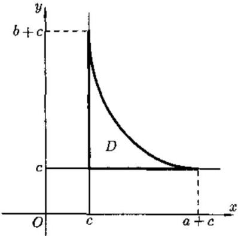 
$\begin{aligned} \iint_{D}^{}\left( \sqrt{\frac{x - c}{a}} + \sqrt{\frac{y - c}{b}} \right)dxdy & \text{图22.5} \\ & = \int_{0}^{\pi/2}d\theta\int_{0}^{1}4ab\rho\cos^{3}\theta\sin^{3}\theta\sqrt{\rho}d\rho = \frac{2ab}{15}.\quad \end{aligned}$

   **难度：5/5；出处：** 同事《数学分析3_习题导出.xlsx》第30行，原导出标识“22.2.8”；章号与谢惠民等《数学分析习题课讲义》（下册）高教社官方目录高度吻合，但具体版次、原书页码未核；与随附陈纪修等《数学分析》第三版不是同一题号体系，原题号22.2.8；**解答来源：** 同事习题导出表第30行“解析”栏，排版转写；数学步骤未逐题复核。

   **待核状态：** 教材原题号和书页待核；现有解析尚待逐题数学审校

<!-- source-exercise:CJX-III-XLSX-r031 -->
2. 例题22.2.9 求 $I = \iint_{\Omega}^{}(x + y)\, dx\, dy$ ,其中 $\Omega$ 是由 $y^{2} = 2x,x + y = 4,x + y = 12$ 围成.

   **答案：** 解 积分区域如图 22.6, 作变换$u = x + y,\quad v = y,$
则变换后的积分区域为
$\begin{matrix} 4 \leq u \leq 12, \\ - 1 - \sqrt{2u + 1} \leq v \leq - 1 + \sqrt{2u + 1}, \end{matrix}$
且 $J = \left| \frac{\partial(x,y)}{\partial(u,v)} \right| = 1.$ 于是
$\begin{aligned} I & = \int_{4}^{12}udu\int_{- 1 - \sqrt{2u + 1}}^{- 1 + \sqrt{2u + 1}}dv \\ & = \int_{4}^{12}2u\sqrt{2u + 1}du\quad(\sqrt{2u + 1} = t) \\ & = \int_{3}^{5}(t^{2} - 1)t^{2}dt = \frac{8156}{15}.\quad ▫ \end{aligned}$
 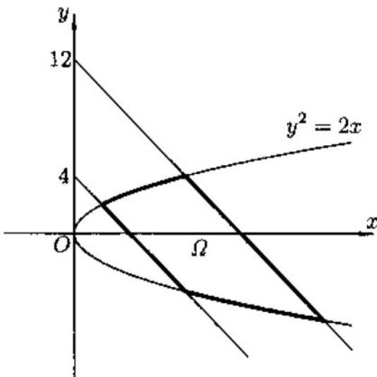 
图22.6

   **难度：4/5；出处：** 同事《数学分析3_习题导出.xlsx》第31行，原导出标识“22.2.9”；章号与谢惠民等《数学分析习题课讲义》（下册）高教社官方目录高度吻合，但具体版次、原书页码未核；与随附陈纪修等《数学分析》第三版不是同一题号体系，原题号22.2.9；**解答来源：** 同事习题导出表第31行“解析”栏，排版转写；数学步骤未逐题复核。

   **待核状态：** 教材原题号和书页待核；现有解析尚待逐题数学审校

<!-- source-exercise:CJX-III-XLSX-r032 -->
3. 例题22.2.7 求由曲线 $\left( \frac{x^{2}}{a^{2}} + \frac{y^{2}}{b^{2}} \right)^{2} = \frac{x^{2}}{a^{2}} - \frac{y^{2}}{b^{2}}$ 所围的面积.

   **答案：** 解 应用广义极坐标变换$x = a\rho cos\theta,\quad y = b\rho sin\theta,$
则 $J = \left| \frac{\partial(x,y)}{\partial(u,v)} \right| = ab\rho$ ,所围成积分区域的曲线变为 $\rho^{2} = cos2\theta$ (双纽线),于是所求的面积
$S = \iint_{D}^{}dxdy = 4\int_{0}^{\frac{\pi}{4}}d\theta\int_{0}^{\sqrt{cos2\theta}}ab\rho d\rho = ab.$

   **难度：4/5；出处：** 同事《数学分析3_习题导出.xlsx》第32行，原导出标识“22.2.7”；章号与谢惠民等《数学分析习题课讲义》（下册）高教社官方目录高度吻合，但具体版次、原书页码未核；与随附陈纪修等《数学分析》第三版不是同一题号体系，原题号22.2.7；**解答来源：** 同事习题导出表第32行“解析”栏，排版转写；数学步骤未逐题复核。

   **待核状态：** 教材原题号和书页待核；现有解析尚待逐题数学审校

<!-- source-exercise:CJX-III-XLSX-r101 -->
4. 例题21.1.1 设 $f(x,y)$ 为可微函数,曲线方程为
$z = f(x,y),\frac{x - x_{0}}{cos\alpha} = \frac{y - y_{0}}{sin\alpha}.$
求曲线上点 $M_{0}(x_{0},y_{0},z_{0})$ 的切线与 xOy 平面所成角的正切.

   **答案：** 解 令 $F(x,y,z) = z - f(x,y),G(x,y,z) = sin\alpha(x - x_{0}) - cos\alpha(y - y_{0})$ . 则$\frac{\partial(F,G)}{\partial(y,z)} = \left| \begin{matrix} - f_{y} & 1 \\ - cos\alpha & 0 \end{matrix} \right| = cos\alpha,\quad\frac{\partial(F,G)}{\partial(z,x)} = \left| \begin{matrix} 1 & - f_{x} \\ 0 & sin\alpha \end{matrix} \right| = sin\alpha,$
$\frac{\partial(F,G)}{\partial(x,y)} = \left| \begin{matrix} - f_{x} & - f_{y} \\ sin\alpha & - cos\alpha \end{matrix} \right| = f_{x}cos\alpha + f_{y}sin\alpha.$
于是曲线上点 $M_{0}(x_{0},y_{0},z_{0})$ 的切线与 $z$ 轴正方向所成夹角 $\varphi$ 的余弦为
$cos\varphi = \frac{f_{x}(x_{0},y_{0})cos\alpha + f_{y}(x_{0},y_{0})sin\alpha}{\sqrt{1 + \lbrack f_{x}(x_{0},y_{0})cos\alpha + f_{y}(x_{0},y_{0})sin\alpha\rbrack^{2}}}.$
由此可算出切线与 $xOy$ 平面所成角的正切为
$f_{x}(x_{0},y_{0})cos\alpha + f_{y}(x_{0},y_{0})sin\alpha.$

   **难度：4/5；出处：** 同事《数学分析3_习题导出.xlsx》第101行，原导出标识“21.1.1”；章号与谢惠民等《数学分析习题课讲义》（下册）高教社官方目录高度吻合，但具体版次、原书页码未核；与随附陈纪修等《数学分析》第三版不是同一题号体系，原题号21.1.1；**解答来源：** 同事习题导出表第101行“解析”栏，排版转写；数学步骤未逐题复核。

   **待核状态：** 教材原题号和书页待核；现有解析尚待逐题数学审校

<!-- source-exercise:CJX-III-3ED-ch12-s5-ex01 -->
5. 求下列空间曲线在指定点的切线与法平面：(1) $y=x^2,z=x/(1+x)$，在 $(1,1,1/2)$；(2) $x=t-\sin t,y=1-\cos t,z=4\sin(t/2)$，在 $t=\pi/2$；(3) $x+y+z=0,x^2+y^2+z^2=6$，在 $(1,-2,1)$；(4) $x^2+y^2=R^2,x^2+z^2=R^2$，在 $(R/\sqrt2,R/\sqrt2,R/\sqrt2)$。

   **答案：** (1) 以 $x$ 参数化，切向量 $(1,2,1/4)$；切线 $r=(1,1,1/2)+s(1,2,1/4)$，法平面 $(x-1)+2(y-1)+(z-1/2)/4=0$。(2) 指定点为 $(\pi/2-1,1,2\sqrt2)$，切向量 $(1,1,\sqrt2)$；切线为该点加 $s(1,1,\sqrt2)$，法平面为 $(x-\pi/2+1)+(y-1)+\sqrt2(z-2\sqrt2)=0$。(3) 两曲面法向量叉积给切向量 $(1,0,-1)$；切线 $(1,-2,1)+s(1,0,-1)$，法平面 $x-z=0$。(4) 两柱面法向叉积给切向量 $(1,-1,-1)$；切线为指定点加 $s(1,-1,-1)$，法平面 $(x-R/\sqrt2)-(y-R/\sqrt2)-(z-R/\sqrt2)=0$。

   **难度：5/5；出处：** 陈纪修、於崇华、金路《数学分析》第三版（下册），第十二章§5习题 1，书页177，PDF第198页；题干全部小问已对照扫描原页，原题号第十二章§5习题 1；**解答来源：** 本课程建设自拟简解，按切向/法向和隐函数条件逐题复核。

<!-- source-exercise:CJX-III-3ED-ch12-s5-ex02 -->
6. 在曲线 $x=t,y=t^2,z=t^3$ 上求点，使该点切线与平面 $x+2y+z=10$ 平行。

   **答案：** 切向量为 $(1,2t,3t^2)$，与平面法向量 $(1,2,1)$ 垂直要求 $1+4t+3t^2=(3t+1)(t+1)=0$。故 $t=-1,-1/3$，点为 $(-1,1,-1)$ 和 $(-1/3,1/9,-1/27)$。

   **难度：3/5；出处：** 陈纪修、於崇华、金路《数学分析》第三版（下册），第十二章§5习题 2，书页177，PDF第198页；题干全部小问已对照扫描原页，原题号第十二章§5习题 2；**解答来源：** 本课程建设自拟简解，按切向/法向和隐函数条件逐题复核。

<!-- source-exercise:CJX-III-3ED-ch12-s5-ex03 -->
7. 求曲线 $x=\sin^2t,y=\sin t\cos t,z=\cos^2t$ 在 $t=\pi/2$ 所对应点处切线的方向余弦。

   **答案：** 导数向量为 $(2\sin t\cos t,\cos^2t-\sin^2t,-2\sin t\cos t)$，在 $\pi/2$ 为 $(0,-1,0)$，已经是单位向量，方向余弦即 $(0,-1,0)$。

   **难度：2/5；出处：** 陈纪修、於崇华、金路《数学分析》第三版（下册），第十二章§5习题 3，书页177，PDF第198页；题干全部小问已对照扫描原页，原题号第十二章§5习题 3；**解答来源：** 本课程建设自拟简解，按切向/法向和隐函数条件逐题复核。

<!-- source-exercise:CJX-III-3ED-ch12-s5-ex11 -->
8. 证明曲线 $x=ae^t\cos t,y=ae^t\sin t,z=ae^t$ 与锥面 $x^2+y^2=z^2$ 的各母线相交的角度相同。

   **答案：** 曲线在参数 $t$ 处与从锥顶发出的母线方向 $g=(\cos t,\sin t,1)$ 相交。切向量 $r\prime(t)=ae^t(\cos t-\sin t,\sin t+\cos t,1)$。其与 $g$ 的夹角满足 $\cos\theta=(r\prime\cdot g)/(\|r\prime\|\|g\|)=2/(\sqrt3\sqrt2)=\sqrt{2/3}$，与 $t$ 无关。

   **难度：3/5；出处：** 陈纪修、於崇华、金路《数学分析》第三版（下册），第十二章§5习题 11，书页177，PDF第198页；题干全部小问已对照扫描原页，原题号第十二章§5习题 11；**解答来源：** 本课程建设自拟简解，按切向/法向和隐函数条件逐题复核。

#### 曲面的法线和切平面

**图谱路径：** 数学分析III / 隐函数定理及其应用 / 几何应用 / 曲面的法线和切平面

**知识内容：** [定义、定理与方法](知识点.md#analysis-iii-8d5c58760a39)

<!-- source-exercise:CJX-III-XLSX-r099 -->
1. 例题21.1.3 设
$\frac{xy}{z} = u,\quad\sqrt{x^{2} + z^{2}} + \sqrt{y^{2} + z^{2}} = v\quad\text{和}\quad\sqrt{x^{2} + z^{2}} - \sqrt{y^{2} + z^{2}} = w$
是三个分别以 $u,v,w$ 为参数的单参数曲面族, 证明过同一点的三曲面族的三个曲面是两两正交的.

   **答案：** 证 设三曲面交于 $(x,y,z)$ 处,则其法向量分别为$\begin{matrix} \left( \frac{y}{z},\frac{x}{z}, - \frac{xy}{z^{2}} \right), \\ \left( \frac{x}{\sqrt{x^{2} + z^{2}}},\frac{y}{\sqrt{y^{2} + z^{2}}},\frac{z}{\sqrt{x^{2} + z^{2}}} + \frac{z}{\sqrt{y^{2} + z^{2}}} \right), \\ \left( \frac{x}{\sqrt{x^{2} + z^{2}}}, - \frac{y}{\sqrt{y^{2} + z^{2}}},\frac{z}{\sqrt{x^{2} + z^{2}}} - \frac{z}{\sqrt{y^{2} + z^{2}}} \right). \end{matrix}$
由于这三个向量的两两内积均为0, 所以过 $(x,y,z)$ 点的这三个曲面族的三个曲面是两两正交的.

   **难度：5/5；出处：** 同事《数学分析3_习题导出.xlsx》第99行，原导出标识“21.1.3”；章号与谢惠民等《数学分析习题课讲义》（下册）高教社官方目录高度吻合，但具体版次、原书页码未核；与随附陈纪修等《数学分析》第三版不是同一题号体系，原题号21.1.3；**解答来源：** 同事习题导出表第99行“解析”栏，排版转写；数学步骤未逐题复核。

   **待核状态：** 教材原题号和书页待核；现有解析尚待逐题数学审校

<!-- source-exercise:CJX-III-XLSX-r100 -->
2. 例题21.1.2 求曲面
$x = u + v,\quad y = u^{2} + v^{2},\quad z = u^{3} + v^{3}$
的切平面当切点 $M(u,v),u \neq v$ , 趋于曲面的边界 $u = v$ 上的点 $M_{0}(u_{0},v_{0})$ 时的极限位置.

   **答案：** 解 先求 $u \neq v$ 时的切平面方程. 由于$\frac{\partial(y,z)}{\partial(u,v)} = \left| \begin{matrix} 2u & 2v \\ 3u^{2} & 3v^{2} \end{matrix} \right| = 6uv(v - u),\quad\frac{\partial(z,x)}{\partial(u,v)} = \left| \begin{matrix} 3u^{2} & 3v^{2} \\ 1 & 1 \end{matrix} \right| = 3(u^{2} - v^{2}),$
$\frac{\partial(x,y)}{\partial(u,v)} = \left| \begin{matrix} 1 & 1 \\ 2u & 2v \end{matrix} \right| = 2(v - u),$
于是过 $(x,y,z)$ 点的切平面方程为
$\begin{matrix} 6uv(v - u)(X - (u + v)) + 3(u^{2} - v^{2})(Y - (u^{2} + v^{2})) \\ \quad\quad + 2(v - u)(Z - (u^{3} + v^{3})) = 0. \end{matrix}$
消去 $v - u$ ,并整理得到
$6uvX - 3(u + v)Y + 2Z = 3uv(u + v) - u^{3} - v^{3}.$
令 $(u,v) \rightarrow (u_{0},u_{0})$ , 则有
$6u_{0}^{2}X - 6u_{0}Y + 2Z = 4u_{0}^{3}.$
将 $(X,Y,Z)$ 改写为 $(x,y,z)$ ,可见所求的极限位置为
$3u_{0}^{2}x - 3u_{0}y + z = 2u_{0}^{3}.$

   **难度：5/5；出处：** 同事《数学分析3_习题导出.xlsx》第100行，原导出标识“21.1.2”；章号与谢惠民等《数学分析习题课讲义》（下册）高教社官方目录高度吻合，但具体版次、原书页码未核；与随附陈纪修等《数学分析》第三版不是同一题号体系，原题号21.1.2；**解答来源：** 同事习题导出表第100行“解析”栏，排版转写；数学步骤未逐题复核。

   **待核状态：** 教材原题号和书页待核；现有解析尚待逐题数学审校

<!-- source-exercise:CJX-III-3ED-ch12-s5-ex04 -->
3. 求下列曲面在指定点的切平面与法线：(1) $z=2x^4+3y^3$，在 $(2,1,35)$；(2) $e^{x/z}+e^{y/z}=4$，在 $(\ln2,\ln2,1)$；(3) 参数曲面 $x=u+v,y=u^2+v^2,z=u^3+v^3$，在 $(u,v)=(0,1)$。

   **答案：** (1) $z_x=64,z_y=9$，切平面 $z-35=64(x-2)+9(y-1)$，法线方向 $(-64,-9,1)$。(2) 令 $F=e^{x/z}+e^{y/z}-4$，在该点 $\nabla F=(2,2,-4\ln2)$；切平面 $2(x-\ln2)+2(y-\ln2)-4\ln2(z-1)=0$，法线方向取该梯度。(3) 参数点 $(1,1,1)$，$r_u=(1,0,0),r_v=(1,2,3)$，叉积可取 $(0,-3,2)$；切平面 $-3(y-1)+2(z-1)=0$，法线为 $(1,1,1)+s(0,-3,2)$。

   **难度：4/5；出处：** 陈纪修、於崇华、金路《数学分析》第三版（下册），第十二章§5习题 4，书页177，PDF第198页；题干全部小问已对照扫描原页，原题号第十二章§5习题 4；**解答来源：** 本课程建设自拟简解，按切向/法向和隐函数条件逐题复核。

<!-- source-exercise:CJX-III-3ED-ch12-s5-ex05 -->
4. 在马鞍面 $z=xy$ 上求一点，使该点法线与平面 $x+3y+z+9=0$ 垂直，并写出该法线方程。

   **答案：** 曲面法向量可取 $(-y,-x,1)$；法线垂直给定平面即法向量与平面法向量 $(1,3,1)$ 平行。第三分量同为 $1$，故 $y=-1,x=-3,z=xy=3$；法线为 $(x,y,z)=(-3,-1,3)+s(1,3,1)$。

   **难度：3/5；出处：** 陈纪修、於崇华、金路《数学分析》第三版（下册），第十二章§5习题 5，书页177，PDF第198页；题干全部小问已对照扫描原页，原题号第十二章§5习题 5；**解答来源：** 本课程建设自拟简解，按切向/法向和隐函数条件逐题复核。

<!-- source-exercise:CJX-III-3ED-ch12-s5-ex06 -->
5. 求椭球面 $x^2+2y^2+3z^2=498$ 上平行于平面 $x+3y+5z=7$ 的切平面。

   **答案：** 椭球面法向量 $(2x,4y,6z)$ 应为 $\lambda(1,3,5)$，于是 $x=\lambda/2,y=3\lambda/4,z=5\lambda/6$。代入椭球得 $(83/24)\lambda^2=498$，$\lambda=\pm12$。两接点为 $(6,9,10)$ 与 $(-6,-9,-10)$，切平面分别为 $x+3y+5z=83$ 和 $x+3y+5z=-83$。

   **难度：4/5；出处：** 陈纪修、於崇华、金路《数学分析》第三版（下册），第十二章§5习题 6，书页177，PDF第198页；题干全部小问已对照扫描原页，原题号第十二章§5习题 6；**解答来源：** 本课程建设自拟简解，按切向/法向和隐函数条件逐题复核。

<!-- source-exercise:CJX-III-3ED-ch12-s5-ex07 -->
6. 求圆柱面 $x^2+y^2=a^2$ 与马鞍面 $bz=xy$ 的交角。

   **答案：** 在交线上两面的法向量可取 $n_1=(2x,2y,0)$、$n_2=(-y,-x,b)$。若取曲面夹角的锐角，$\cos\theta=|n_1\cdot n_2|/(|n_1||n_2|)=2|xy|/[a\sqrt{a^2+b^2}]$。令 $x=a\cos t,y=a\sin t$，得 $\cos\theta=a|\sin2t|/\sqrt{a^2+b^2}$，说明交角随交点改变。

   **难度：3/5；出处：** 陈纪修、於崇华、金路《数学分析》第三版（下册），第十二章§5习题 7，书页177，PDF第198页；题干全部小问已对照扫描原页，原题号第十二章§5习题 7；**解答来源：** 本课程建设自拟简解，按切向/法向和隐函数条件逐题复核。

<!-- source-exercise:CJX-III-3ED-ch12-s5-ex08 -->
7. 已知曲面 $x^2-y^2-3z=0$，求经过 $A=(0,0,-1)$ 且与直线 $x/2=y/1=z/2$ 平行的切平面。

   **答案：** 设接点 $(x_0,y_0,z_0)$，切平面为 $2x_0x-2y_0y-3z-(x_0^2-y_0^2)=0$。过 $A$ 要求 $x_0^2-y_0^2=3$；包含直线方向 $(2,1,2)$ 要求 $4x_0-2y_0-6=0$。解得 $x_0=2,y_0=1,z_0=1$，切平面为 $4x-2y-3z=3$。

   **难度：4/5；出处：** 陈纪修、於崇华、金路《数学分析》第三版（下册），第十二章§5习题 8，书页177，PDF第198页；题干全部小问已对照扫描原页，原题号第十二章§5习题 8；**解答来源：** 本课程建设自拟简解，按切向/法向和隐函数条件逐题复核。

<!-- source-exercise:CJX-III-3ED-ch12-s5-ex09 -->
8. 椭球面 $2x^2+3y^2+z^2=6$ 在 $P=(1,1,1)$ 的指向外侧单位法向量为 $n$。求 $u=\sqrt{6x^2+8y^2}/z$ 在 $P$ 处沿 $n$ 的方向导数。

   **答案：** $n=\nabla(2x^2+3y^2+z^2)/\|\nabla\|=(2,3,1)/\sqrt{14}$。在 $P$ 处 $\nabla u=(6/\sqrt{14},8/\sqrt{14},-\sqrt{14})$，故 $D_nu=\nabla u\cdot n=12/14+24/14-1=11/7$。

   **难度：3/5；出处：** 陈纪修、於崇华、金路《数学分析》第三版（下册），第十二章§5习题 9，书页177，PDF第198页；题干全部小问已对照扫描原页，原题号第十二章§5习题 9；**解答来源：** 本课程建设自拟简解，按切向/法向和隐函数条件逐题复核。

<!-- source-exercise:CJX-III-3ED-ch12-s5-ex10 -->
9. 证明曲面 $\sqrt x+\sqrt y+\sqrt z=\sqrt a$（$a>0$）任一内部点的切平面在三坐标轴上的截距之和为 $a$。

   **答案：** 在 $x_0,y_0,z_0>0$ 处，切平面为 $(x-x_0)/\sqrt{x_0}+(y-y_0)/\sqrt{y_0}+(z-z_0)/\sqrt{z_0}=0$（共同因子 $1/2$ 已约去）。令另外两坐标为零，三个轴截距依次为 $\sqrt{a x_0}$、$\sqrt{a y_0}$、$\sqrt{a z_0}$；求和为 $\sqrt a(\sqrt{x_0}+\sqrt{y_0}+\sqrt{z_0})=a$。

   **难度：3/5；出处：** 陈纪修、於崇华、金路《数学分析》第三版（下册），第十二章§5习题 10，书页177，PDF第198页；题干全部小问已对照扫描原页，原题号第十二章§5习题 10；**解答来源：** 本课程建设自拟简解，按切向/法向和隐函数条件逐题复核。

<!-- source-exercise:CJX-III-3ED-ch12-s5-ex12 -->
10. 证明曲面 $f(ax-bz,ay-cz)=0$ 的切平面都与某一固定直线平行，其中 $f$ 有连续偏导，$a,b,c$ 不同时为零。

   **答案：** 沿固定方向 $v=(b,c,a)$ 作位移时，$ax-bz$ 与 $ay-cz$ 的方向导数分别为 $ab-ba=0$、$ac-ca=0$。因此曲面函数沿 $v$ 不变，$v$ 与每个正则点处的切平面平行；固定直线可取任一条方向为 $v$ 的直线。

   **难度：3/5；出处：** 陈纪修、於崇华、金路《数学分析》第三版（下册），第十二章§5习题 12，书页177，PDF第198页；题干全部小问已对照扫描原页，原题号第十二章§5习题 12；**解答来源：** 本课程建设自拟简解，按切向/法向和隐函数条件逐题复核。

<!-- source-exercise:CJX-III-3ED-ch12-s5-ex13 -->
11. 证明曲面 $z=x f(y/x)$（$x\ne0$）在任一点的切平面都通过原点，其中 $f$ 有连续偏导。

   **答案：** $z(x,y)$ 为一次齐次函数：$z(tx,ty)=t z(x,y)$。Euler 公式给 $xz_x+yz_y=z$。在任一点 $(x_0,y_0,z_0)$ 的切平面 $z-z_0=z_x(x-x_0)+z_y(y-y_0)$ 因 $z_0=x_0z_x+y_0z_y$ 化为 $z=z_xx+z_yy$，故含原点。

   **难度：3/5；出处：** 陈纪修、於崇华、金路《数学分析》第三版（下册），第十二章§5习题 13，书页177，PDF第198页；题干全部小问已对照扫描原页，原题号第十二章§5习题 13；**解答来源：** 本课程建设自拟简解，按切向/法向和隐函数条件逐题复核。

### 条件极值

**图谱路径：** 数学分析III / 隐函数定理及其应用 / 条件极值

**知识内容：** [定义、定理与方法](知识点.md#analysis-iii-61b80cf2bb13)

<!-- source-exercise:CJX-III-XLSX-r036 -->
1. 例题 21.4.5 求由方程$$2x^2+y^2+z^2+2xy-2x-2y-4z+4=0 \tag{21.31}$$所确定的函数 $z=z(x,y)$ 的极值。

   **答案：** 解 1（直接法）由(21.31)对隐函数 $z=z(x,y)$ 求导，得

$$

4x+2z\frac{\partial z}{\partial x}+2y-2-4\frac{\partial z}{\partial x}=0, \tag{21.32}

$$

$$

2y+2z\frac{\partial z}{\partial y}+2x-2-4\frac{\partial z}{\partial y}=0. \tag{21.33}

$$

令 $\displaystyle \frac{\partial z}{\partial x}=\frac{\partial z}{\partial y}=0$，则

$$

2x+y-1=0,\quad x+y-1=0.

$$

由此得驻点为 $(0,1)$，将之代入 (21.31) 得

$$

z^2-4z+3=0.

$$

于是 $z_1=1,z_2=3$，在(21.32)，(21.33)两边求导，得

$$

4+2\left(\frac{\partial z}{\partial x}\right)^2+2z\frac{\partial^2 z}{\partial x^2}-4\frac{\partial^2 z}{\partial x^2}=0, \tag{21.34}

$$

$$

2\frac{\partial z}{\partial x}\frac{\partial z}{\partial y}+2z\frac{\partial^2 z}{\partial x\partial y}+2-4\frac{\partial^2 z}{\partial x\partial y}=0, \tag{21.35}

$$

$$

2+2\left(\frac{\partial z}{\partial y}\right)^2+2z\frac{\partial^2 z}{\partial y^2}-4\frac{\partial^2 z}{\partial y^2}=0. \tag{21.36}

$$

在 (21.34)-(21.36) 中令 $(x,y,z)=(0,1,1),\displaystyle \frac{\partial z}{\partial x}=\frac{\partial z}{\partial y}=0$，得 $A=z_{xx}=2,\ B=z_{xy}=1,\ C=z_{yy}=1$，于是 $D=AC-B^2>0$。故 $z=1$ 为极小值。

在 (21.34)-(21.36) 中令 $(x,y,z)=(0,1,3),\displaystyle \frac{\partial z}{\partial x}=\frac{\partial z}{\partial y}=0$，得 $A=z_{xx}=-2,\ B=z_{xy}=-1,\ C=z_{yy}=-1$，于是 $D=AC-B^2>0$。故 $z=3$ 为极大值。

解 2 以(21.31)为约束条件, 取目标函数 $f(x,y,z)=z$，则 Lagrange 函数为

$$

L(x,y,z,\lambda)=z+\lambda\left(2x^2+y^2+z^2+2xy-2x-2y-4z+4\right).

$$

令

$$

L_x=4\lambda x+2\lambda y-2\lambda=0, \tag{21.37}

$$

$$

L_y=2\lambda x+2\lambda y-2\lambda=0, \tag{21.38}

$$

$$

L_z=1+2\lambda z-4\lambda=0. \tag{21.39}

$$

显然 $\lambda \neq 0$，于是由(21.37)和(21.38)得驻点为$(0,1)$。代入(21.31)得 $z_1=1,z_2=3$。再由(21.39)得 $\lambda_1=\frac12,\ \lambda_2=-\frac12$。由于

$$

L_{xx}=4\lambda,\ L_{yy}=L_{zz}=2\lambda,\ L_{xy}=2\lambda,\ L_{xz}=L_{yz}=0,

$$

于是 $L$ 在 $(0,1,1)$ 与 $(0,1,3)$ 的 Hesse 矩阵分别为

$$

\begin{pmatrix}

2 & 1 & 0 \\

1 & 1 & 0 \\

0 & 0 & 1

\end{pmatrix},\quad

\begin{pmatrix}

-2 & -1 & 0 \\

-1 & -1 & 0 \\

0 & 0 & -1

\end{pmatrix},

$$

前者正定，后者负定，所以 $z=1$ 为极小值，$z=3$ 为极大值

   **难度：4/5；出处：** 同事《数学分析3_习题导出.xlsx》第36行，原导出标识“21.4.5”；章号与谢惠民等《数学分析习题课讲义》（下册）高教社官方目录高度吻合，但具体版次、原书页码未核；与随附陈纪修等《数学分析》第三版不是同一题号体系，原题号21.4.5；**解答来源：** 同事习题导出表第36行“解析”栏，排版转写；数学步骤未逐题复核。

   **待核状态：** 教材原题号和书页待核；现有解析尚待逐题数学审校

#### 拉格朗日乘子法

**图谱路径：** 数学分析III / 隐函数定理及其应用 / 条件极值 / 拉格朗日乘子法

**知识内容：** [定义、定理与方法](知识点.md#analysis-iii-e82c3dc28c91)

<!-- source-exercise:CJX-III-XLSX-r086 -->
1. 例题21.4.3 设 $p \geq 1$ . 求 $f(x,y) = \frac{1}{2}(x^{p} + y^{p})$ 在 $x + y = C$ ( $C$ 为正常数), $x \geq 0$ , $y \geq 0$ 的条件下的最小值.

   **答案：** 解设$L(x,y,\lambda) = \frac{1}{2}(x^{p} + y^{p}) + \lambda(x + y - C).$
令
$\begin{matrix} L_{x} = \frac{p}{2}x^{p - 1} + \lambda = 0, \\ L_{y} = \frac{p}{2}y^{p - 1} + \lambda = 0, \\ x + y = C. \end{matrix}$
解得驻点 $x = y = \frac{C}{2}$ . 由于约束集合是有界闭集, 比较驻点值与附加约束集合边界点的值 $f\left( \frac{C}{2},\frac{C}{2} \right) = \left( \frac{C}{2} \right)^{p}$ , $f(0,C) = f(C,0) = \frac{1}{2}C^{p}$ , 得知 $\left( \frac{C}{2} \right)^{p}$ 为最小值.

   **难度：3/5；出处：** 同事《数学分析3_习题导出.xlsx》第86行，原导出标识“21.4.3”；章号与谢惠民等《数学分析习题课讲义》（下册）高教社官方目录高度吻合，但具体版次、原书页码未核；与随附陈纪修等《数学分析》第三版不是同一题号体系，原题号21.4.3；**解答来源：** 同事习题导出表第86行“解析”栏，排版转写；数学步骤未逐题复核。

   **待核状态：** 教材原题号和书页待核；现有解析尚待逐题数学审校

<!-- source-exercise:CJX-III-XLSX-r087 -->
2. 例题21.4.2 椭球面 $\frac{x^{2}}{3} + y^{2} + \frac{z^{2}}{2} = 1$ 被通过原点的平面 $2x + y + z = 0$ 截成一个椭圆 $l$ . 求此椭圆的面积.

   **答案：** 解 只要求出椭圆 $l$ 的长短半轴即可. 于是问题转化为在约束条件

   **难度：5/5；出处：** 同事《数学分析3_习题导出.xlsx》第87行，原导出标识“21.4.2”；章号与谢惠民等《数学分析习题课讲义》（下册）高教社官方目录高度吻合，但具体版次、原书页码未核；与随附陈纪修等《数学分析》第三版不是同一题号体系，原题号21.4.2；**解答来源：** 同事习题导出表第87行“解析”栏，排版转写；数学步骤未逐题复核。

   **待核状态：** 教材原题号和书页待核；现有解析尚待逐题数学审校

<!-- source-exercise:CJX-III-XLSX-r088 -->
3. 例题21.4.1 求 $f(x,y) = ax^{2} + 2bxy + cy^{2}(b \neq 0)$ 在条件 $x^{2} + y^{2} = 1$ 之下的极值.

   **答案：** 解1 作Lagrange函数$L(x,y,\lambda) = ax^{2} + 2bxy + cy^{2} - \lambda\left( x^{2} + y^{2} - 1 \right).$
解方程组

   **难度：4/5；出处：** 同事《数学分析3_习题导出.xlsx》第88行，原导出标识“21.4.1”；章号与谢惠民等《数学分析习题课讲义》（下册）高教社官方目录高度吻合，但具体版次、原书页码未核；与随附陈纪修等《数学分析》第三版不是同一题号体系，原题号21.4.1；**解答来源：** 同事习题导出表第88行“解析”栏，排版转写；数学步骤未逐题复核。

   **待核状态：** 教材原题号和书页待核；现有解析尚待逐题数学审校

<!-- source-exercise:CJX-III-3ED-ch12-s7-ex02 -->
4. 在周长为 $2p$ 的一切三角形中，求面积最大的三角形及最大面积。

   **答案：** 记边长 $a,b,c$，半周长为 $p$。Heron 公式给 $K^2=p(p-a)(p-b)(p-c)$，三个正数 $(p-a),(p-b),(p-c)$ 的和为 $p$，AM–GM 给乘积至多 $(p/3)^3$。等号要求三者相等，即正三角形；$K_{\max}=p^2/(3\sqrt3)$。

   **难度：3/5；出处：** 陈纪修、於崇华、金路《数学分析》第三版（下册），第十二章§7习题 2，书页201，PDF第222页；题干全部小问已对照扫描原页，原题号第十二章§7习题 2；**解答来源：** 本课程建设自拟简解，按约束极值与几何参数化复核。

<!-- source-exercise:CJX-III-3ED-ch12-s7-ex03 -->
5. 要做一个容积为 $1\,\mathrm m^3$ 的有盖圆桶，求最省材料的半径与高度。

   **答案：** 半径 $r>0$、高 $h>0$ 满足 $\pi r^2h=1$。有盖桶的表面积 $S=2\pi r^2+2\pi rh=2\pi r^2+2/r$。求导 $S\prime=4\pi r-2/r^2=0$ 得 $r=(1/(2\pi))^{1/3}$，$h=1/(\pi r^2)=2r$；二阶导正且两端面积趋无穷，故为全局最小。

   **难度：3/5；出处：** 陈纪修、於崇华、金路《数学分析》第三版（下册），第十二章§7习题 3，书页201，PDF第222页；题干全部小问已对照扫描原页，原题号第十二章§7习题 3；**解答来源：** 本课程建设自拟简解，按约束极值与几何参数化复核。

<!-- source-exercise:CJX-III-3ED-ch12-s7-ex04 -->
6. 抛物面 $z=x^2+y^2$ 被平面 $x+y+z=1$ 截成一椭圆，求原点到该椭圆的最长距离与最短距离。

   **答案：** 记 $s=x^2+y^2=z$，平面条件给 $x+y=1-s$。实数 $x,y$ 存在要求 $(1-s)^2\le2s$，故 $s\in[2-\sqrt3,2+\sqrt3]$，两端均由 $x=y$ 达到。到原点距离平方为 $s+s^2$，随 $s\ge0$ 递增，所以最短、最长距离分别为 $\sqrt{9-5\sqrt3}$ 和 $\sqrt{9+5\sqrt3}$。

   **难度：4/5；出处：** 陈纪修、於崇华、金路《数学分析》第三版（下册），第十二章§7习题 4，书页201，PDF第222页；题干全部小问已对照扫描原页，原题号第十二章§7习题 4；**解答来源：** 本课程建设自拟简解，按约束极值与几何参数化复核。

<!-- source-exercise:CJX-III-3ED-ch12-s7-ex05 -->
7. 在椭圆 $x^2+3y^2=12$ 内接等腰三角形，底边平行椭圆长轴，求使面积最大的三角形及面积。

   **答案：** 椭圆半轴为 $2\sqrt3$（水平）与 $2$（竖直）。取顶点 $(0,2)$、底边端点 $(\pm\sqrt{12-3t^2},t)$，面积 $A(t)=(2-t)\sqrt{12-3t^2}$（$-2\le t\le2$）。求导或平方后求导给内点最大在 $t=-1$，于是顶点 $(0,2)$、底点 $(\pm3,-1)$，面积 $9$；关于 $x$ 轴的对称三角形同样达到。

   **难度：4/5；出处：** 陈纪修、於崇华、金路《数学分析》第三版（下册），第十二章§7习题 5，书页201，PDF第222页；题干全部小问已对照扫描原页，原题号第十二章§7习题 5；**解答来源：** 本课程建设自拟简解，按约束极值与几何参数化复核。

<!-- source-exercise:CJX-III-3ED-ch12-s7-ex06 -->
8. 求空间点 $(a,b,c)$ 到平面 $Ax+By+Cz+D=0$ 的距离。

   **答案：** 平面法向量为 $n=(A,B,C)\ne0$。点到平面的正交投影长度为 $|(Aa+Bb+Cc+D)|/\|n\|$，故距离 $|Aa+Bb+Cc+D|/\sqrt{A^2+B^2+C^2}$。

   **难度：2/5；出处：** 陈纪修、於崇华、金路《数学分析》第三版（下册），第十二章§7习题 6，书页201，PDF第222页；题干全部小问已对照扫描原页，原题号第十二章§7习题 6；**解答来源：** 本课程建设自拟简解，按约束极值与几何参数化复核。

<!-- source-exercise:CJX-III-3ED-ch12-s7-ex07 -->
9. 求平面 $Ax+By+Cz=0$ 与柱面 $x^2/a^2+y^2/b^2=1$ 相交形成的椭圆面积，其中 $A,B,C\ne0$、$a,b>0$。

   **答案：** 用单位圆盘 $(u,v)$ 参数化平面区域：$(x,y,z)=(au,bv,-(Aau+Bbv)/C)$。面积伸缩因子 $\|r_u\times r_v\|=ab\sqrt{1+(A/C)^2+(B/C)^2}$，乘单位盘面积 $\pi$ 得 $\pi ab\sqrt{A^2+B^2+C^2}/|C|$。

   **难度：3/5；出处：** 陈纪修、於崇华、金路《数学分析》第三版（下册），第十二章§7习题 7，书页201，PDF第222页；题干全部小问已对照扫描原页，原题号第十二章§7习题 7；**解答来源：** 本课程建设自拟简解，按约束极值与几何参数化复核。

<!-- source-exercise:CJX-III-3ED-ch12-s7-ex08 -->
10. 在 $x+y=a$、$x,y\ge0$ 条件下求 $z=(x^4+y^4)/2$ 的最小值，并证明 $(x^4+y^4)/2\ge((x+y)/2)^4$。

   **答案：** 可行性要求 $a\ge0$。$t\mapsto t^4$ 凸，Jensen 不等式立即给 $(x^4+y^4)/2\ge((x+y)/2)^4=(a/2)^4$；等号当且仅当 $x=y=a/2$，故这也是最小值。

   **难度：3/5；出处：** 陈纪修、於崇华、金路《数学分析》第三版（下册），第十二章§7习题 8，书页201，PDF第222页；题干全部小问已对照扫描原页，原题号第十二章§7习题 8；**解答来源：** 本课程建设自拟简解，按约束极值与几何参数化复核。

<!-- source-exercise:CJX-III-3ED-ch12-s7-ex09 -->
11. 当 $x,y,z>0$，求 $f(x,y,z)=\ln x+2\ln y+3\ln z$ 在球面 $x^2+y^2+z^2=6R^2$ 上的最大值，并由此证明正数 $a,b,c$ 满足 $ab^2c^3\le108((a+b+c)/6)^6$。

   **答案：** Lagrange 条件给 $1/x=2\lambda x,2/y=2\lambda y,3/z=2\lambda z$，所以 $x^2:y^2:z^2=1:2:3$；约束给 $(x,y,z)=(R,\sqrt2R,\sqrt3R)$，最大值为 $\ln(6\sqrt3R^6)$。令 $a=x^2,b=y^2,c=z^2$，$R^2=(a+b+c)/6$；将最大乘积 $xy^2z^3\le6\sqrt3R^6$ 平方，得到所示不等式。

   **难度：4/5；出处：** 陈纪修、於崇华、金路《数学分析》第三版（下册），第十二章§7习题 9，书页201，PDF第222页；题干全部小问已对照扫描原页，原题号第十二章§7习题 9；**解答来源：** 本课程建设自拟简解，按约束极值与几何参数化复核。

<!-- source-exercise:CJX-III-3ED-ch12-s7-ex10 -->
12. 设 $k,a,b,c>0$。(1) 求 $x^a y^b z^c$ 在 $x,y,z>0$ 且 $x^k+y^k+z^k=1$ 下的最大值；(2) 利用结果证明对任意正数 $u,v,w$，$(u/a)^a(v/b)^b(w/c)^c\le[(u+v+w)/(a+b+c)]^{a+b+c}$。

   **答案：** 记 $S=a+b+c$，令 $U=x^k,V=y^k,W=z^k$，则 $U+V+W=1$。加权 AM–GM 或 Lagrange 条件给最优 $U=a/S,V=b/S,W=c/S$，最大值 $(a/S)^{a/k}(b/S)^{b/k}(c/S)^{c/k}$。(2) 将 $(u,v,w)$ 同除以其和，代入 $k=1$ 的上述最大乘积不等式并移项，即得题示关系，等号当 $u:v:w=a:b:c$。

   **难度：4/5；出处：** 陈纪修、於崇华、金路《数学分析》第三版（下册），第十二章§7习题 10，书页201，PDF第222页；题干全部小问已对照扫描原页，原题号第十二章§7习题 10；**解答来源：** 本课程建设自拟简解，按约束极值与几何参数化复核。

<!-- source-exercise:CJX-III-3ED-ch12-s7-ex13 -->
13. 设 $a_1,\ldots,a_n$ 为已知正数，求线性函数 $f(x_1,\ldots,x_n)=\sum_{j=1}^na_jx_j$ 在约束 $\sum_{j=1}^nx_j^2\le1$ 下的最大值与最小值。

   **答案：** 由 Cauchy–Schwarz，$|f(x)|\le(\sum a_j^2)^{1/2}(\sum x_j^2)^{1/2}\le\|a\|_2$。在 $x=\pm a/\|a\|_2$ 取等号，故最大值 $\|a\|_2$、最小值 $-\|a\|_2$。

   **难度：2/5；出处：** 陈纪修、於崇华、金路《数学分析》第三版（下册），第十二章§7习题 13，书页201，PDF第222页；题干全部小问已对照扫描原页，原题号第十二章§7习题 13；**解答来源：** 本课程建设自拟简解，按约束极值与几何参数化复核。

## 含参量积分

**图谱路径：** 数学分析III / 含参量积分

**知识内容：** [定义、定理与方法](知识点.md#analysis-iii-b88157191aa8)

<!-- source-exercise:CJX-III-XLSX-r020 -->
1. 例题 23.1.3 计算$$I(x)=\int_{0}^{\pi/2}\ln\big(\sin^2\theta+x^2\cos^2\theta\big)\mathrm{d}\theta,\quad x>0.$$

   **答案：** 解 令 $f(x,\theta)=\ln(\sin^2\theta + x^2\cos^2\theta)$。$\forall x_0\in(0,+\infty)$，$f(x,\theta)$ 在 $[\frac12x_0,2x_0]\times[0,\frac{\pi}{2}]$ 上连续，且 $f_x(x,\theta)=\frac{2x\cos^2\theta}{\sin^2\theta+x^2\cos^2\theta}$ 也在 $[\frac12x_0,2x_0]\times[0,\frac{\pi}{2}]$ 上连续。应用积分号下求导的性质，可得对 $\forall x\in(0,+\infty)$，

$$

\begin{aligned}

I'(x)&=\int_{0}^{\pi/2}\frac{2x\cos^2\theta}{\sin^2\theta+x^2\cos^2\theta}\mathrm{d}\theta = 2x\int_{0}^{\pi/2}\frac{\mathrm{d}\theta}{x^2+\tan^2\theta}(\text{令}\tan\theta = t)\\

&=2x\int_{0}^{+\infty}\frac{1}{x^2+t^2}\cdot\frac{1}{1+t^2}\mathrm{d}t\\

&=\frac{2x}{x^2-1}\int_{0}^{+\infty}\left(\frac{1}{1+t^2}-\frac{1}{x^2+t^2}\right)\mathrm{d}t \quad(x\neq 1)\\

&=\frac{2x}{x^2-1}\left(\frac{\pi}{2}-\frac1x\frac{\pi}{2}\right)=\frac{\pi}{1+x}.

\end{aligned}

$$

积分得

$$

I(x)=\pi\ln(1+x)+C.\quad(x\neq 1)

$$

由 $I(x)$ 的连续性知上述表达式对 $x=1$ 也成立。在 (23.1) 中，令 $x=1$，则 $I(1)=0$，从而 $C=-\pi\ln2$。最后得到

$$

I(x)=\pi\ln\frac{1+x}{2}.

$$

   **难度：1/5；出处：** 同事《数学分析3_习题导出.xlsx》第20行，原导出标识“23.1.3”；章号与谢惠民等《数学分析习题课讲义》（下册）高教社官方目录高度吻合，但具体版次、原书页码未核；与随附陈纪修等《数学分析》第三版不是同一题号体系，原题号23.1.3；**解答来源：** 同事习题导出表第20行“解析”栏，排版转写；数学步骤未逐题复核。

   **待核状态：** 教材原题号和书页待核；现有解析尚待逐题数学审校

   **整理说明：** 导出题干在参数条件处截断；按解析所用范围补为 $x>0$，原页待核。

<!-- source-exercise:CJX-III-XLSX-r021 -->
2. 例题23.1.1 设 $f(x)$ 在 $\lbrack 0,1\rbrack$ 上连续, 考察
$F(t) = \int_{0}^{1}\frac{t}{x^{2} + t^{2}}f(x)dx$
的连续性.

   **答案：** 解 显然 $F(t)$ 定义在 $( - \infty, + \infty)$ 上. 且 $\forall t_{0} \neq 0$ , $h(x,t) = \frac{tf(x)}{x^{2} + t^{2}}$ 在 $\lbrack 0,1\rbrack \times \lbrack\frac{1}{2}t_{0},2t_{0}\rbrack$ 上连续 (或 $\lbrack 0,1\rbrack \times \lbrack 2t_{0},\frac{1}{2}t_{0}\rbrack$ 上连续), 由命题23.1.2知 $F(t)$ 在 $t_{0}$ 点连续.下面讨论 $F(t)$ 在 $t = 0$ 处的连续性. 我们先考虑
$\lim_{t \rightarrow 0^{+}}F(t) = \lim_{t \rightarrow 0^{+}}\int_{0}^{1}\frac{t}{x^{2} + t^{2}}f(x)dx.$
注意到
$\int_{0}^{1}\frac{t}{x^{2} + t^{2}}f(x)dx = \int_{0}^{t^{1/3}}\frac{t}{x^{2} + t^{2}}f(x)dx + \int_{t^{1/3}}^{1}\frac{t}{x^{2} + t^{2}}f(x)dx.$
而当 $t \rightarrow 0^{+}$ 时,
$\int_{0}^{t^{1/3}}\frac{t}{x^{2} + t^{2}}f(x)dx = f(\xi)arctan\frac{t^{1/3}}{t} \rightarrow f(0)\frac{\pi}{2}$
$\left| \int_{t^{1/3}}^{1}\frac{t}{x^{2} + t^{2}}f(x)dx \right| \leq \max_{0 \leq x \leq 1}|f(x)|\frac{t}{t^{2/3} + t^{2}} \rightarrow 0.$
因此
$\lim_{t \rightarrow 0^{+}}\int_{0}^{1}\frac{t}{x^{2} + t^{2}}f(x)dx = f(0)\frac{\pi}{2}.$
同理可证
$\lim_{t \rightarrow 0^{-}}F(t) = - f(0)\frac{\pi}{2},$
所以当 $f(0) = 0$ 时, $F(t)$ 在零点连续,否则在零点不连续。

   **难度：5/5；出处：** 同事《数学分析3_习题导出.xlsx》第21行，原导出标识“23.1.1”；章号与谢惠民等《数学分析习题课讲义》（下册）高教社官方目录高度吻合，但具体版次、原书页码未核；与随附陈纪修等《数学分析》第三版不是同一题号体系，原题号23.1.1；**解答来源：** 同事习题导出表第21行“解析”栏，排版转写；数学步骤未逐题复核。

   **待核状态：** 教材原题号和书页待核；现有解析尚待逐题数学审校

<!-- source-exercise:CJX-III-XLSX-r022 -->
3. 例题23.1.2 设
$F(t) = \int_{0}^{t^{2}}dx\int_{x - t}^{x + t}\sin(x^{2} + y^{2} - t^{2})dy,$
求 $F^{\prime}(t)$ .

   **答案：** 解 令 $f(x,t) = \int_{x - t}^{x + t}\sin(x^{2} + y^{2} - t^{2})\, dy$ ,其中 $x,t$ 为参变量。由含参量积分的求导公式$F^{\prime}(t) = 2t\int_{t^{2} - t}^{t^{2} + t}\sin(t^{4} + y^{2} - t^{2})dy + \int_{0}^{t^{2}}\left( \frac{\partial}{\partial t}\int_{x - t}^{x + t}\sin(x^{2} + y^{2} - t^{2})dy \right)dx.$
而
$\begin{matrix} \frac{\partial}{\partial t}\int_{x - t}^{x + t}\sin(x^{2} + y^{2} - t^{2})dy \\ = sin\lbrack x^{2} + (x + t)^{2} - t^{2}\rbrack - ( - 1) \cdot sin\lbrack x^{2} + (x - t)^{2} - t^{2}\rbrack \\ \quad\quad + \int_{x - t}^{x + t}( - 2t)cos(x^{2} + y^{2} - t^{2})dy \\ = 2sin2x^{2}cos2xt - 2t\int_{x - t}^{x + t}\cos(x^{2} + y^{2} - t^{2})dy. \end{matrix}$
最后得到
$\begin{aligned} F^{\prime}(t) & = 2t\int_{t^{2} - t}^{t^{2} + t}\sin(t^{4} + y^{2} - t^{2})dy + 2\int_{0}^{t^{2}}\sin 2x^{2}cos2xtdx \\ & \quad - 2t\int_{0}^{t^{2}}dx\int_{x - t}^{x + t}\cos(x^{2} + y^{2} - t^{2})dy.\quad ▫ \end{aligned}$

   **难度：5/5；出处：** 同事《数学分析3_习题导出.xlsx》第22行，原导出标识“23.1.2”；章号与谢惠民等《数学分析习题课讲义》（下册）高教社官方目录高度吻合，但具体版次、原书页码未核；与随附陈纪修等《数学分析》第三版不是同一题号体系，原题号23.1.2；**解答来源：** 同事习题导出表第22行“解析”栏，排版转写；数学步骤未逐题复核。

   **待核状态：** 教材原题号和书页待核；现有解析尚待逐题数学审校

<!-- source-exercise:CJX-III-XLSX-r023 -->
4. 例题23.1.4求
$I(\alpha) = \int_{0}^{\pi/2}\ln\frac{1 + \alpha cosx}{1 - \alpha cosx} \cdot \frac{1}{cosx}dx,|\alpha| < 1.$

   **答案：** 解 由于$\lim_{x \rightarrow \pi/2}\ln\frac{1 + \alpha cosx}{1 - \alpha cosx} \cdot \frac{1}{cosx} = \lim_{x \rightarrow \pi/2}\left\lbrack \frac{ln(1 + \alpha cosx)}{cosx} - \frac{ln(1 - \alpha cosx)}{cosx} \right\rbrack = 2\alpha,$
于是 $x = \frac{\pi}{2}$ 不是瑕点. 又
$\frac{ln(1 + \alpha cosx)}{cosx} - \frac{ln(1 - \alpha cosx)}{cosx} = \int_{- \alpha}^{\alpha}\frac{dy}{1 + ycosx},$
令 $f(x,y) = 1/(1 + ycosx),\forall\alpha \in ( - 1,1),f(x,y)$ 在 $\lbrack 0,\frac{\pi}{2}\rbrack \times \lbrack - \alpha,\alpha\rbrack$ 上连续,利用交换积分次序性质,
$\begin{aligned} I(\alpha) & = \int_{- \alpha}^{\alpha}dy\int_{0}^{\pi/2}\frac{dx}{1 + ycosx} = \int_{- \alpha}^{\alpha}\frac{2}{\sqrt{1 - y^{2}}}\arctan\left( \sqrt{\frac{1 - y}{1 + y}}\tan\frac{x}{2} \right)|_{0}^{\pi/2}dy \\ & = \int_{- \alpha}^{\alpha}\frac{2}{\sqrt{1 - y^{2}}}\arctan\sqrt{\frac{1 - y}{1 + y}}dy \\ & = \int_{0}^{\alpha}\frac{2}{\sqrt{1 - y^{2}}}\left( \arctan\sqrt{\frac{1 - y}{1 + y}} + arctan\sqrt{\frac{1 + y}{1 - y}} \right)dy \\ & = \pi\int_{0}^{\alpha}\frac{dy}{\sqrt{1 - y^{2}}} = \pi arcsin\alpha.\quad ▫ \end{aligned}$

   **难度：5/5；出处：** 同事《数学分析3_习题导出.xlsx》第23行，原导出标识“23.1.4”；章号与谢惠民等《数学分析习题课讲义》（下册）高教社官方目录高度吻合，但具体版次、原书页码未核；与随附陈纪修等《数学分析》第三版不是同一题号体系，原题号23.1.4；**解答来源：** 同事习题导出表第23行“解析”栏，排版转写；数学步骤未逐题复核。

   **待核状态：** 教材原题号和书页待核；现有解析尚待逐题数学审校

<!-- source-exercise:CJX-III-XLSX-r024 -->
5. 例题23.1.5 证明
$\int_{0}^{2\pi}e^{tcos\theta}cos(tsin\theta)d\theta = 2\pi.$

   **答案：** 分析 注意上式左端是含参量 $t$ 的积分. 设 $f(t) = \int_{0}^{2\pi}e^{tcos\theta}cos(tsin\theta)\, d\theta$ . 要证明 $f(t) \equiv 2\pi$ , 即 $f(t)$ 为常函数. 显然有 $f(0) = 2\pi$ , 于是只要证明 $f^{\prime}(t) \equiv 0$ .证1 由求导性质
$\begin{aligned} f^{\prime}(t) & = \int_{0}^{2\pi}e^{tcos\theta}cos\theta cos(tsin\theta)d\theta - \int_{0}^{2\pi}e^{tcos\theta}sin(tsin\theta)sin\theta d\theta \\ & = \int_{0}^{2\pi}e^{tcos\theta}cos(tsin\theta + \theta)d\theta. \end{aligned}$
容易归纳证明
于是
$f^{(n)}(t) = \int_{0}^{2\pi}e^{tcos\theta}cos(tsin\theta + n\theta)d\theta.$
$f^{(n)}(0) = 0,n = 1,2,\ldots.$
从而利用Taylor展式
$f(t) = f(0) + 0 + \ldots + 0 + \frac{t^{n}}{n!}f^{(n)}(\xi),$
其中 $\xi$ 介于0与 $t$ 之间. 因为
$\left| f^{(n)}(\xi) \right| = \left| \int_{0}^{2\pi}e^{\xi cos\theta}cos(\xi sin\theta + n\theta)d\theta \right| \leq \int_{0}^{2\pi}e^{|\xi|}d\theta \leq 2\pi e^{|t|},$
所以对每一个固定的 $t \in ( - \infty, + \infty)$
$\lim_{n \rightarrow \infty}\frac{t^{n}}{n!}f^{(n)}(\xi) = 0.$
最后得到
$f(t) \equiv f(0) = 2\pi.\quad ▫$
证2 利用下一章的曲线积分知识, 可以计算
$\begin{aligned} f^{\prime}(t) & = \int_{0}^{2\pi}e^{tcos\theta}cos\theta cos(tsin\theta)d\theta - \int_{0}^{2\pi}e^{tcos\theta}sin(tsin\theta)sin\theta d\theta \\ & = \oint_{x^{2} + y^{2} = 1}^{}e^{tx}\lbrack cos(ty)dy + sin(ty)dx\rbrack, \end{aligned}$
其中单位圆取逆时针方向. 用 Green 公式得
$f^{\prime}(t) = \iint_{x^{2} + y^{2} \leq 1}^{}\left\lbrack \frac{\partial}{\partial x}(e^{tx}cos(ty)) - \frac{\partial}{\partial y}(e^{tx}sin(ty)) \right\rbrack dxdy = 0.$
利用含参量积分的性质, 我们可以用嵌入法来计算一些定积分 $I = \int_{a}^{b}f(x)dx$ . 这些定积分对应的不定积分不是初等函数, 故不能用 Newton-Leibniz 公式进行计算. 嵌入法的步骤是先引入参变量 $y$ , 化为 $I(y) = \int_{a}^{b}g(x,y)dx$ , 使得 $I(y_{0}) = I(y_{0}$ 为某定值), 求出 $I(y)$ 后令 $y = y_{0}$ . 在应用含参量积分性质时要注意条件检验.

   **难度：5/5；出处：** 同事《数学分析3_习题导出.xlsx》第24行，原导出标识“23.1.5”；章号与谢惠民等《数学分析习题课讲义》（下册）高教社官方目录高度吻合，但具体版次、原书页码未核；与随附陈纪修等《数学分析》第三版不是同一题号体系，原题号23.1.5；**解答来源：** 同事习题导出表第24行“解析”栏，排版转写；数学步骤未逐题复核。

   **待核状态：** 教材原题号和书页待核；现有解析尚待逐题数学审校

<!-- source-exercise:CJX-III-XLSX-r025 -->
6. 例题23.1.6 求定积分
$I = \int_{0}^{1}\frac{ln(1 + x)}{1 + x^{2}}dx.$

   **答案：** 解 对这个积分在上册 324 页的例题 10.4.7 中已经给出一种解法, 下面的解法是利用含参量积分的性质. 由于 $f(x) = \frac{ln(1 + x)}{1 + x^{2}}$ 没有有限形式的原函数, 直接积分是不可能的. 引入变量 $\alpha$ , 定义$I(\alpha) = \int_{0}^{1}\frac{ln(1 + \alpha x)}{1 + x^{2}}dx.$
易见 $I(1) = I$ 可以验证 $f(x,\alpha) = \frac{ln(1 + \alpha x)}{1 + x^{2}}$ 在 $\lbrack 0,1\rbrack \times \lbrack 0,1\rbrack$ 上满足积分号下求导的条件,于是
$\begin{aligned} I^{\prime}(\alpha) & = \int_{0}^{1}\frac{x}{(1 + x^{2})(1 + \alpha x)}dx \\ & = \frac{1}{1 + \alpha^{2}}\int_{0}^{1}\left( \frac{\alpha + x}{1 + x^{2}} - \frac{\alpha}{1 + \alpha x} \right)dx \\ & = \frac{1}{1 + \alpha^{2}}\lbrack\alpha arctanx + \frac{1}{2}ln(1 + x^{2}) - ln(1 + \alpha x)\rbrack|_{0}^{1} \\ & = \frac{1}{1 + \alpha^{2}}\lbrack\frac{\pi}{4}\alpha + \frac{1}{2}ln2 - ln(1 + \alpha)\rbrack. \end{aligned}$
由此得出
$\begin{aligned} I(1) & = I(0) + \int_{0}^{1}I^{\prime}(\alpha)d\alpha = \int_{0}^{1}\frac{1}{1 + \alpha^{2}}\left\lbrack \frac{\pi}{4}\alpha + \frac{1}{2}ln2 - ln(1 + \alpha) \right\rbrack d\alpha \\ & = \left. \ \left( \frac{\pi}{8}ln(1 + \alpha^{2}) + \frac{1}{2}ln2arctan\alpha \right) \right|_{0}^{1} - I(1). \end{aligned}$
移项得
$I(1) = \frac{\pi}{8}ln2.\quad$

   **难度：4/5；出处：** 同事《数学分析3_习题导出.xlsx》第25行，原导出标识“23.1.6”；章号与谢惠民等《数学分析习题课讲义》（下册）高教社官方目录高度吻合，但具体版次、原书页码未核；与随附陈纪修等《数学分析》第三版不是同一题号体系，原题号23.1.6；**解答来源：** 同事习题导出表第25行“解析”栏，排版转写；数学步骤未逐题复核。

   **待核状态：** 教材原题号和书页待核；现有解析尚待逐题数学审校

### 含参量正常积分

**图谱路径：** 数学分析III / 含参量积分 / 含参量正常积分

**知识内容：** [定义、定理与方法](知识点.md#analysis-iii-092e71e524ed)

所给材料中未找到直接对应的独立未解题。

#### 定义及其性质

**图谱路径：** 数学分析III / 含参量积分 / 含参量正常积分 / 定义及其性质

**知识内容：** [定义、定理与方法](知识点.md#analysis-iii-685bbbd6264f)

<!-- source-exercise:CJX-III-SELF-009 -->
1. 设 $F(x)=\int_0^1 e^{xt}\,dt$。求 $F(0)$ 和 $F\prime(0)$，说明为何可以在积分号下求导。

   **答案：** $F(0)=1$；被积函数及 $\partial_xe^{xt}=te^{xt}$ 在任意紧参数矩形上连续，因此 $F\prime(0)=\int_0^1t\,dt=1/2$。

   **难度：2/5；出处：** 课程建设自拟训练题；知识依据陈纪修等《数学分析》第三版相关章节，无教材原题号或原题页码，原题号自拟训练题 9；**解答来源：** 课程建设自拟并独立计算核对。

<!-- source-exercise:CJX-III-3ED-ch15-s1-ex01 -->
2. 求下列极限：(1) $\lim_{\alpha\to0}\int_0^{1+\alpha}(1+x^2+\alpha^2)^{-1}dx$；(2) $\lim_{n\to\infty}\int_0^1[1+(1+x/n)^n]^{-1}dx$。

   **答案：** (1) 积分区间端点与被积函数在 $\alpha=0$ 附近连续变化，极限为 $\int_0^1(1+x^2)^{-1}dx=\pi/4$。(2) $(1+x/n)^n\to e^x$ 在 $[0,1]$ 上一致收敛，故极限为 $\int_0^1(1+e^x)^{-1}dx=[x-\ln(1+e^x)]_0^1=1+\ln2-\ln(1+e)$。

   **难度：3/5；出处：** 陈纪修、於崇华、金路《数学分析》第三版（下册），第十五章§1习题 1，书页317，PDF第338页；题干全部小问已对照扫描原页，原题号第十五章§1习题 1；**解答来源：** 本课程建设自拟简解，按参数积分与变端点公式复核。

<!-- source-exercise:CJX-III-3ED-ch15-s1-ex02 -->
3. 设 $f(x,y)$ 对每个固定 $y$ 关于 $x\in[a,b]$ 连续；当 $y\to y_0^-$ 时，对每个 $x$，$f(x,y)$ 关于 $y$ 单调增加地趋于连续函数 $\varphi(x)$。证明 $\lim_{y\to y_0^-}\int_a^bf(x,y)dx=\int_a^b\varphi(x)dx$。

   **答案：** 对任意从左趋 $y_0$ 的递增参数列 $y_n$，连续函数 $f(\cdot,y_n)$ 在紧区间 $[a,b]$ 上单调增至连续极限 $\varphi$。由 Dini 定理，收敛一致，故可交换极限与积分。参数极限可由任意这样的序列刻画，因此结论成立。

   **难度：4/5；出处：** 陈纪修、於崇华、金路《数学分析》第三版（下册），第十五章§1习题 2，书页317，PDF第338页；题干全部小问已对照扫描原页，原题号第十五章§1习题 2；**解答来源：** 本课程建设自拟简解，按参数积分与变端点公式复核。

<!-- source-exercise:CJX-III-3ED-ch15-s1-ex04 -->
4. 求下列函数的导数：(1) $I(y)=\int_y^2e^{-x^2y}dx$；(2) $J(y)=\int_y^2\cos(xy)/x\,dx$；(3) $F(t)=\int_0^2dx\int_{x-t}^{x+t}\sin(x^2+y^2-t^2)dy$。

   **答案：** (1) Leibniz 公式给 $I\prime(y)=-e^{-y^3}-\int_y^2x^2e^{-x^2y}dx$。(2) 在 $y>0$ 时，$J\prime(y)=-\cos(y^2)/y-\int_y^2\sin(xy)dx=[\cos(2y)-2\cos(y^2)]/y$。(3) 对内层积分应用变端点公式，再对 $x$ 积分：$F\prime(t)=\int_0^2\{\sin(2x^2+2xt)+\sin(2x^2-2xt)-2t\int_{x-t}^{x+t}\cos(x^2+y^2-t^2)dy\}dx$。

   **难度：4/5；出处：** 陈纪修、於崇华、金路《数学分析》第三版（下册），第十五章§1习题 4，书页317，PDF第338页；题干全部小问已对照扫描原页，原题号第十五章§1习题 4；**解答来源：** 本课程建设自拟简解，按参数积分与变端点公式复核。

<!-- source-exercise:CJX-III-3ED-ch15-s1-ex05 -->
5. 设 $I(y)=\int_0^y(x+y)f(x)dx$，其中 $f$ 可微，求 $I(y)$。

   **答案：** $I\prime(y)=2y f(y)+\int_0^y f(x)dx$，再求导得 $I(y)=3f(y)+2y f\prime(y)$。

   **难度：2/5；出处：** 陈纪修、於崇华、金路《数学分析》第三版（下册），第十五章§1习题 5，书页317，PDF第338页；题干全部小问已对照扫描原页，原题号第十五章§1习题 5；**解答来源：** 本课程建设自拟简解，按参数积分与变端点公式复核。

<!-- source-exercise:CJX-III-3ED-ch15-s1-ex06 -->
6. 设 $F(y)=\int_a^bf(x)|y-x|dx$（$a<b$），其中 $f$ 可微，求 $F(y)$。

   **答案：** 在 $a<y<b$ 时分段为 $\int_a^y f(x)(y-x)dx+\int_y^b f(x)(x-y)dx$，故 $F\prime(y)=\int_a^y f-\int_y^b f$，$F(y)=2f(y)$。在 $y<a$ 或 $y>b$ 时 $F$ 关于 $y$ 线性，故 $F=0$。在端点 $a,b$，二阶导数若两侧值不一致则不存在，不能不加条件地套用内部公式。

   **难度：3/5；出处：** 陈纪修、於崇华、金路《数学分析》第三版（下册），第十五章§1习题 6，书页317，PDF第338页；题干全部小问已对照扫描原页，原题号第十五章§1习题 6；**解答来源：** 本课程建设自拟简解，按参数积分与变端点公式复核。

<!-- source-exercise:CJX-III-3ED-ch15-s1-ex07 -->
7. 设 $f$ 有二阶导数、$F$ 可导。证明 $u(x,t)=\tfrac12[f(x-at)+f(x+at)]+\frac1{2a}\int_{x-at}^{x+at}F(y)dy$ 满足波动方程 $u_{tt}=a^2u_{xx}$，及初值 $u(x,0)=f(x)$、$u_t(x,0)=F(x)$。

   **答案：** 分别对两项用链式法则与变端点求导。$f$ 项的 $u_{tt}$ 与 $a^2u_{xx}$ 都为 $a^2[f(x-at)+f(x+at)]/2$；积分项的 $u_t=[F(x+at)+F(x-at)]/2$，再求 $t$ 导得 $a[F\prime(x+at)-F\prime(x-at)]/2$；其 $a^2u_{xx}$ 同值。令 $t=0$，积分项消失，$f$ 项给 $f(x)$；初速度的 $f$ 两项相消，积分项给 $F(x)$。

   **难度：4/5；出处：** 陈纪修、於崇华、金路《数学分析》第三版（下册），第十五章§1习题 7，书页317，PDF第338页；题干全部小问已对照扫描原页，原题号第十五章§1习题 7；**解答来源：** 本课程建设自拟简解，按参数积分与变端点公式复核。

### 含参量反常积分

**图谱路径：** 数学分析III / 含参量积分 / 含参量反常积分

**知识内容：** [定义、定理与方法](知识点.md#analysis-iii-17c683e75f00)

所给材料中未找到直接对应的独立未解题。

#### 一致收敛性及其判别

**图谱路径：** 数学分析III / 含参量积分 / 含参量反常积分 / 一致收敛性及其判别

**知识内容：** [定义、定理与方法](知识点.md#analysis-iii-43b1071e7c5d)

<!-- source-exercise:CJX-III-XLSX-r082 -->
1. 例题23.2.4 证明 $I(t) = \int_{1}^{+ \infty}\frac{xsintx}{a^{2} + x^{2}}\, dx$ 在 $(0, + \infty)$ 上不一致收敛

   **答案：** 分析 被积函数中因子 $\frac{x}{a^{2} + x^{2}}$ 当 $x \rightarrow + \infty$ 时的渐近性态与 $\frac{1}{x}$ 相同. 而 $\int_{1}^{+ \infty}\frac{sintx}{x}\, dx$ 在 $(0, + \infty)$ 上是不一致收敛的, 故可依此证明原含参量广义积分在 $(0, + \infty)$ 上也是不一致收敛的. 下面给出具体的证明.证1 反证法. 由于 $\frac{sintx}{x} = \frac{xsintx}{a^{2} + x^{2}} \cdot \frac{a^{2} + x^{2}}{x^{2}}$ , 若 $I(t) = \int_{1}^{+ \infty}\frac{xsintx}{a^{2} + x^{2}}\, dx$ 在 $(0, + \infty)$ 上一致收敛, $\frac{a^{2} + x^{2}}{x^{2}} = 1 + \frac{a^{2}}{x^{2}}$ 对 $x$ 单调且 $\left| 1 + \frac{a^{2}}{x^{2}} \right| \leq 1 + a^{2}$ , 由 Abel 判别法知
$\int_{1}^{+ \infty}\frac{sintx}{x}dx$在 $(0, + \infty)$ 上也一致收敛.矛盾. □
证2 $\forall A > 0$ ,取 $A_{0} \geq A$ ,且令 $t_{0} = \frac{1}{A_{0}}$ ,则
$\int_{A_{0}}^{2A_{0}}\frac{xsint_{0}x}{a^{2} + x^{2}}dx = \int_{t_{0}A_{0}}^{2t_{0}A_{0}}\frac{ysiny}{a^{2}t_{0}^{2} + y^{2}}dy = \int_{1}^{2}\frac{ysiny}{\frac{a^{2}}{A_{0}^{2}} + y^{2}}dy.$
不妨设 $A_{0} \geq a$ ,则当 $1 \leq y \leq 2$ 时有
$\frac{y}{\frac{a^{2}}{A_{0}^{2}} + y^{2}} \geq \frac{y}{1 + y^{2}} = \frac{1}{y}\frac{y^{2}}{1 + y^{2}} \geq \frac{1}{2} \cdot \frac{1}{y},$
于是
$\int_{A_{0}}^{2A_{0}}\frac{xsint_{0}x}{a^{2} + x^{2}}dx \geq \frac{1}{2}\int_{1}^{2}\frac{siny}{y}dy = \varepsilon_{0} > 0.$
由 Cauchy 准则知 $\int_{1}^{+ \infty}\frac{xsintx}{a^{2} + x^{2}}\, dx$ 在 $(0, + \infty)$ 上不一致收敛.

   **难度：5/5；出处：** 同事《数学分析3_习题导出.xlsx》第82行，原导出标识“23.2.4”；章号与谢惠民等《数学分析习题课讲义》（下册）高教社官方目录高度吻合，但具体版次、原书页码未核；与随附陈纪修等《数学分析》第三版不是同一题号体系，原题号23.2.4；**解答来源：** 同事习题导出表第82行“解析”栏，排版转写；数学步骤未逐题复核。

   **待核状态：** 教材原题号和书页待核；现有解析尚待逐题数学审校

<!-- source-exercise:CJX-III-XLSX-r083 -->
2. 例题23.2.3 讨论 $\int_{0}^{1}x^{p - 1}\ln^{2}xdx$ 在(1) $p \geq p_{0} > 0$ ;(2) $p > 0$ 中的一致收敛性

   **答案：** 解 (1) 当 $p \geq p_{0} > 0$ 时, 积分以 $x = 0$ 为惟一瑕点, 由于当 $x \in (0,1)$ 时$|x^{p - 1}\ln^{2}x| \leq \frac{\ln^{2}x}{x^{1 - p_{0}}},$
而瑕积分 $\int_{0}^{1}\frac{\ln^{2}x}{x^{1 - p_{0}}}dx$ 是收敛的,故由M判别法知积分在 $p \geq p_{0} > 0$ 上是一致收敛的.
(2)当 $p$ 充分接近 0 时, $x^{p - 1}\ln^{2}x$ 与 $\frac{\ln^{2}x}{x}$ 相接近, 而 $\int_{0}^{1}\frac{\ln^{2}x}{x}dx$ 是发散的, 由此猜测 $p > 0$ 时原积分不是一致收敛的. 下面给出严格的证明: $\forall\xi \in (0,1)$
$\left| \int_{0}^{\xi}x^{p - 1}\ln^{2}xdx \right| = \int_{0}^{\xi}x^{p - 1}\ln^{2}xdx \geq \ln^{2}\xi\int_{0}^{\xi}\frac{dx}{x^{1 - p}} = \ln^{2}\xi \cdot \frac{1}{p}\xi^{p}.$
由于 $\lim_{\xi \rightarrow 0^{+}}\xi^{\xi} = 1$ ,取 $p = \xi \in (0,1)$ ,则当 $\xi \rightarrow 0^{+}$ 时
$\ln^{2}\xi\frac{1}{p}\xi^{p} = \frac{\ln^{2}\xi}{\xi}\xi^{\xi} \rightarrow + \infty.$
由极限的保号性知存在 $\xi_{0} \in \lbrack 0,1\rbrack$ ,当 $0 < \xi \leq \xi_{0}$ 时, $\ln^{2}\xi \cdot \xi^{\xi - 1} > 1$ ,所以存在 $\varepsilon_{0} = 1,\forall\delta > 0,$ 存在 $\xi_{1} = min\{\delta,\xi_{0}\}$ , $p = \xi_{1}$ ,使
$\left| \int_{0}^{\delta}x^{p - 1}\ln^{2}xdx \right| \geq \left| \int_{0}^{\xi_{1}}x^{\xi_{1} - 1}\ln^{2}xdx \right| \geq \ln^{2}\xi_{1} \cdot \xi_{1}^{\xi_{1} - 1} \geq 1.$
由一致收敛的定义知瑕积分不是一致收敛的.

   **难度：5/5；出处：** 同事《数学分析3_习题导出.xlsx》第83行，原导出标识“23.2.3”；章号与谢惠民等《数学分析习题课讲义》（下册）高教社官方目录高度吻合，但具体版次、原书页码未核；与随附陈纪修等《数学分析》第三版不是同一题号体系，原题号23.2.3；**解答来源：** 同事习题导出表第83行“解析”栏，排版转写；数学步骤未逐题复核。

   **待核状态：** 教材原题号和书页待核；现有解析尚待逐题数学审校

<!-- source-exercise:CJX-III-XLSX-r084 -->
3. 例题23.2.2 讨论
$I(\alpha) = \int_{1}^{+ \infty}\frac{sinx}{x^{\alpha}}dx$
在 (1) $\alpha \in \lbrack\alpha_{0}, + \infty)$ , 其中 $\alpha_{0} > 0$ ; (2) $\alpha \in (0, + \infty)$ 中的一致收敛性.

   **答案：** 解 (1) 由于 $\forall A > 1$ 有$\left| \int_{1}^{A}\sin xdx \right| \leq 2,$
即关于 $\alpha \in \lbrack\alpha_{0}, + \infty)$ 上述积分一致有界. 又对每一个 $\alpha \in \lbrack\alpha_{0}, + \infty)$ , $\frac{1}{x^{\alpha}}$ 对 $x$ 单调, 且 $\left| \frac{1}{x^{\alpha}} \right| \leq \frac{1}{x^{\alpha_{0}}} \rightarrow 0(x \rightarrow + \infty)$ , 即当 $x \rightarrow + \infty$ 时, $\frac{1}{x^{\alpha}}$ 关于 $\alpha \in \lbrack\alpha_{0}, + \infty)$ 一致趋于 0, 由 Dirichlet 判别法知 $I(\alpha)$ 在 $\lbrack\alpha_{0}, + \infty)$ 上是一致收敛的.
(2)$\frac{sinx}{x^{\alpha}}$ 在 $\lbrack 1, + \infty) \times (0, + \infty)$ 中连续,对每一个 $\alpha \in (0, + \infty)$ ,广义积分是收敛的, $\alpha = 0$ 是 $(0, + \infty)$ 的聚点。因此由积分 $\int_{0}^{+ \infty}\sin x\, dx$ 发散知广义积分 $I(\alpha)$ 在 $(0, + \infty)$ 上不一致收敛。

   **难度：5/5；出处：** 同事《数学分析3_习题导出.xlsx》第84行，原导出标识“23.2.2”；章号与谢惠民等《数学分析习题课讲义》（下册）高教社官方目录高度吻合，但具体版次、原书页码未核；与随附陈纪修等《数学分析》第三版不是同一题号体系，原题号23.2.2；**解答来源：** 同事习题导出表第84行“解析”栏，排版转写；数学步骤未逐题复核。

   **待核状态：** 教材原题号和书页待核；现有解析尚待逐题数学审校

<!-- source-exercise:CJX-III-XLSX-r085 -->
4. 例题23.2.1 讨论
$I(y) = \int_{0}^{+ \infty}\frac{\sin x^{2}}{1 + x^{y}}dx$
在 $y \in \lbrack 0, + \infty)$ 中的一致收敛性.

   **答案：** 解1(用Abel判别法)首先对任意固定的 $y \geq 0$ ,原广义积分是收敛的。又因为 $\int_{0}^{+ \infty}\sin x^{2}\, dx = \int_{0}^{+ \infty}\frac{sint}{2\sqrt{t}}\, dt$ 收敛,与 $y$ 无关,故关于 $y \in \lbrack 0, + \infty)$ 是一致收敛的。任意固定 $y \in \lbrack 0, + \infty)$ , $\frac{1}{1 + x^{y}}$ 是 $x$ 的单调函数, 且 $\left| \frac{1}{1 + x^{y}} \right| < 1$ . 由 Abel 判别法知
$\int_{0}^{+ \infty}\frac{\sin x^{2}}{1 + x^{y}}dx$
关于 $y$ 在 $\lbrack 0, + \infty)$ 上一致收敛.
解2(用Dirichlet判别法)将 $I(y)$ 改写为
$\int_{0}^{+ \infty}x\sin x^{2}\frac{1}{x(1 + x^{y})}dx.$
由子
$\left| \int_{0}^{A}x\sin x^{2}dx \right| = \left| - \frac{1}{2}\cos x^{2} \right|_{0}^{A} \leq 1,\quad\forall y \in \lbrack 0, + \infty).$
对每一个固定的 $y \in \lbrack 0, + \infty)$ , $\frac{1}{x(1 + x^{y})}$ 对 $x$ 单调, 且
$\left| \frac{1}{x(1 + x^{y})} \right| \leq \frac{1}{x} \rightarrow 0(x \rightarrow + \infty),$
故当 $x \rightarrow + \infty$ 时, $\frac{1}{x(1 + x^{y})}$ 关于 $y$ 一致收敛于0. 由Dirichlet判别法知原广义积分对 $y \in \lbrack 0, + \infty)$ 一致收敛.

   **难度：5/5；出处：** 同事《数学分析3_习题导出.xlsx》第85行，原导出标识“23.2.1”；章号与谢惠民等《数学分析习题课讲义》（下册）高教社官方目录高度吻合，但具体版次、原书页码未核；与随附陈纪修等《数学分析》第三版不是同一题号体系，原题号23.2.1；**解答来源：** 同事习题导出表第85行“解析”栏，排版转写；数学步骤未逐题复核。

   **待核状态：** 教材原题号和书页待核；现有解析尚待逐题数学审校

<!-- source-exercise:CJX-III-3ED-ch15-s2-ex01 -->
5. 证明下列含参变量反常积分在指定区间上一致收敛：(1) $\int_0^\infty\cos(xy)/(x^2+y^2)\,dx$，$y\ge a>0$；(2) $\int_0^\infty[\sin(2x)/(x+\alpha)]e^{-\alpha x}dx$，$0\le\alpha\le\alpha_0$；(3) $\int_0^\infty x\sin(x^4)\cos(\alpha x)dx$，$a\le\alpha\le b$。

   **答案：** (1) 绝对值由 $(x^2+a^2)^{-1}$ 控制，尾积分统一趋零。(2) 在 $x\ge T>0$，$g_\alpha(x)=e^{-\alpha x}/(x+\alpha)$ 对 $x$ 递减且 $g_\alpha(T)\le1/T$；$\sin2x$ 的原函数一致有界，Dirichlet–Abel 尾估计为 $O(1/T)$，与参数无关。原点附近 $|\sin2x|/(x+\alpha)\le2$。(3) 用积化和差，化为相位 $x^4\pm\alpha x$ 的积分。$\alpha$ 在有界区间时，相位导数在大 $x$ 上同阶于 $4x^3$ 且单调；对振幅 $x$ 分部积分，任意尾积分为 $O(T^{-2})$，常数可取为参数一致，因此一致收敛。

   **难度：5/5；出处：** 陈纪修、於崇华、金路《数学分析》第三版（下册），第十五章§2习题 1，书页329，PDF第350页；题干全部小问已对照扫描原页，原题号第十五章§2习题 1；**解答来源：** 本课程建设自拟简解，按一致收敛判别法复核。

<!-- source-exercise:CJX-III-3ED-ch15-s2-ex02 -->
6. 说明下列含参变量反常积分在指定参数区间上不一致收敛：(1) $\int_0^\infty x\sin(\alpha x)/[\alpha(1+x^2)]dx$，$0<\alpha<\infty$；(2) $\int_0^1x^{-\alpha}\sin(1/x)dx$，$0<\alpha<2$。

   **答案：** (1) 固定 $\alpha>0$ 时由 Dirichlet 判别收敛，但令 $\alpha=1/T$ 并看尾段 $[T,2T]$，代换 $u=x/T$ 后积分同阶于 $T\int_1^2\sin u/u\,du$，不趋零。(2) 令 $t=1/x$，尾部变为 $\int_T^\infty t^{\alpha-2}\sin t\,dt$。固定 $\alpha<2$ 由 Dirichlet 判别收敛；令 $\alpha\uparrow2$ 时，在足够远的一个正半周期上 $t^{\alpha-2}$ 可保持有正下界，尾积分不统一趋零，故非一致收敛。

   **难度：4/5；出处：** 陈纪修、於崇华、金路《数学分析》第三版（下册），第十五章§2习题 2，书页329，PDF第350页；题干全部小问已对照扫描原页，原题号第十五章§2习题 2；**解答来源：** 本课程建设自拟简解，按一致收敛判别法复核。

<!-- source-exercise:CJX-III-3ED-ch15-s2-ex03 -->
7. 设 $f(t)$ 在 $t>0$ 连续，反常积分 $\int_0^\infty t^\lambda f(t)dt$ 在 $\lambda=a$ 和 $\lambda=b$（$a<b$）均收敛。证明它关于 $\lambda\in[a,b]$ 一致收敛。

   **答案：** 将积分在 $1$ 处分开。对 $t\ge1$，写 $t^\lambda f=t^{\lambda-b}(t^bf)$，权函数 $t^{\lambda-b}$ 单调不增、界不超过 $1$；Abel 尾估计将所有 $\lambda\in[a,b]$ 的尾部统一控制于 $\lambda=b$ 的积分尾。对 $0<t\le1$，写 $t^\lambda f=t^{\lambda-a}(t^af)$，权函数在 $(0,1]$ 单调不减、界不超过 $1$；同样由 $\lambda=a$ 的零端收敛给统一控制。两端合并即得。

   **难度：4/5；出处：** 陈纪修、於崇华、金路《数学分析》第三版（下册），第十五章§2习题 3，书页329，PDF第350页；题干全部小问已对照扫描原页，原题号第十五章§2习题 3；**解答来源：** 本课程建设自拟简解，按一致收敛判别法复核。

<!-- source-exercise:CJX-III-3ED-ch15-s2-ex04 -->
8. 讨论下列含参量反常积分的一致收敛性：(1) $\int_0^\infty\cos(xy)/\sqrt x\,dx$，$y\ge y_0>0$；(2) $\int_{-\infty}^{\infty}e^{-(x-\alpha)^2}dx$，参数分别取有界区间 $a<\alpha<b$ 与全实轴；(3) $\int_0^1x^{p-1}(\ln x)^2dx$，参数分别取 $p\ge p_0>0$ 与 $p>0$；(4) $\int_0^\infty e^{-\alpha x}\sin x\,dx$，参数分别取 $\alpha\ge\alpha_0>0$ 与 $\alpha>0$。

   **答案：** (1) 一致收敛；分部积分或 Dirichlet 估计给尾部 $O((y_0\sqrt T)^{-1})$。(2) 在有界参数区间一致收敛，因为平移中心统一有界，Gaussian 尾部一致小；在全实轴不一致，取 $\alpha\to\infty$ 会把固定质量移到任意远的尾部。(3) $p\ge p_0$ 时由 $x^{p_0-1}(\ln x)^2$ 统一控制；$p>0$ 上不一致，因为积分值 $2/p^3$ 在 $p\downarrow0$ 发散，零端尾部无法统一变小。(4) $\alpha\ge\alpha_0$ 时由 $e^{-\alpha_0x}$ 控制；$\alpha>0$ 上不一致。其尾积分为 $e^{-\alpha T}(\alpha\sin T+\cos T)/(1+\alpha^2)$，令 $\alpha\downarrow0$ 后沿 $T=2\pi n$ 保持接近 $1$。

   **难度：5/5；出处：** 陈纪修、於崇华、金路《数学分析》第三版（下册），第十五章§2习题 4，书页329，PDF第350页；全部四小问已对照扫描原页，原题号第十五章§2习题 4；**解答来源：** 本课程建设自拟简解，按一致收敛的尾判别复核。

#### 含参量反常积分的性质

**图谱路径：** 数学分析III / 含参量积分 / 含参量反常积分 / 含参量反常积分的性质

**知识内容：** [定义、定理与方法](知识点.md#analysis-iii-edb15fda818b)

<!-- source-exercise:CJX-III-XLSX-r075 -->
1. 例题23.3.3 求积分(见上册395页练习题6(2))
$I(t) = \int_{0}^{+ \infty}e^{- \left( x^{2} + \frac{t^{2}}{x^{2}} \right)}dx,\quad t > 0.$

   **答案：** 解1 由 $M$ 判别法, $I(t)$ 关于 $t > 0$ 是一致收敛的, 形式上求导得$I^{\prime}(t) = \int_{0}^{+ \infty}e^{- \left( x^{2} + \frac{t^{2}}{x^{2}} \right)}\left( - \frac{2t}{x^{2}} \right)dx.$
$\forall t_{0} > 0$,上述积分在 $t_{0}$ 的邻域内一致收敛,所以上面的求导可行.令 $x = \frac{1}{y}$ ,则
$I^{\prime}(t) = \int_{+ \infty}^{0}e^{- (\frac{1}{y^{2}} + y^{2}t^{2})}2tdy.$
再令 $yt = z$ ,则
$I^{\prime}(t) = - 2\int_{0}^{+ \infty}e^{- (z^{2} + \frac{t^{2}}{z^{2}})}dz = - 2I(t).$
所以
$\begin{matrix} lnI(t) = - 2t + C, \\ I(t) = Ce^{- 2t}. \end{matrix}$
考虑到 $I(0) = \int_{0}^{+ \infty}e^{- x^{2}}dx = \frac{\sqrt{\pi}}{2}$ ,所以
$I(t) = \frac{\sqrt{\pi}}{2}e^{- 2t}.\quad ▫$
解2 下面的方法需要的工具不多, 但不容易想到: 令 $y = \frac{t}{x}$ , 则
$I(t) = \int_{0}^{+ \infty}e^{- \left( \frac{t^{2}}{y^{2}} + y^{2} \right)}\frac{t}{y^{2}}dy.$
与原表达式相加得
$\begin{aligned} 2I(t) & = \int_{0}^{+ \infty}e^{- (x^{2} + \frac{t^{2}}{x^{2}})}(1 + \frac{t}{x^{2}})dx = e^{- 2t}\int_{0}^{+ \infty}e^{- (x - \frac{t}{x})^{2}}d(x - \frac{t}{x}) \\ & = e^{- 2t}\int_{- \infty}^{+ \infty}e^{- u^{2}}du = \sqrt{\pi}e^{- 2t}.\quad ▫ \end{aligned}$

   **难度：5/5；出处：** 同事《数学分析3_习题导出.xlsx》第75行，原导出标识“23.3.3”；章号与谢惠民等《数学分析习题课讲义》（下册）高教社官方目录高度吻合，但具体版次、原书页码未核；与随附陈纪修等《数学分析》第三版不是同一题号体系，原题号23.3.3；**解答来源：** 同事习题导出表第75行“解析”栏，排版转写；数学步骤未逐题复核。

   **待核状态：** 教材原题号和书页待核；现有解析尚待逐题数学审校

<!-- source-exercise:CJX-III-XLSX-r078 -->
2. 例题 23.2.8 求例题 23.2.7 中的 $F(a)$ .

其中前一例题定义 $F(a)=\int_0^{+\infty}(1-e^{-at})\cos(bt)\,dt/t$，$b\ne0$、$a\ge0$；此处求该函数的显式表达式。

   **答案：** 解1 利用表达式(23.7),则 $a > 0$ 时$F^{\prime}(a) = \frac{e^{- at}}{a^{2} + b^{2}}(bsinbt - acosbt)|_{0}^{+ \infty} = \frac{a}{a^{2} + b^{2}}.$
于是

   **难度：4/5；出处：** 同事《数学分析3_习题导出.xlsx》第78行，原导出标识“23.2.8”；章号与谢惠民等《数学分析习题课讲义》（下册）高教社官方目录高度吻合，但具体版次、原书页码未核；与随附陈纪修等《数学分析》第三版不是同一题号体系，原题号23.2.8；**解答来源：** 同事习题导出表第78行“解析”栏，排版转写；数学步骤未逐题复核。

   **待核状态：** 教材原题号和书页待核；现有解析尚待逐题数学审校

   **整理说明：** 已从相邻导出题补足前题定义，使题干可独立阅读。

<!-- source-exercise:CJX-III-XLSX-r079 -->
3. 例题23.2.7 证明当 $b \neq 0$ 时
$F(a) = \int_{0}^{+ \infty}\frac{1}{t}(1 - e^{- at})cosbtdt$
在 $\lbrack 0, + \infty)$ 上连续,在 $(0, + \infty)$ 上可导.

   **答案：** 证 由于 $\lim_{t \rightarrow 0^{+}}\frac{1}{t}(1 - e^{- at}) = a,$ 所以 $t = 0$ 不是瑕点.证明 $F(a)$ 在 $\lbrack 0, + \infty)$ 上连续. 令
$f(t,a) = \left\{ \begin{matrix} \frac{1}{t}(1 - e^{- at})cosbt, & t > 0,a \geq 0, \\ a, & t = 0,a \geq 0, \end{matrix} \right.\ $
则 $f(t,a)$ 在 $\lbrack 0, + \infty) \times \lbrack 0, + \infty)$ 上连续.
由 $b \neq 0$ 知 $\int_{1}^{+ \infty}\frac{cosbt}{t}\, dt$ 关于 $a \in \lbrack 0, + \infty)$ 一致收敛,又 $1 - e^{- at}$ 对 $t$ 单调,且 $|1 - e^{- at}| \leq 2$ ,故由 Abel 判别法知 $\int_{1}^{+ \infty}\frac{1}{t}(1 - e^{- at})cosbt\, dt$ 关于 $a \in \lbrack 0, + \infty)$ 一致收敛。从而 $\int_{1}^{+ \infty}\frac{1}{t}(1 - e^{- at})cosbt\, dt$ 在 $a \in \lbrack 0, + \infty)$ 上连续。又由本章第一节的命题 23.1.2(连续性)知 $\int_{0}^{1}\frac{1}{t}(1 - e^{- at})cosbt\, dt$ 也是 $a \in \lbrack 0, + \infty)$ 上的连续函数,所以 $F(a)$ 在 $a \in \lbrack 0, + \infty)$ 上连续。
证明 $F(a)$ 在 $(0, + \infty)$ 上可导. 由
$\frac{\partial f}{\partial a}(t,a) = e^{- at}cosbt,\quad t \geq 0,a \geq 0$
知 $f(t,a)$ 与 $f_{a}(t,a)$ 都在 $\lbrack 0, + \infty) \times \lbrack 0, + \infty)$ 上连续,且 $\forall\varepsilon > 0$ ,当 $a \geq \varepsilon$ 时
$\left| f_{a}(t,a) \right| \leq e^{- at} \leq e^{- \varepsilon t},t \in \lbrack 0, + \infty),$
而 $\int_{0}^{+ \infty}e^{- \varepsilon t}dt$ 收敛,由 $M$ 判别法知 $\int_{0}^{+ \infty}f_{a}(t,a)dt$ 关于 $a \in \lbrack\varepsilon, + \infty)$ 是一致收敛的.于是 $F(a)$ 在 $\lbrack\varepsilon, + \infty)$ 上可导,由 $\varepsilon$ 的任意性知 $F(a)$ 在 $(0, + \infty)$ 上可导,且

   **难度：5/5；出处：** 同事《数学分析3_习题导出.xlsx》第79行，原导出标识“23.2.7”；章号与谢惠民等《数学分析习题课讲义》（下册）高教社官方目录高度吻合，但具体版次、原书页码未核；与随附陈纪修等《数学分析》第三版不是同一题号体系，原题号23.2.7；**解答来源：** 同事习题导出表第79行“解析”栏，排版转写；数学步骤未逐题复核。

   **待核状态：** 教材原题号和书页待核；现有解析尚待逐题数学审校

<!-- source-exercise:CJX-III-XLSX-r080 -->
4. 例题23.2.6 证明 $F(\alpha) = \int_{0}^{+ \infty}\frac{x\, dx}{2 + x^{\alpha}}$ 在 $(2, + \infty)$ 上连续.

   **答案：** 证 $\forall\varepsilon > 0$ , 当 $\alpha \in \lbrack 2 + \varepsilon, + \infty)$ 时有

   **难度：4/5；出处：** 同事《数学分析3_习题导出.xlsx》第80行，原导出标识“23.2.6”；章号与谢惠民等《数学分析习题课讲义》（下册）高教社官方目录高度吻合，但具体版次、原书页码未核；与随附陈纪修等《数学分析》第三版不是同一题号体系，原题号23.2.6；**解答来源：** 同事习题导出表第80行“解析”栏，排版转写；数学步骤未逐题复核。

   **待核状态：** 教材原题号和书页待核；现有解析尚待逐题数学审校

<!-- source-exercise:CJX-III-XLSX-r081 -->
5. 例题23.2.5 求 $\int_{0}^{+ \infty}\frac{1}{x^{2}}(e^{- \alpha x^{2}} - 1)\, dx,$ 其中 $\alpha \geq 0$ .

   **答案：** 解 由于 $\lim_{x \rightarrow 0^{+}}\frac{e^{- \alpha x^{2}} - 1}{x^{2}} = - \alpha$ ,所以 $x = 0$ 不是瑕点。原广义积分与 Poisson 积分比较,多了和因子-1与积因子 $\frac{1}{x^{2}}$ ,现设法用分部积分吸收掉。$\begin{aligned} \int_{0}^{+ \infty}\frac{1}{x^{2}}(e^{- \alpha x^{2}} - 1)dx & = - \int_{0}^{+ \infty}(e^{- \alpha x^{2}} - 1)d\frac{1}{x} \\ & = - \frac{1}{x}(e^{- \alpha x^{2}} - 1)|_{0}^{+ \infty} + \int_{0}^{+ \infty}\frac{1}{x}e^{- \alpha x^{2}} \cdot ( - 2\alpha x)dx \\ & = - 2\alpha\int_{0}^{+ \infty}e^{- \alpha x^{2}}dx = - \sqrt{\pi\alpha}.\quad ▫ \end{aligned}$

   **难度：4/5；出处：** 同事《数学分析3_习题导出.xlsx》第81行，原导出标识“23.2.5”；章号与谢惠民等《数学分析习题课讲义》（下册）高教社官方目录高度吻合，但具体版次、原书页码未核；与随附陈纪修等《数学分析》第三版不是同一题号体系，原题号23.2.5；**解答来源：** 同事习题导出表第81行“解析”栏，排版转写；数学步骤未逐题复核。

   **待核状态：** 教材原题号和书页待核；现有解析尚待逐题数学审校

<!-- source-exercise:CJX-III-3ED-ch15-p340-ex3 -->
6. 证明 $\Gamma(s)$ 在 $s>0$ 上可导，且 $\Gamma\prime(s)=\int_0^{+\infty}x^{s-1}e^{-x}\ln x\,dx$；进一步证明对 $n\ge1$，$\Gamma^{(n)}(s)=\int_0^{+\infty}x^{s-1}e^{-x}(\ln x)^n\,dx$。

   **答案：** 固定紧区间 $s\in[a,b]\subset(0,\infty)$。在 $(0,1]$ 上，所有阶参数导数由 $x^{a-1}|\ln x|^n$ 控制；在 $[1,\infty)$ 上，由 $x^{b-1}e^{-x}(\ln x)^n$ 控制，两者均可积。因此可连续地将任意有限次 $s$ 导数移入积分号，得到公式。

   **难度：4/5；出处：** 陈纪修、於崇华、金路《数学分析》第三版（下册），第十五章章末习题 3，书页340，PDF第361页；题干已对照扫描原页，原题号第十五章章末习题 3；**解答来源：** 本课程建设自拟简解，计算和条件已独立复核。

<!-- source-exercise:CJX-III-3ED-ch15-s2-ex05 -->
7. 证明 $F(\alpha)=\int_1^\infty\cos x\,x^{-\alpha}dx$ 在 $(0,\infty)$ 上连续。

   **答案：** 固定 $\alpha_0>0$，取小邻域 $\alpha\ge\alpha_0/2$。$x^{-\alpha}$ 对 $x\ge1$ 单调递减，其在尾端 $T$ 的上界为 $T^{-\alpha_0/2}$；$\cos x$ 有有界原函数，Dirichlet–Abel 估计给局部参数一致收敛。每个有限截断积分对 $\alpha$ 连续，因此一致极限 $F$ 在 $\alpha_0$ 连续。

   **难度：3/5；出处：** 陈纪修、於崇华、金路《数学分析》第三版（下册），第十五章§2习题 5，书页329，PDF第350页；题干全部小问已对照扫描原页，原题号第十五章§2习题 5；**解答来源：** 本课程建设自拟简解，按一致收敛判别法复核。

<!-- source-exercise:CJX-III-3ED-ch15-s2-ex06 -->
8. 确定 $F(\gamma)=\int_0^\pi\sin x/[x^\gamma(\pi-x)^{2-\gamma}]dx$ 的连续范围。

   **答案：** 在 $x\downarrow0$，被积函数同阶于 $x^{1-\gamma}$，可积当且仅当 $\gamma<2$；在 $x\uparrow\pi$ 同阶于 $(\pi-x)^{\gamma-1}$，可积当且仅当 $\gamma>0$。故定义且连续的范围为 $0<\gamma<2$。在其中任意紧参数区间，两端可用统一可积幂函数控制，应用控制收敛定理得连续。

   **难度：3/5；出处：** 陈纪修、於崇华、金路《数学分析》第三版（下册），第十五章§2习题 6，书页329，PDF第350页；题干全部小问已对照扫描原页，原题号第十五章§2习题 6；**解答来源：** 本课程建设自拟简解，按一致收敛判别法复核。

### Gamma函数和Beta函数

**图谱路径：** 数学分析III / 含参量积分 / Gamma函数和Beta函数

**知识内容：** [定义、定理与方法](知识点.md#analysis-iii-c83fb006291f)

所给材料中未找到直接对应的独立未解题。

#### Gamma函数

**图谱路径：** 数学分析III / 含参量积分 / Gamma函数和Beta函数 / Gamma函数

**知识内容：** [定义、定理与方法](知识点.md#analysis-iii-31153bbe9db0)

<!-- source-exercise:CJX-III-XLSX-r073 -->
1. 例题23.3.5 求 $\int_{0}^{1}\frac{lnx}{1 - x}dx.$

   **答案：** 解 令 $x = e^{- t}$ , 则$\int_{0}^{1}\frac{lnx}{1 - x}dx = \int_{+ \infty}^{0}\frac{- t}{1 - e^{- t}}e^{- t}( - dt) = - \int_{0}^{+ \infty}\frac{t}{e^{t} - 1}dt.$
在上题的结论中取 $s = 2$ ,则
$\int_{0}^{1}\frac{lnx}{1 - x}dx = - \Gamma(2)\sum_{n = 1}^{\infty}\frac{1}{n^{2}} = - \frac{\pi}{6}.$

   **难度：4/5；出处：** 同事《数学分析3_习题导出.xlsx》第73行，原导出标识“23.3.5”；章号与谢惠民等《数学分析习题课讲义》（下册）高教社官方目录高度吻合，但具体版次、原书页码未核；与随附陈纪修等《数学分析》第三版不是同一题号体系，原题号23.3.5；**解答来源：** 同事习题导出表第73行“解析”栏，排版转写；数学步骤未逐题复核。

   **待核状态：** 教材原题号和书页待核；现有解析尚待逐题数学审校

<!-- source-exercise:CJX-III-XLSX-r074 -->
2. 例题23.3.4 证明Riemann的zeta函数的积分形式
$\zeta(s) = \sum_{n = 1}^{\infty}\frac{1}{n^{s}} = \frac{1}{\Gamma(s)}\int_{0}^{+ \infty}\frac{x^{s - 1}}{e^{x} - 1}dx,\quad s > 1.$

   **答案：** 证 对于 $x > 0$ 有展开式$\begin{aligned} \frac{1}{e^{x} - 1} & = \frac{e^{- x}}{1 - e^{- x}} \\ & = e^{- x}(1 + e^{- x} + e^{- 2x} + \ldots) = \sum_{n = 1}^{\infty}e^{- nx}. \end{aligned}$
于是 $\forall A > 0$ 有
$\int_{0}^{A}\frac{x^{s - 1}}{e^{x} - 1}dx = \int_{0}^{A}x^{s - 1}\left( \sum_{n = 1}^{\infty}e^{- nx} \right)dx.$
对于固定的 $s > 1$ ,级数 $\sum_{n = 1}^{\infty}x^{s - 1}e^{- nx}$ 关于 $x \in \lbrack 0, + \infty)$ 是一致收敛的,所以
$\begin{aligned} \int_{0}^{A}\frac{x^{s - 1}}{e^{x} - 1}dx & = \sum_{n = 1}^{\infty}{\int_{0}^{A}x^{s - 1}}e^{- nx}dx = \sum_{n = 1}^{\infty}{\int_{0}^{nA}\left( \frac{y}{n} \right)^{s - 1}}\left( \frac{e^{- y}}{n} \right)dy \\ & = \sum_{n = 1}^{\infty}\frac{1}{n^{s}}\int_{0}^{nA}y^{s - 1}e^{- y}dy. \end{aligned}$
这个级数对于 $A \in \lbrack 0, + \infty)$ 是一致收敛的,于是令 $A \rightarrow + \infty$ ,得
$\int_{0}^{+ \infty}\frac{x^{s - 1}}{e^{x} - 1}dx = \Gamma(s)\sum_{n = 1}^{\infty}\frac{1}{n^{s}}.$

   **难度：5/5；出处：** 同事《数学分析3_习题导出.xlsx》第74行，原导出标识“23.3.4”；章号与谢惠民等《数学分析习题课讲义》（下册）高教社官方目录高度吻合，但具体版次、原书页码未核；与随附陈纪修等《数学分析》第三版不是同一题号体系，原题号23.3.4；**解答来源：** 同事习题导出表第74行“解析”栏，排版转写；数学步骤未逐题复核。

   **待核状态：** 教材原题号和书页待核；现有解析尚待逐题数学审校

<!-- source-exercise:CJX-III-XLSX-r077 -->
3. 例题23.3.1 设平面 $x = 0,y = 0,z = 0$ 与 $x + y + z = 1$ 围成四面体 $V$ , 证明
$\iiint_{V}^{}x^{a - 1}y^{b - 1}z^{c - 1}dxdydz = \frac{\Gamma(a)\Gamma(b)\Gamma(c)}{(a + b + c)\Gamma(a + b + c)}\quad(a,b,c > 0).$

   **答案：** 证 作以下计算即可:$\begin{matrix} I = \iiint_{V}^{}x^{a - 1}y^{b - 1}z^{c - 1}dxdydz = \int_{0}^{1}dx\int_{0}^{1 - x}dy\int_{0}^{1 - x - y}x^{a - 1}y^{b - 1}z^{c - 1}dz \\ = \int_{0}^{1}x^{a - 1}dx\int_{0}^{1 - x}\left( y^{b - 1}\frac{1}{c}z^{c} \right)|_{0}^{1 - x - y}dy \\ = \frac{1}{c}\int_{0}^{1}x^{a - 1}dx\int_{0}^{1 - x}y^{b - 1}(1 - x - y)^{c}dy. \end{matrix}$
再令 $y = (1 - x)t$ ,则
$\begin{aligned} I & = \frac{1}{c}\int_{0}^{1}x^{a - 1}dx\int_{0}^{1}(1 - x)^{b - 1}t^{b - 1}(1 - x)^{c}(1 - t)^{c}(1 - x)dt \\ & = \frac{1}{c}\int_{0}^{1}x^{a - 1}(1 - x)^{b + c}dx\int_{0}^{1}t^{b - 1}(1 - t)^{c}dt \\ & = \frac{1}{c}B(a,b + c + 1)B(b,c + 1) \\ & = \frac{1}{c}\frac{\Gamma(a)\Gamma(b + c + 1)}{\Gamma(a + b + c + 1)} \cdot \frac{\Gamma(b)\Gamma(c + 1)}{\Gamma(b + c + 1)} \\ & = \frac{\Gamma(a)\Gamma(b)\Gamma(c)}{(a + b + c)\Gamma(a + b + c)}.\quad ▫ \end{aligned}$

   **难度：5/5；出处：** 同事《数学分析3_习题导出.xlsx》第77行，原导出标识“23.3.1”；章号与谢惠民等《数学分析习题课讲义》（下册）高教社官方目录高度吻合，但具体版次、原书页码未核；与随附陈纪修等《数学分析》第三版不是同一题号体系，原题号23.3.1；**解答来源：** 同事习题导出表第77行“解析”栏，排版转写；数学步骤未逐题复核。

   **待核状态：** 教材原题号和书页待核；现有解析尚待逐题数学审校

<!-- source-exercise:CJX-III-SELF-010 -->
4. 证明 $B(p,q)=\Gamma(p)\Gamma(q)/\Gamma(p+q)$（$p,q>0$），并计算 $B(1,2)$。

   **答案：** 将 $\Gamma(p)\Gamma(q)=\int_0^\infty\int_0^\infty x^{p-1}y^{q-1}e^{-(x+y)}dxdy$ 作变换 $s=x+y,t=x/(x+y)$，Jacobian 为 $s$，积分分离成 $\Gamma(p+q)B(p,q)$。故 $B(1,2)=1/2$。

   **难度：3/5；出处：** 课程建设自拟训练题；知识依据陈纪修等《数学分析》第三版相关章节，无教材原题号或原题页码，原题号自拟训练题 10；**解答来源：** 课程建设自拟并独立计算核对。

<!-- source-exercise:CJX-III-3ED-ch15-p340-ex2 -->
5. 证明 $\int_0^{+\infty}e^{-x^n}dx=\frac1n\Gamma(1/n)$（$n$ 为正整数），并推出 $\lim_{n\to\infty}\int_0^{+\infty}e^{-x^n}dx=1$。

   **答案：** 令 $t=x^n$，则 $dx=\frac1n t^{1/n-1}dt$，积分等于 $\Gamma(1/n)/n=\Gamma(1+1/n)$，由 $\Gamma$ 在 $1$ 处连续得极限 $\Gamma(1)=1$。也可用 $e^{-x^n}$ 在 $[0,1)$ 上趋 $1$、在 $(1,\infty)$ 上趋 $0$，并以 $1$（$[0,1]$）和 $e^{-x}$（$[1,\infty)$）作控制，应用控制收敛定理。

   **难度：3/5；出处：** 陈纪修、於崇华、金路《数学分析》第三版（下册），第十五章章末习题 2，书页340，PDF第361页；题干已对照扫描原页，原题号第十五章章末习题 2；**解答来源：** 本课程建设自拟简解，计算和条件已独立复核。

<!-- source-exercise:CJX-III-3ED-ch15-p340-ex3 -->
6. 证明 $\Gamma(s)$ 在 $s>0$ 上可导，且 $\Gamma\prime(s)=\int_0^{+\infty}x^{s-1}e^{-x}\ln x\,dx$；进一步证明对 $n\ge1$，$\Gamma^{(n)}(s)=\int_0^{+\infty}x^{s-1}e^{-x}(\ln x)^n\,dx$。

   **答案：** 固定紧区间 $s\in[a,b]\subset(0,\infty)$。在 $(0,1]$ 上，所有阶参数导数由 $x^{a-1}|\ln x|^n$ 控制；在 $[1,\infty)$ 上，由 $x^{b-1}e^{-x}(\ln x)^n$ 控制，两者均可积。因此可连续地将任意有限次 $s$ 导数移入积分号，得到公式。

   **难度：4/5；出处：** 陈纪修、於崇华、金路《数学分析》第三版（下册），第十五章章末习题 3，书页340，PDF第361页；题干已对照扫描原页，原题号第十五章章末习题 3；**解答来源：** 本课程建设自拟简解，计算和条件已独立复核。

<!-- source-exercise:CJX-III-3ED-ch15-p340-ex4 -->
7. 证明 $\lim_{s\to+\infty}\Gamma(s)=+\infty$。

   **答案：** 对 $s>1$，仅取积分区间 $[s,s+1]$，有 $\Gamma(s)\ge\int_s^{s+1}s^{s-1}e^{-(s+1)}dt=s^{s-1}e^{-(s+1)}$。其对数为 $(s-1)\ln s-s-1\to+\infty$，故 $\Gamma(s)\to+\infty$。

   **难度：3/5；出处：** 陈纪修、於崇华、金路《数学分析》第三版（下册），第十五章章末习题 4，书页340，PDF第361页；题干已对照扫描原页，原题号第十五章章末习题 4；**解答来源：** 本课程建设自拟简解，计算和条件已独立复核。

<!-- source-exercise:CJX-III-3ED-ch15-p340-ex5 -->
8. 计算 $\int_0^1\ln\Gamma(x)\,dx$。

   **答案：** 利用反射公式 $\Gamma(x)\Gamma(1-x)=\pi/\sin(\pi x)$。令 $I=\int_0^1\ln\Gamma(x)dx$，代换 $x\mapsto1-x$ 后有 $2I=\int_0^1[\ln\pi-\ln\sin(\pi x)]dx=\ln\pi+\ln2=\ln(2\pi)$，故 $I=\tfrac12\ln(2\pi)$。端点的对数奇性可积。

   **难度：4/5；出处：** 陈纪修、於崇华、金路《数学分析》第三版（下册），第十五章章末习题 5，书页340，PDF第361页；题干已对照扫描原页，原题号第十五章章末习题 5；**解答来源：** 本课程建设自拟简解，计算和条件已独立复核。

#### Beta函数

**图谱路径：** 数学分析III / 含参量积分 / Gamma函数和Beta函数 / Beta函数

**知识内容：** [定义、定理与方法](知识点.md#analysis-iii-4b8607ff80a6)

<!-- source-exercise:CJX-III-XLSX-r076 -->
1. 例题23.3.2 确定 $\alpha,\beta,\gamma$ , 使
$I = \iiint_{D}^{}\frac{dxdydz}{1 + x^{\alpha} + y^{\beta} + z^{\gamma}} < + \infty,$
并求 $I$ 的值, 其中 $D = \{(x,y,z) \mid x \geq 0,y \geq 0,z \geq 0\}$ .

   **答案：** 解 首先应该有 $\alpha > 0,\beta > 0,\gamma > 0$ . 至于进一步的条件, 我们将在计算中得到, 令 $x = u^{2/\alpha},y = v^{2/\beta},z = w^{2/\gamma}$ , 则$I = \frac{8}{\alpha\beta\gamma}\iiint_{\Omega}^{}\frac{u^{2/\alpha - 1}v^{2/\beta - 1}w^{2/\gamma - 1}}{1 + u^{2} + v^{2} + w^{2}}dudvdw,$
其中 $\Omega = \{(u,v,w) \mid u \geq 0,v \geq 0,w \geq 0\}$ . 再作球坐标变换
$u = \rho sin\varphi cos\theta,v = \rho sin\varphi sin\theta,w = \rho cos\varphi,$
$\rho \geq 0,0 \leq \varphi \leq \frac{\pi}{2},0 \leq \theta \leq \frac{\pi}{2},$
则
$\begin{aligned} I & = \frac{8}{\alpha\beta\gamma}\int_{0}^{\pi/2}\cos^{2/\alpha - 1}\theta\sin^{2/\beta - 1}\theta d\theta \cdot \int_{0}^{\pi/2}\sin^{2(\frac{1}{\alpha} + \frac{1}{\beta}) - 1}\varphi\cos^{2/\gamma - 1}\varphi d\varphi \\ & \quad \times \int_{0}^{+ \infty}\frac{\rho^{2(\frac{1}{\alpha} + \frac{1}{\beta} + \frac{1}{\gamma}) - 1}}{1 + \rho^{2}}d\rho \\ & = \frac{1}{\alpha\beta\gamma}B(\frac{1}{\alpha},\frac{1}{\beta})B(\frac{1}{\alpha} + \frac{1}{\beta},\frac{1}{\gamma})\int_{0}^{+ \infty}\frac{t^{\frac{1}{\alpha} + \frac{1}{\beta} + \frac{1}{\gamma} - 1}}{1 + t}dt. \end{aligned}$
可见当且仅当 $\frac{1}{\alpha} + \frac{1}{\beta} + \frac{1}{\gamma} < 1$ 时后一个积分收敛,并且有
$\int_{0}^{+ \infty}\frac{t^{\frac{1}{\alpha} + \frac{1}{\beta} + \frac{1}{\gamma} - 1}}{1 + t}dt = B(\frac{1}{\alpha} + \frac{1}{\beta} + \frac{1}{\gamma},1 - (\frac{1}{\alpha} + \frac{1}{\beta} + \frac{1}{\gamma})),$
这样便得到
$I = \frac{1}{\alpha\beta\gamma}\Gamma(\frac{1}{\alpha})\Gamma(\frac{1}{\beta})\Gamma(\frac{1}{\gamma})\Gamma(1 - (\frac{1}{\alpha} + \frac{1}{\beta} + \frac{1}{\gamma})).$

   **难度：5/5；出处：** 同事《数学分析3_习题导出.xlsx》第76行，原导出标识“23.3.2”；章号与谢惠民等《数学分析习题课讲义》（下册）高教社官方目录高度吻合，但具体版次、原书页码未核；与随附陈纪修等《数学分析》第三版不是同一题号体系，原题号23.3.2；**解答来源：** 同事习题导出表第76行“解析”栏，排版转写；数学步骤未逐题复核。

   **待核状态：** 教材原题号和书页待核；现有解析尚待逐题数学审校

<!-- source-exercise:CJX-III-SELF-010 -->
2. 证明 $B(p,q)=\Gamma(p)\Gamma(q)/\Gamma(p+q)$（$p,q>0$），并计算 $B(1,2)$。

   **答案：** 将 $\Gamma(p)\Gamma(q)=\int_0^\infty\int_0^\infty x^{p-1}y^{q-1}e^{-(x+y)}dxdy$ 作变换 $s=x+y,t=x/(x+y)$，Jacobian 为 $s$，积分分离成 $\Gamma(p+q)B(p,q)$。故 $B(1,2)=1/2$。

   **难度：3/5；出处：** 课程建设自拟训练题；知识依据陈纪修等《数学分析》第三版相关章节，无教材原题号或原题页码，原题号自拟训练题 10；**解答来源：** 课程建设自拟并独立计算核对。

<!-- source-exercise:CJX-III-3ED-ch15-p340-ex6 -->
3. 设 $\Omega=\{(x,y,z):x^2+y^2+z^2\le1\}$。确定正数 $p$ 使反常重积分 $I=\iiint_\Omega(1-x^2-y^2-z^2)^{-p}\,dxdydz$ 收敛，并在收敛时计算 $I$。

   **答案：** 球坐标给 $I=4\pi\int_0^1r^2(1-r^2)^{-p}dr=2\pi B(3/2,1-p)$。在 $r=1$ 附近被积函数同阶于 $(1-r)^{-p}$，故正数 $p$ 的收敛范围为 $0<p<1$。此时 $I=2\pi\Gamma(3/2)\Gamma(1-p)/\Gamma(5/2-p)=\pi^{3/2}\Gamma(1-p)/\Gamma(5/2-p)$。

   **难度：4/5；出处：** 陈纪修、於崇华、金路《数学分析》第三版（下册），第十五章章末习题 6，书页340，PDF第361页；题干已对照扫描原页，原题号第十五章章末习题 6；**解答来源：** 本课程建设自拟简解，计算和条件已独立复核。

<!-- source-exercise:CJX-III-3ED-ch15-p340-ex9 -->
4. 证明 $\int_0^{\pi/2}\tan^\alpha x\,dx=\dfrac{\pi}{2\cos(\alpha\pi/2)}$（$|\alpha|<1$）。

   **答案：** 令 $t=\tan x$，再令 $u=t^2$，原积分为 $\int_0^\infty t^\alpha/(1+t^2)dt=\tfrac12 B((1+\alpha)/2,(1-\alpha)/2)$。两参数之和为 $1$，用 $B(p,1-p)=\pi/\sin(\pi p)$ 得 $\pi/[2\cos(\alpha\pi/2)]$。$|\alpha|<1$ 正是两端收敛条件。

   **难度：4/5；出处：** 陈纪修、於崇华、金路《数学分析》第三版（下册），第十五章章末习题 9，书页340，PDF第361页；题干已对照扫描原页，原题号第十五章章末习题 9；**解答来源：** 本课程建设自拟简解，计算和条件已独立复核。

#### 两者关系

**图谱路径：** 数学分析III / 含参量积分 / Gamma函数和Beta函数 / 两者关系

**知识内容：** [定义、定理与方法](知识点.md#analysis-iii-ae3dd34bef4e)

<!-- source-exercise:CJX-III-SELF-010 -->
1. 证明 $B(p,q)=\Gamma(p)\Gamma(q)/\Gamma(p+q)$（$p,q>0$），并计算 $B(1,2)$。

   **答案：** 将 $\Gamma(p)\Gamma(q)=\int_0^\infty\int_0^\infty x^{p-1}y^{q-1}e^{-(x+y)}dxdy$ 作变换 $s=x+y,t=x/(x+y)$，Jacobian 为 $s$，积分分离成 $\Gamma(p+q)B(p,q)$。故 $B(1,2)=1/2$。

   **难度：3/5；出处：** 课程建设自拟训练题；知识依据陈纪修等《数学分析》第三版相关章节，无教材原题号或原题页码，原题号自拟训练题 10；**解答来源：** 课程建设自拟并独立计算核对。

<!-- source-exercise:CJX-III-3ED-ch15-p340-ex9 -->
2. 证明 $\int_0^{\pi/2}\tan^\alpha x\,dx=\dfrac{\pi}{2\cos(\alpha\pi/2)}$（$|\alpha|<1$）。

   **答案：** 令 $t=\tan x$，再令 $u=t^2$，原积分为 $\int_0^\infty t^\alpha/(1+t^2)dt=\tfrac12 B((1+\alpha)/2,(1-\alpha)/2)$。两参数之和为 $1$，用 $B(p,1-p)=\pi/\sin(\pi p)$ 得 $\pi/[2\cos(\alpha\pi/2)]$。$|\alpha|<1$ 正是两端收敛条件。

   **难度：4/5；出处：** 陈纪修、於崇华、金路《数学分析》第三版（下册），第十五章章末习题 9，书页340，PDF第361页；题干已对照扫描原页，原题号第十五章章末习题 9；**解答来源：** 本课程建设自拟简解，计算和条件已独立复核。

## 曲线积分

**图谱路径：** 数学分析III / 曲线积分

**知识内容：** [定义、定理与方法](知识点.md#analysis-iii-ba62eb55f655)

所给材料中未找到直接对应的独立未解题。

### 第一型曲线积分

**图谱路径：** 数学分析III / 曲线积分 / 第一型曲线积分

**知识内容：** [定义、定理与方法](知识点.md#analysis-iii-7e488e345525)

<!-- source-exercise:CJX-III-XLSX-r009 -->
1. 例题25.5.1设 $S$ 是球面 $x^{2} + y^{2} + z^{2} = 1,f$ 是连续函数,证明 $\iint_{S}^{}f(ax + by + cz)dS = 2\pi\int_{- 1}^{1}f(u\sqrt{a^{2} + b^{2} + c^{2}})du,$
其中 $a,b,c$ 是常数.

   **答案：** 证 不妨设 $a^{2} + b^{2} + c^{2} \neq 0$ , 设 $\begin{pmatrix} u \\ v \\ w \end{pmatrix} = A\begin{pmatrix} x \\ y \\ z \end{pmatrix}$ . 其中矩阵 $A$ 为正交矩阵, 且 $A$ 的第一行的元素为 $\frac{a}{\sqrt{a^{2} + b^{2} + c^{2}}},\frac{b}{\sqrt{a^{2} + b^{2} + c^{2}}},\frac{c}{\sqrt{a^{2} + b^{2} + c^{2}}}$ , 由 (25.18) 知$\begin{matrix} \iint_{S}^{}f(ax + by + cz)dS = \iint_{u^{2} + v^{2} + w^{2} = 1}^{}f(u\sqrt{a^{2} + b^{2} + c^{2}})dS \\ = 2\int_{- 1}^{1}{\int_{- \sqrt{1 - u^{2}}}^{\sqrt{1 - u^{2}}}f}(u\sqrt{a^{2} + b^{2} + c^{2}})\frac{1}{\sqrt{1 - u^{2} - v^{2}}}dudv \\ = 4\int_{- 1}^{1}f(u\sqrt{a^{2} + b^{2} + c^{2}})du\int_{0}^{\sqrt{1 - u^{2}}}\frac{dv}{\sqrt{1 - u^{2} - v^{2}}} \end{matrix}$
$\begin{matrix} = 4\int_{- 1}^{1}f(u\sqrt{a^{2} + b^{2} + c^{2}})du\int_{0}^{\pi/2}dt\quad(v = \sqrt{1 - u^{2}}sint) \\ = 2\pi\int_{- 1}^{1}f(u\sqrt{a^{2} + b^{2} + c^{2}})du.\quad ▫ \end{matrix}$

   **难度：5/5；出处：** 同事《数学分析3_习题导出.xlsx》第9行，原导出标识“25.5.1”；章号与谢惠民等《数学分析习题课讲义》（下册）高教社官方目录高度吻合，但具体版次、原书页码未核；与随附陈纪修等《数学分析》第三版不是同一题号体系，原题号25.5.1；**解答来源：** 同事习题导出表第9行“解析”栏，排版转写；数学步骤未逐题复核。

   **待核状态：** 教材原题号和书页待核；现有解析尚待逐题数学审校

<!-- source-exercise:CJX-III-XLSX-r013 -->
2. 例题 24.1.2 求曲线 $\Gamma$ :
$\left\{ \begin{matrix} (x - y)^{2} = a(x + y), \\ x^{2} - y^{2} = \frac{9}{8}z^{2} \end{matrix} \right.\ $
从 $O(0,0,0)$ 到 $A(x_{0},y_{0},z_{0})$ 的弧长,其中 $a > 0$ , $x_{0} > 0$

   **答案：** 解 在曲线方程第一式两边乘 $(x - y)$ , 并利用第二式得$(x - y)^{3} = a(x^{2} - y^{2}) = \frac{9a}{8}z^{2},$
即

   **难度：4/5；出处：** 同事《数学分析3_习题导出.xlsx》第13行，原导出标识“24.1.2”；章号与谢惠民等《数学分析习题课讲义》（下册）高教社官方目录高度吻合，但具体版次、原书页码未核；与随附陈纪修等《数学分析》第三版不是同一题号体系，原题号24.1.2；**解答来源：** 同事习题导出表第13行“解析”栏，排版转写；数学步骤未逐题复核。

   **待核状态：** 教材原题号和书页待核；现有解析尚待逐题数学审校

<!-- source-exercise:CJX-III-XLSX-r014 -->
3. 例题24.1.3 计算球面 $x^{2} + y^{2} + z^{2} = a^{2}$ 在第一卦限部分的边界的质心坐标 $(x_{0},y_{0},z_{0})$ .

   **答案：** 解 应用质心坐标公式, 其中 $\rho \equiv 1$ , $m = \frac{3}{2}\pi a$ . 如图 24.1 所示, 在 $\Gamma_{1}$ 上用极坐标系 $x = acos\theta,y = asin\theta$ , 则 $ds = ad\theta$ , 且$\int_{\Gamma_{1}}^{}xds = \int_{0}^{\pi/2}acos\theta ad\theta = a^{2}.$
由对称性 $\int_{\Gamma_{2}}^{}x\, ds = a^{2}$ ,且
$\int_{\Gamma_{3}}^{}xds = 0.$
 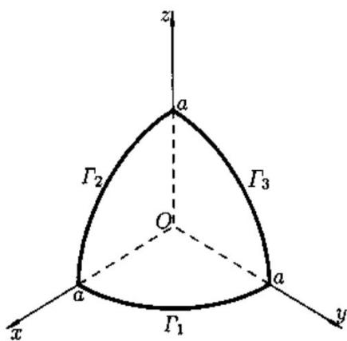 
于是
$x_{0} = \frac{2}{3\pi a}\left( \int_{\Gamma_{1}}^{}xds + \int_{\Gamma_{2}}^{}xds \right) = \frac{4a}{3\pi}.$
图24.1
再用对称性得
$y_{0} = z_{0} = \frac{4a}{3\pi}.$

   **难度：5/5；出处：** 同事《数学分析3_习题导出.xlsx》第14行，原导出标识“24.1.3”；章号与谢惠民等《数学分析习题课讲义》（下册）高教社官方目录高度吻合，但具体版次、原书页码未核；与随附陈纪修等《数学分析》第三版不是同一题号体系，原题号24.1.3；**解答来源：** 同事习题导出表第14行“解析”栏，排版转写；数学步骤未逐题复核。

   **待核状态：** 教材原题号和书页待核；现有解析尚待逐题数学审校

#### 定义及其性质

**图谱路径：** 数学分析III / 曲线积分 / 第一型曲线积分 / 定义及其性质

**知识内容：** [定义、定理与方法](知识点.md#analysis-iii-f44456b0a1b9)

<!-- source-exercise:CJX-III-SELF-012 -->
1. 对线段 $\Gamma:(t,t),0\le t\le1$，计算 $\int_\Gamma(x+y)ds$ 与 $\int_\Gamma x\,dx+y\,dy$；说明反向时哪个积分变号。

   **答案：** $ds=\sqrt2dt$，故第一型积分为 $\int_0^1 2t\sqrt2dt=\sqrt2$。第二型积分为 $\int_0^1 2t dt=1$；反向时第一型不变，第二型变为 $-1$。

   **难度：2/5；出处：** 课程建设自拟训练题；知识依据陈纪修等《数学分析》第三版相关章节，无教材原题号或原题页码，原题号自拟训练题 12；**解答来源：** 课程建设自拟并独立计算核对。

#### 计算

**图谱路径：** 数学分析III / 曲线积分 / 第一型曲线积分 / 计算

**知识内容：** [定义、定理与方法](知识点.md#analysis-iii-a1e585c5ea3e)

<!-- source-exercise:CJX-III-SELF-011 -->
1. 令 $\Gamma$ 为逆时针单位圆，$F=(-y,x)$。计算 $\int_\Gamma 1\,ds$ 和 $\int_\Gamma F\cdot dr$，并核对后者等于 $\int_\Gamma(F\cdot T)ds$。

   **答案：** 取 $r(t)=(\cos t,\sin t)$，$0\le t\le2\pi$，则 $\|r\prime\|=1$，第一型积分为 $2\pi$。$F(r(t))=r\prime(t)$，第二型积分为 $\int_0^{2\pi}1dt=2\pi$，且单位切向量 $T=r\prime$，故两式相合。

   **难度：3/5；出处：** 课程建设自拟训练题；知识依据陈纪修等《数学分析》第三版相关章节，无教材原题号或原题页码，原题号自拟训练题 11；**解答来源：** 课程建设自拟并独立计算核对。

### 第二型曲线积分

**图谱路径：** 数学分析III / 曲线积分 / 第二型曲线积分

**知识内容：** [定义、定理与方法](知识点.md#analysis-iii-55690a013e4c)

<!-- source-exercise:CJX-III-XLSX-r010 -->
1. 例题25.5.2 求第二类曲面积分
$\iint_{S}^{}xdydz + ydzdx + zdxdy,$
其中 $S$ 是柱体 $x^{2} + y^{2} \leq 1$ 被两个平面 $z = 0$ 和 $z = 4$ 所截部分的边界,积分沿边界的外侧.

   **答案：** 解 设上底面为 $S_{1}$ , 下底面为 $S_{2}$ , 侧面为 $S_{3}$ , 则$\iint_{S_{1}}^{}xdydz + ydzdx + zdxdy = \iint_{S_{1}}^{}zdxdy = 4\iint_{S_{1}}^{}dxdy = 4\pi.$
在 $S_{2}$ 上, $z = dz = 0$ , 于是在 $S_{2}$ 上的积分为零. 下面计算在 $S_{3}$ 上的积分. 令
$x = cos\theta,y = sin\theta,z = z$
$(\theta,z) \in D = \{ 0 \leq \theta \leq 2\pi,0 \leq z \leq 4\}.$
则
$A = cos\theta,B = sin\theta,C = 0.$
于是
$\iint_{S_{s}}^{}xdydz + ydzdx + zdxdy = \iint_{D}^{}(\cos^{2}\theta + \sin^{2}\theta)d\theta dz = 8\pi.$
这里积分号前取正号是因为向量 $(A,B,C)$ 与柱面外侧法方向一致, 最后得到
$\iint_{S}^{}xdydz + ydzdx + zdxdy = 12\pi.$

   **难度：4/5；出处：** 同事《数学分析3_习题导出.xlsx》第10行，原导出标识“25.5.2”；章号与谢惠民等《数学分析习题课讲义》（下册）高教社官方目录高度吻合，但具体版次、原书页码未核；与随附陈纪修等《数学分析》第三版不是同一题号体系，原题号25.5.2；**解答来源：** 同事习题导出表第10行“解析”栏，排版转写；数学步骤未逐题复核。

   **待核状态：** 教材原题号和书页待核；现有解析尚待逐题数学审校

<!-- source-exercise:CJX-III-XLSX-r015 -->
2. 例题24.2.1 计算积分
$I = \int_{C}^{}(x^{2} + 2xy)dy,$
其中 C 表示逆时针方向的上半椭圆 $\frac{x^{2}}{a^{2}} + \frac{y^{2}}{b^{2}} = 1$ .

   **答案：** 解 利用椭圆的参数表达式$x = acost,\quad y = bsint,$
按给定方向 $t$ 由0变到 $\pi$ , 将 $x,y$ 用 $t$ 的表达式代入并用 $bcostdt$ 来代替 $dy$ , 得
$\begin{aligned} I & = \int_{0}^{\pi}(a^{2}\cos^{2}t + 2abcostsint)bcostdt \\ & = a^{2}b\int_{0}^{\pi}\cos^{3}tdt + 2ab^{2}\int_{0}^{\pi}\cos^{2}tsintdt = \frac{4}{3}ab^{2}.\quad ▫ \end{aligned}$

   **难度：4/5；出处：** 同事《数学分析3_习题导出.xlsx》第15行，原导出标识“24.2.1”；章号与谢惠民等《数学分析习题课讲义》（下册）高教社官方目录高度吻合，但具体版次、原书页码未核；与随附陈纪修等《数学分析》第三版不是同一题号体系，原题号24.2.1；**解答来源：** 同事习题导出表第15行“解析”栏，排版转写；数学步骤未逐题复核。

   **待核状态：** 教材原题号和书页待核；现有解析尚待逐题数学审校

<!-- source-exercise:CJX-III-XLSX-r016 -->
3. 例题24.2.2 求 $I = \int_{\Gamma}^{}y^{2}dx + z^{2}dy + x^{2}dz,$ 其中 $\Gamma$ 为曲线
$\left\{ \begin{matrix} x^{2} + y^{2} + z^{2} = a^{2}, \\ x^{2} + y^{2} = ax \end{matrix} \right.\ $
上 $z \geq 0$ 的部分, 这里 $a > 0$ , 且从 $x$ 轴正向看 $\Gamma$ 是逆时针方向.

   **答案：** 解 参见图 22.11. 先求曲线 $\Gamma$ 的参数表达式. 若以 $x,y,z$ 之一为参数, 则要涉及开方运算, 出现分支, 很不方便. 从第二个方程易见引入柱坐标$x = rcos\theta,\quad y = rsin\theta,\quad z = z,$
于是 $\Gamma$ 的参数方程为
$\begin{matrix} x = a\cos^{2}\theta,\quad y = acos\theta sin\theta, \\ z = \sqrt{a^{2} - r^{2}} = a|sin\theta|,\quad - \frac{\pi}{2} \leq \theta \leq \frac{\pi}{2}. \end{matrix}$
根据曲线定向, 有
$\begin{aligned} I = & \int_{- \pi/2}^{\pi/2}\left\lbrack a^{2}\cos^{2}\theta\sin^{2}\theta \cdot 2acos\theta( - sin\theta) \right.\ \\ & \left. \ + a^{2}\sin^{2}\theta \cdot a(\cos^{2}\theta - \sin^{2}\theta) + a^{2}\cos^{4}\theta \cdot z^{\prime}(\theta) \right\rbrack d\theta. \end{aligned}$
第一项是奇函数, 且因子 $z(\theta)$ 是偶函数, 所以 $z^{\prime}(\theta)$ 是奇函数, 故第三项也是奇函数, 于是
$\begin{aligned} I & = \int_{- \pi/2}^{\pi/2}a^{3}\sin^{2}\theta(\cos^{2}\theta - \sin^{2}\theta)d\theta \\ & = 2a^{3}\int_{0}^{\pi/2}(\sin^{2}\theta - 2\sin^{4}\theta)d\theta = - \frac{\pi}{4}a^{3}.\quad \end{aligned}$

   **难度：5/5；出处：** 同事《数学分析3_习题导出.xlsx》第16行，原导出标识“24.2.2”；章号与谢惠民等《数学分析习题课讲义》（下册）高教社官方目录高度吻合，但具体版次、原书页码未核；与随附陈纪修等《数学分析》第三版不是同一题号体系，原题号24.2.2；**解答来源：** 同事习题导出表第16行“解析”栏，排版转写；数学步骤未逐题复核。

   **待核状态：** 教材原题号和书页待核；现有解析尚待逐题数学审校

<!-- source-exercise:CJX-III-XLSX-r017 -->
4. 例题24.1.1 求 $I = \oint_{C}^{}x^{2}\, ds$ , 其中 $C$ 为
$\left\{ \begin{matrix} x^{2} + y^{2} + z^{2} = R^{2}, \\ x + y + z = 0. \end{matrix} \right.\ $

   **答案：** 解1(常规方法)先写出曲线 $C$ 的参数表达式. 由于 $C$ 是球面 $x^{2} + y^{2} + z^{2} = R^{2}$ 与经过球心的平面 $x + y + z = 0$ 的交线, 因此是空间的一个圆周. 它在 $x,y$ 平面上的投影为一个椭圆, 这个椭圆方程可从两个曲面方程中消去 $z$ 得到. 即以 $z = - (x + y)$ 代入 $x^{2} + y^{2} + z^{2} = R^{2}$ 中, 得$x^{2} + xy + y^{2} = \frac{R^{2}}{2}.$
将左边配方成平方和
$(\frac{\sqrt{3}}{2}x)^{2} + (\frac{x}{2} + y)^{2} = \frac{R^{2}}{2}.$
令
$\frac{\sqrt{3}}{2}x = \frac{R}{\sqrt{2}}cost,\quad\frac{x}{2} + y = \frac{R}{\sqrt{2}}sint,\quad t \in \lbrack 0,2\pi\rbrack.$
即得到参数表示
$x = \sqrt{\frac{2}{3}}Rcost,\quad y = \frac{R}{\sqrt{2}}sint - \frac{R}{\sqrt{6}}cost,\quad t \in \lbrack 0,2\pi\rbrack.$
代入 $z = - (x + y)$ 中,得
$z = - \frac{R}{\sqrt{6}}cost - \frac{R}{\sqrt{2}}sint,\quad t \in \lbrack 0,2\pi\rbrack.$
由此得
$\begin{aligned} & ds = \sqrt{\lbrack x^{\prime}(t)\rbrack^{2} + \lbrack y^{\prime}(t)\rbrack^{2} + \lbrack z^{\prime}(t)\rbrack^{2}}dt \\ & \quad\quad = R\sqrt{\frac{2}{3}\sin^{2}t + \left( \frac{cost}{\sqrt{2}} + \frac{sint}{\sqrt{6}} \right)^{2} + \left( \frac{sint}{\sqrt{6}} - \frac{cost}{\sqrt{2}} \right)^{2}}dt \\ & \quad\quad = Rdt. \end{aligned}$
故有
$\int_{C}^{}x^{2}ds = \int_{0}^{2\pi}\frac{2}{3}R^{3}\cos^{2}tdt = \frac{2}{3}\pi R^{3}.\quad ▫$
解2(利用对称性) 由对称性有
$\int_{C}^{}x^{2}ds = \int_{C}^{}y^{2}ds = \int_{C}^{}z^{2}ds,$
则
$\int_{C}^{}x^{2}ds = \frac{1}{3}\int_{C}^{}(x^{2} + y^{2} + z^{2})ds = \frac{1}{3}R^{2}\int_{C}^{}ds = \frac{2}{3}\pi R^{3}.$

   **难度：4/5；出处：** 同事《数学分析3_习题导出.xlsx》第17行，原导出标识“24.1.1”；章号与谢惠民等《数学分析习题课讲义》（下册）高教社官方目录高度吻合，但具体版次、原书页码未核；与随附陈纪修等《数学分析》第三版不是同一题号体系，原题号24.1.1；**解答来源：** 同事习题导出表第17行“解析”栏，排版转写；数学步骤未逐题复核。

   **待核状态：** 教材原题号和书页待核；现有解析尚待逐题数学审校

<!-- source-exercise:CJX-III-XLSX-r018 -->
5. 例题24.2.3已知一平面力场,它的方向指向坐标原点,它的大小与它到原点的距离 $r$ 的平方成反比:
$F = \frac{\mu}{r^{2}},$
其中 $\mu$ 为常数. 计算当质量 $m = 1$ 的质点自位置 $A$ 移动到位置 $B$ (不通过原点)时力场做的功.

   **答案：** 解 以 $(x,y)$ 表示点的坐标. 设力与 $x$ 轴的夹角 $\theta$ , 则$cos\theta = - \frac{x}{r},\quad sin\theta = - \frac{y}{r}.$
于是力在 $x,y$ 方向的分量分别为
$F_{1}(x,y) = Fcos\theta = - \mu\frac{x}{r^{3}},\quad F_{2}(x,y) = Fsin\theta = - \mu\frac{y}{r^{3}}.$
而功可表示为曲线积分
$w = - \mu\int_{\widetilde{AB}}^{}\frac{xdx + ydy}{r^{3}}.$
容易看出

   **难度：4/5；出处：** 同事《数学分析3_习题导出.xlsx》第18行，原导出标识“24.2.3”；章号与谢惠民等《数学分析习题课讲义》（下册）高教社官方目录高度吻合，但具体版次、原书页码未核；与随附陈纪修等《数学分析》第三版不是同一题号体系，原题号24.2.3；**解答来源：** 同事习题导出表第18行“解析”栏，排版转写；数学步骤未逐题复核。

   **待核状态：** 教材原题号和书页待核；现有解析尚待逐题数学审校

<!-- source-exercise:CJX-III-XLSX-r019 -->
6. 例题24.2.4 设 $f(x,y)$ 在单位圆盘 $D = \{(x,y) \mid x^{2} + y^{2} \leq 1\}$ 上具有连续的一阶偏导数,且满足 $|f(x,y)| \leq 1\forall(x,y) \in D$ 。试证:存在点 $p_{0}(x_{0},y_{0}) \in intD = \{(x,y) \mid x^{2} + y^{2} < 1\}$ ,使得 $(f_{x}^{2} + f_{y}^{2})|_{(x_{0},y_{0})} \leq 4$ 。

   **答案：** 解 如果有点 $(x_{0},y_{0})$ , 使 $\nabla f(x_{0},y_{0}) = 0$ , 即 $f_{x}(x_{0},y_{0}) = f_{y}(x_{0},y_{0}) = 0$ , 则估计式成立. 如果 $\nabla f$ 在 $D$ 中处处不为零向量, 则 $f$ 在 $D$ 中的梯度曲线存在. 设 $\Gamma$ 是 $f$ 在 $D$ 中的梯度曲线, 其参数方程为$x = x(t),\quad y = y(t),\quad t \in \lbrack 0,T\rbrack,$
$\Gamma$的起点为原点, 终点为 $(x(T),y(T))$ . 由曲线积分公式得到
$\begin{matrix} f(x(T),y(T)) - f(0,0) = \int_{0}^{T}\left( \frac{\partial f}{\partial x}x^{\prime}(t) + \frac{\partial f}{\partial y}y^{\prime}(t) \right)dt \\ = \int_{0}^{T}\frac{\frac{\partial f}{\partial x}x^{\prime}(t) + \frac{\partial f}{\partial y}y^{\prime}(t)}{\sqrt{(x^{\prime}(t))^{2} + (y^{\prime}(t))^{2}}} \cdot \sqrt{(x^{\prime}(t))^{2} + (y^{\prime}(t))^{2}}dt \\ = \int_{F}^{}(\nabla f(x,y) \cdot \tau)ds. \end{matrix}$
设 $l$ 是 $\Gamma$ 的弧长, 并且 $\Gamma$ 自原点出发到达 $D$ 的边界, 则 $l \geq 1$ . 如果在 $intD$ 上处处有 $\nabla f(x,y) \cdot \tau > 2$ , 则就有
$2 \geq |f(x(T),y(T)) - f(0,0)| > 2l \geq 2,$
引出矛盾. 因此存在 $(x_{0},y_{0}) \in intD$ , 使 $\nabla f(x_{0},y_{0}) \cdot \tau \leq 2$ . 又因为 $\nabla f$ 与 $\tau$ 相切, 故 $\nabla f(x_{0},y_{0}) \cdot \tau = |\nabla f(x_{0},y_{0})| \leq 2$ , 即 $(f_{x}^{2} + f_{y}^{2})|_{(x_{0},y_{0})} \leq 4$ .

   **难度：5/5；出处：** 同事《数学分析3_习题导出.xlsx》第19行，原导出标识“24.2.4”；章号与谢惠民等《数学分析习题课讲义》（下册）高教社官方目录高度吻合，但具体版次、原书页码未核；与随附陈纪修等《数学分析》第三版不是同一题号体系，原题号24.2.4；**解答来源：** 同事习题导出表第19行“解析”栏，排版转写；数学步骤未逐题复核。

   **待核状态：** 教材原题号和书页待核；现有解析尚待逐题数学审校

#### 定义及其性质

**图谱路径：** 数学分析III / 曲线积分 / 第二型曲线积分 / 定义及其性质

**知识内容：** [定义、定理与方法](知识点.md#analysis-iii-51dbc8f441cd)

<!-- source-exercise:CJX-III-SELF-012 -->
1. 对线段 $\Gamma:(t,t),0\le t\le1$，计算 $\int_\Gamma(x+y)ds$ 与 $\int_\Gamma x\,dx+y\,dy$；说明反向时哪个积分变号。

   **答案：** $ds=\sqrt2dt$，故第一型积分为 $\int_0^1 2t\sqrt2dt=\sqrt2$。第二型积分为 $\int_0^1 2t dt=1$；反向时第一型不变，第二型变为 $-1$。

   **难度：2/5；出处：** 课程建设自拟训练题；知识依据陈纪修等《数学分析》第三版相关章节，无教材原题号或原题页码，原题号自拟训练题 12；**解答来源：** 课程建设自拟并独立计算核对。

#### 计算

**图谱路径：** 数学分析III / 曲线积分 / 第二型曲线积分 / 计算

**知识内容：** [定义、定理与方法](知识点.md#analysis-iii-db5b0217bf04)

<!-- source-exercise:CJX-III-SELF-011 -->
1. 令 $\Gamma$ 为逆时针单位圆，$F=(-y,x)$。计算 $\int_\Gamma 1\,ds$ 和 $\int_\Gamma F\cdot dr$，并核对后者等于 $\int_\Gamma(F\cdot T)ds$。

   **答案：** 取 $r(t)=(\cos t,\sin t)$，$0\le t\le2\pi$，则 $\|r\prime\|=1$，第一型积分为 $2\pi$。$F(r(t))=r\prime(t)$，第二型积分为 $\int_0^{2\pi}1dt=2\pi$，且单位切向量 $T=r\prime$，故两式相合。

   **难度：3/5；出处：** 课程建设自拟训练题；知识依据陈纪修等《数学分析》第三版相关章节，无教材原题号或原题页码，原题号自拟训练题 11；**解答来源：** 课程建设自拟并独立计算核对。

<!-- source-exercise:CJX-III-3ED-ch14-s2-ex02 -->
2. 设 $L$ 为长度 $C$ 的平面曲线，$M=\max_{(x,y)\in L}\sqrt{P(x,y)^2+Q(x,y)^2}$。证明 $|\int_LPdx+Qdy|\le MC$。用此估计圆周 $L_R:x^2+y^2=R^2$ 上 $I_R=\int_{L_R}(y\,dx-x\,dy)/(x^2+xy+y^2)^2$，并证明 $I_R\to0$（$R\to\infty$）。

   **答案：** 以弧长参数化、单位切向量 $T$ 表示，$|\int_L(P,Q)\cdot T\,ds|\le\int_L\sqrt{P^2+Q^2}\,ds\le MC$。圆周上 $x^2+xy+y^2\ge(x^2+y^2)/2=R^2/2$，而向量场 $(P,Q)=(y,-x)/(x^2+xy+y^2)^2$ 的模不超过 $4/R^3$。$C=2\pi R$，故 $|I_R|\le8\pi/R^2\to0$。

   **难度：3/5；出处：** 陈纪修、於崇华、金路《数学分析》第三版（下册），第十四章§2习题 2，书页275，PDF第296页；题干已对照扫描原页，原题号第十四章§2习题 2；**解答来源：** 本课程建设自拟简解，按弧长估计与参数曲线积分复核。

<!-- source-exercise:CJX-III-3ED-ch14-s2-ex03 -->
3. 一个力场方向沿纵轴负向，大小等于作用点横坐标的平方。求质量为 $m$ 的质点沿抛物线 $y^2=1-x$ 从 $(1,0)$ 移到 $(0,1)$ 时场力做的功。

   **答案：** 把场强写 $F(x,y)=(0,-x^2)$，作用于质量 $m$ 的力为 $mF$。沿曲线取 $y=t$、$x=1-t^2$（$0\le t\le1$），功为 $W=m\int_0^1F\cdot r\prime(t)dt=-m\int_0^1(1-t^2)^2dt=-m(1-2/3+1/5)=-8m/15$。

   **难度：3/5；出处：** 陈纪修、於崇华、金路《数学分析》第三版（下册），第十四章§2习题 3，书页276，PDF第297页；题干已对照扫描原页，原题号第十四章§2习题 3；**解答来源：** 本课程建设自拟简解，按弧长估计与参数曲线积分复核。

#### 两类积分之间的联系

**图谱路径：** 数学分析III / 曲线积分 / 第二型曲线积分 / 两类积分之间的联系

**知识内容：** [定义、定理与方法](知识点.md#analysis-iii-add9a0a40d7f)

<!-- source-exercise:CJX-III-SELF-011 -->
1. 令 $\Gamma$ 为逆时针单位圆，$F=(-y,x)$。计算 $\int_\Gamma 1\,ds$ 和 $\int_\Gamma F\cdot dr$，并核对后者等于 $\int_\Gamma(F\cdot T)ds$。

   **答案：** 取 $r(t)=(\cos t,\sin t)$，$0\le t\le2\pi$，则 $\|r\prime\|=1$，第一型积分为 $2\pi$。$F(r(t))=r\prime(t)$，第二型积分为 $\int_0^{2\pi}1dt=2\pi$，且单位切向量 $T=r\prime$，故两式相合。

   **难度：3/5；出处：** 课程建设自拟训练题；知识依据陈纪修等《数学分析》第三版相关章节，无教材原题号或原题页码，原题号自拟训练题 11；**解答来源：** 课程建设自拟并独立计算核对。

## 重积分

**图谱路径：** 数学分析III / 重积分

**知识内容：** [定义、定理与方法](知识点.md#analysis-iii-5420bbed50bd)

所给材料中未找到直接对应的独立未解题。

### 二重积分

**图谱路径：** 数学分析III / 重积分 / 二重积分

**知识内容：** [定义、定理与方法](知识点.md#analysis-iii-9c07efa4054e)

<!-- source-exercise:CJX-III-XLSX-r038 -->
1. 例题 20.5.1 设 $z = z(x,y)$ 二阶连续可微, 在微分方程$$\frac{1}{(x+y)^2}\left(\frac{\partial^2 z}{\partial x^2}+2\frac{\partial^2 z}{\partial x\partial y}+\frac{\partial^2 z}{\partial y^2}\right)-\frac{1}{(x+y)^3}\left(\frac{\partial z}{\partial x}+\frac{\partial z}{\partial y}\right)=0$$中，作变量代换$$u = xy,\quad v = x - y. \tag{20.26}$$求变换后的方程。

   **答案：** 分析 注意到方程中的导数部分, 第一部分是 $\left(\frac{\partial}{\partial x}+\frac{\partial}{\partial y}\right)^2$ , 第二部分是 $\frac{\partial}{\partial x}+\frac{\partial}{\partial y}$ .

于是只要求出在变量替换 (20.26) 下 $\frac{\partial}{\partial x}+\frac{\partial}{\partial y}$ 的表达式即可.

解 利用链式求导法则得到

$$

\begin{aligned}

z_x &= z_u u_x + z_v v_x = y z_u + z_v,\\

z_y &= z_u u_y + z_v v_y = x z_u - z_v.

\end{aligned}

$$

两式相加得

$$

\left(\frac{\partial}{\partial x}+\frac{\partial}{\partial y}\right)z = (x+y)\frac{\partial z}{\partial u}. \tag{20.27}

$$

于是我们得到在变换 (20.26) 之下有

$$

\frac{\partial}{\partial x}+\frac{\partial}{\partial y} = (x+y)\frac{\partial}{\partial u}. \tag{20.28}

$$

在 (20.27) 两边再作用算子 $\frac{\partial}{\partial x}+\frac{\partial}{\partial y}$ , 并利用 (20.28), 则

$$

\begin{aligned}

\left(\frac{\partial}{\partial x}+\frac{\partial}{\partial y}\right)^2 z &= \left(\frac{\partial}{\partial x}+\frac{\partial}{\partial y}\right)\left[(x+y)\frac{\partial z}{\partial u}\right] \\

&= \left[\left(\frac{\partial}{\partial x}+\frac{\partial}{\partial y}\right)(x+y)\right]\frac{\partial z}{\partial u}+(x+y)\left(\frac{\partial}{\partial x}+\frac{\partial}{\partial y}\right)\frac{\partial z}{\partial u} \\

&= 2\frac{\partial z}{\partial u}+(x+y)^2\frac{\partial^2 z}{\partial u^2}. \tag{20.29}

\end{aligned}

$$

将 (20.27), (20.29) 代入原微分方程中, 则得到

$$

\frac{1}{(x+y)^2}\left[2\frac{\partial z}{\partial u}+(x+y)^2\frac{\partial^2 z}{\partial u^2}\right]-\frac{1}{(x+y)^3}(x+y)\frac{\partial z}{\partial u}=0,

$$

加以整理并将 (20.26) 代入得

$$

\frac{\partial^2 z}{\partial u^2}+\frac{1}{v^2+4u}\frac{\partial z}{\partial u}=0,

$$

即已将原方程化为 $v$ 作参数的二阶线性常微分方程。

   **难度：5/5；出处：** 同事《数学分析3_习题导出.xlsx》第38行，原导出标识“20.5.1”；章号与谢惠民等《数学分析习题课讲义》（下册）高教社官方目录高度吻合，但具体版次、原书页码未核；与随附陈纪修等《数学分析》第三版不是同一题号体系，原题号20.5.1；**解答来源：** 同事习题导出表第38行“解析”栏，排版转写；数学步骤未逐题复核。

   **待核状态：** 教材原题号和书页待核；现有解析尚待逐题数学审校

#### 二重积分的定义及存在性

**图谱路径：** 数学分析III / 重积分 / 二重积分 / 二重积分的定义及存在性

**知识内容：** [定义、定理与方法](知识点.md#analysis-iii-85c16e491077)

<!-- source-exercise:CJX-III-XLSX-r026 -->
1. 例题 22.1.2 设有界非负函数 $f$ 在区域 $D$ 上可积，证明$$\iint_D f(x,y)\mathrm{d}x\mathrm{d}y = 0 \tag{22.2}$$的充分必要条件是 $f$ 在其连续点处的值均为零 (参见上册 333 页题 9).

   **答案：** 证 先证必要性. 用反证法. 若不然, 存在 $p_0(x_0,y_0)\in D$, $f$ 在 $p_0$ 点连续, 且 $f(x_0,y_0)>0$, 由连续函数的局部保号性定理知存在 $\delta > 0$, 使得

$$

f(x,y) > \frac12 f(x_0,y_0),\quad \forall(x,y)\in O_\delta(p_0)\subset D.

$$

于是

$$

\iint_D f(x,y)\mathrm{d}x\mathrm{d}y \ge \iint_{O_\delta(p_0)} \frac12 f(x_0,y_0)\mathrm{d}x\mathrm{d}y = \frac{\pi}{2}\delta^2 f(x_0,y_0) > 0,

$$

与 (22.2) 矛盾.

再证充分性. 设 $f(x,y)$ 在其连续点处的函数值为 0. 对任意划分 $T$ 中可求面积的小区域 $\sigma_i$, 如 $\Delta\sigma_i>0$, 则 $\sigma_i$ 不是零测度集. 由可积充要条件知在每一个 $\sigma_i$ 上至少有 $f$ 的一个连续点, 记之为 $(\xi_i,\eta_i)$, 作和数 $\sum_{i=1}^n f(\xi_i,\eta_i)\Delta\sigma_i$, 则

$$

\sum_{i=1}^n f(\xi_i,\eta_i)\Delta\sigma_i = 0.

$$

于是

$$

\iint_D f(x,y)\mathrm{d}x\mathrm{d}y = \lim_{\|\sigma\|\to 0}\sum_{i=1}^n f(\xi_i,\eta_i)\Delta\sigma_i = 0.

$$

   **难度：4/5；出处：** 同事《数学分析3_习题导出.xlsx》第26行，原导出标识“22.1.2”；章号与谢惠民等《数学分析习题课讲义》（下册）高教社官方目录高度吻合，但具体版次、原书页码未核；与随附陈纪修等《数学分析》第三版不是同一题号体系，原题号22.1.2；**解答来源：** 同事习题导出表第26行“解析”栏，排版转写；数学步骤未逐题复核。

   **待核状态：** 教材原题号和书页待核；现有解析尚待逐题数学审校

<!-- source-exercise:CJX-III-XLSX-r123 -->
2. 例题22.2.2 设函数 $f$ 定义在 $A = \lbrack 0,1\rbrack \times \lbrack 0,1\rbrack$ 上,
$f(x,y) = \left\{ \begin{matrix} 1, & \text{当}x\text{是无理数}, \\ 2y, & \text{当}x\text{是有理数}, \end{matrix} \right.\ $
则 (1) $f$ 在 $A$ 上不可积;
(2)$\int_{0}^{1}dx\int_{0}^{1}f(x,y)dy$ 存在, $\int_{0}^{1}dy\int_{0}^{1}f(x,y)dx$ 不存在.

   **答案：** 证 (1) $\forall y \in \lbrack 0,1\rbrack,y \neq \frac{1}{2},f(x,y)$作为 $x$ 的函数在 $\lbrack 0,1\rbrack$ 上处处不连续,所以 $f(x,y)$ 在 $A$ 上的 $y \neq \frac{1}{2}$ 的每点处都不连续。于是 $f$ 在 $A$ 上不可积。由于
$\int_{0}^{1}f(x,y)dy = \left\{ \begin{matrix} \int_{0}^{1}dy = 1, & \text{当}x\text{为无理数}, \\ \int_{0}^{1}2ydy = 1, & \text{当}x\text{为有理数}, \end{matrix} \right.\ $
所以
$\int_{0}^{1}dx\int_{0}^{1}f(x,y)dy = \int_{0}^{1}dx = 1.$
另一方面, 对 $\forall y \in \lbrack 0,1\rbrack,y \neq \frac{1}{2},f(x,y)$ 作为 $x$ 的一元函数, 在 $\lbrack 0,1\rbrack$ 上每一点都不连续, 于是 $\int_{0}^{1}f(x,y)dx$ 对每个 $y \neq \frac{1}{2}$ 都不存在, 从而
$\int_{0}^{1}dy\int_{0}^{1}f(x,y)dx$
不存在.

   **难度：4/5；出处：** 同事《数学分析3_习题导出.xlsx》第123行，原导出标识“22.2.2”；章号与谢惠民等《数学分析习题课讲义》（下册）高教社官方目录高度吻合，但具体版次、原书页码未核；与随附陈纪修等《数学分析》第三版不是同一题号体系，原题号22.2.2；**解答来源：** 同事习题导出表第123行“解析”栏，排版转写；数学步骤未逐题复核。

   **待核状态：** 教材原题号和书页待核；现有解析尚待逐题数学审校

<!-- source-exercise:CJX-III-XLSX-r126 -->
3. 例题22.1.1 设 $l:x = \varphi(t),y = \psi(t),\alpha \leq t \leq \beta$ , 其中 $\varphi,\psi$ 连续, 且至少其中之一有连续导数, 则曲线 $l$ 的面积为零.

   **答案：** 证 不妨设 $\varphi(t)$ 在闭区间 $\lbrack\alpha,\beta\rbrack$ 上连续, $\psi$有连续导函数. $\forall\varepsilon > 0$ , 可作分割 $\alpha = t_{0} < t_{1} < \cdots < t_{n} = \beta$ , 使当 $s,t \in \lbrack t_{j - 1},t_{j}\rbrack$ , $j = 1,2,\cdots,n$时有$|\varphi(s) - \varphi(t)| < \varepsilon.$
令
$a_{j} = \min_{t_{j - 1} \leq t \leq t_{j}}\varphi(t),\quad b_{j} = \max_{t_{j - 1} \leq t \leq t_{j}}\varphi(t).$
则有
$b_{j} - a_{j} \leq \varepsilon,j = 1,2,\ldots,n,$
又令
$c_{j} = \min_{t_{j - 1} \leq t \leq t_{j}}\psi(t),\quad d_{j} = \max_{t_{j - 1} \leq t \leq t_{j}}\psi(t),\quad I_{j} = \lbrack a_{j},b_{j}\rbrack \times \lbrack c_{j},d_{j}\rbrack,$
于是当 $t \in \lbrack t_{j - 1},t_{j}\rbrack$ 时 $(\varphi(t),\psi(t)) \in I_{j}$ , 故曲线 $l \subset \bigcup_{j = 1}^{n}I_{j}$ . 由于 $\psi^{\prime}(t)$ 在闭区间 $\lbrack\alpha,\beta\rbrack$ 上连续, 所以
$|\psi^{\prime}(t)| < M,\quad\alpha \leq t \leq \beta.$
由微分中值定理得
$d_{j} - c_{j} \leq M(t_{j} - t_{j - 1}),j = 1,2,\ldots,n,$
因而
$\sum_{j = 1}^{n}\left| I_{j} \right| \leq \sum_{j = 1}^{n}\varepsilon M(t_{j} - t_{j - 1}) = \varepsilon M(\beta - \alpha),$
其中 $|I_{j}|$ 表示矩形 $I_{j}$ 的面积. 因为 $\varepsilon$ 是任意的, 故曲线 $l$ 的面积为零.

   **难度：4/5；出处：** 同事《数学分析3_习题导出.xlsx》第126行，原导出标识“22.1.1”；章号与谢惠民等《数学分析习题课讲义》（下册）高教社官方目录高度吻合，但具体版次、原书页码未核；与随附陈纪修等《数学分析》第三版不是同一题号体系，原题号22.1.1；**解答来源：** 同事习题导出表第126行“解析”栏，排版转写；数学步骤未逐题复核。

   **待核状态：** 教材原题号和书页待核；现有解析尚待逐题数学审校

#### 二重积分的性质及计算

**图谱路径：** 数学分析III / 重积分 / 二重积分 / 二重积分的性质及计算

**知识内容：** [定义、定理与方法](知识点.md#analysis-iii-958382d359f3)

<!-- source-exercise:CJX-III-XLSX-r122 -->
1. 例题22.2.3 设区域 $D = \{(x,y) \mid 2y \leq x^{2} + y^{2} \leq 4y,x \geq 0\}$ . 分别将 $D$ 表示为 $x$ 型区域和 $y$ 型区域.

   **答案：** 解 (1) 表示为 $x$ 型区域, $D$可分为三块 (见图22.2), 其中$D_{1} = \left\{ \begin{matrix} 0 \leq x \leq 1, \\ 2 - \sqrt{4 - x^{2}} \leq y \leq 1 - \sqrt{1 - x^{2}}, \end{matrix} \right.\ $
$D_{2} = \left\{ \begin{matrix} 0 \leq x \leq 1, \\ 1 + \sqrt{1 - x^{2}} \leq y \leq 2 + \sqrt{4 - x^{2}}, \end{matrix} \right.\ $
$D_{3} = \left\{ \begin{matrix} 1 \leq x \leq 2, \\ 2 - \sqrt{4 - x^{2}} \leq y \leq 2 + \sqrt{4 - x^{2}}. \end{matrix} \right.\ $
表示为 $y$ 型区域, $D$可分为两块 (见图 22.3), 其中
$E_{1} = \left\{ \begin{matrix} 0 \leq y \leq 2, \\ \sqrt{2y - y^{2}} \leq x \leq \sqrt{4y - y^{2}}, \end{matrix} \right.\ E_{2} = \left\{ \begin{matrix} 2 \leq y \leq 4, \\ 0 \leq x \leq \sqrt{4y - y^{2}}. \end{matrix} \right.\ $
 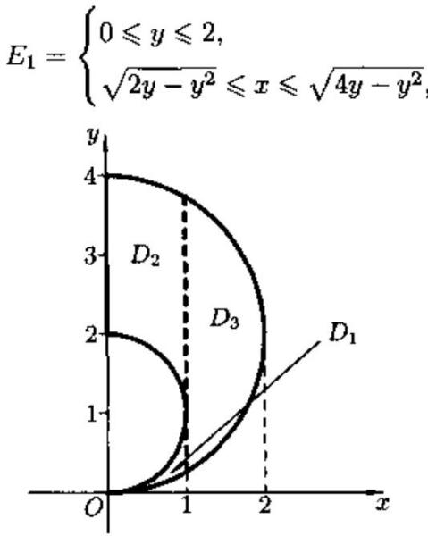 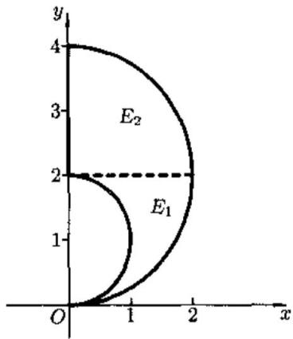 
图22.2 图22.3
当 $f(x,y)$ 中含有 $x^{2} + y^{2}$ 项或 $D$ 的边界表达式中有 $x^{2} + y^{2}$ 项, 则可利用

   **难度：4/5；出处：** 同事《数学分析3_习题导出.xlsx》第122行，原导出标识“22.2.3”；章号与谢惠民等《数学分析习题课讲义》（下册）高教社官方目录高度吻合，但具体版次、原书页码未核；与随附陈纪修等《数学分析》第三版不是同一题号体系，原题号22.2.3；**解答来源：** 同事习题导出表第122行“解析”栏，排版转写；数学步骤未逐题复核。

   **待核状态：** 教材原题号和书页待核；现有解析尚待逐题数学审校

<!-- source-exercise:CJX-III-XLSX-r124 -->
2. 例题22.2.1 设 $A = \lbrack 0,1\rbrack \times \lbrack 0,1\rbrack$ , 求
$I = \iint_{A}^{}\frac{ydxdy}{(1 + x^{2} + y^{2})^{3/2}}.$

   **答案：** 解 先对 $y$ 后对 $x$ 积分, 得到$\begin{matrix} I = \int_{0}^{1}dx\int_{0}^{1}\frac{ydy}{(1 + x^{2} + y^{2})^{3/2}} \\ = \int_{0}^{1}\left( \frac{1}{\sqrt{x^{2} + 1}} - \frac{1}{\sqrt{x^{2} + 2}} \right)dx = ln\frac{2 + \sqrt{2}}{1 + \sqrt{3}}. \end{matrix}$
先对 $x$ 后对 $y$ 积分则得到
$\begin{aligned} I & = \int_{0}^{1}ydy\int_{0}^{1}\frac{dx}{(1 + x^{2} + y^{2})^{3/2}} \\ & = \int_{0}^{1}y\left( \frac{1}{1 + y^{2}}\frac{x}{(1 + x^{2} + y^{2})^{1/2}}|_{x = 0}^{x = 1} \right)dy \\ & = \int_{0}^{1}\frac{ydy}{(1 + y^{2})(2 + y^{2})^{1/2}}\quad(\sqrt{2 + y^{2}} = t) \\ & = \int_{\sqrt{2}}^{\sqrt{3}}\frac{dt}{t^{2} - 1} = \frac{1}{2}\ln\left. \ \frac{t - 1}{t + 1} \right|_{\sqrt{2}}^{\sqrt{3}} = \frac{1}{2}\ln\frac{(\sqrt{3} - 1)(\sqrt{2} + 1)}{(\sqrt{3} + 1)(\sqrt{2} - 1)} \\ & = \frac{1}{2}\ln\frac{2(\sqrt{2} + 1)^{2}}{(\sqrt{3} + 1)^{2}} = ln\frac{2 + \sqrt{2}}{1 + \sqrt{3}}.\quad ▫ \end{aligned}$

   **难度：4/5；出处：** 同事《数学分析3_习题导出.xlsx》第124行，原导出标识“22.2.1”；章号与谢惠民等《数学分析习题课讲义》（下册）高教社官方目录高度吻合，但具体版次、原书页码未核；与随附陈纪修等《数学分析》第三版不是同一题号体系，原题号22.2.1；**解答来源：** 同事习题导出表第124行“解析”栏，排版转写；数学步骤未逐题复核。

   **待核状态：** 教材原题号和书页待核；现有解析尚待逐题数学审校

<!-- source-exercise:CJX-III-XLSX-r125 -->
3. 例题22.1.3 设 $D_{R}$ 是由 $x = R,y = 0,y = \frac{2}{R}x - 1$ 围成. 求
$\lim_{R \rightarrow + \infty}\iint_{D_{R}}^{}e^{- x}\arctan\frac{y}{x}dxdy.$

   **答案：** 解 在图 22.1 中作出了区域 $D_{R}$ 的图形. 由于函数 $e^{- x}\arctan\frac{y}{x}$ 在 $D_{R}$ 上连续, 由积分中值定理, 存在 $(\xi,\eta) \in D_{R}$ , 使得$\begin{aligned} \iint_{D_{R}}^{}e^{- x}\arctan\frac{y}{x}dxdy & = e^{- \xi}\arctan\frac{\eta}{\xi} \cdot |D_{R}| \\ & = \frac{R}{4}e^{- \xi}\arctan\frac{\eta}{\xi}, \end{aligned}$
 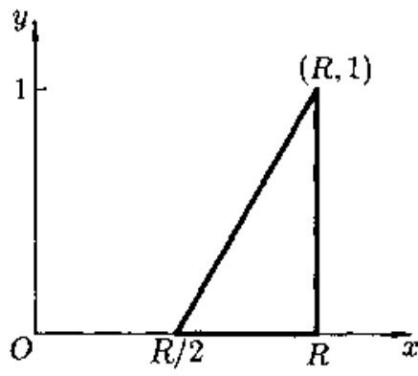 
其中 $\frac{R}{2} \leq \xi \leq R,0 \leq \eta \leq 1$ . 于是当 $R \rightarrow + \infty$ 时 图22.1
$\left| \iint_{D_{R}}^{}e^{- x}\arctan\frac{y}{x}dxdy \right| \leq \frac{R}{4}e^{- R/2}\arctan\frac{\eta}{\xi} \rightarrow 0.$

   **难度：4/5；出处：** 同事《数学分析3_习题导出.xlsx》第125行，原导出标识“22.1.3”；章号与谢惠民等《数学分析习题课讲义》（下册）高教社官方目录高度吻合，但具体版次、原书页码未核；与随附陈纪修等《数学分析》第三版不是同一题号体系，原题号22.1.3；**解答来源：** 同事习题导出表第125行“解析”栏，排版转写；数学步骤未逐题复核。

   **待核状态：** 教材原题号和书页待核；现有解析尚待逐题数学审校

<!-- source-exercise:CJX-III-3ED-ch13-s2-ex02 -->
4. 根据重积分的性质比较积分大小：(1) 在 $D=\{x\ge0,y\ge0,x+y\le1\}$ 上比较 $\iint_D(x+y)^2dxdy$ 与 $\iint_D(x+y)^3dxdy$；(2) 在 $D=[3,5]\times[0,1]$ 上比较 $\iint_D\ln(x+y)dxdy$ 与 $\iint_D[\ln(x+y)]^2dxdy$。

   **答案：** (1) $0\le x+y\le1$，故逐点 $(x+y)^2\ge(x+y)^3$；在内部严格不等，第一积分较大。(2) $3\le x+y\le6$，$\ln(x+y)\ge\ln3>1$，故其平方逐点大于本身，第二积分较大。

   **难度：2/5；出处：** 陈纪修、於崇华、金路《数学分析》第三版（下册），第十三章§2习题 2，书页217，PDF第238页；题干全部小问已对照扫描原页，原题号第十三章§2习题 2；**解答来源：** 本课程建设自拟简解，按区域面积和积分保序性复核。

<!-- source-exercise:CJX-III-3ED-ch13-s2-ex03 -->
5. 利用重积分的性质估计：(1) $\iint_{[0,1]^2}xy(x+y)dxdy$；(2) $\iint_{|x|+|y|\le10}[100+\cos^2x+\cos^2y]^{-1}dxdy$；(3) $\iiint_{x^2+y^2+z^2\le1}(1+x^2+y^2+z^2)^{-1}dV$。

   **答案：** (1) 被积函数非负且在单位方形不超过 $2$，故 $0\le I\le2$；实际逐项积分得 $I=1/3$。(2) 菱形面积为 $200$，被积函数介于 $1/102$ 与 $1/100$，故 $100/51\le I\le2$。(3) 单位球体积 $4\pi/3$，被积函数介于 $1/2$ 与 $1$，故 $2\pi/3\le I\le4\pi/3$；如需精确值，球坐标给 $4\pi-\pi^2$。

   **难度：3/5；出处：** 陈纪修、於崇华、金路《数学分析》第三版（下册），第十三章§2习题 3，书页217，PDF第238页；题干全部小问已对照扫描原页，原题号第十三章§2习题 3；**解答来源：** 本课程建设自拟简解，按区域面积和积分保序性复核。

### 格林公式

**图谱路径：** 数学分析III / 重积分 / 格林公式

**知识内容：** [定义、定理与方法](知识点.md#analysis-iii-3fd9cbd09f1a)

所给材料中未找到直接对应的独立未解题。

#### 格林公式的推导及应用

**图谱路径：** 数学分析III / 重积分 / 格林公式 / 格林公式的推导及应用

**知识内容：** [定义、定理与方法](知识点.md#analysis-iii-72286c9c1dfb)

<!-- source-exercise:CJX-III-XLSX-r011 -->
1. 例题 24.3.4 计算双纽线$$(x^2+y^2)^2=a^2(x^2-y^2) \tag{24.11}$$所围区域的面积。

   **答案：** 解 1 由对称性只需计算第一, 四象限的面积. 令

$$

x=r\cos\theta,\;y=r\sin\theta,\quad -\frac{\pi}{4}\le \theta \le \frac{\pi}{4},

$$

代入方程 (24.11) 得 $r=a\sqrt{\cos2\theta}$，则参数方程为

$$

x(\theta)=a\cos\theta\sqrt{\cos2\theta},\;y(\theta)=a\sin\theta\sqrt{\cos2\theta},\; -\frac{\pi}{4}\le \theta \le \frac{\pi}{4}.

$$

并且

$$

x'(\theta)=a\left(-\sin\theta\right)\sqrt{\cos2\theta}+a\cos\theta\frac{-\sin2\theta}{\sqrt{\cos2\theta}},

$$

$$

y'(\theta)=a\cos\theta\sqrt{\cos2\theta}+a\sin\theta\frac{-\sin2\theta}{\sqrt{\cos2\theta}},

$$

所以

$$

xy'-yx' = a^2\cos2\theta.

$$

由面积公式得到

$$

S = 2\cdot \frac12\oint x\mathrm{d}y-y\mathrm{d}x=\int_{-\pi/4}^{\pi/4} a^2\cos2\theta \mathrm{d}\theta = a^2.

$$

解 2 (用定积分求面积) 在极坐标系中, 双纽线 (24.11) 的方程为

$$

r^2 = a^2\cos2\theta,\; \theta\in\left[-\frac{\pi}{4},\frac{\pi}{4}\right]\cup\left[\frac{3\pi}{4},\frac{5\pi}{4}\right].

$$

于是

$$

S = 4\cdot \frac12\int_{0}^{\pi/4} r^2 \mathrm{d}\theta

= 2\int_{0}^{\pi/4} a^2\cos2\theta \mathrm{d}\theta = a^2.

$$

   **难度：4/5；出处：** 同事《数学分析3_习题导出.xlsx》第11行，原导出标识“24.3.4”；章号与谢惠民等《数学分析习题课讲义》（下册）高教社官方目录高度吻合，但具体版次、原书页码未核；与随附陈纪修等《数学分析》第三版不是同一题号体系，原题号24.3.4；**解答来源：** 同事习题导出表第11行“解析”栏，排版转写；数学步骤未逐题复核。

   **待核状态：** 教材原题号和书页待核；现有解析尚待逐题数学审校

<!-- source-exercise:CJX-III-XLSX-r012 -->
2. 例题 24.3.5 设 $P(x,y),Q(x,y)$ 有连续偏导数，则 $\dfrac{\partial P}{\partial y}=\dfrac{\partial Q}{\partial x}$ 的充要条件是$$\int_{x_0}^{x} P(x,y)\mathrm{d}x+\int_{y_0}^{y} Q(x_0,y)\mathrm{d}y=\int_{x_0}^{x} P(x,y_0)\mathrm{d}x+\int_{y_0}^{y} Q(x,y)\mathrm{d}y.\tag{24.13}$$

   **答案：** 证 先证充分性. 设 (24.13) 成立, 两边对 $x$ 求导, 得

$$

P(x,y)=P(x,y_0)+\int_{y_0}^{y}\frac{\partial Q}{\partial x}(x,y)\mathrm{d}y.

$$

两边再对 $y$ 求导, 则

$$

\frac{\partial P}{\partial y}(x,y)=\frac{\partial Q}{\partial x}(x,y).

$$

再证必要性. 由条件知 $\omega=P\mathrm{d}x+Q\mathrm{d}y$ 与积分路径无关. 取路径为从 $(x_0,y_0)$ 经 $(x_0,y)$ 到 $(x,y)$, 则势函数

$$

\varphi(x,y)=\int_{x_0}^{x} P(x,y)\mathrm{d}x+\int_{y_0}^{y} Q(x_0,y)\mathrm{d}y + C_1.

$$

取路径为从 $(x_0,y_0)$ 经 $(x,y_0)$ 到 $(x,y)$, 则

$$

\varphi(x,y)=\int_{x_0}^{x} P(x,y_0)\mathrm{d}x+\int_{y_0}^{y} Q(x,y)\mathrm{d}y + C_2.

$$

令 $(x,y)=(x_0,y_0)$, 得 $C_1=C_2$.

   **难度：4/5；出处：** 同事《数学分析3_习题导出.xlsx》第12行，原导出标识“24.3.5”；章号与谢惠民等《数学分析习题课讲义》（下册）高教社官方目录高度吻合，但具体版次、原书页码未核；与随附陈纪修等《数学分析》第三版不是同一题号体系，原题号24.3.5；**解答来源：** 同事习题导出表第12行“解析”栏，排版转写；数学步骤未逐题复核。

   **待核状态：** 教材原题号和书页待核；现有解析尚待逐题数学审校

   **整理说明：** 导出解析末混入下一道例题，已剥离并留存处理记录；本题展示仅含当前解析。

<!-- source-exercise:CJX-III-XLSX-r065 -->
3. 例题24.4.3 设 $f$ 和 $g$ 是 $\lbrack 0,1\rbrack$ 上的两个可积函数,满足
$\int_{0}^{1}f(x)dx = \int_{0}^{1}g(x)dx = 1.$
证明存在 $\lbrack 0,1\rbrack$ 中的某个闭区间 $\lbrack a,b\rbrack$ ,使
$\int_{a}^{b}f(x)dx = \int_{a}^{b}g(x)dx = \frac{1}{2}.$

   **答案：** 证 我们定义$D = \{(x,y) \in R^{2} \mid 0 \leq x \leq y \leq 1\},$
并令
$G(x,y) = \left( \int_{x}^{y}f(s)ds - \frac{1}{2},\int_{x}^{y}g(s)ds - \frac{1}{2} \right).$
由 $f,g$ 的可积性, 可知 $G$ 是闭的单连通区域 $D$ 上的连续向量场. 如果 $G(x,y)$ 在 $D$ 的某一点 $(a,b)$ 上取零向量, 就证明了我们所要的结论. 否则, 可以考虑 $\gamma(G,\partial D)$ . $\partial D$由三条直线段组成. 在对角线 $x = y$ 上取常值, 故旋转角度为 0. 在水平边界和垂直边界上, 注意到
$G(0,x) + G(x,1) = (0,0),\quad 0 \leq x \leq 1.$
因而
$G(x,1) = - G(0,x),\quad 0 \leq x \leq 1.$
因此水平边界的任一点的向量恰好与垂直边界上对应点的向量反向. 这说明 $G$ 沿水平边界的旋转角度与其沿垂直边界的旋转角度一样. 而 $G(0,0) = ( - \frac{1}{2}, - \frac{1}{2})$ , $G(0,1) = (\frac{1}{2},\frac{1}{2})$ . 故 $G$ 沿垂直边界的旋转角度为 $2k\pi + \pi$ , $k$为整数. 所以有
$\gamma(G,\partial D) = \frac{0 + 2(2k\pi + \pi)}{2\pi} = 2k + 1 \neq 0.$
由旋转度的性质2知, $G$ 必在 $D$ 上某点 $(a,b)$ 处取零向量,也即
$\int_{a}^{b}f(x)dx = \frac{1}{2} = \int_{a}^{b}g(x)dx.$

   **难度：5/5；出处：** 同事《数学分析3_习题导出.xlsx》第65行，原导出标识“24.4.3”；章号与谢惠民等《数学分析习题课讲义》（下册）高教社官方目录高度吻合，但具体版次、原书页码未核；与随附陈纪修等《数学分析》第三版不是同一题号体系，原题号24.4.3；**解答来源：** 同事习题导出表第65行“解析”栏，排版转写；数学步骤未逐题复核。

   **待核状态：** 教材原题号和书页待核；现有解析尚待逐题数学审校

<!-- source-exercise:CJX-III-XLSX-r066 -->
4. 例题24.4.2(代数基本定理)复数 $z$ 的 $n$ 次多项式 $P_{n}(z)$ 在复域上至少有一个根.

   **答案：** 证 设 $z = x + iy,x,y \in R$ . $P_{n}(z) = R(P_{n}(z)) + iI(P_{n}(z))$ , 其中 $R( \cdot )$ 与 $I( \cdot )$ 分别表示复数的实部和虚部. 构造一个映射$F:(x,y) \rightarrow (R(P_{n}(x + iy)),I(P_{n}(x + iy))).$
$F$是 $R^{2}$ 上的 $n$ 次多项式映射. $P_{n}(z)$在复域上有根的问题归结为 $F$ 在 $R^{2}$ 上是否是退化向量场.
如果 $F$ 是非退化向量场, 则由性质2, $\gamma(F,S_{r}) = 0$ , 其中 $S_{r}$ 表示以 $r$ 为半径的单位圆周. 另一方面, 我们从其它性质计算 $\gamma(F,S_{r})$ .
我们先计算 $P_{n}(z) = z^{n}$ 的情况. 设对应的多项式映射为 $F_{0}$ , 则
$\begin{aligned} \gamma(F_{0},S_{r}) & = \frac{1}{2\pi}\oint_{S_{r}}^{}\frac{RdI - IdR}{R^{2} + I^{2}} \\ & = \frac{1}{2\pi}\int_{0}^{2\pi}\frac{rcosnt(ncosnt) - rsinnt( - nsinnt)}{r^{2}}dt = n. \end{aligned}$
对于一般的 $n$ 次多项式 $P_{n}(z)$ , 不妨设其首系数为 1, 作复多项式的形变
$G(z,\lambda) = \lambda z^{n} + (1 - \lambda)P_{n}(z).$
可知
${\overline{z}}^{n} \cdot G(z,\lambda) = \lambda|z|^{2n} + (1 - \lambda)|z|^{2n} + Q(z).$
其中 $Q(z)$ 满足 $\frac{|Q(z)|}{|z|^{2n}} \rightarrow 0(|z| \rightarrow + \infty)$ . 因此
${\overline{z}}^{n} \cdot G(z,\lambda) = |z|^{2n} + o(|z|^{2n})\quad(|z| \rightarrow + \infty).$
所以当 $r$ 足够大时, $G(z,\lambda)$在复平面的单位圆周 $S_{r}$ 上取不到零点. 这说明 $P_{n}(z)$ 对应的 $n$ 次多项式映射 $F$ 与 $F_{0}$ 在 $S_{r}$ 上同伦, $\gamma(F,S_{r}) = n$ . 这就证明 $F$ 必定是 $R^{2}$ 上的退化向量场. 也证明了 $z^{n}$ 在复域中至少有一根.

   **难度：5/5；出处：** 同事《数学分析3_习题导出.xlsx》第66行，原导出标识“24.4.2”；章号与谢惠民等《数学分析习题课讲义》（下册）高教社官方目录高度吻合，但具体版次、原书页码未核；与随附陈纪修等《数学分析》第三版不是同一题号体系，原题号24.4.2；**解答来源：** 同事习题导出表第66行“解析”栏，排版转写；数学步骤未逐题复核。

   **待核状态：** 教材原题号和书页待核；现有解析尚待逐题数学审校

<!-- source-exercise:CJX-III-XLSX-r067 -->
5. 例题24.4.1 设 $D$ 是 $R^{2}$ 中的一个有界凸区域, 其边界 $\partial D$ 是一条光滑闭曲线. $F$ 是自 $D$ 到 $D$ 的连续映射, 则在 $D$ 内必存在 $F$ 的一个不动点, 即 $\exists\xi \in D$ , 使 $F(\xi) = \xi$ .

   **答案：** 证 由于 $\partial D$ 是一条光滑闭曲线, 我们知 $\partial D$ 上的沿逆时针方向的单位切向量组成 $\partial D$ 上的一个光滑的非退化向量场 $\tau(x,y)$ , 且当 $(x,y) \in \partial D$ 逆时针一圈时, $\tau(x,y)$也转了一圈, 即 $\gamma(\tau,\partial D) = 1$ . 同理, 设 $n(x,y)$ 是 $\partial D$ 上的内法向量场, 则 $\gamma(n,\partial D) = 1$ . 又 $F$ 是自凸区域 $D$ 映到 $D$ 内的映射, 若 $F$ 没有不动点, 则以 $(x,y) \in \partial D$ 为起点, $F(x,y) \in D$为终点的有向线段指向切线的内侧. 即与内法向的夹角不大于 $\frac{\pi}{2}$ . 于是有$(F(x,y) - (x,y)) \cdot n(x,y) \geq 0,\quad\forall(x,y) \in \partial D.$
设 $G(x,y,\lambda) = \lambda(F(x,y) - (x,y)) + (1 - \lambda)n(x,y)$ . 当 $\lambda = 0,1$ 时, $G(x,y,\lambda)$在 $\partial D$ 上非退化. $\lambda \in (0,1)$时
$n(x,y) \cdot G(x,y,\lambda) \geq (1 - \lambda)|n(x,y)|^{2} > 0,\quad(x,y) \in \partial D,$
所以 $G(x,y,\lambda)$ 也在 $\partial D$ 上非退化. 故 $F(x,y) - (x,y)$ 与 $n(x,y)$ 是在 $\partial D$ 上的同伦向量场.
$\gamma(F - id,\partial D) = \gamma(n,\partial D) = 1.$
由性质2可知 $F(x,y) - (x,y)$ 必定是 $D$ 上的退化向量场. 即 $\exists\xi \in D$ , 使 $F(\xi) - \xi = 0$ , 故 $\xi$ 是 $F$ 的不动点.

   **难度：5/5；出处：** 同事《数学分析3_习题导出.xlsx》第67行，原导出标识“24.4.1”；章号与谢惠民等《数学分析习题课讲义》（下册）高教社官方目录高度吻合，但具体版次、原书页码未核；与随附陈纪修等《数学分析》第三版不是同一题号体系，原题号24.4.1；**解答来源：** 同事习题导出表第67行“解析”栏，排版转写；数学步骤未逐题复核。

   **待核状态：** 教材原题号和书页待核；现有解析尚待逐题数学审校

<!-- source-exercise:CJX-III-XLSX-r068 -->
6. 例题24.3.6 设 $a,b,c$ 为常数, 满足 $ac - b^{2} > 0$ ,
$w = \frac{xdy - ydx}{ax^{2} + 2bxy + cy^{2}},$
易见 $w$ 在 $(0,0)$ 以外的区域有定义,且为恰当微分形式. 求 $w$ 关于原点 $(0,0)$ 的循环常数 $\oint_{C}^{}w$ 、其中 $C$ 可取围绕 $(0,0)$ 的任一简单封闭曲线,并取逆时针方向为正向.

   **答案：** 解 设 $P(x,y) = \frac{- y}{ax^{2} + 2bxy + cy^{2}}$ , $Q(x,y) = \frac{x}{ax^{2} + 2bxy + cy^{2}}$ , 则 $\frac{\partial P}{\partial y} = \frac{\partial Q}{\partial x}$ . 可以看出, 沿椭圆 $C$ :$ax^{2} + 2bxy + cy^{2} = 1$
来计算曲线积分最为简便, 因为此时
$\oint_{C}^{}Pdx + Qdy = \oint_{C}^{}xdy - ydx,$
上述积分值恰为椭圆的面积的两倍, 于是
$\oint_{C}^{}w = \frac{2\pi}{\sqrt{ac - b^{2}}}.$

   **难度：5/5；出处：** 同事《数学分析3_习题导出.xlsx》第68行，原导出标识“24.3.6”；章号与谢惠民等《数学分析习题课讲义》（下册）高教社官方目录高度吻合，但具体版次、原书页码未核；与随附陈纪修等《数学分析》第三版不是同一题号体系，原题号24.3.6；**解答来源：** 同事习题导出表第68行“解析”栏，排版转写；数学步骤未逐题复核。

   **待核状态：** 教材原题号和书页待核；现有解析尚待逐题数学审校

<!-- source-exercise:CJX-III-XLSX-r069 -->
7. 例题24.3.3 计算
$I = \oint_{C}^{}\frac{e^{y}}{x^{2} + y^{2}}\left\lbrack (xsinx + ycosx)dx + (ysinx - xcosx)dy \right\rbrack,$
其中 $C:x^{2} + y^{2} = 1$ ,取逆时针方向。

   **答案：** 解令$\begin{matrix} P(x,y) = \frac{e^{y}}{x^{2} + y^{2}}(xsinx + ycosx), \\ Q(x,y) = \frac{c^{y}}{x^{2} + y^{2}}(ysinx - xcosx), \end{matrix}$
由计算知 $\frac{\partial P}{\partial y} = \frac{\partial Q}{\partial x}$ ,从而可在不包含原点的区域上用 Green 公式。为此取 $C_{\varepsilon}:x^{2} + y^{2} = \varepsilon^{2}$ ,取逆时针方向,则
$I = \oint_{C}^{} - \oint_{C_{\varepsilon}}^{} + \oint_{C_{\varepsilon}}^{}.$
对等式右边前两项用 Green 公式, 于是
$\begin{matrix} I = \oint_{C_{\varepsilon}}^{}\frac{e^{y}}{x^{2} + y^{2}}\left\lbrack (xsinx + ycosx)dx + (ysinx - xcosx)dy \right\rbrack \\ = \frac{1}{\varepsilon^{2}}\oint_{C_{\varepsilon}}^{}e^{y}\left\lbrack (xsinx + ycosx)dx + (ysinx - xcosx)dy \right\rbrack. \end{matrix}$
记 $C_{\varepsilon}$ 围成的区域为 $D_{\varepsilon}$ , 再用一次 Green 公式, 则
$I = \frac{1}{\varepsilon^{2}}\iint_{D_{\varepsilon}}^{} - 2e^{y}cosxdxdy.$
应用积分中值定理得到
$I = \frac{1}{\varepsilon^{2}}( - 2e^{\xi}\pi\varepsilon^{2}cos\eta) = - 2\pi e^{\xi}cos\eta,$
其中 $(\xi,\eta) \in D_{\varepsilon}$ . 上述等式对 $\forall\varepsilon > 0$ 都对, 令 $\varepsilon \rightarrow 0$ , 得
$I = \lim_{\varepsilon \rightarrow 0^{+}}( - 2\pi e^{\xi}cos\eta) = - 2\pi.\quad ▫$

   **难度：5/5；出处：** 同事《数学分析3_习题导出.xlsx》第69行，原导出标识“24.3.3”；章号与谢惠民等《数学分析习题课讲义》（下册）高教社官方目录高度吻合，但具体版次、原书页码未核；与随附陈纪修等《数学分析》第三版不是同一题号体系，原题号24.3.3；**解答来源：** 同事习题导出表第69行“解析”栏，排版转写；数学步骤未逐题复核。

   **待核状态：** 教材原题号和书页待核；现有解析尚待逐题数学审校

<!-- source-exercise:CJX-III-XLSX-r070 -->
8. 例题24.3.2 计算积分
$I = \oint_{C}^{}\frac{cos(r,n)}{r}ds,$
其中 $C$ 为逐段光滑的简单闭曲线, $r = (x,y),r = |r| = \sqrt{x^{2} + y^{2}},n$ 是 $C$ 上的单位外法向量.

   **答案：** 解 由 $cos(r,n) = \frac{r \cdot n}{r} = \frac{1}{r}(xcos(n,x) + ycos(n,y))$ 得到 $I = \oint_{C}^{}\left( \frac{x}{r^{2}}cos(n,x) + \frac{y}{r^{2}}cos(n,y) \right)ds.$当 $(0,0)$ 在 $C$ 外时,利用Green公式(24.10),则
$I = \iint_{D}^{}\left\lbrack \partial_{x}(\frac{x}{r^{2}}) + \partial_{y}(\frac{y}{r^{2}}) \right\rbrack dxdy = 0,$
其中 D 是以 C 为边界的区域.
当 $(0,0)$ 在 $C$ 内时,以 $(0,0)$ 为原心,以充分小的 $\varepsilon$ 为半径作圆 $C_{\varepsilon}$ ,使得 $C_{\varepsilon}$ 在 $C$ 内,以 $C$ 及 $C_{\varepsilon}$ 为边界的区域为 $D_{\varepsilon}$ ,则
$\begin{aligned} I = \oint_{C}^{}\left( \frac{x}{r^{2}}cos(n,x) + \frac{y}{r^{2}}cos(n,y) \right)ds + \oint_{C_{\varepsilon}}^{}\left( \frac{x}{r^{2}}cos(n,x) + \frac{y}{r^{2}}cos(n,y) \right)ds \\ & - \oint_{C_{\varepsilon}}^{}\left( \frac{x}{r^{2}}cos(n,x) + \frac{y}{r^{2}}cos(n,y) \right)ds. \end{aligned}$
其中 $C_{\varepsilon}$ 上的单位法向量 $n$ 的方向指向坐标原点. 对前两项用Green公式, 则
$I = - \oint_{C_{s}}^{}\left( \frac{x}{r^{2}}cos(n,x) + \frac{y}{r^{2}}cos(n,y) \right)ds.$
在圆周 $C_{\varepsilon}$ 上,
$cos(n,x) = - \frac{x}{\varepsilon},cos(n,y) = - \frac{y}{\varepsilon},r = \varepsilon,$
从而
$I = \oint_{C_{\varepsilon}}^{}\frac{1}{\varepsilon}ds = 2\pi.$
当 $(0,0) \in C$ 时, 过原点作曲线 $C$ 的切线 $OA,OB$ , 设 $OA,OB$ 的夹角为 $\theta$ (见图24.4), 如果曲线 $C$ 在原点光滑, 则 $\theta = \pi$ .
作一个以 $(0,0)$ 点为心, $\varepsilon$ 为半径的圆 $B_{\varepsilon}$ ,记 $B_{\varepsilon}$ 的圆周在 $C$ 内的部分为 $C_{\varepsilon}$ ,由上面的计算知
 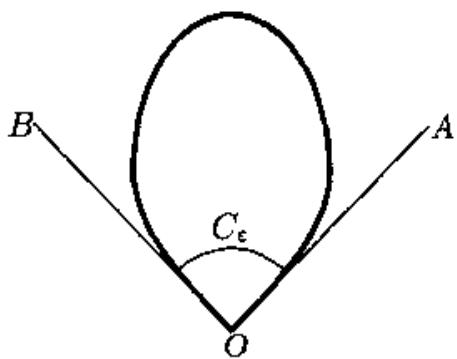 
$I = \lim_{\varepsilon \rightarrow 0}\int_{C_{\varepsilon}}^{}\frac{1}{\varepsilon}ds = \lim_{\varepsilon \rightarrow 0}\theta_{\varepsilon} = \theta,$
图24.4
其中 $\theta_{\varepsilon}$ 是 $C_{\varepsilon}$ 所对应的圆心角.

   **难度：5/5；出处：** 同事《数学分析3_习题导出.xlsx》第70行，原导出标识“24.3.2”；章号与谢惠民等《数学分析习题课讲义》（下册）高教社官方目录高度吻合，但具体版次、原书页码未核；与随附陈纪修等《数学分析》第三版不是同一题号体系，原题号24.3.2；**解答来源：** 同事习题导出表第70行“解析”栏，排版转写；数学步骤未逐题复核。

   **待核状态：** 教材原题号和书页待核；现有解析尚待逐题数学审校

<!-- source-exercise:CJX-III-XLSX-r071 -->
9. 例题24.3.1 $C$ 为抛物线 $2x = \pi y^{2}$ 自 $(0,0)$ 到 $\left( \frac{\pi}{2},1 \right)$ 的弧段,求
$I = \int_{C}^{}(2xy^{3} - y^{2}cosx)dx + (1 - 2ysinx + 3x^{2}y^{2})dy.$

   **答案：** 解 令 $P(x,y) = 2xy^{3} - y^{2}cosx,Q(x,y) = 1 - 2ysinx + 3x^{2}y^{2}$ , 则$- \frac{\partial P}{\partial y} + \frac{\partial Q}{\partial x} = 0.$
为了利用 Green 公式 (24.9), 添加辅助线 (如图 24.3), 则
$I = \int_{C}^{} + \int_{\widetilde{BA}}^{} + \int_{\widetilde{AO}}^{} + \int_{\widetilde{AB}}^{} + \int_{\widetilde{OA}}^{}.$
由 Green 公式, 前三项的积分为零, 于是
$\begin{matrix} I = \int_{\overline{A}\overline{B}}^{} + \int_{\overline{O}\overline{A}}^{} \\ = \int_{0}^{1}\lbrack 1 - 2ysin\frac{\pi}{2} + 3(\frac{\pi}{2})^{2}y^{2}\rbrack dy = \frac{\pi^{2}}{4}. \end{matrix}$
 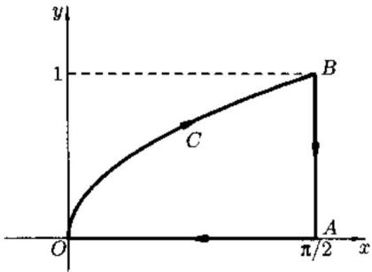 
图24.3

   **难度：4/5；出处：** 同事《数学分析3_习题导出.xlsx》第71行，原导出标识“24.3.1”；章号与谢惠民等《数学分析习题课讲义》（下册）高教社官方目录高度吻合，但具体版次、原书页码未核；与随附陈纪修等《数学分析》第三版不是同一题号体系，原题号24.3.1；**解答来源：** 同事习题导出表第71行“解析”栏，排版转写；数学步骤未逐题复核。

   **待核状态：** 教材原题号和书页待核；现有解析尚待逐题数学审校

<!-- source-exercise:CJX-III-3ED-ch14-s3-ex02 -->
10. 利用曲线积分求下列曲线围成的图形面积：(1) 星形线 $x=a\cos^3t,y=a\sin^3t$；(2) 抛物线 $(x+y)^2=ax$（$a>0$）与 $x$ 轴；(3) 一段旋轮线 $x=a(t-\sin t),y=a(1-\cos t)$（$0\le t\le2\pi$）与 $x$ 轴。

   **答案：** 使用 $A=\oint x\,dy=-\oint y\,dx$（取适当正向）。(1) 第一象限弧线下方面积乘四：$4\int_0^{\pi/2}a\sin^3t\cdot3a\cos^2t\sin t\,dt=3\pi a^2/8$。(2) 上支为 $y=\sqrt{ax}-x$，$0\le x\le a$，故面积 $\int_0^a(\sqrt{ax}-x)dx=a^2/6$。(3) $dx=a(1-\cos t)dt$，故面积 $\int_0^{2\pi}y\,dx=a^2\int_0^{2\pi}(1-\cos t)^2dt=3\pi a^2$。

   **难度：4/5；出处：** 陈纪修、於崇华、金路《数学分析》第三版（下册），第十四章§3习题 2，书页290，PDF第311页；题干全部小问已对照扫描原页，原题号第十四章§3习题 2；**解答来源：** 本课程建设自拟简解，按 Green 公式与原函数核验。

<!-- source-exercise:CJX-III-3ED-ch14-s3-ex03 -->
11. 先证明曲线积分与路径无关，再计算：(1) $\int_{(0,0)}^{(1,1)}(x-y)(dx-dy)$；(2) $\int_{(2,1)}^{(1,2)}\varphi(x)dx+\psi(y)dy$，其中 $\varphi,\psi$ 连续；(3) $\int_{(1,0)}^{(6,8)}(x\,dx+y\,dy)/\sqrt{x^2+y^2}$，路径不通过原点。

   **答案：** (1) 微分形式是 $d[(x-y)^2/2]$，端点值同为零，积分为 $0$。(2) 分别取一元原函数，形式是 $d[\Phi(x)+\Psi(y)]$，积分为 $\int_2^1\varphi(s)ds+\int_1^2\psi(t)dt$。(3) 在去原点区域，形式是 $d\sqrt{x^2+y^2}$，故由端点半径 $10-1=9$。三者都是全微分，所以与所选允许路径无关。

   **难度：3/5；出处：** 陈纪修、於崇华、金路《数学分析》第三版（下册），第十四章§3习题 3，书页290，PDF第311页；题干全部小问已对照扫描原页，原题号第十四章§3习题 3；**解答来源：** 本课程建设自拟简解，按 Green 公式与原函数核验。

<!-- source-exercise:CJX-III-3ED-ch14-s3-ex04 -->
12. 证明 $(2x\cos y+y^2\cos x)dx+(2y\sin x-x^2\sin y)dy$ 是全平面上某函数的全微分，并求一个原函数。

   **答案：** 直接计算 $d[x^2\cos y+y^2\sin x]=(2x\cos y+y^2\cos x)dx+(-x^2\sin y+2y\sin x)dy$，与所给形式一致。故一个势函数为 $x^2\cos y+y^2\sin x$，任加常数亦可。

   **难度：2/5；出处：** 陈纪修、於崇华、金路《数学分析》第三版（下册），第十四章§3习题 4，书页290，PDF第311页；题干全部小问已对照扫描原页，原题号第十四章§3习题 4；**解答来源：** 本课程建设自拟简解，按 Green 公式与原函数核验。

<!-- source-exercise:CJX-III-3ED-ch14-s3-ex05 -->
13. 证明 $(x\,dx+y\,dy)/(x^2+y^2)$ 在去掉负 $y$ 半轴及原点的裂缝平面上是全微分，并求一个原函数。

   **答案：** 在更大的穿孔平面 $\mathbb R^2\setminus\{0\}$ 上已有 $d[\tfrac12\ln(x^2+y^2)]=(x\,dx+y\,dy)/(x^2+y^2)$。因此题给裂缝域上当然也成立，势函数为 $\ln\sqrt{x^2+y^2}$，唯一到加常数。

   **难度：2/5；出处：** 陈纪修、於崇华、金路《数学分析》第三版（下册），第十四章§3习题 5，书页290，PDF第311页；题干全部小问已对照扫描原页，原题号第十四章§3习题 5；**解答来源：** 本课程建设自拟简解，按 Green 公式与原函数核验。

### 二重积分的变量替换

**图谱路径：** 数学分析III / 重积分 / 二重积分的变量替换

**知识内容：** [定义、定理与方法](知识点.md#analysis-iii-01e858bae524)

<!-- source-exercise:CJX-III-XLSX-r037 -->
1. 例题 20.3.3 通过代换 $x = t,\displaystyle y = \frac{t}{1+tu},\displaystyle z = \frac{t}{1+tv}$，试把方程$$x^2 z_x + y^2 z_y = z^2 \tag{20.17}$$变为以 $v$ 为函数，$t, u$ 为自变量的形式。

   **答案：** 分析 题目的意思是有一个函数 $z=z(x,y)$ 满足方程 (20.17), 作自变量代换

$$

x = t,\quad y = \frac{t}{1+tu} \tag{20.18}

$$

以及函数代换

$$

z = \frac{t}{1+tv} \tag{20.19}

$$

得函数 $v=v(t,u)$。求 $v=v(t,u)$ 满足的方程。

解 1 直接从关系式 (20.19) 出发求 $z_x$ 和 $z_y$：

$$

z_x = \left(\frac{t}{1+tv}\right)_t t_x + \left(\frac{t}{1+tv}\right)_v \big(v_t t_x + v_u u_x\big), \tag{20.20}

$$

$$

z_y = \left(\frac{t}{1+tv}\right)_t t_y + \left(\frac{t}{1+tv}\right)_v \big(v_t t_y + v_u u_y\big). \tag{20.21}

$$

由 (20.18) 得

$$

t = x,\quad u = \frac{1}{y}-\frac{1}{x}.

$$

于是

$$

t_x = 1,\quad t_y = 0,

$$

$$

u_x = \frac{1}{x^2},\quad u_y = -\frac{1}{y^2}.

$$

将它们代入 (20.20), (20.21), 得到

$$

z_x = \left(\frac{t}{1+tv}\right)_t + \left(\frac{t}{1+tv}\right)_v\left(v_t + \frac{1}{x^2}v_u\right),

$$

$$

z_y = -\left(\frac{t}{1+tv}\right)_v\frac{1}{y^2}v_u.

$$

将以上式子代入 (20.17), 得到

$$

x^2\left[\left(\frac{t}{1+tv}\right)_t + \left(\frac{t}{1+tv}\right)_v v_t\right] = z^2.

$$

整理得

$$

v_t = 0.

$$

解 2 从(20.19)中解出 $v$ 得

$$

v = \frac{1}{z}-\frac{1}{t},

$$

于是

$$

v_t = -\frac{1}{z^2}(z_x x_t + z_y y_t) + \frac{1}{t^2}, \tag{20.22}

$$

$$

v_u = -\frac{1}{z^2}(z_x x_u + z_y y_u). \tag{20.23}

$$

由 (20.18) 得

$$

x_t = 1,\quad x_u = 0,

$$

$$

y_t = \frac{1}{(1+tu)^2},\quad y_u = -\frac{t^2}{(1+tu)^2}.

$$

将它们代入 (20.22), (20.23) 得

$$

v_t = -\frac{1}{z^2}\left[z_x + \frac{1}{(1+tu)^2}z_y\right] + \frac{1}{t^2},

$$

$$

v_u = \frac{1}{z^2}\frac{t^2}{(1+tu)^2}z_y.

$$

由此解出 $z_x,z_y$，得

$$

z_x = z^2\left(\frac{1}{t^2}-v_t\right)-\frac{z^2}{t^2}v_u,

$$

$$

z_y = \frac{z^2(1+tu)^2}{t^2}v_u.

$$

将它们代入原方程, 得

$$

v_t = 0.

$$

   **难度：5/5；出处：** 同事《数学分析3_习题导出.xlsx》第37行，原导出标识“20.3.3”；章号与谢惠民等《数学分析习题课讲义》（下册）高教社官方目录高度吻合，但具体版次、原书页码未核；与随附陈纪修等《数学分析》第三版不是同一题号体系，原题号20.3.3；**解答来源：** 同事习题导出表第37行“解析”栏，排版转写；数学步骤未逐题复核。

   **待核状态：** 教材原题号和书页待核；现有解析尚待逐题数学审校

#### 变量替换公式

**图谱路径：** 数学分析III / 重积分 / 二重积分的变量替换 / 变量替换公式

**知识内容：** [定义、定理与方法](知识点.md#analysis-iii-8163dcb022ec)

<!-- source-exercise:CJX-III-XLSX-r039 -->
1. 例题 20.5.2 设方程$$a\frac{\partial^2 z}{\partial x^2}+2b\frac{\partial^2 z}{\partial x\partial y}+c\frac{\partial^2 z}{\partial y^2}=0,$$其中 $a,b,c$ 都是常数，$b^2-ac=0,\ c\neq 0$，作代换$$u=x+\alpha y,\quad v=x+\beta y. \tag{20.30}$$问如何选取 $\alpha,\beta$，能使代换后的方程有简单的形式？

   **答案：** 解 不妨设 $c = 1$，则 $a = b^2$，于是原方程变为

$$

\left(b\frac{\partial}{\partial x}+\frac{\partial}{\partial y}\right)^2 z = 0.

$$

若 $b = 0$ 则原方程已是最简形式。以下设 $b \neq 0$，则我们的任务是在 (20.30) 中适当选取 $\alpha,\beta$，使得

$$

b\frac{\partial}{\partial x}+\frac{\partial}{\partial y}=\frac{\partial}{\partial u}. \tag{20.31}

$$

由 (20.30) 得

$$

\begin{aligned}

\frac{\partial}{\partial x}&=\frac{\partial}{\partial u}+\frac{\partial}{\partial v},\\

\frac{\partial}{\partial y}&=\alpha\frac{\partial}{\partial u}+\beta\frac{\partial}{\partial v}.

\end{aligned}

$$

明显地只要取 $\beta = -b,\ \alpha = 1-b$，则 (20.31) 成立。此时原方程化为

$$

\frac{\partial^2 z}{\partial u^2}=0. \tag{20.32}

$$

事实上, 只要取 $\beta = -b,\ \alpha \neq -b$，则 (20.32) 仍成立。

   **难度：5/5；出处：** 同事《数学分析3_习题导出.xlsx》第39行，原导出标识“20.5.2”；章号与谢惠民等《数学分析习题课讲义》（下册）高教社官方目录高度吻合，但具体版次、原书页码未核；与随附陈纪修等《数学分析》第三版不是同一题号体系，原题号20.5.2；**解答来源：** 同事习题导出表第39行“解析”栏，排版转写；数学步骤未逐题复核。

   **待核状态：** 教材原题号和书页待核；现有解析尚待逐题数学审校

#### 极坐标系下二重积分的计算

**图谱路径：** 数学分析III / 重积分 / 二重积分的变量替换 / 极坐标系下二重积分的计算

**知识内容：** [定义、定理与方法](知识点.md#analysis-iii-3c384ce9dbbf)

<!-- source-exercise:CJX-III-XLSX-r119 -->
1. 例题 22.2.6 作极坐标变换, 将二重积分
$\iint_{D}^{}f\left( \sqrt{x^{2} + y^{2}} \right)dxdy$
化为定积分, 其中 $D = \{(x,y) \mid 0 \leq y \leq x \leq 1\}$ .

   **答案：** 解 令 $x = rcos\varphi,y = rsin\varphi,$ 则$\begin{matrix} \iint_{D}^{}f(\sqrt{x^{2} + y^{2}})dxdy = \iint_{D}^{}f(r)rdrd\varphi \\ = \int_{0}^{1}dr\int_{0}^{\pi/4}f(r)rd\varphi + \int_{1}^{\sqrt{2}}dr\int_{arccos(1/r)}^{\pi/4}f(r)rd\varphi \\ = \frac{\pi}{4}\int_{0}^{1}f(r)rdr + \int_{1}^{\sqrt{2}}(\frac{\pi}{4} - arccos\frac{1}{r})f(r)rdr \\ = \frac{\pi}{4}\int_{0}^{\sqrt{2}}f(r)rdr - \int_{1}^{\sqrt{2}}\arccos\frac{1}{r}f(r)rdr.\quad ▫ \end{matrix}$

   **难度：4/5；出处：** 同事《数学分析3_习题导出.xlsx》第119行，原导出标识“22.2.6”；章号与谢惠民等《数学分析习题课讲义》（下册）高教社官方目录高度吻合，但具体版次、原书页码未核；与随附陈纪修等《数学分析》第三版不是同一题号体系，原题号22.2.6；**解答来源：** 同事习题导出表第119行“解析”栏，排版转写；数学步骤未逐题复核。

   **待核状态：** 教材原题号和书页待核；现有解析尚待逐题数学审校

<!-- source-exercise:CJX-III-XLSX-r120 -->
2. 例题22.2.5求
$\lim_{R \rightarrow + \infty}\iint_{\substack{|x| \leq R \\ |y| \leq R}}^{}(x^{2} + y^{2})e^{- (x^{2} + y^{2})}dxdy.$

   **答案：** 解记$I_{R} = \iint_{\substack{|x| \leq R \\ |y| \leq R}}^{}(x^{2} + y^{2})e^{- (x^{2} + y^{2})}dxdy,$
则 $C_{R} \leq I_{R} \leq C_{2R}$ , 且
$\begin{aligned} C_{R} & = \int_{0}^{2\pi}d\theta\int_{0}^{R}r^{3}e^{- r^{2}}dr = \pi\int_{0}^{R^{2}}te^{- t}dt \\ & = \pi(1 - e^{- R^{2}} - R^{2}e^{- R^{2}}) \rightarrow \pi\quad(R \rightarrow + \infty). \end{aligned}$
同理可证 $C_{2R} \rightarrow \pi$ ( $R \rightarrow + \infty$ ). 于是
$\lim_{R \rightarrow + \infty}I_{R} = \pi.$

   **难度：4/5；出处：** 同事《数学分析3_习题导出.xlsx》第120行，原导出标识“22.2.5”；章号与谢惠民等《数学分析习题课讲义》（下册）高教社官方目录高度吻合，但具体版次、原书页码未核；与随附陈纪修等《数学分析》第三版不是同一题号体系，原题号22.2.5；**解答来源：** 同事习题导出表第120行“解析”栏，排版转写；数学步骤未逐题复核。

   **待核状态：** 教材原题号和书页待核；现有解析尚待逐题数学审校

<!-- source-exercise:CJX-III-XLSX-r121 -->
3. 例题 22.2.4 将例题 22.2.3 中的区域 D 分解为 $\theta$ 型区域与 r 型区域.

这里 $D=\{(x,y):2y\le x^2+y^2\le4y,\ x\ge0\}$，取自导出表第122行所列的例题 22.2.3。

   **答案：** 解 在极坐标系中, $D$的边界$x^{2} + y^{2} = 2y,x^{2} + y^{2} = 4y,x = 0$
分别为
$r = 2sin\theta,r = 4sin\theta,\theta = \frac{\pi}{2}.$
于是表示为 $\theta$ 型区域是
$0 \leq \theta \leq \frac{\pi}{2},\quad 2sin\theta \leq r \leq 4sin\theta;$
表示为 r 型区域为 (见图 22.4):
$D_{1} = \left\{ \begin{matrix} 0 \leq r \leq 2, \\ \arcsin\frac{r}{4} \leq \theta \leq arcsin\frac{r}{2}, \end{matrix} \right.\ $
$D_{2} = \left\{ \begin{matrix} 2 \leq r \leq 4, \\ \arcsin\frac{r}{4} \leq \theta \leq \frac{\pi}{2}. \end{matrix} \right.\ $
 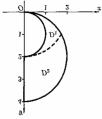 
图22.4

   **难度：3/5；出处：** 同事《数学分析3_习题导出.xlsx》第121行，原导出标识“22.2.4”；章号与谢惠民等《数学分析习题课讲义》（下册）高教社官方目录高度吻合，但具体版次、原书页码未核；与随附陈纪修等《数学分析》第三版不是同一题号体系，原题号22.2.4；**解答来源：** 同事习题导出表第121行“解析”栏，排版转写；数学步骤未逐题复核。

   **待核状态：** 教材原题号和书页待核；现有解析尚待逐题数学审校

   **整理说明：** 已从相邻导出题补足前题定义，使题干可独立阅读。

### 三重积分

**图谱路径：** 数学分析III / 重积分 / 三重积分

**知识内容：** [定义、定理与方法](知识点.md#analysis-iii-f9c7b5690993)

<!-- source-exercise:CJX-III-XLSX-r027 -->
1. 例题 22.3.5 求四维空间中的单位球$$x^2+y^2+z^2+t^2 \le a^2$$的体积 $V$.

   **答案：** 解 用四维空间中的球坐标变换

$$

\begin{aligned}

x &= r\sin \phi_1\sin \phi_2\cos \theta,\quad y = r\sin \phi_1\sin \phi_2\sin \theta,\\

z &= r\sin \phi_1\cos \phi_2,\quad t = r\cos \phi_1,

\end{aligned}

\tag{22.5}

$$

其中 $0\le r \le a,0 \le \theta < 2\pi,0 \le \phi_1,\phi_2 \le \pi$。则

$$

\left|\frac{\partial(x,y,z,t)}{\partial(r,\phi_1,\phi_2,\theta)}\right| = r^3\sin^2 \phi_1\sin \phi_2.

\tag{22.6}

$$

于是

$$

\begin{aligned}

V &= \iiint\limits_{x^2+y^2+z^2+t^2\le a^2} \mathrm{d}x\mathrm{d}y\mathrm{d}z\mathrm{d}t \\

&= \int_{0}^{2\pi} \mathrm{d}\theta \int_{0}^{\pi} \mathrm{d}\phi_1 \int_{0}^{\pi} \mathrm{d}\phi_2 \int_{0}^{a} r^3\sin^2 \phi_1\sin \phi_2 \mathrm{d}r \\

&= \frac{\pi a^4}{2}\int_{0}^{\pi} \sin^2 \phi_1 \mathrm{d}\phi_1 \int_{0}^{\pi} \sin \phi_2 \mathrm{d}\phi_2 = \frac{\pi^2 a^4}{2}.

\end{aligned}

$$

   **难度：5/5；出处：** 同事《数学分析3_习题导出.xlsx》第27行，原导出标识“22.3.5”；章号与谢惠民等《数学分析习题课讲义》（下册）高教社官方目录高度吻合，但具体版次、原书页码未核；与随附陈纪修等《数学分析》第三版不是同一题号体系，原题号22.3.5；**解答来源：** 同事习题导出表第27行“解析”栏，排版转写；数学步骤未逐题复核。

   **待核状态：** 教材原题号和书页待核；现有解析尚待逐题数学审校

#### 三重积分的概念

**图谱路径：** 数学分析III / 重积分 / 三重积分 / 三重积分的概念

**知识内容：** [定义、定理与方法](知识点.md#analysis-iii-5421e6d5cf84)

<!-- source-exercise:CJX-III-SELF-001 -->
1. 对立方体 $\Omega=[0,1]^3$ 计算体积 $\iiint_\Omega 1\,dV$，以及均匀密度 $\rho=1$ 时绕 $z$ 轴的转动惯量。

   **答案：** 体积由三次迭代积分得 $1$。转动惯量为 $I_z=\iiint_\Omega(x^2+y^2)dV=(1/3)+(1/3)=2/3$；到 $z$ 轴的距离平方为 $x^2+y^2$。

   **难度：2/5；出处：** 课程建设自拟训练题；知识依据陈纪修等《数学分析》第三版相关章节，无教材原题号或原题页码，原题号自拟训练题 1；**解答来源：** 课程建设自拟并独立计算核对。

<!-- source-exercise:CJX-III-3ED-ch13-s2-ex03 -->
2. 利用重积分的性质估计：(1) $\iint_{[0,1]^2}xy(x+y)dxdy$；(2) $\iint_{|x|+|y|\le10}[100+\cos^2x+\cos^2y]^{-1}dxdy$；(3) $\iiint_{x^2+y^2+z^2\le1}(1+x^2+y^2+z^2)^{-1}dV$。

   **答案：** (1) 被积函数非负且在单位方形不超过 $2$，故 $0\le I\le2$；实际逐项积分得 $I=1/3$。(2) 菱形面积为 $200$，被积函数介于 $1/102$ 与 $1/100$，故 $100/51\le I\le2$。(3) 单位球体积 $4\pi/3$，被积函数介于 $1/2$ 与 $1$，故 $2\pi/3\le I\le4\pi/3$；如需精确值，球坐标给 $4\pi-\pi^2$。

   **难度：3/5；出处：** 陈纪修、於崇华、金路《数学分析》第三版（下册），第十三章§2习题 3，书页217，PDF第238页；题干全部小问已对照扫描原页，原题号第十三章§2习题 3；**解答来源：** 本课程建设自拟简解，按区域面积和积分保序性复核。

#### 三重积分的计算

**图谱路径：** 数学分析III / 重积分 / 三重积分 / 三重积分的计算

**知识内容：** [定义、定理与方法](知识点.md#analysis-iii-660f019b75d5)

<!-- source-exercise:CJX-III-XLSX-r055 -->
1. 例题25.5.3 设 $B_{r}(M_{0})$ 是以 $M_{0} = (x_{0},y_{0},z_{0})$ 为心, $r$ 为半径的球, $\partial B_{r}(M_{0})$ 是以 $M_{0} = (x_{0},y_{0},z_{0})$ 为心, $r$ 为半径的球面, 证明
$\begin{matrix} \text{(1)}\quad\iiint_{B_{r}(M_{0})}^{}f(x,y,z)dxdydz = \int_{0}^{r}{∯_{\partial B_{\rho}(M_{0})}^{}f}(x,y,z)dS_{\rho}d\rho, \\ \text{(2)}\frac{d}{dr}\iiint_{B_{r}(M_{0})}^{}f(x,y,z)dxdydz = ∯_{\partial B_{r}(M_{0})}^{}f(x,y,z)dS_{r} \end{matrix}$

   **答案：** 证 只证 (1), 因为在 (1) 的两边对 $r$ 求导便得到 (2). 作球坐标变换$\begin{aligned} x & = x_{0} + \rho sin\varphi cos\theta,y = y_{0} + \rho sin\varphi sin\theta,z = z_{0} + \rho cos\varphi, \\ & 0 \leq \theta \leq 2\pi,0 \leq \varphi \leq \pi,0 \leq \rho \leq \tau. \end{aligned}$
则
$\begin{matrix} \iiint_{B_{r}(M_{0})}^{}f(x,y,z)dxdydz \\ = \int_{0}^{r}{\int_{0}^{2\pi}{\int_{0}^{\pi}f}}(x_{0} + \rho sin\varphi cos\theta,y_{0} + \rho sin\varphi sin\theta,z_{0} + \rho cos\varphi)\rho^{2}sin\varphi d\theta d\varphi d\rho \\ = \int_{0}^{r}{∯_{\partial B_{\rho}(M_{0})}^{}f}(x,y,z)dS_{\rho}d\rho. \end{matrix}$
最后一个等号是由 (25.23) 得出

   **难度：5/5；出处：** 同事《数学分析3_习题导出.xlsx》第55行，原导出标识“25.5.3”；章号与谢惠民等《数学分析习题课讲义》（下册）高教社官方目录高度吻合，但具体版次、原书页码未核；与随附陈纪修等《数学分析》第三版不是同一题号体系，原题号25.5.3；**解答来源：** 同事习题导出表第55行“解析”栏，排版转写；数学步骤未逐题复核。

   **待核状态：** 教材原题号和书页待核；现有解析尚待逐题数学审校

<!-- source-exercise:CJX-III-XLSX-r072 -->
2. 例题23.3.6 求 $I = \iiint_{\Omega}^{}\left( \sqrt{a^{2} - x^{2} - y^{2}} \right)^{p}\, dx\, dy\, dz$ 其中 $a > 0,p \geq 0,\Omega$ 是球体 $x^{2} + y^{2} + z^{2} \leq a^{2}$ 被圆柱面 $x^{2} + y^{2} = ay$ 割下的区域 (Viviani 体).

   **答案：** 解 见图 22.11 (现在 x, y 轴的位置有变化). 用柱坐标系, 则$\Omega = \{(r,\theta,z) \mid 0 \leq \theta \leq \pi,0 \leq r \leq asin\theta, - \sqrt{a^{2} - r^{2}} \leq z \leq \sqrt{a^{2} - r^{2}}\}.$
$\begin{matrix} I = \int_{0}^{\pi}d\theta\int_{0}^{asin\theta}dr\int_{- \sqrt{a^{2} - r^{2}}}^{\sqrt{a^{2} - r^{2}}}\left( \sqrt{a^{2} - r^{2}} \right)^{p}rdz = \int_{0}^{\pi}d\theta\int_{0}^{asin\theta}2r(a^{2} - r^{2})^{\frac{p + 1}{2}}dr \\ = - \int_{0}^{\pi}\left( \frac{2}{p + 3}(a^{2} - r^{2})^{\frac{p + 3}{2}} \right)|_{0}^{asin\theta}d\theta = \frac{4a^{p + 3}}{p + 3}\int_{0}^{\pi/2}(1 - \cos^{p + 3}\theta)d\theta \\ = \frac{4a^{p + 3}}{p + 3}\left( \frac{\pi}{2} - \frac{\Gamma(\frac{p + 4}{2})\Gamma(\frac{1}{2})}{2\Gamma(\frac{p + 5}{2})} \right).\quad ▫ \end{matrix}$

   **难度：5/5；出处：** 同事《数学分析3_习题导出.xlsx》第72行，原导出标识“23.3.6”；章号与谢惠民等《数学分析习题课讲义》（下册）高教社官方目录高度吻合，但具体版次、原书页码未核；与随附陈纪修等《数学分析》第三版不是同一题号体系，原题号23.3.6；**解答来源：** 同事习题导出表第72行“解析”栏，排版转写；数学步骤未逐题复核。

   **待核状态：** 教材原题号和书页待核；现有解析尚待逐题数学审校

<!-- source-exercise:CJX-III-XLSX-r102 -->
3. 例题22.6.1 求球体 $x^{2} + y^{2} + z^{2} \leq a^{2}$ 和圆柱体 $x^{2} + y^{2} \leq ax(a > 0)$ 的公共部分所成的空间区域 (Viviani 体) 的体积 $V$ .

   **答案：** 解 如图 22.11 所示,$\begin{matrix} V = 2\iint_{x^{2} + y^{2} \leq ax}^{}\sqrt{a^{2} - x^{2} - y^{2}}dxdy \\ = 2\int_{- \pi/2}^{\pi/2}d\theta\int_{0}^{acos\theta}r\sqrt{a^{2} - r^{2}}dr \\ = \int_{- \pi/2}^{\pi/2} - \frac{2}{3}(a^{2} - r^{2})^{3/2}|_{0}^{acos\theta}d\theta \\ = - \frac{2}{3}\int_{- \pi/2}^{\pi/2}\left\lbrack (a^{2}\sin^{2}\theta)^{3/2} - a^{3} \right\rbrack d\theta. \end{matrix}$
再往下作就有两种可能了,一种是
 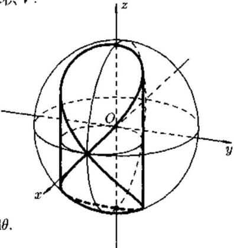 
图22.11
$(\sin^{2}\theta)^{3/2} = \sin^{3}\theta\quad(\text{这是错的!}),$
应该是
$(\sin^{2}\theta)^{3/2} = |sin\theta|^{3}.$
但如果一开始就利用对称性, 得
$V = 4\iint_{x^{2} + y^{2} \leq ax,y \geq 0}^{}\sqrt{z^{2} - x^{2} - y^{2}}dxdy,$
不但使运算简便, 而且无形中避免了上述错误的发生.

   **难度：4/5；出处：** 同事《数学分析3_习题导出.xlsx》第102行，原导出标识“22.6.1”；章号与谢惠民等《数学分析习题课讲义》（下册）高教社官方目录高度吻合，但具体版次、原书页码未核；与随附陈纪修等《数学分析》第三版不是同一题号体系，原题号22.6.1；**解答来源：** 同事习题导出表第102行“解析”栏，排版转写；数学步骤未逐题复核。

   **待核状态：** 教材原题号和书页待核；现有解析尚待逐题数学审校

<!-- source-exercise:CJX-III-XLSX-r117 -->
4. 例题22.3.2 求 $I = \iiint_{\Omega}^{}(x + y)\, dx\, dy\, dz$ ,其中 $\Omega$ 为由 $x = 0,x = 1,x^{2} + 1 = \frac{y^{2}}{a^{2}} + \frac{z^{2}}{b^{2}}$ 所围成.

   **答案：** 解 由积分区域 (见图 22.9) 的构成宜采用 “先二后一” 的积分次序.$I = \int_{0}^{1}dx\iint_{D(x)}^{}(x + y)dydz,$其中 $D(x) = \{\frac{y^{2}}{a^{2}} + \frac{z^{2}}{b^{2}} \leq 1 + x^{2}\}$ 对于二重积分 $\iint_{D(x)}^{}ydydz,$ 由于 $D(x)$ 在 $yOz$ 平面上的投影关于原点对称,且 $f(y,z) = y = - f( - y, - z).$ 由22.2.3节中最后一部分关于简化积分的说明知 $\iint_{D(x)}^{}ydydz = 0,$ 面
 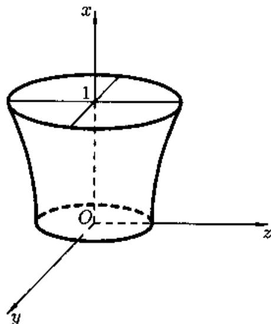 
图22.9
$\iint_{D(x)}^{}xdydz = \pi abx(1 + x^{2}).$
于是
$I = \pi ab\int_{0}^{1}x(1 + x^{2})dx = \frac{3}{4}\pi ab.$

   **难度：4/5；出处：** 同事《数学分析3_习题导出.xlsx》第117行，原导出标识“22.3.2”；章号与谢惠民等《数学分析习题课讲义》（下册）高教社官方目录高度吻合，但具体版次、原书页码未核；与随附陈纪修等《数学分析》第三版不是同一题号体系，原题号22.3.2；**解答来源：** 同事习题导出表第117行“解析”栏，排版转写；数学步骤未逐题复核。

   **待核状态：** 教材原题号和书页待核；现有解析尚待逐题数学审校

<!-- source-exercise:CJX-III-XLSX-r118 -->
5. 例题22.3.1 求积分
$I = \iiint_{\Omega}^{}z^{2}dxdydz,$
其中 $\Omega$ 为两个球 $x^{2} + y^{2} + z^{2} \leq R^{2},x^{2} + y^{2} + z^{2} \leq 2Rz$ 的公共部分.

   **答案：** 解 先画出积分区域, 如图 22.8.综合被积函数和积分区域, 可把积分视成在 $z \in \lbrack 0,R\rbrack$ 上一系列带权 $z^{2}$ 的小薄片的求和. 根据积分区域 $\Omega$ 的构成情况, 可将 $\Omega$ 分成两个子区域 $\Omega_{1}$ 与 $\Omega_{2}$ .
$\Omega_{1}:\left\{ \begin{matrix} x^{2} + y^{2} + z^{2} \leq 2Rz, \\ 0 \leq z \leq \frac{R}{2}, \end{matrix} \right.\ $
$\Omega_{2}:\left\{ \begin{matrix} x^{2} + y^{2} + z^{2} \leq R^{2}, \\ \frac{R}{2} \leq z \leq R, \end{matrix} \right.\ $
 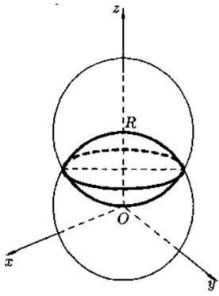 
当 $z \in \lbrack 0,\frac{R}{2}\rbrack$ 时,由 $x^{2} + y^{2} + z^{2} \leq 2Rz$ 可得到薄片面积为 $\pi(2Rz - z^{2})$ ;
当 $z \in \lbrack\frac{R}{2},R\rbrack$ 时, 由 $x^{2} + y^{2} + z^{2} \leq R^{2}$ 可得到薄片面积为 $\pi(R^{2} - z^{2})$ . 所以
图22.8
$\begin{matrix} I = \int_{0}^{R/2}\pi z^{2}(2Rz - z^{2})dz + \int_{R/2}^{R}\pi z^{2}(R^{2} - z^{2})dz \\ = \left( \frac{1}{2}\pi Rz^{4} - \frac{1}{5}\pi z^{5} \right)|_{0}^{R/2} + \left( \frac{1}{3}\pi R^{2}z^{3} - \frac{1}{5}\pi z^{5} \right)|_{R/2}^{R} = \frac{59}{480}\pi R^{5}. \end{matrix}$

   **难度：4/5；出处：** 同事《数学分析3_习题导出.xlsx》第118行，原导出标识“22.3.1”；章号与谢惠民等《数学分析习题课讲义》（下册）高教社官方目录高度吻合，但具体版次、原书页码未核；与随附陈纪修等《数学分析》第三版不是同一题号体系，原题号22.3.1；**解答来源：** 同事习题导出表第118行“解析”栏，排版转写；数学步骤未逐题复核。

   **待核状态：** 教材原题号和书页待核；现有解析尚待逐题数学审校

#### 三重积分的变量替换公式

**图谱路径：** 数学分析III / 重积分 / 三重积分 / 三重积分的变量替换公式

**知识内容：** [定义、定理与方法](知识点.md#analysis-iii-28e0f8bc6d7e)

<!-- source-exercise:CJX-III-XLSX-r114 -->
1. 例题22.3.5 求四维空间中的单位球
$x^{2} + y^{2} + z^{2} + t^{2} \leq a^{2}$
的体积 V.

   **答案：** 解 用四维空间中的球坐标变换

   **难度：5/5；出处：** 同事《数学分析3_习题导出.xlsx》第114行，原导出标识“22.3.5”；章号与谢惠民等《数学分析习题课讲义》（下册）高教社官方目录高度吻合，但具体版次、原书页码未核；与随附陈纪修等《数学分析》第三版不是同一题号体系，原题号22.3.5；**解答来源：** 同事习题导出表第114行“解析”栏，排版转写；数学步骤未逐题复核。

   **待核状态：** 教材原题号和书页待核；现有解析尚待逐题数学审校

<!-- source-exercise:CJX-III-XLSX-r115 -->
2. 例题22.3.4设 $H(x) = \sum_{i,j = 1}^{3}a_{ij}x_{i}x_{j}$ ,其中 $A = (a_{ij})$ 是3阶正定对称阵.求
$I = \iiint_{H(x) \leq 1}^{}e^{\sqrt{H(x)}}dx_{1}dx_{2}dx_{3}.$

   **答案：** 解 存在 3 阶正交矩阵 P, 使得$P^{T}AP = \begin{pmatrix} \lambda_{1} & 0 & 0 \\ 0 & \lambda_{2} & 0 \\ 0 & 0 & \lambda_{3} \end{pmatrix},$
其中 $\lambda_{i} > 0,i = 1,2,3$ . 作正交变换 $x = Py$ , 这里 $x,y \in \mathbb{R}^{3}$ , 则
$H(x) = H(Py) = \lambda_{1}y_{1}^{2} + \lambda_{2}y_{2}^{2} + \lambda_{3}y_{3}^{2}$
且变换的 Jacobi 行列式 $detP \equiv 1$ . 从而
$I = \iiint_{\lambda_{1}y_{1}^{2} + \lambda_{2}y_{2}^{2} + \lambda_{3}y_{3}^{2} \leq 1}^{}e^{\sqrt{\lambda_{1}y_{1}^{2} + \lambda_{2}y_{2}^{2} + \lambda_{3}y_{3}^{2}}}dy_{1}dy_{2}dy_{3}.$
令
$\begin{matrix} y_{1} = \frac{1}{\sqrt{\lambda_{1}}}rsin\varphi cos\theta,y_{2} = \frac{1}{\sqrt{\lambda_{2}}}rsin\varphi sin\theta, \\ y_{3} = \frac{1}{\sqrt{\lambda_{3}}}rcos\varphi, \end{matrix}$
则
$\begin{matrix} I = \frac{1}{\sqrt{\lambda_{1}\lambda_{2}\lambda_{3}}}\int_{0}^{2\pi}d\theta\int_{0}^{\pi}d\varphi\int_{0}^{1}r^{2}e^{r}sin\varphi dr \\ = \frac{4\pi}{\sqrt{\lambda_{1}\lambda_{2}\lambda_{3}}}\int_{0}^{1}r^{2}e^{r}dr = \frac{4\pi}{\sqrt{\lambda_{1}\lambda_{2}\lambda_{3}}}(e - 2). \end{matrix}$
由于 $A$ 的行列式 $detA = \lambda_{1}\lambda_{2}\lambda_{3}$ ,所以
$I = \frac{4\pi}{\sqrt{detA}}(e - 2).$

   **难度：5/5；出处：** 同事《数学分析3_习题导出.xlsx》第115行，原导出标识“22.3.4”；章号与谢惠民等《数学分析习题课讲义》（下册）高教社官方目录高度吻合，但具体版次、原书页码未核；与随附陈纪修等《数学分析》第三版不是同一题号体系，原题号22.3.4；**解答来源：** 同事习题导出表第115行“解析”栏，排版转写；数学步骤未逐题复核。

   **待核状态：** 教材原题号和书页待核；现有解析尚待逐题数学审校

<!-- source-exercise:CJX-III-XLSX-r116 -->
3. 例题22.3.3 计算积分
$H = \iiint_{\begin{matrix} x,y,z \geq 0 \\ x^{2} + y^{2} + z^{2} \leq R^{2} \end{matrix}}^{}\frac{xyzdxdydz}{\sqrt{a^{2}x^{2} + b^{2}y^{2} + c^{2}z^{2}}},\quad\text{其中}a > b > c > 0.$

   **答案：** 解 在球坐标下$H = \int_{0}^{\pi/2}{\int_{0}^{\pi/2}{\int_{0}^{R}\frac{r^{4}\sin^{3}\varphi cos\varphi sin\theta cos\theta drd\varphi d\theta}{\sqrt{a^{2}\sin^{2}\varphi\cos^{2}\theta + b^{2}\sin^{2}\varphi\sin^{2}\theta + c^{2}\cos^{2}\varphi}}}}.$
令 $\sin^{2}\varphi = u,\sin^{2}\theta = v,$ 则
$\begin{aligned} H & = \frac{1}{4}\int_{0}^{1}{\int_{0}^{1}{\int_{0}^{R}r^{4}}}\frac{udrdudv}{\sqrt{a^{2}u(1 - v) + b^{2}uv + c^{2}(1 - u)}} \\ & = \frac{1}{20}R^{5}\int_{0}^{1}udu\int_{0}^{1}\frac{dv}{\sqrt{\lbrack c^{2} + (a^{2} - c^{2})u\rbrack + (b^{2} - a^{2})uv}} \\ & = \frac{1}{20}R^{5}\int_{0}^{1}\left\{ \frac{2}{(b^{2} - a^{2})u}\sqrt{\lbrack c^{2} + (a^{2} - c^{2})u\rbrack + (b^{2} - a^{2})uv} \right\}|_{v = 0}^{v = 1}udu \\ & = \frac{R^{5}}{10(b^{2} - a^{2})}\int_{0}^{1}\left\{ \sqrt{\lbrack c^{2} + (a^{2} - c^{2})u\rbrack + (b^{2} - a^{2})u} - \sqrt{c^{2} + (a^{2} - c^{2})u} \right\} du \\ & = \frac{R^{5}}{10(b^{2} - a^{2})}\left\{ \frac{2}{3(b^{2} - c^{2})}\lbrack c^{2} + (b^{2} - c^{2})u\rbrack^{\frac{3}{2}} - \frac{2}{3(a^{2} - c^{2})}\lbrack c^{2} + (a^{2} - c^{2})u\rbrack^{\frac{3}{2}} \right\}|_{0}^{1} \\ & = \frac{R^{5}}{10(b^{2} - a^{2})}\left\lbrack \frac{2}{3(b^{2} - c^{2})}(b^{3} - c^{3}) - \frac{2}{3(a^{2} - c^{2})}(a^{3} - c^{3}) \right\rbrack \\ & = \frac{R^{5}}{15}\frac{1}{b^{2} - a^{2}}\left( \frac{b^{2} + bc + c^{2}}{b + c} - \frac{a^{2} + ac + c^{2}}{a + c} \right) \\ & = \frac{R^{5}}{15}\frac{ab + bc + ca}{(a + b)(b + c)(c + a)}.\quad ▫ \end{aligned}$

   **难度：5/5；出处：** 同事《数学分析3_习题导出.xlsx》第116行，原导出标识“22.3.3”；章号与谢惠民等《数学分析习题课讲义》（下册）高教社官方目录高度吻合，但具体版次、原书页码未核；与随附陈纪修等《数学分析》第三版不是同一题号体系，原题号22.3.3；**解答来源：** 同事习题导出表第116行“解析”栏，排版转写；数学步骤未逐题复核。

   **待核状态：** 教材原题号和书页待核；现有解析尚待逐题数学审校

### 重积分的应用

**图谱路径：** 数学分析III / 重积分 / 重积分的应用

**知识内容：** [定义、定理与方法](知识点.md#analysis-iii-b6f8b0b817da)

<!-- source-exercise:CJX-III-XLSX-r029 -->
1. 例题 22.5.5 设 $f$ 在 $[0,1]$ 上为正连续函数，证明$$1 \le \int_0^1 \frac{\mathrm{d}x}{f(x)}\int_0^1 f(x)\mathrm{d}x \le \frac{(m+M)^2}{4mM}, \tag{22.10}$$其中 $m,M$ 分别为 $f(x)$ 在 $[0,1]$ 上的最小值和最大值（参见上册374页题11）。

   **答案：** 证设

$$

I=\int_0^1 \frac{\mathrm{d}x}{f(x)}\int_0^1 f(x)\mathrm{d}x

=\int_0^1 \frac{\mathrm{d}x}{f(x)}\int_0^1 f(y)\mathrm{d}y

=\int_0^1\int_0^1 \frac{f(y)}{f(x)}\mathrm{d}x\mathrm{d}y.

$$

由对称性

$$

I=\frac12\int_0^1\int_0^1 \left(\frac{f(y)}{f(x)}+\frac{f(x)}{f(y)}\right)\mathrm{d}x\mathrm{d}y.

$$

令 $F(z)=z+\dfrac1z,z>0$，则 $F(z)\ge 2,F''(z)>0$，故 $F(z)$ 是凸函数。当 $F(a)=F(\beta)$ 时。

对 $z\in[a,\beta]$ 有 $F(z)\le F(a)=F(\beta)$。取 $z=\dfrac{f(y)}{f(x)},a=\dfrac{m}{M},\beta=\dfrac{M}{m}$，得

$$

2\le \frac{f(y)}{f(x)}+\frac{f(x)}{f(y)}\le \frac{m}{M}+\frac{M}{m},

$$

从而

$$

1\le I\le \frac{m^2+M^2}{2mM}.

$$

但这与不等式 (22.10) 相比还不够精确. 为此分析 (22.10), 由右端的平方启发用算术平均值-几何平均值不等式 (上册第 4 页) 得

$$

I=\int_0^1 \frac{\mathrm{d}x}{f(x)}\cdot\int_0^1 f(x)\mathrm{d}x \le \frac14\left[\int_0^1 \left(f(x)+\frac{1}{f(x)}\right)\mathrm{d}x\right]^2. \tag{22.11}

$$

但当 $m\le f(x)\le M$ 时不能充分利用 $z+\dfrac1z$ 的凸性来估计 $f(x)+\dfrac{1}{f(x)}$。观察 $I$ 的特点，用 $\dfrac{f(x)}{\sqrt{mM}}$ 替代 $f(x)$ 得

$$

I=\int_0^1 \frac{\sqrt{mM}}{f(x)}\mathrm{d}x\cdot\int_0^1 \frac{f(x)}{\sqrt{mM}}\mathrm{d}x \le \frac14\left(\int_0^1 \left(\frac{f(x)}{\sqrt{mM}}+\frac{\sqrt{mM}}{f(x)}\right)\mathrm{d}x\right)^2.

$$

再取 $z=\dfrac{f(x)}{\sqrt{mM}},\ \alpha=\sqrt{\dfrac{m}{M}},\ \beta=\sqrt{\dfrac{M}{m}}$，由 $z+\dfrac{1}{z}$ 的凸性得

$$

I \le \frac14\left(\sqrt{\frac{m}{M}}+\sqrt{\frac{M}{m}}\right)^2 \le \frac{(m+M)^2}{4mM}.

$$

不等式 (22.10) 得证。

   **难度：5/5；出处：** 同事《数学分析3_习题导出.xlsx》第29行，原导出标识“22.5.5”；章号与谢惠民等《数学分析习题课讲义》（下册）高教社官方目录高度吻合，但具体版次、原书页码未核；与随附陈纪修等《数学分析》第三版不是同一题号体系，原题号22.5.5；**解答来源：** 同事习题导出表第29行“解析”栏，排版转写；数学步骤未逐题复核。

   **待核状态：** 教材原题号和书页待核；现有解析尚待逐题数学审校

<!-- source-exercise:CJX-III-XLSX-r103 -->
2. 例题22.5.10 设 $u,u_{x},u_{y}$ 在有界区域 $\Omega \subset R^{2}$ 上连续,且在 $\Omega$ 的边界 $\partial\Omega$ 上 $u = u_{x} = u_{y} = 0$ ,则对于 $1 \leq p < 2$ 有
$\left. \parallel u \right.\parallel_{\frac{2p}{2 - p}} \leq C\left( \left. \parallel u_{x} \right.\parallel_{p} + \left. \parallel u_{y} \right.\parallel_{p} \right),$
其中 C 只与 p 有关, 与 u 无关.

   **答案：** 证 先设 $p = 1$ . 当 $(x,y) \in R^{2}\backslash\Omega$ 时, 定义 $u(x,y) = 0$ , 则$u(x,y) = \int_{- \infty}^{x}u_{x}(x,y)dx,\quad\text{且}u(x,y) = \int_{- \infty}^{y}u_{y}(x,y)dy.$
从而
$|u(x,y)| \leq \int_{- \infty}^{x}|u_{x}|dx,\quad\text{且}|u(x,y)| \leq \int_{- \infty}^{y}|u_{y}|dy.$
由此得
$|u(x,y)|^{2} \leq \int_{- \infty}^{+ \infty}|u_{x}(x,y)|dx\int_{- \infty}^{+ \infty}|u_{y}(x,y)|dy.$
两边在 $R^{2}$ 上积分得到
$\iint_{\Omega}^{}|u(x,y)|^{2} \leq \iint_{\Omega}^{}|u_{x}|dxdy\iint_{\Omega}^{}|u_{y}|dxdy.$
两边开平方, 得
$\parallel u \parallel_{2} \leq \parallel u_{x} \parallel_{1}^{1/2} \parallel u_{y} \parallel_{1}^{1/2}.$
利用 $\sqrt{a}\sqrt{b} \leq \frac{1}{2}(a + b)$ , 就有

   **难度：5/5；出处：** 同事《数学分析3_习题导出.xlsx》第103行，原导出标识“22.5.10”；章号与谢惠民等《数学分析习题课讲义》（下册）高教社官方目录高度吻合，但具体版次、原书页码未核；与随附陈纪修等《数学分析》第三版不是同一题号体系，原题号22.5.10；**解答来源：** 同事习题导出表第103行“解析”栏，排版转写；数学步骤未逐题复核。

   **待核状态：** 教材原题号和书页待核；现有解析尚待逐题数学审校

<!-- source-exercise:CJX-III-XLSX-r104 -->
3. 例题22.5.9 设 $u \in L^{r}(\Omega)$ , $0 < p \leq q \leq r$ , 则
$\parallel u \parallel_{q} \leq \parallel u \parallel_{p}^{\lambda} \parallel u \parallel_{r}^{1 - \lambda},$
其中 $\lambda$ 满足 $\frac{1}{q} = \frac{\lambda}{p} + \frac{1 - \lambda}{r}$ .

   **答案：** 证 由 Hölder 不等式$\begin{matrix} \left. \parallel u \right.\parallel_{q}^{q} = \iint_{\Omega}^{}|u|^{q}dxdy = \iint_{\Omega}^{}|u|^{\lambda q}|u|^{(1 - \lambda)q}dxdy \\ \leq \left\{ \iint_{\Omega}^{}\left( |u|^{\lambda q} \right)^{\frac{p}{\lambda q}}dxdy \right\}^{\frac{\lambda q}{p}}\left\{ \iint_{\Omega}^{}\left( |u|^{(1 - \lambda)q} \right)^{\frac{r}{(1 - \lambda)q}} \right\}^{\frac{(1 - \lambda)q}{r}} \\ = \parallel u \parallel_{p}^{\lambda q} \parallel u \parallel_{r}^{(1 - \lambda)q}, \end{matrix}$
两边开 q 次方即为所求

   **难度：5/5；出处：** 同事《数学分析3_习题导出.xlsx》第104行，原导出标识“22.5.9”；章号与谢惠民等《数学分析习题课讲义》（下册）高教社官方目录高度吻合，但具体版次、原书页码未核；与随附陈纪修等《数学分析》第三版不是同一题号体系，原题号22.5.9；**解答来源：** 同事习题导出表第104行“解析”栏，排版转写；数学步骤未逐题复核。

   **待核状态：** 教材原题号和书页待核；现有解析尚待逐题数学审校

<!-- source-exercise:CJX-III-XLSX-r105 -->
4. 例题22.5.8 设 $u \in L^{q}(\Omega)$ , $0 < p \leq q$ , 则
$|\Omega|^{- 1/p} \parallel u \parallel_{p} \leq |\Omega|^{- 1/q} \parallel u \parallel_{q}.$
其中 $|\Omega|$ 表示 $\Omega$ 的体积.

   **答案：** $\begin{aligned} & \text{证 由 Hölder 不等式} \\ & \parallel u \parallel_{p}^{p} = \iint_{\Omega}^{}|u|^{p}dxdy \leq (\iint_{\Omega}^{}(|u|^{p})^{q/p}dxdy)^{p/q}(\iint_{\Omega}^{}1^{q/(q - p)}dxdy)^{(q - p)/q} \\ & \quad\quad = |\Omega|^{(q - p)/q} \parallel u \parallel_{q}^{p}, \end{aligned}$两边开 $p$ 次方, 则
$\parallel u \parallel_{p} \leq |\Omega|^{\frac{1}{p} - \frac{1}{q}} \parallel u \parallel_{q}.$

   **难度：4/5；出处：** 同事《数学分析3_习题导出.xlsx》第105行，原导出标识“22.5.8”；章号与谢惠民等《数学分析习题课讲义》（下册）高教社官方目录高度吻合，但具体版次、原书页码未核；与随附陈纪修等《数学分析》第三版不是同一题号体系，原题号22.5.8；**解答来源：** 同事习题导出表第105行“解析”栏，排版转写；数学步骤未逐题复核。

   **待核状态：** 教材原题号和书页待核；现有解析尚待逐题数学审校

<!-- source-exercise:CJX-III-XLSX-r106 -->
5. 例题22.5.7 (Hölder不等式) 设 $u \in L^{p}(\Omega),v \in L^{q}(\Omega),p,q > 1$ , 且 $\frac{1}{p} + \frac{1}{q} = 1$ , 则
$\parallel uv \parallel_{1} \leq \parallel u \parallel_{p} \parallel v \parallel_{q}.$

   **答案：** 证 不妨设 $\parallel u \parallel_{p} > 0, \parallel v \parallel_{p} > 0.$ 令$a = \frac{|u|}{\parallel u \parallel_{p}},\quad b = \frac{|v|}{\parallel v \parallel_{p}}.$
由 Young 不等式 (上册 259 页题 10):
$ab \leq \frac{a^{p}}{p} + \frac{b^{q}}{q},$
其中 $p,q > 1,\frac{1}{p} + \frac{1}{q} = 1,a,b \geq 0,$ 得到
$\frac{|u| \cdot |v|}{\parallel u \parallel_{p} \parallel v \parallel_{p}} \leq \frac{|u|^{p}}{p \parallel u \parallel_{p}^{p}} + \frac{|v|^{q}}{q \parallel v \parallel_{q}^{q}}.$
两边在 $\Omega$ 上积分得
$\frac{\iint_{\Omega}^{}|u| \cdot |v|dxdy}{\parallel u \parallel_{p} \parallel v \parallel_{p}} \leq \frac{1}{p} + \frac{1}{q} = 1.$
由此得出所要证明的不等式 (参见上册 349~350 页).

   **难度：5/5；出处：** 同事《数学分析3_习题导出.xlsx》第106行，原导出标识“22.5.7”；章号与谢惠民等《数学分析习题课讲义》（下册）高教社官方目录高度吻合，但具体版次、原书页码未核；与随附陈纪修等《数学分析》第三版不是同一题号体系，原题号22.5.7；**解答来源：** 同事习题导出表第106行“解析”栏，排版转写；数学步骤未逐题复核。

   **待核状态：** 教材原题号和书页待核；现有解析尚待逐题数学审校

<!-- source-exercise:CJX-III-XLSX-r107 -->
6. 例题22.5.6 设 $f,\frac{\partial f}{\partial x},\frac{\partial f}{\partial t},\frac{\partial^{2}f}{\partial x^{2}}$ 均为 $\lbrack 0,1\rbrack \times \lbrack 0,1\rbrack$ 中的连续函数,且在 $\lbrack 0,1\rbrack \times \lbrack 0,1\rbrack$ 中成立 $\frac{\partial f}{\partial t} = \frac{\partial^{2}f}{\partial x^{2}}$ 和 $\left| \frac{\partial f}{\partial x} \right| \leq 1$ .(2)由 (1) 的结论证明: 对任何 $(x,t_{1}),(x,t_{2}) \in \lbrack 0,1\rbrack \times \lbrack 0,1\rbrack$ 成立
$\left| f(x,t_{1}) - f(x,t_{2}) \right| \leq 5\left| t_{1} - t_{2} \right|^{\frac{1}{2}}.$

   **答案：** 利用 (1) 得$\begin{aligned} & |f(x,t_{1}) - f(x,t_{2})| \leq |f(x,t_{1}) - f(\xi,t_{1})| + |f(\xi,t_{1}) - f(\xi,t_{2})| + |f(x,t_{2}) - f(\xi,t_{2})| \\ & \quad \leq 1 \cdot |x - \xi| + 4|t_{1} - t_{2}|^{\frac{1}{2}} + 1 \cdot |x - \xi| \\ & \quad \leq |x - \overline{x}| + 4|t_{1} - t_{2}|^{\frac{1}{2}} + |x - \overline{x}| = 5|t_{1} - t_{2}|^{\frac{1}{2}}.\quad ▫ \end{aligned}$

   **难度：5/5；出处：** 同事《数学分析3_习题导出.xlsx》第107行，原导出标识“22.5.6”；章号与谢惠民等《数学分析习题课讲义》（下册）高教社官方目录高度吻合，但具体版次、原书页码未核；与随附陈纪修等《数学分析》第三版不是同一题号体系，原题号22.5.6；**解答来源：** 同事习题导出表第107行“解析”栏，排版转写；数学步骤未逐题复核。

   **待核状态：** 教材原题号和书页待核；现有解析尚待逐题数学审校

<!-- source-exercise:CJX-III-XLSX-r110 -->
7. 例题22.5.1 设 $V$ 是由曲线 $x = \varphi(z)$ , $a \leq z \leq b$ 绕 $z$ 轴旋转而得的体积, 这里曲线不与 $z$ 轴相交且旋转体被 $z = a$ 和 $z = b$ 所围住. 证明公式
$V = \pi\int_{a}^{b}\varphi^{2}(z)dz.$

   **答案：** 证 把 $V$ 视为一个由一系列垂直于 $z$ 轴的小薄片(小圆盘)所组成的体积,则在 $z$ 处,圆盘面积为 $\pi\varphi^{2}(z)$ ,厚度为 $dz$ ,薄片体积微元为 $dV = \pi\varphi^{2}(z)$ ,因而$V = \pi\int_{a}^{b}\varphi^{2}(z)dz.$
曲面的面积 曲面面积的定义需小心对待, 见相应的教科书或 25.1.1 小节. 我们这里用微元法给出一些曲面的计算公式. 假定曲面面积是存在的.
先设曲面 $S$ 由方程
$z = f(x,y),\quad(x,y) \in D$
表示, 其中 $D$ 是平面上可求面积的有界区域, $f(x,y)$是连续可微函数. 给定平面上一个小的可求面积区域 $\Delta D$ , 我们用“以平代曲”的方法计算其对应的曲面微元 $\Delta S$ , 即计算 $S$ 对应于 $\Delta D$ 那部分的切平面面积, 以之取作 $\Delta S$ 的近似值. 为此取 $(\xi,\eta) \in \Delta D$ . 设 $S$ 在 $(\xi,\eta,f(\xi,\eta))$ 处的法向量为
$n = (cos\alpha,cos\beta,cos\gamma).$
再记对应于 $\Delta D$ 那部分的切平面面积为 $\Delta\sigma$ ,则由投影定理
$\Delta\sigma = \frac{\Delta D}{|cos\gamma|}.$
根据法向量的表达, 有
因此
$n = (f_{x}(\xi,\eta),f_{y}(\xi,\eta), \pm 1).$
$cos\gamma = \frac{\pm 1}{\sqrt{1 + f_{x}^{2}(\xi,\eta) + f_{y}^{2}(\xi,\eta)}}.$
即
$\Delta S \approx \Delta\sigma = \sqrt{1 + f_{x}^{2}(\xi,\eta) + f_{y}^{2}(\xi,\eta)}\Delta D.$
这样我们就得到了面积微分
$dS = \sqrt{1 + f_{x}^{2}(x,y) + f_{y}^{2}(x,y)}dxdy.$
曲面面积即为
$S = \iint_{D}^{}\sqrt{1 + f_{x}^{2}(x,y) + f_{y}^{2}(x,y)}dxdy.$
如果曲面 $S$ 由参数方程
$x = x(u,v),\quad y = y(u,v),\quad z = z(u,v),\quad(u,v) \in D$
表示, 其中 $D$ 是参数平面上可求面积的区域, $x(u,v)$ , $y(u,v)$ , $z(u,v)$在 $D$ 上有连续偏导数, 则
$dS = \sqrt{EG - F^{2}}dudv,$
其中
$\begin{matrix} E = x_{u}^{2} + y_{u}^{2} + z_{u}^{2}, \\ F = x_{u}x_{v} + y_{u}y_{v} + z_{u}z_{v}, \\ G = x_{v}^{2} + y_{v}^{2} + z_{v}^{2}. \end{matrix}$
因而
$S = \iint_{D}^{}\sqrt{EG - F^{2}}dudv.$

   **难度：3/5；出处：** 同事《数学分析3_习题导出.xlsx》第110行，原导出标识“22.5.1”；章号与谢惠民等《数学分析习题课讲义》（下册）高教社官方目录高度吻合，但具体版次、原书页码未核；与随附陈纪修等《数学分析》第三版不是同一题号体系，原题号22.5.1；**解答来源：** 同事习题导出表第110行“解析”栏，排版转写；数学步骤未逐题复核。

   **待核状态：** 教材原题号和书页待核；现有解析尚待逐题数学审校

#### 曲面的面积

**图谱路径：** 数学分析III / 重积分 / 重积分的应用 / 曲面的面积

**知识内容：** [定义、定理与方法](知识点.md#analysis-iii-017ff0009366)

<!-- source-exercise:CJX-III-XLSX-r028 -->
1. 例面 22.5.3 设 $V$ 是这样的几何体，它是由参数曲面 $\Sigma_t: \phi(x,y,z)=t$ 自 $t$ 从 $a$ 到 $b$ 所扫成的，证明 $V$ 的体积$$|V|=\int_a^b\left(\iint_{S_t} \frac{1}{\sqrt{\phi_x^2+\phi_y^2+\phi_z^2}}\mathrm{d}S\right)\mathrm{d}t, \tag{22.7}$$其中 $S_t$ 表示曲面 $\Sigma_t$ 所对应的曲面区域，$\mathrm{d}S$ 表示曲面 $\Sigma_t$ 的面积微分。

   **答案：** 证 关键是考虑 $t$ 到 $t+\Delta t$ 时沿 $\phi(x,y,z)=t$ 的法向距离的移动. 注意到此时的曲面 $\Sigma_t$ 在 $(x,y,z)$ 处的法向量为

$$

\boldsymbol{n}=(\phi_x,\phi_y,\phi_z).

$$

考虑曲面随参数 $t$ 的变化的性质. 设 $x=x(t),y=y(t),z=z(t)$ 表示了 $\Sigma_t$ 中一串连续可微变化的质点，则质点速度为 $(x'(t),y'(t),z'(t))$。注意到质点总满足 $\phi(x(t),y(t),z(t))=t$，因而又有

$$

1=\phi_x x'(t)+\phi_y y'(t)+\phi_z z'(t).

$$

所以从运动角度看 $(x,y,z)$ 处的法向速度(即速度在法向上的投影)为

$$

C=\frac{\phi_x x'(t)+\phi_y y'(t)+\phi_z z'(t)}{\sqrt{\phi_x^2+\phi_y^2+\phi_z^2}}=\frac{1}{\sqrt{\phi_x^2+\phi_y^2+\phi_z^2}}.

$$

按微元法，在 $\Delta t$ 时间内 $\Sigma_t$ 所移厚度为 $\Sigma_t$ 的面积 $\iint_{S_t}\mathrm{d}S$ 乘以 $\Delta t$ 的法向分量 $C\Delta t$。从而

$$

|V|=\int_a^b\left(\iint_{S_t} C\,\mathrm{d}S\right)\mathrm{d}t.

$$

   **难度：5/5；出处：** 同事《数学分析3_习题导出.xlsx》第28行，原导出标识“导出表第28行（无教材原题号）”；章号与谢惠民等《数学分析习题课讲义》（下册）高教社官方目录高度吻合，但具体版次、原书页码未核；与随附陈纪修等《数学分析》第三版不是同一题号体系，原题号导出表第28行（无教材原题号）；**解答来源：** 同事习题导出表第28行“解析”栏，排版转写；数学步骤未逐题复核。

   **待核状态：** 教材原题号和书页待核；现有解析尚待逐题数学审校

<!-- source-exercise:CJX-III-XLSX-r064 -->
2. 例题25.1.2 求上半球面 $z = \sqrt{a^{2} - x^{2} - y^{2}}$ 被 $x^{2} + y^{2} = ax$ 截取部分的面积与质心坐标, 其中 $a > 0$ .

   **答案：** 解 见图 22.11, 这就是 Viviani 体的上表面. 由于$z_{x} = \frac{- x}{\sqrt{a^{2} - x^{2} - y^{2}}},z_{y} = \frac{- y}{\sqrt{a^{2} - x^{2} - y^{2}}},$
故所求面积
$\begin{matrix} S = \iint_{x^{2} + y^{2} \leq ax}^{}\frac{a}{\sqrt{a^{2} - x^{2} - y^{2}}}dxdy \\ = \int_{- \pi/2}^{\pi/2}d\theta\int_{0}^{acos\theta}\frac{a}{\sqrt{a^{2} - r^{2}}}rdr \\ = (\pi - 2)a^{2}. \end{matrix}$
下面求质心坐标, 由对称性知 $y_{0} = 0$ , 且
$\begin{aligned} x_{0} & = \frac{1}{(\pi - 2)a^{2}}\iint_{S}^{}xdS \\ & = \frac{2}{(\pi - 2)a^{2}}\iint_{\begin{matrix} x^{2} + y^{2} \leq ax \\ y \geq 0 \end{matrix}}^{}\frac{ax}{\sqrt{a^{2} - x^{2} - y^{2}}}dxdy \\ & = \frac{2}{(\pi - 2)a}\int_{0}^{\pi/2}\cos\theta d\theta\int_{0}^{acos\theta}\frac{r}{\sqrt{a^{2} - r^{2}}}rdr(r = acost) \\ & = \frac{2}{(\pi - 2)a}\int_{0}^{\pi/2}\cos\theta d\theta\int_{\pi/2}^{\theta}\frac{a^{2}\cos^{2}t}{asint}( - asint)dt \\ & = \frac{a}{\pi - 2}\int_{0}^{\pi/2}\cos\theta(\frac{\pi}{2} - \theta - sin\theta cos\theta)d\theta \\ & = \frac{2a}{3(\pi - 2)}; \\ z_{0} & = \frac{1}{(\pi - 2)a^{2}}\iint_{S}^{}zdS \\ & = \frac{1}{(\pi - 2)a^{2}}\iint_{x^{2} + y^{2} \leq ax}^{}\frac{a}{\sqrt{a^{2} - x^{2} - y^{2}}}\sqrt{a^{2} - x^{2} - y^{2}}dxdy \\ & = \frac{\pi a}{4(\pi - 2)}.\quad ▫ \\ \end{aligned}$

   **难度：5/5；出处：** 同事《数学分析3_习题导出.xlsx》第64行，原导出标识“25.1.2”；章号与谢惠民等《数学分析习题课讲义》（下册）高教社官方目录高度吻合，但具体版次、原书页码未核；与随附陈纪修等《数学分析》第三版不是同一题号体系，原题号25.1.2；**解答来源：** 同事习题导出表第64行“解析”栏，排版转写；数学步骤未逐题复核。

   **待核状态：** 教材原题号和书页待核；现有解析尚待逐题数学审校

<!-- source-exercise:CJX-III-XLSX-r109 -->
3. 例题22.5.2 设连续曲线 $z = \varphi(x)$ , $a \leq x \leq b$ 绕 $z$ 轴旋转所得曲面为 $\Sigma$ . 求 $\Sigma$ 的面积 $S$ .

   **答案：** 解 用柱坐标把 $\Sigma$ 参数化, 有$\begin{matrix} x = rcos\theta,\quad y = rsin\theta,\quad z = \varphi(r), \\ a \leq r \leq b,\quad 0 \leq \theta \leq 2\pi. \end{matrix}$
故
$\begin{matrix} E = 1 + (\varphi^{\prime}(r))^{2},\quad F = 0,\quad G = r^{2}. \\ S = \int_{0}^{2\pi}d\theta\int_{a}^{b}r\sqrt{1 + (\varphi^{\prime}(r))^{2}}dr = 2\pi\int_{a}^{b}r\sqrt{1 + (\varphi^{\prime}(r))^{2}}dr. \end{matrix}$

   **难度：4/5；出处：** 同事《数学分析3_习题导出.xlsx》第109行，原导出标识“22.5.2”；章号与谢惠民等《数学分析习题课讲义》（下册）高教社官方目录高度吻合，但具体版次、原书页码未核；与随附陈纪修等《数学分析》第三版不是同一题号体系，原题号22.5.2；**解答来源：** 同事习题导出表第109行“解析”栏，排版转写；数学步骤未逐题复核。

   **待核状态：** 教材原题号和书页待核；现有解析尚待逐题数学审校

<!-- source-exercise:CJX-III-3ED-ch14-s1-ex05 -->
4. 设球面 $\Sigma$ 半径为 $R$，球心在固定球面 $x^2+y^2+z^2=a^2$ 上。问当 $R$ 为何值时，$\Sigma$ 位于固定球体 $x^2+y^2+z^2\le a^2$ 内的面积最大？求最大面积。

   **答案：** 取球心 $M$ 满足 $|M|=a$，点写成 $M+Rn$（$|n|=1$），在固定球内当且仅当 $R^2+2aR\cos\theta\le0$。$0\le R\le2a$ 时这是 $\cos\theta\le-R/(2a)$ 的球冠，面积 $S(R)=2\pi R^2(1-R/(2a))$；$R>2a$ 时面积为零。求导 $S\prime(R)=\pi R(4-3R/a)$，得最大值在 $R=4a/3$，$S_{\max}=32\pi a^2/27$。

   **难度：4/5；出处：** 陈纪修、於崇华、金路《数学分析》第三版（下册），第十四章§1习题 5，书页264，PDF第285页；题干全部小问已对照扫描原页，原题号第十四章§1习题 5；**解答来源：** 本课程建设自拟简解，按球面几何和积分核验。

#### 质心

**图谱路径：** 数学分析III / 重积分 / 重积分的应用 / 质心

**知识内容：** [定义、定理与方法](知识点.md#analysis-iii-e22a250b940c)

<!-- source-exercise:CJX-III-XLSX-r108 -->
1. 例题22.5.4 若直线 $x = 0,x = a,y = 0$ 与正连续曲线 $y = f(x)$ 围成的区域的质心的 $x$ 坐标是 $g(a)$ , 证明
$f(x) = \frac{Ag^{\prime}(x)}{\lbrack x - g(x)\rbrack^{2}}\exp\left( \int\frac{dx}{x - g(x)} \right),$
其中 A 为正常数, a 是参数.

   **答案：** 证 见图 22.10,$g(a) = \frac{M_{x}(1)}{M(0)} = \frac{\int_{0}^{a}xf(x)dx}{\int_{0}^{a}f(x)dx},$
即
$g(a)\int_{0}^{a}f(x)dx = \int_{0}^{a}xf(x)dx.$
两边对 $a$ 求导得
$g(a)f(a) + g^{\prime}(a)\int_{0}^{a}f(x)dx = af(a).$
 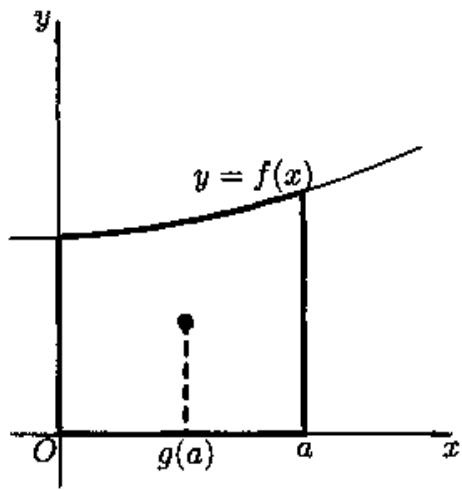 
令 $F(a) = \int_{0}^{a}f(x)dx,$ 注意到 $a - g(a) \neq 0$ ,则
图22.10
$\frac{F^{\prime}(a)}{F(a)} = \frac{g^{\prime}(a)}{a - g(a)}.$
两边对 $a$ 积分, 得
$lnF(a) = \int\frac{g^{\prime}(a)}{a - g(a)}da + C.$
所以
$\int_{0}^{a}f(x)dx = F(a) = Aexp\left( \int\frac{g^{\prime}(a)}{a - g(a)}da \right).$
两边对 $a$ 求导得
$f(a) = \frac{Ag^{\prime}(a)}{a - g(a)}\exp\left( \int\frac{g^{\prime}(a)}{a - g(a)}da \right).$
考虑到
$\begin{aligned} \int\frac{g^{\prime}(a)}{a - g(a)}da & = \int\frac{g^{\prime}(a) - 1}{a - g(a)}da + \int\frac{da}{a - g(a)} \\ & = - ln(a - g(a)) + \int\frac{da}{a - g(a)}, \end{aligned}$
则
$f(a) = \frac{Ag^{\prime}(a)}{\left\lbrack a - g(a) \right\rbrack^{2}}\exp\left( \int\frac{da}{a - g(a)} \right).$

   **难度：4/5；出处：** 同事《数学分析3_习题导出.xlsx》第108行，原导出标识“22.5.4”；章号与谢惠民等《数学分析习题课讲义》（下册）高教社官方目录高度吻合，但具体版次、原书页码未核；与随附陈纪修等《数学分析》第三版不是同一题号体系，原题号22.5.4；**解答来源：** 同事习题导出表第108行“解析”栏，排版转写；数学步骤未逐题复核。

   **待核状态：** 教材原题号和书页待核；现有解析尚待逐题数学审校

#### 转动惯量

**图谱路径：** 数学分析III / 重积分 / 重积分的应用 / 转动惯量

**知识内容：** [定义、定理与方法](知识点.md#analysis-iii-7cc51670979d)

<!-- source-exercise:CJX-III-SELF-001 -->
1. 对立方体 $\Omega=[0,1]^3$ 计算体积 $\iiint_\Omega 1\,dV$，以及均匀密度 $\rho=1$ 时绕 $z$ 轴的转动惯量。

   **答案：** 体积由三次迭代积分得 $1$。转动惯量为 $I_z=\iiint_\Omega(x^2+y^2)dV=(1/3)+(1/3)=2/3$；到 $z$ 轴的距离平方为 $x^2+y^2$。

   **难度：2/5；出处：** 课程建设自拟训练题；知识依据陈纪修等《数学分析》第三版相关章节，无教材原题号或原题页码，原题号自拟训练题 1；**解答来源：** 课程建设自拟并独立计算核对。

#### 引力

**图谱路径：** 数学分析III / 重积分 / 重积分的应用 / 引力

**知识内容：** [定义、定理与方法](知识点.md#analysis-iii-6450ab29bf8b)

<!-- source-exercise:CJX-III-SELF-002 -->
1. 均匀密度为 $\rho$ 的有界体 $\Omega$ 对体外点 $x$ 产生的 Newton 引力位势应写成什么积分？指出将 $x$ 移到体内时需额外检查什么。

   **答案：** 取引力常数 $G>0$，位势可按约定写 $U(x)=G\rho\int_\Omega\|x-y\|^{-1}dy$（物理势能常取负号）。体外核连续；体内 $y=x$ 为奇点，须检验局部可积性。三维中 $\int_{\|z\|<\varepsilon}\|z\|^{-1}dz=4\pi\int_0^\varepsilon r\,dr<\infty$。

   **难度：3/5；出处：** 课程建设自拟训练题；知识依据陈纪修等《数学分析》第三版相关章节，无教材原题号或原题页码，原题号自拟训练题 2；**解答来源：** 课程建设自拟并独立计算核对。

<!-- source-exercise:CJX-III-3ED-ch14-s1-ex07 -->
2. 求半径为 $a$、面密度为 $1$ 的均匀球面对不在球面上的单位质量质点的引力。

   **答案：** 设质点位置向量为 $x$、$r=|x|$，引力常数为 $G$。由球面对称性，正标量位势 $U(r)=G\iint_{|y|=a}|x-y|^{-1}dS_y=2\pi G a^2\int_{-1}^{1}(r^2+a^2-2ar t)^{-1/2}dt=4\pi G a^2/\max(r,a)$。吸引力向量取 $F=\nabla U$：当 $r<a$ 时 $F=0$；当 $r>a$ 时 $F=-4\pi G a^2x/r^3$。若教材取 $G=1$，代入即可；球面上的点另有奇性问题，题干已排除。

   **难度：4/5；出处：** 陈纪修、於崇华、金路《数学分析》第三版（下册），第十四章§1习题 7，书页264，PDF第285页；题干全部小问已对照扫描原页，原题号第十四章§1习题 7；**解答来源：** 本课程建设自拟简解，按球面几何和积分核验。

## 曲面积分

**图谱路径：** 数学分析III / 曲面积分

**知识内容：** [定义、定理与方法](知识点.md#analysis-iii-d87359a28049)

所给材料中未找到直接对应的独立未解题。

### 第一型曲面积分

**图谱路径：** 数学分析III / 曲面积分 / 第一型曲面积分

**知识内容：** [定义、定理与方法](知识点.md#analysis-iii-7eee36c39309)

<!-- source-exercise:CJX-III-XLSX-r004 -->
1. 例题25.1.1 设 $S$ 为 $z = \sqrt{x^{2} + y^{2}}$ 被 $x^{2} + y^{2} = 2ax$ 割下的部分, 求
$I = \iint_{S}^{}(x^{2}y^{2} + y^{2}z^{2} + z^{2}x^{2})dS.$

   **答案：** 解1 见图25.1, 在直角坐标系中计算$\begin{matrix} z_{x} = \frac{x}{z},\quad z_{y} = \frac{y}{z}, \\ \sqrt{1 + z_{x}^{2} + z_{y}^{2}} = \sqrt{2}, \\ I = \iint_{x^{2} + y^{2} \leq 2ax}^{}\lbrack x^{2}y^{2} + (x^{2} + y^{2})^{2}\rbrack\sqrt{2}dxdy. \end{matrix}$
 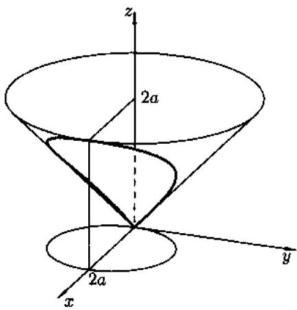 
用极坐标变换求上述二重积分, 则
图25.1
$\begin{aligned} I & = \sqrt{2}\int_{- \pi/2}^{\pi/2}d\theta\int_{0}^{2acos\theta}(r^{4}\cos^{2}\theta\sin^{2}\theta + r^{4})rdr \\ & = \sqrt{2}\int_{- \pi/2}^{\pi/2}(\cos^{2}\theta\sin^{2}\theta + 1) \cdot \left( \frac{1}{6}r^{6}|_{0}^{2acos\theta} \right)d\theta \\ & = \frac{\sqrt{2}}{6}(2a)^{6}\int_{- \pi/2}^{\pi/2}\cos^{6}\theta(\cos^{2}\theta\sin^{2}\theta + 1)d\theta = \frac{29}{8}\sqrt{2}\pi a^{6}. \end{aligned}$
解2 用参数式计算. $z = \sqrt{x^{2} + y^{2}}$在球坐标系中的方程为 $\varphi = \frac{\pi}{4}$ , 因此 $S$ 的参数方程为
$x = \frac{1}{\sqrt{2}}rcos\theta,y = \frac{1}{\sqrt{2}}rsin\theta,z = \frac{1}{\sqrt{2}}r,(r,\theta) \in D.$
又 $S$ 的边界线
$z = \sqrt{x^{2} + y^{2}},\quad x^{2} + y^{2} = 2ax$
的球坐标表示为
$\varphi = \frac{\pi}{4},\quad r^{2}\sin^{2}\varphi = 2arsin\varphi cos\theta.$
于是
$D = \{ - \frac{\pi}{2} \leq \theta \leq \frac{\pi}{2},0 \leq r \leq 2\sqrt{2}acos\theta\}.$
计算得
$E = \frac{r^{2}}{2},F = 0,G = 1,$
最后得到
$\begin{aligned} I & = \int_{- \pi/2}^{\pi/2}d\theta\int_{0}^{2\sqrt{2}acos\theta}(\frac{1}{4}r^{4}\cos^{2}\theta\sin^{2}\theta + \frac{1}{4}r^{4})\frac{r}{\sqrt{2}}dr \\ & = \frac{29}{8}\sqrt{2}\pi a^{6}.\quad ▫ \end{aligned}$

   **难度：5/5；出处：** 同事《数学分析3_习题导出.xlsx》第4行，原导出标识“25.1.1”；章号与谢惠民等《数学分析习题课讲义》（下册）高教社官方目录高度吻合，但具体版次、原书页码未核；与随附陈纪修等《数学分析》第三版不是同一题号体系，原题号25.1.1；**解答来源：** 同事习题导出表第4行“解析”栏，排版转写；数学步骤未逐题复核。

   **待核状态：** 教材原题号和书页待核；现有解析尚待逐题数学审校

<!-- source-exercise:CJX-III-XLSX-r007 -->
2. 例题25.2.3 求
$I = \iint_{\Sigma}^{}xyz(y^{2}z^{2} + z^{2}x^{2} + x^{2}y^{2})dS,$
其中 $\Sigma$ 为第一卦限中的球面 $x^{2} + y^{2} + z^{2} = a^{2}$ ( $x \geq 0,y \geq 0,z \geq 0$ ).

   **答案：** 解 见图 25.3, 不论用参数式或直角坐标式, 直接计算均相当复杂, 取 $\Sigma$ 的上侧, 则 $(x,y,z)$ 处的法向量为 $\left( \frac{x}{a},\frac{y}{a},\frac{z}{a} \right)$ 利用公式 (25.4),$\begin{matrix} I = a\iint_{\Sigma}^{}\left( y^{3}z^{3}\frac{x}{a} + z^{3}x^{3}\frac{y}{a} + x^{3}y^{3}\frac{z}{a} \right)dS \\ = a\iint_{\Sigma}^{}y^{3}z^{3}dydz + z^{3}x^{3}dzdx + x^{3}y^{3}dxdy \\ = 3a\iint_{\Sigma}^{}x^{3}y^{3}dxdy = 3a\iint_{D_{xy}}^{}x^{3}y^{3}dxdy, \end{matrix}$
其中 $D_{xy} = \{ x^{2} + y^{2} \leq a^{2},x \geq 0,y \geq 0\}$ ,作极坐标代换得
$\begin{aligned} I & = 3a\int_{0}^{\pi/2}d\theta\int_{0}^{a}r^{7}\sin^{3}\theta\cos^{3}\theta dr \\ & = \frac{3}{64}a^{9}\int_{0}^{\pi/2}\sin^{3}2\theta d\theta = \frac{1}{32}a^{9}.\quad ▫ \end{aligned}$
 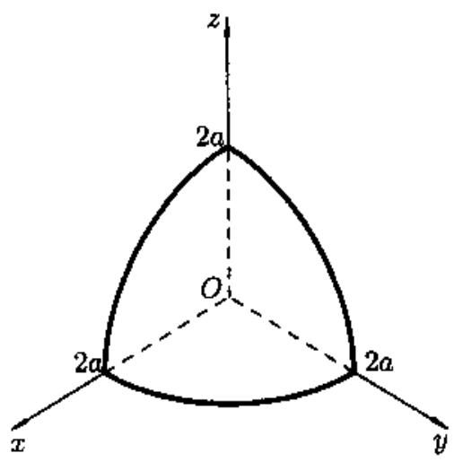 
图25.3
 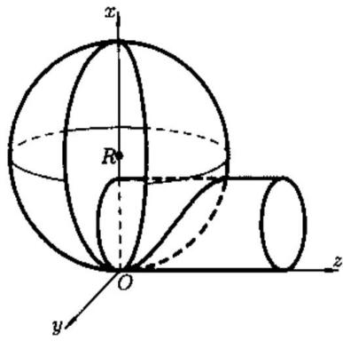 
图25.4

   **难度：5/5；出处：** 同事《数学分析3_习题导出.xlsx》第7行，原导出标识“25.2.3”；章号与谢惠民等《数学分析习题课讲义》（下册）高教社官方目录高度吻合，但具体版次、原书页码未核；与随附陈纪修等《数学分析》第三版不是同一题号体系，原题号25.2.3；**解答来源：** 同事习题导出表第7行“解析”栏，排版转写；数学步骤未逐题复核。

   **待核状态：** 教材原题号和书页待核；现有解析尚待逐题数学审校

#### 概念

**图谱路径：** 数学分析III / 曲面积分 / 第一型曲面积分 / 概念

**知识内容：** [定义、定理与方法](知识点.md#analysis-iii-c1fe80df7594)

<!-- source-exercise:CJX-III-SELF-013 -->
1. 设 $F=(x,y,z)$，求单位球外向通量；分别用直接曲面积分和 Gauss 公式计算。

   **答案：** 在单位球上 $n=(x,y,z)$，$F\cdot n=1$，通量为面积 $4\pi$。另一方面 $\operatorname{div}F=3$，单位球体积 $4\pi/3$，故通量为 $3\cdot4\pi/3=4\pi$。

   **难度：3/5；出处：** 课程建设自拟训练题；知识依据陈纪修等《数学分析》第三版相关章节，无教材原题号或原题页码，原题号自拟训练题 13；**解答来源：** 课程建设自拟并独立计算核对。

<!-- source-exercise:CJX-III-SELF-014 -->
2. 对单位正方形 $S=\{(x,y,0):0\le x,y\le1\}$ 取向上法向，求 $\iint_S1\,dS$ 与向量场 $F=(0,0,2)$ 穿过 $S$ 的通量。

   **答案：** 参数化 $r(x,y)=(x,y,0)$，$r_x\times r_y=(0,0,1)$。第一型曲面积分为面积 $1$；第二型通量为 $\int_0^1\int_0^1 2dxdy=2$。

   **难度：2/5；出处：** 课程建设自拟训练题；知识依据陈纪修等《数学分析》第三版相关章节，无教材原题号或原题页码，原题号自拟训练题 14；**解答来源：** 课程建设自拟并独立计算核对。

#### 计算

**图谱路径：** 数学分析III / 曲面积分 / 第一型曲面积分 / 计算

**知识内容：** [定义、定理与方法](知识点.md#analysis-iii-4fdad37c8992)

<!-- source-exercise:CJX-III-SELF-013 -->
1. 设 $F=(x,y,z)$，求单位球外向通量；分别用直接曲面积分和 Gauss 公式计算。

   **答案：** 在单位球上 $n=(x,y,z)$，$F\cdot n=1$，通量为面积 $4\pi$。另一方面 $\operatorname{div}F=3$，单位球体积 $4\pi/3$，故通量为 $3\cdot4\pi/3=4\pi$。

   **难度：3/5；出处：** 课程建设自拟训练题；知识依据陈纪修等《数学分析》第三版相关章节，无教材原题号或原题页码，原题号自拟训练题 13；**解答来源：** 课程建设自拟并独立计算核对。

<!-- source-exercise:CJX-III-SELF-014 -->
2. 对单位正方形 $S=\{(x,y,0):0\le x,y\le1\}$ 取向上法向，求 $\iint_S1\,dS$ 与向量场 $F=(0,0,2)$ 穿过 $S$ 的通量。

   **答案：** 参数化 $r(x,y)=(x,y,0)$，$r_x\times r_y=(0,0,1)$。第一型曲面积分为面积 $1$；第二型通量为 $\int_0^1\int_0^1 2dxdy=2$。

   **难度：2/5；出处：** 课程建设自拟训练题；知识依据陈纪修等《数学分析》第三版相关章节，无教材原题号或原题页码，原题号自拟训练题 14；**解答来源：** 课程建设自拟并独立计算核对。

<!-- source-exercise:CJX-III-3ED-ch14-s1-ex08 -->
3. 设 $u(x,y,z)$ 连续，且在 $M=(x_0,y_0,z_0)$ 处有连续二阶偏导。记 $\Sigma_R$ 为以 $M$ 为心、半径 $R$ 的球面，$T(R)=(4\pi R^2)^{-1}\iint_{\Sigma_R}u\,dS$。(1) 证明 $T(R)\to u(M)$；(2) 若 $\Delta u(M)\ne0$，求 $T(R)-u(M)$ 在 $R\downarrow0$ 时的主要部分。

   **答案：** (1) 球面上各点距 $M$ 恰为 $R$，由连续性 $|T(R)-u(M)|\le\sup_{|h|=R}|u(M+h)-u(M)|\to0$。(2) 对 $u(M+Rn)$ 作二阶 Taylor 展开；单位球面平均满足 $\langle n_i\rangle=0$、$\langle n_i n_j\rangle=\delta_{ij}/3$，故 $T(R)=u(M)+(R^2/6)\Delta u(M)+o(R^2)$。非零条件保证主要部分为 $(R^2/6)\Delta u(M)$。

   **难度：4/5；出处：** 陈纪修、於崇华、金路《数学分析》第三版（下册），第十四章§1习题 8，书页264，PDF第285页；题干全部小问已对照扫描原页，原题号第十四章§1习题 8；**解答来源：** 本课程建设自拟简解，按球面几何和积分核验。

### 第二型曲面积分

**图谱路径：** 数学分析III / 曲面积分 / 第二型曲面积分

**知识内容：** [定义、定理与方法](知识点.md#analysis-iii-c76ea3d9ba8c)

<!-- source-exercise:CJX-III-XLSX-r005 -->
1. 例题25.2.1设 $\Sigma$ 为上半单位球面 $z = \sqrt{1 - (x^{2} + y^{2})}$ ,取内侧,求
$I = \iint_{\Sigma}^{}dydz + dzdx + dxdy.$

   **答案：** 解 1 用直角坐标系计算$I = \iint_{\Sigma}^{}dydz + \iint_{\Sigma}^{}dzdx + \iint_{\Sigma}^{}dxdy = I_{1} + I_{2} + I_{3}.$
计算 $I_{1}:\Sigma = \Sigma_{1} + \Sigma_{2}$ ,其中
$\Sigma_{1}:x = \sqrt{1 - y^{2} - z^{2}},(y,z) \in D_{yz} = \{ y^{2} + z^{2} \leq 1,z \geq 0\},\text{取后侧},$
$\Sigma_{2}:x = - \sqrt{1 - y^{2} - z^{2}},(y,z) \in D_{yz}$ , 取前侧,
则
$I_{1} = \iint_{\Sigma_{1}}^{}dydz + \iint_{\Sigma_{2}}^{}dydz = - \iint_{D_{yz}}^{}dydz + \iint_{D_{yz}}^{}dydz = 0.$
同理有
$I_{2} = 0,I_{3} = - \iint_{D_{xy}}^{}dxdy = - \pi.$
最后得到
$I = - \pi.\quad ▫$
解2 用参数方程
$\begin{matrix} \Sigma:x = sin\varphi cos\theta,y = sin\varphi sin\theta,z = cos\varphi, \\ 0 \leq \varphi \leq \frac{\pi}{2},0 \leq \theta \leq 2\pi, \end{matrix}$
计算行列式
$\begin{matrix} A = \frac{\partial(y,z)}{\partial(\varphi,\theta)} = \sin^{2}\varphi cos\theta,\quad B = \frac{\partial(z,x)}{\partial(\varphi,\theta)} = \sin^{2}\varphi sin\theta, \\ C = \frac{\partial(x,y)}{\partial(\varphi,\theta)} = sin\varphi cos\varphi. \end{matrix}$
因为 $C > 0$ ,则 $(A,B,C)$ 的方向与上半球面 $S$ 内侧的法线方向相反,故积分号前取“-”号,得
$\begin{aligned} I & = - \iint_{D}^{}(\sin^{2}\varphi cos\theta + \sin^{2}\varphi sin\theta + sin\varphi cos\varphi)d\varphi d\theta \\ & = - \int_{0}^{\pi/2}d\varphi\int_{0}^{2\pi}\lbrack\sin^{2}\varphi(cos\theta + sin\theta) + sin\varphi cos\varphi\rbrack d\theta \\ & = - 2\pi\int_{0}^{\pi/2}\sin\varphi cos\varphi d\varphi = - \pi.\quad ▫ \end{aligned}$

   **难度：4/5；出处：** 同事《数学分析3_习题导出.xlsx》第5行，原导出标识“25.2.1”；章号与谢惠民等《数学分析习题课讲义》（下册）高教社官方目录高度吻合，但具体版次、原书页码未核；与随附陈纪修等《数学分析》第三版不是同一题号体系，原题号25.2.1；**解答来源：** 同事习题导出表第5行“解析”栏，排版转写；数学步骤未逐题复核。

   **待核状态：** 教材原题号和书页待核；现有解析尚待逐题数学审校

<!-- source-exercise:CJX-III-XLSX-r006 -->
2. 例题25.2.2 求
$I = \oint_{\Sigma}^{}(z + x)dydz + (x + y)dzdx + (y + z)dxdy,$
其中 $\Sigma$ 是由 $x^{2} + y^{2} = 1,z = 1$ 及三个坐标平面围成的立体在第一卦限的部分的表面,取外侧.
 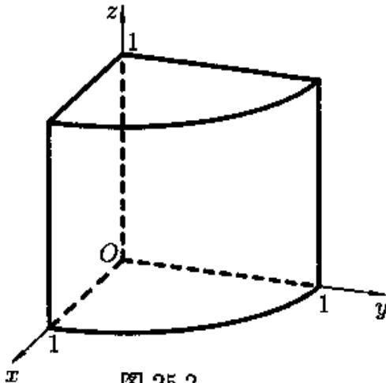 
图25.2

   **答案：** 解 见图 25.2, 因为 $\Sigma$ 分块较多 (需分 5 块), 不便于用参数式, 故应在直角坐标系中计算. 记 $\Sigma = \Sigma_{1} + \Sigma_{2} + \Sigma_{3} + \Sigma_{4} + \Sigma_{5}$ . 其中 $\Sigma_{1}$ 为圆柱面, $\Sigma_{2}$为下底面, $\Sigma_{3}$为上底面, $\Sigma_{4}$为左侧面 $y = 0$ , $\Sigma_{5}$为右侧面 $x = 0$ . 则有$I = \iint_{\Sigma}^{}(z + x)dydz + \iint_{\Sigma}^{}(x + y)dzdx + \iint_{\Sigma}^{}(y + z)dxdy = I_{1} + I_{2} + I_{3}.$
计算 $I_{1}$ ,有
$I_{1} = \sum_{i = 1}^{5}{\iint_{\Sigma_{i}}^{}(}x + z)dydz.$
因为 $\Sigma_{2},\Sigma_{3},\Sigma_{4}$ 在 $yOz$ 平面上的投影面积为零,于是
$\iint_{\Sigma_{i}}^{}(x + z)dydz = 0,\quad i = 2,3,4,$
而
$\Sigma_{1}:x = \sqrt{1 - y^{2}},(y,z) \in D_{yz} = \{ 0 \leq y \leq 1,0 \leq z \leq 1\}$ , 取前侧,
$\Sigma_{5}:x = 0,(y,z) \in D_{yz}$,取后侧.
于是
$\begin{aligned} I_{1} & = \iint_{\Sigma_{1}}^{}(x + z)dydz + \iint_{\Sigma_{5}}^{}(x + z)dydz \\ & = \iint_{D_{y^{z}}}^{}(\sqrt{1 - y^{2}} + z)dydz - \iint_{D_{y^{z}}}^{}zdydz \\ & = \int_{0}^{1}{\int_{0}^{1}\sqrt{1 - y^{2}}}dydz = \frac{\pi}{4}. \end{aligned}$
用类似的方法可求出 $I_{2} = \frac{\pi}{4}$ .
然后求
$I_{3} = \sum_{i = 1}^{5}{\iint_{\Sigma_{i}}^{}(}y + z)dxdy.$
显然有
$\iint_{\Sigma_{i}}^{}(y + z)dxdy = 0,i = 1,4,5,$
而
$\Sigma_{2}:z = 0,(x,y) \in D_{xy} = \{ x^{2} + y^{2} \leq 1,x \geq 0,y \geq 0\}$,取下侧,
$\Sigma_{3}:z = 1,(x,y) \in D_{xy},$取上侧,
于是
$\begin{aligned} I_{3} & = \iint_{\Sigma_{2}}^{}(y + z)dxdy + \iint_{\Sigma_{3}}^{}(y + z)dxdy \\ & = - \iint_{D_{xy}}^{}ydxdy + \iint_{D_{xy}}^{}(1 + y)dxdy \\ & = \iint_{D_{xy}}^{}dxdy = \frac{\pi}{4}. \end{aligned}$
最后得到
$I = I_{1} + I_{2} + I_{3} = \frac{3}{4}\pi.$

   **难度：5/5；出处：** 同事《数学分析3_习题导出.xlsx》第6行，原导出标识“25.2.2”；章号与谢惠民等《数学分析习题课讲义》（下册）高教社官方目录高度吻合，但具体版次、原书页码未核；与随附陈纪修等《数学分析》第三版不是同一题号体系，原题号25.2.2；**解答来源：** 同事习题导出表第6行“解析”栏，排版转写；数学步骤未逐题复核。

   **待核状态：** 教材原题号和书页待核；现有解析尚待逐题数学审校

<!-- source-exercise:CJX-III-XLSX-r008 -->
3. 题25.2.4求
$I = \iint_{\Gamma}^{}(y - z)dydz + (z - x)dzdx + (x - y)dxdy,$
其中 $\Sigma$ 是球面 $x^{2} + y^{2} + z^{2} = 2Rx$ 被柱面 $x^{2} + y^{2} = 2rx$ ( $0 < r < R$ ) 截下的位于 $z \geq 0$ 的部分, 取外侧.

   **答案：** 解 见图 25.4, 改写球面方程为 $(x - R)^{2} + y^{2} + z^{2} = R^{2}$ , 其外侧的法向量$n = \left( \frac{x - R}{R},\frac{y}{R},\frac{z}{R} \right).$
由公式 (25.4), 有
$\begin{aligned} I & = \iint_{\Sigma}^{}(y - z,z - x,x - y) \cdot ndS \\ & = \frac{1}{R}\iint_{\Sigma}^{}\left\lbrack (y - z)(x - R) + (z - x)y + (x - y)z \right\rbrack dS \\ & = \iint_{\Sigma}^{}(z - y)dS. \end{aligned}$
由于 $\Sigma$ 关于 $xOz$ 平面对称, 而函数 $y$ 是奇函数, 于是
$\begin{matrix} I = \iint_{\Sigma}^{}zdS = \iint_{x^{2} + y^{2} \leq 2rx}^{}\sqrt{2Rx - x^{2} - y^{2}}\frac{R}{\sqrt{2Rx - x^{2} - y^{2}}}dxdy \\ = R \cdot \pi r^{2} = \pi Rr^{2}.\quad ▫ \end{matrix}$

   **难度：5/5；出处：** 同事《数学分析3_习题导出.xlsx》第8行，原导出标识“导出表第8行（无教材原题号）”；章号与谢惠民等《数学分析习题课讲义》（下册）高教社官方目录高度吻合，但具体版次、原书页码未核；与随附陈纪修等《数学分析》第三版不是同一题号体系，原题号导出表第8行（无教材原题号）；**解答来源：** 同事习题导出表第8行“解析”栏，排版转写；数学步骤未逐题复核。

   **待核状态：** 教材原题号和书页待核；现有解析尚待逐题数学审校

#### 概念

**图谱路径：** 数学分析III / 曲面积分 / 第二型曲面积分 / 概念

**知识内容：** [定义、定理与方法](知识点.md#analysis-iii-cf2cc511384e)

<!-- source-exercise:CJX-III-SELF-013 -->
1. 设 $F=(x,y,z)$，求单位球外向通量；分别用直接曲面积分和 Gauss 公式计算。

   **答案：** 在单位球上 $n=(x,y,z)$，$F\cdot n=1$，通量为面积 $4\pi$。另一方面 $\operatorname{div}F=3$，单位球体积 $4\pi/3$，故通量为 $3\cdot4\pi/3=4\pi$。

   **难度：3/5；出处：** 课程建设自拟训练题；知识依据陈纪修等《数学分析》第三版相关章节，无教材原题号或原题页码，原题号自拟训练题 13；**解答来源：** 课程建设自拟并独立计算核对。

<!-- source-exercise:CJX-III-SELF-014 -->
2. 对单位正方形 $S=\{(x,y,0):0\le x,y\le1\}$ 取向上法向，求 $\iint_S1\,dS$ 与向量场 $F=(0,0,2)$ 穿过 $S$ 的通量。

   **答案：** 参数化 $r(x,y)=(x,y,0)$，$r_x\times r_y=(0,0,1)$。第一型曲面积分为面积 $1$；第二型通量为 $\int_0^1\int_0^1 2dxdy=2$。

   **难度：2/5；出处：** 课程建设自拟训练题；知识依据陈纪修等《数学分析》第三版相关章节，无教材原题号或原题页码，原题号自拟训练题 14；**解答来源：** 课程建设自拟并独立计算核对。

#### 计算

**图谱路径：** 数学分析III / 曲面积分 / 第二型曲面积分 / 计算

**知识内容：** [定义、定理与方法](知识点.md#analysis-iii-8b58b4ab3f90)

<!-- source-exercise:CJX-III-SELF-013 -->
1. 设 $F=(x,y,z)$，求单位球外向通量；分别用直接曲面积分和 Gauss 公式计算。

   **答案：** 在单位球上 $n=(x,y,z)$，$F\cdot n=1$，通量为面积 $4\pi$。另一方面 $\operatorname{div}F=3$，单位球体积 $4\pi/3$，故通量为 $3\cdot4\pi/3=4\pi$。

   **难度：3/5；出处：** 课程建设自拟训练题；知识依据陈纪修等《数学分析》第三版相关章节，无教材原题号或原题页码，原题号自拟训练题 13；**解答来源：** 课程建设自拟并独立计算核对。

<!-- source-exercise:CJX-III-SELF-014 -->
2. 对单位正方形 $S=\{(x,y,0):0\le x,y\le1\}$ 取向上法向，求 $\iint_S1\,dS$ 与向量场 $F=(0,0,2)$ 穿过 $S$ 的通量。

   **答案：** 参数化 $r(x,y)=(x,y,0)$，$r_x\times r_y=(0,0,1)$。第一型曲面积分为面积 $1$；第二型通量为 $\int_0^1\int_0^1 2dxdy=2$。

   **难度：2/5；出处：** 课程建设自拟训练题；知识依据陈纪修等《数学分析》第三版相关章节，无教材原题号或原题页码，原题号自拟训练题 14；**解答来源：** 课程建设自拟并独立计算核对。

#### 两类曲面积分之间的联系

**图谱路径：** 数学分析III / 曲面积分 / 第二型曲面积分 / 两类曲面积分之间的联系

**知识内容：** [定义、定理与方法](知识点.md#analysis-iii-b623a7ab34d0)

<!-- source-exercise:CJX-III-SELF-014 -->
1. 对单位正方形 $S=\{(x,y,0):0\le x,y\le1\}$ 取向上法向，求 $\iint_S1\,dS$ 与向量场 $F=(0,0,2)$ 穿过 $S$ 的通量。

   **答案：** 参数化 $r(x,y)=(x,y,0)$，$r_x\times r_y=(0,0,1)$。第一型曲面积分为面积 $1$；第二型通量为 $\int_0^1\int_0^1 2dxdy=2$。

   **难度：2/5；出处：** 课程建设自拟训练题；知识依据陈纪修等《数学分析》第三版相关章节，无教材原题号或原题页码，原题号自拟训练题 14；**解答来源：** 课程建设自拟并独立计算核对。

### 高斯公式和斯托克斯公式

**图谱路径：** 数学分析III / 曲面积分 / 高斯公式和斯托克斯公式

**知识内容：** [定义、定理与方法](知识点.md#analysis-iii-8737f457950f)

所给材料中未找到直接对应的独立未解题。

#### 高斯公式

**图谱路径：** 数学分析III / 曲面积分 / 高斯公式和斯托克斯公式 / 高斯公式

**知识内容：** [定义、定理与方法](知识点.md#analysis-iii-b18dc64e3ed7)

<!-- source-exercise:CJX-III-XLSX-r054 -->
1. 例题26.1.1 证明重积分的分部积分公式
$\iiint_{\Omega}^{}u\frac{\partial v}{\partial x}dxdydz = ∯_{\Sigma}^{}uvdydz - \iiint_{\Omega}^{}v\frac{\partial u}{\partial x}dxdydz,$
其中 $\Sigma$ 是 $\Omega$ 的边界, 分片光滑, 取外侧. $u,v$ 在 $\overline{\Omega}$ 上连续可微.

   **答案：** 证 在 (26.1) 中令 $a = (uv,0,0)$ , 则$\iiint_{\Omega}^{}\left( u\frac{\partial v}{\partial x} + v\frac{\partial u}{\partial x} \right)dxdydz = ∯_{\Sigma}^{}uvdydz.\quad ▫$
注 令 $v = 1$ ,则有
$\iiint_{\Omega}^{}\frac{\partial u}{\partial x}dxdydz = \iint_{\Sigma}^{}udydz.$

   **难度：5/5；出处：** 同事《数学分析3_习题导出.xlsx》第54行，原导出标识“26.1.1”；章号与谢惠民等《数学分析习题课讲义》（下册）高教社官方目录高度吻合，但具体版次、原书页码未核；与随附陈纪修等《数学分析》第三版不是同一题号体系，原题号26.1.1；**解答来源：** 同事习题导出表第54行“解析”栏，排版转写；数学步骤未逐题复核。

   **待核状态：** 教材原题号和书页待核；现有解析尚待逐题数学审校

<!-- source-exercise:CJX-III-XLSX-r062 -->
2. 例题25.3.2 计算曲面积分
$I = \iint_{c}^{}\frac{xdydz + ydzdx + zdxdy}{(ax^{2} + by^{2} + cz^{2})^{3/2}},$
其中 $S$ 是球面 $x^{2} + y^{2} + z^{2} = 1$ , 取外侧 $(a > 0,b > 0,c > 0)$ .

   **答案：** 解1 记 $P(x,y,z) = \frac{x}{(ax^{2} + by^{2} + cz^{2})^{3/2}},Q(x,y,z) = \frac{y}{(ax^{2} + by^{2} + cz^{2})^{3/2}}$，$R(x,y,z) = \frac{z}{(ax^{2} + by^{2} + cz^{2})^{3/2}}$,则在不包含原点的任何区域上
$\frac{\partial P}{\partial x} + \frac{\partial Q}{\partial y} + \frac{\partial R}{\partial z} = 0.$
为了利用 Gauss 公式, 对充分小的 $\varepsilon > 0$ , 作闭曲面
$S_{\varepsilon} = \{ ax^{2} + by^{2} + cz^{2} = \varepsilon^{2}\},$
取外侧. 由 Gauss 公式
$I = \iint_{S_{x}}^{}\frac{xdydz + ydzdx + zdxdy}{(ax^{2} + by^{2} + cz^{2})^{3/2}} = \frac{1}{\varepsilon^{3}}\iint_{S_{x}}^{}xdydz + ydzdx + zdxdy.$
上述积分在 $S_{\varepsilon}$ 的外侧. 再一次用 Gauss 公式, 则
$I = \frac{3}{\varepsilon^{3}}\iiint_{ax^{2} + by^{2} + cz^{2} \leq \varepsilon^{2}}^{}dxdydz = \frac{3}{\varepsilon^{3}} \cdot \frac{4\pi}{3} \cdot \frac{\varepsilon^{3}}{\sqrt{abc}} = \frac{4\pi}{\sqrt{abc}}.$
解2(不用Gauss公式而直接计算)利用单位球面的参数方程
$\begin{matrix} x = sin\varphi cos\theta,y = sin\varphi sin\theta,z = cos\varphi, \\ 0 \leq \varphi \leq \pi,0 \leq \theta \leq 2\pi, \end{matrix}$
计算得到
$\begin{matrix} A = \frac{\partial(y,z)}{\partial(\varphi,\theta)} = \sin^{2}\varphi cos\theta,B = \frac{\partial(z,x)}{\partial(\varphi,\theta)} = \sin^{2}\varphi sin\theta, \\ C = \frac{\partial(x,y)}{\partial(\varphi,\theta)} = sin\varphi cos\varphi. \end{matrix}$
容易看出, $(A,B,C)$ 的方向与单位球面外侧法线方向一致,故积分号前取“+”号,由(25.3)得
$I = 8\int_{0}^{\pi/2}{\int_{0}^{\pi/2}\frac{sin\varphi d\varphi d\theta}{\left( a\sin^{2}\varphi\cos^{2}\theta + b\sin^{2}\varphi\sin^{2}\theta + c\cos^{2}\varphi \right)^{3/2}}}.$
先计算对 $\varphi$ 的积分, 我们令 $cos\varphi = t$ , 则
$\begin{matrix} \int_{0}^{\pi/2}\frac{sin\varphi d\varphi}{(a\sin^{2}\varphi\cos^{2}\theta + b\sin^{2}\varphi\sin^{2}\theta + c\cos^{2}\varphi)^{3/2}} \\ = \int_{0}^{1}\frac{dt}{\left\lbrack (a\cos^{2}\theta + b\sin^{2}\theta) - (a\cos^{2}\theta + b\sin^{2}\theta - c)t^{2} \right\rbrack^{3/2}} \\ = \frac{1}{(a\cos^{2}\theta + b\sin^{2}\theta)} \cdot \frac{t}{\left\lbrack (a\cos^{2}\theta + b\sin^{2}\theta) - (a\cos^{2}\theta + b\sin^{2}\theta - c)t^{2} \right\rbrack^{1/2}}|_{t = 0}^{t = 1} \\ = \frac{1}{\sqrt{c}} \cdot \frac{1}{a\cos^{2}\theta + b\sin^{2}\theta}. \end{matrix}$
最后得到
$\begin{aligned} I & = \frac{8}{\sqrt{c}}\int_{0}^{\pi/2}\frac{d\theta}{a\cos^{2}\theta + b\sin^{2}\theta} = \frac{8}{\sqrt{c}}\int_{0}^{+ \infty}\frac{dt}{a + bt^{2}}(t = tan\theta) \\ & = \frac{8}{\sqrt{c}}\frac{1}{\sqrt{ab}}\arctan\left( \sqrt{\frac{b}{a}}t \right)|_{0}^{+ \infty} = \frac{4\pi}{\sqrt{abc}}.\quad ▫ \end{aligned}$

   **难度：5/5；出处：** 同事《数学分析3_习题导出.xlsx》第62行，原导出标识“25.3.2”；章号与谢惠民等《数学分析习题课讲义》（下册）高教社官方目录高度吻合，但具体版次、原书页码未核；与随附陈纪修等《数学分析》第三版不是同一题号体系，原题号25.3.2；**解答来源：** 同事习题导出表第62行“解析”栏，排版转写；数学步骤未逐题复核。

   **待核状态：** 教材原题号和书页待核；现有解析尚待逐题数学审校

<!-- source-exercise:CJX-III-XLSX-r063 -->
3. 例题25.3.1 求
$\begin{matrix} \text{求} \\ I = \iint_{\Sigma}^{}4xzdydz - 2yzdzdx + (1 - z^{2})dxdy, \end{matrix}$
其中 $\Sigma$ 是曲线 $z = e^{y}$ ( $0 \leq y \leq a$ ) 绕 $z$ 轴旋转生成的旋转面, 取下侧.

   **答案：** 解 $\Sigma$ 的方程为$z = e^{\sqrt{x^{2} + y^{2}}}(x^{2} + y^{2} \leq a^{2}).$
 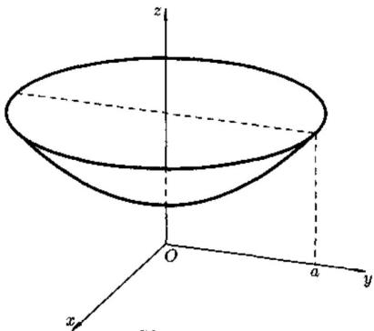 
图25.5
直接计算比较复杂. 考虑用 Gauss 公式. 由于 $\Sigma$ 不闭, 需要添加辅助面
$\Sigma_{1}:z = e^{a},(x^{2} + y^{2} \leq a^{2})$取上侧.
见图25.5, 设 $\Sigma$ 与 $\Sigma_{1}$ 围成的区域为 $D$ , 令
$P = 4xz,Q = - 2yz,R = 1 - z^{2}.$
则
$\frac{\partial P}{\partial x} + \frac{\partial Q}{\partial y} + \frac{\partial R}{\partial z} = 0.$
由公式 (25.5), 得
$\begin{matrix} I = \left( \iint_{\Sigma}^{} + \iint_{\Sigma_{1}}^{} - \iint_{\Sigma_{1}}^{} \right)(1 - z^{2})dxdy = - \iint_{\Sigma_{1}}^{}(1 - z^{2})dxdy \\ = (e^{2a} - 1)\iint_{x^{2} + y^{2} \leq a^{2}}^{}dxdy = (e^{2a} - 1)\pi a^{2}.\quad ▫ \end{matrix}$

   **难度：5/5；出处：** 同事《数学分析3_习题导出.xlsx》第63行，原导出标识“25.3.1”；章号与谢惠民等《数学分析习题课讲义》（下册）高教社官方目录高度吻合，但具体版次、原书页码未核；与随附陈纪修等《数学分析》第三版不是同一题号体系，原题号25.3.1；**解答来源：** 同事习题导出表第63行“解析”栏，排版转写；数学步骤未逐题复核。

   **待核状态：** 教材原题号和书页待核；现有解析尚待逐题数学审校

<!-- source-exercise:CJX-III-SELF-013 -->
4. 设 $F=(x,y,z)$，求单位球外向通量；分别用直接曲面积分和 Gauss 公式计算。

   **答案：** 在单位球上 $n=(x,y,z)$，$F\cdot n=1$，通量为面积 $4\pi$。另一方面 $\operatorname{div}F=3$，单位球体积 $4\pi/3$，故通量为 $3\cdot4\pi/3=4\pi$。

   **难度：3/5；出处：** 课程建设自拟训练题；知识依据陈纪修等《数学分析》第三版相关章节，无教材原题号或原题页码，原题号自拟训练题 13；**解答来源：** 课程建设自拟并独立计算核对。

#### 斯托克斯公式

**图谱路径：** 数学分析III / 曲面积分 / 高斯公式和斯托克斯公式 / 斯托克斯公式

**知识内容：** [定义、定理与方法](知识点.md#analysis-iii-ae8073ea8138)

<!-- source-exercise:CJX-III-XLSX-r059 -->
1. 例题25.3.5 试用Stokes公式计算
$I = \oint_{C}^{}(y^{2} + z^{2})dx + (z^{2} + x^{2})dy + (x^{2} + y^{2})dz,$
其中 $C$ 为 $x^{2} + y^{2} + z^{2} = 2Rx$ 与 $x^{2} + y^{2} = 2rx$ 的交线 $(0 < r < R,z > 0)$ , $C$ 的定向使得 $C$ 所包围的球面上较小区域保持在左边.

   **答案：** 解 见图 25.4, 设 S 为球面 $x^{2} + y^{2} + z^{2} = 2Rx$ 被柱面 $x^{2} + y^{2} = 2rx$ 所截部分的外侧, 由 Stokes 公式 (25.13)$\begin{matrix} I = \iint_{S}^{}\left| \begin{matrix} \frac{x - R}{R} & \frac{y}{R} & \frac{z}{R} \\ \frac{\partial}{\partial x} & \frac{\partial}{\partial y} & \frac{\partial}{\partial z} \\ y^{2} + z^{2} & z^{2} + x^{2} & x^{2} + y^{2} \end{matrix} \right|dS \\ = \frac{2}{R}\iint_{S}^{}\left\lbrack (y - z)(x - R) + (z - x)y + (x - y)z \right\rbrack dS \\ = 2\iint_{S}^{}(z - y)dS = 2\iint_{S}^{}zdS = 2R\iint_{x^{2} + y^{2} \leq 2rx}^{}dxdy = 2\pi r^{2}R.\quad ▫ \end{matrix}$

   **难度：5/5；出处：** 同事《数学分析3_习题导出.xlsx》第59行，原导出标识“25.3.5”；章号与谢惠民等《数学分析习题课讲义》（下册）高教社官方目录高度吻合，但具体版次、原书页码未核；与随附陈纪修等《数学分析》第三版不是同一题号体系，原题号25.3.5；**解答来源：** 同事习题导出表第59行“解析”栏，排版转写；数学步骤未逐题复核。

   **待核状态：** 教材原题号和书页待核；现有解析尚待逐题数学审校

<!-- source-exercise:CJX-III-XLSX-r060 -->
2. 例题 25.3.4 设 $\Sigma$ 是分片光滑的闭曲面, n 为 $\Sigma$ 上的单位外法向量, 试证明
$I = \oint_{\Sigma}^{}\left| \begin{matrix} cos(n,x) & cos(n,y) & cos(n,z) \\ \frac{\partial}{\partial x} & \frac{\partial}{\partial y} & \frac{\partial}{\partial z} \\ P & Q & R \end{matrix} \right|dS = 0,$
其中分两种情形: (1) $P,Q,R$ 在 $\overline{\Omega}$ 上二阶连续可微, $\Omega$ 为 $\Sigma$ 所围的立体; (2) $P,Q,R$ 在 $\Sigma$ 上一阶连续可微.

   **答案：** 证 对情形 (1) 用 Gauss 公式$\begin{aligned} I & = \iint_{\Sigma}^{}\left( \frac{\partial R}{\partial y} - \frac{\partial Q}{\partial z} \right)dydz + \left( \frac{\partial P}{\partial z} - \frac{\partial R}{\partial x} \right)dzdx \\ & \quad + \left( \frac{\partial Q}{\partial x} - \frac{\partial P}{\partial y} \right)dxdy \\ & = \iiint_{\Omega}^{}\left\lbrack \frac{\partial}{\partial x}\left( \frac{\partial R}{\partial y} - \frac{\partial Q}{\partial z} \right) + \frac{\partial}{\partial y}\left( \frac{\partial P}{\partial z} - \frac{\partial R}{\partial x} \right) \right.\ \\ & \quad\left. \ + \frac{\partial}{\partial z}\left( \frac{\partial Q}{\partial x} - \frac{\partial P}{\partial y} \right) \right\rbrack dxdydz \\ & = 0. \end{aligned}$
 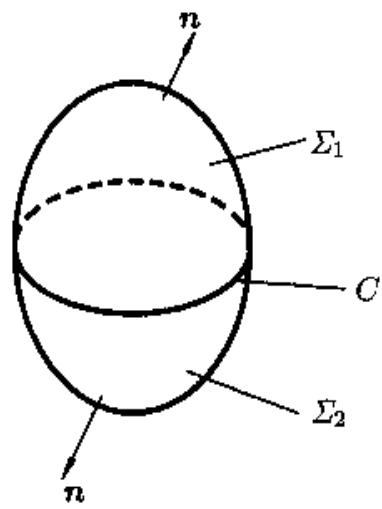 
图25.7
情形 (2) 参见图 25.7. 在 $\Sigma$ 上任取一条逐段光滑的闭曲线 $C,C$ 分 $\Sigma$ 为两部分 $\Sigma_{1}$ 与 $\Sigma_{2}$ , 在 $\Sigma_{1},\Sigma_{2}$ 上分别应用 Stokes 公式, 则对于 $i = 1,2$ ,
$\iint_{\Sigma_{t}}^{}\left| \begin{matrix} cos(n,x) & cos(n,y) & cos(n,z) \\ \frac{\partial}{\partial x} & \frac{\partial}{\partial y} & \frac{\partial}{\partial z} \\ P & Q & R \end{matrix} \right|dS = \oint_{C_{t}}^{}Pdx + Qdy + Rdz.$
因 $\Sigma_{1},\Sigma_{2}$ 分居 $C$ 两侧, 故 $C_{1},C_{2}$ 为同一条曲线 $C$ , 只是它们的定向相反. 若记 $C_{1}$ 为 $C_{+}$ , 则 $C_{2}$ 为 $C_{-}$ , 从而
$\begin{matrix} I = \left( \iint_{\Sigma_{1}}^{} + \iint_{\Sigma_{2}}^{} \right)\left| \begin{matrix} cos(n,x) & cos(n,y) & cos(n,z) \\ \frac{\partial}{\partial x} & \frac{\partial}{\partial y} & \frac{\partial}{\partial z} \\ P & Q & R \end{matrix} \right|dS \\ = \left( \oint_{C_{+}}^{} + \oint_{C_{-}}^{} \right)Pdx + Qdy + Rdz = 0.\quad ▫ \end{matrix}$

   **难度：5/5；出处：** 同事《数学分析3_习题导出.xlsx》第60行，原导出标识“25.3.4”；章号与谢惠民等《数学分析习题课讲义》（下册）高教社官方目录高度吻合，但具体版次、原书页码未核；与随附陈纪修等《数学分析》第三版不是同一题号体系，原题号25.3.4；**解答来源：** 同事习题导出表第60行“解析”栏，排版转写；数学步骤未逐题复核。

   **待核状态：** 教材原题号和书页待核；现有解析尚待逐题数学审校

<!-- source-exercise:CJX-III-XLSX-r061 -->
3. 例题25.3.3 求
$I = \oint_{C}^{}(y^{2} - z^{2})dx + (z^{2} - x^{2})dy + (x^{2} - y^{2})dz,$
其中 $C$ 是立方体 $\{ 0 \leq x \leq a,0 \leq y \leq a,0 \leq z \leq a\}$ 的表面与平面 $x + y + z = \frac{3}{2}a$ 的交线, 取向从 $z$ 轴正向看去是逆时针方向.

   **答案：** 分析 见图 25.6, 分六段积分的计算量很大, 且 C 也不便于表示为一个统一的参数式. 因 C 为闭曲线, 且 $P = y^{2} - z^{2}$ , $Q = z^{2} - x^{2}$ , $R = x^{2} - y^{2}$连续可微, 故考虑用 Stokes 公式.解 令 $\Sigma$ 为 $x + y + z = \frac{3}{2}a$ 被 $C$ 所围的一块, 取上侧, 则 $C$ 的取向与 $\Sigma$ 的取侧相容. 应用Stokes公式(25.13),
$\begin{matrix} I = \iint_{\Sigma}^{}\left| \begin{matrix} \frac{1}{\sqrt{3}} & \frac{1}{\sqrt{3}} & \frac{1}{\sqrt{3}} \\ \frac{\partial}{\partial x} & \frac{\partial}{\partial y} & \frac{\partial}{\partial z} \\ y^{2} - z^{2} & z^{2} - x^{2} & x^{2} - y^{2} \end{matrix} \right|dS \\ = \frac{1}{\sqrt{3}}\iint_{\Sigma}^{} - 4(x + y + z)dS \\ = - \frac{4}{\sqrt{3}}\iint_{\Sigma}^{}\frac{3}{2}adS = - 2\sqrt{3}a \cdot |\Sigma| \\ = - 2\sqrt{3}a \cdot \frac{3\sqrt{3}}{4}a^{2} = - \frac{9}{2}a^{3}.\quad ▫ \end{matrix}$
 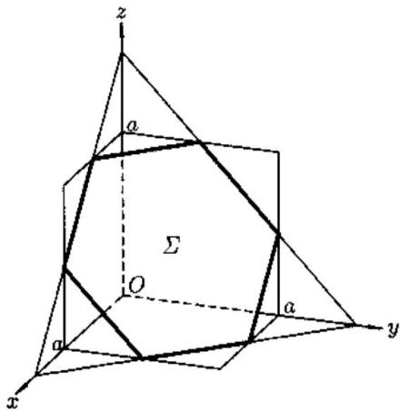 
图25.6

   **难度：5/5；出处：** 同事《数学分析3_习题导出.xlsx》第61行，原导出标识“25.3.3”；章号与谢惠民等《数学分析习题课讲义》（下册）高教社官方目录高度吻合，但具体版次、原书页码未核；与随附陈纪修等《数学分析》第三版不是同一题号体系，原题号25.3.3；**解答来源：** 同事习题导出表第61行“解析”栏，排版转写；数学步骤未逐题复核。

   **待核状态：** 教材原题号和书页待核；现有解析尚待逐题数学审校

### 场论初步

**图谱路径：** 数学分析III / 曲面积分 / 场论初步

**知识内容：** [定义、定理与方法](知识点.md#analysis-iii-a4d1fd7dcbc4)

<!-- source-exercise:CJX-III-XLSX-r003 -->
1. 例题 26.2.2 设 $h(x,y,z)$ 在 $\mathbb{R}^3$ 上二阶连续可微，$\partial B_r(M)$ 是以 $M=(x,y,z)$ 为心，$r$ 为半径的球面，定义$$M_h(x,y,z,r)=\frac{1}{4\pi r^2}\oiint_{\partial B_r(M)} h(\xi,\eta,\zeta)\mathrm{d}S_r,$$其中 $r>0$，证明(1) $M_h$ 是 $x,y,z,r$ 的二次连续可微函数；(2) $\Delta M_h(x,y,z,r)=\left(\frac{\partial^2}{\partial r^2}+\frac{2}{r}\frac{\partial}{\partial r}\right)M_h(x,y,z,r)$，其中 $\Delta=\frac{\partial^2}{\partial x^2}+\frac{\partial^2}{\partial y^2}+\frac{\partial^2}{\partial z^2}$；(3)$\lim\limits_{r\to0^+}\frac{\partial}{\partial r}M_h(x,y,z,r)=0.$

   **答案：** 证 (1) 由 (25.27), $M_h$ 的表达式可改写为

$$

M_h(x,y,z,r)=\frac{1}{4\pi}\oiint_{\partial B_1(0)} h(x+r\alpha_1,y+r\alpha_2,z+r\alpha_3)\mathrm{d}S_1,

$$

其中 $(\alpha_1,\alpha_2,\alpha_3)$ 是球面 $\partial B_1(0)$ 的单位外法向量，$\mathrm{d}S_1$ 是 $\partial B_1(0)$ 的面积元。由含参变量积分的性质知 $M_h$ 是 $x,y,z,r$ 的二次连续可微函数。

(2) 由含参变量积分的求导公式得

$$

\Delta M_h(x,y,z,r)=\frac{1}{4\pi}\oiint_{\partial B_1(0)} \Delta h(x+r\alpha_1,y+r\alpha_2,z+r\alpha_3)\mathrm{d}S_1,\tag{26.16}

$$

$$

\begin{aligned}

\frac{\partial M_h}{\partial r}&=\frac{1}{4\pi}\oiint_{\partial B_1(0)} \left(\frac{\partial h}{\partial x}\alpha_1+\frac{\partial h}{\partial y}\alpha_2+\frac{\partial h}{\partial z}\alpha_3\right)\mathrm{d}S_1\\

&=\frac{1}{4\pi r^2}\oiint_{\partial B_r(0)} \left(\frac{\partial h}{\partial x}\alpha_1+\frac{\partial h}{\partial y}\alpha_2+\frac{\partial h}{\partial z}\alpha_3\right)\mathrm{d}S_r.

\end{aligned} \quad(\text{由}(25.26))

$$

应用 Gauss 公式 (26.2), 则

$$

\frac{\partial M_h}{\partial r}=\frac{1}{4\pi r^2}\iiint_{B_r(M)} \Delta h(\xi,\eta,\zeta)\mathrm{d}\xi\mathrm{d}\eta\mathrm{d}\zeta. \tag{26.18}

$$

应用例题 25.5.3(2) 中的结果, 则

$$

\frac{\partial^2 M_h}{\partial r^2}=-\frac{1}{2\pi r^3}\iiint_{B_r(M)} \Delta h(\xi,\eta,\zeta)\mathrm{d}\xi\mathrm{d}\eta\mathrm{d}\zeta

+\frac{1}{4\pi r^2}\oiint_{\partial B_r(M)} \Delta h(\xi,\eta,\zeta)\mathrm{d}S_r. \tag{26.19}

$$

由 (26.18), (26.19) 得

$$

\begin{aligned}

\frac{\partial^2 M_h}{\partial r^2}+\frac{2}{r}\frac{\partial M_h}{ \partial r}

&=\frac{1}{4\pi r^2}\oiint_{\partial B_r(M)} \Delta h(\xi,\eta,\zeta)\mathrm{d}S_r \\

&=\frac{1}{4\pi r^2}\oiint_{\partial B_r(0)} \Delta h(x+r\alpha_1,y+r\alpha_2,z+r\alpha_3)\mathrm{d}S_r \\

&=\Delta M_h(x,y,z,r). \quad(\text{由}(26.16))

\end{aligned}

$$

(3)利用 (26.18) 以及积分中值定理可知

$$

\lim_{r\to0^+}\frac{\partial}{\partial r}M_h(x,y,z,r)

=\lim_{r\to0^+}\frac{1}{4\pi r^2}\Delta h(\xi^*,\eta^*,\zeta^*)\cdot\frac{4}{3}\pi r^3=0,

$$

其中 $(\xi^*,\eta^*,\zeta^*)\in B_r(M)$.

   **难度：5/5；出处：** 同事《数学分析3_习题导出.xlsx》第3行，原导出标识“26.2.2”；章号与谢惠民等《数学分析习题课讲义》（下册）高教社官方目录高度吻合，但具体版次、原书页码未核；与随附陈纪修等《数学分析》第三版不是同一题号体系，原题号26.2.2；**解答来源：** 同事习题导出表第3行“解析”栏，排版转写；数学步骤未逐题复核。

   **待核状态：** 教材原题号和书页待核；现有解析尚待逐题数学审校

<!-- source-exercise:CJX-III-XLSX-r049 -->
2. 例题26.2.2 设 $h(x,y,z)$ 在 $R^{3}$ 上二阶连续可微, $\partial B_{r}(M)$ 是以 $M = (x,y,z)$ 为心, $r$ 为半径的球面, 定义
$M_{h}(x,y,z,r) = \frac{1}{4\pi r^{2}}∯_{\partial B_{r}(M)}^{}h(\xi,\eta,\zeta)dS_{r},$
其中 $r > 0$ ,证明
$M_{h}$是 $x,y,z,r$ 的二次连续可微函数;
$\Delta M_{h}(x,y,z,r) = \left( \frac{\partial^{2}}{\partial r^{2}} + \frac{2}{r}\frac{\partial}{\partial r} \right)M_{h}(x,y,z,r),$
其中 $\Delta = \frac{\partial^{2}}{\partial x^{2}} + \frac{\partial^{2}}{\partial y^{2}} + \frac{\partial^{2}}{\partial z^{2}};$
(3)$\lim_{r \rightarrow 0^{+}}\frac{\partial}{\partial r}M_{h}(x,y,z,r) = 0.$

   **答案：** 证 (1) 由 (25.27), $M_{h}$的表达式可改写为$M_{h}(x,y,z,r) = \frac{1}{4\pi}∯_{\partial B_{1}(0)}^{}h(x + r\alpha_{1},y + r\alpha_{2},z + r\alpha_{3})dS_{1},$
其中 $(\alpha_{1},\alpha_{2},\alpha_{3})$ 是球面 $\partial B_{1}(0)$ 的单位外法向量, $dS_{1}$ 是 $\partial B_{1}(0)$ 的面积元.由含参变量积分的性质知 $M_{h}$ 是 $x,y,z,r$ 的二次连续可微函数
(2)由含参变量积分的求导公式得
$\begin{aligned} & \Delta M_{h}(x,y,z,r) = \frac{1}{4\pi}∯_{\partial B_{1}(0)}^{}\Delta h(x + r\alpha_{1},y + r\alpha_{2},z + r\alpha_{3})dS_{1},(26.16 \\ & \frac{\partial M_{h}}{\partial r} = \frac{1}{4\pi}∯_{\partial B_{1}(0)}^{}(\frac{\partial h}{\partial x}\alpha_{1} + \frac{\partial h}{\partial y}\alpha_{2} + \frac{\partial h}{\partial z}\alpha_{3})dS_{1} \\ & \quad\quad = \frac{1}{4\pi r^{2}}∯_{\partial B_{r}(0)}^{}(\frac{\partial h}{\partial x}\alpha_{1} + \frac{\partial h}{\partial y}\alpha_{2} + \frac{\partial h}{\partial z}\alpha_{3})dS_{r}.\quad\quad(\text{由}(25.26)) \end{aligned}$

   **难度：5/5；出处：** 同事《数学分析3_习题导出.xlsx》第49行，原导出标识“26.2.2”；章号与谢惠民等《数学分析习题课讲义》（下册）高教社官方目录高度吻合，但具体版次、原书页码未核；与随附陈纪修等《数学分析》第三版不是同一题号体系，原题号26.2.2；**解答来源：** 同事习题导出表第49行“解析”栏，排版转写；数学步骤未逐题复核。

   **待核状态：** 教材原题号和书页待核；现有解析尚待逐题数学审校

<!-- source-exercise:CJX-III-XLSX-r050 -->
3. 例题26.2.1(第一Green恒等式)设 $\Sigma$ 为区域 $\Omega$ 的边界曲面,分片光滑, $u,v$ 在 $\overline{\Omega}$ 上二阶连续可微,试证明
$\iiint_{\Omega}^{}\Delta u \cdot vdxdydz + \iiint_{\Omega}^{}\nabla u \cdot \nabla vdxdydz = \oint_{\Sigma}^{}v\frac{\partial u}{\partial n}dS,$
其中 n 为 $\Sigma$ 上的单位外法向量, $\frac{\partial u}{\partial n}$ 是 u 在 n 方向上的方向导数.

   **答案：** 证 根据方向导数的计算公式,$∯_{\Sigma}^{}v\frac{\partial u}{\partial n}dS = ∯_{\Sigma}^{}v\left\lbrack \frac{\partial u}{\partial x}cos(n,x) + \frac{\partial u}{\partial y}cos(n,y) + \frac{\partial u}{\partial z}cos(n,z) \right\rbrack dS.$
利用公式 (26.2), 则
$\begin{aligned} \oint_{\Sigma}^{}v\frac{\partial u}{\partial n}dS & = \iiint_{\Omega}^{}\left\lbrack \frac{\partial}{\partial x}(vu_{x}) + \frac{\partial}{\partial y}(vu_{y}) + \frac{\partial}{\partial z}(vu_{z}) \right\rbrack dxdydz \\ & = \iiint_{\Omega}^{}\Delta u \cdot vdxdydz + \iiint_{\Omega}^{}\nabla u \cdot \nabla vdxdydz.\quad ▫ \end{aligned}$

   **难度：5/5；出处：** 同事《数学分析3_习题导出.xlsx》第50行，原导出标识“26.2.1”；章号与谢惠民等《数学分析习题课讲义》（下册）高教社官方目录高度吻合，但具体版次、原书页码未核；与随附陈纪修等《数学分析》第三版不是同一题号体系，原题号26.2.1；**解答来源：** 同事习题导出表第50行“解析”栏，排版转写；数学步骤未逐题复核。

   **待核状态：** 教材原题号和书页待核；现有解析尚待逐题数学审校

<!-- source-exercise:CJX-III-XLSX-r051 -->
4. 例题26.1.4 设 $u(x,y,z)$ 在 ${\overline{B}}_{R}(M_{0})$ 上二阶连续可微, 其中 $M_{0} = (x_{0},y_{0},z_{0})$ , $B_{R}(M_{0})$ 是以 $M_{0}$ 为心, 以 $R$ 为半径的球. 对于 $0 < \rho \leq R$ , 如果都有
$∯_{\partial B_{p}(M_{0})}^{}\frac{\partial u}{\partial n}(x,y,z)dS = 0,$
其中 $\partial B_{\rho}(M_{0})$ 是以 $M_{0}$ 为心,以 $\rho$ 为半径的球面, $n$ 是球面上的单位外法向量,则
$u(M_{0}) = \frac{1}{4\pi R^{2}}∯_{\partial B_{R}(M_{0})}^{}u(x,y,z)dS.$
即球心的值等于球面上的积分平均值.

   **答案：** 证令$\begin{aligned} & \text{令} \\ & x = x_{0} + \rho sin\varphi cos\theta,y = y_{0} + \rho sin\varphi sin\theta,z = z_{0} + \rho cos\varphi, \\ & \quad\quad 0 \leq \theta \leq 2\pi,0 \leq \varphi \leq \pi. \end{aligned}$
则在 $\partial B_{\rho}(M_{0})$ 上有
$\begin{aligned} \frac{\partial u}{\partial n}(x,y,z) & = \nabla u \cdot n \\ & = \frac{du}{d\rho}(x_{0} + \rho sin\varphi cos\theta,y_{0} + \rho sin\varphi sin\theta,z_{0} + \rho cos\varphi) \\ & = \frac{du}{d\rho}(M_{0} + \rho n). \end{aligned}$
于是
$\begin{matrix} 0 = \iint_{\partial B_{\rho}(M_{0})}^{}\frac{\partial u}{\partial n}(x,y,z)dS = \rho^{2}\iint_{\partial B_{1}(0)}^{}\frac{du}{d\rho}(M_{0} + \rho n)dS_{1} \\ = \rho^{2}\frac{d}{d\rho}\iint_{\partial B_{1}(0)}^{}u(M_{0} + \rho n)dS_{1}. \end{matrix}$
由此可得到
$\frac{d}{d\rho}∯_{\partial B_{1}(0)}^{}u(M_{0} + \rho n)dS_{1} = 0,$
即
$\frac{d}{d\rho}\lbrack\rho^{- 2}∯_{\partial B_{\rho}(0)}^{}u(M_{0} + \rho n)dS_{\rho}\rbrack = 0.$
因此对于 $0 < \rho \leq R,$
$\rho^{- 2}∯_{\partial B_{\rho}(0)}^{}u(M_{0} + \rho n)dS_{\rho} = R^{- 2}∯_{\partial B_{R}(0)}^{}u(M_{0} + Rn)dS_{R}.$
另一方面,当 $\rho \rightarrow 0^{+}$ 时,
$\rho^{- 2}∯_{\partial B_{\rho}(\mathfrak{0})}^{}u(M_{0} + \rho n)dS_{\rho} \rightarrow 4\pi u(M_{0}).$

   **难度：5/5；出处：** 同事《数学分析3_习题导出.xlsx》第51行，原导出标识“26.1.4”；章号与谢惠民等《数学分析习题课讲义》（下册）高教社官方目录高度吻合，但具体版次、原书页码未核；与随附陈纪修等《数学分析》第三版不是同一题号体系，原题号26.1.4；**解答来源：** 同事习题导出表第51行“解析”栏，排版转写；数学步骤未逐题复核。

   **待核状态：** 教材原题号和书页待核；现有解析尚待逐题数学审校

<!-- source-exercise:CJX-III-XLSX-r052 -->
5. 例题26.1.3 $A,B$ 为可微的向量函数, 则
$\nabla \cdot (A \times B) = B \cdot (\nabla \times A) - A \cdot (\nabla \times B).$

   **答案：** 证 设 $A = (a_{1},a_{2},a_{3}),B = (b_{1},b_{2},b_{3})$ ,则有$A \times B = \left| \begin{matrix} i & j & k \\ a_{1} & a_{2} & a_{3} \\ b_{1} & b_{2} & b_{3} \end{matrix} \right|.$
于是
$\nabla \cdot (A \times B) = \frac{\partial}{\partial x}\left| \begin{matrix} a_{2} & a_{3} \\ b_{2} & b_{3} \end{matrix} \right| - \frac{\partial}{\partial y}\left| \begin{matrix} a_{1} & a_{3} \\ b_{1} & b_{3} \end{matrix} \right| + \frac{\partial}{\partial z}\left| \begin{matrix} a_{1} & a_{2} \\ b_{1} & b_{2} \end{matrix} \right|$
$\begin{aligned} & = \left| \begin{matrix} \partial_{x}a_{2} & \partial_{x}a_{3} \\ b_{2} & b_{3} \end{matrix} \right| - \left| \begin{matrix} \partial_{y}a_{1} & \partial_{y}a_{3} \\ b_{1} & b_{3} \end{matrix} \right| + \left| \begin{matrix} \partial_{z}a_{1} & \partial_{z}a_{2} \\ b_{1} & b_{2} \end{matrix} \right| \\ & \quad\quad + \left| \begin{matrix} a_{2} & a_{3} \\ \partial_{x}b_{2} & \partial_{x}b_{3} \end{matrix} \right| - \left| \begin{matrix} a_{1} & a_{3} \\ \partial_{y}b_{1} & \partial_{y}b_{3} \end{matrix} \right| + \left| \begin{matrix} a_{1} & a_{2} \\ \partial_{z}b_{1} & \partial_{z}b_{2} \end{matrix} \right| \\ & = I_{1} + I_{2}. \end{aligned}$
其中 $I_{1}$ 为前三项, $I_{2}$为后三项. 经计算验证有
$I_{1} = b_{1}\left( \partial_{y}a_{3} - \partial_{z}a_{2} \right) + b_{2}\left( \partial_{z}a_{1} - \partial_{x}a_{3} \right) + b_{3}\left( \partial_{x}a_{2} - \partial_{y}a_{1} \right) = B \cdot (\nabla \times A),$
同理可证
$I_{2} = - A(\nabla \times B).\quad$

   **难度：5/5；出处：** 同事《数学分析3_习题导出.xlsx》第52行，原导出标识“26.1.3”；章号与谢惠民等《数学分析习题课讲义》（下册）高教社官方目录高度吻合，但具体版次、原书页码未核；与随附陈纪修等《数学分析》第三版不是同一题号体系，原题号26.1.3；**解答来源：** 同事习题导出表第52行“解析”栏，排版转写；数学步骤未逐题复核。

   **待核状态：** 教材原题号和书页待核；现有解析尚待逐题数学审校

<!-- source-exercise:CJX-III-XLSX-r053 -->
6. 例题26.1.2 设 $G$ 是 $R^{3}$ 中关于其内一点 $M$ 的星形区域. $F = (P,Q,R)$ 是 $G$ 内的光滑向量场, 且 $divF = 0$ . 证明: 存在 $G$ 内的光滑向量场 $A$ , 使得
$F = curlA.$

   **答案：** 证 不妨设 $M$ 为原点. 由于 $G$ 关于原点为星形区域, 于是对任何 $(x,y,z) \in G$ , 有

   **难度：5/5；出处：** 同事《数学分析3_习题导出.xlsx》第53行，原导出标识“26.1.2”；章号与谢惠民等《数学分析习题课讲义》（下册）高教社官方目录高度吻合，但具体版次、原书页码未核；与随附陈纪修等《数学分析》第三版不是同一题号体系，原题号26.1.2；**解答来源：** 同事习题导出表第53行“解析”栏，排版转写；数学步骤未逐题复核。

   **待核状态：** 教材原题号和书页待核；现有解析尚待逐题数学审校

#### 场的概念

**图谱路径：** 数学分析III / 曲面积分 / 场论初步 / 场的概念

**知识内容：** [定义、定理与方法](知识点.md#analysis-iii-409f6cefc37a)

<!-- source-exercise:CJX-III-SELF-015 -->
1. 定义 $g(x,y,z)=x^2+y^2+z^2$、$F=\nabla g$。求 $\nabla g$、$\operatorname{div}F$、$\nabla\times F$，并说明 $F$ 的流线方向。

   **答案：** $\nabla g=(2x,2y,2z)$，$\operatorname{div}F=6$，$\nabla\times F=0$。除原点外，流线切向量与径向向量平行，故沿射线向外。

   **难度：2/5；出处：** 课程建设自拟训练题；知识依据陈纪修等《数学分析》第三版相关章节，无教材原题号或原题页码，原题号自拟训练题 15；**解答来源：** 课程建设自拟并独立计算核对。

#### 梯度场，散度场，旋度场

**图谱路径：** 数学分析III / 曲面积分 / 场论初步 / 梯度场，散度场，旋度场

**知识内容：** [定义、定理与方法](知识点.md#analysis-iii-f12fcad9d663)

<!-- source-exercise:CJX-III-SELF-015 -->
1. 定义 $g(x,y,z)=x^2+y^2+z^2$、$F=\nabla g$。求 $\nabla g$、$\operatorname{div}F$、$\nabla\times F$，并说明 $F$ 的流线方向。

   **答案：** $\nabla g=(2x,2y,2z)$，$\operatorname{div}F=6$，$\nabla\times F=0$。除原点外，流线切向量与径向向量平行，故沿射线向外。

   **难度：2/5；出处：** 课程建设自拟训练题；知识依据陈纪修等《数学分析》第三版相关章节，无教材原题号或原题页码，原题号自拟训练题 15；**解答来源：** 课程建设自拟并独立计算核对。

## 向量函数微分学

**图谱路径：** 数学分析III / 向量函数微分学

**知识内容：** [定义、定理与方法](知识点.md#analysis-iii-70ad2d37f1c5)

所给材料中未找到直接对应的独立未解题。

### n维欧式空间和向量函数

**图谱路径：** 数学分析III / 向量函数微分学 / n维欧式空间和向量函数

**知识内容：** [定义、定理与方法](知识点.md#analysis-iii-6bff640ccd81)

所给材料中未找到直接对应的独立未解题。

#### 向量函数的极限和连续

**图谱路径：** 数学分析III / 向量函数微分学 / n维欧式空间和向量函数 / 向量函数的极限和连续

**知识内容：** [定义、定理与方法](知识点.md#analysis-iii-1f6e0e544be2)

<!-- source-exercise:CJX-III-SELF-016 -->
1. 设 $F(x,y)=(x^2,y^2)$。判断 $F$ 在原点的连续性与可微性；求 $DF(1,1)$，并判断该点附近是否有局部反函数。

   **答案：** 多项式分量连续且可微，$DF(0,0)=0$，因为 $F(h)=O(\|h\|^2)=o(\|h\|)$。$DF(1,1)=\operatorname{diag}(2,2)$，行列式 $4\ne0$，由反函数定理局部可逆。

   **难度：3/5；出处：** 课程建设自拟训练题；知识依据陈纪修等《数学分析》第三版相关章节，无教材原题号或原题页码，原题号自拟训练题 16；**解答来源：** 课程建设自拟并独立计算核对。

### 向量函数的微分

**图谱路径：** 数学分析III / 向量函数微分学 / 向量函数的微分

**知识内容：** [定义、定理与方法](知识点.md#analysis-iii-34fbbd6b855e)

所给材料中未找到直接对应的独立未解题。

#### 可微性定义

**图谱路径：** 数学分析III / 向量函数微分学 / 向量函数的微分 / 可微性定义

**知识内容：** [定义、定理与方法](知识点.md#analysis-iii-1750fe648e10)

<!-- source-exercise:CJX-III-SELF-016 -->
1. 设 $F(x,y)=(x^2,y^2)$。判断 $F$ 在原点的连续性与可微性；求 $DF(1,1)$，并判断该点附近是否有局部反函数。

   **答案：** 多项式分量连续且可微，$DF(0,0)=0$，因为 $F(h)=O(\|h\|^2)=o(\|h\|)$。$DF(1,1)=\operatorname{diag}(2,2)$，行列式 $4\ne0$，由反函数定理局部可逆。

   **难度：3/5；出处：** 课程建设自拟训练题；知识依据陈纪修等《数学分析》第三版相关章节，无教材原题号或原题页码，原题号自拟训练题 16；**解答来源：** 课程建设自拟并独立计算核对。

<!-- source-exercise:CJX-III-3ED-ch12-s1-ex21 -->
2. 求下列向量值函数在指定点的导数（Jacobian）：(1) $F(x)=(a\cos x,b\sin x,cx)^T$，在 $x=\pi/4$；(2) $F(x,y,z)=(3x+e^y\cot z,\ x^3+y^3\tan z)^T$，在 $(1,2,\pi/4)$；(3) $G(u,v)=(u\cos v,u\sin v,v)^T$，在 $(1,\pi)$。

   **答案：** (1) $F\prime(\pi/4)=(-a/\sqrt2,b/\sqrt2,c)^T$。(2) $DF(1,2,\pi/4)=\begin{pmatrix}3&e^2&-2e^2\\3&12&18\end{pmatrix}$。(3) 以 $G_u,G_v$ 为列，$DG(1,\pi)=\begin{pmatrix}-1&0\\0&-1\\0&1\end{pmatrix}$。

   **难度：3/5；出处：** 陈纪修、於崇华、金路《数学分析》第三版（下册），第十二章§1习题 21，书页137，PDF第158页；题干全部小问已对照扫描原页，原题号第十二章§1习题 21；**解答来源：** 本课程建设自拟简解，已逐项核导数和条件。

<!-- source-exercise:CJX-III-3ED-ch12-s1-ex22 -->
3. 设 $F:\mathbb R^3\to\mathbb R^3$ 为向量值函数。(1) 若坐标函数为 $F_1=x,F_2=y,F_3=z$，证明 $DF=I_3$；(2) 写出所有满足 $DF=I_3$ 的坐标函数形式；(3) 若 $DF=\operatorname{diag}(p(x),q(y),r(z))$，写出坐标函数的一般形式。

   **答案：** (1) 三个分量对各坐标求偏导即单位矩阵。(2) $D(F-\operatorname{id})=0$，在连通的 $\mathbb R^3$ 上 $F(x,y,z)=(x+c_1,y+c_2,z+c_3)$。(3) 取原函数 $P\prime=p,Q\prime=q,R\prime=r$，则 $F=(P(x)+c_1,Q(y)+c_2,R(z)+c_3)$。

   **难度：3/5；出处：** 陈纪修、於崇华、金路《数学分析》第三版（下册），第十二章§1习题 22，书页137，PDF第158页；题干全部小问已对照扫描原页，原题号第十二章§1习题 22；**解答来源：** 本课程建设自拟简解，已逐项核导数和条件。

#### 可微性条件

**图谱路径：** 数学分析III / 向量函数微分学 / 向量函数的微分 / 可微性条件

**知识内容：** [定义、定理与方法](知识点.md#analysis-iii-594a8ab5961e)

<!-- source-exercise:CJX-III-SELF-016 -->
1. 设 $F(x,y)=(x^2,y^2)$。判断 $F$ 在原点的连续性与可微性；求 $DF(1,1)$，并判断该点附近是否有局部反函数。

   **答案：** 多项式分量连续且可微，$DF(0,0)=0$，因为 $F(h)=O(\|h\|^2)=o(\|h\|)$。$DF(1,1)=\operatorname{diag}(2,2)$，行列式 $4\ne0$，由反函数定理局部可逆。

   **难度：3/5；出处：** 课程建设自拟训练题；知识依据陈纪修等《数学分析》第三版相关章节，无教材原题号或原题页码，原题号自拟训练题 16；**解答来源：** 课程建设自拟并独立计算核对。

<!-- source-exercise:CJX-III-3ED-ch12-s1-ex13 -->
2. 验证 $f(x,y)=xy/\sqrt{x^2+y^2}$（非原点），$f(0,0)=0$，在原点连续且可偏导，但不可微。

   **答案：** $|f|\le\sqrt{x^2+y^2}/2\to0$，故连续。沿坐标轴函数恒零，所以两个偏导为 $0$；若可微则应有 $f=o(r)$，但沿 $x=y=t$，$f/r=1/2$，故不可微。

   **难度：4/5；出处：** 陈纪修、於崇华、金路《数学分析》第三版（下册），第十二章§1习题 13，书页136，PDF第157页；题干全部小问已对照扫描原页，原题号第十二章§1习题 13；**解答来源：** 本课程建设自拟简解，已逐项核导数和条件。

<!-- source-exercise:CJX-III-3ED-ch12-s1-ex14 -->
3. 设 $f(x,y)=(x^2+y^2)\sin[1/(x^2+y^2)]$（非原点），$f(0,0)=0$。证明 $f_x,f_y$ 在原点不连续，但 $f$ 在原点可微。

   **答案：** $|f(x,y)|\le r^2=o(r)$，故在原点可微且微分为零，两个原点偏导亦为零。非原点处 $f_x=2x\sin(1/r^2)-2x\cos(1/r^2)/r^2$；沿 $y=0$ 的第二项为 $-2\cos(1/x^2)/x$，不趋零（且无界）。$f_y$ 由对称性同理。

   **难度：4/5；出处：** 陈纪修、於崇华、金路《数学分析》第三版（下册），第十二章§1习题 14，书页136，PDF第157页；题干全部小问已对照扫描原页，原题号第十二章§1习题 14；**解答来源：** 本课程建设自拟简解，已逐项核导数和条件。

#### 向量函数的极值

**图谱路径：** 数学分析III / 向量函数微分学 / 向量函数的微分 / 向量函数的极值

**知识内容：** [定义、定理与方法](知识点.md#analysis-iii-8ba97c3189f0)

<!-- source-exercise:CJX-III-SELF-017 -->
1. 设 $F(x,y)=(x,y)$。求标量函数 $\|F(x,y)\|^2$ 的唯一极小点，并解释为何不能直接给向量 $F$ 排序寻找极值。

   **答案：** $\|F\|^2=x^2+y^2\ge0$，只在 $(0,0)$ 取到 $0$。$\mathbb R^2$ 没有与标量大小兼容的自然全序，故“向量函数极值”必须先明确范数、分量序或具体目标。

   **难度：2/5；出处：** 课程建设自拟训练题；知识依据陈纪修等《数学分析》第三版相关章节，无教材原题号或原题页码，原题号自拟训练题 17；**解答来源：** 课程建设自拟并独立计算核对。

### 反函数定理和隐函数定理

**图谱路径：** 数学分析III / 向量函数微分学 / 反函数定理和隐函数定理

**知识内容：** [定义、定理与方法](知识点.md#analysis-iii-8cb781fa3f86)

所给材料中未找到直接对应的独立未解题。

#### 反函数定理

**图谱路径：** 数学分析III / 向量函数微分学 / 反函数定理和隐函数定理 / 反函数定理

**知识内容：** [定义、定理与方法](知识点.md#analysis-iii-719ef00b3027)

<!-- source-exercise:CJX-III-SELF-016 -->
1. 设 $F(x,y)=(x^2,y^2)$。判断 $F$ 在原点的连续性与可微性；求 $DF(1,1)$，并判断该点附近是否有局部反函数。

   **答案：** 多项式分量连续且可微，$DF(0,0)=0$，因为 $F(h)=O(\|h\|^2)=o(\|h\|)$。$DF(1,1)=\operatorname{diag}(2,2)$，行列式 $4\ne0$，由反函数定理局部可逆。

   **难度：3/5；出处：** 课程建设自拟训练题；知识依据陈纪修等《数学分析》第三版相关章节，无教材原题号或原题页码，原题号自拟训练题 16；**解答来源：** 课程建设自拟并独立计算核对。

#### 隐函数定理

**图谱路径：** 数学分析III / 向量函数微分学 / 反函数定理和隐函数定理 / 隐函数定理

**知识内容：** [定义、定理与方法](知识点.md#analysis-iii-3e16d27e4938)

<!-- source-exercise:CJX-III-XLSX-r048 -->
1. 例题 20.1.1 证明在点 (1,1) 的某一邻域内存在惟一的连续可微函数 $y = f(x)$ ,满足 $f(1) = 1$ , $xf(x) + 2lnx + 3lnf(x) - 1 = 0$ ,并求 $f^{\prime}(x)$ .

   **答案：** 证 令 $F(x,y) = xy + 2lnx + 3lny - 1$ ,则(1)$F(x,y)$ 在点 $(1,1)$ 点的邻域内有关于 $x,y$ 的连续偏导数;
(2)$F(1,1) = 0;\quad(3)F_{y}(1,1) = (x + \frac{3}{y})|_{(x,y) = (1,1)} \neq 0.$
由隐函数存在定理, 在 (1,1) 的某邻域内存在惟一的连续可微函数 $y = f(x)$ , 满足 $f(1) = 1,xf(x) + 2lnx + 3lnf(x) - 1 = 0$ 且
$f^{\prime}(x) = - \frac{F_{x}(x,y)}{F_{y}(x,y)} = - \frac{y + \frac{2}{x}}{x + \frac{3}{y}} = - \frac{xy^{2} + 2y}{x^{2}y + 3x}.$

   **难度：3/5；出处：** 同事《数学分析3_习题导出.xlsx》第48行，原导出标识“20.1.1”；章号与谢惠民等《数学分析习题课讲义》（下册）高教社官方目录高度吻合，但具体版次、原书页码未核；与随附陈纪修等《数学分析》第三版不是同一题号体系，原题号20.1.1；**解答来源：** 同事习题导出表第48行“解析”栏，排版转写；数学步骤未逐题复核。

   **待核状态：** 教材原题号和书页待核；现有解析尚待逐题数学审校

## 高维积分与微分形式

**图谱路径：** 数学分析III / 高维积分与微分形式

**知识内容：** [定义、定理与方法](知识点.md#analysis-iii-4fae274b9826)

所给材料中未找到直接对应的独立未解题。

### n重积分的计算

**图谱路径：** 数学分析III / 高维积分与微分形式 / n重积分的计算

**知识内容：** [定义、定理与方法](知识点.md#analysis-iii-ac36e4376286)

所给材料中未找到直接对应的独立未解题。

#### 矩形区域上的n重积分

**图谱路径：** 数学分析III / 高维积分与微分形式 / n重积分的计算 / 矩形区域上的n重积分

**知识内容：** [定义、定理与方法](知识点.md#analysis-iii-240a2e62204d)

<!-- source-exercise:CJX-III-SELF-018 -->
1. 计算 $\int_{[0,1]^n}(x_1+\cdots+x_n)\,dx$，并通过变换 $x_i=2u_i$ 求 $[0,2]^n$ 上同一函数的积分。

   **答案：** Fubini 定理给每个 $x_i$ 项积分 $1/2$，总值 $n/2$。变换的 Jacobian 为 $2^n$，被积函数变为 $2\sum u_i$，故第二个积分为 $2^{n+1}(n/2)=n2^n$。

   **难度：3/5；出处：** 课程建设自拟训练题；知识依据陈纪修等《数学分析》第三版相关章节，无教材原题号或原题页码，原题号自拟训练题 18；**解答来源：** 课程建设自拟并独立计算核对。

#### 一般区域上的n重积分

**图谱路径：** 数学分析III / 高维积分与微分形式 / n重积分的计算 / 一般区域上的n重积分

**知识内容：** [定义、定理与方法](知识点.md#analysis-iii-7392759e59dd)

<!-- source-exercise:CJX-III-SELF-018 -->
1. 计算 $\int_{[0,1]^n}(x_1+\cdots+x_n)\,dx$，并通过变换 $x_i=2u_i$ 求 $[0,2]^n$ 上同一函数的积分。

   **答案：** Fubini 定理给每个 $x_i$ 项积分 $1/2$，总值 $n/2$。变换的 Jacobian 为 $2^n$，被积函数变为 $2\sum u_i$，故第二个积分为 $2^{n+1}(n/2)=n2^n$。

   **难度：3/5；出处：** 课程建设自拟训练题；知识依据陈纪修等《数学分析》第三版相关章节，无教材原题号或原题页码，原题号自拟训练题 18；**解答来源：** 课程建设自拟并独立计算核对。

<!-- source-exercise:CJX-III-3ED-ch13-s4-ex06 -->
2. 设 $f$ 在 $[0,a]$ 连续，证明 $\iint_{0\le y\le x\le a}f(y)[(a-x)(x-y)]^{-1/2}dxdy=\pi\int_0^af(y)dy$。

   **答案：** 对非负核按先 $y$ 后 $x$ 的次序积分，固定 $y$ 令 $x=y+(a-y)\sin^2\theta$，则 $dx/\sqrt{(a-x)(x-y)}=2d\theta$，$\theta:0\to\pi/2$，内积分恒为 $\pi$。再对 $y\in[0,a]$ 积分即得；一般有符号连续 $f$ 可先对正负部分处理。

   **难度：3/5；出处：** 陈纪修、於崇华、金路《数学分析》第三版（下册），第十三章§4习题 6，书页244，PDF第265页；题干全部小问已对照扫描原页，原题号第十三章§4习题 6；**解答来源：** 本课程建设自拟简解，按比较判别、换元与 Gaussian 积分复核。

#### n维变量替换

**图谱路径：** 数学分析III / 高维积分与微分形式 / n重积分的计算 / n维变量替换

**知识内容：** [定义、定理与方法](知识点.md#analysis-iii-e087e08c0dcc)

<!-- source-exercise:CJX-III-SELF-018 -->
1. 计算 $\int_{[0,1]^n}(x_1+\cdots+x_n)\,dx$，并通过变换 $x_i=2u_i$ 求 $[0,2]^n$ 上同一函数的积分。

   **答案：** Fubini 定理给每个 $x_i$ 项积分 $1/2$，总值 $n/2$。变换的 Jacobian 为 $2^n$，被积函数变为 $2\sum u_i$，故第二个积分为 $2^{n+1}(n/2)=n2^n$。

   **难度：3/5；出处：** 课程建设自拟训练题；知识依据陈纪修等《数学分析》第三版相关章节，无教材原题号或原题页码，原题号自拟训练题 18；**解答来源：** 课程建设自拟并独立计算核对。

<!-- source-exercise:CJX-III-3ED-ch13-s4-ex05 -->
2. 设 $t>0$，$F(t)=\iint_{0\le x\le t,\ 0\le y\le t}e^{-x^2/y^2}dxdy$（在 $y=0$ 处按极限理解）。求 $F\prime(t)$。

   **答案：** 作缩放 $x=tu,y=tv$，Jacobian 为 $t^2$，而 $x^2/y^2=u^2/v^2$，故 $F(t)=Ct^2$，$C=\iint_{[0,1]^2}e^{-u^2/v^2}dudv$ 有限。于是 $F\prime(t)=2Ct=2F(t)/t$。

   **难度：3/5；出处：** 陈纪修、於崇华、金路《数学分析》第三版（下册），第十三章§4习题 5，书页244，PDF第265页；题干全部小问已对照扫描原页，原题号第十三章§4习题 5；**解答来源：** 本课程建设自拟简解，按比较判别、换元与 Gaussian 积分复核。

#### n维球坐标与对称积分

**图谱路径：** 数学分析III / 高维积分与微分形式 / n重积分的计算 / n维球坐标与对称积分

**知识内容：** [定义、定理与方法](知识点.md#analysis-iii-58344be1b96f)

<!-- source-exercise:CJX-III-SELF-019 -->
1. 判别 $\int_{\|x\|<1}\|x\|^{-p}dx$ 和 $\int_{\|x\|>1}\|x\|^{-p}dx$ 在 $\mathbb R^n$ 中分别何时收敛。

   **答案：** 球坐标后分别成常数倍 $\int_0^1r^{n-1-p}dr$ 与 $\int_1^\infty r^{n-1-p}dr$；前者当且仅当 $p<n$ 收敛，后者当且仅当 $p>n$ 收敛。

   **难度：3/5；出处：** 课程建设自拟训练题；知识依据陈纪修等《数学分析》第三版相关章节，无教材原题号或原题页码，原题号自拟训练题 19；**解答来源：** 课程建设自拟并独立计算核对。

<!-- source-exercise:CJX-III-3ED-ch13-s4-ex07 -->
2. 计算 $\int_{\mathbb R^n}e^{-(x_1^2+\cdots+x_n^2)}dx_1\cdots dx_n$。

   **答案：** 被积函数分离为 $\prod_{j=1}^ne^{-x_j^2}$，且非负可积。由 Tonelli 与一维 Gaussian 积分 $\int_{\mathbb R}e^{-x^2}dx=\sqrt\pi$，结果为 $\pi^{n/2}$。

   **难度：2/5；出处：** 陈纪修、於崇华、金路《数学分析》第三版（下册），第十三章§4习题 7，书页244，PDF第265页；题干全部小问已对照扫描原页，原题号第十三章§4习题 7；**解答来源：** 本课程建设自拟简解，按比较判别、换元与 Gaussian 积分复核。

### 反常重积分

**图谱路径：** 数学分析III / 高维积分与微分形式 / 反常重积分

**知识内容：** [定义、定理与方法](知识点.md#analysis-iii-3dfe828554f2)

所给材料中未找到直接对应的独立未解题。

#### 无界区域上的反常重积分

**图谱路径：** 数学分析III / 高维积分与微分形式 / 反常重积分 / 无界区域上的反常重积分

**知识内容：** [定义、定理与方法](知识点.md#analysis-iii-006f8339fa14)

<!-- source-exercise:CJX-III-XLSX-r111 -->
1. 例题22.4.3 证明广义二重积分
$\iint_{\substack{x \geq 1 \\ y \geq 1}}^{}\frac{x^{2} - y^{2}}{(x^{2} + y^{2})^{2}}dxdy$
发散.

   **答案：** 证 我们将证明在无限扇形 $D^{\prime} = \{(x,y) \mid 2y \leq x \leq 3y,x \geq 1,y \geq 1\}$ 上$\left| \frac{x^{2} - y^{2}}{(x^{2} + y^{2})^{2}} \right| \geq \frac{C}{r^{2}},$
其中 $r = \sqrt{x^{2} + y^{2}},C$ 为正常数. 事实上当 $2y \leq x \leq 3y$ 时,
$4y^{2} \leq x^{2} \leq 9y^{2},\quad 3y^{2} \leq x^{2} - y^{2} \leq 8y^{2},\quad 5y^{2} \leq x^{2} + y^{2} \leq 10y^{2},$
从而
$x^{2} - y^{2} \geq 3y^{2} = \frac{3}{10} \cdot 10y^{2} \geq \frac{3}{10}(x^{2} + y^{2}).$
于是
$\frac{x^{2} - y^{2}}{(x^{2} + y^{2})^{2}} \geq \frac{3}{10r^{2}},$
所以原广义二重积分发散.

   **难度：5/5；出处：** 同事《数学分析3_习题导出.xlsx》第111行，原导出标识“22.4.3”；章号与谢惠民等《数学分析习题课讲义》（下册）高教社官方目录高度吻合，但具体版次、原书页码未核；与随附陈纪修等《数学分析》第三版不是同一题号体系，原题号22.4.3；**解答来源：** 同事习题导出表第111行“解析”栏，排版转写；数学步骤未逐题复核。

   **待核状态：** 教材原题号和书页待核；现有解析尚待逐题数学审校

<!-- source-exercise:CJX-III-XLSX-r113 -->
2. 例题22.4.1 计算 $\iint_{\mathbb{R}^{2}}^{}e^{- (x^{2} + y^{2})}\, dx\, dy$ ,并求 Poisson 积分 $\int_{- \infty}^{+ \infty}e^{- x^{2}}\, dx$ .

   **答案：** 解 被积函数为 $e^{- r^{2}}$ . 当 $r \rightarrow + \infty$ 时, 它比任何 $\frac{1}{r^{p}}(p > 2)$ 都更快地趋于零, 所以广义二重积分是收敛的.取同心圆族
$\Omega_{\rho} = \{ x^{2} + y^{2} \leq \rho^{2}\},$
于是
$\begin{aligned} \iint_{R^{2}}^{}e^{- (x^{2} + y^{2})}dxdy & = \lim_{\rho \rightarrow + \infty}\iint_{\Omega_{\rho}}^{}e^{- (x^{2} + y^{2})}dxdy \\ & = \lim_{\rho \rightarrow + \infty}\int_{0}^{2\pi}d\theta\int_{0}^{\rho}e^{- r^{2}}rdr = \lim_{\rho \rightarrow + \infty}\pi(1 - e^{- \rho^{2}}) = \pi. \end{aligned}$
在上述计算中, 如果取正方形族
$\Omega_{l} = \{ - l \leq x \leq l, - l \leq y \leq l\},$
则
$\begin{aligned} \iint_{R^{2}}^{}e^{- (x^{2} + y^{2})}dxdy & = \lim_{l \rightarrow + \infty}\iint_{\Omega_{l}}^{}e^{- (x^{2} + y^{2})}dxdy \\ & = \lim_{l \rightarrow + \infty}\left\{ \int_{- l}^{l}e^{- x^{2}}dx\int_{- l}^{l}e^{- y^{2}}dy \right\} = \left\{ \int_{- \infty}^{+ \infty}e^{- x^{2}}dx \right\}^{2}. \end{aligned}$
因此
$\int_{- \infty}^{+ \infty}e^{- x^{2}}dx = \sqrt{\pi}.$

   **难度：4/5；出处：** 同事《数学分析3_习题导出.xlsx》第113行，原导出标识“22.4.1”；章号与谢惠民等《数学分析习题课讲义》（下册）高教社官方目录高度吻合，但具体版次、原书页码未核；与随附陈纪修等《数学分析》第三版不是同一题号体系，原题号22.4.1；**解答来源：** 同事习题导出表第113行“解析”栏，排版转写；数学步骤未逐题复核。

   **待核状态：** 教材原题号和书页待核；现有解析尚待逐题数学审校

<!-- source-exercise:CJX-III-3ED-ch13-s4-ex04 -->
3. 判断 $I=\iint_{\mathbb R^2}[(1+x^2)(1+y^2)]^{-1}dxdy$ 是否收敛；若收敛，求其值。

   **答案：** 被积函数非负且可分离。由 Tonelli/Fubini 或矩形截断极限，$I=(\int_{\mathbb R}(1+x^2)^{-1}dx)^2=\pi^2$，故收敛。

   **难度：2/5；出处：** 陈纪修、於崇华、金路《数学分析》第三版（下册），第十三章§4习题 4，书页244，PDF第265页；题干全部小问已对照扫描原页，原题号第十三章§4习题 4；**解答来源：** 本课程建设自拟简解，按比较判别、换元与 Gaussian 积分复核。

#### 无界函数的反常重积分

**图谱路径：** 数学分析III / 高维积分与微分形式 / 反常重积分 / 无界函数的反常重积分

**知识内容：** [定义、定理与方法](知识点.md#analysis-iii-0af5ba5638fe)

<!-- source-exercise:CJX-III-XLSX-r112 -->
1. 例题22.4.2 讨论广义重积分
$I = \iint_{D}^{}\frac{dxdy}{(x + y)^{p}}$
的收敛性, 其中 $D = \{(x,y) \mid 0 \leq x \leq 1,x + y \geq 1\}$ . 当积分收敛时, 求积分的值.

   **答案：** 解 由于被积函数恒正, 因此可以取任一列趋于 $D$ 的有界区域列, 使得积分容易计算, 为此取$D_{n} = \{(x,y) \mid 0 \leq x \leq 1,1 \leq x + y \leq n\},$
则
$I_{n} = \iint_{D_{n}}^{}\frac{dxdy}{(x + y)^{p}}.$
作变量替换 $x = u,x + y = v$ ,则
$I_{n} = \int_{0}^{1}du\int_{1}^{n}\frac{dv}{v^{p}} = \frac{1}{1 - p}(n^{1 - p} - 1).$
从而当 $p > 1$ 时, 积分收敛, 且
$\iint_{D}^{}\frac{dxdy}{(x + y)^{p}} = \frac{1}{p - 1}.$

   **难度：4/5；出处：** 同事《数学分析3_习题导出.xlsx》第112行，原导出标识“22.4.2”；章号与谢惠民等《数学分析习题课讲义》（下册）高教社官方目录高度吻合，但具体版次、原书页码未核；与随附陈纪修等《数学分析》第三版不是同一题号体系，原题号22.4.2；**解答来源：** 同事习题导出表第112行“解析”栏，排版转写；数学步骤未逐题复核。

   **待核状态：** 教材原题号和书页待核；现有解析尚待逐题数学审校

<!-- source-exercise:CJX-III-3ED-ch15-p340-ex6 -->
2. 设 $\Omega=\{(x,y,z):x^2+y^2+z^2\le1\}$。确定正数 $p$ 使反常重积分 $I=\iiint_\Omega(1-x^2-y^2-z^2)^{-p}\,dxdydz$ 收敛，并在收敛时计算 $I$。

   **答案：** 球坐标给 $I=4\pi\int_0^1r^2(1-r^2)^{-p}dr=2\pi B(3/2,1-p)$。在 $r=1$ 附近被积函数同阶于 $(1-r)^{-p}$，故正数 $p$ 的收敛范围为 $0<p<1$。此时 $I=2\pi\Gamma(3/2)\Gamma(1-p)/\Gamma(5/2-p)=\pi^{3/2}\Gamma(1-p)/\Gamma(5/2-p)$。

   **难度：4/5；出处：** 陈纪修、於崇华、金路《数学分析》第三版（下册），第十五章章末习题 6，书页340，PDF第361页；题干已对照扫描原页，原题号第十五章章末习题 6；**解答来源：** 本课程建设自拟简解，计算和条件已独立复核。

<!-- source-exercise:CJX-III-3ED-ch13-s4-ex03 -->
3. 设 $D$ 是第一象限内由抛物线 $y=x^2$、圆周 $x^2+y^2=1$ 与 $x$ 轴围成的平面区域。证明 $\iint_D(x^2+y^2)^{-1}dxdy$ 收敛。

   **答案：** 唯一奇点在原点。区域在 $0<x<1$ 时有 $0\le y\le\min(x^2,\sqrt{1-x^2})$，故非负积分不超过 $\int_0^1dx\int_0^{x^2}(x^2+y^2)^{-1}dy=\int_0^1x^{-1}\arctan x\,dx\le1$；因此收敛。

   **难度：3/5；出处：** 陈纪修、於崇华、金路《数学分析》第三版（下册），第十三章§4习题 3，书页244，PDF第265页；题干全部小问已对照扫描原页，原题号第十三章§4习题 3；**解答来源：** 本课程建设自拟简解，按比较判别、换元与 Gaussian 积分复核。

#### 比较判别法

**图谱路径：** 数学分析III / 高维积分与微分形式 / 反常重积分 / 比较判别法

**知识内容：** [定义、定理与方法](知识点.md#analysis-iii-cbff9be4dbd7)

<!-- source-exercise:CJX-III-SELF-019 -->
1. 判别 $\int_{\|x\|<1}\|x\|^{-p}dx$ 和 $\int_{\|x\|>1}\|x\|^{-p}dx$ 在 $\mathbb R^n$ 中分别何时收敛。

   **答案：** 球坐标后分别成常数倍 $\int_0^1r^{n-1-p}dr$ 与 $\int_1^\infty r^{n-1-p}dr$；前者当且仅当 $p<n$ 收敛，后者当且仅当 $p>n$ 收敛。

   **难度：3/5；出处：** 课程建设自拟训练题；知识依据陈纪修等《数学分析》第三版相关章节，无教材原题号或原题页码，原题号自拟训练题 19；**解答来源：** 课程建设自拟并独立计算核对。

<!-- source-exercise:CJX-III-3ED-ch13-s4-ex01 -->
2. 讨论下列反常重积分的敛散性：(1) $\iint_{\mathbb R^2}[(1+|x|^p)(1+|y|^q)]^{-1}dxdy$；(2) $\iint_{0\le y\le1}\varphi(x,y)(1+x^2+y^2)^{-p}dxdy$，$0<m\le|\varphi|\le M$；(3) $\iint_{x^2+y^2\le1}\varphi(x,y)(1-x^2-y^2)^{-p}dxdy$，同样有正的上下界；(4) $\iint_{(0,a)^2}|x-y|^{-p}dxdy$；(5) $\iiint_{x^2+y^2+z^2\le1}(x^2+y^2+z^2)^{-p}dV$。

   **答案：** 按绝对收敛判别：(1) 分离变量后分别要求 $p>1,q>1$。(2) $y$ 在有限区间，$|x|\to\infty$ 时绝对值同阶于 $|x|^{-2p}$，绝对收敛当且仅当 $p>1/2$。(3) 边界附近 $1-r^2\asymp1-r$，绝对收敛当且仅当 $p<1$。(4) 奇性沿对角线，局部令 $u=x-y$，要求 $\int_{|u|<1}|u|^{-p}du$ 有限，即 $p<1$。(5) 球坐标给 $\int_0^1r^{2-2p}dr$，故 $p<3/2$。第(2)(3)仅给 $m\le|\varphi|\le M$，未说明 $\varphi$ 连续或固定符号；在绝对发散区间，带符号反常积分可能因振荡条件收敛，不能仅据绝对值界断言一般敛散。若补充 $\varphi$ 连续且定义域连通，则符号固定，以上阈值亦是普通收敛阈值。

   **难度：5/5；出处：** 陈纪修、於崇华、金路《数学分析》第三版（下册），第十三章§4习题 1，书页243，PDF第264页；题干全部小问已对照扫描原页，原题号第十三章§4习题 1；**解答来源：** 本课程建设自拟简解，按比较判别、换元与 Gaussian 积分复核。

   **整理说明：** 原题第(2)(3)小问仅限制 |φ|，未限制符号或连续性；一般条件收敛性无法由给定条件唯一判定。

#### 坐标变换判别

**图谱路径：** 数学分析III / 高维积分与微分形式 / 反常重积分 / 坐标变换判别

**知识内容：** [定义、定理与方法](知识点.md#analysis-iii-9a1d197d3b42)

<!-- source-exercise:CJX-III-SELF-019 -->
1. 判别 $\int_{\|x\|<1}\|x\|^{-p}dx$ 和 $\int_{\|x\|>1}\|x\|^{-p}dx$ 在 $\mathbb R^n$ 中分别何时收敛。

   **答案：** 球坐标后分别成常数倍 $\int_0^1r^{n-1-p}dr$ 与 $\int_1^\infty r^{n-1-p}dr$；前者当且仅当 $p<n$ 收敛，后者当且仅当 $p>n$ 收敛。

   **难度：3/5；出处：** 课程建设自拟训练题；知识依据陈纪修等《数学分析》第三版相关章节，无教材原题号或原题页码，原题号自拟训练题 19；**解答来源：** 课程建设自拟并独立计算核对。

<!-- source-exercise:CJX-III-3ED-ch13-s4-ex02 -->
2. 计算下列反常重积分：(1) $\iint_D x^{-p}y^{-q}dxdy$，$D=\{(x,y):xy\ge1,x\ge1\}$ 且 $p>q>1$；(2) $\iint_{x^2/a^2+y^2/b^2\ge1}e^{-(x^2/a^2+y^2/b^2)}dxdy$；(3) $\iiint_{\mathbb R^3}e^{-(x^2+y^2+z^2)}dV$。

   **答案：** (1) 先对 $y\ge1/x$ 积分，得 $(q-1)^{-1}\int_1^\infty x^{q-1-p}dx=1/[(q-1)(p-q)]$。(2) 令 $u=x/a,v=y/b$ 后在单位圆外用极坐标，结果 $2\pi ab\int_1^\infty re^{-r^2}dr=\pi ab/e$（取 $a,b>0$）。(3) 一维 Gaussian 积分三次相乘，结果 $\pi^{3/2}$。

   **难度：4/5；出处：** 陈纪修、於崇华、金路《数学分析》第三版（下册），第十三章§4习题 2，书页243，PDF第264页；题干全部小问已对照扫描原页，原题号第十三章§4习题 2；**解答来源：** 本课程建设自拟简解，按比较判别、换元与 Gaussian 积分复核。

#### 绝对收敛与条件收敛

**图谱路径：** 数学分析III / 高维积分与微分形式 / 反常重积分 / 绝对收敛与条件收敛

**知识内容：** [定义、定理与方法](知识点.md#analysis-iii-72a4da58199a)

<!-- source-exercise:CJX-III-SELF-020 -->
1. 说明 $\int_1^\infty \sin x/x\,dx$ 的收敛类型，并给出绝对收敛为何失败的一条理由。

   **答案：** 由 Dirichlet 判别法，$\int_1^\infty\sin x/x\,dx$ 收敛。$|\sin x|$ 的周期平均为正常数，$\int_1^\infty|\sin x|/x\,dx$ 与调和型积分同量级而发散，所以仅条件收敛。

   **难度：4/5；出处：** 课程建设自拟训练题；知识依据陈纪修等《数学分析》第三版相关章节，无教材原题号或原题页码，原题号自拟训练题 20；**解答来源：** 课程建设自拟并独立计算核对。

### 微分形式

**图谱路径：** 数学分析III / 高维积分与微分形式 / 微分形式

**知识内容：** [定义、定理与方法](知识点.md#analysis-iii-7484dc6241e5)

所给材料中未找到直接对应的独立未解题。

#### 微分形式的概念

**图谱路径：** 数学分析III / 高维积分与微分形式 / 微分形式 / 微分形式的概念

**知识内容：** [定义、定理与方法](知识点.md#analysis-iii-9879528f0b79)

<!-- source-exercise:CJX-III-SELF-021 -->
1. 在单位方形上令 $\omega=x\,dy$，求 $d\omega$；对 $T(u,v)=(u^2,v)$ 求 $T^*(d\omega)$ 并积分。

   **答案：** $d\omega=dx\wedge dy$。$T^*d\omega=d(u^2)\wedge dv=2u\,du\wedge dv$，故 $\int_{[0,1]^2}T^*d\omega=\int_0^1\int_0^1 2u\,dvdu=1$。

   **难度：3/5；出处：** 课程建设自拟训练题；知识依据陈纪修等《数学分析》第三版相关章节，无教材原题号或原题页码，原题号自拟训练题 21；**解答来源：** 课程建设自拟并独立计算核对。

#### 外积运算

**图谱路径：** 数学分析III / 高维积分与微分形式 / 微分形式 / 外积运算

**知识内容：** [定义、定理与方法](知识点.md#analysis-iii-978113d97295)

<!-- source-exercise:CJX-III-SELF-021 -->
1. 在单位方形上令 $\omega=x\,dy$，求 $d\omega$；对 $T(u,v)=(u^2,v)$ 求 $T^*(d\omega)$ 并积分。

   **答案：** $d\omega=dx\wedge dy$。$T^*d\omega=d(u^2)\wedge dv=2u\,du\wedge dv$，故 $\int_{[0,1]^2}T^*d\omega=\int_0^1\int_0^1 2u\,dvdu=1$。

   **难度：3/5；出处：** 课程建设自拟训练题；知识依据陈纪修等《数学分析》第三版相关章节，无教材原题号或原题页码，原题号自拟训练题 21；**解答来源：** 课程建设自拟并独立计算核对。

<!-- source-exercise:CJX-III-3ED-ch13-s5-ex04 -->
2. 证明微分形式的外积满足分配律和结合律。

   **答案：** 先在基形式 $dx_{i_1}\wedge\cdots\wedge dx_{i_p}$ 上验证：重复指标的项为零；互异指标的项由排序置换符号确定。$(\alpha\wedge\beta)\wedge\gamma$ 与 $\alpha\wedge(\beta\wedge\gamma)$ 对同一指标串给出相同总置换符号，因此结合。对各系数作线性展开即得 $\alpha\wedge(\beta+\gamma)=\alpha\wedge\beta+\alpha\wedge\gamma$ 及另一侧的分配律。

   **难度：3/5；出处：** 陈纪修、於崇华、金路《数学分析》第三版（下册），第十三章§5习题 4，书页250，PDF第271页；题干全部小问已对照扫描原页，原题号第十三章§5习题 4；**解答来源：** 本课程建设自拟简解，按外积与 Jacobian 规则复核。

<!-- source-exercise:CJX-III-3ED-ch13-s5-ex06 -->
3. 设 $\omega_j=\sum_{i=1}^n a_i^{\,j}dx_i$（$j=1,\ldots,n$）为 $\mathbb R^n$ 上的 1-形式。证明 $\omega_1\wedge\cdots\wedge\omega_n=\det(a_i^{\,j})\,dx_1\wedge\cdots\wedge dx_n$。

   **答案：** 外积的多重线性展开为 $\sum_{i_1,\ldots,i_n}a_{i_1}^{\,1}\cdots a_{i_n}^{\,n}dx_{i_1}\wedge\cdots\wedge dx_{i_n}$。重复指标项为零；其余按置换 $\sigma$ 取符号 $\operatorname{sgn}(\sigma)$ 后合并，系数即 $\sum_\sigma\operatorname{sgn}(\sigma)\prod_j a_{\sigma(j)}^{\,j}=\det(a_i^{\,j})$。

   **难度：3/5；出处：** 陈纪修、於崇华、金路《数学分析》第三版（下册），第十三章§5习题 6，书页250，PDF第271页；题干全部小问已对照扫描原页，原题号第十三章§5习题 6；**解答来源：** 本课程建设自拟简解，按外积与 Jacobian 规则复核。

#### 外微分

**图谱路径：** 数学分析III / 高维积分与微分形式 / 微分形式 / 外微分

**知识内容：** [定义、定理与方法](知识点.md#analysis-iii-0c72a67443cb)

<!-- source-exercise:CJX-III-XLSX-r056 -->
1. 例题25.4.3 设 $f \in \Lambda^{0}$ 是 $C^{2}$ 类的0-形式, 即 $f$ 是二次连续可微的函数, 则 $d^{2}f = 0$ .

   **答案：** 证 由于 $\frac{\partial^{2}f}{\partial x_{i}\partial x_{j}} = \frac{\partial^{2}f}{\partial x_{j}\partial x_{i}}(i,j = 1,2,\cdots,n)$ , 所以$\begin{aligned} d^{2}f & = d(df) = d(\sum_{i = 1}^{n}\frac{\partial f}{\partial x_{i}}dx_{i}) = \sum_{i = 1}^{n}{\sum_{j = 1}^{n}\frac{\partial^{2}f}{\partial x_{j}\partial x_{i}}}dx_{i} \land dx_{j} \\ & = \sum_{i < j}^{}(\frac{\partial^{2}f}{\partial x_{i}\partial x_{j}} - \frac{\partial^{2}f}{\partial x_{j}\partial x_{i}})dx_{i} \land dx_{j} = 0.\quad ▫ \end{aligned}$

   **难度：4/5；出处：** 同事《数学分析3_习题导出.xlsx》第56行，原导出标识“25.4.3”；章号与谢惠民等《数学分析习题课讲义》（下册）高教社官方目录高度吻合，但具体版次、原书页码未核；与随附陈纪修等《数学分析》第三版不是同一题号体系，原题号25.4.3；**解答来源：** 同事习题导出表第56行“解析”栏，排版转写；数学步骤未逐题复核。

   **待核状态：** 教材原题号和书页待核；现有解析尚待逐题数学审校

<!-- source-exercise:CJX-III-XLSX-r057 -->
2. 例题 25.4.1 设 $\omega = dx_{i_{1}} \land dx_{i_{2}} \land \cdots \land dx_{i_{k}}$ ,则 $d\omega = 0$

   **答案：** 证 $d\omega = d(1dx_{i_{1}} \land dx_{i_{2}} \land \ldots \land dx_{i_{k}})$ $= (d1) \land dx_{i_{1}} \land dx_{i_{2}} \land \ldots \land dx_{i_{k}} = 0.$ □例题25.4.2 设 $\omega = Pdx + Qdy + Rdz$ 为 $R^{3}$ 上的 $C^{1}$ 类1-形式, 计算 $d\omega$ .
$\begin{aligned} \text{解} & d\omega = (dP) \land dx + (dQ) \land dy + (dR) \land dz \\ & \quad\quad = (\frac{\partial P}{\partial x}dx + \frac{\partial P}{\partial y}dy + \frac{\partial P}{\partial z}dz) \land dx + (\frac{\partial Q}{\partial x}dx + \frac{\partial Q}{\partial y}dy + \frac{\partial Q}{\partial z}dz) \land dy \\ & \quad\quad + (\frac{\partial R}{\partial x}dx + \frac{\partial R}{\partial y}dy + \frac{\partial R}{\partial z}dz) \land dz \\ & \quad\quad = (\frac{\partial R}{\partial y} - \frac{\partial Q}{\partial z})dydz + (\frac{\partial P}{\partial z} - \frac{\partial R}{\partial x})dzdx + (\frac{\partial Q}{\partial x} - \frac{\partial P}{\partial y})dxdy.\quad\square \end{aligned}$

   **难度：4/5；出处：** 同事《数学分析3_习题导出.xlsx》第57行，原导出标识“25.4.1”；章号与谢惠民等《数学分析习题课讲义》（下册）高教社官方目录高度吻合，但具体版次、原书页码未核；与随附陈纪修等《数学分析》第三版不是同一题号体系，原题号25.4.1；**解答来源：** 同事习题导出表第57行“解析”栏，排版转写；数学步骤未逐题复核。

   **待核状态：** 教材原题号和书页待核；现有解析尚待逐题数学审校

<!-- source-exercise:CJX-III-SELF-021 -->
3. 在单位方形上令 $\omega=x\,dy$，求 $d\omega$；对 $T(u,v)=(u^2,v)$ 求 $T^*(d\omega)$ 并积分。

   **答案：** $d\omega=dx\wedge dy$。$T^*d\omega=d(u^2)\wedge dv=2u\,du\wedge dv$，故 $\int_{[0,1]^2}T^*d\omega=\int_0^1\int_0^1 2u\,dvdu=1$。

   **难度：3/5；出处：** 课程建设自拟训练题；知识依据陈纪修等《数学分析》第三版相关章节，无教材原题号或原题页码，原题号自拟训练题 21；**解答来源：** 课程建设自拟并独立计算核对。

#### 拉回与变量替换

**图谱路径：** 数学分析III / 高维积分与微分形式 / 微分形式 / 拉回与变量替换

**知识内容：** [定义、定理与方法](知识点.md#analysis-iii-89c306bb15f1)

<!-- source-exercise:CJX-III-SELF-021 -->
1. 在单位方形上令 $\omega=x\,dy$，求 $d\omega$；对 $T(u,v)=(u^2,v)$ 求 $T^*(d\omega)$ 并积分。

   **答案：** $d\omega=dx\wedge dy$。$T^*d\omega=d(u^2)\wedge dv=2u\,du\wedge dv$，故 $\int_{[0,1]^2}T^*d\omega=\int_0^1\int_0^1 2u\,dvdu=1$。

   **难度：3/5；出处：** 课程建设自拟训练题；知识依据陈纪修等《数学分析》第三版相关章节，无教材原题号或原题页码，原题号自拟训练题 21；**解答来源：** 课程建设自拟并独立计算核对。

<!-- source-exercise:CJX-III-3ED-ch13-s5-ex05 -->
2. 写出 $dx\wedge dy\wedge dz$ 在下列变量替换下的表达式：(1) 柱面坐标 $x=r\cos\theta,y=r\sin\theta,z=z$；(2) 球面坐标 $x=r\sin\varphi\cos\theta,y=r\sin\varphi\sin\theta,z=r\cos\varphi$。

   **答案：** 顶次形式在变量替换下乘 Jacobian 行列式。柱面坐标有 $\det\partial(x,y,z)/\partial(r,\theta,z)=r$，故 $dx\wedge dy\wedge dz=r\,dr\wedge d\theta\wedge dz$。球面坐标按 $(r,\varphi,\theta)$ 次序的 Jacobian 为 $r^2\sin\varphi$，故 $dx\wedge dy\wedge dz=r^2\sin\varphi\,dr\wedge d\varphi\wedge d\theta$；若改变量顺序须同步改变符号。

   **难度：3/5；出处：** 陈纪修、於崇华、金路《数学分析》第三版（下册），第十三章§5习题 5，书页250，PDF第271页；题干全部小问已对照扫描原页，原题号第十三章§5习题 5；**解答来源：** 本课程建设自拟简解，按外积与 Jacobian 规则复核。

#### 微分形式积分

**图谱路径：** 数学分析III / 高维积分与微分形式 / 微分形式 / 微分形式积分

**知识内容：** [定义、定理与方法](知识点.md#analysis-iii-8bfd0f4d85d3)

<!-- source-exercise:CJX-III-XLSX-r058 -->
1. 例题25.3.6 对于微分式
$z\left( \frac{1}{x^{2}y} - \frac{1}{x^{2} + z^{2}} \right)dx + \frac{z}{xy^{2}}dy + \left( \frac{x}{x^{2} + z^{2}} - \frac{1}{xy} \right)dz,$
判断原函数的存在性并求出之.

   **答案：** 解1 容易验证$\frac{\partial P}{\partial y} = \frac{\partial Q}{\partial x} = - \frac{z}{x^{2}y^{2}},$
$\frac{\partial Q}{\partial z} = \frac{\partial R}{\partial y} = \frac{1}{xy^{2}},$
$\frac{\partial R}{\partial x} = \frac{\partial P}{\partial z} = \frac{1}{x^{2}y} + \frac{z^{2} - x^{2}}{(x^{2} + y^{2})^{2}},$
因此该微分式有原函数. 根据微分式的特点, 为计算简单起见取 $z_{0} = 0$ , $x_{0},y_{0} > 0$ , 积分路径为 $(x_{0},y_{0},0) \rightarrow (x,y_{0},0) \rightarrow (x,y,0) \rightarrow (x,y,z)$ , 则
$\varphi(x,y,z) = \int_{0}^{z}\left( \frac{x}{x^{2} + z^{2}} - \frac{1}{xy} \right)dz + C = arctan\frac{z}{x} - \frac{z}{xy} + C.$
解2 求原函数时也可用下面求不定积分的方法: 由
$\frac{\partial\varphi}{\partial z} = \frac{x}{x^{2} + z^{2}} - \frac{1}{xy},$
则
$\varphi(x,y,z) = \int\left( \frac{x}{x^{2} + z^{2}} - \frac{1}{xy} \right)dz = arctan\frac{z}{x} - \frac{z}{xy} + \psi(x,y).$
由此得
$\frac{\partial\varphi}{\partial x} = - \frac{z}{x^{2} + z^{2}} + \frac{z}{x^{2}y} + \frac{\partial\psi}{\partial x},$
$\frac{\partial\varphi}{\partial y} = \frac{z}{xy^{2}} + \frac{\partial\psi}{\partial y}.$
由 $\frac{\partial\varphi}{\partial x} = P,\frac{\partial\varphi}{\partial y} = Q,$ 得
$\frac{\partial\psi}{\partial x} = \frac{\partial\psi}{\partial y} = 0.$
即 $\psi(x,y)$ 为常数, 所以
$\varphi(x,y,z) = arctan\frac{z}{x} - \frac{z}{xy} + C.$

   **难度：5/5；出处：** 同事《数学分析3_习题导出.xlsx》第58行，原导出标识“25.3.6”；章号与谢惠民等《数学分析习题课讲义》（下册）高教社官方目录高度吻合，但具体版次、原书页码未核；与随附陈纪修等《数学分析》第三版不是同一题号体系，原题号25.3.6；**解答来源：** 同事习题导出表第58行“解析”栏，排版转写；数学步骤未逐题复核。

   **待核状态：** 教材原题号和书页待核；现有解析尚待逐题数学审校

<!-- source-exercise:CJX-III-SELF-021 -->
2. 在单位方形上令 $\omega=x\,dy$，求 $d\omega$；对 $T(u,v)=(u^2,v)$ 求 $T^*(d\omega)$ 并积分。

   **答案：** $d\omega=dx\wedge dy$。$T^*d\omega=d(u^2)\wedge dv=2u\,du\wedge dv$，故 $\int_{[0,1]^2}T^*d\omega=\int_0^1\int_0^1 2u\,dvdu=1$。

   **难度：3/5；出处：** 课程建设自拟训练题；知识依据陈纪修等《数学分析》第三版相关章节，无教材原题号或原题页码，原题号自拟训练题 21；**解答来源：** 课程建设自拟并独立计算核对。

## 傅里叶级数

**图谱路径：** 数学分析III / 傅里叶级数

**知识内容：** [定义、定理与方法](知识点.md#analysis-iii-1dbacfd214d5)

所给材料中未找到直接对应的独立未解题。

### 周期函数与三角函数系

**图谱路径：** 数学分析III / 傅里叶级数 / 周期函数与三角函数系

**知识内容：** [定义、定理与方法](知识点.md#analysis-iii-98b758f2c9d4)

所给材料中未找到直接对应的独立未解题。

#### 周期函数

**图谱路径：** 数学分析III / 傅里叶级数 / 周期函数与三角函数系 / 周期函数

**知识内容：** [定义、定理与方法](知识点.md#analysis-iii-81b5d983a38c)

<!-- source-exercise:CJX-III-SELF-022 -->
1. 对 $2\pi$ 周期延拓的 $f(x)=x$（$-\pi<x<\pi$），求实 Fourier 系数及级数在 $x=\pi$ 处的和。

   **答案：** $f$ 为奇函数，$a_0=a_n=0$。分部积分得 $b_n=\pi^{-1}\int_{-\pi}^{\pi}x\sin nx\,dx=2(-1)^{n+1}/n$。故级数 $2\sum_{n\ge1}(-1)^{n+1}\sin(nx)/n$；在跳点 $\pi$ 的左右极限为 $\pi,-\pi$，和为 $0$。

   **难度：3/5；出处：** 课程建设自拟训练题；知识依据陈纪修等《数学分析》第三版相关章节，无教材原题号或原题页码，原题号自拟训练题 22；**解答来源：** 课程建设自拟并独立计算核对。

#### 三角函数系

**图谱路径：** 数学分析III / 傅里叶级数 / 周期函数与三角函数系 / 三角函数系

**知识内容：** [定义、定理与方法](知识点.md#analysis-iii-5002ecebbc62)

<!-- source-exercise:CJX-III-SELF-022 -->
1. 对 $2\pi$ 周期延拓的 $f(x)=x$（$-\pi<x<\pi$），求实 Fourier 系数及级数在 $x=\pi$ 处的和。

   **答案：** $f$ 为奇函数，$a_0=a_n=0$。分部积分得 $b_n=\pi^{-1}\int_{-\pi}^{\pi}x\sin nx\,dx=2(-1)^{n+1}/n$。故级数 $2\sum_{n\ge1}(-1)^{n+1}\sin(nx)/n$；在跳点 $\pi$ 的左右极限为 $\pi,-\pi$，和为 $0$。

   **难度：3/5；出处：** 课程建设自拟训练题；知识依据陈纪修等《数学分析》第三版相关章节，无教材原题号或原题页码，原题号自拟训练题 22；**解答来源：** 课程建设自拟并独立计算核对。

#### Fourier系数

**图谱路径：** 数学分析III / 傅里叶级数 / 周期函数与三角函数系 / Fourier系数

**知识内容：** [定义、定理与方法](知识点.md#analysis-iii-68cc4f9d2070)

<!-- source-exercise:CJX-III-SELF-022 -->
1. 对 $2\pi$ 周期延拓的 $f(x)=x$（$-\pi<x<\pi$），求实 Fourier 系数及级数在 $x=\pi$ 处的和。

   **答案：** $f$ 为奇函数，$a_0=a_n=0$。分部积分得 $b_n=\pi^{-1}\int_{-\pi}^{\pi}x\sin nx\,dx=2(-1)^{n+1}/n$。故级数 $2\sum_{n\ge1}(-1)^{n+1}\sin(nx)/n$；在跳点 $\pi$ 的左右极限为 $\pi,-\pi$，和为 $0$。

   **难度：3/5；出处：** 课程建设自拟训练题；知识依据陈纪修等《数学分析》第三版相关章节，无教材原题号或原题页码，原题号自拟训练题 22；**解答来源：** 课程建设自拟并独立计算核对。

<!-- source-exercise:CJX-III-3ED-ch16-s1-ex05 -->
2. 求定义在任意长度为 $2\pi$ 的区间 $[a,a+2\pi]$ 上函数 $f(x)$ 的 Fourier 级数及系数计算公式。

   **答案：** 将 $f$ 作 $2\pi$ 周期延拓。取 $a_0=\pi^{-1}\int_a^{a+2\pi}f(x)dx$，$a_n=\pi^{-1}\int_a^{a+2\pi}f(x)\cos nx\,dx$，$b_n=\pi^{-1}\int_a^{a+2\pi}f(x)\sin nx\,dx$；相应 Fourier 级数为 $a_0/2+\sum_{n\ge1}(a_n\cos nx+b_n\sin nx)$。这些系数对一个完整周期的起点 $a$ 不变。

   **难度：2/5；出处：** 陈纪修、於崇华、金路《数学分析》第三版（下册），第十六章§1习题 5，书页348，PDF第369页；题干全部小问已对照扫描原页，原题号第十六章§1习题 5；**解答来源：** 本课程建设自拟简解，按 Fourier 系数积分复核。

#### Fourier级数

**图谱路径：** 数学分析III / 傅里叶级数 / 周期函数与三角函数系 / Fourier级数

**知识内容：** [定义、定理与方法](知识点.md#analysis-iii-fd2d8f318c7e)

<!-- source-exercise:CJX-III-SELF-022 -->
1. 对 $2\pi$ 周期延拓的 $f(x)=x$（$-\pi<x<\pi$），求实 Fourier 系数及级数在 $x=\pi$ 处的和。

   **答案：** $f$ 为奇函数，$a_0=a_n=0$。分部积分得 $b_n=\pi^{-1}\int_{-\pi}^{\pi}x\sin nx\,dx=2(-1)^{n+1}/n$。故级数 $2\sum_{n\ge1}(-1)^{n+1}\sin(nx)/n$；在跳点 $\pi$ 的左右极限为 $\pi,-\pi$，和为 $0$。

   **难度：3/5；出处：** 课程建设自拟训练题；知识依据陈纪修等《数学分析》第三版相关章节，无教材原题号或原题页码，原题号自拟训练题 22；**解答来源：** 课程建设自拟并独立计算核对。

<!-- source-exercise:CJX-III-3ED-ch16-s3-ex02 -->
2. 证明一个三角级数 $a_0/2+\sum_{n\ge1}(a_n\cos nx+b_n\sin nx)$ 若是某个在 $[-\pi,\pi]$ 上可积或绝对可积函数的 Fourier 级数，则 $\sum_{n\ge1}b_n/n$ 收敛。

   **答案：** 记 $S_N(x)=\sum_{n=1}^N\sin(nx)/n$。这族函数对 $N,x$ 一致有界，且对除端点外的 $x$ 逐点收敛于锯齿函数。若 $b_n$ 为 $f\in L^1[-\pi,\pi]$ 的正弦系数，则 $\sum_{n=1}^N b_n/n=\pi^{-1}\int_{-\pi}^{\pi}f(x)S_N(x)dx$。由一致界与控制收敛定理，右侧有极限，故所给数项级数收敛。

   **难度：4/5；出处：** 陈纪修、於崇华、金路《数学分析》第三版（下册），第十六章§3习题 2，书页366，PDF第387页；题干全部小问已对照扫描原页，原题号第十六章§3习题 2；**解答来源：** 本课程建设自拟简解，按 Fourier 级数、Fejér 定理和 Parseval 等式复核。

<!-- source-exercise:CJX-III-3ED-ch16-s3-ex03 -->
3. 说明级数 $\sum_{n=2}^\infty\sin(nx)/\ln n$ 与 $\sum_{n=2}^\infty\sin(nx)/\ln\ln n$ 处处收敛，但都不可能是某个可积或绝对可积函数的 Fourier 级数。

   **答案：** 在 $x\notin2\pi\mathbb Z$ 时，$\sum_{n=2}^N\sin(nx)$ 部分和有界，而 $1/\ln n$ 与 $1/\ln\ln n$ 最终单调趋零，故由 Dirichlet 判别收敛；在 $x\in2\pi\mathbb Z$ 各项为零。若任一是可积函数的 Fourier 级数，上题必要条件要求 $\sum_{n\ge2}1/(n\ln n)$ 或 $\sum_{n\ge3}1/(n\ln\ln n)$ 收敛，但二者由积分判别均发散。

   **难度：4/5；出处：** 陈纪修、於崇华、金路《数学分析》第三版（下册），第十六章§3习题 3，书页366，PDF第387页；题干全部小问已对照扫描原页，原题号第十六章§3习题 3；**解答来源：** 本课程建设自拟简解，按 Fourier 级数、Fejér 定理和 Parseval 等式复核。

### 傅里叶级数的展开

**图谱路径：** 数学分析III / 傅里叶级数 / 傅里叶级数的展开

**知识内容：** [定义、定理与方法](知识点.md#analysis-iii-f86c6f8537d3)

所给材料中未找到直接对应的独立未解题。

#### 2π周期函数展开

**图谱路径：** 数学分析III / 傅里叶级数 / 傅里叶级数的展开 / 2π周期函数展开

**知识内容：** [定义、定理与方法](知识点.md#analysis-iii-19cc1279b175)

<!-- source-exercise:CJX-III-SELF-022 -->
1. 对 $2\pi$ 周期延拓的 $f(x)=x$（$-\pi<x<\pi$），求实 Fourier 系数及级数在 $x=\pi$ 处的和。

   **答案：** $f$ 为奇函数，$a_0=a_n=0$。分部积分得 $b_n=\pi^{-1}\int_{-\pi}^{\pi}x\sin nx\,dx=2(-1)^{n+1}/n$。故级数 $2\sum_{n\ge1}(-1)^{n+1}\sin(nx)/n$；在跳点 $\pi$ 的左右极限为 $\pi,-\pi$，和为 $0$。

   **难度：3/5；出处：** 课程建设自拟训练题；知识依据陈纪修等《数学分析》第三版相关章节，无教材原题号或原题页码，原题号自拟训练题 22；**解答来源：** 课程建设自拟并独立计算核对。

<!-- source-exercise:CJX-III-3ED-ch16-s1-ex01 -->
2. 交流电 $E(t)=A\sin(\omega t)$ 经整流得到：(1) 半波整流 $f_1(t)=\frac A2(\sin\omega t+|\sin\omega t|)$；(2) 全波整流 $f_2(t)=A|\sin\omega t|$。取 $\omega=1$，将两函数在 $[-\pi,\pi]$ 展开成 Fourier 级数。

   **答案：** 由偶函数展开 $|\sin t|=\frac2\pi-\frac4\pi\sum_{n=1}^\infty\frac{\cos(2nt)}{4n^2-1}$（积分计算偶次余弦系数，其余为零）。因此 $f_1(t)=\frac A\pi+\frac A2\sin t-\frac{2A}{\pi}\sum_{n\ge1}\cos(2nt)/(4n^2-1)$；$f_2(t)=\frac{2A}{\pi}-\frac{4A}{\pi}\sum_{n\ge1}\cos(2nt)/(4n^2-1)$。两级数在全实轴一致收敛。

   **难度：4/5；出处：** 陈纪修、於崇华、金路《数学分析》第三版（下册），第十六章§1习题 1，书页348，PDF第369页；题干全部小问已对照扫描原页，原题号第十六章§1习题 1；**解答来源：** 本课程建设自拟简解，按 Fourier 系数积分复核。

#### 任意周期函数展开

**图谱路径：** 数学分析III / 傅里叶级数 / 傅里叶级数的展开 / 任意周期函数展开

**知识内容：** [定义、定理与方法](知识点.md#analysis-iii-09823c5cc21d)

<!-- source-exercise:CJX-III-SELF-023 -->
1. 把 $f(x)=x$（$-L<x<L$）作周期 $2L$ 延拓，写出正弦级数；说明它在 $x=L$ 的收敛值。

   **答案：** 函数为奇函数，$a_n=0$，$b_n=L^{-1}\int_{-L}^{L}x\sin(n\pi x/L)dx=2L(-1)^{n+1}/(n\pi)$。在 $x=L$ 的左右极限为 $L,-L$，故级数和为 $0$。

   **难度：3/5；出处：** 课程建设自拟训练题；知识依据陈纪修等《数学分析》第三版相关章节，无教材原题号或原题页码，原题号自拟训练题 23；**解答来源：** 课程建设自拟并独立计算核对。

#### 正弦级数与余弦级数

**图谱路径：** 数学分析III / 傅里叶级数 / 傅里叶级数的展开 / 正弦级数与余弦级数

**知识内容：** [定义、定理与方法](知识点.md#analysis-iii-4c3eb08a5f00)

<!-- source-exercise:CJX-III-SELF-023 -->
1. 把 $f(x)=x$（$-L<x<L$）作周期 $2L$ 延拓，写出正弦级数；说明它在 $x=L$ 的收敛值。

   **答案：** 函数为奇函数，$a_n=0$，$b_n=L^{-1}\int_{-L}^{L}x\sin(n\pi x/L)dx=2L(-1)^{n+1}/(n\pi)$。在 $x=L$ 的左右极限为 $L,-L$，故级数和为 $0$。

   **难度：3/5；出处：** 课程建设自拟训练题；知识依据陈纪修等《数学分析》第三版相关章节，无教材原题号或原题页码，原题号自拟训练题 23；**解答来源：** 课程建设自拟并独立计算核对。

#### 复形式傅里叶级数

**图谱路径：** 数学分析III / 傅里叶级数 / 傅里叶级数的展开 / 复形式傅里叶级数

**知识内容：** [定义、定理与方法](知识点.md#analysis-iii-20dcd04d4956)

<!-- source-exercise:CJX-III-SELF-024 -->
1. 对 $f(x)=\cos x$，写出复形式 Fourier 系数，并判断其实形式 Fourier 级数是否一致收敛、能否逐项求导。

   **答案：** $c_1=c_{-1}=1/2$，其余 $c_n=0$。级数只有有限项，故一致收敛，且可逐项求导得到 $-\sin x$；一般无穷级数不能仅据逐点收敛逐项求导。

   **难度：2/5；出处：** 课程建设自拟训练题；知识依据陈纪修等《数学分析》第三版相关章节，无教材原题号或原题页码，原题号自拟训练题 24；**解答来源：** 课程建设自拟并独立计算核对。

### 傅里叶级数的收敛定理

**图谱路径：** 数学分析III / 傅里叶级数 / 傅里叶级数的收敛定理

**知识内容：** [定义、定理与方法](知识点.md#analysis-iii-66d59007a33c)

所给材料中未找到直接对应的独立未解题。

#### Dirichlet条件

**图谱路径：** 数学分析III / 傅里叶级数 / 傅里叶级数的收敛定理 / Dirichlet条件

**知识内容：** [定义、定理与方法](知识点.md#analysis-iii-03d29e8d7a61)

<!-- source-exercise:CJX-III-SELF-022 -->
1. 对 $2\pi$ 周期延拓的 $f(x)=x$（$-\pi<x<\pi$），求实 Fourier 系数及级数在 $x=\pi$ 处的和。

   **答案：** $f$ 为奇函数，$a_0=a_n=0$。分部积分得 $b_n=\pi^{-1}\int_{-\pi}^{\pi}x\sin nx\,dx=2(-1)^{n+1}/n$。故级数 $2\sum_{n\ge1}(-1)^{n+1}\sin(nx)/n$；在跳点 $\pi$ 的左右极限为 $\pi,-\pi$，和为 $0$。

   **难度：3/5；出处：** 课程建设自拟训练题；知识依据陈纪修等《数学分析》第三版相关章节，无教材原题号或原题页码，原题号自拟训练题 22；**解答来源：** 课程建设自拟并独立计算核对。

<!-- source-exercise:CJX-III-3ED-ch16-s2-ex01 -->
2. 设 $\psi(x)$ 在 $[0,\infty)$ 上连续且单调，$\psi(x)\to0$。证明 $\lim_{p\to\infty}\int_0^\infty\psi(x)\sin(px)dx=0$。

   **答案：** 固定 $A>0$。在 $[0,A]$ 上 $\psi$ 可积，Riemann–Lebesgue 引理给振荡积分随 $p\to\infty$ 趋零。尾部 $[A,\infty)$ 由单调性和 $\sin(px)$ 原函数的界，Dirichlet 估计给 $|\int_A^\infty\psi(x)\sin(px)dx|\le C|\psi(A)|/p$。先取 $A$ 大使 $|\psi(A)|$ 小，再取 $p$ 大，得所求极限。

   **难度：3/5；出处：** 陈纪修、於崇华、金路《数学分析》第三版（下册），第十六章§2习题 1，书页358，PDF第379页；题干全部小问已对照扫描原页，原题号第十六章§2习题 1；**解答来源：** 本课程建设自拟简解，按收敛判别和数项级数恒等式复核。

<!-- source-exercise:CJX-III-3ED-ch16-s2-ex04 -->
3. 证明 Dirichlet 振荡积分引理对分段单调的有界函数 $\psi$ 仍成立。

   **答案：** 按有限个单调区间分割积分。每段分别用 Dirichlet–Abel 尾估计控制 $\psi$ 端值与变差；有限段的估计相加仍趋零。若讨论 Fourier 积分中的核函数，先在分段点处作积分分割，再在每个连续单调片段应用同一引理；有限个跳点不影响积分值。

   **难度：3/5；出处：** 陈纪修、於崇华、金路《数学分析》第三版（下册），第十六章§2习题 4，书页358，PDF第379页；题干全部小问已对照扫描原页，原题号第十六章§2习题 4；**解答来源：** 本课程建设自拟简解，按收敛判别和数项级数恒等式复核。

#### 收敛定理

**图谱路径：** 数学分析III / 傅里叶级数 / 傅里叶级数的收敛定理 / 收敛定理

**知识内容：** [定义、定理与方法](知识点.md#analysis-iii-32b0afe46412)

<!-- source-exercise:CJX-III-SELF-022 -->
1. 对 $2\pi$ 周期延拓的 $f(x)=x$（$-\pi<x<\pi$），求实 Fourier 系数及级数在 $x=\pi$ 处的和。

   **答案：** $f$ 为奇函数，$a_0=a_n=0$。分部积分得 $b_n=\pi^{-1}\int_{-\pi}^{\pi}x\sin nx\,dx=2(-1)^{n+1}/n$。故级数 $2\sum_{n\ge1}(-1)^{n+1}\sin(nx)/n$；在跳点 $\pi$ 的左右极限为 $\pi,-\pi$，和为 $0$。

   **难度：3/5；出处：** 课程建设自拟训练题；知识依据陈纪修等《数学分析》第三版相关章节，无教材原题号或原题页码，原题号自拟训练题 22；**解答来源：** 课程建设自拟并独立计算核对。

#### 一致收敛条件

**图谱路径：** 数学分析III / 傅里叶级数 / 傅里叶级数的收敛定理 / 一致收敛条件

**知识内容：** [定义、定理与方法](知识点.md#analysis-iii-6ca0d2731756)

<!-- source-exercise:CJX-III-SELF-024 -->
1. 对 $f(x)=\cos x$，写出复形式 Fourier 系数，并判断其实形式 Fourier 级数是否一致收敛、能否逐项求导。

   **答案：** $c_1=c_{-1}=1/2$，其余 $c_n=0$。级数只有有限项，故一致收敛，且可逐项求导得到 $-\sin x$；一般无穷级数不能仅据逐点收敛逐项求导。

   **难度：2/5；出处：** 课程建设自拟训练题；知识依据陈纪修等《数学分析》第三版相关章节，无教材原题号或原题页码，原题号自拟训练题 24；**解答来源：** 课程建设自拟并独立计算核对。

#### 逐项积分与逐项求导

**图谱路径：** 数学分析III / 傅里叶级数 / 傅里叶级数的收敛定理 / 逐项积分与逐项求导

**知识内容：** [定义、定理与方法](知识点.md#analysis-iii-b463b70ff5ca)

<!-- source-exercise:CJX-III-SELF-024 -->
1. 对 $f(x)=\cos x$，写出复形式 Fourier 系数，并判断其实形式 Fourier 级数是否一致收敛、能否逐项求导。

   **答案：** $c_1=c_{-1}=1/2$，其余 $c_n=0$。级数只有有限项，故一致收敛，且可逐项求导得到 $-\sin x$；一般无穷级数不能仅据逐点收敛逐项求导。

   **难度：2/5；出处：** 课程建设自拟训练题；知识依据陈纪修等《数学分析》第三版相关章节，无教材原题号或原题页码，原题号自拟训练题 24；**解答来源：** 课程建设自拟并独立计算核对。

<!-- source-exercise:CJX-III-3ED-ch16-s3-ex01 -->
2. 由 $x=2\sum_{n=1}^\infty(-1)^{n+1}\sin(nx)/n$（$-\pi<x<\pi$），用逐项积分法求 $x^2$ 和 $x^3$ 的 Fourier 级数。

   **答案：** 在紧子区间逐项积分，并利用端点或平均值确定积分常数，得 $x^2=\pi^2/3+4\sum_{n\ge1}(-1)^n\cos(nx)/n^2$。再从 $0$ 到 $x$ 积分并代入 $x$ 的正弦展开，得 $x^3=\sum_{n\ge1}(-1)^n(12/n^3-2\pi^2/n)\sin(nx)$。两式按相应 Fourier 收敛意义理解，第一式在闭区间连续。

   **难度：4/5；出处：** 陈纪修、於崇华、金路《数学分析》第三版（下册），第十六章§3习题 1，书页366，PDF第387页；题干全部小问已对照扫描原页，原题号第十六章§3习题 1；**解答来源：** 本课程建设自拟简解，按 Fourier 级数、Fejér 定理和 Parseval 等式复核。

### 傅里叶级数的应用

**图谱路径：** 数学分析III / 傅里叶级数 / 傅里叶级数的应用

**知识内容：** [定义、定理与方法](知识点.md#analysis-iii-ed909ef857c8)

所给材料中未找到直接对应的独立未解题。

#### 函数逼近

**图谱路径：** 数学分析III / 傅里叶级数 / 傅里叶级数的应用 / 函数逼近

**知识内容：** [定义、定理与方法](知识点.md#analysis-iii-05dcf64f5be6)

<!-- source-exercise:CJX-III-SELF-028 -->
1. 利用 $f(x)=x$ 的 Fourier 正弦系数 $b_n=2(-1)^{n+1}/n$ 写出 Parseval 等式，并求 $\sum_{n=1}^\infty n^{-2}$。

   **答案：** $(1/\pi)\int_{-\pi}^{\pi}x^2dx=2\pi^2/3=\sum_{n\ge1}b_n^2=4\sum_{n\ge1}n^{-2}$，因此和为 $\pi^2/6$。前提是三角系在 $L^2$ 中完备。

   **难度：4/5；出处：** 课程建设自拟训练题；知识依据陈纪修等《数学分析》第三版相关章节，无教材原题号或原题页码，原题号自拟训练题 28；**解答来源：** 课程建设自拟并独立计算核对。

<!-- source-exercise:CJX-III-3ED-ch16-s3-ex09 -->
2. 设 $f$ 是 $2\pi$ 周期连续函数。证明对任意 $\varepsilon>0$，存在三角多项式 $p(x)$ 使 $\int_{-\pi}^{\pi}|f(x)-p(x)|dx<\varepsilon$。

   **答案：** 由 Fejér 定理，$f$ 的 Fourier-Cesàro 平均 $\sigma_N$ 是三角多项式且一致收敛于 $f$。取 $N$ 使 $\|f-\sigma_N\|_\infty<\varepsilon/(2\pi)$，便有 $\int_{-\pi}^{\pi}|f-\sigma_N|dx\le2\pi\|f-\sigma_N\|_\infty<\varepsilon$。

   **难度：2/5；出处：** 陈纪修、於崇华、金路《数学分析》第三版（下册），第十六章§3习题 9，书页367，PDF第388页；题干全部小问已对照扫描原页，原题号第十六章§3习题 9；**解答来源：** 本课程建设自拟简解，按 Fourier 级数、Fejér 定理和 Parseval 等式复核。

#### 求和问题

**图谱路径：** 数学分析III / 傅里叶级数 / 傅里叶级数的应用 / 求和问题

**知识内容：** [定义、定理与方法](知识点.md#analysis-iii-a5d58d1b3bda)

<!-- source-exercise:CJX-III-SELF-028 -->
1. 利用 $f(x)=x$ 的 Fourier 正弦系数 $b_n=2(-1)^{n+1}/n$ 写出 Parseval 等式，并求 $\sum_{n=1}^\infty n^{-2}$。

   **答案：** $(1/\pi)\int_{-\pi}^{\pi}x^2dx=2\pi^2/3=\sum_{n\ge1}b_n^2=4\sum_{n\ge1}n^{-2}$，因此和为 $\pi^2/6$。前提是三角系在 $L^2$ 中完备。

   **难度：4/5；出处：** 课程建设自拟训练题；知识依据陈纪修等《数学分析》第三版相关章节，无教材原题号或原题页码，原题号自拟训练题 28；**解答来源：** 课程建设自拟并独立计算核对。

<!-- source-exercise:CJX-III-3ED-ch16-s2-ex07 -->
2. 利用 $\sum_{n=1}^\infty n^{-2}=\pi^2/6$ 证明：(1) $1-1/2^2+1/3^2-1/4^2+\cdots=\pi^2/12$；(2) $1+1/3^2+1/5^2+\cdots=\pi^2/8$。

   **答案：** 偶数项平方倒数之和为 $\frac14\zeta(2)=\pi^2/24$。交错和是总和减去两倍偶数项，$\zeta(2)-2(\zeta(2)/4)=\zeta(2)/2=\pi^2/12$。奇数项之和为总和减偶数项，$3\zeta(2)/4=\pi^2/8$。

   **难度：2/5；出处：** 陈纪修、於崇华、金路《数学分析》第三版（下册），第十六章§2习题 7，书页358，PDF第379页；题干全部小问已对照扫描原页，原题号第十六章§2习题 7；**解答来源：** 本课程建设自拟简解，按收敛判别和数项级数恒等式复核。

<!-- source-exercise:CJX-III-3ED-ch16-s2-ex08 -->
3. 求 $\sin x$ 的全部非零零点的倒数的平方和。

   **答案：** 非零零点为 $x_k=k\pi$，$k\in\mathbb Z\setminus\{0\}$。故 $\sum_{k\ne0}1/x_k^2=2\pi^{-2}\sum_{k=1}^\infty k^{-2}=2\pi^{-2}(\pi^2/6)=1/3$。

   **难度：2/5；出处：** 陈纪修、於崇华、金路《数学分析》第三版（下册），第十六章§2习题 8，书页358，PDF第379页；题干全部小问已对照扫描原页，原题号第十六章§2习题 8；**解答来源：** 本课程建设自拟简解，按收敛判别和数项级数恒等式复核。

#### 方程求解背景

**图谱路径：** 数学分析III / 傅里叶级数 / 傅里叶级数的应用 / 方程求解背景

**知识内容：** [定义、定理与方法](知识点.md#analysis-iii-915a4218ae49)

<!-- source-exercise:CJX-III-SELF-030 -->
1. 写出一维热方程 $u_t=\kappa u_{xx}$ 在 Fourier 频率 $\xi$ 上满足的常微分方程，并给出初值 $\widehat u_0(\xi)$ 的形式解。

   **答案：** 在足够衰减与正则条件下，$\widehat{u_{xx}}=-\xi^2\widehat u$，故 $\partial_t\widehat u=-\kappa\xi^2\widehat u$，解为 $\widehat u(t,\xi)=e^{-\kappa\xi^2t}\widehat u_0(\xi)$。

   **难度：3/5；出处：** 课程建设自拟训练题；知识依据陈纪修等《数学分析》第三版相关章节，无教材原题号或原题页码，原题号自拟训练题 30；**解答来源：** 课程建设自拟并独立计算核对。

## 傅里叶分析拓展

**图谱路径：** 数学分析III / 傅里叶分析拓展

**知识内容：** [定义、定理与方法](知识点.md#analysis-iii-503028a7f7f0)

所给材料中未找到直接对应的独立未解题。

### Cesaro求和

**图谱路径：** 数学分析III / 傅里叶分析拓展 / Cesaro求和

**知识内容：** [定义、定理与方法](知识点.md#analysis-iii-5c8712cb04a9)

所给材料中未找到直接对应的独立未解题。

#### Cesaro平均

**图谱路径：** 数学分析III / 傅里叶分析拓展 / Cesaro求和 / Cesaro平均

**知识内容：** [定义、定理与方法](知识点.md#analysis-iii-c63fdc50b8c6)

<!-- source-exercise:CJX-III-SELF-025 -->
1. 设 $S_0=0$，$S_n=\sum_{k=1}^n1/k$。定义 $\sigma_N=(N+1)^{-1}\sum_{n=0}^NS_n$，并求 $N=2$ 时的值。

   **答案：** $S_0=0,S_1=1,S_2=3/2$，故 $\sigma_2=(0+1+3/2)/3=5/6$。Cesàro 平均是部分和的算术平均；此例原级数发散，平均也不应被误认为收敛。

   **难度：2/5；出处：** 课程建设自拟训练题；知识依据陈纪修等《数学分析》第三版相关章节，无教材原题号或原题页码，原题号自拟训练题 25；**解答来源：** 课程建设自拟并独立计算核对。

#### Fejer核

**图谱路径：** 数学分析III / 傅里叶分析拓展 / Cesaro求和 / Fejer核

**知识内容：** [定义、定理与方法](知识点.md#analysis-iii-b5ef3eb58bd0)

<!-- source-exercise:CJX-III-SELF-026 -->
1. 写出 Fejér 核 $K_N$ 的非负性和平均值，并求 $f(x)=\cos x$ 的第 $N$ 个 Fourier-Cesàro 平均。

   **答案：** $K_N=(N+1)^{-1}|\sum_{k=0}^Ne^{ikx}|^2\ge0$，且 $\int_{-\pi}^{\pi}K_Ndx=2\pi$。$\cos x$ 的部分和从 $S_1$ 起恒为自身，若 $S_0=0$，则 $\sigma_N=N\cos x/(N+1)$，一致趋于 $\cos x$。

   **难度：3/5；出处：** 课程建设自拟训练题；知识依据陈纪修等《数学分析》第三版相关章节，无教材原题号或原题页码，原题号自拟训练题 26；**解答来源：** 课程建设自拟并独立计算核对。

#### Fejer定理

**图谱路径：** 数学分析III / 傅里叶分析拓展 / Cesaro求和 / Fejer定理

**知识内容：** [定义、定理与方法](知识点.md#analysis-iii-9ed82035a560)

<!-- source-exercise:CJX-III-SELF-026 -->
1. 写出 Fejér 核 $K_N$ 的非负性和平均值，并求 $f(x)=\cos x$ 的第 $N$ 个 Fourier-Cesàro 平均。

   **答案：** $K_N=(N+1)^{-1}|\sum_{k=0}^Ne^{ikx}|^2\ge0$，且 $\int_{-\pi}^{\pi}K_Ndx=2\pi$。$\cos x$ 的部分和从 $S_1$ 起恒为自身，若 $S_0=0$，则 $\sigma_N=N\cos x/(N+1)$，一致趋于 $\cos x$。

   **难度：3/5；出处：** 课程建设自拟训练题；知识依据陈纪修等《数学分析》第三版相关章节，无教材原题号或原题页码，原题号自拟训练题 26；**解答来源：** 课程建设自拟并独立计算核对。

<!-- source-exercise:CJX-III-3ED-ch16-s3-ex08 -->
2. 设 $f$ 是 $2\pi$ 周期连续函数。证明若它的全部 Fourier 系数为零，则 $f\equiv0$。

   **答案：** 所有系数为零意味着各 Fourier 部分和及其 Fejér 平均恒为零。Fejér 定理保证连续周期函数的这些平均一致收敛到 $f$，故 $f$ 为零函数。

   **难度：2/5；出处：** 陈纪修、於崇华、金路《数学分析》第三版（下册），第十六章§3习题 8，书页367，PDF第388页；题干全部小问已对照扫描原页，原题号第十六章§3习题 8；**解答来源：** 本课程建设自拟简解，按 Fourier 级数、Fejér 定理和 Parseval 等式复核。

#### 切萨罗和的应用

**图谱路径：** 数学分析III / 傅里叶分析拓展 / Cesaro求和 / 切萨罗和的应用

**知识内容：** [定义、定理与方法](知识点.md#analysis-iii-e9b317510032)

<!-- source-exercise:CJX-III-SELF-026 -->
1. 写出 Fejér 核 $K_N$ 的非负性和平均值，并求 $f(x)=\cos x$ 的第 $N$ 个 Fourier-Cesàro 平均。

   **答案：** $K_N=(N+1)^{-1}|\sum_{k=0}^Ne^{ikx}|^2\ge0$，且 $\int_{-\pi}^{\pi}K_Ndx=2\pi$。$\cos x$ 的部分和从 $S_1$ 起恒为自身，若 $S_0=0$，则 $\sigma_N=N\cos x/(N+1)$，一致趋于 $\cos x$。

   **难度：3/5；出处：** 课程建设自拟训练题；知识依据陈纪修等《数学分析》第三版相关章节，无教材原题号或原题页码，原题号自拟训练题 26；**解答来源：** 课程建设自拟并独立计算核对。

### 平方平均逼近

**图谱路径：** 数学分析III / 傅里叶分析拓展 / 平方平均逼近

**知识内容：** [定义、定理与方法](知识点.md#analysis-iii-7eb8da5bd77e)

所给材料中未找到直接对应的独立未解题。

#### 平方可积函数空间

**图谱路径：** 数学分析III / 傅里叶分析拓展 / 平方平均逼近 / 平方可积函数空间

**知识内容：** [定义、定理与方法](知识点.md#analysis-iii-a6178e0bf209)

<!-- source-exercise:CJX-III-SELF-027 -->
1. 在 $L^2[-\pi,\pi]$ 中，将 $f(x)=x$ 正交投影到 $\operatorname{span}\{\sin x\}$，求投影系数并写出 Bessel 不等式。

   **答案：** $\langle x,\sin x\rangle=2\pi$，$\|\sin x\|_2^2=\pi$，投影为 $2\sin x$。其平方范数为 $4\pi$，Bessel 不等式给 $4\pi\le\|x\|_2^2=2\pi^3/3$。

   **难度：3/5；出处：** 课程建设自拟训练题；知识依据陈纪修等《数学分析》第三版相关章节，无教材原题号或原题页码，原题号自拟训练题 27；**解答来源：** 课程建设自拟并独立计算核对。

#### 最佳平方逼近

**图谱路径：** 数学分析III / 傅里叶分析拓展 / 平方平均逼近 / 最佳平方逼近

**知识内容：** [定义、定理与方法](知识点.md#analysis-iii-2fb3dff63b8e)

<!-- source-exercise:CJX-III-SELF-027 -->
1. 在 $L^2[-\pi,\pi]$ 中，将 $f(x)=x$ 正交投影到 $\operatorname{span}\{\sin x\}$，求投影系数并写出 Bessel 不等式。

   **答案：** $\langle x,\sin x\rangle=2\pi$，$\|\sin x\|_2^2=\pi$，投影为 $2\sin x$。其平方范数为 $4\pi$，Bessel 不等式给 $4\pi\le\|x\|_2^2=2\pi^3/3$。

   **难度：3/5；出处：** 课程建设自拟训练题；知识依据陈纪修等《数学分析》第三版相关章节，无教材原题号或原题页码，原题号自拟训练题 27；**解答来源：** 课程建设自拟并独立计算核对。

#### Bessel不等式

**图谱路径：** 数学分析III / 傅里叶分析拓展 / 平方平均逼近 / Bessel不等式

**知识内容：** [定义、定理与方法](知识点.md#analysis-iii-30712fd08546)

<!-- source-exercise:CJX-III-SELF-027 -->
1. 在 $L^2[-\pi,\pi]$ 中，将 $f(x)=x$ 正交投影到 $\operatorname{span}\{\sin x\}$，求投影系数并写出 Bessel 不等式。

   **答案：** $\langle x,\sin x\rangle=2\pi$，$\|\sin x\|_2^2=\pi$，投影为 $2\sin x$。其平方范数为 $4\pi$，Bessel 不等式给 $4\pi\le\|x\|_2^2=2\pi^3/3$。

   **难度：3/5；出处：** 课程建设自拟训练题；知识依据陈纪修等《数学分析》第三版相关章节，无教材原题号或原题页码，原题号自拟训练题 27；**解答来源：** 课程建设自拟并独立计算核对。

<!-- source-exercise:CJX-III-3ED-ch16-s3-ex07 -->
2. 设 $f$ 为 $2\pi$ 周期且有二阶连续导数的函数，$b_n=\pi^{-1}\int_{-\pi}^{\pi}f(x)\sin(nx)dx$、$b_n''=\pi^{-1}\int_{-\pi}^{\pi}f''(x)\sin(nx)dx$。若 $\sum|b_n''|$ 收敛，证明 $\sum_{n\ge1}\sqrt{|b_n|}<\frac12(2+\sum_{n\ge1}|b_n''|)$。

   **答案：** 周期边界项在两次分部积分后相消，得 $b_n''=-n^2b_n$。由 $2\sqrt{|b_n|}=2\sqrt{|b_n''|}/n\le |b_n''|+1/n^2$，求和得 $\sum\sqrt{|b_n|}\le\tfrac12(\sum|b_n''|+\sum n^{-2})$；因 $\sum n^{-2}=\pi^2/6<2$，便得到题示严格不等式。

   **难度：4/5；出处：** 陈纪修、於崇华、金路《数学分析》第三版（下册），第十六章§3习题 7，书页367，PDF第388页；题干全部小问已对照扫描原页，原题号第十六章§3习题 7；**解答来源：** 本课程建设自拟简解，按 Fourier 级数、Fejér 定理和 Parseval 等式复核。

#### Parseval等式

**图谱路径：** 数学分析III / 傅里叶分析拓展 / 平方平均逼近 / Parseval等式

**知识内容：** [定义、定理与方法](知识点.md#analysis-iii-e1af23ccb1a4)

<!-- source-exercise:CJX-III-SELF-028 -->
1. 利用 $f(x)=x$ 的 Fourier 正弦系数 $b_n=2(-1)^{n+1}/n$ 写出 Parseval 等式，并求 $\sum_{n=1}^\infty n^{-2}$。

   **答案：** $(1/\pi)\int_{-\pi}^{\pi}x^2dx=2\pi^2/3=\sum_{n\ge1}b_n^2=4\sum_{n\ge1}n^{-2}$，因此和为 $\pi^2/6$。前提是三角系在 $L^2$ 中完备。

   **难度：4/5；出处：** 课程建设自拟训练题；知识依据陈纪修等《数学分析》第三版相关章节，无教材原题号或原题页码，原题号自拟训练题 28；**解答来源：** 课程建设自拟并独立计算核对。

<!-- source-exercise:CJX-III-3ED-ch16-s3-ex04 -->
2. 对 $f(x)=1$（$-\pi\le x<0$）、$f(x)=0$（$0\le x<\pi$），利用其 Fourier 级数 $f\sim\frac12-\frac2\pi\sum_{n\ge1}\sin((2n-1)x)/(2n-1)$ 和 Parseval 等式，证明 $\sum_{n\ge1}(2n-1)^{-2}=\pi^2/8$。

   **答案：** $a_0=1$，非零正弦系数为 $b_{2n-1}=-2/[\pi(2n-1)]$。Parseval 等式左侧 $(1/\pi)\int_{-\pi}^{\pi}|f|^2dx=1$；右侧为 $a_0^2/2+\sum b_n^2=1/2+(4/\pi^2)\sum_{n\ge1}(2n-1)^{-2}$。解得所求和为 $\pi^2/8$。

   **难度：3/5；出处：** 陈纪修、於崇华、金路《数学分析》第三版（下册），第十六章§3习题 4，书页366，PDF第387页；题干全部小问已对照扫描原页，原题号第十六章§3习题 4；**解答来源：** 本课程建设自拟简解，按 Fourier 级数、Fejér 定理和 Parseval 等式复核。

<!-- source-exercise:CJX-III-3ED-ch16-s3-ex05 -->
3. 利用 $f(x)=|x|$（$-\pi\le x<\pi$）的 Fourier 级数 $f\sim\pi/2-(4/\pi)\sum_{n\ge1}\cos((2n-1)x)/(2n-1)^2$ 及 Parseval 等式，求 $\sum_{n\ge1}(2n-1)^{-4}$。

   **答案：** $a_0=\pi$，奇数频率余弦系数为 $-4/[\pi(2n-1)^2]$，其余为零。Parseval 左侧为 $(1/\pi)\int_{-\pi}^{\pi}x^2dx=2\pi^2/3$；右侧为 $\pi^2/2+(16/\pi^2)\sum_{n\ge1}(2n-1)^{-4}$。故和为 $\pi^4/96$。

   **难度：3/5；出处：** 陈纪修、於崇华、金路《数学分析》第三版（下册），第十六章§3习题 5，书页367，PDF第388页；题干全部小问已对照扫描原页，原题号第十六章§3习题 5；**解答来源：** 本课程建设自拟简解，按 Fourier 级数、Fejér 定理和 Parseval 等式复核。

<!-- source-exercise:CJX-III-3ED-ch16-s3-ex06 -->
4. 利用 $x^2=\pi^2/3+4\sum_{n\ge1}(-1)^n\cos(nx)/n^2$（$-\pi<x<\pi$）和 Parseval 等式，求 $\sum_{n\ge1}n^{-4}$。

   **答案：** Parseval 左侧 $(1/\pi)\int_{-\pi}^{\pi}x^4dx=2\pi^4/5$；右侧的常数项为 $a_0^2/2=(2\pi^2/3)^2/2=2\pi^4/9$，余弦系数平方和为 $16\sum n^{-4}$。因此 $16\sum n^{-4}=2\pi^4(1/5-1/9)=8\pi^4/45$，所求为 $\pi^4/90$。

   **难度：3/5；出处：** 陈纪修、於崇华、金路《数学分析》第三版（下册），第十六章§3习题 6，书页367，PDF第388页；题干全部小问已对照扫描原页，原题号第十六章§3习题 6；**解答来源：** 本课程建设自拟简解，按 Fourier 级数、Fejér 定理和 Parseval 等式复核。

#### 均方收敛

**图谱路径：** 数学分析III / 傅里叶分析拓展 / 平方平均逼近 / 均方收敛

**知识内容：** [定义、定理与方法](知识点.md#analysis-iii-a38b427c5e81)

<!-- source-exercise:CJX-III-SELF-027 -->
1. 在 $L^2[-\pi,\pi]$ 中，将 $f(x)=x$ 正交投影到 $\operatorname{span}\{\sin x\}$，求投影系数并写出 Bessel 不等式。

   **答案：** $\langle x,\sin x\rangle=2\pi$，$\|\sin x\|_2^2=\pi$，投影为 $2\sin x$。其平方范数为 $4\pi$，Bessel 不等式给 $4\pi\le\|x\|_2^2=2\pi^3/3$。

   **难度：3/5；出处：** 课程建设自拟训练题；知识依据陈纪修等《数学分析》第三版相关章节，无教材原题号或原题页码，原题号自拟训练题 27；**解答来源：** 课程建设自拟并独立计算核对。

### Fourier积分

**图谱路径：** 数学分析III / 傅里叶分析拓展 / Fourier积分

**知识内容：** [定义、定理与方法](知识点.md#analysis-iii-9c8fdb6c0be2)

所给材料中未找到直接对应的独立未解题。

#### Fourier积分的引入

**图谱路径：** 数学分析III / 傅里叶分析拓展 / Fourier积分 / Fourier积分的引入

**知识内容：** [定义、定理与方法](知识点.md#analysis-iii-3cadaa3a6292)

<!-- source-exercise:CJX-III-SELF-029 -->
1. 采用 $\widehat f(\xi)=\int_{\mathbb R}f(x)e^{-ix\xi}dx$，求 $f(x)=e^{-a|x|}$（$a>0$）的 Fourier 变换并写出反演在 $x=0$ 的恒等式。

   **答案：** 偶性给 $\widehat f(\xi)=2\int_0^\infty e^{-ax}\cos(\xi x)dx=2a/(a^2+\xi^2)$。反演给 $1=(2\pi)^{-1}\int_{\mathbb R}2a/(a^2+\xi^2)d\xi$，等价于 $\int_{\mathbb R}(a^2+\xi^2)^{-1}d\xi=\pi/a$。

   **难度：4/5；出处：** 课程建设自拟训练题；知识依据陈纪修等《数学分析》第三版相关章节，无教材原题号或原题页码，原题号自拟训练题 29；**解答来源：** 课程建设自拟并独立计算核对。

#### Fourier积分公式

**图谱路径：** 数学分析III / 傅里叶分析拓展 / Fourier积分 / Fourier积分公式

**知识内容：** [定义、定理与方法](知识点.md#analysis-iii-82070cf70c59)

<!-- source-exercise:CJX-III-SELF-029 -->
1. 采用 $\widehat f(\xi)=\int_{\mathbb R}f(x)e^{-ix\xi}dx$，求 $f(x)=e^{-a|x|}$（$a>0$）的 Fourier 变换并写出反演在 $x=0$ 的恒等式。

   **答案：** 偶性给 $\widehat f(\xi)=2\int_0^\infty e^{-ax}\cos(\xi x)dx=2a/(a^2+\xi^2)$。反演给 $1=(2\pi)^{-1}\int_{\mathbb R}2a/(a^2+\xi^2)d\xi$，等价于 $\int_{\mathbb R}(a^2+\xi^2)^{-1}d\xi=\pi/a$。

   **难度：4/5；出处：** 课程建设自拟训练题；知识依据陈纪修等《数学分析》第三版相关章节，无教材原题号或原题页码，原题号自拟训练题 29；**解答来源：** 课程建设自拟并独立计算核对。

#### Fourier变换

**图谱路径：** 数学分析III / 傅里叶分析拓展 / Fourier积分 / Fourier变换

**知识内容：** [定义、定理与方法](知识点.md#analysis-iii-be418bf386ad)

<!-- source-exercise:CJX-III-SELF-029 -->
1. 采用 $\widehat f(\xi)=\int_{\mathbb R}f(x)e^{-ix\xi}dx$，求 $f(x)=e^{-a|x|}$（$a>0$）的 Fourier 变换并写出反演在 $x=0$ 的恒等式。

   **答案：** 偶性给 $\widehat f(\xi)=2\int_0^\infty e^{-ax}\cos(\xi x)dx=2a/(a^2+\xi^2)$。反演给 $1=(2\pi)^{-1}\int_{\mathbb R}2a/(a^2+\xi^2)d\xi$，等价于 $\int_{\mathbb R}(a^2+\xi^2)^{-1}d\xi=\pi/a$。

   **难度：4/5；出处：** 课程建设自拟训练题；知识依据陈纪修等《数学分析》第三版相关章节，无教材原题号或原题页码，原题号自拟训练题 29；**解答来源：** 课程建设自拟并独立计算核对。

<!-- source-exercise:CJX-III-3ED-ch16-s4-ex01 -->
2. 采用 $\widehat f(\omega)=\int_{\mathbb R}f(x)e^{-i\omega x}dx$，求下列函数的 Fourier 变换：(1) $f(x)=A$ 当 $0<x<\delta$，其余为零；(2) $f(x)=e^{-a|x|}$，$a>0$；(3) $f(x)=e^{-ax^2}$，$a>0$；(4) $f(x)=e^{-2x}$ 当 $x\ge0$，其余为零；(5) $f(x)=A\cos(\omega_0x)$ 当 $|x|\le\delta$，其余为零，其中 $\omega_0\ne0$、$\delta=\pi/\omega_0>0$。

   **答案：** (1) $\widehat f=A[1-e^{-i\omega\delta}]/(i\omega)$（$\omega\ne0$），在零频连续取 $A\delta$。(2) 偶性给 $2\int_0^\infty e^{-ax}\cos(\omega x)dx=2a/(a^2+\omega^2)$。(3) 完全平方或 Gaussian 积分给 $\sqrt{\pi/a}\,e^{-\omega^2/(4a)}$。(4) $\int_0^\infty e^{-(2+i\omega)x}dx=1/(2+i\omega)$。(5) 由余弦分成两个指数，$\widehat f=A\{\sin[(\omega-\omega_0)\delta]/(\omega-\omega_0)+\sin[(\omega+\omega_0)\delta]/(\omega+\omega_0)\}$；分母为零处取连续极限 $\delta$。

   **难度：4/5；出处：** 陈纪修、於崇华、金路《数学分析》第三版（下册），第十六章§4习题 1，书页374，PDF第395页；题干全部小问已对照扫描原页，原题号第十六章§4习题 1；**解答来源：** 本课程建设自拟简解，按变换约定、Gaussian 积分与卷积定义复核。

<!-- source-exercise:CJX-III-3ED-ch16-s4-ex02 -->
3. 对半轴函数 $f(x)=e^{-ax}$（$x\ge0,a>0$），求 Fourier 正弦变换和余弦变换。

   **答案：** 按本书无额外归一化因子的约定，$F_s(\omega)=\int_0^\infty e^{-ax}\sin(\omega x)dx=\omega/(a^2+\omega^2)$，$F_c(\omega)=\int_0^\infty e^{-ax}\cos(\omega x)dx=a/(a^2+\omega^2)$。两式分别取 $\int_0^\infty e^{-(a-i\omega)x}dx=(a+i\omega)/(a^2+\omega^2)$ 的虚部与实部。

   **难度：2/5；出处：** 陈纪修、於崇华、金路《数学分析》第三版（下册），第十六章§4习题 2，书页374，PDF第395页；题干全部小问已对照扫描原页，原题号第十六章§4习题 2；**解答来源：** 本课程建设自拟简解，按变换约定、Gaussian 积分与卷积定义复核。

#### Fourier积分收敛定理

**图谱路径：** 数学分析III / 傅里叶分析拓展 / Fourier积分 / Fourier积分收敛定理

**知识内容：** [定义、定理与方法](知识点.md#analysis-iii-ff9da8826d05)

<!-- source-exercise:CJX-III-SELF-029 -->
1. 采用 $\widehat f(\xi)=\int_{\mathbb R}f(x)e^{-ix\xi}dx$，求 $f(x)=e^{-a|x|}$（$a>0$）的 Fourier 变换并写出反演在 $x=0$ 的恒等式。

   **答案：** 偶性给 $\widehat f(\xi)=2\int_0^\infty e^{-ax}\cos(\xi x)dx=2a/(a^2+\xi^2)$。反演给 $1=(2\pi)^{-1}\int_{\mathbb R}2a/(a^2+\xi^2)d\xi$，等价于 $\int_{\mathbb R}(a^2+\xi^2)^{-1}d\xi=\pi/a$。

   **难度：4/5；出处：** 课程建设自拟训练题；知识依据陈纪修等《数学分析》第三版相关章节，无教材原题号或原题页码，原题号自拟训练题 29；**解答来源：** 课程建设自拟并独立计算核对。

#### Fourier变换的应用

**图谱路径：** 数学分析III / 傅里叶分析拓展 / Fourier积分 / Fourier变换的应用

**知识内容：** [定义、定理与方法](知识点.md#analysis-iii-e9f9ec11dec1)

<!-- source-exercise:CJX-III-SELF-029 -->
1. 采用 $\widehat f(\xi)=\int_{\mathbb R}f(x)e^{-ix\xi}dx$，求 $f(x)=e^{-a|x|}$（$a>0$）的 Fourier 变换并写出反演在 $x=0$ 的恒等式。

   **答案：** 偶性给 $\widehat f(\xi)=2\int_0^\infty e^{-ax}\cos(\xi x)dx=2a/(a^2+\xi^2)$。反演给 $1=(2\pi)^{-1}\int_{\mathbb R}2a/(a^2+\xi^2)d\xi$，等价于 $\int_{\mathbb R}(a^2+\xi^2)^{-1}d\xi=\pi/a$。

   **难度：4/5；出处：** 课程建设自拟训练题；知识依据陈纪修等《数学分析》第三版相关章节，无教材原题号或原题页码，原题号自拟训练题 29；**解答来源：** 课程建设自拟并独立计算核对。

<!-- source-exercise:CJX-III-3ED-ch16-s4-ex03 -->
2. 设 $f_1(x)=e^{-x}$（$x\ge0$，否则为零），$f_2(x)=\sin x$（$0\le x\le\pi/2$，否则为零）。求卷积 $(f_1*f_2)(x)$。

   **答案：** 按 $(f_1*f_2)(x)=\int_{\mathbb R}f_1(x-t)f_2(t)dt$，$x<0$ 时为零；$x\ge0$ 时 $=e^{-x}\int_0^{\min(x,\pi/2)}e^t\sin t\,dt$。原函数为 $e^t(\sin t-\cos t)/2$，故 $0\le x\le\pi/2$ 时结果为 $[\sin x-\cos x+e^{-x}]/2$；$x\ge\pi/2$ 时为 $(e^{\pi/2}+1)e^{-x}/2$。在分界点两式相同。

   **难度：3/5；出处：** 陈纪修、於崇华、金路《数学分析》第三版（下册），第十六章§4习题 3，书页375，PDF第396页；题干全部小问已对照扫描原页，原题号第十六章§4习题 3；**解答来源：** 本课程建设自拟简解，按变换约定、Gaussian 积分与卷积定义复核。

<!-- source-exercise:CJX-III-3ED-ch16-s5-ex01 -->
3. 说明离散 Fourier 变换 $X(j)=\sum_{n=0}^{N-1}x(n)e^{-2\pi i n j/N}$ 可看成连续 Fourier 变换 $\widehat f(\omega)=\int_{\mathbb R}f(x)e^{-i\omega x}dx$ 的离散近似形式的推广。

   **答案：** 在有限窗口取等距采样 $x(n)=f(n\Delta x)$，$L=N\Delta x$，频率 $\omega_j=2\pi j/L$。则 $\Delta x\,X(j)=\sum_n f(n\Delta x)e^{-i\omega_j n\Delta x}\Delta x$ 正是截断积分的 Riemann 和；当网格变细且窗口覆盖主要质量时趋于 $\widehat f(\omega_j)$。离散变换还把有限数据视为周期延拓并在离散频率格上运算，因此应说明截断、采样、周期延拓和 $\Delta x$ 归一化，而不能直接写 $X=\widehat f$。

   **难度：3/5；出处：** 陈纪修、於崇华、金路《数学分析》第三版（下册），第十六章§5习题 1，书页380，PDF第401页；题干已对照扫描原页，原题号第十六章§5习题 1；**解答来源：** 本课程建设自拟简解，按离散 Fourier 指数与分治算法核验。

<!-- source-exercise:CJX-III-3ED-ch16-s5-ex02 -->
4. 证明离散 Fourier 指数的正交关系 $N^{-1}\sum_{n=0}^{N-1}e^{-2\pi i n j/N}e^{2\pi i n k/N}=\delta_{jk}$（$j,k=0,\ldots,N-1$）。

   **答案：** 令 $q=e^{2\pi i(k-j)/N}$。若 $j=k$，和为 $N$；若 $j\ne k$，$q\ne1$ 且 $q^N=1$，几何级数和 $(1-q^N)/(1-q)=0$。除以 $N$ 得 Kronecker 符号。

   **难度：2/5；出处：** 陈纪修、於崇华、金路《数学分析》第三版（下册），第十六章§5习题 2，书页380，PDF第401页；题干已对照扫描原页，原题号第十六章§5习题 2；**解答来源：** 本课程建设自拟简解，按离散 Fourier 指数与分治算法核验。

<!-- source-exercise:CJX-III-3ED-ch16-s5-ex03 -->
5. 设 $N=pq$（$p,q\in\mathbb N$），构造只需 $O((p+q)N)$ 次基本运算的离散 Fourier 变换算法。

   **答案：** 写输入下标 $n=n_1+pn_2$（$0\le n_1<p,0\le n_2<q$），输出下标 $k=k_2+qk_1$。先对每个 $n_1$ 做长度 $q$ 的 DFT：$Y_{n_1}(k_2)=\sum_{n_2=0}^{q-1}x(n_1+pn_2)e^{-2\pi i n_2k_2/q}$。乘旋转因子 $e^{-2\pi i n_1k_2/N}$ 后，对每个 $k_2$ 沿 $n_1$ 做长度 $p$ 的 DFT：$X(k_2+qk_1)=\sum_{n_1=0}^{p-1}Y_{n_1}(k_2)e^{-2\pi i n_1k_2/N}e^{-2\pi i n_1k_1/p}$。用直接小规模 DFT，前后两阶段成本分别为 $O(pq^2)$ 与 $O(qp^2)$，即 $O((p+q)N)$。

   **难度：4/5；出处：** 陈纪修、於崇华、金路《数学分析》第三版（下册），第十六章§5习题 3，书页380，PDF第401页；题干已对照扫描原页，原题号第十六章§5习题 3；**解答来源：** 本课程建设自拟简解，按离散 Fourier 指数与分治算法核验。

<!-- source-exercise:CJX-III-3ED-ch16-s5-ex04 -->
6. 对 $N=2^3=8$，具体写出以 $2$ 为底的快速 Fourier 变换（FFT）计算流程。

   **答案：** 令 $W_m=e^{-2\pi i/m}$。先分别对偶序列 $(x_0,x_2,x_4,x_6)$ 与奇序列 $(x_1,x_3,x_5,x_7)$ 递归做四点 DFT，得 $E_k,O_k$（$k=0,1,2,3$）。每个四点 DFT 再拆成两组二点 DFT，如偶序列拆 $(x_0,x_4)$ 与 $(x_2,x_6)$，用 $W_4^k$ 合并；二点 DFT 就是和与差。最后八点合并：$X_k=E_k+W_8^kO_k$、$X_{k+4}=E_k-W_8^kO_k$（$k=0,1,2,3$）。三层蝶形完成，乘加运算量为 $O(8\log_2 8)$。

   **难度：3/5；出处：** 陈纪修、於崇华、金路《数学分析》第三版（下册），第十六章§5习题 4，书页380，PDF第401页；题干已对照扫描原页，原题号第十六章§5习题 4；**解答来源：** 本课程建设自拟简解，按离散 Fourier 指数与分治算法核验。

