# 复变函数习题与简解

**版本日期：** 2026-10-11。

**状态：** 同事图谱全部路径与180行导出题已保留；主书八章175道章末题逐页录入，正文独立任务抽录；Conway十二章各有核页参考题。原书冲突逐题标注，导出题真实书目及部分上下文待核。。100个实质知识点、402道独立题目；每题均附答案栏，出处或数学待核事项在相应题目下标示。同一题目跨多个知识点展示不增加独立题数。

## 来源、版本与阶段范围

- **主源与范围：** 主书：谭小江、伍胜健《复变函数简明教程》，北京大学出版社，2005；参考：John B. Conway, Functions of One Complex Variable, 2nd ed.。同事图谱139行、习题导出180行；导出题未标原书书名及题号。
- **主教材：** 复变函数简明教程-谭小江.pdf；SHA-256：`a113ef6e8ef4975555270e7b7d4aa90d3afb36e3a7652abf7b3e91dac9b454f9`。
- **参考书：** 单复变函数-Conway.pdf；SHA-256：`cc967f34f977dc013d4f043edb07081aec6e49af3bfdd7210dc7fd71d648f5f2`。
- **同事习题导出：** 复变函数简明教程_习题导出.xlsx；SHA-256：`fa8318b2302fcf7ff9b50715071247fe896ff8eccc589b9b94a7e2c7afbafd02`。
- **同事知识图谱与范围：** 复变函数-2026-10-11-18-43-18.xls；SHA-256：`2ede0a603336d5d221b946cf9413b39526581231e758a701c011994850239297`。
- 本交付Markdown只保留书目信息和逐条书页/PDF页，不依赖本机PDF链接；教材PDF保存在课程根`资料/`，不随网页资源包分发。

## 目录

- [复数和复函数](#ca-003)
- [解析函数](#ca-022)
- [Cauchy定理和Cauchy公式](#ca-054)
- [Laurent级数](#ca-090)
- [留数](#ca-102)
- [调和函数](#ca-111)
- [解析开拓](#ca-118)
- [共形映射](#ca-129)

本课共有402道不同来源身份的题目，按直接关联节点展示457条。原书题、同事导出题和自拟题均在出处栏分别标明；全小问同题保存；难度为1—5，来源与解答来源分别列示。

## 课程总览

**图谱路径：** 复变函数

**知识内容：** [定义、定理与方法](知识点.md#complex-analysis)

所给材料中未找到直接对应的独立未解题。

## 复数和复函数

**图谱路径：** 复变函数 / 复数和复函数

**知识内容：** [定义、定理与方法](知识点.md#ca-003)

所给材料中未找到直接对应的独立未解题。

### 复数域

**图谱路径：** 复变函数 / 复数和复函数 / 复数域

**知识内容：** [定义、定理与方法](知识点.md#ca-004)

所给材料中未找到直接对应的独立未解题。

#### 虚根

**图谱路径：** 复变函数 / 复数和复函数 / 复数域 / 虚根

**知识内容：** [定义、定理与方法](知识点.md#ca-005)

<!-- source-exercise:TJX-XLSX-r137 -->
1. 求出方程式
 $$\binom{n}{1}x+\binom{n}{3}x^2+\cdots=0$$
的所有根(当 $n$ 为偶数时,最后一项为 $n x^{n-1}$,$n$ 为奇数时,则为 $x^{n}$)。

   **答案：** 如果将所给方程改写作$(1 + x)^{n} = (1 - x)^{n}$
则
$\frac{1 + x}{1 - x} = e^{\frac{2k\pi i}{\tau}}(k = 0,1,\ldots,n - 1).$
所以
$x = \frac{e^{\frac{2\pi i}{n}} - 1}{e^{\frac{2\pi i}{n}} + 1} = itan\frac{k\pi}{n}(k = 0,1,\ldots,n - 1).$

   **难度：4/5；出处：** 同事提供《复变函数简明教程_习题导出.xlsx》第137行；导出表无教材书名、原题号及页码，来源待核，原题号同事习题导出表第137行（非教材原题号）；**解答来源：** 同事导出原解析，数学正确性待逐题审核。

   **整理说明：** 原导出知识点标签：复数域

<!-- source-exercise:TJX-XLSX-r159 -->
2. 设
   $z=x+iy$($x,y$
   为实数),求如下各式的实部和虚部。
 (1)    $z^4$ , (2) $\frac{1}{z}$ , (3) $\frac{z-1}{z+1}$ , (4)    $\frac{1}{z^2}$。

   **答案：** (1)    $z^4=(x+iy)^4=(x^4-6x^2y^2+y^4)+4xy(x^2-y^2)i$。实部:$x^4-6x^2y^2+y^4$;虚部:$4xy(x^2-y^2)$。 (2)    $\frac1z=\frac{1}{x+iy}=\frac{x-iy}{x^2+y^2}=\frac{x}{x^2+y^2}-\frac{y}{x^2+y^2}i$。实部:$\frac{x}{x^2+y^2}$;虚部:$-\frac{y}{x^2+y^2}$。 (3)
 $$
 \begin{aligned}
 \frac{z-1}{z+1}
 &=\frac{(x-1)+iy}{(x+1)+iy}=\frac{\big((x-1)+iy\big)\big((x+1)-iy\big)}{(x+1)^2+y^2}\\
 &=\frac{x^2+y^2-1}{(x+1)^2+y^2}+\frac{2y}{(x+1)^2+y^2}i.
 \end{aligned}
 $$
 实部:$\frac{x^2+y^2-1}{(x+1)^2+y^2}$;虚部:$\frac{2y}{(x+1)^2+y^2}$。 (4)
 $$
 \begin{aligned}
 \frac1{z^2}&=\frac1{(x+iy)^2}=\frac1{(x^2-y^2)+2xyi}\\
 &=\frac{x^2-y^2}{(x^2+y^2)^2}-\frac{2xy}{(x^2+y^2)^2}i.
 \end{aligned}
 $$
 实部:$\frac{x^2-y^2}{(x^2+y^2)^2}$;虚部:$-\frac{2xy}{(x^2+y^2)^2}$。

   **难度：2/5；出处：** 同事提供《复变函数简明教程_习题导出.xlsx》第159行；导出表无教材书名、原题号及页码，来源待核，原题号同事习题导出表第159行（非教材原题号）；**解答来源：** 同事导出原解析，数学正确性待逐题审核。

   **整理说明：** 原导出知识点标签：复数域

<!-- source-exercise:TJX-XLSX-r160 -->
3. 化简如下各式:
 (1)    $(1+2i)^3$(2)
   $\frac{5}{-3+4i}$ (3) $\left(\frac{2+i}{3-2i}\right)^2$(4)
   $(1+i)^n+(1-i)^n$ (5) $\sqrt{5+12i}$(6)    $\sqrt{i}\sqrt{-i}$

   **答案：** (1)    $(1+2i)^3=1+3(2i)+3(2i)^2+(2i)^3=-11-2i$。 (2)    $\frac{5}{-3+4i}=\frac{5(-3-4i)}{(-3+4i)(-3-4i)}=-\frac{3}{5}-\frac{4}{5}i$。 (3)    $\left(\frac{2+i}{3-2i}\right)^2=\frac{3+4i}{5-12i}=-\frac{33}{169}+\frac{56}{169}i$。  (4)
 $$
 \begin{aligned}
 (1+i)^n+(1-i)^n
 &=\big\{\sqrt{2}\big(\cos\frac{\pi}{4}+i\sin\frac{\pi}{4}\big)\big\}^n+\big\{\sqrt{2}\big(\cos\frac{\pi}{4}-i\sin\frac{\pi}{4}\big)\big\}^n\\
 &=2^{\frac{n}{2}}\big(\cos\frac{n\pi}{4}+i\sin\frac{n\pi}{4}\big)+2^{\frac{n}{2}}\big(\cos\frac{n\pi}{4}-i\sin\frac{n\pi}{4}\big)\\
 &=2^{\frac{n}{2}+1}\cos\frac{n\pi}{4}.
 \end{aligned}
 $$ (5)    设
   $\sqrt{5+12i}=x+iy$,由
   $5+12i=(x^2-y^2)+2xyi$
   求得x,y为:$x=\pm3,\ y=\pm2$,故
   $\sqrt{5+12i}=\pm(3+2i)$。 (6)    设
   $\sqrt{i}=x+iy$,得
   $\sqrt{i}=\pm\big(\frac{1}{\sqrt{2}}+\frac{1}{\sqrt{2}}i\big)$。又
   $\sqrt{-i}=\pm\big(\frac{1}{\sqrt{2}}-\frac{1}{\sqrt{2}}i\big)$。故
   $\sqrt{i}\sqrt{-i}=\pm\sqrt{2}$。

   **难度：2/5；出处：** 同事提供《复变函数简明教程_习题导出.xlsx》第160行；导出表无教材书名、原题号及页码，来源待核，原题号同事习题导出表第160行（非教材原题号）；**解答来源：** 同事导出原解析，数学正确性待逐题审核。

   **整理说明：** 原导出知识点标签：复数域

<!-- source-exercise:TJX-XLSX-r174 -->
4. 四点
   $\alpha,\beta,\gamma,\delta$
   在同一圆周上(或同一直线上)的必要充分条件是
   $\frac{\alpha-\gamma}{\beta-\gamma}:\frac{\alpha-\delta}{\beta-\delta}$
   是一实数。

   **答案：** $\frac{\alpha-\gamma}{\beta-\gamma}:\frac{\alpha-\delta}{\beta-\delta}$   的幅角等于
   $\angle\beta\gamma\alpha-\angle\beta\delta\alpha$,仅当这个差等于0或
   $\pi$
   时,四点
   $\alpha,\beta,\gamma,\delta$
   在一个圆周上(或同一直线上),由此得到所需的必要而充分条件。

   **难度：3/5；出处：** 同事提供《复变函数简明教程_习题导出.xlsx》第174行；导出表无教材书名、原题号及页码，来源待核，原题号同事习题导出表第174行（非教材原题号）；**解答来源：** 同事导出原解析，数学正确性待逐题审核。

   **整理说明：** 原导出知识点标签：复数域

<!-- source-exercise:TJX-XLSX-r175 -->
5. $|a|=1$ 或者
   $|b|=1$
   有一个成立时,则
   $\left|\frac{a-b}{1-\overline{a}b}\right|=1$。

   **答案：** 如设   $a=\alpha+i\beta,\ b=\gamma+i\delta$,则
 $$
 \begin{aligned}
 \left|\frac{a-b}{1-\overline{a}b}\right|
 &=\frac{\sqrt{(\alpha-\gamma)^2+(\beta-\delta)^2}}{\sqrt{(1-\alpha\gamma-\beta\delta)^2+(\beta\gamma-\alpha\delta)^2}}\\
 &=\frac{\sqrt{(\alpha^2+\beta^2)+(\gamma^2+\delta^2)-2\alpha\gamma-2\beta\delta}}{\sqrt{1+(\alpha^2+\beta^2)(\gamma^2+\delta^2)-2\alpha\gamma-2\beta\delta}}.
 \end{aligned}
 $$
 故
   $|a|=\sqrt{\alpha^2+\beta^2}=1$
   或者
   $|b|=\sqrt{\gamma^2+\delta^2}=1$
   时,上式等于1。
 又当
   $|a|=|b|=1$
   时,由于
   $\alpha^2+\beta^2=1$,$\gamma^2+\delta^2=1$,当
   $a=b$
   时,有
   $\alpha\gamma+\beta\delta=1$,上式的分母等于零。故当
   $a=b$
   时,上述等式不成立。

   **难度：3/5；出处：** 同事提供《复变函数简明教程_习题导出.xlsx》第175行；导出表无教材书名、原题号及页码，来源待核，原题号同事习题导出表第175行（非教材原题号）；**解答来源：** 同事导出原解析，数学正确性待逐题审核。

   **整理说明：** 原导出知识点标签：复数域

<!-- source-exercise:TJX-XLSX-r176 -->
6. 求如下各式的绝对值:
 (1)    $-2i(3+i)(2+4i)(1+i)$ ,
 (2)    $\frac{(3+4i)(-1+2i)}{(-1-i)(3-i)}$

   **答案：** (1)
 $$
 |-2i(3+i)(2+4i)(1+i)|=2\cdot1\cdot\sqrt{10}\cdot\sqrt{20}\cdot\sqrt{2}=40.
 $$
 (2)
 $$
 \left|\frac{(3+4i)(-1+2i)}{(-1-i)(3-i)}\right|=\frac{|3+4i|\cdot|-1+2i|}{|-1-i|\cdot|3-i|}=\frac{5\cdot\sqrt{5}}{\sqrt{2}\cdot\sqrt{10}}=\frac52.
 $$

   **难度：2/5；出处：** 同事提供《复变函数简明教程_习题导出.xlsx》第176行；导出表无教材书名、原题号及页码，来源待核，原题号同事习题导出表第176行（非教材原题号）；**解答来源：** 同事导出原解析，数学正确性待逐题审核。

   **整理说明：** 原导出知识点标签：复数域

<!-- source-exercise:TJX-XLSX-r177 -->
7. 设
   $\alpha=a+bi$(但
   $a\neq b$),证明,仅当
   $a,b$
   之中至少有一个为零时,$\alpha^4$
   为实数。又当如下四个关系式任一个满足时,$\alpha^4$
   为虚数:$a=\pm(1\pm\sqrt{2})b$。

   **答案：** 由于   $\Re \alpha^4=a^4-6a^2b^2+b^4$,$\Im \alpha^4=4ab(a^2-b^2)$,故仅当
   $a,b$
   中至少有一个是零时,$\Im \alpha^4=0$。而仅当
   $a=\pm(1\pm\sqrt{2})b$
   时,$\Re \alpha^4=0$。

   **难度：3/5；出处：** 同事提供《复变函数简明教程_习题导出.xlsx》第177行；导出表无教材书名、原题号及页码，来源待核，原题号同事习题导出表第177行（非教材原题号）；**解答来源：** 同事导出原解析，数学正确性待逐题审核。

   **整理说明：** 原导出知识点标签：复数域

<!-- source-exercise:TJX-XLSX-r178 -->
8. 如果
   $\alpha=a+bi,\ b\neq0$,证明
   $\frac{\alpha}{1+\alpha^2}$
   仅当
   $a^2+b^2=1$
   时为实数。

   **答案：** 如果   $b\neq0$,则
 $\Im\left(\frac{\alpha}{1+\alpha^2}\right)=\frac{b(1-a^2-b^2)}{(1+a^2-b^2)^2+4a^2b^2}$
 所以仅当
   $a^2+b^2=1$
   时,上式为零,这就表明仅在这时
   $\frac{\alpha}{1+\alpha^2}$
   成为实数。

   **难度：3/5；出处：** 同事提供《复变函数简明教程_习题导出.xlsx》第178行；导出表无教材书名、原题号及页码，来源待核，原题号同事习题导出表第178行（非教材原题号）；**解答来源：** 同事导出原解析，数学正确性待逐题审核。

   **整理说明：** 原导出知识点标签：复数域

#### 复数

**图谱路径：** 复变函数 / 复数和复函数 / 复数域 / 复数

**知识内容：** [定义、定理与方法](知识点.md#ca-006)

<!-- source-exercise:TJX-ch01-2 -->
1. 解方程 $z^5=1-i$。

   **答案：** 写 $1-i=\sqrt2 e^{-i\pi/4}$。五个根为 $z_k=2^{1/10}\exp\!\big(i(-\pi/4+2k\pi)/5\big)$，$k=0,1,2,3,4$；由五次根的不同辐角知无遗漏。

   **难度：2/5；出处：** 谭小江、伍胜健《复变函数简明教程》（北京大学出版社，2005），习题一第2题，书页29，PDF页41，原题号习题一第2题；**解答来源：** 本次据主书原题自拟简解；题干已回PDF原页核读。

<!-- source-exercise:TJX-ch01-5 -->
2. 设 $z_1,z_2,z_3$ 都是单位复向量，证明：它们为一正三角形的顶点的充分必要条件是 $z_1+z_2+z_3=0$。

   **答案：** 正三角形内接单位圆时三辐角相差 $2\pi/3$，故和为零。反之 $z_3=-(z_1+z_2)$ 且 $|z_j|=1$，于是 $1=|z_1+z_2|^2=2+2\operatorname{Re}(z_1\bar z_2)$，夹角余弦为 $-1/2$；循环得三点等间隔。

   **难度：3/5；出处：** 谭小江、伍胜健《复变函数简明教程》（北京大学出版社，2005），习题一第5题，书页29，PDF页41，原题号习题一第5题；**解答来源：** 本次据主书原题自拟简解；题干已回PDF原页核读。

<!-- source-exercise:TJX-ch01-7 -->
3. 用复变量表示过点 $(1,3)$、$(-1,4)$ 的直线方程。

   **答案：** 实坐标方程是 $x+2y-7=0$。代入 $x=(z+\bar z)/2$、$y=(z-\bar z)/(2i)$ 并乘以 $2$ 得 $(1-2i)z+(1+2i)\bar z-14=0$。

   **难度：2/5；出处：** 谭小江、伍胜健《复变函数简明教程》（北京大学出版社，2005），习题一第7题，书页29，PDF页41，原题号习题一第7题；**解答来源：** 本次据主书原题自拟简解；题干已回PDF原页核读。

<!-- source-exercise:TJX-ch01-8 -->
4. (1) 设 $A,C\in\mathbb R,B\in\mathbb C$，问 $Az\bar z+Bz+\bar B\bar z+C=0$ 在什么条件下是圆方程，并求圆心和半径；(2) 在该方程中令 $A\to0$，求半径和圆心的极限，并说明几何意义。

   **答案：** (1) $A\ne0$ 且 $|B|^2-AC>0$ 时为非退化圆，配方得圆心 $-\bar B/A$、半径 $\sqrt{|B|^2-AC}/|A|$；等号是点、负值为空集。(2) 固定 $B\ne0,C$ 时圆心和半径都趋于无穷，而方程趋于直线 $Bz+\bar B\bar z+C=0$，可视为过无穷远点的广义圆。

   **难度：3/5；出处：** 谭小江、伍胜健《复变函数简明教程》（北京大学出版社，2005），习题一第8题，书页29，PDF页41，原题号习题一第8题；**解答来源：** 本次据主书原题自拟简解；题干已回PDF原页核读。

<!-- source-exercise:TJX-ch01-9 -->
5. 证明：直线 $Bz+\bar B\bar z+C=0$ 是点 $z_1,z_2$ 连线的垂直平分线的充要条件是什么？

   **答案：** 等距条件 $|z-z_1|^2=|z-z_2|^2$ 展开为 $(\bar z_2-\bar z_1)z+(z_2-z_1)\bar z+|z_1|^2-|z_2|^2=0$。因此须 $z_1\ne z_2$ 且存在非零实数 $t$，使 $B=t(\bar z_2-\bar z_1)$、$C=t(|z_1|^2-|z_2|^2)$。

   **难度：3/5；出处：** 谭小江、伍胜健《复变函数简明教程》（北京大学出版社，2005），习题一第9题，书页29，PDF页41，原题号习题一第9题；**解答来源：** 本次据主书原题自拟简解；题干已回PDF原页核读。

<!-- source-exercise:CONWAY-ch01-s03-3 -->
6. 固定 $a\in\mathbb R,c>0$，描述点集 $|z-a|-|z+a|=2c$，并讨论所有 $a,c$ 情形；再令 $a$ 为任意复数，借平面旋转描述同一轨迹。

   **答案：** 两焦点为 $\pm a$，距离差绝对值不超过 $2|a|$。若 $a=0$ 或 $c>|a|$，轨迹空；若 $0<c<|a|$，它是双曲线朝 $-a$ 方向的一支；若 $c=|a|>0$，退化为从 $-a$ 沿远离 $a$ 的射线。复数 $a\ne0$ 时乘 $e^{-i\arg a}$ 把焦点旋成实轴上的 $\pm|a|$，再旋回。

   **难度：3/5；出处：** John B. Conway, Functions of One Complex Variable, 2nd ed., Springer-Verlag，Chapter 1 §3 Exercises 3，书页4，PDF页17，原题号Chapter 1 §3 Exercises 3；**解答来源：** 本次据参考书原题自拟简解；题干已回PDF原页核读。

#### 虚数

**图谱路径：** 复变函数 / 复数和复函数 / 复数域 / 虚数

**知识内容：** [定义、定理与方法](知识点.md#ca-007)

<!-- source-exercise:CA-TRAIN-015 -->
1. 考察 $f(z)=\bar z$ 对两条相交直线的作用：它保持无向角吗？保持平面定向吗？

   **答案：** 复共轭是关于实轴的镜像，保持夹角绝对值但把有向角 $\theta$ 变成 $-\theta$；其实 Jacobi 行列式为 $-1$，故反转定向，是第二类保角映射。

   **难度：2/5；出处：** 本项目根据所附教材知识点自拟训练题；非教材原题，书页及PDF页不适用，原题号本项目自拟训练题15；**解答来源：** 本次自拟简解，已按相关定理核算。

   **整理说明：** 教学训练题，不计原书独立习题数

#### Euler公式

**图谱路径：** 复变函数 / 复数和复函数 / 复数域 / Euler公式

**知识内容：** [定义、定理与方法](知识点.md#ca-008)

<!-- source-exercise:TJX-ch01-18 -->
1. 计算 $(1+\cos\theta+\cdots+\cos n\theta)+i(\sin\theta+\cdots+\sin n\theta)$。

   **答案：** 该式为 $\sum_{k=0}^n e^{ik\theta}$。若 $e^{i\theta}\ne1$，其值为 $(1-e^{i(n+1)\theta})/(1-e^{i\theta})$；若 $e^{i\theta}=1$，则为 $n+1$。

   **难度：2/5；出处：** 谭小江、伍胜健《复变函数简明教程》（北京大学出版社，2005），习题一第18题，书页30，PDF页42，原题号习题一第18题；**解答来源：** 本次据主书原题自拟简解；题干已回PDF原页核读。

<!-- source-exercise:TJX-ch02-10 -->
2. 设 $z=x+iy$，定义 $e^z=e^x(\cos y+i\sin y)$。证明：(1) $e^z$ 在 $\mathbb C$ 解析且 $(e^z)'=e^z$；(2) $e^{z_1+z_2}=e^{z_1}e^{z_2}$。

   **答案：** (1) 实虚部 $u=e^x\cos y,v=e^x\sin y$ 满足 Cauchy–Riemann 方程，且 $u_x+iv_x=e^z$。(2) 将 $z_j=x_j+iy_j$ 代入定义，使用正弦余弦和角公式与实指数乘法公式。

   **难度：2/5；出处：** 谭小江、伍胜健《复变函数简明教程》（北京大学出版社，2005），习题二第10题，书页75，PDF页87，原题号习题二第10题；**解答来源：** 本次据主书原题自拟简解；题干已回PDF原页核读。

<!-- source-exercise:TJX-ch02-11 -->
3. 定义 $\cos z=(e^{iz}+e^{-iz})/2$、$\sin z=(e^{iz}-e^{-iz})/(2i)$。证明 $\sin(z+w)$ 与 $\cos(z+w)$ 的和角公式。

   **答案：** 代入 $e^{i(z+w)}=e^{iz}e^{iw}$ 与 $e^{-i(z+w)}=e^{-iz}e^{-iw}$ 后展开并合并，得 $\sin(z+w)=\sin z\cos w+\cos z\sin w$，$\cos(z+w)=\cos z\cos w-\sin z\sin w$。

   **难度：2/5；出处：** 谭小江、伍胜健《复变函数简明教程》（北京大学出版社，2005），习题二第11题，书页75，PDF页87，原题号习题二第11题；**解答来源：** 本次据主书原题自拟简解；题干已回PDF原页核读。

<!-- source-exercise:TJX-ch01-1 -->
4. 将下列复数表示为 $a+ib$ 的形式：$i^n$、$(1+i\sqrt3)^n$、$(1+i)^n+(1-i)^n$（$n\in\mathbb N$）。

   **答案：** $i^n=\cos(n\pi/2)+i\sin(n\pi/2)$；$1+i\sqrt3=2e^{i\pi/3}$，故第二式为 $2^n[\cos(n\pi/3)+i\sin(n\pi/3)]$；$1\pm i=\sqrt2e^{\pm i\pi/4}$，第三式为 $2^{n/2+1}\cos(n\pi/4)+0i$。

   **难度：2/5；出处：** 谭小江、伍胜健《复变函数简明教程》（北京大学出版社，2005），习题一第1题，书页28，PDF页40，原题号习题一第1题；**解答来源：** 本次据主书原题自拟简解；题干已回PDF原页核读。

<!-- source-exercise:TJX-ch01-3 -->
5. 设 $r>0$ 为实数、$z=x+iy$ 为复数，将复数 $r^z$ 表示为 $a+ib$ 的形式。

   **答案：** 按正实底数的指数定义，$r^z=e^{z\log r}=r^x[\cos(y\log r)+i\sin(y\log r)]$；因此 $a=r^x\cos(y\log r)$，$b=r^x\sin(y\log r)$。

   **难度：2/5；出处：** 谭小江、伍胜健《复变函数简明教程》（北京大学出版社，2005），习题一第3题，书页29，PDF页41，原题号习题一第3题；**解答来源：** 本次据主书原题自拟简解；题干已回PDF原页核读。

#### 共轭运算

**图谱路径：** 复变函数 / 复数和复函数 / 复数域 / 共轭运算

**知识内容：** [定义、定理与方法](知识点.md#ca-009)

<!-- source-exercise:TJX-ch01-4 -->
1. 证明 $|z_1-z_2|^2=|z_1|^2-2\operatorname{Re}(z_1\overline{z_2})+|z_2|^2$，并说明其几何意义。

   **答案：** 直接展开 $(z_1-z_2)(\bar z_1-\bar z_2)$，中间两项之和为 $-2\operatorname{Re}(z_1\bar z_2)$。若 $z_j$ 看成平面向量，此式就是欧氏余弦定理或内积恒等式。

   **难度：2/5；出处：** 谭小江、伍胜健《复变函数简明教程》（北京大学出版社，2005），习题一第4题，书页29，PDF页41，原题号习题一第4题；**解答来源：** 本次据主书原题自拟简解；题干已回PDF原页核读。

<!-- source-exercise:TJX-ch01-6 -->
2. 证明：(1) $|z_1-\bar z_1z_2|^2-|z_1-z_2|^2=(1-|z_1|^2)(1-|z_2|)$（原书所印）；(2) 若 $|z_1|<1,|z_2|<1$，则 $\left|(z_1-z_2)/(1-\bar z_1z_2)\right|<1$；(3) 若 $|z_1|=1$ 或 $|z_2|=1$ 且 $z_1\ne z_2$，则该分式的模为 $1$。

   **答案：** (1) 原书右端漏印平方，正确恒等式为 $|1-\bar z_1z_2|^2-|z_1-z_2|^2=(1-|z_1|^2)(1-|z_2|^2)$；展开两平方即得。(2)(3) 由正确恒等式，内点时右端正、边界点时为零，分母非零，故结论。题干第一项还将 $1$ 误印为 $z_1$，已在简解中校正。

   **难度：3/5；出处：** 谭小江、伍胜健《复变函数简明教程》（北京大学出版社，2005），习题一第6题，书页29，PDF页41，原题号习题一第6题；**解答来源：** 本次据主书原题自拟简解；题干已回PDF原页核读。

   **待核状态：** 原书印误，已说明

   **勘误：** 原书习题一第6题(1)两处疑似排印错误：左端首项应为 $|1-\bar z_1z_2|^2$，右端末因子应为 $1-|z_2|^2$；原文已保留，简解按正确恒等式计算。

### 复平面的拓扑

**图谱路径：** 复变函数 / 复数和复函数 / 复平面的拓扑

**知识内容：** [定义、定理与方法](知识点.md#ca-010)

所给材料中未找到直接对应的独立未解题。

#### 三角不等式

**图谱路径：** 复变函数 / 复数和复函数 / 复平面的拓扑 / 三角不等式

**知识内容：** [定义、定理与方法](知识点.md#ca-011)

<!-- source-exercise:TJX-XLSX-r158 -->
1. 设函数 $f(z)$ 定义于 $|z|<1$,且在 $|z|<1$ 中一致连续。证明对于收敛于单位圆周一点 $\zeta$ 的任意点列 $z_n\ (n=1,2,\dots,\ |z_n|<1)$,$\lim\limits_{n\to\infty} f(z_n)$ 存在,且极限值仅与 $\zeta$ 有关。

   **答案：** 由于  $f(z)$  在  $|z| < 1$  上一致连续,所以对于任意的  $\varepsilon > 0$  ,存在  $\delta > 0$  ,当  $|z - z^{\prime}| < \delta(|z| < 1,|z^{\prime}| < 1)$  时,恒有  $|f(z) - f(z^{\prime})| < \varepsilon$  。设  $\{ z_{n}\}$  满足所设条件的一列点列,那么,如果选择适当的号码 $n_{0}$  ,当  $n > n_{0}$  时,有  $|\xi - z_{n}| < \frac{\delta}{2}$  。因此,如果  $n > n_{0},m > n_{0}$  ,则有  $|z_{n} - z_{m}| \leq |z_{n} - \xi| + |\xi - z_{m}| < \delta$  ,所以有  $|f(z_{n}) - f(z_{m})| < \varepsilon$  。这表示  $w = \lim_{n \rightarrow \infty}f(z_{n})$  存在。其次证明  $w$  仅依赖于  $\xi$  。如果选择适合条件的另一个点列  $\{ z_{i}^{\prime}\}$  ,同样可证  $w^{\prime} = \lim_{n \rightarrow \infty}f(z_{i}^{\prime})$  。这样,如果考虑上述两个点列合起来所得到的点列 $z_{1},z_{1}^{\prime},z_{2},z_{2}^{\prime},\ldots$  ,这个点列也是收敛点列,因此,数列  $f(z_{1}),f(z_{1}^{\prime}),f(z_{2}),f(z_{2}^{\prime}),\ldots$  收敛于某个极限  $W$  。但是由于收敛数列的任何部分数列收敛于相同的极限,故得到 $W = w - w^{\prime}$  。

   **难度：3/5；出处：** 同事提供《复变函数简明教程_习题导出.xlsx》第158行；导出表无教材书名、原题号及页码，来源待核，原题号同事习题导出表第158行（非教材原题号）；**解答来源：** 同事导出原解析，数学正确性待逐题审核。

   **整理说明：** 原导出知识点标签：复平面的拓扑

<!-- source-exercise:TJX-XLSX-r161 -->
2. 如果
   $E$
   的部分集合
   $C$
   是连通的,且
   $E$
   中不存在包含
   $C$
   的比
   $C$
   更大的连通的部分集合时,称
   $C$
   为
   $E$
   的分集(Component)。例如,除去原点后实轴上的点集合的分集是正坐标轴和负坐标轴两个集合。证明闭集合的分集仍是闭集合,开集合的分集仍是开集合。注意开集合的分集仍是开集合，这在一般空间里是不一定成立的，由于我们现在考虑的集合皆为复数平面上的集合，故可这样说，复数平面所具有的拓扑特性，这在考虑所谓局部连通时是一个重要的条件。

   **答案：** 设   $C$
   为闭集合
   $E$
   的分集,$\overline{C}$
   是连通的闭集合。又根据分集的定义,$E$
   内不存在包含
   $C$
   的更大的连通集合,故
   $\overline{C}\subset C$。显然有
   $\overline{C}\supset C$,故
   $C=\overline{C}$,亦即
   $C$
   是闭集合。
 设C是开集合的分集,设$\alpha$是C的任意一点,$U(\alpha,\varepsilon)$为$\alpha$的$\varepsilon$-近傍。由于
   $U(\alpha,\varepsilon)\cap E$ 是开集合,故可取$\alpha$的适当的$\rho$-近傍:$U(\alpha,\rho)$,它全部包含于
   $U(\alpha,\varepsilon)\cap E$ 中。由于
   $U(\alpha,\rho)$
   是含有$\alpha$的E的连通的部分集合,故
   $U(\alpha,\rho)$
   必为C的部分集合。所以$\alpha$是C的内点。

   **难度：4/5；出处：** 同事提供《复变函数简明教程_习题导出.xlsx》第161行；导出表无教材书名、原题号及页码，来源待核，原题号同事习题导出表第161行（非教材原题号）；**解答来源：** 同事导出原解析，数学正确性待逐题审核。

   **整理说明：** 原导出知识点标签：复平面的拓扑

<!-- source-exercise:TJX-XLSX-r162 -->
3. 设数列
   $\{x_n\}$
   的
   $x_n$
   为正的实数,证明
   $\varliminf_{n \to \infty}\frac{x_{n-1}}{x_{n}} \geq \varlimsup_{n \to \infty}\sqrt[n]{x_{n}}$,$\varliminf_{n \to \infty}\sqrt[n]{x_{n}} \geq \varliminf_{n \to \infty}\frac{x_{n+1}}{x_{n}}$。

   **答案：** 设   $\varlimsup_{n \to \infty}\frac{x_{n+1}}{x_n}=\lambda$。对于任意的正数
   $\varepsilon$,存在某个号码
   $n_0$,对
   $n\ge n_0$ 的一切
   $n$,有
   $\frac{x_{n+1}}{x_n}<\lambda+\varepsilon$。
 用
   $n_0,n_0+1,\cdots,n_0+k-1$
   代入上式的n,再将得到的不等式两边相乘,得到
   $\frac{x_{n_0+k}}{x_{n_0}}<(\lambda+\varepsilon)^k$,即
   $x_{n_0+k}<x_{n_0}(\lambda+\varepsilon)^k$。
 所以
   $\sqrt[k]{x_{n_0+k}}<\sqrt[k]{x_{n_0}}\cdot\sqrt[k]{(\lambda+\varepsilon)^k}$。
 由于当
   $k\to\infty$
   时,$\sqrt[k]{x_{n_0}}\to 1$,$\sqrt[k]{(\lambda+\varepsilon)^k}=(\lambda+\varepsilon)\cdot\sqrt[n_0+k]{\frac{1}{(\lambda+\varepsilon)^{n_0}}}\to\lambda+\varepsilon$。
 所以
   $\varlimsup_{n \to \infty}\sqrt[n]{x_n}\le \lambda+\varepsilon$。
 由于
   $\varepsilon$
   是任意的,所以
   $\varlimsup_{n \to \infty}\sqrt[n]{x_n}\le \lambda$。
 故
   $\varlimsup_{n \to \infty}\frac{x_{n+1}}{x_n}\ge \varlimsup_{n \to \infty}\sqrt[n]{x_n}$。
 同样,如设
   $\varliminf_{n \to \infty}\frac{x_{n+1}}{x_n}=\lambda$ 可得
   $\varliminf_{n \to \infty}\sqrt[n]{x_n}\ge\lambda$。亦即
   $\varliminf_{n \to \infty}\sqrt[n]{x_n}\ge \varliminf_{n \to \infty}\frac{x_{n+1}}{x_n}$。

   **难度：4/5；出处：** 同事提供《复变函数简明教程_习题导出.xlsx》第162行；导出表无教材书名、原题号及页码，来源待核，原题号同事习题导出表第162行（非教材原题号）；**解答来源：** 同事导出原解析，数学正确性待逐题审核。

   **整理说明：** 原导出知识点标签：复平面的拓扑

<!-- source-exercise:TJX-XLSX-r164 -->
4. 集合
   $E$
   的任意部分集合都不是连通的,称
   $E$
   处处不连通。如果
   $E$
   是有界闭集合且处处不连通,则在
   $E$
   的任意点
   $P$
   的任意近傍都可描画出一条
   Jordan
   闭曲线包围
   $P$
   点,而在这条闭曲线上没有集合
   $E$
   的点。试证明之。

   **答案：** 考虑   $P$
   点的
   $\alpha$-近傍。以
   $P$
   为圆心,$\alpha'(<\alpha)$
   为半径画一个圆。这个圆的圆周
   $\gamma$
   及其外部和
   $E$
   的交记为
   $E_1$(闭集)。设
   $P_1$
   是
   $E_1$
   的一点,则存在某个正数
   $\varepsilon_1$,$P_1$
   和
   $P$
   不能用由
   $E$
   的点所构成的
   $\varepsilon_1$-链相联结。$\varepsilon_1$
   的下限设为
   $\eta$,显然
   $\eta>0$。若
   $\eta=0$,存在点列
   $\{P_n\}$,$\lim\varepsilon_n=0$。$\{P_n\}$
   的极限点
   $P_0\in E_1$,存在
   $\varepsilon_0>0$,$P$
   和
   $P_0$
   不能以
   $\varepsilon_0$-链相联结。$P_0$
   的
   $\varepsilon_0$‑近傍中可取
   $P_i$,而
   $P_i$
   与
   $P_0$
   不能以
   $\varepsilon_0$‑链相联结,故
   $\varepsilon_i\ge\varepsilon_0$,与
   $\varepsilon_n\to0$
   矛盾。
 现在考虑
   $E$
   的各点的
   $\frac{\eta}{3}$‑近傍。根据Heine‑Borel定理,选出有限覆盖。内部含有
   $P$
   的近傍的公共集合
   $\Sigma$
   是由有限个圆弧所构成的单连通的Jordan区域。$\Sigma$
   和
   $E_1$
   的任何一点的
   $\frac{\eta}{3}$‑近傍都没有公共点,同时,$\Sigma$
   的境界在
   $P$
   的
   $\alpha$-近傍中。

   **难度：5/5；出处：** 同事提供《复变函数简明教程_习题导出.xlsx》第164行；导出表无教材书名、原题号及页码，来源待核，原题号同事习题导出表第164行（非教材原题号）；**解答来源：** 同事导出原解析，数学正确性待逐题审核。

   **整理说明：** 原导出知识点标签：复平面的拓扑

<!-- source-exercise:TJX-XLSX-r165 -->
5. 设二点为
   $\alpha,\beta$。点列
   $\alpha=z_1,z_2,\cdots,z_{n-1},z_n=\beta$,如果有
   $|z_j-z_{j+1}|<\varepsilon$,就称这个点列为连接二点
   $\alpha,\beta$
   的
   $\varepsilon$-链
   ($\varepsilon$-chain)。如果集合
   $E$
   的任意二点可由仅是
   $E$
   的点所构成的
   $\varepsilon$-链相联结时,就称
   $E$
   是
   $\varepsilon$-连通的。证明有界闭集合是连通的必要充分条件是对于任意的正数
   $\varepsilon$,它是
   $\varepsilon$-连通的。

   **答案：** 必要性。考虑   $E$
   的任意一点
   $\alpha$。对于任意确定的正数
   $\varepsilon$,设
   $E_1$
   是
   $E$
   中的这样一些点的集合,这些点可用由
   $\alpha$
   出发的
   $\varepsilon$-链相联结。设
   $E-E_1=E_2$,于是
   $E=E_1+E_2,\ E_1\cap E_2=\emptyset$。而且
   $E_1,E_2$
   都是关于
   $E$
   是闭集合,因此,如果
   $E$
   是连通集合,必有
   $E_2=\emptyset$。亦即
   $E=E_1$,由于
   $\varepsilon$
   是任意的,所以
   $E$
   是
   $\varepsilon$-连通的。
 充分性。设
   $E=E_1+E_2,\ E_1\cap E_2=\emptyset,\ E_1\neq\emptyset,\ E_2\neq\emptyset$,$E_1,E_2$
   均是有界闭集合。因此
   $d(E_1,E_2)=\varepsilon>0$。考虑
   $\frac{\varepsilon}{2}$‑链,显然,$E_1$
   的点和
   $E_2$
   的点不能以这链相联结。

   **难度：5/5；出处：** 同事提供《复变函数简明教程_习题导出.xlsx》第165行；导出表无教材书名、原题号及页码，来源待核，原题号同事习题导出表第165行（非教材原题号）；**解答来源：** 同事导出原解析，数学正确性待逐题审核。

   **整理说明：** 原导出知识点标签：复平面的拓扑

<!-- source-exercise:TJX-XLSX-r166 -->
6. 设
   $E$
   是连通集合,如果
   $E \subseteq E_1 \subseteq \overline{E}$,则
   $E_1$
   也是连通集合。

   **答案：** 设   $E_1$
   不是连通的,那么存在这样的集合
   $H_1,H_2$,它们都是关于
   $E_1$
   是闭集合,且
   $E_1=H_1+H_2,\ H_1\cap H_2=\emptyset,\ H_1\neq\emptyset,\ H_2\neq\emptyset$。
 设
   $E\cap H_1=G_1,\ E\cap H_2=G_2$,则
   $E=G_1+G_2,\ G_1\neq\emptyset,\ G_2\neq\emptyset$,并且
   $G_1$
   和
   $G_2$
   是关于E是闭集合。但这与E是连通的矛盾。

   **难度：4/5；出处：** 同事提供《复变函数简明教程_习题导出.xlsx》第166行；导出表无教材书名、原题号及页码，来源待核，原题号同事习题导出表第166行（非教材原题号）；**解答来源：** 同事导出原解析，数学正确性待逐题审核。

   **整理说明：** 原导出知识点标签：复平面的拓扑

<!-- source-exercise:TJX-XLSX-r167 -->
7. 点集合
   $E$
   的部分集合
   $H$
   的凝聚点若为
   $E$
   的点,则必为
   $H$
   的点时,称
   $H$
   为关于
   $E$
   是闭集合。如果不存在这样两个非空集合
   $H_1$
   和
   $H_2$,它们均是关于
   $E$
   是闭集合,无公共点,且
   $H_1+H_2=E,\ H_1\cap H_2=\emptyset,\ H_1\neq\emptyset,\ H_2\neq\emptyset$,我们就称
   $E$
   是连通集合。特别连通集合
   $E$
   是闭集合时,$E$
   就是连续体。证明如果连通集合A与集合E及其补集具有公共点,则A必和E的境界具有公共点。

   **答案：** 设全平面为   $S$,$E$
   的内点的集合为
   $\mathring{E}$,$E$
   的境界为
   $\partial E$,$S$
   是三个互相没有公共点的集合
   $\mathring{E},\partial E,\mathring{(S-E)}$ 的和集。如果
   $A\cap \partial E=\emptyset$,则
   $A=(A\cap \mathring{E})\cup(A\cap \mathring{(S-E)})$。上式右边第一项和第二项都是非空的,且关于A是闭集合。这与A是连通的矛盾。

   **难度：5/5；出处：** 同事提供《复变函数简明教程_习题导出.xlsx》第167行；导出表无教材书名、原题号及页码，来源待核，原题号同事习题导出表第167行（非教材原题号）；**解答来源：** 同事导出原解析，数学正确性待逐题审核。

   **整理说明：** 原导出知识点标签：复平面的拓扑

<!-- source-exercise:TJX-XLSX-r168 -->
8. 设
   $z,z'$
   是有界集合
   $E$
   的任意两点,称
   $d=\sup_{z,z'\in E}|z-z'|$ 为集合
   $E$
   的直径。试证当
   $E$
   是有界闭集合时,在
   $E$
   中一定存在两点
   $z_0$
   和
   $z_0'$,使
   $d=|z_0-z_0'|$,并且证明可用半径为
   $d$
   的圆盖住
   $E$。

   **答案：** 选取满足如下不等式的点列   $\{z_n\}$
   和
   $\{z_n'\}$,$d-\frac1n<|z_n-z_n'|\le d$。
 如果设
   $\{z_n\},\{z_n'\}$
   的凝聚点之一分别为
   $z_0,z_0'$,那么在
   $\{z_n\}$
   及
   $\{z_n'\}$
   中各可选取收敛于
   $z_0$
   和
   $z_0'$
   的部分点列,由此可得
   $d=|z_0-z_0'|$。
 另外,固定
   $E$
   中的点
   $z$,由于这个点
   $z$
   与其它任意一点
   $z'$
   的距离
   $|z-z'|$
   恒小于
   $d$,故以
   $z$
   为圆心,$d$
   为半径的圆便可盖住
   $E$。

   **难度：4/5；出处：** 同事提供《复变函数简明教程_习题导出.xlsx》第168行；导出表无教材书名、原题号及页码，来源待核，原题号同事习题导出表第168行（非教材原题号）；**解答来源：** 同事导出原解析，数学正确性待逐题审核。

   **整理说明：** 原导出知识点标签：复平面的拓扑

<!-- source-exercise:TJX-XLSX-r169 -->
9. 证明一切有理点的集合是可数集合。

   **答案：** 由于有理点一一对应于既约有理数   $a,b$
   的组
   $(a,b)$,由上题知,所有有理点的集合是可数集合。

   **难度：2/5；出处：** 同事提供《复变函数简明教程_习题导出.xlsx》第169行；导出表无教材书名、原题号及页码，来源待核，原题号同事习题导出表第169行（非教材原题号）；**解答来源：** 同事导出原解析，数学正确性待逐题审核。

   **整理说明：** 原导出知识点标签：复平面的拓扑

<!-- source-exercise:TJX-XLSX-r170 -->
10. 证明一切有理数的集合是可数集合。

   **答案：** 设有理数为r,r>0,或者r=0,或者r<0。 如果
   $r>0$,则
   $r$
   可用
   $r=\frac{m}{n}$
   和既约正整数
   $m$,$n$
   来表示。$\frac{m}{n}$
   与组
   $(m,n)$
   相对应。组
   $(m,n)$
   和正整数的组
   $(i,j)\ (i,j=1,2,3,\cdots)$ 的一部分相对应。而组
   $(i,j)$
   的集合是可数集合。由于可数集合的无限部分集合仍是可数集合,所以组
   $(m,n)$
   的集合是可数的。同样,负的有理数集合也是可数的。因此,有理数的集合是可数无限集合。

   **难度：2/5；出处：** 同事提供《复变函数简明教程_习题导出.xlsx》第170行；导出表无教材书名、原题号及页码，来源待核，原题号同事习题导出表第170行（非教材原题号）；**解答来源：** 同事导出原解析，数学正确性待逐题审核。

   **整理说明：** 原导出知识点标签：复平面的拓扑

<!-- source-exercise:TJX-XLSX-r171 -->
11. 证明一切整数的集合是可数集合。

   **答案：** 如果附加如下的号码,所有的整数就和自然数1,2,…,n,…构成一一对应。也就是使得:0与1对应,正整数n与2n对应,负的整数与2n‑1对应。

   **难度：2/5；出处：** 同事提供《复变函数简明教程_习题导出.xlsx》第171行；导出表无教材书名、原题号及页码，来源待核，原题号同事习题导出表第171行（非教材原题号）；**解答来源：** 同事导出原解析，数学正确性待逐题审核。

   **整理说明：** 原导出知识点标签：复平面的拓扑

<!-- source-exercise:TJX-XLSX-r179 -->
12. 实数列
   $\{x_n\}$
   收敛于有限值
   $x$
   的必要充分条件是
   $\varliminf_{n \to \infty} x_{n}=\varlimsup_{n \to \infty} x_{n}=x$。

   **答案：** 设   $\{x_n\}$
   收敛于
   $x$,又设
   $\varepsilon$
   是任意正数,则对于
   $\varepsilon$
   存在一个号码
   $n_0(\varepsilon)$,当
   $n\ge n_0(\varepsilon)$ 时,有
   $x-\varepsilon<x_n<x+\varepsilon$
   成立,所以
 $x-\varepsilon<\inf_{n\ge    n_0(\varepsilon)}x_n<x+\varepsilon$
 $x-\varepsilon<\sup_{n\ge    n_0(\varepsilon)}x_n<x+\varepsilon$
 设
   $\varepsilon\to0$,则
   $n_0(\varepsilon)$
   单调增大,由于
 $\inf_{n\ge    n_0(\varepsilon)}x_n\to \varliminf_{n \to \infty}x_n$
 $\sup_{n\ge    n_0(\varepsilon)}x_n\to \varlimsup_{n \to \infty}x_n$
 故有
   $\varliminf_{n \to \infty}x_n=\varlimsup_{n \to \infty}x_n=x$。
 其次,设
   $\varliminf_{n \to \infty}x_n=\varlimsup_{n \to \infty}x_n=x$,设
   $\varepsilon$
   为任意正数时,存在号码
   $n_0(\varepsilon)$,当
   $n\ge n_0(\varepsilon)$ 时,有
   $|x_n-x|<\varepsilon$,亦即
   $x_n\to x$。

   **难度：3/5；出处：** 同事提供《复变函数简明教程_习题导出.xlsx》第179行；导出表无教材书名、原题号及页码，来源待核，原题号同事习题导出表第179行（非教材原题号）；**解答来源：** 同事导出原解析，数学正确性待逐题审核。

   **整理说明：** 原导出知识点标签：复平面的拓扑

<!-- source-exercise:TJX-XLSX-r180 -->
13. 证明如下不等式:
 (1)    $\varliminf_{n \to \infty} x_{n} \leq \varlimsup_{n \to \infty}    x_{n}$。
 (2)    $\varliminf_{n \to \infty} x_{n}+\varliminf_{n \to \infty} y_{n}    \leq \varliminf_{n \to \infty}(x_{n}+y_{n}) \leq \varliminf_{n \to    \infty} x_{n}+\varlimsup_{n \to \infty} y_{n}$。
 (3)    $\varliminf_{n \to \infty} x_{n}+\varlimsup_{n \to \infty} y_{n}    \leq \varlimsup_{n \to \infty}(x_{n}+y_{n}) \leq \varlimsup_{n \to    \infty} x_{n}+\varlimsup_{n \to \infty}    y_{n}$。

   **答案：** $\{x_n\},\{y_n\}$   都有界时,则
 $\varliminf_{n    \to \infty} x_{n}=\lim_{n \to \infty}\bigl\{\inf_{i\ge    n}x_i\bigr\},\quad \varlimsup_{n \to \infty} x_{n}=\lim_{n \to    \infty}\bigl\{\sup_{i\ge n}x_i\bigr\}$
 $\varliminf_{n \to    \infty}(x_n+y_n)=\lim_{n \to \infty}\bigl\{\inf_{i\ge    n}(x_i+y_i)\bigr\}$
 $\varlimsup_{n \to    \infty}(x_n+y_n)=\lim_{n \to \infty}\bigl\{\sup_{i\ge    n}(x_i+y_i)\bigr\}$
 又由例题1的不等式,有
 $\inf_{i>n}x_i    \le \sup_{i\ge n}x_i$
 $\inf_{i>n}x_i+\inf_{i>n}y_i \le    \inf_{i>n}(x_i+y_i) \le    \inf_{i>n}x_n+\sup_{i>n}y_i$
 $\inf_{i>n}x_i+\sup_{i>n}y_i    \le \sup_{i>n}(x_i+y_i) \le \sup_{i>n}x_i+\sup_{i>n}y_i$
 由此如取
   $n\to\infty$,就得到所求的不等式。
 $\{x_n\},\{y_n\}$    不是都有界时,例如,$\{x_n\}$
   下方有界,上方无界,$\{y_n\}$
   上方有界,下方无界时,则
 $\varliminf_{n    \to \infty} x_{n}=\lim_{n \to \infty}\inf_{i>n}x_i,\quad    \varlimsup_{n \to \infty} x_{n}=+\infty$
 $\varliminf_{n \to    \infty} y_{n}=-\infty,\quad \varlimsup_{n \to \infty}    y_{n}=\lim_{n \to \infty}\sup_{i>n}y_i$
 故
   $\varliminf_{n \to \infty} x_n \le \varlimsup_{n \to \infty}x_n(=+\infty)$。
 由于
   $\{x_n+y_n\}$
   上方及下方均无界,故
 $\varliminf_{n    \to \infty}(x_n+y_n)=-\infty,\quad \varlimsup_{n \to    \infty}(x_n+y_n)=+\infty$。
 所以
 $\varliminf_{n    \to \infty}x_n+\varliminf_{n \to \infty}y_n=\varliminf_{n \to    \infty}(x_n+y_n)\le \varliminf_{n \to \infty}x_n+\varlimsup_{n \to    \infty}y_n=\varliminf_{n \to \infty}(x_n+y_n)$。

   **难度：4/5；出处：** 同事提供《复变函数简明教程_习题导出.xlsx》第180行；导出表无教材书名、原题号及页码，来源待核，原题号同事习题导出表第180行（非教材原题号）；**解答来源：** 同事导出原解析，数学正确性待逐题审核。

   **整理说明：** 原导出知识点标签：复平面的拓扑

<!-- source-exercise:TJX-XLSX-r181 -->
14. 设
   $m$
   和
   $n$
   各取一切自然数的值,求数列
   $\left\{\frac{1}{m}+\frac{1}{n}\right\}$
   的上限和下限。

   **答案：** $m$   和
   $n$
   各取所有自然数时,由于
   $0<\frac{1}{m}+\frac{1}{n}\le 2$,且当
   $m\to\infty,n\to\infty$
   时
   $\frac{1}{m}+\frac{1}{n}\to 0$,所以上限是2,下限是0。

   **难度：2/5；出处：** 同事提供《复变函数简明教程_习题导出.xlsx》第181行；导出表无教材书名、原题号及页码，来源待核，原题号同事习题导出表第181行（非教材原题号）；**解答来源：** 同事导出原解析，数学正确性待逐题审核。

   **整理说明：** 原导出知识点标签：复平面的拓扑

<!-- source-exercise:TJX-XLSX-r182 -->
15. 求由
   $x_{n}=\sqrt[n]{n}\ (n=1,2,3,\cdots)$ 所构成的数列
   $\{x_n\}$
   的上限和下限。

   **答案：** 考虑   $y=\frac{\log x}{x}$,由于
   $y'=\frac{1-\log x}{x^2}$,故当
   $x \ge 3$ 时,$y'<0$。因此,$\frac{\log x}{x}$ 单调减少,并且
   $\lim_{n \to \infty}\frac{\log x}{x}=0$。而
   $\sqrt[n]{n}=e^{\frac{\ln n}{n}}$,故当
   $n \ge 3$,$\sqrt[n]{n}$
   单调减少,且
   $\lim_{n \to \infty}\sqrt[n]{n}=1$,又显然
   $\sqrt[n]{n}\ge\sqrt[n]{1}=1$,$\sqrt[3]{3}>\sqrt{2}>1$,所以,上限是
   $\sqrt[3]{3}$,下限是
   1。

   **难度：3/5；出处：** 同事提供《复变函数简明教程_习题导出.xlsx》第182行；导出表无教材书名、原题号及页码，来源待核，原题号同事习题导出表第182行（非教材原题号）；**解答来源：** 同事导出原解析，数学正确性待逐题审核。

   **整理说明：** 原导出知识点标签：复平面的拓扑

#### 收敛序列

**图谱路径：** 复变函数 / 复数和复函数 / 复平面的拓扑 / 收敛序列

**知识内容：** [定义、定理与方法](知识点.md#ca-012)

<!-- source-exercise:TJX-ch01-12 -->
1. 对于任意集合 $S\subset\mathbb C$，证明 $\operatorname{diam}S=\operatorname{diam}\overline S$。

   **答案：** 因 $S\subset\overline S$，一侧不等式显然。任取 $z,w\in\overline S$，可取 $z_n,w_n\in S$ 趋于它们，于是 $|z-w|=\lim|z_n-w_n|\le\operatorname{diam}S$；取上确界即得反向不等式。

   **难度：2/5；出处：** 谭小江、伍胜健《复变函数简明教程》（北京大学出版社，2005），习题一第12题，书页29，PDF页41，原题号习题一第12题；**解答来源：** 本次据主书原题自拟简解；题干已回PDF原页核读。

<!-- source-exercise:TJX-ch01-13 -->
2. 设 $z_0\notin\mathbb R$、$z_n\to z_0$。证明：适当选取辐角主值后，$|z_n|\to|z_0|$、$\arg z_n\to\arg z_0$。

   **答案：** 模连续，故 $|z_n|\to|z_0|$。选一条不穿过 $z_0$ 的辐角割线，令局部辐角在包含 $z_0$ 的小圆盘连续；充分大的 $z_n$ 都在其中，故辐角收敛。原书原式末尾似把 $\arg z_0$ 写成极限，按其数学意图理解。

   **难度：2/5；出处：** 谭小江、伍胜健《复变函数简明教程》（北京大学出版社，2005），习题一第13题，书页29，PDF页41，原题号习题一第13题；**解答来源：** 本次据主书原题自拟简解；题干已回PDF原页核读。

   **待核状态：** 原书符号/球面坐标表述待教师复核

#### Cauchy准则

**图谱路径：** 复变函数 / 复数和复函数 / 复平面的拓扑 / Cauchy准则

**知识内容：** [定义、定理与方法](知识点.md#ca-013)

<!-- source-exercise:CA-TRAIN-016 -->
1. 已知幂级数 $\sum_{n=0}^\infty(-1)^n/(n+1)$ 收敛。求 $\lim_{r\uparrow1}\sum_{n=0}^\infty(-r)^n/(n+1)$。

   **答案：** Abel 定理给径向极限等于边界和。又在 $0\le r<1$ 积分几何级数得 $\sum_{n\ge0}(-r)^n/(n+1)=\log(1+r)/r$，所以极限为 $\log2$。

   **难度：3/5；出处：** 本项目根据所附教材知识点自拟训练题；非教材原题，书页及PDF页不适用，原题号本项目自拟训练题16；**解答来源：** 本次自拟简解，已按相关定理核算。

   **整理说明：** 教学训练题，不计原书独立习题数

#### 圆盘邻域

**图谱路径：** 复变函数 / 复数和复函数 / 复平面的拓扑 / 圆盘邻域

**知识内容：** [定义、定理与方法](知识点.md#ca-014)

<!-- source-exercise:TJX-ch01-14 -->
1. 设 $\Omega\subset\mathbb C$ 为任意开集，证明 $\Omega$ 可分为有限或一列互不相交且连通的开集的并。

   **答案：** 取 $\Omega$ 的全部连通分支。局部圆盘连通，故每个分支为开集；不同分支不交且并为 $\Omega$。每个非空开分支含一有理坐标点，彼此不同；$\mathbb Q^2$ 可数，分支至多可数。

   **难度：3/5；出处：** 谭小江、伍胜健《复变函数简明教程》（北京大学出版社，2005），习题一第14题，书页29，PDF页41，原题号习题一第14题；**解答来源：** 本次据主书原题自拟简解；题干已回PDF原页核读。

<!-- source-exercise:TJX-ch01-15 -->
2. 设 $S$ 是给定集合。$T\subset S$ 若包含 $S$ 中自己的所有极限点，称 $S$ 的相对闭集；若 $S\setminus T$ 相对闭，称相对开集。证明：$S$ 连通当且仅当不能分解为两个非空、不交的相对开集（等价地相对闭集）的并。

   **答案：** 若有这种分解 $S=A\sqcup B$，两集合同时相对开闭，便给出 $S$ 的分离，故不连通。若 $S$ 不连通，按定义存在不交非空相对开集 $A,B$ 覆盖 $S$；因 $B=S\setminus A$，二者亦相对闭。

   **难度：3/5；出处：** 谭小江、伍胜健《复变函数简明教程》（北京大学出版社，2005），习题一第15题，书页30，PDF页42，原题号习题一第15题；**解答来源：** 本次据主书原题自拟简解；题干已回PDF原页核读。

#### 极限点原理

**图谱路径：** 复变函数 / 复数和复函数 / 复平面的拓扑 / 极限点原理

**知识内容：** [定义、定理与方法](知识点.md#ca-015)

<!-- source-exercise:TJX-ch01-10 -->
1. 设 $S\subset\mathbb C$ 为任意集合，$S'$ 是 $S$ 的所有极限点组成的导集。证明 $S'$ 是闭集，且 $\overline S=S\cup S'$。

   **答案：** 若 $z$ 是 $S'$ 的极限点，任意小去心圆盘可先取其中一点 $w\in S'$，再在 $w$ 的小去心圆盘内取 $S$ 的点且避开 $z$，故 $z\in S'$，导集闭。闭包中的点若不在 $S$，每个邻域都含异于该点的 $S$ 点，故属于 $S'$；反向包含显然。

   **难度：3/5；出处：** 谭小江、伍胜健《复变函数简明教程》（北京大学出版社，2005），习题一第10题，书页29，PDF页41，原题号习题一第10题；**解答来源：** 本次据主书原题自拟简解；题干已回PDF原页核读。

<!-- source-exercise:TJX-ch01-11 -->
2. 设 $F\subset\mathbb C$ 为紧集，证明 $F$ 是有界闭集。

   **答案：** 用开圆盘 $D(0,n)$ 覆盖 $F$，有限子覆盖给出有界性。若 $z\notin F$，每个 $w\in F$ 取互不交的 $z,w$ 小邻域，由紧性取有限子覆盖，交出 $z$ 的一个与 $F$ 不交邻域，故补集开，$F$ 闭。

   **难度：3/5；出处：** 谭小江、伍胜健《复变函数简明教程》（北京大学出版社，2005），习题一第11题，书页29，PDF页41，原题号习题一第11题；**解答来源：** 本次据主书原题自拟简解；题干已回PDF原页核读。

<!-- source-exercise:TJX-ch01-19 -->
3. 设 $K\subset\mathbb C$ 为紧集，$F\subset\mathbb C$ 为闭集，$\operatorname{dist}(K,F)=\inf\{|z-w|:z\in K,w\in F\}$。证明：(1) 若 $K\cap F=\varnothing$，则该距离为正；(2) 若 $D$ 开、$S\subset D$ 有界闭，则 $\operatorname{dist}(S,\partial D)>0$。

   **答案：** (1) 若距离为零，取 $z_n\in K,w_n\in F$ 且 $|z_n-w_n|\to0$；由紧性取 $z_{n_j}\to z\in K$，于是 $w_{n_j}\to z\in F$，矛盾。(2) $S$ 是紧集且与闭集 $\partial D$ 不交，应用(1)。

   **难度：3/5；出处：** 谭小江、伍胜健《复变函数简明教程》（北京大学出版社，2005），习题一第19题，书页30，PDF页42，原题号习题一第19题；**解答来源：** 本次据主书原题自拟简解；题干已回PDF原页核读。

#### 简单闭曲线

**图谱路径：** 复变函数 / 复数和复函数 / 复平面的拓扑 / 简单闭曲线

**知识内容：** [定义、定理与方法](知识点.md#ca-016)

<!-- source-exercise:CA-TRAIN-019 -->
1. 若 $|f(z)|\le M$ 于分段光滑曲线 $\gamma$ 上，曲线长度为 $L$，证明 $|\int_\gamma f(z)\,dz|\le ML$。

   **答案：** 参数化 $z=\gamma(t)$ 后，由积分三角不等式有 $|\int f(\gamma(t))\gamma'(t)dt|\le\int|f(\gamma(t))||\gamma'(t)|dt\le M\int|\gamma'(t)|dt=ML$。

   **难度：2/5；出处：** 本项目根据所附教材知识点自拟训练题；非教材原题，书页及PDF页不适用，原题号本项目自拟训练题19；**解答来源：** 本次自拟简解，已按相关定理核算。

   **整理说明：** 教学训练题，不计原书独立习题数

### 复函数

**图谱路径：** 复变函数 / 复数和复函数 / 复函数

**知识内容：** [定义、定理与方法](知识点.md#ca-017)

所给材料中未找到直接对应的独立未解题。

#### 复值函数

**图谱路径：** 复变函数 / 复数和复函数 / 复函数 / 复值函数

**知识内容：** [定义、定理与方法](知识点.md#ca-018)

<!-- source-exercise:TJX-XLSX-r143 -->
1. $z$ 沿抛物线 $y=x^2$ 趋向无限远点时,$\lim e^{z}$ 存在吗?

   **答案：** 沿第一象限和第二象限的那支抛物线的极限值分别是 $\infty,0$.

   **难度：3/5；出处：** 同事提供《复变函数简明教程_习题导出.xlsx》第143行；导出表无教材书名、原题号及页码，来源待核，原题号同事习题导出表第143行（非教材原题号）；**解答来源：** 同事导出原解析，数学正确性待逐题审核。

   **整理说明：** 原导出知识点标签：复函数

<!-- source-exercise:TJX-XLSX-r144 -->
2. $z$ 沿双曲线 $xy=1$ 趋向于无限远点时,求出对应于双曲线的四支 $\lim e^{z}$ 的值。

   **答案：** 当沿着以正负实轴作为渐近线的那支趋于 $\infty$  时,极限值分别是  $\infty,0$  。在其它情况下,无极限。

   **难度：3/5；出处：** 同事提供《复变函数简明教程_习题导出.xlsx》第144行；导出表无教材书名、原题号及页码，来源待核，原题号同事习题导出表第144行（非教材原题号）；**解答来源：** 同事导出原解析，数学正确性待逐题审核。

   **整理说明：** 原导出知识点标签：复函数

<!-- source-exercise:TJX-XLSX-r145 -->
3. 设 $z=x+iy$ 沿双曲线 $xy=1$ 的四支趋向于无穷，分别讨论 $z+e^z$ 的极限。

   **答案：** 当 $-\frac{\pi}{2}<\theta<\frac{\pi}{2}$ 时,$|z+e^{z}|\ge |e^z|-|z|$,$e^z$ 增长远快于 $|z|$;当 $\frac{\pi}{2}<\theta<\frac{3\pi}{2}$ 时,$|z+e^{z}|\ge |z|-|e^z|$,$|e^z|\to0$;
当 $\theta=\pm\frac{\pi}{2}$ 时,$|z+e^{z}|\ge |z|-1$。
因此,对于所有方向,$z+e^{z}\to\infty$。

   **难度：3/5；出处：** 同事提供《复变函数简明教程_习题导出.xlsx》第145行；导出表无教材书名、原题号及页码，来源待核，原题号同事习题导出表第145行（非教材原题号）；**解答来源：** 同事导出原解析，数学正确性待逐题审核。

   **待核状态：** 上下文已补，原题来源待核

   **整理说明：** 原导出知识点标签：复函数；已据导出表第144行补入双曲线 $xy=1$ 的趋近条件。

<!-- source-exercise:TJX-XLSX-r146 -->
4. $z$ 沿通过原点的半直线趋向无限远点时,求出使 $\lim e^{z}$ 存在的所有方向。

   **答案：** 设 $\arg z=\theta$。当 $-\frac{\pi}{2}<\theta<\frac{\pi}{2}$ 时,$\Re z=x\to+\infty$,$|e^z|=e^x$,所以 $e^z\to\infty$。当 $\frac{\pi}{2}<\theta<\frac{3\pi}{2}$ 时,$\Re z=x\to-\infty$,$|e^z|=e^x$,所以 $e^z\to0$。当 $\theta=\pm\frac{\pi}{2}$ 时,$\Re z=0$,$e^z=e^{iy}$,模恒为1,在单位圆周上振动,$e^z$ 没有极限值。故极限存在的方向:辐角 $\theta\in\left(-\frac{\pi}{2},\frac{\pi}{2}\right)\cup\left(\frac{\pi}{2},\frac{3\pi}{2}\right)$。

   **难度：3/5；出处：** 同事提供《复变函数简明教程_习题导出.xlsx》第146行；导出表无教材书名、原题号及页码，来源待核，原题号同事习题导出表第146行（非教材原题号）；**解答来源：** 同事导出原解析，数学正确性待逐题审核。

   **整理说明：** 原导出知识点标签：复函数

#### 连续函数

**图谱路径：** 复变函数 / 复数和复函数 / 复函数 / 连续函数

**知识内容：** [定义、定理与方法](知识点.md#ca-019)

<!-- source-exercise:TJX-ch01-16 -->
1. 设 $S$ 连通，$f$ 是 $S$ 上函数。若任意 $z_0\in S$ 都存在 $r>0$，使 $f$ 在 $S\cap D(z_0,r)$ 上为常数，证明 $f$ 在 $S$ 上为常数。

   **答案：** 固定 $z_*$，令 $A=\{z\in S:f(z)=f(z_*)\}$。局部常值使 $A$ 相对开；其补集同样相对开，故 $A$ 相对闭。连通性与 $A\ne\varnothing$ 迫使 $A=S$。

   **难度：3/5；出处：** 谭小江、伍胜健《复变函数简明教程》（北京大学出版社，2005），习题一第16题，书页30，PDF页42，原题号习题一第16题；**解答来源：** 本次据主书原题自拟简解；题干已回PDF原页核读。

<!-- source-exercise:TJX-ch01-17 -->
2. 设 $U,V\subset\mathbb C$ 为区域，连续映射 $f:U\to V$ 称开映射，若把 $U$ 中开集映为 $V$ 中开集；称逆紧映射，若任意紧集 $K\subset V$ 的原像 $f^{-1}(K)$ 在 $U$ 中紧。证明若 $f$ 既开又逆紧，则 $f(U)=V$。

   **答案：** 开映射使 $f(U)$ 在 $V$ 中开。逆紧性使 $f$ 闭：对 $U$ 中闭集 $A$ 和趋于 $f(A)$ 某点 $v$ 的序列，含该序列及极限的紧集 $K$ 的原像紧，从 $A\cap f^{-1}(K)$ 取收敛子列，极限仍在 $A$ 且映到 $v$。故 $f(U)$ 在连通 $V$ 中亦闭；非空开闭子集只能是 $V$。

   **难度：4/5；出处：** 谭小江、伍胜健《复变函数简明教程》（北京大学出版社，2005），习题一第17题，书页30，PDF页42，原题号习题一第17题；**解答来源：** 本次据主书原题自拟简解；题干已回PDF原页核读。

<!-- source-exercise:TJX-body-p020-uniform -->
3. 证明正文定理3：设 $S\subset\mathbb C$ 为有界闭集，$f:S\to\mathbb C$ 连续，则 $f$ 在 $S$ 上一致连续。

   **答案：** 反设不一致连续，则存在 $\varepsilon_0>0$ 和 $z_n,w_n\in S$，满足 $|z_n-w_n|<1/n$ 而 $|f(z_n)-f(w_n)|\ge\varepsilon_0$。由 $S$ 紧取子列 $z_{n_k}\to z\in S$，则 $w_{n_k}\to z$；连续性使两函数值之差趋零，矛盾。

   **难度：2/5；出处：** 谭小江、伍胜健《复变函数简明教程》（北京大学出版社，2005），正文书页20，PDF页32，原题号正文留作练习，书页20（非章末编号题）；**解答来源：** 本次据正文明确留给读者的任务自拟简解，题干已回PDF原页核读。

### 扩充复平面（Riemann）球面

**图谱路径：** 复变函数 / 复数和复函数 / 扩充复平面（Riemann）球面

**知识内容：** [定义、定理与方法](知识点.md#ca-020)

所给材料中未找到直接对应的独立未解题。

#### 球极射影

**图谱路径：** 复变函数 / 复数和复函数 / 扩充复平面（Riemann）球面 / 球极射影

**知识内容：** [定义、定理与方法](知识点.md#ca-021)

<!-- source-exercise:TJX-XLSX-r065 -->
1. 如设前问的一次变换为$w=w(z)$,证明
 $$\frac{|dz|}{1+|z|^2}=\frac{|dw|}{1+|w|^2}.$$

   **答案：** 如设由于Riemann球的旋转,$w=b$对应于$z=a$,则由前题 $$\frac{z-a}{1+\overline{a}z}=e^{i\theta}\frac{w-b}{1+\overline{b}w}.$$
如设$z\to a$,则由于$w\to b$,故
 $$\frac{|dz|}{1+|z|^2}=\frac{|dw|}{1+|w|^2}.$$

   **难度：4/5；出处：** 同事提供《复变函数简明教程_习题导出.xlsx》第65行；导出表无教材书名、原题号及页码，来源待核，原题号同事习题导出表第65行（非教材原题号）；**解答来源：** 同事导出原解析，数学正确性待逐题审核。

   **整理说明：** 原导出知识点标签：扩充复平面（Riemann）球面

<!-- source-exercise:TJX-XLSX-r066 -->
2. 求表示Riemann球旋转的一次变换。

   **答案：** 用$R(z)$表示Riemann球面上与复数平面上点$z$的对应点。由定理1可知可用一次变换表示Riemann球$\Sigma$的旋转。如果旋转$\Sigma$,使$R(a)$与原点重合,由于通过$R(a)$的$\Sigma$的直径的另一端点$R\left(-\frac{1}{a}\right)$是北极,故一次变换为 $$\zeta=k\frac{z-a}{z+\frac{1}{a}}\quad(k为常数).$$
而在这时,$z=0$在$|\zeta|=|a|$上,故$|K|=\frac{1}{|a|}$,亦即
 $$k=\frac{e^{i\theta}}{a}\quad(0\le\theta<2\pi).$$
因此
 $$\zeta=e^{i\theta}\frac{z-a}{1+\overline{a}z}.$$

   **难度：4/5；出处：** 同事提供《复变函数简明教程_习题导出.xlsx》第66行；导出表无教材书名、原题号及页码，来源待核，原题号同事习题导出表第66行（非教材原题号）；**解答来源：** 同事导出原解析，数学正确性待逐题审核。

   **整理说明：** 原导出知识点标签：扩充复平面（Riemann）球面

<!-- source-exercise:TJX-XLSX-r153 -->
3. 证明 $z$ 平面的面积元素和与其相对应的 Riemann 球面的面积元素之比等于 $(1 + |z|^{2})^{2}$ 。

   **答案：** 如设Riemann球面的方程式为 $$\xi^2+\eta^2+\left(\zeta-\frac12\right)^2=\frac14,$$
则
 $$\frac{\partial \zeta}{\partial \xi}=-\frac{\xi}{\zeta-\frac12},\quad \frac{\partial \zeta}{\partial \eta}=-\frac{\eta}{\zeta-\frac12}.$$
在复数平面上含有点$z$的边长为 $\Delta r$ 的正方形的面积设为 $\Delta\sigma$,和这正方形相对应的Riemann球面上的区域的面积以及它在$xoy$平面上的正射影的面积分别设为 $\Delta s,\ \Delta p$,则
 $$
 \begin{aligned}
 \frac{\Delta s}{\Delta p}&=\sqrt{1+\left(\frac{\partial\zeta}{\partial\xi}\right)^2+\left(\frac{\partial\zeta}{\partial\eta}\right)^2}+o(\Delta r)\\
 &=\sqrt{1+\frac{\xi^2+\eta^2}{\left(\zeta-\frac12\right)^2}}+o(\Delta r).
 \end{aligned}
 $$
因此根据球极射影变换公式,有
 $$
 \begin{aligned}
 \frac{\Delta s}{\Delta p}
 &=\left(1+\frac{4|z|^2}{(1+|z|^2)^2}\right)^{\frac12}+o(\Delta r)
 =\frac{1+|z|^2}{|1+|z|^2|}+o(\Delta r),
 \end{aligned}
 $$
 $$
 \begin{aligned}
 \frac{\Delta p}{\Delta \sigma}
 &=\left|\frac{\partial\xi}{\partial x}\frac{\partial\eta}{\partial y}-\frac{\partial\eta}{\partial x}\frac{\partial\xi}{\partial y}\right|+o(\Delta r)
 =\frac{1}{(1+|z|^2)^2}+o(\Delta r).
 \end{aligned}
 $$
因此
 $$\lim_{\Delta r\to 0}\frac{\Delta s}{\Delta\sigma}=\frac{1}{(1+|z|^2)^2},$$
故平面面积元比球面面积元等于 $(1+|z|^2)^2$。

   **难度：4/5；出处：** 同事提供《复变函数简明教程_习题导出.xlsx》第153行；导出表无教材书名、原题号及页码，来源待核，原题号同事习题导出表第153行（非教材原题号）；**解答来源：** 同事导出原解析，数学正确性待逐题审核。

   **整理说明：** 原导出知识点标签：扩充复平面（Riemann）球面

<!-- source-exercise:TJX-XLSX-r163 -->
4. 证明,复数平面上的圆对应于
   Riemann
   球面上的圆,反之,Riemann
   球面上的圆对应于复数平面上的圆。

   **答案：** 设复数平面上一个圆的方程式为   $A(x^2+y^2)+Bx+Cy+D=0$。将它映射到
   Riemann
   球面上,可以表作
   $B\xi+C\eta+(A-D)\zeta+D=0$,这表示点
   $(\xi,\eta,\zeta)$
   在一个平面上,因此,上述圆映射为上述平面和Riemann球面的交线。
 其次,由于Riemann球面上的任意一个圆都是Riemann球面和一个平面
   $\alpha\xi+\beta\eta+\gamma\zeta+\delta=0$
   的交线,代入球极射影公式,得
 $$
 \alpha\frac{x}{1+x^2+y^2}+\beta\frac{y}{1+x^2+y^2}+\gamma\frac{x^2+y^2}{1+x^2+y^2}+\delta=0,
 $$
 亦即
   $(\gamma+\delta)(x^2+y^2)+\alpha x+\beta y+\delta=0$。这表示圆。
  
 
|(注:部分内容可能由 AI 生成)

   **难度：4/5；出处：** 同事提供《复变函数简明教程_习题导出.xlsx》第163行；导出表无教材书名、原题号及页码，来源待核，原题号同事习题导出表第163行（非教材原题号）；**解答来源：** 同事导出原解析，数学正确性待逐题审核。

   **整理说明：** 原导出知识点标签：扩充复平面（Riemann）球面

<!-- source-exercise:TJX-ch01-24 -->
5. 设 $C_1,C_2$ 是 §1.4 中 Riemann 球面的两个坐标平面，坐标关系 $w=1/z$。平面 $C_1$ 中的直线 $Bz+\bar B\bar z+C=0$ 在平面 $C_2$ 中是什么曲线？

   **答案：** 代入 $z=1/w$ 并乘 $|w|^2$ 得 $C|w|^2+\bar B w+B\bar w=0$。若 $C\ne0$，是过 $w=0$ 的圆；若 $C=0$，是过 $w=0$ 的直线（作为广义圆）。

   **难度：3/5；出处：** 谭小江、伍胜健《复变函数简明教程》（北京大学出版社，2005），习题一第24题，书页30，PDF页42，原题号习题一第24题；**解答来源：** 本次据主书原题自拟简解；题干已回PDF原页核读。

<!-- source-exercise:TJX-ch01-25 -->
6. 在第24题同样坐标关系 $w=1/z$ 下，平面 $C_1$ 中的圆 $Az\bar z+Bz+\bar B\bar z+C=0$ 在 $C_2$ 中是什么曲线？

   **答案：** 代入 $z=1/w$ 并乘 $|w|^2$ 得 $C|w|^2+\bar B w+B\bar w+A=0$。若原圆不经 $z=0$，即 $C\ne0$，像仍为圆；若经 $0$，即 $C=0$，像为直线。需按原圆非退化条件排除空集或单点。

   **难度：3/5；出处：** 谭小江、伍胜健《复变函数简明教程》（北京大学出版社，2005），习题一第25题，书页30，PDF页42，原题号习题一第25题；**解答来源：** 本次据主书原题自拟简解；题干已回PDF原页核读。

<!-- source-exercise:TJX-ch01-26 -->
7. 设 $f$ 是 Riemann 球面上的 $C^\infty$ 函数，证明微分 $df$ 与坐标无关。

   **答案：** 若两坐标以 $w=1/z$ 变换，链式法则给 $df=f_z\,dz+f_{\bar z}\,d\bar z=f_w\,dw+f_{\bar w}\,d\bar w$，因为 $dw=-z^{-2}dz$、$d\bar w=-\bar z^{-2}d\bar z$ 且偏导相应反变。故 $df$ 是同一切余向量，不依赖局部坐标表示。

   **难度：3/5；出处：** 谭小江、伍胜健《复变函数简明教程》（北京大学出版社，2005），习题一第26题，书页30，PDF页42，原题号习题一第26题；**解答来源：** 本次据主书原题自拟简解；题干已回PDF原页核读。

<!-- source-exercise:TJX-ch01-27 -->
8. 将 $f=z\bar z$ 定义到 Riemann 球面上，并求 $\partial f/\partial w$ 在 $\infty$ 处的值，其中 $w=1/z$ 是无穷远点附近的坐标。

   **答案：** 令 $f(\infty)=\infty$；在源与目标的无穷远坐标 $w=1/z$、$\eta=1/f$ 下，$\eta=|w|^2$。所以 $\partial\eta/\partial w=\bar w$，在 $w=0$ 取值 $0$。原题把球面坐标下的导数简写为 $\partial f/\partial w$；应按上述坐标解释。

   **难度：3/5；出处：** 谭小江、伍胜健《复变函数简明教程》（北京大学出版社，2005），习题一第27题，书页31，PDF页43，原题号习题一第27题；**解答来源：** 本次据主书原题自拟简解；题干已回PDF原页核读。

   **待核状态：** 原书符号/球面坐标表述待教师复核

<!-- source-exercise:TJX-ch01-28 -->
9. 在 Riemann 球面上定义球度量 $ds^2=4|dz|^2/(1+|z|^2)^2$。证明对坐标变换 $z=1/w$，有 $4|dz|^2/(1+|z|^2)^2=4|dw|^2/(1+|w|^2)^2$。

   **答案：** $dz=-w^{-2}dw$ 且 $1+|z|^2=(1+|w|^2)/|w|^2$；代入后 $|w|^{-4}$ 在分子、分母约去，得到所需等式。

   **难度：2/5；出处：** 谭小江、伍胜健《复变函数简明教程》（北京大学出版社，2005），习题一第28题，书页31，PDF页43，原题号习题一第28题；**解答来源：** 本次据主书原题自拟简解；题干已回PDF原页核读。

<!-- source-exercise:TJX-ch03-22 -->
10. 设 $f$ 在单位圆盘解析。证明存在盘内序列 $z_n\to1$，使 $f(z_n)$ 收敛。

   **答案：** 原书若把‘收敛’理解为有限复极限，命题不成立：$f(z)=1/(1-z)$ 在任意 $z_n\to1$ 时都趋于无穷。若在 Riemann 球面 $\widehat{\mathbb C}$ 中理解，则取任意 $z_n\to1$，由球面紧致性选子列使像收敛。原题须明确值域拓扑或增加有界性条件。

   **难度：3/5；出处：** 谭小江、伍胜健《复变函数简明教程》（北京大学出版社，2005），习题三第22题，书页118，PDF页130，原题号习题三第22题；**解答来源：** 本次据主书原题自拟简解；题干已回PDF原页核读。

   **待核状态：** 原题若指有限复极限则为假，反例已给

   **勘误：** 原题若指有限复极限则为假，反例已给

## 解析函数

**图谱路径：** 复变函数 / 解析函数

**知识内容：** [定义、定理与方法](知识点.md#ca-022)

所给材料中未找到直接对应的独立未解题。

### 解析函数

**图谱路径：** 复变函数 / 解析函数 / 解析函数

**知识内容：** [定义、定理与方法](知识点.md#ca-023)

所给材料中未找到直接对应的独立未解题。

#### 解析函数

**图谱路径：** 复变函数 / 解析函数 / 解析函数 / 解析函数

**知识内容：** [定义、定理与方法](知识点.md#ca-024)

<!-- source-exercise:TJX-XLSX-r053 -->
1. 设$f(z)$在$|z|<1$上正则,$|f(z)|\le1$,$f(0)=0$,如果$f(z)$在$|z|=1$上的长度为$\alpha$的弧$\Gamma$的各点处具有绝对值为1的境界值,则由映射$f(z)$,$\Gamma$的像的长度不小于$\alpha$。仅当$f(z)=e^{i\theta}z$时,才等于$\alpha$。

   **答案：** $\varphi(z)=\frac{f(z)}{z}$在$|z|<1$上正则,在$\Gamma$上$|\varphi(z)|=1$。故当$z$在$\Gamma$上沿正方向移动时,点$f(z)$以及$\varphi(z)$也都沿单位圆的正方向移动,幅角的增量如以$\Delta\arg$表示,则 $$\Delta\arg f(z)=\Delta\arg\varphi(z)+\Delta\arg z\ge\Delta\arg z.$$
等号仅当$\varphi(z)=\text{const}$才成立,这时$|\varphi(z)|=1$,故
 $$f(z)=e^{i\theta} z.$$

   **难度：4/5；出处：** 同事提供《复变函数简明教程_习题导出.xlsx》第53行；导出表无教材书名、原题号及页码，来源待核，原题号同事习题导出表第53行（非教材原题号）；**解答来源：** 同事导出原解析，数学正确性待逐题审核。

   **整理说明：** 原导出知识点标签：解析函数/解析函数/解析函数

<!-- source-exercise:TJX-XLSX-r075 -->
2. 设 $f(z)$ 是整函数,证明存在整函数 $g(z)$ ,使
 $$f(z)=\sum_{n=0}^{\infty} g(n) z^{n}$$
成立。

   **答案：** 设  $f(z)$  的Taylor展开式是$f(z) = a_{0}^{\prime} + a_{1}z + a_{2}z^{2} + \ldots + a_{n}z^{n} + \ldots.$
由例题[9],作出整函数 $g(z)$  ,使它在点  $0,1,2,\ldots,n,\ldots$  分别取值  $a_{0},a_{1},a_{2},\ldots,a_{n},\ldots$  ,这个  $g(z)$  就是所求的函数。

   **难度：4/5；出处：** 同事提供《复变函数简明教程_习题导出.xlsx》第75行；导出表无教材书名、原题号及页码，来源待核，原题号同事习题导出表第75行（非教材原题号）；**解答来源：** 同事导出原解析，数学正确性待逐题审核。

   **整理说明：** 原导出知识点标签：解析函数/解析函数/解析函数

<!-- source-exercise:TJX-XLSX-r078 -->
3. 证明
 $$\beta(m, n)=\frac{\Gamma(m) \cdot \Gamma(n)}{\Gamma(m+n)} .$$

   **答案：** $$\Gamma(m)\Gamma(n)=\int_{0}^{\infty}e^{-x}x^{m-1}dx\int_{0}^{\infty}e^{-y}y^{n-1}dy.$$
做变量替换 $x=u^2,y=v^2$
 $$\Gamma(m)\Gamma(n)=4\lim_{R\to\infty}\iint_{[0,R]^2} e^{-(u^2+v^2)}u^{2m-1}v^{2n-1}dudv.$$
正方形区域积分等价于第一象限四分之一圆 $Q_R$ 的极限。极坐标变换 $u=r\cos\theta,\ v=r\sin\theta$。
 $$
 \Gamma(m)\Gamma(n)=4\int_{0}^{\infty}e^{-r^2}r^{2m+2n-1}dr\int_{0}^{\frac{\pi}{2}}\cos^{2m-1}\theta\sin^{2n-1}\theta d\theta.
 $$
令 $s=r^2$,$\int_{0}^{\infty}e^{-r^2}r^{2m+2n-1}dr=\frac12\int_{0}^{\infty}e^{-s}s^{m+n-1}ds=\frac12\Gamma(m+n).$
 $$
 \beta(m,n)=2\int_{0}^{\frac{\pi}{2}}\cos^{2m-1}\theta\sin^{2n-1}\theta d\theta=\frac{\Gamma(m)\Gamma(n)}{\Gamma(m+n)}.
 $$

   **难度：4/5；出处：** 同事提供《复变函数简明教程_习题导出.xlsx》第78行；导出表无教材书名、原题号及页码，来源待核，原题号同事习题导出表第78行（非教材原题号）；**解答来源：** 同事导出原解析，数学正确性待逐题审核。

   **整理说明：** 原导出知识点标签：解析函数/解析函数/解析函数

<!-- source-exercise:TJX-XLSX-r079 -->
4. 称
 $$\beta(p, q)=\int_{0}^{1} x^{p-1}(1-x)^{q-1} d x$$
为Euler第二种积分或者 $\beta$ 函数(Beta‑function).
关于这个积分证明如下事实,
 (1) $\beta(p, q)=\beta(q, p)$ ;
 (2) $\beta(p, q+1)=\frac{q}{p} \beta(p+1, q)=\frac{q}{p+q} \beta(p, q),$
 (3) $\Gamma(z)=\lim _{n \to \infty} n^{z} \beta(z, n).$

   **答案：** (1)作变量替换 $x\mapsto 1-x$:
 $$
 \beta(p, q)=\int_{0}^{1} x^{p-1}(1-x)^{q-1} d x
 =\int_{1}^{0}(1-x)^{p-1}x^{q-1}(-dx)=\int_{0}^{1}x^{q-1}(1-x)^{p-1}dx=\beta(q,p).
 $$

 (2)分部积分:
 $$
 \begin{aligned}
 \beta(p, q+1)&=\int_{0}^{1} x^{p-1}(1-x)^{q} d x
 =\left.\frac{x^{p}(1-x)^{q}}{p}\right|_{0}^{1}+\frac{q}{p}\int_{0}^{1}x^{p}(1-x)^{q-1}dx\\
 &=\frac{q}{p}\beta(p+1,q).
 \end{aligned}
 $$
 $$
 \beta(p,q)=\int_0^1 x^{p-1}(1-x)^{q-1}[x+(1-x)]dx=\beta(p+1,q)+\beta(p,q+1).
 $$
 $$\beta(p,q)=\frac{p}{q}\beta(p,q+1)+\beta(p,q+1)=\frac{p+q}{q}\beta(p,q+1),$$
 $$\beta(p,q+1)=\frac{q}{p+q}\beta(p,q).$$

 (3)递推
 $$\beta(z,n)=\frac{n-1}{z+n}\beta(z,n-1)=\cdots=\frac{(n-1)!}{z(z+1)\cdots(z+n-1)}.$$
 $$\lim_{n\to\infty}n^z\beta(z,n)=\lim_{n\to\infty}\frac{(n-1)!}{z(z+1)\cdots(z+n-1)}n^z=\Gamma(z).$$

   **难度：3/5；出处：** 同事提供《复变函数简明教程_习题导出.xlsx》第79行；导出表无教材书名、原题号及页码，来源待核，原题号同事习题导出表第79行（非教材原题号）；**解答来源：** 同事导出原解析，数学正确性待逐题审核。

   **整理说明：** 原导出知识点标签：解析函数/解析函数/解析函数

<!-- source-exercise:TJX-XLSX-r080 -->
5. 在上式中令 $n \to \infty$ ,由问题16的(4),
 $$\Pi(z, n) \to \Gamma(z) .$$
亦即 $\Gamma(z)=\lim _{n \to \infty} \int_{0}^{n}\left(1-\frac{t}{n}\right)^{n} t^{z-1} d t.$

设 $\Gamma_{1}(z)=\int_{0}^{\infty} e^{-t} t^{z-1} d t,$
 (1)证明
 $$\Gamma_{1}(z)-\Gamma(z)=\lim _{n \to \infty} \int_{0}^{n}\left\{e^{-t}-\left(1-\frac{t}{n}\right)^{n}\right\} t^{z-1} d t .$$
 (2)证明不等式
 $$0 \leq e^{-t}-\left(1-\frac{t}{n}\right)^{n} \leq n^{-1} t^{2} e^{-t} .$$
并利用这个不等式证明 $\Gamma_{1}(z)=\Gamma(z).$

   **答案：** (1)
 $$\Gamma_1(z)-\Pi(z,n)=\int_{n}^{\infty}e^{-t}t^{z-1}dt+\int_{0}^{n}\left\{e^{-t}-\left(1-\frac{t}{n}\right)^n\right\}t^{z-1}dt,$$
 $\Re z>0$,无穷积分 $\int_{0}^{\infty}e^{-t}t^{z-1}dt$ 收敛,$\lim_{n\to\infty}\int_{n}^{\infty}e^{-t}t^{z-1}dt=0$,又 $\lim_{n\to\infty}\Pi(z,n)=\Gamma(z)$,
 $$\Gamma_{1}(z)-\Gamma(z)=\lim _{n \to \infty} \int_{0}^{n}\left\{e^{-t}-\left(1-\frac{t}{n}\right)^{n}\right\} t^{z-1} d t .$$

 (2)当 $0\leq y<1$,$e^{-y}\ge 1-y$,令 $y=\frac t n$,$0\le t\le n$,则 $e^{-t}\ge \left(1-\frac t n\right)^n$。
 $$0 \leq e^{-t}-\left(1-\frac{t}{n}\right)^{n}=e^{-t}\left\{1-e^{t}\left(1-\frac{t}{n}\right)^{n}\right\}.$$
利用 $1-e^{t}\left(1-\frac{t}{n}\right)^n \le \frac{t^2}{n}$,
 $$0 \leq e^{-t}-\left(1-\frac{t}{n}\right)^{n} \leq n^{-1} t^{2} e^{-t} .$$
 $$\left|\int_{0}^{n}\left\{e^{-t}-\left(1-\frac{t}{n}\right)^{n}\right\} t^{\Re z-1} d t\right|\leq \frac1n\int_{0}^{\infty}e^{-t}t^{\Re z+1}dt \to 0\quad(n\to\infty).$$
故 $\Gamma_1(z)-\Gamma(z)=0$,即 $\Gamma_{1}(z)=\Gamma(z).$

   **难度：4/5；出处：** 同事提供《复变函数简明教程_习题导出.xlsx》第80行；导出表无教材书名、原题号及页码，来源待核，原题号同事习题导出表第80行（非教材原题号）；**解答来源：** 同事导出原解析，数学正确性待逐题审核。

   **整理说明：** 原导出知识点标签：解析函数/解析函数/解析函数

<!-- source-exercise:TJX-XLSX-r081 -->
6. 在
 $$\Pi(z, n)=\int_{0}^{n}\left(1-\frac{t}{n}\right)^{n} t^{z-1} d t (\Re(z)>0 )$$
中,如果作变量置换 $t=n \tau$ ,则
 $$\Pi(z, n)=n^{z} \int_{0}^{1}(1-\tau)^{n} \tau^{z-1} d \tau .$$
反复进行分部积分法,得
 $$\int_{0}^{1}(1-\tau)^{n} \tau^{z-1} d \tau=\frac{n(n-1) \cdots 1}{z(z+1) \cdots(z+n-1)} \int_{0}^{1} \tau^{z+n-1} d \tau .$$
试证明
 $$\Pi(z, n)=\frac{1 \cdot 2 \cdot \cdots \cdot n}{z(z+1) \cdots(z+n-1)(z+n)} n^{z}.$$
称 $\Pi(z, n)$ 为Gauss的 $\Pi$ 函数。

   **答案：** 反复分部积分: $$
 \begin{aligned}
 \int_{0}^{1}(1-\tau)^{n} \tau^{z-1} d \tau
 &=\left.\frac{1}{z} \tau^{z}(1-\tau)^{n}\right|_{0} ^{1}+\frac{n}{z} \int_{0}^{1}(1-\tau)^{n-1} \tau^{z} d \tau \\
 &=\frac{n}{z} \int_{0}^{1}(1-\tau)^{n-1} \tau^{z} d \tau \\
 &=\cdots \cdots \\
 &=\frac{n(n-1) \cdots 1}{z(z+1) \cdots(z+n-1)} \int_{0}^{1} \tau^{z+n-1} d \tau,
 \end{aligned}
 $$
 $$\int_{0}^{1}\tau^{z+n-1}d\tau=\frac{1}{z+n}.$$
故
 $$
 \Pi(z, n)=n^{z} \cdot \frac{n!}{z(z+1) \cdots(z+n-1)} \cdot \frac{1}{z+n}=\frac{n!}{z(z+1) \cdots(z+n)} n^{z}.
 $$

   **难度：4/5；出处：** 同事提供《复变函数简明教程_习题导出.xlsx》第81行；导出表无教材书名、原题号及页码，来源待核，原题号同事习题导出表第81行（非教材原题号）；**解答来源：** 同事导出原解析，数学正确性待逐题审核。

   **整理说明：** 原导出知识点标签：解析函数/解析函数/解析函数

<!-- source-exercise:TJX-XLSX-r082 -->
7. 称
 $$\frac{1}{\Gamma(z)}=z e^{\gamma z} \prod_{n=1}^{\infty}\left\{\left(1+\frac{z}{n}\right) e^{-\frac{z}{n}}\right\}$$
所定义的函数 $\Gamma(z)$ 为 Gamma函数。这个函数在 $z=0,-1,-2, \dots$ 处具有一阶极点,除此之外是正则函数。
证明下式:
 (1) $\Gamma(1)=1,\ \Gamma'(1)=-\gamma,$
 (2) $\Gamma(z+1)=z \Gamma(z);$
 (3) $\Gamma(z) \Gamma(1-z)=\frac{\pi}{\sin \pi z},$
 (4) $\Gamma(z)=\lim _{m \to \infty} \frac{1 \cdot 2 \cdots \cdot(m-1)}{z(z+1) \cdots(z+m-1)} m^{z};$
 (5)
 $$\begin{aligned}
 & \Gamma(z) \Gamma\left(z+\frac{1}{n}\right) \Gamma\left(z+\frac{2}{n}\right) \cdots \Gamma\left(z+\frac{n-1}{n}\right) \\
 & =(2 \pi)^{\frac{1}{2}(n-1)} n^{\frac{1}{2}-n z} \Gamma(n z) .
 \end{aligned}$$
特别 $n=2$ 时, $2^{2 z-1} \Gamma(z) \Gamma\left(z+\frac{1}{2}\right)=\sqrt{\pi} \Gamma(2 z)$ .一般称(5)式 为Gauss乘法公式。特别, $n=2$ 时,称为Legendre乘法公式。

   **答案：** (1)在Euler公式中,如设 $z=1$ ,则 $\Gamma(1)=1$。
又对 $\frac{1}{\Gamma(z)}=z e^{\gamma z} \prod_{n=1}^{\infty}\left\{\left(1+\frac{z}{n}\right) e^{-\frac{z}{n}}\right\}$
进行对数微分法,则得
 $$-\frac{\Gamma'(z)}{\Gamma(z)}=\frac{1}{z}+\gamma+\sum_{n=1}^{\infty}\left(\frac{\frac{1}{n}}{1+\frac{z}{n}}-\frac{1}{n}\right) .$$
再设 $z=1$ ,有
 $$-\Gamma'(1)=1+\gamma+\sum_{n=1}^{\infty}\left(\frac{\frac1n}{1+\frac1n}-\frac1n\right) =1+\gamma-\sum_{n=1}^{\infty}\frac1{n(n+1)}=\gamma .$$
因此 $\Gamma'(1)=-\gamma.$

 (2)由Euler 公式
 $$\begin{aligned}
 \frac{\Gamma(z+1)}{\Gamma(z)} &= z \lim_{m\to\infty}\prod_{n=1}^m\left\{\frac{(1+\frac1n)(z+n)}{z+n+1}\right\}
 =z\lim_{m\to\infty}\frac{m+1}{z+m+1}=z .
 \end{aligned}$$
故 $\Gamma(z+1)=z \Gamma(z).$

 (3)由 $\Gamma(z)$ 的无穷乘积定义,
 $$\Gamma(z)\Gamma(-z)=-\frac1{z^2}\prod_{n=1}^{\infty}\left\{\left(1+\frac{z}{n}\right)^{-1}e^{\frac{z}{n}}\right\}\cdot \prod_{n=1}^{\infty}\left\{\left(1-\frac{z}{n}\right)^{-1}e^{-\frac{z}{n}}\right\}=-\frac{\pi}{z\sin\pi z}.$$
由于 $\Gamma(1-z)=-z\Gamma(-z)$,代入得到 $\Gamma(z)\Gamma(1-z)=\frac{\pi}{\sin\pi z}$。

 (4)
 $$\frac1{\Gamma(z)}=z\lim_{m\to\infty}\left[m^{-z}\prod_{n=1}^m\left(1+\frac{z}{n}\right)\right],$$
 $$\Gamma(z)=\lim_{m \to \infty} \frac{1 \cdot 2 \cdot 3 \cdots \cdot(m-1)}{z(z+1)(z+2) \cdots(z+m-1)} \cdot m^{z}.$$

 (5)设
 $$\phi(z)=\frac{n^{nz}\Gamma(z)\Gamma\left(z+\frac1n\right)\cdots\Gamma\left(z+\frac{n-1}{n}\right)}{n\Gamma(nz)},$$
由(4),$\phi(z)$ 与 $z$ 无关。
 $$\phi(z)^2=\prod_{p=1}^{n-1}\left\{\Gamma\left(\frac pn\right)\Gamma\left(1-\frac pn\right)\right\}=\frac{(2\pi)^{n-1}}{n},$$
 $$\phi(z)=(2\pi)^{\frac12(n-1)}n^{-\frac12},$$
 $$\Gamma(z) \Gamma\left(z+\frac{1}{n}\right) \cdots \Gamma\left(z+\frac{n-1}{n}\right)
 =n^{\frac{1}{2}-n z}(2 \pi)^{\frac{1}{2}(n-1)} \Gamma(n z) .$$

   **难度：5/5；出处：** 同事提供《复变函数简明教程_习题导出.xlsx》第82行；导出表无教材书名、原题号及页码，来源待核，原题号同事习题导出表第82行（非教材原题号）；**解答来源：** 同事导出原解析，数学正确性待逐题审核。

   **整理说明：** 原导出知识点标签：解析函数/解析函数/解析函数

<!-- source-exercise:TJX-XLSX-r083 -->
8. 证明无限乘积
 $$z e^{\gamma z} \prod_{n=1}^{\infty}\left\{\left(1+\frac{z}{n}\right) e^{-\frac{z}{n}}\right\}$$
其中 $\gamma=\lim _{n \to \infty}\left\{1+\frac{1}{2}+\cdots+\frac{1}{n}-\log n\right\}=0.5772 \cdots$ ,为欧拉常数,在全有限平面上正则。

   **答案：** 设 N 为任意正整数,如果 $|z|<\frac{1}{2} N$ ,则对于 $n>N$ 的 n ,有 $$\begin{aligned}
 \left|\log \left(1+\frac{z}{n}\right)-\frac{z}{n}\right| & =\left|-\frac{1}{2} \cdot \frac{z^{2}}{n^{2}}+\frac{1}{3} \cdot \frac{z^{3}}{n^{3}}+\cdots\right| \\
 & \leq \frac{|z|^{2}}{n^{2}}\left\{1+\left|\frac{z}{n}\right|+\left|\frac{z}{n}\right|^{2}+\cdots\right\} \\
 & \leq \frac{N^{2}}{4 n^{2}}\left\{1+\frac{1}{2}+\frac{1}{2^{2}}+\cdots\right\}=\frac{N^{2}}{2} \cdot \frac{1}{n^{2}},
 \end{aligned}$$
由于 $\sum_{n=N+1}^{\infty} \frac{N^{2}}{n^{2}}<+\infty$ ,故当 $|z|<\frac{1}{2} N$ 时,
 $$\sum_{n=N+1}^{\infty}\left\{\log \left(1+\frac{z}{n}\right)-\frac{z}{n}\right\}$$
绝对且一致收敛,因此
 $$e^{\sum_{n=N+1}^{\infty}\left\{\log \left(1+\frac{z}{n}\right)-\frac{z}{n}\right\}}=\prod_{n=N+1}^{\infty}\left\{\left(1+\frac{z}{n}\right) e^{-\frac{z}{n}}\right\}$$
绝对且一致收款,所以 $z e^{\gamma z} \prod_{n=1}^{\infty}\left\{(1+\frac{z}{n}) e^{-\frac{z}{n}}\right\}$ 在 $|z|<\frac{N}{2}$ 上是 正则函数。由于 N 可以是任意的,所以,这个函数在全有限平 面上正则。

   **难度：4/5；出处：** 同事提供《复变函数简明教程_习题导出.xlsx》第83行；导出表无教材书名、原题号及页码，来源待核，原题号同事习题导出表第83行（非教材原题号）；**解答来源：** 同事导出原解析，数学正确性待逐题审核。

   **整理说明：** 原导出知识点标签：解析函数/解析函数/解析函数

<!-- source-exercise:TJX-XLSX-r084 -->
9. 设 $f_{n}(z)$ . $(n=1,2,3, \cdots)$ 为定义于集合 D 上的函数, 如果
 $$p_{n}(z)=\prod_{m=1}^{n}\left\{1+f_{m}(z)\right\}$$
在 D 上广义一致收敛,并且其极限函数不为零时,称无限乘积 $\prod_{m=1}^{\infty}\left\{1+f_{m}(z)\right\}$ 在 D 上一致收敛。
证明,无限乘积 $\prod_{n=1}^{\infty}\left\{1+f_{n}(z)\right\}$ 一致收敛的必要充分条件是 $\sum_{n=1}^{\infty}|\log \left\{1+f_{n}(z)\right\}|$ 一致收敛。
又如果 $f_{n}(z)$ 在区域 D 上正则,如果无限乘积
 $$\prod_{n=1}^{\infty}\left\{1+f_{n}(z)\right\}$$
在 D 上一致收敛。则这个无限乘积所表示的函数在 D 上正则。

   **答案：** 设 $D'$ 是 D 的任意有界闭的部分集合,并设在 $D'$ 上 $\sum_{n=1}^{\infty}|f_{n}(z)|$ 的上界为 M。 $$(1+|f_{1}|)(1+|f_{2}|)\cdots(1+|f_{n}|)<e^{|f_{1}|+|f_{2}|+\cdots+|f_{n}|}\leq e^{M}$$
现设 $P_{n}(z)=\prod_{m=1}^{n}\left\{1+|f_{m}(z)|\right\}$ ,则
 $$P_{n}(z)-P_{n-1}(z)=\left(1+|f_{1}|\right)\left(1+|f_{2}|\right)\cdots\left(1+|f_{n-1}|\right)|f_{n}|$$
若 $\sum_{n=1}^{\infty}|f_n(z)|$ 一致收敛,则级数 $\sum_{n=1}^{\infty}\{P_n(z)-P_{n-1}(z)\}$ 一致收敛。
又如设 $p_{n}(z)=\prod_{m=1}^{n}\left\{1+f_{m}(z)\right\}$ 则
 $$p_{n}(z)-p_{n-1}(z)=\left(1+f_{1}\right)\left(1+f_{2}\right)\cdots\left(1+f_{n-1}\right) f_{n}$$
显然 $|p_{n}(z)-p_{n-1}(z)| ≤P_{n}-P_{n-1}$,故 $\sum_{n=1}^{\infty}\left\{p_{n}(z)-p_{n-1}(z)\right\}$ 一致收敛,从而 $\{p_{n}(z)\}$ 一致收敛。因此 $f(z)=\lim _{n \to \infty} p_{n}(z)$ 在 D 上正则。
利用 $\log(1+w)$ 在 $w=0$ 附近等价无穷小关系,$\sum|\log(1+f_n)|$一致收敛等价于$\sum|f_n|$一致收敛,等价无穷乘积广义一致收敛,极限不为零。

   **难度：4/5；出处：** 同事提供《复变函数简明教程_习题导出.xlsx》第84行；导出表无教材书名、原题号及页码，来源待核，原题号同事习题导出表第84行（非教材原题号）；**解答来源：** 同事导出原解析，数学正确性待逐题审核。

   **整理说明：** 原导出知识点标签：解析函数/解析函数/解析函数

<!-- source-exercise:TJX-XLSX-r085 -->
10. 证明
 (1) $\left(\frac{\pi}{\sin \pi z}\right)^{2}=\sum_{n=-\infty}^{\infty} \frac{1}{(z-n)^{2}},$
 (2) $e^{a z}-e^{b z}=(a-b) z e^{\frac{1}{2}(a+b) z} \prod_{n=1}^{\infty}\left\{1+\frac{(a-b)^{2} z^{2}}{4 n^{2} \pi^{2}}\right\}.$

   **答案：** (1)函数 $\frac{\pi^{2}}{\sin ^{2} \pi z}$ 在 $z=n$ ( n 为整数) 处具有极点,在 $z=0$ 处的主要部分是 $\frac{1}{z^{2}}$ ,在 $z=n$ 处的主要部分是 $\frac{1}{(z-n)^{2}}$。级数 $\sum_{n=-\infty}^{\infty} \frac{1}{(z-n)^{2}}$ 在 $z\neq n$ 处收敛,并且在任意有界闭集合上除去 $z=n$ 点以外,是一致收敛的。设
 $$g(z)=\frac{\pi^{2}}{\sin ^{2} \pi z}-\sum_{n=-\infty}^{\infty} \frac{1}{(z-n)^{2}} .$$
函数 $\frac{\pi^{2}}{\sin ^{2}\pi z}$ , $\sum_{n=-\infty}^{\infty} \frac{1}{(z-n)^{2}}$ 都是以1为周期的周期函数,所以 $g(z)$ 也是以1为周期的周期函数,并且在全有限平面上正则。设 $z=x+i y$ ,
 $$|\sin \pi z|^{2}=\frac{1}{2}(\cosh 2 \pi y-\cos 2 \pi x),$$
故当 $|y| \to \infty$ 时, $\frac{\pi^{2}}{\sin ^{2} \pi z}$ 趋于0。
而当 $z \to \infty$ 时, $\sum_{n=-\infty}^{+\infty} \frac{1}{(z-n)^{2}}$ 也趋于0,于是, 在 $0 ≤x ≤1$ 上, $|g(z)|$ 一致有界。由 $g(z)$ 的周期性知 $|g(z)|$ 在全平面有界,因此,根据Liouville定理 $g(z)$ 是常数,由于 $|y| \to \infty$ 时, $|g(z)| \to 0$ ,故 $g(z) \equiv 0$ .所以
 $$\frac{\pi^{2}}{\sin ^{2} \pi z}=\sum_{n=-\infty}^{+\infty} \frac{1}{(z-n)^{2}} .$$

 (2)
 $$\begin{aligned}
 e^{a z}-e^{b z} &=e^{\frac{1}{2}(a+b) z}\left(e^{\frac{a-b}{2}z}-e^{-\frac{a-b}{2}z}\right) \\
 &=e^{\frac12(a+b)z}\cdot 2i\sin \frac{(a-b)z}{2i} \\
 &=e^{\frac12(a+b)z}\cdot (a-b) z \prod_{n=1}^{\infty}\left\{1+\frac{(a-b)^{2} z^{2}}{4 n^{2} \pi^{2}}\right\}
 \end{aligned}$$
因此 $e^{a z}-e^{b z}=(a-b) z e^{\frac{1}{2}(a+b) z} \prod_{n=1}^{\infty}\left\{1+\frac{(a-b)^{2}}{4 n^{2} \pi^{2}} z^{2}\right\}.$

   **难度：4/5；出处：** 同事提供《复变函数简明教程_习题导出.xlsx》第85行；导出表无教材书名、原题号及页码，来源待核，原题号同事习题导出表第85行（非教材原题号）；**解答来源：** 同事导出原解析，数学正确性待逐题审核。

   **整理说明：** 原导出知识点标签：解析函数/解析函数/解析函数

<!-- source-exercise:TJX-XLSX-r086 -->
11. 证明
 $$\prod_{n=2}^{\infty}\left(1-\frac{1}{n^{2}}\right)=\frac{1}{2} ;\ \prod_{n=1}^{\infty}\left(1+z^{2 n}\right)=\frac{1}{1-z^{2}}\quad(|z|<1).$$

   **答案：** $$\begin{aligned}
 P_{n} &=\prod_{m=2}^{n}\left(1-\frac{1}{m^{2}}\right)=\prod_{m=2}^{n}\left(\frac{m-1}{m} \cdot \frac{m+1}{m}\right) \\
 & =\frac{1}{2} \cdot \frac{3}{2} \cdot \frac{2}{3} \cdot \cdots \cdot \frac{n-2}{n-1} \cdot \frac{n}{n-1} \cdot \frac{n-1}{n} \cdot \frac{n+1}{n} \\
 &=\frac{1}{2} \cdot \frac{n+1}{n}.
 \end{aligned}$$
故 $\prod_{n=2}^{\infty}\left(1-\frac{1}{n^{2}}\right)=\lim _{n \to \infty} P_{n}=\lim _{n \to \infty} \frac{1}{2} \cdot \frac{n+1}{n}=\frac{1}{2}.$
记 $P_n=\prod_{m=1}^{n}(1+z^{2^m})=\frac{1-z^{2^{n+1}}}{1-z^2}$,当 $|z|<1$,$n\to\infty$,$z^{2^{n+1}}\to0$,
 $$\prod_{n=1}^{\infty}\left(1+z^{2^n}\right)=\lim_{n\to\infty}P_n=\frac1{1-z^2}.$$

   **难度：3/5；出处：** 同事提供《复变函数简明教程_习题导出.xlsx》第86行；导出表无教材书名、原题号及页码，来源待核，原题号同事习题导出表第86行（非教材原题号）；**解答来源：** 同事导出原解析，数学正确性待逐题审核。

   **整理说明：** 原导出知识点标签：解析函数/解析函数/解析函数

<!-- source-exercise:TJX-XLSX-r141 -->
12. 双曲函数由
 $$\cosh z=\frac{e^{z}+e^{-z}}{2},\quad \sinh z=\frac{e^{z}-e^{-z}}{2}$$
定义,证明如下等式
 $$\cosh^2 z-\sinh^2 z=1,$$
 $$\cosh\left(z_1+z_2\right)=\cosh z_1\cosh z_2+\sinh z_1\sinh z_2,$$
 $$\sinh\left(z_1+z_2\right)=\sinh z_1\cosh z_2+\cosh z_1\sinh z_2,$$
 $$(\cosh z)'=\sinh z,\quad (\sinh z)'=\cosh z.$$

   **答案：** $$
 \begin{aligned}
 \cosh^2 z-\sinh^2 z
 &=\frac14(e^z+e^{-z})^2-\frac14(e^z-e^{-z})^2\\
 &=\frac14\left[(e^{2z}+2+e^{-2z})-(e^{2z}-2+e^{-2z})\right]=1.
 \end{aligned}
 $$
 $$
 \begin{aligned}
 \cosh(z_1+z_2)&=\frac12\left(e^{z_1+z_2}+e^{-z_1-z_2}\right)\\
 &=\frac14(e^{z_1}+e^{-z_1})(e^{z_2}+e^{-z_2})+\frac14(e^{z_1}-e^{-z_1})(e^{z_2}-e^{-z_2})\\
 &=\cosh z_1\cosh z_2+\sinh z_1\sinh z_2.
 \end{aligned}
 $$
 $$
 \begin{aligned}
 \sinh(z_1+z_2)&=\frac12\left(e^{z_1+z_2}-e^{-z_1-z_2}\right)\\
 &=\frac14(e^{z_1}-e^{-z_1})(e^{z_2}+e^{-z_2})+\frac14(e^{z_1}+e^{-z_1})(e^{z_2}-e^{-z_2})\\
 &=\sinh z_1\cosh z_2+\cosh z_1\sinh z_2.
 \end{aligned}
 $$
 $$(\cosh z)'=\left(\frac{e^z+e^{-z}}{2}\right)'=\frac{e^z-e^{-z}}{2}=\sinh z,$$
 $$(\sinh z)'=\left(\frac{e^z-e^{-z}}{2}\right)'=\frac{e^z+e^{-z}}{2}=\cosh z.$$

   **难度：2/5；出处：** 同事提供《复变函数简明教程_习题导出.xlsx》第141行；导出表无教材书名、原题号及页码，来源待核，原题号同事习题导出表第141行（非教材原题号）；**解答来源：** 同事导出原解析，数学正确性待逐题审核。

   **整理说明：** 原导出知识点标签：解析函数/解析函数/解析函数

<!-- source-exercise:TJX-XLSX-r142 -->
13. 下列函数对于 $z$ 的那些值是正则的?在正则点,求出微分系数。
 $$\tan z=\frac{\sin z}{\cos z},\quad \cot z=\frac{\cos z}{\sin z}.$$

   **答案：** 由  $cosz,sinz$  的定义知它们在  $|z| < \infty$  上正则。因此  $tanz$  在除去使  $cosz = 0$  的点,亦即除去  $z = \frac{2n + 1}{2}\pi(n = 0, \pm 1, \pm 2,\cdots)$  以外的所有点处正则。  $cotz$  在除去使  $sinz = 0$  的点,亦即除去  $z = n\pi(n = 0, \pm 1, \pm 2,\cdots)$  以外的所有点处正则。$\frac{d}{dz}tanz = \frac{d}{dz}\frac{sinz}{cosz} = \frac{\cos^{2}z + \sin^{2}z}{\cos^{2}z} = \frac{1}{\cos^{2}z}.$
$\frac{d}{dz}cotz = \frac{d}{dz}\frac{cosz}{sinz} = \frac{- \sin^{2}z - \cos^{2}z}{\sin^{2}z} = - \frac{1}{\sin^{2}z}.$

   **难度：2/5；出处：** 同事提供《复变函数简明教程_习题导出.xlsx》第142行；导出表无教材书名、原题号及页码，来源待核，原题号同事习题导出表第142行（非教材原题号）；**解答来源：** 同事导出原解析，数学正确性待逐题审核。

   **整理说明：** 原导出知识点标签：解析函数/解析函数/解析函数

<!-- source-exercise:TJX-XLSX-r147 -->
14. 求 $\sin i,\ \cos i,\ \cos\left(\frac{\pi}{4}+i\right)$ 的值。

   **答案：** $$\sin i=\frac{e^{-1}-e^{1}}{2i}=\frac i2\left(e-\frac1e\right).$$
 $$\cos i=\frac{e^{-1}+e}{2}=\frac12\left(e+\frac1e\right).$$
 $$
 \begin{aligned}
 \cos\left(\frac{\pi}{4}+i\right)
 &=\cos\frac{\pi}{4}\cdot\cos i-\sin\frac{\pi}{4}\cdot\sin i\\
 &=\frac{1}{\sqrt 2}\cdot\frac12\left(e+\frac1e\right)-\frac{1}{\sqrt 2}\cdot\frac i2\left(e-\frac1e\right)\\
 &=\frac{1}{2\sqrt 2}\left[\left(e+\frac1e\right)-i\left(e-\frac1e\right)\right].
 \end{aligned}
 $$

   **难度：3/5；出处：** 同事提供《复变函数简明教程_习题导出.xlsx》第147行；导出表无教材书名、原题号及页码，来源待核，原题号同事习题导出表第147行（非教材原题号）；**解答来源：** 同事导出原解析，数学正确性待逐题审核。

   **整理说明：** 原导出知识点标签：解析函数/解析函数/解析函数

<!-- source-exercise:TJX-XLSX-r148 -->
15. 设 $f(z)$ 在区域 $D$ 上正则,如果在 $D$ 上满足如下条件之一,则 $f(z)$ 在 $D$ 上是常数。
 (ⅰ) 在所有点处 $f'(z)=0$。
 (ⅱ) $\Re f(z)$ 或者 $\Im f(z)$ 是常数。
 (ⅲ) $|f(z)|$ 是常数。
 (ⅳ) 在所有点处,$f(z)$ 仅取实数值。

   **答案：** 设 $f(z)=u(x,y)+iv(x,y),\ z=x+iy$。

 (i)
 $$
 \begin{aligned}
 f'(z) &=u_x(x,y)+iv_x(x,y)
 =\frac1i\left[u_y(x,y)+iv_y(x,y)\right]=0,
 \end{aligned}
 $$
因此,$u_x=u_y=v_x=v_y=0$,故$u$,$v$为常数,所以 $f(z)$ 为常数。
 (ii) 如果 $u(x,y)$ 是常数,则 $u_x=u_y=0$。由 Cauchy-Riemann关系式,$v_x=-u_y=0$,$v_y=u_x=0$,因此 $f'(z)=0$。由 (i) 知 $f(z)$ 是常数。当 $v(x,y)$ 是常数时也同样证明。
 (iii) 如设 $|f(z)|^2=u^2+v^2=k$,当 $k=0$ 时,显然 $f(z)=0$,故 $f(z)$ 是常数。设$k>0$,则 $uu_x+vv_x=0$,$uu_y+vv_y=0$。在上两式中,将$u$,$v$看作未知数,由于不能$u=v=0$,故系数行列式为0:
 $$
 \begin{vmatrix}
 u_x & v_x\\
 u_y & v_y
 \end{vmatrix}=u_x^2+v_x^2=|f'(z)|^2=0.
 $$
因此由(i),$f(z)$ 是常数。
 (iv) 在 $D$ 的所有点处 $v(x,y)=0$。所以由 $u_x=v_y=0$,$u_y=-v_x=0$,就有 $f'(z)=0$,由 (i) 知 $f(z)$ 是常数。

   **难度：3/5；出处：** 同事提供《复变函数简明教程_习题导出.xlsx》第148行；导出表无教材书名、原题号及页码，来源待核，原题号同事习题导出表第148行（非教材原题号）；**解答来源：** 同事导出原解析，数学正确性待逐题审核。

   **整理说明：** 原导出知识点标签：解析函数/解析函数/解析函数

<!-- source-exercise:TJX-XLSX-r150 -->
16. 证明 $f(z)$ 和 $\overline{f(\overline z)}$ 同时正则。

   **答案：** 设 $f(z)$ 的实部与虚部各为 $u(x,y),\ v(x,y)$。如果 $f(z)$ 在点 $z_0$ 正则,那么在 $z_0$ 近傍的各点 $z$,有 $$\frac{\partial u(x,y)}{\partial x}=\frac{\partial v(x,y)}{\partial y},\quad
 \frac{\partial u(x,y)}{\partial y}=-\frac{\partial v(x,y)}{\partial x}.$$
令 $\tilde u(x,y)=u(x,-y),\ \tilde v(x,y)=-v(x,-y)$,则 $\overline{f(\overline z)}=\tilde u+i\tilde v$,计算偏导:
 $$\frac{\partial \tilde u}{\partial x}=\frac{\partial u(x,-y)}{\partial x}=-\frac{\partial v(x,-y)}{\partial (-y)}=\frac{\partial \tilde v}{\partial y},$$
 $$\frac{\partial \tilde u}{\partial y}=-\frac{\partial u(x,-y)}{\partial(-y)}=\frac{\partial v(x,-y)}{\partial x}=-\frac{\partial \tilde v}{\partial x}.$$
亦即 $\overline{f(\overline z)}$ 作为 $\overline z$ 的函数满足Cauchy-Riemann关系式。因此,若 $f(z)$ 正则,则 $\overline{f(\overline z)}$ 正则。反之亦然。

   **难度：3/5；出处：** 同事提供《复变函数简明教程_习题导出.xlsx》第150行；导出表无教材书名、原题号及页码，来源待核，原题号同事习题导出表第150行（非教材原题号）；**解答来源：** 同事导出原解析，数学正确性待逐题审核。

   **整理说明：** 原导出知识点标签：解析函数/解析函数/解析函数

<!-- source-exercise:TJX-XLSX-r156 -->
17. 定义于 $0<|z|<\infty$ 的函数
 $$f(z)=\frac{x^2 y}{x^4+y^2}$$
当 $z\to 0$ 时,具有极限值0,因此,如果设 $f(0)=0$,则 $f(z)$ 在全有限平面上连续,而且沿通过原点的任意直线 $z=x+iy$ 趋近于原点时
 $$\frac{f(z)-f(0)}{z-0}=\frac{f(z)}{z}$$
具有相等的极限值0,但是 $f(z)$ 在 $z=0$ 不可导。试证明之。

   **答案：** 沿通过原点的直线 $y = ax$  点  $z$  趋向于0时,不论 $a$  为何,恒有$\frac{f(z)}{z} = \frac{x^{2}y}{x^{4} + y^{2}} = \frac{\alpha x^{8}}{x^{2}\left( x^{2} + a^{2} \right)} = \frac{\alpha x}{x^{2} + a^{2}} \rightarrow 0.$
但是,沿抛物线  $y = x^{2}$  ,点z趋向0时
$\frac{f(z)}{z} = \frac{x^{2}y}{x^{4} + y^{2}} \rightarrow \frac{1}{2}.$
因此,  $f(z)$  在  $z = 0$  处不可导。

   **难度：3/5；出处：** 同事提供《复变函数简明教程_习题导出.xlsx》第156行；导出表无教材书名、原题号及页码，来源待核，原题号同事习题导出表第156行（非教材原题号）；**解答来源：** 同事导出原解析，数学正确性待逐题审核。

   **整理说明：** 原导出知识点标签：解析函数/解析函数/解析函数

<!-- source-exercise:TJX-ch02-7 -->
18. 设 $f$ 是 $C^\infty$ 函数，证明若 $f$ 解析，则对任意 $k\in\mathbb N$，$f^{(k)}$ 也解析。

   **答案：** Cauchy 导数公式在任意小闭圆盘内给 $f^{(k)}(z)=\frac{k!}{2\pi i}\oint f(\zeta)(\zeta-z)^{-k-1}d\zeta$，右侧对 $z$ 可继续求导，故各阶导函数解析。

   **难度：2/5；出处：** 谭小江、伍胜健《复变函数简明教程》（北京大学出版社，2005），习题二第7题，书页75，PDF页87，原题号习题二第7题；**解答来源：** 本次据主书原题自拟简解；题干已回PDF原页核读。

<!-- source-exercise:TJX-ch02-1 -->
19. 若 $f$ 是复平面 $\mathbb C$ 上的解析函数，证明 $g(z)=\overline{f(\bar z)}$ 也在 $\mathbb C$ 上解析。

   **答案：** 若 $f(z)=\sum a_n(z-z_0)^n$ 于 $z_0$ 邻域，则 $g(z)=\sum\bar a_n(z-\bar z_0)^n$ 于 $\bar z_0$ 邻域收敛，故处处解析；亦可由 Cauchy–Riemann 方程验证。

   **难度：2/5；出处：** 谭小江、伍胜健《复变函数简明教程》（北京大学出版社，2005），习题二第1题，书页74，PDF页86，原题号习题二第1题；**解答来源：** 本次据主书原题自拟简解；题干已回PDF原页核读。

<!-- source-exercise:TJX-ch02-2 -->
20. 若 $f$、$g$ 都是 $\mathbb C$ 上的解析函数，证明 $h(z)=\overline{f[\overline{g(\bar z)}]}$ 解析。

   **答案：** 函数 $g^*(z)=\overline{g(\bar z)}$ 与 $f^*(z)=\overline{f(\bar z)}$ 均解析，由第1题的结论与解析函数复合封闭，$h=f^*\circ g^*$ 解析。

   **难度：2/5；出处：** 谭小江、伍胜健《复变函数简明教程》（北京大学出版社，2005），习题二第2题，书页74，PDF页86，原题号习题二第2题；**解答来源：** 本次据主书原题自拟简解；题干已回PDF原页核读。

<!-- source-exercise:TJX-ch02-20 -->
21. 设 $f$ 在 $\mathbb C$ 解析，将上半平面映到上半平面、实轴映为实轴。证明对实轴上任意 $x$ 有 $f'(x)\ge0$。

   **答案：** 由实轴实值，$f'(x)$ 为实数。对 $y>0$ 小量，$\operatorname{Im}f(x+iy)=yf'(x)+o(y)\ge0$；除以 $y$ 令 $y\downarrow0$，得 $f'(x)\ge0$。若映入严格上半平面，非恒定时可进一步讨论取零点，但原题只需非负。

   **难度：3/5；出处：** 谭小江、伍胜健《复变函数简明教程》（北京大学出版社，2005），习题二第20题，书页77，PDF页89，原题号习题二第20题；**解答来源：** 本次据主书原题自拟简解；题干已回PDF原页核读。

#### 单叶解析函数

**图谱路径：** 复变函数 / 解析函数 / 解析函数 / 单叶解析函数

**知识内容：** [定义、定理与方法](知识点.md#ca-025)

<!-- source-exercise:TJX-XLSX-r010 -->
1. 证明函数 $f(z)=\frac{z}{(1-z)^2}$ 在 $|z|<\frac12$ 上单叶,并且在比它大的同心圆内不是单叶的。

   **答案：** $f(z)$ 定义于全 $z$ 平面。设 $z_1,z_2$ 是 $|z|<\frac12$ 内相异的两点,则 $$
 \begin{aligned}
 f(z_1)-f(z_2)&=\frac{z_1}{(1-z_1)^3}-\frac{z_2}{(1-z_2)^3}\\
 &=\frac{(z_1-z_2)\big[1+z_1z_2(z_1+z_2)-3z_1z_2\big]}{(1-z_1)^3(1-z_2)^3},
 \end{aligned}
 $$
因此
 $$
 \begin{aligned}
 |f(z_1)-f(z_2)|
 &=\frac{|z_1-z_2|}{|1-z_1|^3|1-z_2|^3}\cdot\big|1+z_1z_2(z_1+z_2)-3z_1z_2\big|\\
 &\ge\frac{|z_1-z_2|}{|1-z_1|^3|1-z_2|^3}\Big[1-|z_1z_2|(|z_1|+|z_2|)-3|z_1||z_2|\Big]>0.
 \end{aligned}
 $$
所以 $f(z)$ 在 $|z|<\frac12$ 上单叶。其次,$z\neq1$,计算 $f'(z)$,有
 $$
 f'(z)=\frac{(1-z)^3+3z(1-z)^2}{(1-z)^6}=\frac{1+2z}{(1-z)^4}.
 $$
因此 $f'\big(-\frac12\big)=0$,故 $f(z)$ 在以原点为圆心半径大于 $\frac12$ 的圆内不是单叶的。

   **难度：4/5；出处：** 同事提供《复变函数简明教程_习题导出.xlsx》第10行；导出表无教材书名、原题号及页码，来源待核，原题号同事习题导出表第10行（非教材原题号）；**解答来源：** 同事导出原解析，数学正确性待逐题审核。

   **整理说明：** 原导出知识点标签：单叶解析函数

<!-- source-exercise:TJX-XLSX-r057 -->
2. 设$f(z)$在$|z|<1$上正则,$|f(z)|\le1$,$f(0)=0$,$|f'(0)|=a$,则$f(z)$在
 $$|z|<\frac{a}{1+\sqrt{1-a^2}}=\rho$$
上是单叶函数。(Dieudonné)

   **答案：** 如设$f(z)$在$|z|<\rho$上不是单叶的,则存在相异二点$z_1,z_2$,使 $$f(z_1)=f(z_2)=\omega,\quad |z_1|=|z_2|=r<\rho.$$
这是因为如果这样二点不存在,由映射$f(z)$,$|z|=r<\rho$的像曲线就为单闭曲线,根据第三章定理23,$f(z)$在$|z|<r$上就成为单叶的了。于是由问题9和问题10
 $$\frac{r(a-r)}{1-ar}\le |f(z_2)|=|\omega|\le r^2,$$
亦即
 $$\frac{r(a-r)}{1-ar}\le r^2$$
于是得
 $$r\ge \frac{1-\sqrt{1-a^2}}{a}=\rho$$
此即矛盾。故$f(z)$在$|z|<\rho$上是单叶的。

   **难度：5/5；出处：** 同事提供《复变函数简明教程_习题导出.xlsx》第57行；导出表无教材书名、原题号及页码，来源待核，原题号同事习题导出表第57行（非教材原题号）；**解答来源：** 同事导出原解析，数学正确性待逐题审核。

   **整理说明：** 原导出知识点标签：单叶解析函数

<!-- source-exercise:TJX-ch05-7 -->
3. 设 $f(z)=a_0+a_1z+\cdots+a_nz^n$（$n\ge2$）满足 $\sum_{i=2}^n|a_i|\le|a_1|$。原书声称 $f$ 在单位盘内单叶；核查。

   **答案：** 原书条件不足：$f(z)=z+z^2$ 满足 $|a_2|=|a_1|=1$，但 $f'(-1/2)=0$，在盘内不局部单叶。若加强为 $\sum_{i=2}^n i|a_i|\le|a_1|$ 且有适当严格性，则 $|\sum_{i\ge2}a_i(z_1^i-z_2^i)|<|a_1||z_1-z_2|$，可推出单叶。

   **难度：3/5；出处：** 谭小江、伍胜健《复变函数简明教程》（北京大学出版社，2005），习题五第7题，书页162，PDF页174，原题号习题五第7题；**解答来源：** 本次据主书原题自拟简解；题干已回PDF原页核读。

   **待核状态：** 原书单叶结论为假，反例 z+z² 已给

   **勘误：** 原书单叶结论为假，反例 z+z² 已给

<!-- source-exercise:CONWAY-ch12-s04-2 -->
4. 证明：若整函数 $f$ 在全平面单叶，则 $f(z)=az+b$，其中 $a\ne0$。

   **答案：** 若 $\infty$ 是可去奇点，$f$ 常值，不合单叶；若是本性奇点，Casorati–Weierstrass 或 Picard 定理与单叶性矛盾。故 $\infty$ 是极点，$f$ 为多项式；若次数大于1，则导数有零点，局部不单叶。于是只能是一次多项式 $az+b$、$a\ne0$。

   **难度：3/5；出处：** John B. Conway, Functions of One Complex Variable, 2nd ed., Springer-Verlag，Chapter 12 §4 Exercises 2，书页301，PDF页314，原题号Chapter 12 §4 Exercises 2；**解答来源：** 本次据参考书原题自拟简解；题干已回PDF原页核读。

#### 解析同胚

**图谱路径：** 复变函数 / 解析函数 / 解析函数 / 解析同胚

**知识内容：** [定义、定理与方法](知识点.md#ca-026)

<!-- source-exercise:TJX-ch02-8 -->
1. 设 $f$ 解析且有连续导函数，并有 $f'(z_0)\ne0$。证明存在 $z_0$ 的邻域 $U$ 和 $f(z_0)$ 的邻域 $V$，使 $f:U\to V$ 一一映上；用 Cauchy–Riemann 方程证明 $f^{-1}:V\to U$ 也解析。

   **答案：** $J_f(z_0)=|f'(z_0)|^2>0$，实逆函数定理给局部 $C^1$ 逆映射。逆 Jacobi 矩阵是 $Df^{-1}=(Df)^{-1}$；解析映射的 $Df$ 具有 $\begin{pmatrix}a&-b\\b&a\end{pmatrix}$ 形式，其逆仍同形，故逆函数满足 Cauchy–Riemann 方程并解析。

   **难度：3/5；出处：** 谭小江、伍胜健《复变函数简明教程》（北京大学出版社，2005），习题二第8题，书页75，PDF页87，原题号习题二第8题；**解答来源：** 本次据主书原题自拟简解；题干已回PDF原页核读。

<!-- source-exercise:TJX-ch04-8 -->
2. 证明穿孔单位盘 $0<|z|<1$ 与圆环 $r<|z|<R$（$0<r<R$）不解析同胚。

   **答案：** 若有共形同胚 $F$，其在穿孔盘上有界，故在 $0$ 可去并解析延拓。原映射单叶使延拓在 $0$ 的导数不为零，否则局部呈多重覆盖；其像点不能在目标环内部（否则单叶性被破坏），只能在边界。但开映射定理又使 $F(0)$ 的小邻域落入延拓像，与穿孔盘其他点全映入环域相矛盾。

   **难度：4/5；出处：** 谭小江、伍胜健《复变函数简明教程》（北京大学出版社，2005），习题四第8题，书页138，PDF页150，原题号习题四第8题；**解答来源：** 本次据主书原题自拟简解；题干已回PDF原页核读。

<!-- source-exercise:CA-TRAIN-017 -->
3. 求 Joukowski 映射 $J(z)=(z+z^{-1})/2$ 在单位圆 $z=e^{it}$ 上的像。

   **答案：** $J(e^{it})=(e^{it}+e^{-it})/2=\cos t$，像为实线段 $[-1,1]$，并且圆上除端点对应处外两点 $e^{it}$ 与 $e^{-it}$ 同像；故 $J$ 在整条圆上不单叶。

   **难度：2/5；出处：** 本项目根据所附教材知识点自拟训练题；非教材原题，书页及PDF页不适用，原题号本项目自拟训练题17；**解答来源：** 本次自拟简解，已按相关定理核算。

   **整理说明：** 教学训练题，不计原书独立习题数

### Cauchy-Riemann方程

**图谱路径：** 复变函数 / 解析函数 / Cauchy-Riemann方程

**知识内容：** [定义、定理与方法](知识点.md#ca-027)

所给材料中未找到直接对应的独立未解题。

#### Cauchy-Riemann方程

**图谱路径：** 复变函数 / 解析函数 / Cauchy-Riemann方程 / Cauchy-Riemann方程

**知识内容：** [定义、定理与方法](知识点.md#ca-028)

<!-- source-exercise:TJX-XLSX-r151 -->
1. 求如下函数的实部和虚部:
 (ⅰ) $\displaystyle\frac{1+z}{1-z}$ ; (ii) $\displaystyle\frac12\left(z+\frac1z\right)$ .
并且如果在(i)中, $z\neq1,\ z\neq\infty$ ;在(ii)中 $z\neq0,\ z\neq\infty$ ,证明它们满足Cauchy-Riemann关系式。

   **答案：** (i) $$\frac{1+z}{1-z}=\frac{(1+z)(1-\overline z)}{|1-z|^2}=\frac{1-(x^2+y^2)+2iy}{(1-x)^2+y^2}.$$
因此,如设这个函数的实部和虚部各为 $u(x,y)$ , $v(x,y)$ ,则
 $$u(x,y)=\frac{1-(x^2+y^2)}{(1-x)^2+y^2},\quad
 v(x,y)=\frac{2y}{(1-x)^2+y^2}.$$
它们除了$(1,0)$外,在全有限平面上都可微分,且
 $$
 \begin{aligned}
 \frac{\partial u}{\partial x}
 &=\frac{\partial}{\partial x}\frac{1-(x^2+y^2)}{(1-x)^2+y^2}
 =\frac{2\left[(1-x)^2-y^2\right]}{\left[(1-x)^2+y^2\right]^2},\\
 \frac{\partial v}{\partial y}
 &=\frac{\partial}{\partial y}\frac{2y}{(1-x)^2+y^2}
 =\frac{2\left[(1-x)^2-y^2\right]}{\left[(1-x)^2+y^2\right]^2},\\
 \frac{\partial u}{\partial y}
 &=\frac{\partial}{\partial y}\frac{1-(x^2+y^2)}{(1-x)^2+y^2}
 =-\frac{4y(1-x)}{\left[(1-x)^2+y^2\right]^2},\\
 \frac{\partial v}{\partial x}
 &=\frac{\partial}{\partial x}\frac{2y}{(1-x)^2+y^2}
 =\frac{4y(1-x)}{\left[(1-x)^2+y^2\right]^2}.
 \end{aligned}
 $$
所以
 $$\frac{\partial u}{\partial x}=\frac{\partial v}{\partial y},\quad \frac{\partial u}{\partial y}=-\frac{\partial v}{\partial x}.$$
 (ii)
 $$
 \frac12\left(z+\frac1z\right)
 =\frac{x(x^2+y^2+1)+iy(x^2+y^2-1)}{2(x^2+y^2)}.
 $$
如设这个函数的实部与虚部各为 $u(x,y)$,$v(x,y)$,则
 $$u(x,y)=\frac{x(x^2+y^2+1)}{2(x^2+y^2)},\quad
 v(x,y)=\frac{y(x^2+y^2-1)}{2(x^2+y^2)}.$$
除去原点外,都在全有限平面上可微分,且
 $$
 \begin{aligned}
 \frac{\partial u}{\partial x}&=\frac12\left(1-\frac{x^2-y^2}{(x^2+y^2)^2}\right),\\
 \frac{\partial v}{\partial y}&=\frac12\left(1-\frac{x^2-y^2}{(x^2+y^2)^2}\right),\\
 \frac{\partial u}{\partial y}&=-\frac{xy}{(x^2+y^2)^2},\\
 \frac{\partial v}{\partial x}&=\frac{xy}{(x^2+y^2)^2}.
 \end{aligned}
 $$
故
 $$\frac{\partial u}{\partial x}=\frac{\partial v}{\partial y},\quad \frac{\partial u}{\partial y}=-\frac{\partial v}{\partial x}.$$

   **难度：3/5；出处：** 同事提供《复变函数简明教程_习题导出.xlsx》第151行；导出表无教材书名、原题号及页码，来源待核，原题号同事习题导出表第151行（非教材原题号）；**解答来源：** 同事导出原解析，数学正确性待逐题审核。

   **整理说明：** 原导出知识点标签：Cauchy-Riemann方程/Cauchy-Riemann方程

<!-- source-exercise:TJX-XLSX-r152 -->
2. 假定 $f(z)$ 具有连续的二阶偏导数,证明
 $$\frac{\partial^2 f}{\partial x^2}+\frac{\partial^2 f}{\partial y^2}=4\frac{\partial^2 f}{\partial z\partial \overline{z}}.$$

   **答案：** 已知 $$\frac{\partial f}{\partial z}=\frac12\left(\frac{\partial f}{\partial x}-i\frac{\partial f}{\partial y}\right),\quad
 \frac{\partial f}{\partial \overline z}=\frac12\left(\frac{\partial f}{\partial x}+i\frac{\partial f}{\partial y}\right),$$
 $$
 \begin{aligned}
 \frac{\partial^2 f}{\partial z\partial \overline z}
 &=\frac14\left[\frac{\partial}{\partial x}\left(\frac{\partial f}{\partial x}-i\frac{\partial f}{\partial y}\right)+i\frac{\partial}{\partial y}\left(\frac{\partial f}{\partial x}-i\frac{\partial f}{\partial y}\right)\right]\\
 &=\frac14\left(\frac{\partial^2 f}{\partial x^2}+\frac{\partial^2 f}{\partial y^2}\right).
 \end{aligned}
 $$
移项即得
 $$\frac{\partial^2 f}{\partial x^2}+\frac{\partial^2 f}{\partial y^2}=4\frac{\partial^2 f}{\partial z\partial \overline z}.$$

   **难度：3/5；出处：** 同事提供《复变函数简明教程_习题导出.xlsx》第152行；导出表无教材书名、原题号及页码，来源待核，原题号同事习题导出表第152行（非教材原题号）；**解答来源：** 同事导出原解析，数学正确性待逐题审核。

   **整理说明：** 原导出知识点标签：Cauchy-Riemann方程/Cauchy-Riemann方程

<!-- source-exercise:TJX-XLSX-r155 -->
3. 如下复变函数
 $$w=f(z)=u+iv=
 \begin{cases}
 z_0+re^{\frac{i\varphi}{2}} & \left(0\le \varphi \le \frac{\pi}{4}\right)\\
 z_0+re^{i\left(\frac{3}{2}\varphi-\frac{\pi}{4}\right)} & \left(\frac{\pi}{4}<\varphi \le \frac{\pi}{2}\right);\\
 z_0+re^{i\varphi} & \left(\frac{\pi}{2}<\varphi<2\pi\right)
 \end{cases}$$
将全 $z(=re^{i\varphi})$ 平面一一对应地连续映射为全$w$平面。这个函数在 $z=z_0$ 点虽然满足Cauchy-Riemann关系式,但在该点却不可导,试证明之。

   **答案：** 容易计算  $u_{x}(z_{0}) = v_{y}(z_{0}) = 1,u_{y}(z_{0}) = - v_{x}(z_{0}) = 0,$  所以  $f(z)$  在  $z = z_{0}$  处满足Cauchy-Riemann关系式。但是, $x$  在沿着直线  $arg(z - z_{0}) = \varphi = \text{const}$  趋于  $z_{0}$  时,$\lim_{z \rightarrow z_{0}}\frac{f(z) - f(z_{0})}{z - z_{0}}$
的值随  $\varphi = const$  而变化。所以,  $f(z)$  在  $z = z_{0}$  处不可导。

   **难度：4/5；出处：** 同事提供《复变函数简明教程_习题导出.xlsx》第155行；导出表无教材书名、原题号及页码，来源待核，原题号同事习题导出表第155行（非教材原题号）；**解答来源：** 同事导出原解析，数学正确性待逐题审核。

   **整理说明：** 原导出知识点标签：Cauchy-Riemann方程/Cauchy-Riemann方程

<!-- source-exercise:TJX-XLSX-r157 -->
4. 函数 $f(z)=\sqrt{|xy|}\ (z=x+iy)$ 在 $z=0$ 虽然满足Cauchy-Riemann关系式,但在 $z=0$ 处不可导。试证明。

   **答案：** 由于  $\frac{\partial f}{\partial x}|_{\begin{matrix} x = 0 \\ y = 0 \end{matrix}} = \frac{\partial f}{\partial y}|_{\begin{matrix} x = 0 \\ y = 0 \end{matrix}} = 0$  ,所以  $f(z)$  在  $z = 0$  处满足Cauchy-Riemann关系式。设 $\alpha$  是任意的实数,如设  $z = x \cdot (1 + ia)$  ,则$\frac{f(z) - f(0)}{z - 0} = \frac{f(z)}{z} = \frac{\sqrt{|ax^{2}|}}{x(1 + ia)} = \frac{\sqrt{|a|}}{1 + ia}.$
固定  $\alpha$  不变时,  $x \rightarrow 0$  时,上式虽具有有限的极限值,但其极限值随  $\alpha$  而异。因此,所给函数在  $z = 0$  处是不可导的。

   **难度：3/5；出处：** 同事提供《复变函数简明教程_习题导出.xlsx》第157行；导出表无教材书名、原题号及页码，来源待核，原题号同事习题导出表第157行（非教材原题号）；**解答来源：** 同事导出原解析，数学正确性待逐题审核。

   **整理说明：** 原导出知识点标签：Cauchy-Riemann方程/Cauchy-Riemann方程

<!-- source-exercise:TJX-ch01-20 -->
5. 设 $f(x,y)=x^3+3xy+y$，求 $\partial f/\partial z$ 与 $\partial f/\partial\bar z$。

   **答案：** 用 Wirtinger 算子 $\partial_z=(\partial_x-i\partial_y)/2$、$\partial_{\bar z}=(\partial_x+i\partial_y)/2$，且 $f_x=3x^2+3y$、$f_y=3x+1$，故两结果分别为 $[3x^2+3y-i(3x+1)]/2$ 与 $[3x^2+3y+i(3x+1)]/2$。

   **难度：2/5；出处：** 谭小江、伍胜健《复变函数简明教程》（北京大学出版社，2005），习题一第20题，书页30，PDF页42，原题号习题一第20题；**解答来源：** 本次据主书原题自拟简解；题干已回PDF原页核读。

<!-- source-exercise:TJX-ch02-5 -->
6. 设 $f(z)=u(x,y)+iv(x,y)$ 解析且 $f'(z)\ne0$。证明：等值曲线 $u=c_1$ 与 $v=c_2$ 正交。

   **答案：** Cauchy–Riemann 方程给 $\nabla u=(u_x,u_y)$、$\nabla v=(v_x,v_y)=(-u_y,u_x)$，故点积为零。$f'\ne0$ 保证两梯度非零，曲线局部光滑且相交角为直角。

   **难度：2/5；出处：** 谭小江、伍胜健《复变函数简明教程》（北京大学出版社，2005），习题二第5题，书页75，PDF页87，原题号习题二第5题；**解答来源：** 本次据主书原题自拟简解；题干已回PDF原页核读。

<!-- source-exercise:TJX-ch02-6 -->
7. (1) 设 $u(x,y)=ax^2+2bxy+cy^2$。问 $u$ 在什么条件下是解析函数的实部？如是，求 $v$ 使 $u+iv$ 解析。(2) 问映射 $F:(x,y)\mapsto(x^2+y^2,xy)$ 是否解析？若否，求一个映射 $G$，使 $F+G$ 解析。

   **答案：** (1) 必要且充分是 $\Delta u=2(a+c)=0$，即 $c=-a$。由 Cauchy–Riemann 方程积分得 $v=-bx^2+2axy+by^2+C$。(2) $F$ 的两分量不满足 Cauchy–Riemann 方程；取解析映射 $H(z)=z^2=(x^2-y^2,2xy)$，则 $G=H-F=(-2y^2,xy)$ 即可。

   **难度：3/5；出处：** 谭小江、伍胜健《复变函数简明教程》（北京大学出版社，2005），习题二第6题，书页75，PDF页87，原题号习题二第6题；**解答来源：** 本次据主书原题自拟简解；题干已回PDF原页核读。

<!-- source-exercise:TJX-ch02-30 -->
8. 用极坐标 $z=r(\cos\theta+i\sin\theta)$ 证明 Cauchy–Riemann 方程等价于 $u_r=v_\theta/r$、$v_r=-u_\theta/r$，并写出 $f'(z)$ 的极坐标形式。

   **答案：** 链式法则给 $\partial_r=\cos\theta\partial_x+\sin\theta\partial_y$，$r^{-1}\partial_\theta=-\sin\theta\partial_x+\cos\theta\partial_y$；代入直角坐标 Cauchy–Riemann 方程即得。径向差商给 $f'(z)=e^{-i\theta}(u_r+iv_r)$（$r>0$）。

   **难度：3/5；出处：** 谭小江、伍胜健《复变函数简明教程》（北京大学出版社，2005），习题二第30题，书页78，PDF页90，原题号习题二第30题；**解答来源：** 本次据主书原题自拟简解；题干已回PDF原页核读。

<!-- source-exercise:TJX-body-p022-wirtinger -->
9. 证明正文引理3：对实可微复值函数 $f$，Wirtinger 导数与共轭满足 $\partial_z\bar f=\overline{\partial_{\bar z}f}$、$\partial_{\bar z}\bar f=\overline{\partial_z f}$。

   **答案：** 由 $\partial_z=(\partial_x-i\partial_y)/2$、$\partial_{\bar z}=(\partial_x+i\partial_y)/2$，而实偏导与取共轭交换，直接有 $\partial_z\bar f=(\overline{f_x}-i\overline{f_y})/2=\overline{(f_x+i f_y)/2}=\overline{\partial_{\bar z}f}$；另一式同理。

   **难度：2/5；出处：** 谭小江、伍胜健《复变函数简明教程》（北京大学出版社，2005），正文书页22，PDF页34，原题号正文留作练习，书页22（非章末编号题）；**解答来源：** 本次据正文明确留给读者的任务自拟简解，题干已回PDF原页核读。

<!-- source-exercise:CA-TRAIN-011 -->
10. 判断 $u(x,y)=x^2-y^2$ 的一个共轭调和函数，并写出相应解析函数。

   **答案：** $u_x=2x$、$u_y=-2y$，Cauchy–Riemann 方程给 $v_y=2x$、$v_x=2y$，故 $v=2xy+C$。因此 $u+iv=z^2+iC$。

   **难度：2/5；出处：** 本项目根据所附教材知识点自拟训练题；非教材原题，书页及PDF页不适用，原题号本项目自拟训练题11；**解答来源：** 本次自拟简解，已按相关定理核算。

   **整理说明：** 教学训练题，不计原书独立习题数

#### 调和函数

**图谱路径：** 复变函数 / 解析函数 / Cauchy-Riemann方程 / 调和函数

**知识内容：** [定义、定理与方法](知识点.md#ca-029)

<!-- source-exercise:TJX-XLSX-r014 -->
1. 设 $D$ 含有无限远点并且以有限个圆 $C_{m}$ : $|z-a_{m}|=R_{m}$ $(m=1,2, \cdots, n)$ 作为境界的区域。$D$ 的Robin常数设为 $\gamma$。现考虑函数
 $$f(z)=\frac{1}{n} \sum_{m=1}^{n} \log \frac{\left|z-a_{m}\right|}{R_{m}}$$
在无穷远点的展开,有 $f(z)=\log |z|+v(z)$,$v(z)$ 在无穷远点调和,$v(\infty)=\gamma'=\frac{1}{n} \sum_{m=1}^{n} \log \frac{1}{R_{m}}$。证明 $\gamma<\gamma'$。

   **答案：** 设区域  $D$  关于无限远点的 Green 函数是 $g(z,\infty)$  ,在  $z = \infty$  处$g(z,\infty) = log|z| + u(z).(u(z)\text{在}\infty\text{点调和})$
现设  $h(z) = f(z) - g(z,\infty)$  ,则除  $\infty$  点外,  $h(z)$  在D上调和,在 $\infty$  点处  $h(z) = v(z) - u(z)$  ,由于  $v(z)$  和  $u(z)$  均在  $\infty$  点调和,故  $h(z)$  在  $\infty$  点也调和。又由于在D的境界上 $f(z) > 0,g(z,\infty) = 0$  ,故在D的境界上, $h(z) > 0$  。于是在D上 $h(z) > 0$  。特别,考虑  $\infty$  点,有  $h(\infty) = \gamma^{\prime} - \gamma > 0$  ,故  $\gamma^{\prime} > \gamma$  。

   **难度：4/5；出处：** 同事提供《复变函数简明教程_习题导出.xlsx》第14行；导出表无教材书名、原题号及页码，来源待核，原题号同事习题导出表第14行（非教材原题号）；**解答来源：** 同事导出原解析，数学正确性待逐题审核。

   **整理说明：** 原导出知识点标签：调和函数/调和函数

<!-- source-exercise:TJX-XLSX-r015 -->
2. 设 $G_{1}$ , $G_{2}$ 分别以无限远点为内点的有限重连通域,$G_{1}$ 是 $G_{2}$ 的部分区域。$G_{1}^{*}$ 的Capacity设为 $C_{1}$,$G_{2}^{*}$ 的Capacity为 $C_{2}$,证明 $C_{1} \geq C_{2}$。

   **答案：** 由练习题13,有$g_{1}(z,\infty) \leq g_{2}(z,\infty)z \in G_{1}.$
于是对于Robin常数 $\gamma_{1},\gamma_{2}$  ,有  $\gamma_{1} \leq \gamma_{2}$  ,因此
$C_{1} \geq C_{2}.$

   **难度：3/5；出处：** 同事提供《复变函数简明教程_习题导出.xlsx》第15行；导出表无教材书名、原题号及页码，来源待核，原题号同事习题导出表第15行（非教材原题号）；**解答来源：** 同事导出原解析，数学正确性待逐题审核。

   **整理说明：** 原导出知识点标签：调和函数/调和函数

<!-- source-exercise:TJX-XLSX-r016 -->
3. 设 $D$ 是包含有无限远点,并且由有限条Jordan曲线所围成的区域。$D$ 关于 $\infty$ 的Green函数设为 $g(z, \infty)$,则有,$g(z, \infty)=\log |z|+u(z)$,这里 $u(z)$ 在 $D$ 上包括 $z=\infty$ 是调和函数,称 $\nu=u(\infty)$ 是Robin常数,又称 $C=e^{-\nu}$ 为 $D$ 的补集 $D^*$ 的Capacity(容量)。求以原点为圆心r为半径的圆外部的Capacity。

   **答案：** 单位圆外部关于无限远点的Green函数是$g(z,\infty) = log|z| - logr.$
因此Capacity是 $e^{l_{0}r} = r$  ,亦即等于半径r。

   **难度：3/5；出处：** 同事提供《复变函数简明教程_习题导出.xlsx》第16行；导出表无教材书名、原题号及页码，来源待核，原题号同事习题导出表第16行（非教材原题号）；**解答来源：** 同事导出原解析，数学正确性待逐题审核。

   **整理说明：** 原导出知识点标签：调和函数/调和函数

<!-- source-exercise:TJX-XLSX-r017 -->
4. 设函数 $u(z)$ 在圆环区域 $0<\rho \leqslant|z| \leqslant1$ 上调和,并且在 $|z|=\rho$ 上是常数。对于 $\rho<r<1$ 中,记 $S_{r}(u)=\max_{|z|=r} u(z)-\min_{|z|=r} u(z)$($S_r(u)$ 称为 $u(z)$ 在 $|z|=r$ 上的振幅),证明存在只与 $r$ 有关的函数 $q(r)$,$\lim_{r\to 1} q(r)=0$,$0<q(r)<1$,并且 $S_{r}(u) \leq q(r) S_{1}(u)$。

   **答案：** 可旋转坐标轴,使得在 $|z| = r$  上的互相共轭的二点处$u(z)$取得最大值与最小值。
设  $f(z) = u(z) - u(\bar{z})$  , 则  $f(z)$  在  $0 < \rho \leq |z| \leq 1$  上调和,并且在  $|z| = \rho$  和实轴上等于零。而在  $|z| = 1$  上,  $|f(z)| \leq S_{1}(u)$  ,并且在  $|z| = r$  的一点 z 处 $f(z) = S_{y}(z)$  。
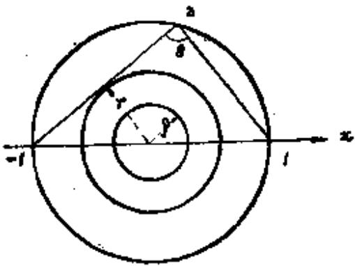
图6.10
现设  $g(z)$  是在上半圆内调和的函数,它具有的境界值是:在上半圆周上 $g(z) = S_{1}(z)$  ,在实轴上  $g(z) = 0$  。由上题知,在上半圆内
$f(z) \leq g(z).$
如设  $\omega(z)$  是上半圆关于上半圆周的调和测度,则
$g(z) = S_{1}(u) \cdot \omega(z)①.$
而
$\begin{aligned} \omega(z) & = 2\left( 1 - \frac{\theta}{\pi} \right) = 2\left( 1 - \frac{1}{\pi}\arg\frac{z - 1}{z + 1} \right) \\ & = \frac{2}{\pi}\left( arctg\frac{\tau}{1 + t} + arctg\frac{\tau}{1 - t} \right) \\ & \sim \frac{4}{\pi}\frac{\tau}{(1 - t^{2})}.\quad(\text{其中}z = t + i\tau) \end{aligned}$
因此,如设  $\omega(z)$  在  $|z| = r$  上的最大值是  $q(r)$  ,则
$f(z) \leq q(r) \cdot S_{1}(u),$
又由于在  $|z| = r$  的某点处有  $f(z) = S_{r}(u)$  ,故
$S_{r}(u) \leq q(r) \cdot S_{1}(u).$

   **难度：5/5；出处：** 同事提供《复变函数简明教程_习题导出.xlsx》第17行；导出表无教材书名、原题号及页码，来源待核，原题号同事习题导出表第17行（非教材原题号）；**解答来源：** 同事导出原解析，数学正确性待逐题审核。

   **整理说明：** 原导出知识点标签：调和函数/调和函数

<!-- source-exercise:TJX-XLSX-r018 -->
5. 设 $D$ 是有限重连通的Jordan区域,其一部分境界是弧 $\alpha$,除 $\alpha$ 以外其余的境界为 $\beta$。$D^{*}$ 是含有 $D$ 的有界区域。证明,如果 $\alpha$ 在 $D^{*}$ 的境界上,$z \in D$,则
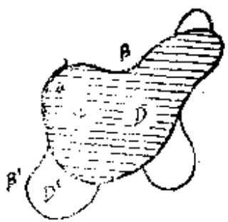
图8.7
 $$\omega\left(z, \alpha, D^{*}\right) \geq \omega(z, \alpha, D) .$$
 (Carleman区域扩大定理)。

   **答案：** 如设$u(z) = \omega(z,\alpha,D^{\ast}) - \omega(z,\alpha,D),$
则  $u(z)$  在  $D$  上调和。由于在  $D$  的境界上,  $\omega(z,a,D) = 0$  ,  $\omega(z,a,D^{\ast}) \geq 0$  ,故在  $D$  的境界上  $u(z) \geq 0$  ①。于是根据最大值原理,对于  $D$  的点  $z$  ,有  $u(z) \geq 0$  ,亦即
$\omega(z,\alpha,D^{\ast}) \geq \omega(z,\alpha,D).$

   **难度：3/5；出处：** 同事提供《复变函数简明教程_习题导出.xlsx》第18行；导出表无教材书名、原题号及页码，来源待核，原题号同事习题导出表第18行（非教材原题号）；**解答来源：** 同事导出原解析，数学正确性待逐题审核。

   **整理说明：** 原导出知识点标签：调和函数/调和函数

<!-- source-exercise:TJX-XLSX-r019 -->
6. 设 $\alpha$ 是单位圆周上的互相没有公共点的至多是可数个开弧 $\alpha_{i}(i=1,2, \cdots)$ 所构成的集合,证明在单位圆域 $D$ 上
 $$\omega(z, \alpha, D)=\frac{1}{2 \pi} \int_{\alpha} \frac{1-r^{2}}{1+r^{2}-2 r \cos (\theta-\varphi)} d \theta$$
这里 $0 \leq r<1$,$z=r e^{i \varphi}$。并证明在 $D$ 上广义一致地有 $\omega(z, \alpha, D)=\sum_{i} \omega\left(z, \alpha_{i}, D\right)$。

   **答案：** 函数$u_{i}(z) = u_{i}(r,\varphi) = \frac{1}{2\pi}\int_{a_{i}}^{}\frac{(1 - r^{2})d\theta}{1 + r^{2} - 2rcos(\theta - \varphi)}$
$0 \leq r < 1,z = re^{i\varphi}.$
在  $|z| < 1$  上调和,在  $\alpha_{i}$  的内点处  $u_{i}(z) = 1$  ,在  $\alpha_{i}$  的外点处
$u_{i}(z) = 0$,并且由于
$\frac{1}{2\pi}\int_{\omega_{j}}^{}\frac{(1 - r^{2})d\theta}{1 + r^{2} - 2rcos(\theta - \varphi)} \leq \frac{1}{2\pi}\int_{0}^{2\pi}\frac{(1 - r^{2})d\theta}{1 + r^{2} - 2rcos(\theta - \varphi)} = 1,$
故  $u_{i}(z)$  是有界的。因此
$u_{i}(z) = \omega(z,a_{i},D).$
由于  $\alpha$  是开集合,故
$\begin{aligned} \frac{1}{2\pi}\int_{\alpha}^{}\frac{(1 - r^{2})d\theta}{1 + r^{2} - 2rcos(\theta - \varphi)} & = \sum_{i = 1}^{\infty}\frac{1}{2\pi}\int_{\alpha_{i}}^{}\frac{(1 - r^{2})d\theta}{1 + r^{2} - 2rcos(\theta - \varphi)} \\ & = \sum_{i = 1}^{\infty}\omega(z,\alpha_{i},D). \end{aligned}$
由于  $\omega(z,\alpha_{i},D)$  是正的,并且  $\sum_{i = 1}^{\infty}\omega(z,\alpha_{i},D) \leq 1$  ,故由Harnack定理, $\sum_{i = 1}^{\infty}\omega(z,\alpha_{i},D)$  在  $D$  上广义一致收敛于调和函数  $u(z)$  ,由于在弧  $\alpha_{i}$  上,  $\omega(z,\alpha_{i},D) = 1$  ,  $\omega(z,\alpha_{j},D) = 0(j \neq i)$  ,故  $u(z)$  在  $a_{i}$  等于 1,在  $a_{i}$  外点处等于 0。因此 $u(z)$  的境界值是:在  $a$  上,  $u(z) = 1$  ,  $a$  的外点处  $u(z) = 0$  ,在  $D$  上  $u(z)$  有界。
于是  $u(z) = \omega(z,u,D)$.

   **难度：4/5；出处：** 同事提供《复变函数简明教程_习题导出.xlsx》第19行；导出表无教材书名、原题号及页码，来源待核，原题号同事习题导出表第19行（非教材原题号）；**解答来源：** 同事导出原解析，数学正确性待逐题审核。

   **整理说明：** 原导出知识点标签：调和函数/调和函数

<!-- source-exercise:TJX-XLSX-r021 -->
7. 证明例题[16]注意中叙述的函数是一意确定的。

   **答案：** 设  $u_{1}$  是异于  $u$  的解,设$U(z) = u(z) - u_{1}(z),$
$U(z)$在  $D$  上调和,在  $\beta$  上  $\frac{\partial U}{\partial n} = 0$  ,在  $\alpha_{i}(i = 1,2,\ldots)$  的内点  $\zeta$  上  $\overline{\lim}U(z) = 0$  ,并且在  $\alpha_{i}(i = 1,2,\ldots)$  的端点  $P_{i^{\prime}}$  ,  $P_{i}^{''}(i = 1,2,\ldots)$
$U(z)$有界,又  $U(z)$  的最大值不能在端点  $P_{i}^{\prime}$  ,  $P_{i}^{\prime\prime}(i = 1,2,\ldots)$  处取得,这是因为如果在某端点  $P$  处取最大值,以  $P$  点为圆心画一充分小的圆,使它的境界和它的内部不含有其它的端点。这个圆域与 $D$  的公共部分记为  $\Delta$  (指单连通的公共部分),在  $\Delta$  的境界上,  $\beta$  和  $\alpha_{i}$  的部分各设为  $\beta_{\Delta}$  和  $\alpha_{\Delta}$  ,将  $\Delta$  保角映射为单位圆的上半个圆域的函数设为  $w = s(z)$  ,使  $P$  点对应于原点,  $\alpha_{\Delta}$  和  $\beta_{1}$  分别映射为实轴上的半径。函数  $U\{ S^{- 1}(w)\} = \phi(w)$  在这个半圆域上调和。
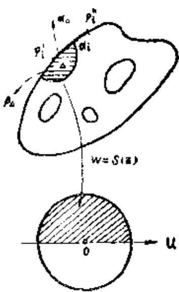
图6.9
对于下半个圆内的点  $w$  ,如定义  $\phi(w) = \phi(w)$  ,则  $\phi(w)$  在整个单位圆内除原点外是调和的。又由于  $\phi(w)$  在原点处是有界的,因此  $\phi(w)$  在整个单位圆内包括原点是调和的。如果以  $S^{- 1}(w)$  返回区域D考虑,那么 $U(z)$  在P点调和,这与 $U(z)$  在P点取得最大值矛盾。同样,在端点处也不能取得最小值。在 $\beta$  上,由例题[12]的注意,不能取得最大、最小值。所以, $U(z)$  的最大、最小值在a上取得。于是 $U(z) = 0,z \in D$  ,即  $u(z) = u_{1}(z)$  。

   **难度：4/5；出处：** 同事提供《复变函数简明教程_习题导出.xlsx》第21行；导出表无教材书名、原题号及页码，来源待核，原题号同事习题导出表第21行（非教材原题号）；**解答来源：** 同事导出原解析，数学正确性待逐题审核。

   **待核状态：** 上下文待核

   **整理说明：** 原导出知识点标签：调和函数/调和函数；题干只写‘例题[16]注意’，导出表没有该例题；定义对象缺失，待原题来源补证。

<!-- source-exercise:TJX-XLSX-r022 -->
8. 设 $D$ 是由有限条光滑正则曲线 $C_{1}, C_{2}, \cdots, C_{n}$ 所围成的区域。在 $C_{i}(i=1,2, \cdots, n)$ 上给定连续函数 $f_{i}(s)$ 时,证明在 $D$ 上调和、在境界 $C_{i}(i=1,2, \cdots, n)$ 上 $\frac{\partial v}{\partial n}=f_{i}(s)$ 的函数 $v(z)$ 存在。并证明除去一个常数外,这样的函数是一意确定的。
注意(1)设 $f_{i}(s)$  作为弧长(以 $C_{i}$  上某点  $s_{i}$  作为起点)的函数是连续的;
(2)记 $g_{i}(s) = \int_{si}^{s}f_{i}(s)ds$  ,如设  $u(z)$  是具有境界值  $- g_{i}(s)$ $(i = 1,2,\cdots,n)$  的Dirichlet问题的解,证明,这个 $u(z)$  就是所求的函数①.
(3)练习题22称为 Neumann 问题.

   **答案：** 设$g_{i}(s) = \int_{si}^{s}f_{i}(s)ds_{\bullet}$
如设  $u(z)$  是在  $C_{i}$  上具有境界值  $- g_{i}(s)$  的调和函数,在  $C_{i}$  上,
$\frac{\partial u}{\partial s} = - \frac{\partial g_{i}(s)}{\partial s} = - f_{i}(s).$
设  $v(z)$  是  $u(z)$  的共轭调和函数,故在  $C_{i}$  上有
$\frac{\partial v}{\partial n} = f_{i}(s),$
并且有
$\int_{C_{1} + C_{2} + \ldots + C_{n}}^{}\frac{\partial v}{\partial n}ds = \int_{C_{1} + C_{2} + \ldots + C_{n}}^{}f_{i}(s)ds = 0.$
因此  $v(z)$  在D上是单值的。
故  $v(z)$  就是所求的函数。

   **难度：4/5；出处：** 同事提供《复变函数简明教程_习题导出.xlsx》第22行；导出表无教材书名、原题号及页码，来源待核，原题号同事习题导出表第22行（非教材原题号）；**解答来源：** 同事导出原解析，数学正确性待逐题审核。

   **整理说明：** 原导出知识点标签：调和函数/调和函数

<!-- source-exercise:TJX-XLSX-r023 -->
9. 设 $D$ 是 $n$ 重连通区域,$u(z)$ 在 $D$ 上调和,在 $D$ 的境界 $C_{1}, C_{2}, \cdots, C_{n}$ 上连续。如果在 $C_{\nu}(\nu=1,2, \cdots, n)$ 上 $|u(z)| \leq M_{\nu}$,证明
 $$u(z) \leq M_{n}+\sum_{\nu=1}^{n-1}\left(M_{\nu}-M_{n}\right) \omega_{\nu}(z) .$$
其中 $\omega_{\nu}(z)$ 是关于 $D$ 的 $C_{\nu}$ 的调和测度。

   **答案：** 设 $$f(z)=M_{n}-u(z)+\sum_{\nu=1}^{n-1}\left(M_{\nu}-M_{n}\right) \omega_{\nu}(z),$$
 $f(z)$ 在 $D$ 上调和。在 $C_{\nu}(\nu=1,2, \cdots, n)$ 上,$\omega_{\nu}(z)=1$,$\omega_{\mu}(z)=0(\mu \neq\nu)$,故在 $C_{\nu}$ 上,$f(z)=M_{\nu}-u(z)$,$z \in C_{\nu}$。但是,由于在 $C_{\nu}$ 上 $|u(z)| \leq M_{\nu}$,故在 $C_{\nu}$ 上,$f(z) \geq0(\nu=1,2, \cdots, n)$。因此,在 $D$ 的境界上,$f(z) \geq0$,故由最大值原理,有 $f(z) \geq0$,$z \in D$。亦即
 $$u(z) \leq M_{n}+\sum_{\nu=1}^{n-1}\left(M_{\nu}-M_{n}\right) \omega_{\nu}(z) .$$

   **难度：4/5；出处：** 同事提供《复变函数简明教程_习题导出.xlsx》第23行；导出表无教材书名、原题号及页码，来源待核，原题号同事习题导出表第23行（非教材原题号）；**解答来源：** 同事导出原解析，数学正确性待逐题审核。

   **整理说明：** 原导出知识点标签：调和函数/调和函数

<!-- source-exercise:TJX-XLSX-r025 -->
10. 设函数 $f(t)$ 在区间 $t_{1}<t<t_{2}$ 上是单调增加的凸函数。 如果 $u(z)$ 在区域 $D$ 上次调和,并且 $t_{1}<u(z)<t_{2}$,证明 $v(z)=f[u(z)]$ 在 $D$ 上次调和。

   **答案：** 由于  $u(z)$  是次调和的,故$u(z_{0}) \leq \frac{1}{2\pi}\int_{0}^{2\pi}u(z_{0} + re^{i\theta})d\theta.$
又由于  $f(t)$  是单调递增函数,故
$v(z_{0}) = f\lbrack u(z_{0})\rbrack \leq f\left\lbrack \frac{1}{2\pi}\int_{0}^{2\pi}u(z_{0} - re^{iz})d\theta \right\rbrack.$
$f(t)$是凸函数,故
$f\left\lbrack \frac{1}{2\pi}\int_{0}^{2\pi}u(z_{0} + re^{i\theta})d\theta \right\rbrack \leq - \frac{1}{2\pi}\int_{0}^{2\pi}f\lbrack u(z_{1} - re^{i\theta})\rbrack d\theta.①$
因此
$v(z_{0}) \leq \frac{1}{2\pi}\int_{0}^{2\pi}f\lbrack u(z_{0} + re^{i\theta})\rbrack d\theta = \frac{1}{2\pi}\int_{0}^{2\pi}v(z_{0} + re^{i\theta})d\theta.$

   **难度：3/5；出处：** 同事提供《复变函数简明教程_习题导出.xlsx》第25行；导出表无教材书名、原题号及页码，来源待核，原题号同事习题导出表第25行（非教材原题号）；**解答来源：** 同事导出原解析，数学正确性待逐题审核。

   **整理说明：** 原导出知识点标签：调和函数/调和函数

<!-- source-exercise:TJX-XLSX-r026 -->
11. 如果函数 $u(z)$ 在 $D$ 上超调和,并且 $u(z)>0$,$z \in D$,证明 $\frac{1}{u(z)}$ 在 $D$ 上次调和。又问如果 $u(z)$ 次调和,$\frac{1}{u(z)}$ 是超调和吗?

   **答案：** 设  $z_{0}$  是  $D$  的一点,并设圆  $\left| z - z_{0} \right| = r$  是包含在  $D$  内的任意一个圆。由于  $u(z)$  是超调和的,故$u(z_{0}) \geq \frac{1}{2\pi}\int_{0}^{2\pi}u(z_{0} + re^{i\theta})d\theta.$
又由于  $u(z) > 0$  ,故由Schwarz不等式有
$\int_{0}^{2\pi}\frac{1}{u(z_{0} + re^{i\theta})}d\theta \cdot \int_{0}^{2\pi}u(z_{0} + re^{i\theta})d\theta = 4\pi^{2}.$
故
$\frac{1}{2\pi}\int_{0}^{2\pi}\frac{1}{u(z_{0} + re^{i\theta})}d\theta \geq \frac{2\pi}{\int_{0}^{2\pi}u(z_{0} + re^{i\theta})d\theta}.$
故由(1)式及(2)式,有
$\frac{1}{2\pi}\int_{0}^{2\pi}\frac{1}{u(z_{0} + re^{i\theta})}d\theta \geq \frac{1}{u(z_{0})}.$
其次,考虑  $u(x,y) = e^{x}$  ,由于  $\Delta u = e^{x} > 0$  ,故  $e^{x}$  是次调和的。但是  $\frac{1}{u(x,y)} = e^{- x},\Delta\frac{1}{u} = e^{- x} > 0,$  亦即  $\frac{1}{u}$  是次调和的。
 ——译者注
因此一般地,  $u(z)$  是次调和的,  $\frac{1}{u}$  不是超调和的。
注意 将例题[12]的函数 $h(z)$  和上述结果比较,  $\Delta h(z) > 0$  .

   **难度：4/5；出处：** 同事提供《复变函数简明教程_习题导出.xlsx》第26行；导出表无教材书名、原题号及页码，来源待核，原题号同事习题导出表第26行（非教材原题号）；**解答来源：** 同事导出原解析，数学正确性待逐题审核。

   **整理说明：** 原导出知识点标签：调和函数/调和函数

<!-- source-exercise:TJX-XLSX-r027 -->
12. 如果函数 $u(z)$ 在区域 $D$ 上调和,则 $|u(z)|$ 在 $D$ 上是次调和的。

   **答案：** 因为 $$|u(z)|=\max \{u(z),-u(z)\},$$
而 $u(z)$ 和 $-u(z)$ 均在 $D$ 上调和,故由次调和函数判定定理,知 $|u(z)|$ 是次调和的。

   **难度：2/5；出处：** 同事提供《复变函数简明教程_习题导出.xlsx》第27行；导出表无教材书名、原题号及页码，来源待核，原题号同事习题导出表第27行（非教材原题号）；**解答来源：** 同事导出原解析，数学正确性待逐题审核。

   **整理说明：** 原导出知识点标签：调和函数/调和函数

<!-- source-exercise:TJX-XLSX-r028 -->
13. 设 $D$ 是和上题一样的区域,证明 $\int_{\Gamma} \frac{\partial g(z, \zeta)}{\partial n} d s=-2 \pi$。

   **答案：** 在定理12中,设 $u(z) = 1$  ,可直接得证。

   **难度：2/5；出处：** 同事提供《复变函数简明教程_习题导出.xlsx》第28行；导出表无教材书名、原题号及页码，来源待核，原题号同事习题导出表第28行（非教材原题号）；**解答来源：** 同事导出原解析，数学正确性待逐题审核。

   **待核状态：** 上下文待核

   **整理说明：** 原导出知识点标签：调和函数/调和函数；‘和上题一样的区域’在当前导出顺序中没有对应 Green 函数题，区域与边界未定。

<!-- source-exercise:TJX-XLSX-r029 -->
14. 设 $D$ 是Jordan区域,其境界 $\Gamma$ 设由有限条解析曲线构成,如设 $\zeta$ 是 $D$ 的任意一点,证明在 $\Gamma$ 上 $\frac{\partial g(z, \zeta)}{\partial n}$ 存在且连续,而且 $\frac{\partial g(z, \zeta)}{\partial n}<0$。这里 $\frac{\partial}{\partial n}$ 表示 $\Gamma$ 的外法向导数。

   **答案：** 由定理7,$g(z, \zeta)$ 在境界 $\Gamma$ 上是调和的,因此,在 $\Gamma$ 上,$\frac{\partial g}{\partial x}$、$\frac{\partial g}{\partial y}$ 存在并且连续,由于 $$\frac{\partial g}{\partial n}=g_{x} \cos (x, n)+g_{y} \cos (y, n),$$
故 $\frac{\partial g}{\partial n}$ 在 $\Gamma$ 上存在并且连续,再由相关例题结论,可知
 $$\frac{\partial g(z, \zeta)}{\partial n}<0 .$$

   **难度：3/5；出处：** 同事提供《复变函数简明教程_习题导出.xlsx》第29行；导出表无教材书名、原题号及页码，来源待核，原题号同事习题导出表第29行（非教材原题号）；**解答来源：** 同事导出原解析，数学正确性待逐题审核。

   **整理说明：** 原导出知识点标签：调和函数/调和函数

<!-- source-exercise:TJX-XLSX-r030 -->
15. 设 $D$ , $D_{n}(n=1,2, \cdots)$ 是Jordan区域,$D_{1} \subseteq D_{2} \subseteq D_{3} \subseteq \cdots \subseteq D_{n} \subseteq \cdots$,并且 $\bigcup_{n=1}^{\infty} D_{n}=D$。如果设 $\zeta_{0}$ 是 $D$ 的任意一点,则在不含有 $\zeta_{0}$ 的 $D$ 的任意闭区域上,$\{g_{n}(z, \zeta_{0})\}$ 一致收敛于 $g(z, \zeta_{0})$。

   **答案：** 设 $n_{0}$ 是任意的号码,只要 $n \geq n_{0}$,$z \in D_{n_{0}}$,就有 $$g_{n}\left(z, \zeta_{0}\right) \leq g_{n+1}\left(z, \zeta_{0}\right) \leq g\left(z, \zeta_{0}\right) .$$
因此在 $D_{n_{0}}$ 上
 $$\lim_{n \to \infty} g_{n}\left(z, \zeta_{0}\right) \leq g\left(z, \zeta_{0}\right) .$$
由于 $n_{0}$ 是任意的,故在 $D$ 上有
 $$\lim_{n \to \infty} g_{n}\left(z, \zeta_{0}\right) \leq g\left(z, \zeta_{0}\right) .$$
再设 $C$ 以及 $C_{n}$ 是 $D$ 和 $D_{n}$ 的境界。在 $C$ 上,$g(z, \zeta_{0})=0$,故如取充分大的 $n_{0}$,对于 $n \geq n_{0}$,在 $C_{n}$ 上,有 $0<g(z, \zeta_{0})<\varepsilon$。又由于在 $C_{n}$ 上 $g_{n}(z, \zeta_{0})=0$,因此在 $C_{n}$ 上,有
 $$0<g\left(z, \zeta_{0}\right)-g_{n}\left(z, \zeta_{0}\right)<\varepsilon .$$
由于 $g(z, \zeta_{0})-g_{n}(z, \zeta_{0})$ 在 $D_{n}$ 上是调和函数,故由最大值原理,在 $D_{n}$ 上有
 $$0<g\left(z, \zeta_{0}\right)-g_{n}\left(z, \zeta_{0}\right)<\varepsilon .$$
因此在 $D_{n}$ 上有
 $$g_{n}\left(z, \zeta_{0}\right)>g\left(z, \zeta_{0}\right)-\varepsilon .$$
于是在 $D_{n}$ 上,有
 $$\lim_{n \to \infty} g_{n}\left(z, \zeta_{0}\right) \geq g\left(z, \zeta_{0}\right)-\varepsilon,$$
如令 $\varepsilon \to 0$,$n_{0} \to \infty$,故在 $D$ 上有
 $$\lim_{n \to \infty} g_{n}\left(z, \zeta_{0}\right) \geq g\left(z, \zeta_{0}\right)$$
联立得到 $\lim_{n \to \infty} g_{n}\left(z, \zeta_{0}\right)=g\left(z, \zeta_{0}\right)$。
其次设 $\Delta$ 是不含有 $\zeta_{0}$ 的任意闭区域。在 $\Delta$ 上,当 $n \geq n_{0}$ 时,
 $$g_{n}\left(z, \zeta_{0}\right) \leq g_{n+1}\left(z, \zeta_{0}\right) \leq \cdots \to g\left(z, \zeta_{0}\right),$$
故由Harnack定理,在 $\Delta$ 上 $\{g_{n}(z, \zeta_{0})\}$ 一致收敛于 $g(z, \zeta_{0})$。

   **难度：4/5；出处：** 同事提供《复变函数简明教程_习题导出.xlsx》第30行；导出表无教材书名、原题号及页码，来源待核，原题号同事习题导出表第30行（非教材原题号）；**解答来源：** 同事导出原解析，数学正确性待逐题审核。

   **整理说明：** 原导出知识点标签：调和函数/调和函数

<!-- source-exercise:TJX-XLSX-r031 -->
16. 设 $D^{*}$ 是包含在 $D$ 内的区域,$\zeta \in D^{*}$,如果 $D$ 和 $D^{*}$ 关于 $\zeta$ 的Green函数分别是 $g(z, \zeta)$ 和 $g^{*}(z, \zeta)$,证明 $g^{*}(z, \zeta) \leq g(z, \zeta),\ z \in D^{*}$。

   **答案：** 设 $f(z)=g(z, \zeta)-g^{*}(z, \zeta)$,则 $f(z)$ 在 $z=\zeta$ 处调和,在 $D^{*}$ 的境界上 $g(z, \zeta) \geq 0$,$g^{*}(z, \zeta)=0$,因此在 $D^{*}$ 的境界上 $f(z) \geq 0$。根据最大值原理有 $$f(z) \geq 0,\ z \in D^{*} .$$
即 $g^{*}(z, \zeta) \leq g(z, \zeta),\ z \in D^{*}$。
注意:特别当 $D^{*}$ 和 $D$ 相同时,$g^{*}(z, \zeta)=g(z, \zeta)$。$D$ 含有 $D^{*}$ 以外的点时,$g^{*}(z, \zeta)<g(z, \zeta)$。

   **难度：3/5；出处：** 同事提供《复变函数简明教程_习题导出.xlsx》第31行；导出表无教材书名、原题号及页码，来源待核，原题号同事习题导出表第31行（非教材原题号）；**解答来源：** 同事导出原解析，数学正确性待逐题审核。

   **整理说明：** 原导出知识点标签：调和函数/调和函数

<!-- source-exercise:TJX-XLSX-r035 -->
17. 设 $D$ 是由正则曲线 $\Gamma$ 所围成的区域,如果 $v(z)$ 在 $D+\Gamma$ 上调和,证明 $\int_{\Gamma} v \frac{\partial v}{\partial n} d s \geq 0$。等号何时才成立?利用这个结论证明,如果在 $\Gamma$ 上 $\frac{\partial v}{\partial n}=0$ 则 $v(z)$ 是常数。

   **答案：** 由例题[6],有 $$\int_{\Gamma} v \frac{\partial v}{\partial n} d s=\iint_{D}\left[\left(\frac{\partial v}{\partial x}\right)^{2}+\left(\frac{\partial v}{\partial y}\right)^{2}\right] d x d y,$$
只要 $v(z)$ 不为常数,就有
 $$\left(\frac{\partial v}{\partial x}\right)^{2}+\left(\frac{\partial v}{\partial y}\right)^{2}>0,$$
因此有
 $$\int_{\Gamma} v \frac{\partial v}{\partial n} d s>0 .$$
如果 $v(z)$ 是常数,则
 $$\left(\frac{\partial v}{\partial x}\right)^{2}+\left(\frac{\partial v}{\partial y}\right)^{2}=0,$$
因此
 $$\int_{\Gamma} v \frac{\partial v}{\partial n} \cdot d s=0 .$$
即:**等号当且仅当 $v(z)$ 为常数时成立**。
其次,如果在 $\Gamma$ 上 $\frac{\partial v}{\partial n}=0$,则
 $$\int_{\Gamma} v \frac{\partial v}{\partial n} d s=0$$
从而
 $$\left(\frac{\partial v}{\partial x}\right)^{2}+\left(\frac{\partial v}{\partial y}\right)^{2}=0,$$
亦即
 $$\frac{\partial v}{\partial x}=\frac{\partial v}{\partial y}=0$$
故 $v(z)$ 是常数。

   **难度：3/5；出处：** 同事提供《复变函数简明教程_习题导出.xlsx》第35行；导出表无教材书名、原题号及页码，来源待核，原题号同事习题导出表第35行（非教材原题号）；**解答来源：** 同事导出原解析，数学正确性待逐题审核。

   **整理说明：** 原导出知识点标签：调和函数/调和函数

<!-- source-exercise:TJX-XLSX-r037 -->
18. 设函数 $u(z)$ 在 $|z| \leq r$ 上调和,证
 $$\begin{aligned}
 \int_{0}^{2 \pi} u^{2}\left(r e^{i \theta}\right) d \theta= & 2 \pi u^{2}(0)+2 \iint_{|z|<r}|\operatorname{grad} u|^{2} \cdot \log r \cdot r d r d \theta \\
 & +\int_{0}^{2 \pi} \frac{\partial u^{2}\left(r e^{i \theta}\right)}{\partial r} \log r \cdot r d \theta .
 \end{aligned}$$

   **答案：** 设 $D$ 是以原点为中心 $\varepsilon(0<\varepsilon<r)$ 及 $r$ 为半径的两个圆所围成的圆环区域,其境界设为 $\Gamma$,对 $u^{2}(z)$ 和 $\log \rho(|z|=\rho)$ 使用 Green第二公式,则 $$\iint_{D} \Delta u^{2} \cdot \log \rho \cdot \rho d \rho d \theta=\int_{\Gamma}\left(\frac{\partial u^{2}}{\partial n} \log \rho-u^{2} \frac{\partial \log \rho}{\partial n}\right) \rho d \theta \cdots(*)$$
而
 $$\Delta u^{2}=2\left\{\left(\frac{\partial u}{\partial x}\right)^{2}+\left(\frac{\partial u}{\partial y}\right)^{2}\right\}+2 u \Delta u=2 |\operatorname{grad} u|^{2}.$$
 $$\int_{\Gamma} \frac{\partial u^{2}}{\partial n} \cdot \log \rho \cdot \rho d \theta=\int_{0}^{2 \pi} \frac{\partial u^{2}}{\partial r} \log r \cdot r d \theta+\int_{0}^{2 \pi} \frac{\partial u^{2}\left(\varepsilon e^{i \theta}\right)}{\partial \varepsilon} \log \varepsilon \cdot \varepsilon d \theta .$$
在 $|z|=r$ 上 $\left(\frac{\partial \log \rho}{\partial n}\right)_{\rho=r}=\left(\frac{\partial \log \rho}{\partial \rho}\right)_{\rho=r}=\frac{1}{r},$
在 $|z|=\varepsilon$ 上 $\left(\frac{\partial \log \rho}{\partial n}\right)_{\rho=\varepsilon}=-\left(\frac{\partial \log \rho}{\partial \rho}\right)_{\rho=\varepsilon}=-\frac{1}{\varepsilon},$
故
 $$\int_{\Gamma} u^{2} \cdot \frac{\partial \log \rho}{\partial n} \cdot \rho d \theta=\int_{0}^{2 \pi} u^{2}\left(r e^{i \theta}\right) d \theta-\int_{0}^{2 \pi} u^{2}\left(\varepsilon e^{i \theta}\right) d \theta .$$
当$\varepsilon \to 0$时
 $$\int_{0}^{2 \pi} u^{2}\left(\varepsilon e^{i \theta}\right) d \theta \to 2 \pi u^{2}(0),$$
 $$\varepsilon \cdot \log \varepsilon \cdot \int_{0}^{2 \pi} \frac{\partial u^{2}}{\partial \varepsilon} d \theta \to 0,$$
 $$\iint_{D} \Delta u^{2} \log \rho \cdot \rho d \rho d \theta \to 2 \iint_{|z|<r}|\operatorname{grad} u|^{2} \cdot \log r \cdot r d r d \theta$$
因此当 $\varepsilon \to 0$ 时,(*)式就成为
 $$\int_{0}^{2 \pi} u^{2}\left(r e^{i \theta}\right) d \theta=2 \pi u^{2}(0)+2 \iint_{|z|<r}|\operatorname{grad} u|^{2} \cdot \log r \cdot r d r d \theta+\int_{0}^{2 \pi} \frac{\partial u^{2}\left(r e^{i \theta}\right)}{\partial r} \log r \cdot r d \theta .$$

   **难度：5/5；出处：** 同事提供《复变函数简明教程_习题导出.xlsx》第37行；导出表无教材书名、原题号及页码，来源待核，原题号同事习题导出表第37行（非教材原题号）；**解答来源：** 同事导出原解析，数学正确性待逐题审核。

   **整理说明：** 原导出知识点标签：调和函数/调和函数

<!-- source-exercise:TJX-XLSX-r038 -->
19. 设 $u(x, y)$ 是在有界区域 $D$ 上具有一阶连续导数的函数。 $Q$ 是 $D$ 内部的边平行于 $x-$轴和 $y-$轴的正方形,其境界设为 $C(Q)$。对于任意的 $Q$ ,如果
 $$\int_{C(Q)} \frac{\partial u}{\partial n} d s=0,$$
则 $u(x, y)$ 在 $D$ 上调和,试证明之。

   **答案：** 设 $Q$ 是以点 $(x, y)$ 为中心边长为 $2 r$ 的正方形。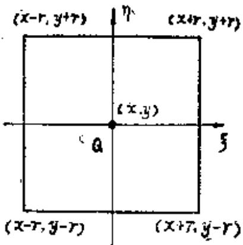
图6.8
设
 $$u^{(r)}(x, y)=\frac{1}{4 r^{2}} \int_{-r}^{r} \int_{-r}^{r} u(x+\xi, y+\eta) d \xi d \eta,$$
则
 $$\begin{aligned}
 & \frac{\partial u^{(r)}(x, y)}{\partial x}=\frac{1}{4 r^{2}} \int_{-r}^{r} \int_{-r}^{r} \frac{\partial u(x+\xi, y+\eta)}{\partial \xi} d \xi d \eta \\
 & =\frac{1}{4 r^{2}} \int_{-r}^{r}[u(x+r, y+\eta)-u(x-r, y+\eta)] d \eta,
 \end{aligned}$$
因此
 $$\frac{\partial^{2} u^{(r)}(x, y)}{\partial x^{2}}=\frac{1}{4 r^{2}} \int_{-r}^{r}\left(\frac{\partial u(x+r, y+\eta)}{\partial x}-\frac{\partial u(x-r, y+\eta)}{\partial x}\right) d \eta .$$
同样
 $$\frac{\partial^{2} u^{(r)}(x, y)}{\partial y^{2}}=\frac{1}{4 r^{2}} \int_{-r}^{r}\left(\frac{\partial u(x+\xi, y+r)}{\partial y}-\frac{\partial u(x+\xi, y-r)}{\partial y}\right) d \xi .$$
因此 $\Delta u^{(r)}(x, y)=\frac{1}{4 r^{2}} \int_{C(Q)} \frac{\partial u}{\partial n} d s=0$,所以 $u^{(r)}(x, y)$ 是调和函数,令 $r \to 0$,$u^{(r)}(x, y)$ 一致收敛于 $u(x, y)$,故 $u(x, y)$ 在 $D$ 上是调和函数。

   **难度：4/5；出处：** 同事提供《复变函数简明教程_习题导出.xlsx》第38行；导出表无教材书名、原题号及页码，来源待核，原题号同事习题导出表第38行（非教材原题号）；**解答来源：** 同事导出原解析，数学正确性待逐题审核。

   **整理说明：** 原导出知识点标签：调和函数/调和函数

<!-- source-exercise:TJX-XLSX-r039 -->
20. 如果 $f(z)$ 在 $D$ 上正则,并且 $f(z)\neq0$,则 $\log |f(z)|$ 在 $D$ 上调和。

   **答案：** 由例题[4], $$\Delta \log |f(z)|=\frac{1}{2}\left|f'(z)\right|^{2}\left(\frac{\partial^{2}}{\partial u^{2}}+\frac{\partial^{2}}{\partial v^{2}}\right) \log \left(u^{2}+v^{2}\right)=0 .$$

   **难度：3/5；出处：** 同事提供《复变函数简明教程_习题导出.xlsx》第39行；导出表无教材书名、原题号及页码，来源待核，原题号同事习题导出表第39行（非教材原题号）；**解答来源：** 同事导出原解析，数学正确性待逐题审核。

   **整理说明：** 原导出知识点标签：调和函数/调和函数

<!-- source-exercise:TJX-XLSX-r040 -->
21. 当 $R$ , $\varphi$ 是常数时,证明 $\frac{R^{2}-r^{2}}{R^{2}-2 R r \cos (\theta-\varphi)+r^{2}}$ 是调和函数,并求出它的奇异点。

   **答案：** 由例题[2],有 $$\frac{R^{2}-r^{2}}{R^{2}-2 R r \cos (\theta-\varphi)+r^{2}}=\Re\left(\frac{z+a}{z-a}\right) \ (\text{其中 } z=R e^{i \theta},\ a=r e^{i \varphi}).$$
 $\frac{z+a}{z-a}$ 只要 $z \neq a$ 是正则的,故 $\Re\left(\frac{z+a}{z-a}\right)$ 调和。$z=a$ 是 $\frac{z+a}{z-a}$ 的极点,$\Re\left(\frac{z+a}{z-a}\right)$ 在 $z=a$ 处不调和,$z=a$ 是该函数的奇异点。

   **难度：3/5；出处：** 同事提供《复变函数简明教程_习题导出.xlsx》第40行；导出表无教材书名、原题号及页码，来源待核，原题号同事习题导出表第40行（非教材原题号）；**解答来源：** 同事导出原解析，数学正确性待逐题审核。

   **整理说明：** 原导出知识点标签：调和函数/调和函数

<!-- source-exercise:TJX-XLSX-r041 -->
22. 设 $f(z)=u+i v$ 是正则函数,则
 $$\left(\frac{\partial^{2}}{\partial x^{2}}+\frac{\partial^{2}}{\partial y^{2}}\right)|f(z)|^{p}=p^{2}|f(z)|^{p-2}\cdot\left|f'(z)\right|^{2};$$
 $$\left(\frac{\partial^{2}}{\partial x^{2}}+\frac{\partial^{2}}{\partial y^{2}}\right)|u|^{p}=p(p-1)|u|^{p-2} \cdot\left|f'(z)\right|^{2}.$$
 (这里设 $u \neq0$)。

   **答案：** 由例题[4]有 $$\left(\frac{\partial^{2}}{\partial x^{2}}+\frac{\partial^{2}}{\partial y^{2}}\right)|f(z)|^{p}=\left|f'(z)\right|^{2}\left(\frac{\partial^{2}}{\partial u^{2}}+\frac{\partial^{2}}{\partial v^{2}}\right)|f(z)|^{p},$$
故当 $|f(z)|^{p}=(u^{2}+v^{2})^{\frac{p}{2}}$ 时,有
 $$\frac{\partial^{2}|f(z)|^{p}}{\partial u^{2}}=p\left(u^{2}+v^{2}\right)^{\frac{p-2}{2}}+p(p-2) u^{2}\left(u^{2}+v^{2}\right)^{\frac{p-4}{2}} .$$
 $$\frac{\partial^{2}|f(z)|^{p}}{\partial v^{2}}=p\left(u^{2}+v^{2}\right)^{\frac{p-2}{2}}+p(p-2) v^{2}\left(u^{2}+v^{2}\right)^{\frac{p-4}{2}} .$$
于是
 $$\begin{aligned}
 & \left(\frac{\partial^{2}}{\partial x^{2}}+\frac{\partial^{2}}{\partial y^{2}}\right)|f(z)|^{p}=\left\{2 p\left(u^{2}+v^{2}\right)^{\frac{p-2}{2}}\right. \\
 & \left.+p(p-2)\left(u^{2}+v^{2}\right)^{\frac{p-2}{2}}\right\} \cdot\left|f'(z)\right|^{2} \\
 & =p^{2} \cdot\left(u^{2}+v^{2}\right)^{\frac{p-2}{2}}\left|f'(z)\right|^{2} \\
 & =p^{2} \cdot|f(z)|^{p-2}\left|f'(z)\right|^{2}.
 \end{aligned}$$
又
 $$\frac{\partial^{2}|u|^{p}}{\partial u^{2}}=p(p-1)|u|^{p-2},$$
 $$\frac{\partial^{2}|u|^{p}}{\partial v^{2}}=0$$
故
 $$\left(\frac{\partial^{2}}{\partial x^{2}}+\frac{\partial^{2}}{\partial y^{2}}\right)|u|^{p}=p(p-1)|u|^{p-2}\left|f'(z)\right|^{2}.$$

   **难度：4/5；出处：** 同事提供《复变函数简明教程_习题导出.xlsx》第41行；导出表无教材书名、原题号及页码，来源待核，原题号同事习题导出表第41行（非教材原题号）；**解答来源：** 同事导出原解析，数学正确性待逐题审核。

   **整理说明：** 原导出知识点标签：调和函数/调和函数

<!-- source-exercise:TJX-XLSX-r042 -->
23. 证明当 $x^{2}+y^{2} \neq0$ 时,$u(x, y)=\frac{x}{x^{2}+y^{2}}$ 是调和函数。

   **答案：** 由于 $u(x, y)=\frac{x}{x^{2}+y^{2}}$,如设 $x=r \cos \theta$,$y=r \sin \theta$,则 $u=\frac{\cos \theta}{r}$,因此 $$\frac{\partial^{2} u}{\partial r^{2}}=\frac{2 \cos \theta}{r^{3}},\ \frac{\partial u}{\partial r}=-\frac{\cos \theta}{r^{2}},\ \frac{\partial^{2} u}{\partial \theta^{2}}=-\frac{\cos \theta}{r},(r \neq 0)$$
从而
 $$\Delta u=\frac{\partial^{2} u}{\partial r^{2}}+\frac{1}{r} \frac{\partial u}{\partial r}+\frac{1}{r^{2}} \frac{\partial^{2} u}{\partial \theta^{2}}=\frac{2 \cos \theta}{r^{3}}-\frac{\cos \theta}{r^{3}}-\frac{\cos \theta}{r^{3}}=0.$$
故 u 是调和函数。

   **难度：2/5；出处：** 同事提供《复变函数简明教程_习题导出.xlsx》第42行；导出表无教材书名、原题号及页码，来源待核，原题号同事习题导出表第42行（非教材原题号）；**解答来源：** 同事导出原解析，数学正确性待逐题审核。

   **整理说明：** 原导出知识点标签：调和函数/调和函数

<!-- source-exercise:TJX-XLSX-r043 -->
24. 证明 $e^{x} \sin y$ , $e^{x} \cos y$ 是调和函数。

   **答案：** 如设 $u(x, y)=e^{x} \sin y$,则 $\frac{\partial^{2} u}{\partial x^{2}}=e^{x} \sin y$,$\frac{\partial^{2} u}{\partial y^{2}}=-e^{x} \sin y$,故 $\Delta u=0$。又设 $v(x, y)=e^{x} \cos y$,$\frac{\partial^{2} v}{\partial x^{2}}=e^{x} \cos y$,$\frac{\partial^{2} v}{\partial y^{2}}=-e^{x} \cos y$,故 $\Delta v=0$。因此,$u(x, y)$ 和 $v(x, y)$ 是调和的。又由于 $e^{x} \sin y=\Im e^{x}$,$e^{x} \cos y=\Re e^{x}$,故知 $u(x, y)$ 和 $v(x, y)$ 调和。

   **难度：2/5；出处：** 同事提供《复变函数简明教程_习题导出.xlsx》第43行；导出表无教材书名、原题号及页码，来源待核，原题号同事习题导出表第43行（非教材原题号）；**解答来源：** 同事导出原解析，数学正确性待逐题审核。

   **整理说明：** 原导出知识点标签：调和函数/调和函数

<!-- source-exercise:TJX-ch01-23 -->
25. 试用 $\partial/\partial z$、$\partial/\partial\bar z$ 表示 $\partial^2/\partial x^2+\partial^2/\partial y^2$。

   **答案：** 由 $\partial_z=(\partial_x-i\partial_y)/2$、$\partial_{\bar z}=(\partial_x+i\partial_y)/2$，在 $C^2$ 函数上混合偏导交换，故 $4\partial_z\partial_{\bar z}=\partial_x^2+\partial_y^2=\Delta$。

   **难度：2/5；出处：** 谭小江、伍胜健《复变函数简明教程》（北京大学出版社，2005），习题一第23题，书页30，PDF页42，原题号习题一第23题；**解答来源：** 本次据主书原题自拟简解；题干已回PDF原页核读。

<!-- source-exercise:TJX-ch06-1 -->
26. 设 $u(z)$ 在区域 $D$ 内调和，证明 Wirtinger 导数 $\partial u/\partial z$ 在 $D$ 内解析。

   **答案：** $\partial_{\bar z}(\partial_z u)=\frac14\Delta u=0$。因 $u$ 调和而光滑，$\partial_z u$ 满足 Cauchy–Riemann 方程，故解析。

   **难度：2/5；出处：** 谭小江、伍胜健《复变函数简明教程》（北京大学出版社，2005），习题六第1题，书页170，PDF页182，原题号习题六第1题；**解答来源：** 本次据主书原题自拟简解；题干已回PDF原页核读。

<!-- source-exercise:TJX-ch06-5 -->
27. 设 $f(z)$ 与 $f^2(z)$ 在区域 $D$ 内解析且没有零点，证明 $\ln|f(z)|$ 调和。

   **答案：** 因 $f$ 解析且无零点，任意小圆盘上有解析对数 $g=\log f$；$\ln|f|=\operatorname{Re}g$，故局部调和，因而在整个 $D$ 调和。题设 $f^2$ 解析且无零点由 $f$ 的条件自动满足。

   **难度：2/5；出处：** 谭小江、伍胜健《复变函数简明教程》（北京大学出版社，2005），习题六第5题，书页170，PDF页182，原题号习题六第5题；**解答来源：** 本次据主书原题自拟简解；题干已回PDF原页核读。

<!-- source-exercise:TJX-ch06-6 -->
28. 设 $u,v$ 都是区域 $D$ 内调和函数。问：$uv$ 是否调和？

   **答案：** 不一定。取 $u=v=x$，二者均满足 $\Delta=0$，但 $uv=x^2$ 满足 $\Delta(uv)=2$。一般地 $\Delta(uv)=2\nabla u\cdot\nabla v$。

   **难度：2/5；出处：** 谭小江、伍胜健《复变函数简明教程》（北京大学出版社，2005），习题六第6题，书页170，PDF页182，原题号习题六第6题；**解答来源：** 本次据主书原题自拟简解；题干已回PDF原页核读。

<!-- source-exercise:TJX-ch06-7 -->
29. 设 $f$ 在区域 $D$ 内解析，$u$ 在区域 $G$ 内调和，且 $f(D)\subset G$。证明 $u\circ f$ 在 $D$ 内调和。

   **答案：** 链式法则与解析映射的 Cauchy–Riemann 方程给 $\Delta(u\circ f)=|f'|^2(\Delta u)\circ f=0$。该等式在临界点亦成立。

   **难度：3/5；出处：** 谭小江、伍胜健《复变函数简明教程》（北京大学出版社，2005），习题六第7题，书页170，PDF页182，原题号习题六第7题；**解答来源：** 本次据主书原题自拟简解；题干已回PDF原页核读。

<!-- source-exercise:TJX-ch03-17 -->
30. 若 $u(x,y)$ 是全平面 $\mathbb R^2$ 上非负的调和函数，证明 $u$ 为常数。

   **答案：** 因平面单连通，取整函数 $F$ 使 $\operatorname{Re}F=u$。则 $|e^{-F}|=e^{-u}\le1$，由 Liouville 定理 $e^{-F}$ 常值；其导数 $-F'e^{-F}=0$ 给 $F'$ 恒零，故 $u$ 常值。

   **难度：3/5；出处：** 谭小江、伍胜健《复变函数简明教程》（北京大学出版社，2005），习题三第17题，书页117，PDF页129，原题号习题三第17题；**解答来源：** 本次据主书原题自拟简解；题干已回PDF原页核读。

<!-- source-exercise:TJX-ch06-2 -->
31. 设 $u$ 在区域 $D$ 调和且非常数。(1) $u$ 能否在 $D$ 内一条曲线上恒为常数？(2) 若 $D_1\subset D$ 是区域且 $u$ 在 $D_1$ 内恒为常数，证明 $u$ 在 $D$ 恒为常数。

   **答案：** (1) 能，例如 $u(x,y)=x$ 在任意竖直线段上恒值。(2) 调和函数实解析；$u-c$ 在非空开集为零，按解析延拓或唯一性定理在连通区域 $D$ 恒零。亦可取局部共轭调和函数，应用解析函数恒等定理。

   **难度：2/5；出处：** 谭小江、伍胜健《复变函数简明教程》（北京大学出版社，2005），习题六第2题，书页170，PDF页182，原题号习题六第2题；**解答来源：** 本次据主书原题自拟简解；题干已回PDF原页核读。

<!-- source-exercise:TJX-ch06-3 -->
32. 设 $f$ 与 $f^2$ 在区域 $D$ 内复调和，证明 $f$ 或 $\bar f$ 在 $D$ 内解析。

   **答案：** Wirtinger 形式 $\Delta=4\partial_z\partial_{\bar z}$。由 $\Delta f=0$ 及 $\Delta(f^2)=8f_zf_{\bar z}=0$，故 $f_zf_{\bar z}=0$。$f_z$ 解析、$f_{\bar z}$ 反解析；若前者不恒零，则其非零集开且稠密，迫使后者恒零，$f$ 解析；否则 $f_z=0$，即 $\bar f$ 解析。

   **难度：3/5；出处：** 谭小江、伍胜健《复变函数简明教程》（北京大学出版社，2005），习题六第3题，书页170，PDF页182，原题号习题六第3题；**解答来源：** 本次据主书原题自拟简解；题干已回PDF原页核读。

<!-- source-exercise:TJX-ch06-12 -->
33. 设 $f$ 是整函数，且原书条件 $\lim_{z\to\infty}\operatorname{Re}f(z)/z=0$。证明 $f$ 为常数。

   **答案：** 按复商极限理解，条件即 $\operatorname{Re}f(z)=o(|z|)$。固定中心 $z_0$，对半径 $R$ 的圆使用书中提示的导数公式 $f'(z_0)=(\pi i)^{-1}\oint_{|\zeta-z_0|=R}\operatorname{Re}f(\zeta)(\zeta-z_0)^{-2}d\zeta$，估计 $|f'(z_0)|\le2\sup_{|\zeta-z_0|=R}|\operatorname{Re}f(\zeta)|/R=o(1)$；令 $R\to\infty$ 得导数恒零。

   **难度：3/5；出处：** 谭小江、伍胜健《复变函数简明教程》（北京大学出版社，2005），习题六第12题，书页171，PDF页183，原题号习题六第12题；**解答来源：** 本次据主书原题自拟简解；题干已回PDF原页核读。

<!-- source-exercise:TJX-ch06-15 -->
34. 设调和函数列 $u_n$ 在 $|z-a|<R$ 内单调递增：$u_n(z)\le u_{n+1}(z)$。证明它或在盘内闭一致趋于 $+\infty$，或内闭一致收敛到调和函数（Harnack 原理）。

   **答案：** 令 $v_n=u_n-u_1\ge0$。若某一点 $v_n(z_0)\to\infty$，Harnack 不等式在任意紧子盘把该增长传到整个紧子盘且给一致下界，故内闭一致趋于无穷。若该点有界，则 Harnack 不等式使 $v_n$ 在各紧子盘一致有界；调和函数的内估计/正规性给局部一致收敛子列，单调性迫使全列同极限，极限调和。

   **难度：4/5；出处：** 谭小江、伍胜健《复变函数简明教程》（北京大学出版社，2005），习题六第15题，书页171，PDF页183，原题号习题六第15题；**解答来源：** 本次据主书原题自拟简解；题干已回PDF原页核读。

<!-- source-exercise:CA-TRAIN-004 -->
35. 设 $u(re^{i\theta})=r^2\cos2\theta$。验证 $u$ 调和，并指出它在单位圆上的边界值和相应 Poisson 积分。

   **答案：** $u(x,y)=x^2-y^2$，故 $\Delta u=2-2=0$；边界值是 $\cos2\theta$。Poisson 积分把 Fourier 模 $\cos2\theta$ 延拓为 $r^2\cos2\theta$，由唯一性确证。

   **难度：3/5；出处：** 本项目根据所附教材知识点自拟训练题；非教材原题，书页及PDF页不适用，原题号本项目自拟训练题4；**解答来源：** 本次自拟简解，已按相关定理核算。

   **整理说明：** 教学训练题，不计原书独立习题数

#### 共轭调和函数

**图谱路径：** 复变函数 / 解析函数 / Cauchy-Riemann方程 / 共轭调和函数

**知识内容：** [定义、定理与方法](知识点.md#ca-030)

<!-- source-exercise:TJX-ch02-4 -->
1. 设 $f(z)=u+iv$ 解析，且 $u=\sin v$，证明 $f$ 为常数。

   **答案：** $u,v$ 均调和。由 $u=\sin v$ 得 $\Delta u=\cos v\,\Delta v-\sin v|\nabla v|^2=-\sin v|\nabla v|^2=0$。若某处 $\sin v\ne0$，则附近 $\nabla v=0$，解析函数局部常值，因恒等定理全域常值。若 $\sin v\equiv0$，连续的 $v$ 在离散集 $\pi\mathbb Z$ 中取值，亦常值。

   **难度：3/5；出处：** 谭小江、伍胜健《复变函数简明教程》（北京大学出版社，2005），习题二第4题，书页75，PDF页87，原题号习题二第4题；**解答来源：** 本次据主书原题自拟简解；题干已回PDF原页核读。

<!-- source-exercise:CONWAY-ch11-s03-1 -->
2. 设 $f$ 在区域 $G$ 解析且不恒零，在去掉零点的 $G_0$ 上定义 $h(z)=\log|f(z)|$。证明 $h_x-ih_y=f'/f$。

   **答案：** 局部给无零函数 $f$ 取解析对数 $F=\log f$，则 $h=\operatorname{Re}F$。由 Cauchy–Riemann 方程，$h_x-ih_y=F'=f'/f$；各局部分支导数一致，故等式在全部 $G_0$ 成立。

   **难度：2/5；出处：** John B. Conway, Functions of One Complex Variable, 2nd ed., Springer-Verlag，Chapter 11 §3 Exercises 1，书页291，PDF页304，原题号Chapter 11 §3 Exercises 1；**解答来源：** 本次据参考书原题自拟简解；题干已回PDF原页核读。

<!-- source-exercise:CA-TRAIN-011 -->
3. 判断 $u(x,y)=x^2-y^2$ 的一个共轭调和函数，并写出相应解析函数。

   **答案：** $u_x=2x$、$u_y=-2y$，Cauchy–Riemann 方程给 $v_y=2x$、$v_x=2y$，故 $v=2xy+C$。因此 $u+iv=z^2+iC$。

   **难度：2/5；出处：** 本项目根据所附教材知识点自拟训练题；非教材原题，书页及PDF页不适用，原题号本项目自拟训练题11；**解答来源：** 本次自拟简解，已按相关定理核算。

   **整理说明：** 教学训练题，不计原书独立习题数

### 导数的几何意义

**图谱路径：** 复变函数 / 解析函数 / 导数的几何意义

**知识内容：** [定义、定理与方法](知识点.md#ca-031)

所给材料中未找到直接对应的独立未解题。

#### Jacobi行列式

**图谱路径：** 复变函数 / 解析函数 / 导数的几何意义 / Jacobi行列式

**知识内容：** [定义、定理与方法](知识点.md#ca-032)

<!-- source-exercise:TJX-XLSX-r138 -->
1. 在映射 $w=\cos z$ 下,求矩形 $0<x_1\le x\le x_2<\frac{\pi}{2},\ 0<y_1\le y\le y_2$ 的像的面积。

   **答案：** $21.\left| \frac{dw}{dz} - \right|^{2} = |sinz|^{2} = sinz \cdot \overline{sinz}$ $\begin{matrix} = \frac{e^{i(x + iy)} - e^{- i(x + iy)}}{2i} \cdot \frac{e^{- i(x - iy)} - e^{i(x - iy)}}{( - 2i)} \\ = - \frac{cos2x}{2} + \frac{e^{2y} + e^{- 2y}}{4}. \end{matrix}$
如设所求面积为  $I$  ,则
$\begin{aligned} I & = \int_{y_{1}}^{x_{2}}{\int_{y_{1}}^{y_{2}}\left| \frac{dw}{dz} \right|^{2}}dxdy \\ & = \left( \frac{x_{2} - x_{1}}{8} \right)(e^{2y_{2}} - e^{2y_{1}} - e^{- 2y_{2}} + e^{- 2y_{1}}). \\ & \quad - \left( \frac{y_{2} - y_{1}}{4} \right)(sin2x_{2} - sin2x_{1}). \end{aligned}$

   **难度：4/5；出处：** 同事提供《复变函数简明教程_习题导出.xlsx》第138行；导出表无教材书名、原题号及页码，来源待核，原题号同事习题导出表第138行（非教材原题号）；**解答来源：** 同事导出原解析，数学正确性待逐题审核。

   **待核状态：** 上下文已补，原题来源待核

   **整理说明：** 原导出知识点标签：导数的几何意义；已据原解析中的导数 $w'=-\sin z$ 与相邻第139行补写映射 $w=\cos z$；仍需原始题号核对。

<!-- source-exercise:TJX-XLSX-r149 -->
2. 设 $f(z)=u(x,y)+iv(x,y)$ 在区域 $D$ 上正则,证明 $u_x v_y-u_y v_x$ 等于 $|f'(z)|^2$。

   **答案：** 由于 $f(z)$ 是正则的,故 $$f'(z)=\frac{\partial u}{\partial x}+i\frac{\partial v}{\partial x}.$$
由Cauchy-Riemann关系式 $v_y=u_x,\ u_y=-v_x$,有
 $$u_x v_y-u_y v_x=u_x^2+v_x^2=\left|f'(z)\right|^2.$$

   **难度：3/5；出处：** 同事提供《复变函数简明教程_习题导出.xlsx》第149行；导出表无教材书名、原题号及页码，来源待核，原题号同事习题导出表第149行（非教材原题号）；**解答来源：** 同事导出原解析，数学正确性待逐题审核。

   **整理说明：** 原导出知识点标签：导数的几何意义

<!-- source-exercise:TJX-XLSX-r154 -->
3. 设 $w=f(z)=u(x,y)+iv(x,y)$ 在 $z$ 平面的区域 $D$ 上给出一对一的连续映射的函数,并设 $u(x,y),v(x,y)$ 在 $D$ 上具有连续的偏导数。这时,以 $D$ 内一点作为中心,包含在 $D$ 内的充分小的闭正方形(设其边长为 $\rho$)由映射 $f(z)$ 而形成的像的面积设为 $\Omega(\rho)$,则
 $$\lim_{\rho\to 0}\frac{\Omega(\rho)}{\rho^2}=\left|u_x v_y-u_y v_x\right|.$$

   **答案：** 取任意一点 $z_{0} \in D$  ,对此选取充分小的  $\rho$  ,使以  $z_{0},z_{0} + \rho,z_{0} + (1 + i)\rho,z_{0} + i\rho$  为顶点的正方形  $Q$  完全含于  $D$  内。设由映射  $w = f(z),Q$  的像为  $R$  。根据假设,由于  $u(x,y),v(x,y)$在  $(x_{0},y_{0})$  可以全微分,故如设  $x = x_{0} + \Delta x,y = y_{0} + \Delta y$  对于  $0 \leq \Delta x \leq \rho,0 \leq \Delta y \leq \rho,$  成立
$u = u(z) = u\left( z_{0} \right) + u_{x}\left( z_{0} \right)\Delta x + u_{y}\left( z_{0} \right)\Delta y, + o(\theta)$
$v = v(z) = v\left( z_{0} \right) + v_{x}\left( z_{0} \right)\Delta x + v_{y}\left( z_{c} \right)\Delta y + o(\rho).$
这里  $o(\rho)$  是表示比  $\rho$  高阶的无限小记号,即对于任意的  $\varepsilon > 0$  当  $\rho$  充分小时,  $|o(\rho)| < \varepsilon\rho$  。其次设
$u^{\ast} = u^{\ast}(z) = u(z_{0}) + u_{x}(z_{0})\Delta x + u_{y}(z_{0})\Delta y,$东周  $v^{\ast} = v^{\ast}(z) = v(z_{0}) + v_{x}(z_{0})\Delta x + v_{y}(z_{0})\Delta y,$  求圆  $w^{\ast} = u^{\ast} + iv^{\ast}$
当  $z$  在  $Q$  上变动时,  $w^{\ast}$  就描画出以  $f(z_{0})$  ,  $f(z_{0}) + f_{x}(z_{0})$
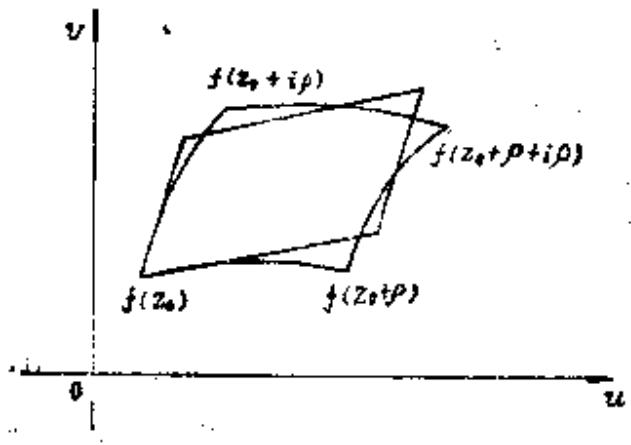
图2.6
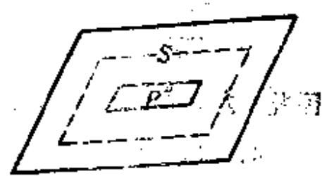
图2.7
$f(z_{0}) + \lbrack f_{x}(z_{0}) + f_{y}(z_{0})\rbrack\rho,f(z_{0}) + f_{y}(z_{0})\rho$为顶点的闭的平行四边形 $P$  。现在,在  $P$  的外部以及其内部,分别作离它的各边为  $2\rho\epsilon$  的平行线,平行  $P$  的各条边,而作成二个平行四边形  $P$  ,这样对于属于  $Q$  的任意点  $z$  ,有
$\begin{aligned} & \left| u(z) - u^{\ast}(z) \right| < \varepsilon\rho, \\ & \left| v(z) - v^{\ast}(z) \right| < \varepsilon\rho, \end{aligned}$
因此有  $|w - w^{\prime}| < 2e\rho$  。所以  $P$  和  $R$  包含在  $P^{\prime}$  内,或者说,  $P$  和  $R$  的周界包含在  $P^{\prime}$  和  $P^{''}$  之间的带状区域  $S$  内。故  $P$  ,  $R$  的面积都比  $P^{''}$  的面积大,但比  $P^{\prime}$  的面积小。所以,  $P$  和  $R$  的面积之差比带状区域  $S$  的面积小。然而  $P$  的面积等于  $|J(z_{0}) \cdot \rho^{2}(J = (u_{x}v_{y} - u_{y}v_{x}))$  ,  $S$  的面积等于
$4\varepsilon\rho^{2}(\sqrt{u_{x}^{2}(z_{0}) + v_{x}^{2}(z_{0})} + \sqrt{u_{y}^{2}(z_{0}) + v_{y}^{2}(z_{0}))}.$
因此
$\begin{aligned} & \mid \left| J(z_{0}) \right|\rho^{2} - \Omega(\rho) \mid < 4\varepsilon\rho^{2}(\sqrt{u_{x}^{2}(z_{0}) + v_{x}^{2}(z_{0})} \\ & \quad + \sqrt{u_{y}^{2}(z_{0}) + v_{y}^{2}(z_{0})}). \end{aligned}$
由于在含有  $z_{0}$  的D的任意闭部分区域上, $u_{x},u_{y},v_{z},v_{y}$  连续,因此上式与  $z_{0}$  的位置无关,从而
$\left| |J|\rho^{2} - \Omega(\rho) \right| < 4\varepsilon\rho^{2}M,$
所以
$\lim_{\rho \cdot 0}\frac{\Omega(\rho)}{\rho^{2}} = |J| = |u_{x}v_{y} - u_{y}v_{x}|.$
在上面的证明中,如果 $J(z_{0}) = 0,P$  成为一条线或一个点,  $P^{''}$  虽然作不出,但由于  $0 < \Omega(\rho) < M_{1}e\rho^{2}$  ,故得到
$\lim_{\rho \rightarrow 0}\frac{\Omega(\rho)}{\rho^{2}} = 0.$

   **难度：4/5；出处：** 同事提供《复变函数简明教程_习题导出.xlsx》第154行；导出表无教材书名、原题号及页码，来源待核，原题号同事习题导出表第154行（非教材原题号）；**解答来源：** 同事导出原解析，数学正确性待逐题审核。

   **整理说明：** 原导出知识点标签：导数的几何意义

<!-- source-exercise:TJX-ch08-9 -->
4. 设 $D$ 是可求面积的区域，$f:D\to\mathbb D$ 为 Riemann 映射。证明 $\iint_D|f'(z)|^2\,dx\,dy\le\pi$。

   **答案：** 共形映射的实 Jacobi 行列式为 $|f'|^2$；面积换元公式给 $\iint_D|f'|^2dA=\operatorname{area}(f(D))=\operatorname{area}(\mathbb D)=\pi$。故题中不等式实际取等。

   **难度：2/5；出处：** 谭小江、伍胜健《复变函数简明教程》（北京大学出版社，2005），习题八第9题，书页207，PDF页219，原题号习题八第9题；**解答来源：** 本次据主书原题自拟简解；题干已回PDF原页核读。

<!-- source-exercise:TJX-ch01-22 -->
5. 把向量映射 $(x,y)\mapsto(u(x,y),v(x,y))$ 写为复函数 $f(z)$。若 $f$ 实连续可导，证明其 Jacobi 行列式满足 $\det\begin{pmatrix}u_x&u_y\\v_x&v_y\end{pmatrix}=\det\begin{pmatrix}f_z&f_{\bar z}\\\overline{f}_{z}&\overline{f}_{\bar z}\end{pmatrix}$。

   **答案：** 利用 Wirtinger 算子，右侧为 $f_z\overline{f_z}-f_{\bar z}\overline{f_{\bar z}}=|f_z|^2-|f_{\bar z}|^2$。展开 $f_z=(u_x+v_y+i(v_x-u_y))/2$、$f_{\bar z}=(u_x-v_y+i(v_x+u_y))/2$ 得 $u_xv_y-u_yv_x$，即左侧。

   **难度：3/5；出处：** 谭小江、伍胜健《复变函数简明教程》（北京大学出版社，2005），习题一第22题，书页30，PDF页42，原题号习题一第22题；**解答来源：** 本次据主书原题自拟简解；题干已回PDF原页核读。

<!-- source-exercise:TJX-ch02-9 -->
6. 设 $f$ 是区域 $\Omega_1$ 到 $\Omega_2$ 的 $C^\infty$ 同胚，且对 $\Omega_1$ 内任意以光滑曲线为边界的有界开集 $O$，$O$ 与 $f(O)$ 面积相等。若 $f$ 解析，证明 $f(z)=e^{i\theta}z+c$。

   **答案：** 面积公式和小圆盘极限给 $J_f=1$，解析性又给 $J_f=|f'|^2$，故 $|f'|=1$。非常值解析函数的模不能内部取最大，故 $f'$ 常数且模为1；积分得 $f=e^{i\theta}z+c$。

   **难度：3/5；出处：** 谭小江、伍胜健《复变函数简明教程》（北京大学出版社，2005），习题二第9题，书页75，PDF页87，原题号习题二第9题；**解答来源：** 本次据主书原题自拟简解；题干已回PDF原页核读。

<!-- source-exercise:TJX-ch02-18 -->
7. 设 $D$ 是单位盘在 $w=e^z$ 下的像。证明 $D$ 的面积为 $\pi\sum_{n=0}^{\infty}1/[(n+1)!n!]$。

   **答案：** 指数函数在 $|z|<1$ 单叶，因为两原像之差若为 $2\pi ik$，模不可能小于2。面积换元给 $A(D)=\iint_{|z|<1}|e^z|^2dA$。展开 $e^z=\sum z^n/n!$，圆盘上不同角频率正交，$\iint|z|^{2n}dA=\pi/(n+1)$，故结果为 $\pi\sum1/[(n+1)(n!)^2]=\pi\sum1/[(n+1)!n!]$。

   **难度：3/5；出处：** 谭小江、伍胜健《复变函数简明教程》（北京大学出版社，2005），习题二第18题，书页77，PDF页89，原题号习题二第18题；**解答来源：** 本次据主书原题自拟简解；题干已回PDF原页核读。

<!-- source-exercise:TJX-ch03-19 -->
8. 设 $f$ 将单位圆盘单叶映到区域 $D$，证明 $D$ 的面积 $A(D)\ge\pi|f'(0)|^2$。

   **答案：** 面积换元 $A(D)=\iint_{|z|<1}|f'(z)|^2dA$。写 $f'(z)=\sum_{n\ge0}b_nz^n$，圆盘正交积分得 $A(D)=\pi\sum_{n\ge0}|b_n|^2/(n+1)\ge\pi|b_0|^2=\pi|f'(0)|^2$。

   **难度：3/5；出处：** 谭小江、伍胜健《复变函数简明教程》（北京大学出版社，2005），习题三第19题，书页117，PDF页129，原题号习题三第19题；**解答来源：** 本次据主书原题自拟简解；题干已回PDF原页核读。

<!-- source-exercise:CA-TRAIN-008 -->
9. 说明 $f(z)=z^3$ 在 $0$ 是否局部保角；求其局部分歧次数。

   **答案：** $f'(0)=0$，故它在 $0$ 不是局部解析同胚，也不在该点保持通常的有向角；在去心邻域的其他点导数非零。其局部标准式已是 $w=z^3$，分歧次数为 $3$。

   **难度：3/5；出处：** 本项目根据所附教材知识点自拟训练题；非教材原题，书页及PDF页不适用，原题号本项目自拟训练题8；**解答来源：** 本次自拟简解，已按相关定理核算。

   **整理说明：** 教学训练题，不计原书独立习题数

<!-- source-exercise:CA-TRAIN-029 -->
10. 考察 $T(z)=2z+3$。写出它分解为一次伸缩与一次平移的形式，并求导数和实 Jacobi 行列式。

   **答案：** $T=\tau_3\circ s_2$，$s_2(z)=2z$、$\tau_3(z)=z+3$；$T'(z)=2$，故 $J_T=|T'|^2=4$，面积扩大四倍、有向角不变。

   **难度：2/5；出处：** 本项目根据所附教材知识点自拟训练题；非教材原题，书页及PDF页不适用，原题号本项目自拟训练题29；**解答来源：** 本次自拟简解，已按相关定理核算。

   **整理说明：** 教学训练题，不计原书独立习题数

#### 全纯切映射与保角变换

**图谱路径：** 复变函数 / 解析函数 / 导数的几何意义 / 全纯切映射与保角变换

**知识内容：** [定义、定理与方法](知识点.md#ca-033)

所给材料中未找到直接对应的独立未解题。

##### 第一类保教映射

**图谱路径：** 复变函数 / 解析函数 / 导数的几何意义 / 全纯切映射与保角变换 / 第一类保教映射

**知识内容：** [定义、定理与方法](知识点.md#ca-034)

<!-- source-exercise:TJX-ch02-28 -->
1. 设 $f=u+iv$，且 $u,v$ 在 $z_0$ 实可微。若 $\lim_{z\to z_0}|[f(z)-f(z_0)]/(z-z_0)|$ 存在，证明 $f$ 或 $\bar f$ 在 $z_0$ 复可导。

   **答案：** 实微分写 $f(z_0+h)-f(z_0)=ah+b\bar h+o(|h|)$。模商沿 $h=re^{i\theta}$ 的极限为 $|a+be^{-2i\theta}|$；它与 $\theta$ 无关当且仅当 $a\bar b=0$。若 $b=0$ 则 $f$ 复可导；若 $a=0$ 则 $\bar f$ 复可导。

   **难度：4/5；出处：** 谭小江、伍胜健《复变函数简明教程》（北京大学出版社，2005），习题二第28题，书页78，PDF页90，原题号习题二第28题；**解答来源：** 本次据主书原题自拟简解；题干已回PDF原页核读。

<!-- source-exercise:CA-TRAIN-008 -->
2. 说明 $f(z)=z^3$ 在 $0$ 是否局部保角；求其局部分歧次数。

   **答案：** $f'(0)=0$，故它在 $0$ 不是局部解析同胚，也不在该点保持通常的有向角；在去心邻域的其他点导数非零。其局部标准式已是 $w=z^3$，分歧次数为 $3$。

   **难度：3/5；出处：** 本项目根据所附教材知识点自拟训练题；非教材原题，书页及PDF页不适用，原题号本项目自拟训练题8；**解答来源：** 本次自拟简解，已按相关定理核算。

   **整理说明：** 教学训练题，不计原书独立习题数

##### 第二类保教映射

**图谱路径：** 复变函数 / 解析函数 / 导数的几何意义 / 全纯切映射与保角变换 / 第二类保教映射

**知识内容：** [定义、定理与方法](知识点.md#ca-035)

<!-- source-exercise:CA-TRAIN-015 -->
1. 考察 $f(z)=\bar z$ 对两条相交直线的作用：它保持无向角吗？保持平面定向吗？

   **答案：** 复共轭是关于实轴的镜像，保持夹角绝对值但把有向角 $\theta$ 变成 $-\theta$；其实 Jacobi 行列式为 $-1$，故反转定向，是第二类保角映射。

   **难度：2/5；出处：** 本项目根据所附教材知识点自拟训练题；非教材原题，书页及PDF页不适用，原题号本项目自拟训练题15；**解答来源：** 本次自拟简解，已按相关定理核算。

   **整理说明：** 教学训练题，不计原书独立习题数

### 幂级数

**图谱路径：** 复变函数 / 解析函数 / 幂级数

**知识内容：** [定义、定理与方法](知识点.md#ca-036)

所给材料中未找到直接对应的独立未解题。

#### Cauchy准则

**图谱路径：** 复变函数 / 解析函数 / 幂级数 / Cauchy准则

**知识内容：** [定义、定理与方法](知识点.md#ca-037)

<!-- source-exercise:TJX-ch01-21 -->
1. 设 $z_0$ 是集合 $S$ 的极限点。给出并证明在 $z\in S$ 且 $z\to z_0$ 时，函数 $f(z)$ 收敛的 Cauchy 准则。

   **答案：** 准则是：任意 $\varepsilon>0$ 存在 $\delta>0$，使 $z,w\in S$、$0<|z-z_0|,|w-z_0|<\delta$ 时 $|f(z)-f(w)|<\varepsilon$。必要性由极限三角不等式；充分性取一列 $z_n\to z_0$，则 $f(z_n)$ 为复数 Cauchy 列，极限 $L$；再将任意近点与充分远的 $z_n$ 比较即得 $f(z)\to L$。

   **难度：3/5；出处：** 谭小江、伍胜健《复变函数简明教程》（北京大学出版社，2005），习题一第21题，书页30，PDF页42，原题号习题一第21题；**解答来源：** 本次据主书原题自拟简解；题干已回PDF原页核读。

<!-- source-exercise:TJX-ch02-15 -->
2. 若级数 $\sum_{n=0}^{\infty}|a_n|$ 收敛，证明 $\sum_{n=0}^{\infty}a_n$ 收敛，且其和与求和顺序无关。

   **答案：** 绝对收敛使任意尾项和的模至多为对应绝对值尾和，故部分和列为 Cauchy 列。对任意重排，先选有限指标集覆盖原级数的主要质量，剩余绝对值和小于 $\varepsilon$；重排取得这些指标后，其部分和与原和差小于 $\varepsilon$。

   **难度：2/5；出处：** 谭小江、伍胜健《复变函数简明教程》（北京大学出版社，2005），习题二第15题，书页76，PDF页88，原题号习题二第15题；**解答来源：** 本次据主书原题自拟简解；题干已回PDF原页核读。

<!-- source-exercise:CONWAY-ch02-s03-7 -->
3. 在 $\mathbb R$ 上构造度量 $d$，使 $d$ 收敛与通常绝对值收敛等价，但实数列 $n\to+\infty$ 在 $d$ 下为 Cauchy 列。

   **答案：** 取 $d(x,y)=|\arctan x-\arctan y|$。$\arctan$ 是从 $\mathbb R$ 到 $(-\pi/2,\pi/2)$ 的同胚，故有限点处收敛等价；而 $\arctan n\to\pi/2$，故 $\{n\}$ 是 $d$-Cauchy 列，却在 $\mathbb R$ 中无 $d$ 极限。

   **难度：2/5；出处：** John B. Conway, Functions of One Complex Variable, 2nd ed., Springer-Verlag，Chapter 2 §3 Exercises 7，书页20，PDF页33，原题号Chapter 2 §3 Exercises 7；**解答来源：** 本次据参考书原题自拟简解；题干已回PDF原页核读。

<!-- source-exercise:CA-TRAIN-016 -->
4. 已知幂级数 $\sum_{n=0}^\infty(-1)^n/(n+1)$ 收敛。求 $\lim_{r\uparrow1}\sum_{n=0}^\infty(-r)^n/(n+1)$。

   **答案：** Abel 定理给径向极限等于边界和。又在 $0\le r<1$ 积分几何级数得 $\sum_{n\ge0}(-r)^n/(n+1)=\log(1+r)/r$，所以极限为 $\log2$。

   **难度：3/5；出处：** 本项目根据所附教材知识点自拟训练题；非教材原题，书页及PDF页不适用，原题号本项目自拟训练题16；**解答来源：** 本次自拟简解，已按相关定理核算。

   **整理说明：** 教学训练题，不计原书独立习题数

#### 控制收敛原理

**图谱路径：** 复变函数 / 解析函数 / 幂级数 / 控制收敛原理

**知识内容：** [定义、定理与方法](知识点.md#ca-038)

<!-- source-exercise:TJX-ch02-13 -->
1. 设 $f(z)=\sum_{n\ge0}a_nz^n$ 收敛半径为 $R$；一列幂级数 $g_m(z)=\sum_{n\ge0}b_{mn}z^n$ 满足对任意 $m,n$ 有 $|b_{mn}|\le|a_n|$，且每个 $n$ 的 $b_{mn}\to b_n$。证明各 $g_m$ 与 $g=\sum b_nz^n$ 收敛半径至少为 $R$，且在每个 $|z|\le r<R$ 上 $g_m\to g$ 一致。

   **答案：** $|b_n|\le|a_n|$，所以各级数在 $|z|<R$ 绝对收敛。固定 $r<R$，$\sum|a_n|r^n<\infty$。先取尾项 $N$ 使 $2\sum_{n>N}|a_n|r^n<\varepsilon/2$，再由有限个系数逐点收敛取 $m$ 大，使前 $N$ 项一致差小于 $\varepsilon/2$；两者合得一致收敛。

   **难度：3/5；出处：** 谭小江、伍胜健《复变函数简明教程》（北京大学出版社，2005），习题二第13题，书页76，PDF页88，原题号习题二第13题；**解答来源：** 本次据主书原题自拟简解；题干已回PDF原页核读。

<!-- source-exercise:CA-TRAIN-009 -->
2. 设 $f_n$ 在区域 $D$ 解析并局部一致收敛到 $f$。说明为何 $f$ 解析且 $f_n'$ 局部一致收敛到 $f'$。

   **答案：** 任取闭圆盘 $\overline{D(z_0,r)}\Subset D$，沿其边界的 Cauchy 导数公式有 $f_n^{(k)}(z)=\frac{k!}{2\pi i}\oint f_n(\zeta)(\zeta-z)^{-k-1}\,d\zeta$。边界一致收敛允许传极限，对较小闭圆盘得到导数一致收敛；$k=0$ 给解析性。

   **难度：3/5；出处：** 本项目根据所附教材知识点自拟训练题；非教材原题，书页及PDF页不适用，原题号本项目自拟训练题9；**解答来源：** 本次自拟简解，已按相关定理核算。

   **整理说明：** 教学训练题，不计原书独立习题数

#### Abel定理

**图谱路径：** 复变函数 / 解析函数 / 幂级数 / Abel定理

**知识内容：** [定义、定理与方法](知识点.md#ca-039)

<!-- source-exercise:TJX-ch07-8 -->
1. 设 $f(z)=\sum_{n\ge0}a_nz^n$ 收敛半径为1、各系数实数，且部分和 $S_n=\sum_{k=0}^na_k\to+\infty$。证明 $z=1$ 是奇点；并举例说明若仅有 $|S_n|\to\infty$，结论可能失败。

   **答案：** Abel 分部求和给 $f(r)=(1-r)\sum_{n\ge0}S_nr^n$（$0<r<1$）；若 $S_n\to+\infty$，该加权平均趋于 $+\infty$，故 $1$ 不可解析延拓。反例取 $a_n=(-1)^nn$（$a_0=0$），则 $f(z)=-z/(1+z)^2$ 在 $z=1$ 解析，但 $S_n$ 的绝对值沿奇偶指标均趋于无穷。

   **难度：4/5；出处：** 谭小江、伍胜健《复变函数简明教程》（北京大学出版社，2005），习题七第8题，书页186，PDF页198，原题号习题七第8题；**解答来源：** 本次据主书原题自拟简解；题干已回PDF原页核读。

<!-- source-exercise:CA-TRAIN-016 -->
2. 已知幂级数 $\sum_{n=0}^\infty(-1)^n/(n+1)$ 收敛。求 $\lim_{r\uparrow1}\sum_{n=0}^\infty(-r)^n/(n+1)$。

   **答案：** Abel 定理给径向极限等于边界和。又在 $0\le r<1$ 积分几何级数得 $\sum_{n\ge0}(-r)^n/(n+1)=\log(1+r)/r$，所以极限为 $\log2$。

   **难度：3/5；出处：** 本项目根据所附教材知识点自拟训练题；非教材原题，书页及PDF页不适用，原题号本项目自拟训练题16；**解答来源：** 本次自拟简解，已按相关定理核算。

   **整理说明：** 教学训练题，不计原书独立习题数

### 多值函数与反函数

**图谱路径：** 复变函数 / 解析函数 / 多值函数与反函数

**知识内容：** [定义、定理与方法](知识点.md#ca-040)

所给材料中未找到直接对应的独立未解题。

#### 单值解析分支

**图谱路径：** 复变函数 / 解析函数 / 多值函数与反函数 / 单值解析分支

**知识内容：** [定义、定理与方法](知识点.md#ca-041)

<!-- source-exercise:TJX-XLSX-r134 -->
1. 叙述如下多值函数的Riemann曲面的作法:
 (ⅰ) $\displaystyle w=\sqrt{\frac{z-b}{z-a}}\ (a\neq b)$,
 (ⅱ) $w=\sqrt{z}\sqrt[3]{z-1}$。

   **答案：** (i)如设$\xi = \frac{z - b}{z - a},$
 (*)
则全z平面一一对应地保角映射为全ζ平面,z=a,z=b分别对
应于  $\zeta = \infty,\zeta = 0$  。将两张  $z$  平面全部重合,以  $z = a,z = b$  作为支点作面  $F$  。由映射(*) $F$  映射为  $w = \sqrt{\zeta}$  的 Riemann 曲面 $F^{\prime}$  ,  $w$  作为  $\zeta$  的函数在  $F^{\prime}$  上是单值函数,除
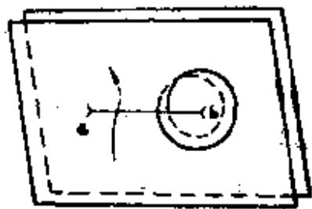
图2.13
了0, $\infty$  以外是正则的。因此,如果将  $\zeta$  变换为  $z$  (即以  $z$  为变数),那么  $w$  作为  $z$  的函数在  $F$  上是单值函数,除去  $z = a$  ,$z = b$  以外是正则的。所以  $F$  是  $w = \sqrt{\frac{z - b}{z - a}}$  的Riemann曲面。
 z绕b点旋转二周时(在F上认为是旋转一周),w绕原点旋转一周,z绕a点旋转二周时(在F上旋转一周),w绕无限远点旋转一周。
(ii)设 $z$  为非实数,设
$\begin{matrix} w_{1} = \sqrt{z} + \sqrt[3]{z - 1} \\ w_{2} = - \sqrt{z} + \sqrt[3]{z - 1} \\ w_{3} = \sqrt{z} + \omega\sqrt[3]{z - 1} \\ w_{4} = - \sqrt{z} + \omega\sqrt[3]{z - 1} \\ w_{5} = \sqrt{z} + \omega^{2} \cdot \sqrt[3]{z - 1} \\ w_{6} = - \sqrt{z} + \omega^{2} \cdot \sqrt[3]{z - 1}. \end{matrix}$
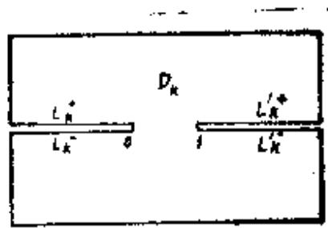
图2.14
这里  $\omega$  为1的虚立方根 $\left( \omega = \frac{- 1 + i\sqrt{3}}{2} \right)$  。如果将各个  $w_{k}(k = 1,2,3,4,5,6)$  看作  $z$  的函数,则在  $z$  平面的沿实轴从  $- \infty$  到0以及从1到 $+ \infty$  剪开的区域  $D_{k}$  上是单值正则的。
设  $x_{k}$  是  $D_{k}$  的一个境界点  $(x_{k}$  是实数,  $- \infty < x_{k} < 0)$  ,如果将这个点作为上半平面的某个点列的凝聚点则以 $x_{k}^{+}$  表示,如果作为下半平面的点列的凝聚点则以  $x_{k}^{-}$  表示,我们将  $x_{k}^{+}$  和  $x_{k}^{-}$  看作相异的境界点。所有点  $x_{k}^{+},x_{k}^{-}$  的集合各称为  $D_{k}$  的割断线  $( - \infty,0)$  的上沿和下沿,以  $L_{k}^{+},L_{k}^{-}$  表示,同样可定义  $D_{k}$  的另一割断线  $(1, + \infty)$  的上沿  $L_{k}^{+}$  和下沿  $L_{k}^{-}$  。
将  $D_{1}$  和  $D_{2}$  重合起来,使割断线  $( - \infty,0)$  全部重合,分别
将  $L_{1}$  和  $L_{2}$  ,  $L_{3}$  和  $L_{2}^{-}$  连接起来。这种连接的状态以下图表示:
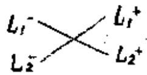
图2.15
同样将  $D_{5}$  和  $D_{4}$  ,  $D_{5}$  和  $D_{6}$  沿  $( - \infty,0)$  连接起来,连接的方式如下图所示:
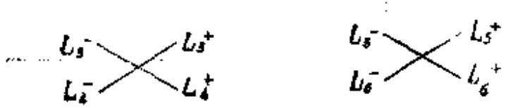
图2.16
其次,沿割断线  $(1, + \infty)$  也连接起来,连接的方法为
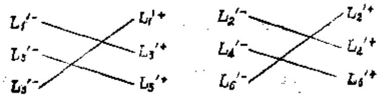
图2.17
这样就作出了没有境界的一个区域F。F就是所求的Riemann曲面。
所给函数w的六个分支 $w_{k}(k = 2,2,3,4,5,6)$  分别在  $D_{k}$  上是单值正则的,w作为一个函数在F是单值的,除去支点0,1, $\infty$以外在F上是正则的。 $D_{k}$  及其境界(割断线)所成的点集合称为F的第k叶。
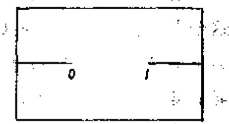
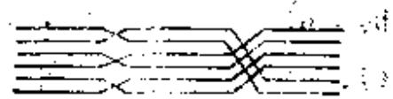
由于  $F$  恰是六张全复数平面重叠而成的(除去0,1,∞外),所以 $z$  平面上的一点  $z_{0}( \neq 0, \neq 1, \neq \infty)$  看作是六个相异的  $F$  上的点重复在一起。反之,如设  $F$  上的一点为  $p$  ,  $p$  由与它相重的  $z$  平面上的点  $z(p)$  一意确定。称  $z(p)$  为  $p$  的射影。以0,1,∞作为射影的 $F$  的支点各为三个,二个和一个。
从第1(或第3,第5)叶上的一点p出发,并设p这样运动,即使其射影沿圆 $|z| = \rho < 1$  的正向旋转两周。这时,p途中经过第2(4,6)叶绕以原点为射影的F的支点旋转一周,最后回到第1(3.5)叶原来的位置。
从第1(或第2)叶的p点出发,并设p点这样运动,使其射影沿圆 $|z - 1| = \rho < 1$  的正向旋转三周。这时,p在途中顺次通过第3(4)叶,第5(6)叶,绕以z=1,作为射影的F的支点旋转一周,最后回到第1(2)叶原来的位置。
从第一叶的一点  $p = p_{0}$  出发,并设p点这样运动,使其射影沿圆 $|z| = \rho > 1$  的负向旋转六周。这时,p在途中顺次通过第1,第2,第6,第5,第3,第4,第2,第1,第5,第6,第4,第3叶,绕以无限远点作为射影的F的支点旋转一周,最后回到第1叶原来的位置 $p_{0}$  ,

   **难度：5/5；出处：** 同事提供《复变函数简明教程_习题导出.xlsx》第134行；导出表无教材书名、原题号及页码，来源待核，原题号同事习题导出表第134行（非教材原题号）；**解答来源：** 同事导出原解析，数学正确性待逐题审核。

   **整理说明：** 原导出知识点标签：多值函数与反函数

<!-- source-exercise:TJX-XLSX-r135 -->
2. 应用对数表示 $\arccos z$,$\arcsin z$。

   **答案：** 如设  $w = arccosz$  ,则$z = cosw = \frac{e^{iw} + e^{- iw}}{2}.$
由此式解出  $e^{- iw}$  ,得
$e^{- iw} = z \pm \sqrt{z^{2} - 1},$
因此  $- iw = log(z \pm \sqrt{z^{2} - 1})$
故  $arccosz = ilog(z \pm \sqrt{z^{2} - 1})$
同样可得
$arcsinz = ilog( - iz \pm \sqrt{1 - z^{2}}).$

   **难度：3/5；出处：** 同事提供《复变函数简明教程_习题导出.xlsx》第135行；导出表无教材书名、原题号及页码，来源待核，原题号同事习题导出表第135行（非教材原题号）；**解答来源：** 同事导出原解析，数学正确性待逐题审核。

   **整理说明：** 原导出知识点标签：多值函数与反函数

<!-- source-exercise:TJX-XLSX-r136 -->
3. $\log(zw)=\log z+\log w$ 恒成立吗?

   **答案：** 如设  $z = re^{i\theta}$,  $w = \rho e^{i\varphi}$  , 则$logz = logr + i\theta + 2n\pi i,\quad logw = log\rho + i\varphi + 2m\pi i$
$(n,m = 0, \pm 1, \pm 2,\ldots)$
$zW = r\rho e^{i(\theta + \varphi)}$,故
$log(zw) = log(r\rho) + i\lbrack(\theta + \varphi) + 2p\pi\rbrack$
$= (logr + i\theta) + (log\rho + i\varphi) + 2p\pi i$
$(p = 0, \pm 1, \pm 2,\ldots)$
因此  $log(zw) = logz + logw$  成立的必要充分条件是
$p = n + m.$

   **难度：3/5；出处：** 同事提供《复变函数简明教程_习题导出.xlsx》第136行；导出表无教材书名、原题号及页码，来源待核，原题号同事习题导出表第136行（非教材原题号）；**解答来源：** 同事导出原解析，数学正确性待逐题审核。

   **整理说明：** 原导出知识点标签：多值函数与反函数

<!-- source-exercise:TJX-ch02-19 -->
4. 只考虑主辐角，把 $(1+i)^{1+i}$ 表示为 $a+ib$。

   **答案：** 主值 $\operatorname{Log}(1+i)=\log\sqrt2+i\pi/4$。因此 $(1+i)^{1+i}=\exp((1+i)\operatorname{Log}(1+i))=e^{\log\sqrt2-\pi/4}[\cos(\pi/4+\log\sqrt2)+i\sin(\pi/4+\log\sqrt2)]$。

   **难度：2/5；出处：** 谭小江、伍胜健《复变函数简明教程》（北京大学出版社，2005），习题二第19题，书页77，PDF页89，原题号习题二第19题；**解答来源：** 本次据主书原题自拟简解；题干已回PDF原页核读。

<!-- source-exercise:TJX-ch02-21 -->
5. 设 $D$ 是不含 $z_0$ 的单连通区域，$f_1,f_2$ 是 $\sqrt{z-z_0}$ 在 $D$ 上两个不同解析分支。证明 $f_1(D)\cap f_2(D)=\varnothing$。

   **答案：** 若 $w=f_1(z_1)=f_2(z_2)$，平方得 $z_1-z_0=w^2=z_2-z_0$，故 $z_1=z_2$。但两个不同平方根分支在每点互为相反数且无零，不能在同一点同值，矛盾。

   **难度：3/5；出处：** 谭小江、伍胜健《复变函数简明教程》（北京大学出版社，2005），习题二第21题，书页77，PDF页89，原题号习题二第21题；**解答来源：** 本次据主书原题自拟简解；题干已回PDF原页核读。

<!-- source-exercise:CA-TRAIN-005 -->
6. 在 $\mathbb C\setminus\{0\}$ 上，函数 $f(z)=1/z$ 是否有全局解析原函数？在去掉负实轴后的割域上如何构造？

   **答案：** 沿单位圆积分 $\oint dz/z=2\pi i\ne0$，故穿孔平面上无全局原函数。在主值割域 $\mathbb C\setminus(-\infty,0]$ 上取 $\operatorname{Log} z=\ln|z|+i\operatorname{Arg} z$，$\operatorname{Arg} z\in(-\pi,\pi)$，其导数为 $1/z$。

   **难度：3/5；出处：** 本项目根据所附教材知识点自拟训练题；非教材原题，书页及PDF页不适用，原题号本项目自拟训练题5；**解答来源：** 本次自拟简解，已按相关定理核算。

   **整理说明：** 教学训练题，不计原书独立习题数

<!-- source-exercise:CA-TRAIN-006 -->
7. 将 $\log z$ 的局部解析分支沿一条绕 $0$ 正向一周的闭路解析开拓，说明终值与初值之差。

   **答案：** 沿闭路有 $\int dz/z=2\pi i$，故终点虽回到同一 $z$，延拓分支的值增加 $2\pi i$。这说明穿孔平面上 $\log z$ 无单值解析分支；可在其对数 Riemann 曲面上单值化。

   **难度：3/5；出处：** 本项目根据所附教材知识点自拟训练题；非教材原题，书页及PDF页不适用，原题号本项目自拟训练题6；**解答来源：** 本次自拟简解，已按相关定理核算。

   **整理说明：** 教学训练题，不计原书独立习题数

<!-- source-exercise:CA-TRAIN-028 -->
8. 取 $\arcsin z=-i\operatorname{Log}(iz+\sqrt{1-z^2})$ 的一支。在 $z=0$ 附近求导数。

   **答案：** 指定 $\sqrt{1-z^2}$ 在 $0$ 处取 $1$、对数在 $1$ 附近取 $0$。令 $w=iz+\sqrt{1-z^2}$，则 $w'/w=i/\sqrt{1-z^2}$，故 $(\arcsin z)'=1/\sqrt{1-z^2}$。分支点在 $\pm1$。

   **难度：3/5；出处：** 本项目根据所附教材知识点自拟训练题；非教材原题，书页及PDF页不适用，原题号本项目自拟训练题28；**解答来源：** 本次自拟简解，已按相关定理核算。

   **整理说明：** 教学训练题，不计原书独立习题数

#### Riemann曲面

**图谱路径：** 复变函数 / 解析函数 / 多值函数与反函数 / Riemann曲面

**知识内容：** [定义、定理与方法](知识点.md#ca-042)

<!-- source-exercise:TJX-ch02-17 -->
1. 试构造 $\sqrt[n]{z}$ 的 Riemann 曲面。

   **答案：** 取 $n$ 张沿同一从 $0$ 到 $\infty$ 的割线切开的复平面，把第 $k$ 张割线一侧与第 $k+1$ 张（模 $n$）另一侧粘合；所得连通 $n$ 层覆盖除 $0,\infty$ 外无分歧，在分歧点局部坐标 $w$ 满足 $z=w^n$，函数 $w=\sqrt[n]{z}$ 在该曲面上单值解析。

   **难度：3/5；出处：** 谭小江、伍胜健《复变函数简明教程》（北京大学出版社，2005），习题二第17题，书页76，PDF页88，原题号习题二第17题；**解答来源：** 本次据主书原题自拟简解；题干已回PDF原页核读。

<!-- source-exercise:TJX-ch02-29 -->
2. 设 $a_1,a_2,a_3,a_4$ 两两不等，求 $\sqrt{(z-a_1)(z-a_2)(z-a_3)(z-a_4)}$ 的单值解析函数存在的最大区域。

   **答案：** 该表达式在避开四个分支点后沿闭路延拓的变号由环路包围奇数个分支点决定。可取两条互不交割线分别连接两对分支点，再在割域上选平方根；然而割线配对和形状不唯一，严格说不存在唯一的‘最大区域’，只能描述满足所有闭路绕四点总奇偶数为零的单值域。

   **难度：4/5；出处：** 谭小江、伍胜健《复变函数简明教程》（北京大学出版社，2005），习题二第29题，书页78，PDF页90，原题号习题二第29题；**解答来源：** 本次据主书原题自拟简解；题干已回PDF原页核读。

   **待核状态：** ‘最大区域’不唯一，需指定割线/单值域选取规则

   **勘误：** ‘最大区域’不唯一，需指定割线/单值域选取规则

<!-- source-exercise:TJX-ch07-11 -->
3. 问函数 $\sin\sqrt z/\sqrt z$ 与 $\cos\sqrt z$ 是否多值。

   **答案：** 二者并不多值：$\sin w/w$ 与 $\cos w$ 都是 $w$ 的偶整函数。代入 $w^2=z$ 得 $\sin\sqrt z/\sqrt z=\sum_{n\ge0}(-1)^nz^n/(2n+1)!$、$\cos\sqrt z=\sum_{n\ge0}(-1)^nz^n/(2n)!$，均为全平面单值整函数，$z=0$ 前者取1。

   **难度：2/5；出处：** 谭小江、伍胜健《复变函数简明教程》（北京大学出版社，2005），习题七第11题，书页187，PDF页199，原题号习题七第11题；**解答来源：** 本次据主书原题自拟简解；题干已回PDF原页核读。

<!-- source-exercise:CA-TRAIN-006 -->
4. 将 $\log z$ 的局部解析分支沿一条绕 $0$ 正向一周的闭路解析开拓，说明终值与初值之差。

   **答案：** 沿闭路有 $\int dz/z=2\pi i$，故终点虽回到同一 $z$，延拓分支的值增加 $2\pi i$。这说明穿孔平面上 $\log z$ 无单值解析分支；可在其对数 Riemann 曲面上单值化。

   **难度：3/5；出处：** 本项目根据所附教材知识点自拟训练题；非教材原题，书页及PDF页不适用，原题号本项目自拟训练题6；**解答来源：** 本次自拟简解，已按相关定理核算。

   **整理说明：** 教学训练题，不计原书独立习题数

<!-- source-exercise:CA-TRAIN-026 -->
5. 对方程 $F(z,w)=w^2-z=0$，分别讨论 $(z,w)=(1,1)$ 与 $(0,0)$ 附近能否把 $w$ 唯一解析表示为 $z$ 的函数。

   **答案：** $F_w=2w$；在 $(1,1)$ 非零，隐函数定理给唯一分支 $w=\sqrt z$ 且 $w(1)=1$。在 $(0,0)$ 导数为零，若存在解析 $w(z)$ 则其零点阶数的两倍为 $z$ 的一阶零点，不可能；此处为分歧点。

   **难度：3/5；出处：** 本项目根据所附教材知识点自拟训练题；非教材原题，书页及PDF页不适用，原题号本项目自拟训练题26；**解答来源：** 本次自拟简解，已按相关定理核算。

   **整理说明：** 教学训练题，不计原书独立习题数

#### 反三角函数

**图谱路径：** 复变函数 / 解析函数 / 多值函数与反函数 / 反三角函数

**知识内容：** [定义、定理与方法](知识点.md#ca-043)

<!-- source-exercise:CA-TRAIN-028 -->
1. 取 $\arcsin z=-i\operatorname{Log}(iz+\sqrt{1-z^2})$ 的一支。在 $z=0$ 附近求导数。

   **答案：** 指定 $\sqrt{1-z^2}$ 在 $0$ 处取 $1$、对数在 $1$ 附近取 $0$。令 $w=iz+\sqrt{1-z^2}$，则 $w'/w=i/\sqrt{1-z^2}$，故 $(\arcsin z)'=1/\sqrt{1-z^2}$。分支点在 $\pm1$。

   **难度：3/5；出处：** 本项目根据所附教材知识点自拟训练题；非教材原题，书页及PDF页不适用，原题号本项目自拟训练题28；**解答来源：** 本次自拟简解，已按相关定理核算。

   **整理说明：** 教学训练题，不计原书独立习题数

#### 儒可夫斯基函数

**图谱路径：** 复变函数 / 解析函数 / 多值函数与反函数 / 儒可夫斯基函数

**知识内容：** [定义、定理与方法](知识点.md#ca-044)

<!-- source-exercise:TJX-body-p063-joukowski -->
1. 正文 §2.5 已分析 Joukowski 映射 $J(z)=(z+z^{-1})/2$ 在上半平面上的像。继续讨论它在穿孔单位盘 $0<|z|<1$、单位盘外 $|z|>1$ 及下半平面上的单叶性与像域。

   **答案：** 方程 $J(z_1)=J(z_2)$ 等价于 $z_1=z_2$ 或 $z_1z_2=1$。因此每个给定域都不同时包含互为倒数的两点，故单叶。单位圆边界映实线段 $[-1,1]$，穿孔盘与盘外都映为 $\mathbb C\setminus[-1,1]$；上下半平面均映为 $\mathbb C\setminus(( -\infty,-1]\cup[1,\infty))$，两者给该二重逆映射的不同分支。

   **难度：3/5；出处：** 谭小江、伍胜健《复变函数简明教程》（北京大学出版社，2005），正文书页63，PDF页75，原题号正文留作练习，书页63（非章末编号题）；**解答来源：** 本次据正文明确留给读者的任务自拟简解，题干已回PDF原页核读。

<!-- source-exercise:CA-TRAIN-017 -->
2. 求 Joukowski 映射 $J(z)=(z+z^{-1})/2$ 在单位圆 $z=e^{it}$ 上的像。

   **答案：** $J(e^{it})=(e^{it}+e^{-it})/2=\cos t$，像为实线段 $[-1,1]$，并且圆上除端点对应处外两点 $e^{it}$ 与 $e^{-it}$ 同像；故 $J$ 在整条圆上不单叶。

   **难度：2/5；出处：** 本项目根据所附教材知识点自拟训练题；非教材原题，书页及PDF页不适用，原题号本项目自拟训练题17；**解答来源：** 本次自拟简解，已按相关定理核算。

   **整理说明：** 教学训练题，不计原书独立习题数

### 分式线性变换

**图谱路径：** 复变函数 / 解析函数 / 分式线性变换

**知识内容：** [定义、定理与方法](知识点.md#ca-045)

所给材料中未找到直接对应的独立未解题。

#### 分式线性变换

**图谱路径：** 复变函数 / 解析函数 / 分式线性变换 / 分式线性变换

**知识内容：** [定义、定理与方法](知识点.md#ca-046)

<!-- source-exercise:TJX-XLSX-r055 -->
1. 设$|a_n|<1$,$|b_n|<1$,$\lim\limits_{n\to\infty}a_n=\lim\limits_{n\to\infty}b_n=1$,$\frac{1-|b_n|}{1-|a_n|}\to a\ (0<a<\infty)$。如适当选择$\{\theta_n\}\,(0\le\theta_n<2\pi)$,则一次变换列
 $$\frac{w-b_n}{1-\overline{b}_n w}=e^{i\theta_n}\frac{z-a_n}{1-\overline{a}_n z}\quad(n=1,2,\cdots)$$
当$n\to\infty$时收敛于
 $$\frac{1-w}{1+w}=a\frac{1-z}{1+z}.$$

   **答案：** 记$|a_n|=p_n$,$|b_n|=q_n$,$\arg a_n=\varphi_n$,$\arg b_n=\psi_n$($0\le\varphi_n,\psi_n<2\pi$),并设 $$Z_n=\frac{z-a_n}{1-\overline{a}_n z},\quad W_n=\frac{w-b_n}{1-\overline{b}_n w},$$
 $$\zeta_n=e^{-i\varphi_n}z,\quad \omega_n=e^{-i\psi_n}w.$$
于是
 $$Z_n=e^{i\varphi_n}\frac{\zeta_n-p_n}{1-p_n\zeta_n},\quad W_n=e^{i\psi_n}\frac{\omega_n-q_n}{1-q_n\omega_n},$$
 $$W_n=e^{i\theta_n} Z_n.$$
这里如设$\theta_n=\psi_n-\varphi_n$,则
 $$\frac{1+e^{-i\varphi_n}Z_n}{1-e^{-i\varphi_n}Z_n}=\frac{1+e^{-i\psi_n}W_n}{1-e^{-i\psi_n}W_n}.$$
因此
 $$\frac{1-\omega_n}{1+\omega_n}=\frac{1-q_n}{1-p_n}\cdot\frac{1+p_n}{1+q_n}\cdot\frac{1-\zeta_n}{1+\zeta_n}.$$
设$n\to\infty$,就有
 $$\frac{1-w}{1+w}=a\frac{1-z}{1+z}.$$

   **难度：5/5；出处：** 同事提供《复变函数简明教程_习题导出.xlsx》第55行；导出表无教材书名、原题号及页码，来源待核，原题号同事习题导出表第55行（非教材原题号）；**解答来源：** 同事导出原解析，数学正确性待逐题审核。

   **整理说明：** 原导出知识点标签：分式线性变换/分式线性变换

<!-- source-exercise:TJX-XLSX-r063 -->
2. 设$ad-bc=1$,以$C$表示圆$|cz+d|=1$,证明一次变换
 $$w=\frac{az+b}{cz+d}\quad(ad-bc=1)$$
将$C$内的长度、面积增加,将$C$外的长度、面积减小。

   **答案：** 取一次变换导数的绝对值,有 $$\frac{dw}{dz}=\frac{a(cz+d)-(az+b)c}{(cz+d)^2}=\frac{ad-bc}{(cz+d)^2}=\frac{1}{(cz+d)^2}.$$
 $$\left|\frac{dw}{dz}\right|=\frac{1}{|cz+d|^2}.$$
因此当$|cz+d|<1$和$|cz+d|>1$时,就分成为
 $$\left|\frac{dw}{dz}\right|>1,\quad\left|\frac{dw}{dz}\right|<1.$$

   **难度：4/5；出处：** 同事提供《复变函数简明教程_习题导出.xlsx》第63行；导出表无教材书名、原题号及页码，来源待核，原题号同事习题导出表第63行（非教材原题号）；**解答来源：** 同事导出原解析，数学正确性待逐题审核。

   **整理说明：** 原导出知识点标签：分式线性变换/分式线性变换

<!-- source-exercise:TJX-XLSX-r064 -->
3. 证明当且仅当相异的四点的非调和比是实数时,这四点在同一圆周上。

   **答案：** 设$z_1,z_2,z_3,z_4$为相异的四点。用一次变换将$z_1,z_2,z_3$变换到实轴上去。由于这时非调和比不变,故如果$z_4$不在实轴上,非调和比就不是实数。反之,如果$z_4$在实轴上,非调和比为实数。

   **难度：3/5；出处：** 同事提供《复变函数简明教程_习题导出.xlsx》第64行；导出表无教材书名、原题号及页码，来源待核，原题号同事习题导出表第64行（非教材原题号）；**解答来源：** 同事导出原解析，数学正确性待逐题审核。

   **整理说明：** 原导出知识点标签：分式线性变换/分式线性变换

<!-- source-exercise:TJX-XLSX-r067 -->
4. 将$|z|<1$映射为$|w|<1$的一次变换中,证明$\frac{|dz|}{1-|z|^2}=\frac{|dw|}{1-|w|^2}$(Poincaré微分不变式)。

   **答案：** 题意的一次变换由 $$\frac{z-a}{1-\overline{a}z}=e^{i\theta}\frac{w-b}{1-\overline{b}w}$$
给出,如设$z\to a$,则由于$w\to b$,故
 $$\frac{dz}{1-|a|^2}=e^{i\theta}\frac{dw}{1-|b|^2},$$
所以
 $$\frac{|dz|}{1-|z|^2}=\frac{|dw|}{1-|w|^2}.$$

   **难度：3/5；出处：** 同事提供《复变函数简明教程_习题导出.xlsx》第67行；导出表无教材书名、原题号及页码，来源待核，原题号同事习题导出表第67行（非教材原题号）；**解答来源：** 同事导出原解析，数学正确性待逐题审核。

   **整理说明：** 原导出知识点标签：分式线性变换/分式线性变换

<!-- source-exercise:TJX-ch02-22 -->
5. (1) 设 $z_1,z_2$ 是单位盘内不同两点，证明存在单位盘自同构 $L$ 使 $L(z_1)=0$、$L(z_2)>0$，并问是否唯一；(2) 证明 $L^{-1}$ 把实轴（在圆盘内的一段）映为过 $z_1,z_2$ 且与单位圆正交的圆弧。

   **答案：** (1) 先取 $\phi_{z_1}(z)=(z-z_1)/(1-\bar z_1z)$，再乘唯一旋转 $e^{-i\arg\phi_{z_1}(z_2)}$；盘自同构固定零者仅为旋转，故唯一。(2) 盘自同构把双曲测地线映为双曲测地线；实直径的逆像为与边界圆正交、过 $z_1,z_2$ 的圆弧（直径是圆经无穷远的情形）。

   **难度：4/5；出处：** 谭小江、伍胜健《复变函数简明教程》（北京大学出版社，2005），习题二第22题，书页77，PDF页89，原题号习题二第22题；**解答来源：** 本次据主书原题自拟简解；题干已回PDF原页核读。

<!-- source-exercise:TJX-ch02-23 -->
6. 证明把实轴映为实轴的分式线性变换可写成 $w=(az+b)/(cz+d)$，其中 $a,b,c,d$ 都为实数；讨论行列式 $ad-bc$ 的符号与上、下半平面的对应。

   **答案：** 由三实点像仍为实点，决定变换的矩阵可取实系数。$\operatorname{Im}[(az+b)/(cz+d)]=(ad-bc)\operatorname{Im}z/|cz+d|^2$，故行列式正时分别保持上、下半平面，负时交换上、下半平面。原书末句若写负时下半平面仍映为下半平面，应按此恒等式勘误。

   **难度：3/5；出处：** 谭小江、伍胜健《复变函数简明教程》（北京大学出版社，2005），习题二第23题，书页77，PDF页89，原题号习题二第23题；**解答来源：** 本次据主书原题自拟简解；题干已回PDF原页核读。

   **待核状态：** 原书映射半平面方向的末句疑误，按虚部恒等式更正

   **勘误：** 原书映射半平面方向的末句疑误，按虚部恒等式更正

<!-- source-exercise:TJX-ch02-25 -->
7. 设交比变换 $L(z)=\frac{z-z_3}{z-z_4}\frac{z_2-z_4}{z_2-z_3}$，它把 $z_3,z_2,z_4$ 分别送到 $0,1,\infty$。证明由 $z_2,z_3,z_4$ 决定的广义圆被映为实轴；在何条件下圆内部映为上半平面、外部映为下半平面？

   **答案：** 广义圆上的交比为实数，故整圆映到实轴。取圆内测试点 $z_*$；若 $\operatorname{Im}L(z_*)>0$，连通性与保角性保证整个内部到上半平面，外部到下半平面；若小于零则两侧互换。条件等价于三指定点在圆周上的次序给出的定向。

   **难度：3/5；出处：** 谭小江、伍胜健《复变函数简明教程》（北京大学出版社，2005），习题二第25题，书页77，PDF页89，原题号习题二第25题；**解答来源：** 本次据主书原题自拟简解；题干已回PDF原页核读。

<!-- source-exercise:TJX-ch02-27 -->
8. 设四个点 $z_1,z_2,z_3,z_4$ 按顺序位于圆周 $K$ 上，证明其交比 $(z_1,z_2,z_3,z_4)>0$。

   **答案：** 取分式线性变换把圆变为实轴，并把前三点送到 $0,1,\infty$；按圆周顺序第四点落在使所用交比取正的实区间。也可将圆化为单位圆 $z_j=e^{it_j}$，代入交比后化为正弦比，四个角差的符号成对抵消。

   **难度：3/5；出处：** 谭小江、伍胜健《复变函数简明教程》（北京大学出版社，2005），习题二第27题，书页77，PDF页89，原题号习题二第27题；**解答来源：** 本次据主书原题自拟简解；题干已回PDF原页核读。

<!-- source-exercise:TJX-ch08-7 -->
9. 设 $\lambda$ 是过 $-1,1$ 的任意圆周，点 $z_1,z_2$ 不在 $\lambda$ 上且 $z_1z_2=1$。证明 $z_1,z_2$ 中恰有一个位于 $\lambda$ 内部。

   **答案：** 圆周方程可写 $|z|^2+Az+\bar A\bar z-1=0$，其中过 $\pm1$ 迫使 $A$ 纯虚。记左侧为 $F(z)$，代入 $z_2=1/z_1$，可算 $|z_1|^2F(1/z_1)=-F(z_1)$；因两点均不在圆上，$F$ 值异号，恰有一个在内。

   **难度：3/5；出处：** 谭小江、伍胜健《复变函数简明教程》（北京大学出版社，2005），习题八第7题，书页207，PDF页219，原题号习题八第7题；**解答来源：** 本次据主书原题自拟简解；题干已回PDF原页核读。

<!-- source-exercise:TJX-ch08-11 -->
10. 设区域 $D$ 的边界由两个不相交的圆周组成。证明存在分式线性变换把 $D$ 映为圆环 $\{z:r<|z|<1\}$（$0<r<1$）。

   **答案：** 两圆构成同轴圆系，取其两个极限点 $p,q$（其中一圆包在另一圆内时分别位于各补域）。分式线性变换 $T(z)=(z-p)/(z-q)$ 将同轴圆系的两给定圆都送到以原点为中心的圆；再作正实伸缩使外边界半径1，内边界半径为 $r\in(0,1)$，得到圆环。

   **难度：4/5；出处：** 谭小江、伍胜健《复变函数简明教程》（北京大学出版社，2005），习题八第11题，书页208，PDF页220，原题号习题八第11题；**解答来源：** 本次据主书原题自拟简解；题干已回PDF原页核读。

<!-- source-exercise:CONWAY-ch03-s03-5 -->
11. 在扩充复平面 $\widehat{\mathbb C}$ 上，分别求伸缩 $z\mapsto az$、平移 $z\mapsto z+b$、倒数 $z\mapsto1/z$ 的不动点，并列明退化恒等情形。

   **答案：** $a\ne0,1$ 时伸缩固定 $0,\infty$；$a=1$ 时处处固定。$b\ne0$ 时平移仅固定 $\infty$，$b=0$ 时处处固定。倒数变换交换 $0,\infty$，有限不动点满足 $z^2=1$，即 $\pm1$。

   **难度：2/5；出处：** John B. Conway, Functions of One Complex Variable, 2nd ed., Springer-Verlag，Chapter 3 §3 Exercises 5，书页54，PDF页67，原题号Chapter 3 §3 Exercises 5；**解答来源：** 本次据参考书原题自拟简解；题干已回PDF原页核读。

<!-- source-exercise:CA-TRAIN-007 -->
12. 求把单位盘内 $a$ 送到 $0$ 的一个盘自同构，并说明全部此类映射相差何种自由度。

   **答案：** $\phi_a(z)=(z-a)/(1-\bar a z)$，$|a|<1$，是盘自同构且 $\phi_a(a)=0$。任意另一个这样的自同构与它复合逆映射后固定 $0$，由 Schwarz 引理等号情形只能是旋转，故一般形为 $e^{i\theta}\phi_a$。

   **难度：3/5；出处：** 本项目根据所附教材知识点自拟训练题；非教材原题，书页及PDF页不适用，原题号本项目自拟训练题7；**解答来源：** 本次自拟简解，已按相关定理核算。

   **整理说明：** 教学训练题，不计原书独立习题数

#### 分式线性变换群

**图谱路径：** 复变函数 / 解析函数 / 分式线性变换 / 分式线性变换群

**知识内容：** [定义、定理与方法](知识点.md#ca-047)

<!-- source-exercise:TJX-ch02-26 -->
1. 证明保持交比 $(w,w_1,w_2,w_3)=(z,z_1,z_2,z_3)$、且将三个互异点 $z_i$ 送到三个互异点 $w_i$ 的变换是唯一的分式线性变换。

   **答案：** 取把 $z_1,z_2,z_3$ 归一化为 $0,1,\infty$ 的交比映射 $L_z$，并取对应的 $L_w$；所求是 $L_w^{-1}\circ L_z$，为分式线性变换。若另一个变换有同样三点像，其与此变换之逆的复合固定 $0,1,\infty$，只可能是恒等。

   **难度：3/5；出处：** 谭小江、伍胜健《复变函数简明教程》（北京大学出版社，2005），习题二第26题，书页77，PDF页89，原题号习题二第26题；**解答来源：** 本次据主书原题自拟简解；题干已回PDF原页核读。

<!-- source-exercise:TJX-ch03-28 -->
2. 若 $f$ 是上半平面到自身的解析同胚，证明 $f(z)=(az+b)/(cz+d)$，其中 $a,b,c,d\in\mathbb R$、$ad-bc>0$。

   **答案：** 用 Cayley 变换把上半平面与单位盘共形对应。盘自同构由 Schwarz 引理及其等号情形分类为 $e^{i\theta}(z-\alpha)/(1-\bar\alpha z)$；共轭回上半平面仍为分式线性变换，且边界实轴映实轴，矩阵可取实系数。其虚部符号公式迫使行列式正。

   **难度：4/5；出处：** 谭小江、伍胜健《复变函数简明教程》（北京大学出版社，2005），习题三第28题，书页119，PDF页131，原题号习题三第28题；**解答来源：** 本次据主书原题自拟简解；题干已回PDF原页核读。

<!-- source-exercise:TJX-ch04-26 -->
3. (1) 求 $\mathbb C$ 的全纯自同胚中保持欧氏度量 $ds^2=|dz|^2$ 不变者；(2) 求 Riemann 球面的全纯自同胚中保持球度量 $ds^2=4|dz|^2/(1+|z|^2)^2$ 不变者。

   **答案：** (1) 全平面全纯自同胚为 $az+b$，保长要求 $|a|=1$，即旋转加平移。(2) 球面全纯自同胚为 Möbius 变换，保球度量者是 $z\mapsto(az+b)/(-\bar b z+\bar a)$，其中 $|a|^2+|b|^2=1$；它们对应 $\mathrm{PSU}(2)$ 的球面旋转。

   **难度：4/5；出处：** 谭小江、伍胜健《复变函数简明教程》（北京大学出版社，2005），习题四第26题，书页139，PDF页151，原题号习题四第26题；**解答来源：** 本次据主书原题自拟简解；题干已回PDF原页核读。

<!-- source-exercise:CA-TRAIN-018 -->
4. 把 $T_1(z)=z+1$ 与 $T_2(z)=1/z$ 复合，写出 $T_1\circ T_2$ 的矩阵表示并说明矩阵标量倍的作用。

   **答案：** $T_1\circ T_2=(z+1)/z$，可由 $\begin{pmatrix}1&1\\1&0\end{pmatrix}$ 表示；乘任意非零复数不改变分式线性变换。该矩阵行列式 $-1$，乘 $i$ 后行列式为 $1$，给出 $\mathrm{SL}_2(\mathbb C)$ 代表。

   **难度：3/5；出处：** 本项目根据所附教材知识点自拟训练题；非教材原题，书页及PDF页不适用，原题号本项目自拟训练题18；**解答来源：** 本次自拟简解，已按相关定理核算。

   **整理说明：** 教学训练题，不计原书独立习题数

#### 二阶特殊复矩阵群

**图谱路径：** 复变函数 / 解析函数 / 分式线性变换 / 二阶特殊复矩阵群

**知识内容：** [定义、定理与方法](知识点.md#ca-048)

<!-- source-exercise:CA-TRAIN-018 -->
1. 把 $T_1(z)=z+1$ 与 $T_2(z)=1/z$ 复合，写出 $T_1\circ T_2$ 的矩阵表示并说明矩阵标量倍的作用。

   **答案：** $T_1\circ T_2=(z+1)/z$，可由 $\begin{pmatrix}1&1\\1&0\end{pmatrix}$ 表示；乘任意非零复数不改变分式线性变换。该矩阵行列式 $-1$，乘 $i$ 后行列式为 $1$，给出 $\mathrm{SL}_2(\mathbb C)$ 代表。

   **难度：3/5；出处：** 本项目根据所附教材知识点自拟训练题；非教材原题，书页及PDF页不适用，原题号本项目自拟训练题18；**解答来源：** 本次自拟简解，已按相关定理核算。

   **整理说明：** 教学训练题，不计原书独立习题数

### 基本分式线性变换

**图谱路径：** 复变函数 / 解析函数 / 基本分式线性变换

**知识内容：** [定义、定理与方法](知识点.md#ca-049)

所给材料中未找到直接对应的独立未解题。

#### 旋转

**图谱路径：** 复变函数 / 解析函数 / 基本分式线性变换 / 旋转

**知识内容：** [定义、定理与方法](知识点.md#ca-050)

<!-- source-exercise:CA-TRAIN-007 -->
1. 求把单位盘内 $a$ 送到 $0$ 的一个盘自同构，并说明全部此类映射相差何种自由度。

   **答案：** $\phi_a(z)=(z-a)/(1-\bar a z)$，$|a|<1$，是盘自同构且 $\phi_a(a)=0$。任意另一个这样的自同构与它复合逆映射后固定 $0$，由 Schwarz 引理等号情形只能是旋转，故一般形为 $e^{i\theta}\phi_a$。

   **难度：3/5；出处：** 本项目根据所附教材知识点自拟训练题；非教材原题，书页及PDF页不适用，原题号本项目自拟训练题7；**解答来源：** 本次自拟简解，已按相关定理核算。

   **整理说明：** 教学训练题，不计原书独立习题数

#### 伸缩

**图谱路径：** 复变函数 / 解析函数 / 基本分式线性变换 / 伸缩

**知识内容：** [定义、定理与方法](知识点.md#ca-051)

<!-- source-exercise:CA-TRAIN-029 -->
1. 考察 $T(z)=2z+3$。写出它分解为一次伸缩与一次平移的形式，并求导数和实 Jacobi 行列式。

   **答案：** $T=\tau_3\circ s_2$，$s_2(z)=2z$、$\tau_3(z)=z+3$；$T'(z)=2$，故 $J_T=|T'|^2=4$，面积扩大四倍、有向角不变。

   **难度：2/5；出处：** 本项目根据所附教材知识点自拟训练题；非教材原题，书页及PDF页不适用，原题号本项目自拟训练题29；**解答来源：** 本次自拟简解，已按相关定理核算。

   **整理说明：** 教学训练题，不计原书独立习题数

#### 平移

**图谱路径：** 复变函数 / 解析函数 / 基本分式线性变换 / 平移

**知识内容：** [定义、定理与方法](知识点.md#ca-052)

<!-- source-exercise:CA-TRAIN-018 -->
1. 把 $T_1(z)=z+1$ 与 $T_2(z)=1/z$ 复合，写出 $T_1\circ T_2$ 的矩阵表示并说明矩阵标量倍的作用。

   **答案：** $T_1\circ T_2=(z+1)/z$，可由 $\begin{pmatrix}1&1\\1&0\end{pmatrix}$ 表示；乘任意非零复数不改变分式线性变换。该矩阵行列式 $-1$，乘 $i$ 后行列式为 $1$，给出 $\mathrm{SL}_2(\mathbb C)$ 代表。

   **难度：3/5；出处：** 本项目根据所附教材知识点自拟训练题；非教材原题，书页及PDF页不适用，原题号本项目自拟训练题18；**解答来源：** 本次自拟简解，已按相关定理核算。

   **整理说明：** 教学训练题，不计原书独立习题数

<!-- source-exercise:CA-TRAIN-029 -->
2. 考察 $T(z)=2z+3$。写出它分解为一次伸缩与一次平移的形式，并求导数和实 Jacobi 行列式。

   **答案：** $T=\tau_3\circ s_2$，$s_2(z)=2z$、$\tau_3(z)=z+3$；$T'(z)=2$，故 $J_T=|T'|^2=4$，面积扩大四倍、有向角不变。

   **难度：2/5；出处：** 本项目根据所附教材知识点自拟训练题；非教材原题，书页及PDF页不适用，原题号本项目自拟训练题29；**解答来源：** 本次自拟简解，已按相关定理核算。

   **整理说明：** 教学训练题，不计原书独立习题数

### 二阶特殊线性群

**图谱路径：** 复变函数 / 解析函数 / 二阶特殊线性群

**知识内容：** [定义、定理与方法](知识点.md#ca-053)

<!-- source-exercise:CA-TRAIN-018 -->
1. 把 $T_1(z)=z+1$ 与 $T_2(z)=1/z$ 复合，写出 $T_1\circ T_2$ 的矩阵表示并说明矩阵标量倍的作用。

   **答案：** $T_1\circ T_2=(z+1)/z$，可由 $\begin{pmatrix}1&1\\1&0\end{pmatrix}$ 表示；乘任意非零复数不改变分式线性变换。该矩阵行列式 $-1$，乘 $i$ 后行列式为 $1$，给出 $\mathrm{SL}_2(\mathbb C)$ 代表。

   **难度：3/5；出处：** 本项目根据所附教材知识点自拟训练题；非教材原题，书页及PDF页不适用，原题号本项目自拟训练题18；**解答来源：** 本次自拟简解，已按相关定理核算。

   **整理说明：** 教学训练题，不计原书独立习题数

## Cauchy定理和Cauchy公式

**图谱路径：** 复变函数 / Cauchy定理和Cauchy公式

**知识内容：** [定义、定理与方法](知识点.md#ca-054)

所给材料中未找到直接对应的独立未解题。

### 路径积分

**图谱路径：** 复变函数 / Cauchy定理和Cauchy公式 / 路径积分

**知识内容：** [定义、定理与方法](知识点.md#ca-055)

所给材料中未找到直接对应的独立未解题。

#### 性质

**图谱路径：** 复变函数 / Cauchy定理和Cauchy公式 / 路径积分 / 性质

**知识内容：** [定义、定理与方法](知识点.md#ca-056)

所给材料中未找到直接对应的独立未解题。

##### 方向性

**图谱路径：** 复变函数 / Cauchy定理和Cauchy公式 / 路径积分 / 性质 / 方向性

**知识内容：** [定义、定理与方法](知识点.md#ca-057)

<!-- source-exercise:TJX-XLSX-r036 -->
1. 设 $D$ 是由正则曲线 $\Gamma$ 所围成的区域, $z=x+i y$, $z_{0}=x_{0}+i y_{0}$,证明
 $$\int_{\Gamma} \frac{x-x_{0}}{z-z_{0}} d z=i \iint_{D} \frac{d x d y}{z-z_{0}} .$$

   **答案：** 当 $z_{0}$ 不是 $D$ 的点时,在 Gauss‑Green 公式中,设 $$p(x, y)=i \frac{x-x_{0}}{z-z_{0}},\ q(x, y)=-\frac{x-x_{0}}{z-z_{0}}$$
有
 $$p_{x}(x, y)=i \frac{i\left(y-y_{0}\right)}{\left(z-z_{0}\right)^{2}},\ q_{y}(x, y)=\frac{i\left(x-x_{0}\right)}{\left(z-z_{0}\right)^{2}}$$
因此
 $$\int_{\Gamma} \frac{x-x_{0}}{z-z_{0}}(d x+i d y)=i \iint_{D} \frac{z-z_{0}}{\left(z-z_{0}\right)^{2}} d x d y,$$
故
 $$\int_{\Gamma} \frac{x-x_{0}}{z-z_{0}} d z=i \iint_{D} \frac{d x d y}{z-z_{0}} .$$
其次,$z_{0}$ 是 $D$ 的点时,从 $D$ 去掉以 $z_{0}$ 为圆心,$\varepsilon$ 为半径的圆域,剩下的区域设为 $D_{\varepsilon}$,有
 $$\int_{\Gamma} \frac{x-x_{0}}{z-z_{0}} d z-\int_{\left|z-z_{0}\right|=\varepsilon} \frac{x-x_{0}}{z-z_{0}} d z=i \iint_{D_{\varepsilon}} \frac{d x d y}{z-z_{0}} .$$
但
 $$\begin{aligned}
 \left|\int_{\left|z-z_{0}\right|=\varepsilon} \frac{x-x_{0}}{z-z_{0}} d z\right| & \leq \int_{\left|z-z_{0}\right|=\varepsilon}\left|\frac{x-x_{0}}{z-z_{0}}\right||d z| \\
 & \leq \int_{\left|z-z_{0}\right|=\varepsilon}|d z|=2 \pi \varepsilon .
 \end{aligned}$$
故当 $\varepsilon \to 0$ 时,$\int_{\left|z-z_{0}\right|=\varepsilon} \frac{x-x_{0}}{z-z_{0}} d z \to 0$,令 $\varepsilon \to0$,得
 $$\int_{\Gamma} \frac{x-x_{0}}{z-z_{0}} d z=i \iint_{D} \frac{d x d y}{z-z_{0}} .$$

   **难度：4/5；出处：** 同事提供《复变函数简明教程_习题导出.xlsx》第36行；导出表无教材书名、原题号及页码，来源待核，原题号同事习题导出表第36行（非教材原题号）；**解答来源：** 同事导出原解析，数学正确性待逐题审核。

   **整理说明：** 原导出知识点标签：Cauchy定理和Cauchy公式

<!-- source-exercise:TJX-XLSX-r077 -->
2. 设 $f(z)$ 在 $|z|<1$ 上正则,并且 $|f(z)| ≤1$ ,如果其零点为 $\{z_{\nu}\}$ ,证明
 $$\sum_{\nu=1}^{\infty}\left(1-\left|z_{\nu}\right|\right)<\infty .$$

   **答案：** 由Schwarz引理,单位圆内有界解析函数的Blaschke乘积不等式 $$|f(z)|\leq \prod_{\nu}\left|\frac{z-z_{\nu}}{1-\overline{z}_{\nu}z}\right|.$$
若 $f(0)\neq 0$,令 $z=0$,$0<|f(0)|\leq\prod_{\nu}|z_{\nu}|$。无穷乘积 $\prod|z_\nu|$ 收敛,等价于级数 $\sum(1-|z_\nu|)$ 收敛。
若 $f(0)=0$,记 $f(z)=z^p F(z)$,$F(0)\neq0$,$F(z)$ 在单位圆解析,$|F(z)|\le 1$。同样 $0<|F(0)|\le\prod_{\nu}|z_\nu|$,$\prod|z_\nu|$收敛,故 $\sum(1-|z_\nu|)<+\infty$。

   **难度：4/5；出处：** 同事提供《复变函数简明教程_习题导出.xlsx》第77行；导出表无教材书名、原题号及页码，来源待核，原题号同事习题导出表第77行（非教材原题号）；**解答来源：** 同事导出原解析，数学正确性待逐题审核。

   **整理说明：** 原导出知识点标签：Cauchy定理和Cauchy公式

<!-- source-exercise:TJX-XLSX-r095 -->
3. 设 D 是由有限个可度长的曲线所围成的有界区域。在 D 上正则在 $\bar{D}$ 上连续的函数列 $\{f_{n}(z)\}$ 在 D 的境界上有 $|f_{n}(z)| \leqslant M$ ,并且 $\{f_{n}(z)\}$ 在 D 的境界上收敛,则 $\{f_{n}(z)\}$ 在 D 上广义一致收敛。

   **答案：** 设 $D'$ 是 D 的任意的有界部分闭区域, $D'$ 和 D 的境界 Γ 的距离是一正数,设此距离为 ρ .由Egoroff定理,知存在 Γ 的部分闭集合 $\Gamma^{*}$ ,有 $\int_{\Gamma-\Gamma^{*}}|d \zeta|<\varepsilon$ 并且在 $\Gamma^{*}$ 上, $\{f_{n}(\zeta)\}$ 一致收敛。因此,存在自然数 N ,只要 $n ≥N$ , p 为任意自然数,有 $|f_{n+p}(\zeta)-f_{n}(\zeta)|<\varepsilon$ , $\zeta \in \Gamma^{*}$ .根据Cauchy积分定理,有 $$f_{n+p}(z)-f_{n}(z)=\frac{1}{2 \pi i} \int_{\Gamma} \frac{f_{n+p}(\xi)-f_{n}(\xi)}{\xi-z} d \xi .$$
因此
 $$\left|f_{n+p}(z)-f_{n}(z)\right| \leq \frac{1}{2 \pi} \int_{\Gamma-\Gamma^{*}} \frac{\left|f_{n+p}(\zeta)-f_{n}(\zeta)\right|}{|\zeta-z|}|d \zeta|$$
 $$+\frac{1}{2 \pi} \int_{\Gamma^{*}} \frac{\left|f_{n+p}(\zeta)-f_{n}(\zeta)\right|}{|\zeta-z|}|d \zeta|$$
 $$\leq \frac{1}{2\pi}\cdot\frac{2M}{\rho}\int_{\Gamma-\Gamma^{*}}|d\zeta|+\frac1{2\pi}\cdot\frac{\varepsilon}{\rho}\leq\varepsilon\cdot\frac{(2M+1)}{2\pi\rho}$$
由此, $\{f_{n}(z)\}$ 在 $D'$ 上一致收敛。

   **难度：4/5；出处：** 同事提供《复变函数简明教程_习题导出.xlsx》第95行；导出表无教材书名、原题号及页码，来源待核，原题号同事习题导出表第95行（非教材原题号）；**解答来源：** 同事导出原解析，数学正确性待逐题审核。

   **整理说明：** 原导出知识点标签：Cauchy定理和Cauchy公式

<!-- source-exercise:TJX-XLSX-r096 -->
4. 如设在区域 D 上正则在 $\bar{D}$ 上连续的函数列 $\{f_{n}(z)\}$ 在 D 的境界上一致收敛,则它在 D 上一致收敛。试证明之。

   **答案：** 由于在 D 的境界上 $\{f_{n}(z)\}$ 一致收敛,故对于任意正数 $\varepsilon>0$ ,如果适当选择自然数 N ,只要 $n ≥N$ , p 为任意自然数,对于 D 的境界上的点 ζ ,总有 $$\left|f_{n+p}(\zeta)-f_{n}(\zeta)\right|<\varepsilon .$$
由于 $f_{n+p}(z)-f_{n}(z)$ 在 D 上正则,故由最大值定理,在 D 的境界上存在一点 $\zeta_{0}$ ,有
 $$\left|f_{n+p}(z)-f_{n}(z)\right|<\left|f_{n+p}\left(\zeta_{0}\right)-f_{n}\left(\zeta_{0}\right)\right|,$$
因此有 $|f_{n+p}(z)-f_{n}(z)|<\varepsilon$。

   **难度：3/5；出处：** 同事提供《复变函数简明教程_习题导出.xlsx》第96行；导出表无教材书名、原题号及页码，来源待核，原题号同事习题导出表第96行（非教材原题号）；**解答来源：** 同事导出原解析，数学正确性待逐题审核。

   **整理说明：** 原导出知识点标签：Cauchy定理和Cauchy公式

<!-- source-exercise:TJX-XLSX-r104 -->
5. 设 $f(z)$ 在 $|z| \leq R$ 上正则,并且 $| f(z)| \leq M$ . $f(0) \neq0$ ,则在 $|z| \leq\frac{R}{3}$ 上 $f(z)$ 的零点的个数不超过 $\frac{1}{\log 2} \log \frac{M}{|f(0)|}$ .

   **答案：** 设 $z_{\nu}(\nu=1,2, \cdots, n)$ 为 $f(z)$ 含在 $|z| \leq\frac{R}{3}$ 中的零点。 则函数 $$g(z)=\frac{f(z)}{\prod_{\nu=1}^{n}\left(1-\frac{z}{z_{\nu}}\right)}$$
在 $|z| \leq R$ 上正则。在 $|z| =R$ 上,由于 $|\frac{z}{z_{\nu}}| \geq3$ ,故
 $$|g\left(R e^{i \theta}\right)| \leq \frac{M}{2^{n}},$$

 $$所以 |g(0)| \leq 2^{-n} M.$$

但是 $f(0)=g(0)$ ,故
 $$|f(0)| \leq 2^{-n} M ,$$

 $$因此 n \leq \frac{1}{\log 2} \log \frac{M}{|f(0)|}.$$

   **难度：4/5；出处：** 同事提供《复变函数简明教程_习题导出.xlsx》第104行；导出表无教材书名、原题号及页码，来源待核，原题号同事习题导出表第104行（非教材原题号）；**解答来源：** 同事导出原解析，数学正确性待逐题审核。

   **整理说明：** 原导出知识点标签：Cauchy定理和Cauchy公式

<!-- source-exercise:TJX-XLSX-r131 -->
6. 设 D 为有限区域, C 为正则曲线。对于 $z \in D$ , $Z \in C$ , $f(z ; Z)$ 是连续函数,并且对于一切 $Z \in C$ , $f(z, Z)$ 是 z 的正则函数,则
 $$F(z)=\int_{C} f(z, Z) d Z$$
在 D 上正则,并且
 $$F^{(n)}(z)=\int_{C} \frac{\partial^{n} f(z, Z)}{\partial z^{n}} d Z .$$

   **答案：** 设 C 的方程式为 $Z=Z(t)(a \leq t \leq b)$ ,由定理1的(I), $$F(z)=\int_{a}^{b} f[z, Z(t)] Z'(t) d t .$$
其中区间 $[a, b]$ 可适当地分成有限个部分区间,在每个部分区间的内部 $Z'(t)$ 连续。和上题一样设 R 为 D 内部的任意矩形,则
 $$\frac{\partial^{n}}{\partial z^{n}} f[z, Z(t)] Z'(t)=\frac{1}{2 \pi i} \int_{R} \frac{f[\zeta, Z(t)]}{(\zeta-z)^{n+1}} Z'(t) d \zeta$$
在 $[R] \times[a, b]$ 是连续的,故
 $$F^{(n)}(z)=\int_{a}^{b} \frac{\partial^{n}}{\partial z^{n}} f[z, Z(t)] Z'(t) d t=\int_{C} \frac{\partial^{n} f(z, Z)}{\partial z^{n}} d Z.$$

   **难度：4/5；出处：** 同事提供《复变函数简明教程_习题导出.xlsx》第131行；导出表无教材书名、原题号及页码，来源待核，原题号同事习题导出表第131行（非教材原题号）；**解答来源：** 同事导出原解析，数学正确性待逐题审核。

   **整理说明：** 原导出知识点标签：Cauchy定理和Cauchy公式

<!-- source-exercise:TJX-XLSX-r132 -->
7. 设 $f(z, t)$ 为具有如下性质的函数,
 (1)复变数 z 在区域 D 内变化;
 (2)实变数 t 在闭区间 $[a, b]$ 上变化,
 (3) $f(z, t)$ 作为 z 以及 t 的函数分别在各自的变化域上连续;
 (4) $f(z, t)$ 是 z 的正则函数。
这时,
 $$F(z)=\int_{a}^{b} f(z, t) d t$$
在 D 上正则,并且:
 $$F'(z)=\int_{a}^{b} f_{z}'(z, t) d t .$$

   **答案：** 设 $z=x+i y$ ,并设包含在 D 内的任意矩形的四周为 R ,其内部为 $[R]$ ,根据定理6, $$f_{z}'(z, t)=\frac{1}{2 \pi i} \int_{R} \frac{f(\zeta, t)}{(\zeta-z)^{2}} d \zeta \quad z \in[R], t \in[a, b],$$
由假设 $f(\zeta, t)$ 在 $R \times[a, b]$ 连续,所以 $f_{z}'(z, t)$ 在 $[R] \times[a, b]$ 连续。由Cauchy‑Riemann关系式
 $$f_{z}'(z, t)=f_{x}'(z, t)=-i f_{y}'(z, t),$$
故
 $$F_{x}'(z)=\int_{a}^{b} f_{x}'(z, t) d t=-i \int_{a}^{b} f_{y}'(z, t) d t=-i F_{y}(z).$$
这是对 $F(z)$ 的Cauchy‑Riemann关系式,故 $F(z)$ 在 D 上正则,并且
 $$F'(z)=F_{x}'(z)=\int_{a}^{b} f_{z}'(z, t) d t.$$

   **难度：3/5；出处：** 同事提供《复变函数简明教程_习题导出.xlsx》第132行；导出表无教材书名、原题号及页码，来源待核，原题号同事习题导出表第132行（非教材原题号）；**解答来源：** 同事导出原解析，数学正确性待逐题审核。

   **整理说明：** 原导出知识点标签：Cauchy定理和Cauchy公式

##### 线性性

**图谱路径：** 复变函数 / Cauchy定理和Cauchy公式 / 路径积分 / 性质 / 线性性

**知识内容：** [定义、定理与方法](知识点.md#ca-058)

<!-- source-exercise:CA-TRAIN-014 -->
1. 在圆盘上取解析函数 $f(z)=z^2$。写出 $\langle f,f\rangle=\int_{|z|<1}|f|^2\,dA$，并计算其值。

   **答案：** 极坐标给 $\langle f,f\rangle=\int_0^{2\pi}\int_0^1r^4r\,dr\,d\theta=2\pi/6=\pi/3>0$，说明平方可积解析函数内积的正定性。

   **难度：2/5；出处：** 本项目根据所附教材知识点自拟训练题；非教材原题，书页及PDF页不适用，原题号本项目自拟训练题14；**解答来源：** 本次自拟简解，已按相关定理核算。

   **整理说明：** 教学训练题，不计原书独立习题数

##### 可加性

**图谱路径：** 复变函数 / Cauchy定理和Cauchy公式 / 路径积分 / 性质 / 可加性

**知识内容：** [定义、定理与方法](知识点.md#ca-059)

<!-- source-exercise:CA-TRAIN-012 -->
1. 设 $f$ 在区域 $D$ 连续，沿 $D$ 内每个闭三角形边界的积分为零。证明 $f$ 解析。

   **答案：** 在每个小凸圆盘固定 $z_0$，因三角形积分为零，积分 $F(z)=\int_{z_0}^zf(\zeta)\,d\zeta$ 与折线路径无关，且 $F'=f$。所以 $f$ 是解析函数 $F$ 的导数，因而解析。

   **难度：3/5；出处：** 本项目根据所附教材知识点自拟训练题；非教材原题，书页及PDF页不适用，原题号本项目自拟训练题12；**解答来源：** 本次自拟简解，已按相关定理核算。

   **整理说明：** 教学训练题，不计原书独立习题数

##### 绝对值不等式

**图谱路径：** 复变函数 / Cauchy定理和Cauchy公式 / 路径积分 / 性质 / 绝对值不等式

**知识内容：** [定义、定理与方法](知识点.md#ca-060)

<!-- source-exercise:CA-TRAIN-019 -->
1. 若 $|f(z)|\le M$ 于分段光滑曲线 $\gamma$ 上，曲线长度为 $L$，证明 $|\int_\gamma f(z)\,dz|\le ML$。

   **答案：** 参数化 $z=\gamma(t)$ 后，由积分三角不等式有 $|\int f(\gamma(t))\gamma'(t)dt|\le\int|f(\gamma(t))||\gamma'(t)|dt\le M\int|\gamma'(t)|dt=ML$。

   **难度：2/5；出处：** 本项目根据所附教材知识点自拟训练题；非教材原题，书页及PDF页不适用，原题号本项目自拟训练题19；**解答来源：** 本次自拟简解，已按相关定理核算。

   **整理说明：** 教学训练题，不计原书独立习题数

### Cauchy公式

**图谱路径：** 复变函数 / Cauchy定理和Cauchy公式 / Cauchy公式

**知识内容：** [定义、定理与方法](知识点.md#ca-061)

所给材料中未找到直接对应的独立未解题。

#### Cauchy公式

**图谱路径：** 复变函数 / Cauchy定理和Cauchy公式 / Cauchy公式 / Cauchy公式

**知识内容：** [定义、定理与方法](知识点.md#ca-062)

所给材料中未找到直接对应的独立未解题。

##### Cauchy型积分

**图谱路径：** 复变函数 / Cauchy定理和Cauchy公式 / Cauchy公式 / Cauchy公式 / Cauchy型积分

**知识内容：** [定义、定理与方法](知识点.md#ca-063)

<!-- source-exercise:TJX-ch03-3 -->
1. 设 $\gamma$ 是复平面中的光滑曲线，$\phi$ 是 $\gamma$ 上的连续函数。证明 Cauchy 型积分 $F(z)=\frac1{2\pi i}\int_\gamma\frac{\phi(w)}{w-z}\,dw$ 在 $\mathbb C\setminus\gamma$ 上解析。

   **答案：** 固定 $z_0\notin\gamma$，取半径小于 $\operatorname{dist}(z_0,\gamma)$ 的圆盘；核 $1/(w-z)$ 在此对 $z$ 可作一致收敛幂级数，故可逐项积分，得 $F$ 局部幂级数展开。

   **难度：3/5；出处：** 谭小江、伍胜健《复变函数简明教程》（北京大学出版社，2005），习题三第3题，书页116，PDF页128，原题号习题三第3题；**解答来源：** 本次据主书原题自拟简解；题干已回PDF原页核读。

<!-- source-exercise:CA-TRAIN-009 -->
2. 设 $f_n$ 在区域 $D$ 解析并局部一致收敛到 $f$。说明为何 $f$ 解析且 $f_n'$ 局部一致收敛到 $f'$。

   **答案：** 任取闭圆盘 $\overline{D(z_0,r)}\Subset D$，沿其边界的 Cauchy 导数公式有 $f_n^{(k)}(z)=\frac{k!}{2\pi i}\oint f_n(\zeta)(\zeta-z)^{-k-1}\,d\zeta$。边界一致收敛允许传极限，对较小闭圆盘得到导数一致收敛；$k=0$ 给解析性。

   **难度：3/5；出处：** 本项目根据所附教材知识点自拟训练题；非教材原题，书页及PDF页不适用，原题号本项目自拟训练题9；**解答来源：** 本次自拟简解，已按相关定理核算。

   **整理说明：** 教学训练题，不计原书独立习题数

#### Morera定理

**图谱路径：** 复变函数 / Cauchy定理和Cauchy公式 / Cauchy公式 / Morera定理

**知识内容：** [定义、定理与方法](知识点.md#ca-064)

<!-- source-exercise:TJX-ch03-9 -->
1. 设 $f$ 在区域 $\Omega$ 连续，$\gamma$ 是 $\Omega$ 内一段圆弧，且 $f$ 在 $\Omega\setminus\gamma$ 解析。证明 $f$ 在 $\Omega$ 解析。

   **答案：** 对跨越圆弧的小三角形，在两侧沿弧切分后应用 Cauchy 定理，弧两侧积分因 $f$ 连续而抵消；可由贴近弧的平行曲线取极限严格化。因此每个小三角形积分为零，Morera 定理给 $f$ 解析。

   **难度：3/5；出处：** 谭小江、伍胜健《复变函数简明教程》（北京大学出版社，2005），习题三第9题，书页117，PDF页129，原题号习题三第9题；**解答来源：** 本次据主书原题自拟简解；题干已回PDF原页核读。

<!-- source-exercise:CA-TRAIN-012 -->
2. 设 $f$ 在区域 $D$ 连续，沿 $D$ 内每个闭三角形边界的积分为零。证明 $f$ 解析。

   **答案：** 在每个小凸圆盘固定 $z_0$，因三角形积分为零，积分 $F(z)=\int_{z_0}^zf(\zeta)\,d\zeta$ 与折线路径无关，且 $F'=f$。所以 $f$ 是解析函数 $F$ 的导数，因而解析。

   **难度：3/5；出处：** 本项目根据所附教材知识点自拟训练题；非教材原题，书页及PDF页不适用，原题号本项目自拟训练题12；**解答来源：** 本次自拟简解，已按相关定理核算。

   **整理说明：** 教学训练题，不计原书独立习题数

#### 多连通区域上解析函数的原函数

**图谱路径：** 复变函数 / Cauchy定理和Cauchy公式 / Cauchy公式 / 多连通区域上解析函数的原函数

**知识内容：** [定义、定理与方法](知识点.md#ca-065)

<!-- source-exercise:TJX-ch03-8 -->
1. 设 $f$ 在去心圆盘 $D_0(z_0,R)=\{z:0<|z-z_0|<R\}$ 解析。证明存在常数 $c$，使 $f(z)-c/(z-z_0)$ 在该域有原函数。

   **答案：** 取 $c=(2\pi i)^{-1}\oint_{|z-z_0|=r}f(z)dz$，它与 $r$ 无关。任意闭路的周期由其绕 $z_0$ 的整数圈数乘 $2\pi i c$ 给出；减去 $c/(z-z_0)$ 后所有闭路积分为零，故由路径积分构造全局原函数。

   **难度：3/5；出处：** 谭小江、伍胜健《复变函数简明教程》（北京大学出版社，2005），习题三第8题，书页116，PDF页128，原题号习题三第8题；**解答来源：** 本次据主书原题自拟简解；题干已回PDF原页核读。

<!-- source-exercise:CONWAY-ch08-s01-2 -->
2. 设 $G=\{|z|<1\}$、$K=\{z:1/4\le|z|\le3/4\}$。给出一个在 $K$ 邻域解析、却不能在 $K$ 上被 $G$ 内解析函数一致逼近的函数。

   **答案：** 取 $f(z)=1/z$，在 $K$ 的邻域解析。若 $g_n\in\mathcal O(G)$ 在 $K$ 一致逼近 $1/z$，沿 $|z|=1/2$ 积分可传极限；每个 $\oint g_n dz=0$，但 $\oint dz/z=2\pi i$，矛盾。圆环的内洞阻止了 Runge 近似。

   **难度：3/5；出处：** John B. Conway, Functions of One Complex Variable, 2nd ed., Springer-Verlag，Chapter 8 §1 Exercises 2，书页201，PDF页214，原题号Chapter 8 §1 Exercises 2；**解答来源：** 本次据参考书原题自拟简解；题干已回PDF原页核读。

<!-- source-exercise:CA-TRAIN-005 -->
3. 在 $\mathbb C\setminus\{0\}$ 上，函数 $f(z)=1/z$ 是否有全局解析原函数？在去掉负实轴后的割域上如何构造？

   **答案：** 沿单位圆积分 $\oint dz/z=2\pi i\ne0$，故穿孔平面上无全局原函数。在主值割域 $\mathbb C\setminus(-\infty,0]$ 上取 $\operatorname{Log} z=\ln|z|+i\operatorname{Arg} z$，$\operatorname{Arg} z\in(-\pi,\pi)$，其导数为 $1/z$。

   **难度：3/5；出处：** 本项目根据所附教材知识点自拟训练题；非教材原题，书页及PDF页不适用，原题号本项目自拟训练题5；**解答来源：** 本次自拟简解，已按相关定理核算。

   **整理说明：** 教学训练题，不计原书独立习题数

### 利用幂级数研究解析函数

**图谱路径：** 复变函数 / Cauchy定理和Cauchy公式 / 利用幂级数研究解析函数

**知识内容：** [定义、定理与方法](知识点.md#ca-066)

所给材料中未找到直接对应的独立未解题。

#### m阶零点

**图谱路径：** 复变函数 / Cauchy定理和Cauchy公式 / 利用幂级数研究解析函数 / m阶零点

**知识内容：** [定义、定理与方法](知识点.md#ca-067)

<!-- source-exercise:CA-TRAIN-020 -->
1. 指出 $f(z)=(z-1)^3e^z$ 在 $z=1$ 的零点阶数，并说明其在该点附近是否为开映射。

   **答案：** $e^z$ 在 $1$ 非零，故 $1$ 是三阶零点。$f$ 非常值解析，按开映射定理将 $1$ 的每个邻域映到含 $0$ 的开集；导数在 $1$ 为零不妨碍开映射。

   **难度：2/5；出处：** 本项目根据所附教材知识点自拟训练题；非教材原题，书页及PDF页不适用，原题号本项目自拟训练题20；**解答来源：** 本次自拟简解，已按相关定理核算。

   **整理说明：** 教学训练题，不计原书独立习题数

#### 解析函数的唯一性定理

**图谱路径：** 复变函数 / Cauchy定理和Cauchy公式 / 利用幂级数研究解析函数 / 解析函数的唯一性定理

**知识内容：** [定义、定理与方法](知识点.md#ca-068)

<!-- source-exercise:TJX-XLSX-r112 -->
1. 设 $C_{1}, C_{2}, \cdots, C_{n}, \cdots$ 是单位圆 $|z|<1$ 内部的曲线。各条曲线 $C_{n}$ 和连接原点和点 $e^{i \theta}(\theta_{1} \leq\theta \leq\theta_{2})$ 的半径相交, 并且当 $n \to \infty$ 时, $C_{n}$ 无限接近单位圆的弧。如果在 $|z|<1$ 有界的正则函数 $f(z)$ 在 $C_{n}$ 上的值,当 $n \to \infty$ 时,无限趋于常数 a ,则
 $$f(z) \equiv a .$$
 (Koebe定理)。

   **答案：** 不妨设 $a=0$ .在由直线 $\arg z=\theta_{1}$ , $\arg z=\theta_2$ 和 $C_{n}$ 所围成的区域 $D_{n}$ 上应用Carleman不等式结果,则由 $|f(z)| \leq M$ ,以及对于 $\varepsilon>0$ n 充分大时,在角平分线上的点 z 有 $$|f(z)| \leq M^{1-(2|z|)^{\frac{1}{\alpha}}} \cdot \varepsilon^{(2|z|)^{\frac{1}{\alpha}}} \to 0(n \to \infty),$$
因此在角平分线上,有 $f(z)=0$ ,故根据解析函数的唯一性定理, 有 $f(z)\equiv 0$。

   **难度：4/5；出处：** 同事提供《复变函数简明教程_习题导出.xlsx》第112行；导出表无教材书名、原题号及页码，来源待核，原题号同事习题导出表第112行（非教材原题号）；**解答来源：** 同事导出原解析，数学正确性待逐题审核。

   **整理说明：** 原导出知识点标签：解析函数的唯一性定理

<!-- source-exercise:TJX-ch03-13 -->
2. 设 $f$ 在区域 $\Omega$ 解析、非常零函数，且有无穷多个零点。证明零点可排成一列 $\{z_n\}$，且在 $\Omega$ 内无极限点。

   **答案：** 恒等定理说明非恒零解析函数的零点在域内离散。用可数个有理中心闭圆盘紧覆盖 $\Omega$；每个紧盘内零点有限，否则有域内聚点。因此零点集可数，可列为序列，且无域内聚点。

   **难度：3/5；出处：** 谭小江、伍胜健《复变函数简明教程》（北京大学出版社，2005），习题三第13题，书页117，PDF页129，原题号习题三第13题；**解答来源：** 本次据主书原题自拟简解；题干已回PDF原页核读。

<!-- source-exercise:TJX-ch03-15 -->
3. 设 $f$ 在区域 $\Omega$ 解析且不是多项式。证明存在 $z_0\in\Omega$，使对任意 $n\ge0$ 有 $f^{(n)}(z_0)\ne0$。

   **答案：** 若某阶导函数恒零，则 $f$ 为多项式，与假设矛盾；故每个 $f^{(n)}$ 的零点集都离散、可数。所有阶导函数零点的并仍可数，而区域不可数；取并集外一点即得。

   **难度：3/5；出处：** 谭小江、伍胜健《复变函数简明教程》（北京大学出版社，2005），习题三第15题，书页117，PDF页129，原题号习题三第15题；**解答来源：** 本次据主书原题自拟简解；题干已回PDF原页核读。

<!-- source-exercise:TJX-ch04-18 -->
4. 解析函数的唯一性定理对亚纯函数是否成立？对仅有孤立奇点的函数是否成立？成立证明，不成立给反例。

   **答案：** 对亚纯函数：若相等点在域内聚集，差函数亚纯；聚点若为极点，则邻域不可能有零点积聚，故聚点是解析点，恒等定理适用。对允许本性孤立奇点的函数，若相等点仅积聚于该奇点则不成立，例如 $f(z)=\sin(1/z)$ 与 $g(z)=0$ 在穿孔盘内有趋于 $0$ 的相等点而不恒等；若聚点位于共同解析域内部则仍成立。

   **难度：4/5；出处：** 谭小江、伍胜健《复变函数简明教程》（北京大学出版社，2005），习题四第18题，书页138，PDF页150，原题号习题四第18题；**解答来源：** 本次据主书原题自拟简解；题干已回PDF原页核读。

<!-- source-exercise:TJX-ch07-3 -->
5. 设 $f$ 在 $|z|<1$ 解析，且在 $0$ 的邻域满足 $f(2z)=z f(z)f'(z)$。证明 $f$ 可解析开拓到 $\mathbb C$。

   **答案：** 令 $f(0)=0$（方程在0给出）。若 $f$ 非零，设其在0的最低非零项为 $a_mz^m$，$m\ge1$；左侧最低阶为 $a_m2^mz^m$，右侧最低阶为 $m a_m^2z^{2m}$，阶数矛盾。因此 $f$ 在0邻域恒零，按恒等定理在单位盘恒零，可由零函数延拓到全平面。

   **难度：3/5；出处：** 谭小江、伍胜健《复变函数简明教程》（北京大学出版社，2005），习题七第3题，书页186，PDF页198，原题号习题七第3题；**解答来源：** 本次据主书原题自拟简解；题干已回PDF原页核读。

<!-- source-exercise:CONWAY-ch04-s03-8 -->
6. 设 $G$ 为区域，$f,g$ 在 $G$ 解析且对所有 $z\in G$ 有 $f(z)g(z)=0$。证明 $f\equiv0$ 或 $g\equiv0$。

   **答案：** 若 $f$ 不恒零，存在一点 $z_0$ 使 $f(z_0)\ne0$；连续性给该点邻域 $f\ne0$，故 $g=0$ 于此邻域。由解析函数恒等定理，$g\equiv0$ 于连通域 $G$。

   **难度：2/5；出处：** John B. Conway, Functions of One Complex Variable, 2nd ed., Springer-Verlag，Chapter 4 §3 Exercises 8，书页80，PDF页93，原题号Chapter 4 §3 Exercises 8；**解答来源：** 本次据参考书原题自拟简解；题干已回PDF原页核读。

#### 开映射定理

**图谱路径：** 复变函数 / Cauchy定理和Cauchy公式 / 利用幂级数研究解析函数 / 开映射定理

**知识内容：** [定义、定理与方法](知识点.md#ca-069)

<!-- source-exercise:TJX-ch02-12 -->
1. 设 $f(z)=\sum_{n=0}^{\infty}a_n(z-z_0)^n$ 在 $z_0$ 邻域收敛且非常数。(1) 证明 $f(z)=f(z_0)+(z-z_0)^m g(z)$，其中 $m\ge1$、$g$ 解析且在较小邻域处处非零；(2) 证明还能写成 $f(z)=f(z_0)+[(z-z_0)h(z)]^m$，$h$ 解析且不为零；(3) 据此证明非常值解析函数把区域内开集映为开集。

   **答案：** (1) 取首个非零系数 $a_m$，把 $(z-z_0)^m$ 提出，$g(z_0)=a_m\ne0$，缩小邻域使 $g$ 无零。(2) 小圆盘单连通，给无零 $g$ 取解析 $m$ 次根 $h$。(3) 局部坐标 $\psi(z)=(z-z_0)h(z)$ 在 $z_0$ 导数非零，故局部同胚；$\psi^m$ 把含零邻域映成含零邻域。因此每个像点都是开像内点。

   **难度：4/5；出处：** 谭小江、伍胜健《复变函数简明教程》（北京大学出版社，2005），习题二第12题，书页75，PDF页87，原题号习题二第12题；**解答来源：** 本次据主书原题自拟简解；题干已回PDF原页核读。

<!-- source-exercise:CA-TRAIN-020 -->
2. 指出 $f(z)=(z-1)^3e^z$ 在 $z=1$ 的零点阶数，并说明其在该点附近是否为开映射。

   **答案：** $e^z$ 在 $1$ 非零，故 $1$ 是三阶零点。$f$ 非常值解析，按开映射定理将 $1$ 的每个邻域映到含 $0$ 的开集；导数在 $1$ 为零不妨碍开映射。

   **难度：2/5；出处：** 本项目根据所附教材知识点自拟训练题；非教材原题，书页及PDF页不适用，原题号本项目自拟训练题20；**解答来源：** 本次自拟简解，已按相关定理核算。

   **整理说明：** 教学训练题，不计原书独立习题数

#### 最大模原理

**图谱路径：** 复变函数 / Cauchy定理和Cauchy公式 / 利用幂级数研究解析函数 / 最大模原理

**知识内容：** [定义、定理与方法](知识点.md#ca-070)

<!-- source-exercise:TJX-XLSX-r098 -->
1. 设函数 $f(z)$ 在 $D$ 内单值正则,并且 $f(z)\neq0$,则 $|f(z)|$ 在 $D$ 内取不到最小值。

   **答案：** 设  $|f(z)|$  在  $D$  内一点  $z_{0}$  取得最小值。根据假  $\left| f(z_{0}) \right| \neq 0,$因此即使取任意正数  $\lambda( < 1)$  ,在  $D$  上  $|f(z)|$  也取不到  $\lambda|f(z_{0})|$  的值。但是根据定理27, $f(z)$  必须取得属于  $f(z_{0})$  的适当近傍内的值。此即矛盾。

   **难度：3/5；出处：** 同事提供《复变函数简明教程_习题导出.xlsx》第98行；导出表无教材书名、原题号及页码，来源待核，原题号同事习题导出表第98行（非教材原题号）；**解答来源：** 同事导出原解析，数学正确性待逐题审核。

   **整理说明：** 原导出知识点标签：最大模原理

<!-- source-exercise:TJX-XLSX-r110 -->
2. 设 $f(\zeta)$ 在 $\zeta=\xi+i \eta$ 平面的带状区域 S: $\xi_{1} \leq\xi \leq\xi_{3}$ , $-\infty<\eta<+\infty$ 上正则有界,如果设 $\xi_{1}<\xi_{2}<\xi_{3}$ , $|f(\zeta)|$ 在 $\xi=\xi_{i}$ 上的上限为 $\mu(\xi_{i})(i=1,2,3)$ ,则
 $$\mu\left(\xi_{2}\right) \leq \mu\left(\xi_{1}\right)^{\frac{\xi_{3}-\xi_{2}}{\xi_{3}-\xi_{1}}} \cdot \mu\left(\xi_{3}\right)^{\frac{\xi_{2}-\xi_{1}}{\xi_{3}-\xi_{1}}} .$$
 (Doetsch定理)。

   **答案：** 设  $\alpha$  由下式确定图3.8
$e^{a\xi_{1}}\mu(\xi_{1}) = e^{a\xi_{8}}\mu(\xi_{s}) = m.$
如设
$\varphi(\xi) = e^{\alpha\xi}f(\xi),$
则  $\varphi(\xi)$  在  $S$  上正则,由于  $|f(\xi)| \leq M$  ,故在  $S$  上有
$\mid \varphi(\xi) \mid \leq e^{a\xi} \mid f(\xi) \mid \leq e^{a\xi}aM_{\bullet}$
在境界  $\xi = \xi_{i}(i = 1,3)$  上,
$\mid \varphi(\xi) \mid \leq e^{a\xi_{i}}\mu(\xi_{i}) = m$
因此由问题11,在S上有
$\mid \varphi(\xi) \mid \leq m_{\bullet}$
特别在  $\xi = \xi_{2}$  上上式也成立,故
$e^{a\xi_{1}}\mu(\xi_{2}) \leq e^{a\xi_{1}}\mu(\xi_{1}).$
以下和上题相同。
注意 变换  $\xi = logz = logr + i\theta$  将  $r_{1} \leq |z| \leq r_{3}$  变换为  $\log r_{1} \leq \xi \leq logr_{3}$  ,虽然如此,但是23题的 $f(\xi)$  可以不具有周期  $2n\pi i$  ,所以23题是22题的推广。

   **难度：4/5；出处：** 同事提供《复变函数简明教程_习题导出.xlsx》第110行；导出表无教材书名、原题号及页码，来源待核，原题号同事习题导出表第110行（非教材原题号）；**解答来源：** 同事导出原解析，数学正确性待逐题审核。

   **整理说明：** 原导出知识点标签：最大模原理

<!-- source-exercise:TJX-XLSX-r111 -->
3. 设 $f(z)$ 在圆环区域 $r_{1} \leqslant|z| \leq r_{3}$ 上是单值正则函数。设 $r_{1}<r_{2}<r_{3}$ ,如果 $|f(z)|$ 在 $|z|=r_{i}$ 上的最大值为 $M(r_{i})$ $(i=1,2,3)$ ,则
 $$M\left(r_{2}\right) \leq M\left(r_{1}\right)^{\frac{\log r_{3}-\log r_{2}}{\log r_{3}-\log r_{1}}} \cdot M\left(r_{3}\right)^{\frac{\log r_{2}-\log r_{1}}{\log r_{3}-\log r_{1}}} .$$
 (Hadamard三圆定理)。

   **答案：** 设  $a$  为实数,如设$F(z) = (z - z_{0})^{\alpha}f(z)①,$
则  $F(z)$  在  $r_{1} \leq |z| \leq r_{3}$  上一般是多值函数,但是
$\mid F(z) \mid = \mid z - z_{0} \mid^{a_{\ast}} \mid f(z) \mid$
却为单值函数,因此它在 $|z| = r_{1}$  或者  $|z| = r_{3}$  上取得最大值。
如果根据
$r_{1}^{a}M(r_{1}) = r_{3}^{a}M(r_{3})$
确定a,则由
$r_{2}^{a}M(r_{2}) \leq r_{1}^{a}M(r_{1})$
可改写作
$\begin{aligned} M(r_{2}) & \leq \left( \frac{r_{1}}{r_{2}} \right)^{s}M(r_{1}) = \left( \frac{r_{1}}{r_{2}} \right)^{\frac{logM(r_{1})logM(r_{8})}{\log r_{3} - logr_{1}}} \cdot M(r_{1}) \\ & = M(r_{1})^{\frac{\log r_{3} - logr_{2}}{\log r_{3} - logr_{1}}} \cdot M(r_{3})^{\frac{\log r_{2} - logr_{1}}{\log r_{3} - logr_{1}}}. \end{aligned}$
注意 在(28)式的两边如取对数,则
$\begin{aligned} logM(r_{2}) & \leq logM(r_{1})\frac{\log r_{3} - logr_{2}}{\log r_{3} - logr_{1}} \\ & + logM(r_{3})\frac{\log r_{2} - logr_{1}}{\log r_{3} - logr_{1}}. \end{aligned}$
一般定义于  $x_{i} \leq x \leq x_{3}$  上的实函数  $y = \psi(x)$  ,满足
$\psi(x) \leq \psi(x_{1})\frac{x_{3} - x}{x_{3} - x_{1}} + \psi(x_{3})\frac{x - x_{1}}{x_{3} - x_{1}}$
时,  $\psi(x)$  称为凸函数。这是因为(29)式的右边是连接 $(x_{1},$
$\psi(x_{1})$和  $(x_{s},\psi(x_{s}))$  的直线和直线 x=x 的交点的纵坐标, (29) 式表示它不小于函数 $\psi(x)$  在 x 处的函数值。因此, (28)式表示  $M(r)$  是  $logr$  的凸函数。
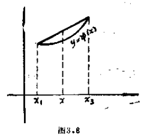

   **难度：3/5；出处：** 同事提供《复变函数简明教程_习题导出.xlsx》第111行；导出表无教材书名、原题号及页码，来源待核，原题号同事习题导出表第111行（非教材原题号）；**解答来源：** 同事导出原解析，数学正确性待逐题审核。

   **整理说明：** 原导出知识点标签：最大模原理

<!-- source-exercise:TJX-XLSX-r113 -->
4. 设 D 为线段 $OA, OB$ 以及连接 A , B 的 Jordan 弧 $\overset{\frown}{AB}$ 围成的区域, $\angle A O B=\alpha\pi$ , R 是 O 与 $\overset{\frown}{AB}$ 的最大距离。设 $f(z)$ 是D 上的解析函数,如果对于 $OA$ , $OB$ 上的 $\zeta$ ,有
 $$\varlimsup_{\substack{z \to \zeta\\ z\in D}}|f(z)| \leq M,$$
对于 $\overset{\frown}{AB}$ 上的 $\zeta$ ,有
 $$\varlimsup_{\substack{z \to \zeta\\ z\in D}}|f(z)| \leq m<M,$$
则在 $\angle A O B$ 的角平分线上的点 $z(z \in D)$ ,有
 $$|f(z)| \leq M^{1-\left(\frac{|z|}{R}\right)^{\frac{1}{\alpha}}}\cdot m^{\left(\frac{|z|}{R}\right)^{\frac{1}{\alpha}}}$$
 (Carleman不等式)。

   **答案：** 不妨设正实轴二等分 $\angle AOB$ , z 为其上的一个定点。如设 $$\omega(\zeta)=\exp \left(\left(\frac{\zeta}{|z|}\right)^{\frac{1}{\alpha}}\right)$$
在 $OA$ 、 $OB$ 上,由于 $\zeta=r e^{\pm \frac{i\alpha\pi}{2}}$ ,故
 $$|\omega(\zeta)|=\left|\exp \left( \pm\left(\frac{r}{|z|}\right)^{\frac{1}{\alpha}} i\right)\right|=1 .$$
在 $\overset{\frown}{AB}$ 上 $\zeta=r e^{i \theta}(-\frac{\alpha \pi}{2}<\theta<\frac{\alpha \pi}{2})$ ,故
 $$|\omega(\zeta)|=\left|\exp \left(\left(\frac{r}{|z|}\right)^{\frac{1}{\alpha}} \cdot e^{\frac{i \theta}{\alpha}}\right)\right| =\exp \left(\left(\frac{r}{|z|}\right)^{\frac{1}{\alpha}} \cos \frac{\theta}{\alpha}\right).$$
设 $\sigma>0$ ,并设
 $$F_{\sigma}(\zeta)=\omega(\zeta)^{\sigma} \cdot f(\zeta) ,$$
则在 $OA$ 、 $OB$ 上,
 $$|F_{\sigma}(\zeta)|=|\omega(\zeta)|^{\sigma} \cdot|f(\zeta)| \leq M .$$
在 $\overset{\frown}{AB}$ 上
 $$|F_{\sigma}(\zeta)| \leq m \cdot \exp \left(\sigma\left(\frac{R}{|z|}\right)^{\frac{1}{\alpha}}\right),$$
故在 D 上
 $$|F_{\sigma}(\zeta)| \leq \max \left\{M, m \cdot \exp \left[\sigma\left(\frac{R}{|z|}\right)^{\frac{1}{\alpha}}\right)\right\} .$$
特别取这样的 $\sigma$ ,使
 $$M=m \cdot \exp \left(\sigma \cdot\left(\frac{R}{|z|}\right)^{\frac{1}{\alpha}}\right),$$
则 $|F_{\sigma}(\zeta)| \leq M.$
 $$|f(z)| \leq M \cdot|\omega(z)|^{-\sigma}=M e^{-\sigma}=M^{1-\left(\frac{|z|}{R}\right)^{\frac{1}{\alpha}}}{m}^{\left(\frac{|z|}{R}\right)^{\frac{1}{\alpha}}} .$$

   **难度：5/5；出处：** 同事提供《复变函数简明教程_习题导出.xlsx》第113行；导出表无教材书名、原题号及页码，来源待核，原题号同事习题导出表第113行（非教材原题号）；**解答来源：** 同事导出原解析，数学正确性待逐题审核。

   **整理说明：** 原导出知识点标签：最大模原理

<!-- source-exercise:TJX-XLSX-r114 -->
5. 设 $f(z)$ 在正方形 $ABCD$ 内部正则,如果 z 从正方形的内部趋近于境界点 $\zeta$ 时,有
 $$\varlimsup_{z \to \zeta}|f(z)| \leq M,$$
特别, $\zeta \in AB$ 时,有
 $$\varlimsup_{z \to \zeta}|f(z)| \leq m<M,$$
则在三角形 $OAB$ 上,有
 $$|f(z)| \leq M^{\frac{3}{4}} \cdot m^{\frac{1}{4}} .$$
这里 O 为正方形的中心。

   **答案：** 设 $z_{0}$ 为三角形 $OAB$ 内的任意一点,如设 $$g(z)=f\left(z-z_{0}\right), h(z)=\prod_{\nu=0}^{3} g\left[i^{\nu}\left(z-z_{0}\right)\right] .$$
 $h(z)$ 在以 $z_{0}$ 为中心的小正方形内部正则,在其境界上, $\varlimsup|h(z)| \leq M^{3} \cdot m$ ,故在这个 小正方形内部有
 $$|h(z)| \leq M^{3} \cdot m .$$
特别,在 $z=z_{0}$ 处,
 $$|h\left(z_{0}\right)|=\left|f\left(z_{0}\right)\right|^{4} \leq M^{3} \cdot m .$$
由于 $z_{0}$ 是三角形 $OAB$ 内任意一点,故
 $$|f(z)| \leq M^{\frac{3}{4}} m^{\frac{1}{4}} .$$
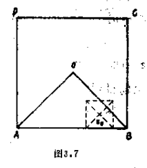

   **难度：4/5；出处：** 同事提供《复变函数简明教程_习题导出.xlsx》第114行；导出表无教材书名、原题号及页码，来源待核，原题号同事习题导出表第114行（非教材原题号）；**解答来源：** 同事导出原解析，数学正确性待逐题审核。

   **整理说明：** 原导出知识点标签：最大模原理

<!-- source-exercise:TJX-XLSX-r115 -->
6. 设区域 D 含有点 $z_{0}$ ,并且以 $z_{0}$ 为圆心 r 为半径中心角 为 $\alpha$ 的圆弧在 D 的外部,设 $f(z)$ 在 D 上单值正则,并且 $|f(z)| \leq M .$ 如果在包含在圆 $|z-z_{0}|<r$ 内的 D 的境界 $\Gamma$ 上,有
 $$\varlimsup_{z \to \zeta, z\in D,\zeta\in \Gamma}|f(z)| \leq m<M,$$
则
 $$\left|f\left(z_{0}\right)\right| \leq M^{1-\frac{1}{n}} \cdot m^{\frac{1}{n}} .$$
这里 n 是使 $\alpha>\frac{2 \pi}{n}$ 成立的自然数(Lindclof不等式)。
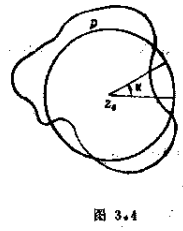

   **答案：** 设 $D_{1}$ , $D_{2}, \cdots, D_{n-1}$ 各为 D 围绕 $z_{0}$ 旋转如下角度: $$\frac{2 \pi}{n}, \frac{4 \pi}{n}, \cdots, \frac{2(n-1) \pi}{n}$$
所成的区域。集合 $G=D \cap D_{1} \cap D_{2} \cdots \cap D_{n-1}$ 是含有 $z_{0}$ 的开集,且不包含圆周 $|z-z_{0}|=r$ 上的点。设 $D_{0}$ 为含有 $z_{0}$ 的 G 的一个分集, 并设 C 为 $D_{0}$ 的境界。由于函数
 $$f_{\nu}(z)=f\left[z_{0}+e^{\frac{2 \pi i}{n}}\left(z-z_{0}\right)\right]$$
在 $D_{\nu}(\nu=1,2, \cdots n-1)$ 上是单值正则的,故
 $$F(z)=f(z) \cdot f_{1}(z) \cdots f_{n-1}(z)$$
在 $D_{0}$ 上正则,并且在 c 上
 $$\varlimsup_{z \to \zeta,\zeta \in C}|F(z)| \leq M^{n-1} \cdot m .$$
故由最大模原理,有
 $$|F\left(z_{0}\right)| \leq M^{n-1} \cdot m .$$
因此
 $$\left|f\left(z_{0}\right)\right| \leq M^{1-\frac{1}{n}} \cdot m^{\frac{1}{n}} .$$

   **难度：5/5；出处：** 同事提供《复变函数简明教程_习题导出.xlsx》第115行；导出表无教材书名、原题号及页码，来源待核，原题号同事习题导出表第115行（非教材原题号）；**解答来源：** 同事导出原解析，数学正确性待逐题审核。

   **整理说明：** 原导出知识点标签：最大模原理

<!-- source-exercise:TJX-XLSX-r120 -->
7. 在上题中,用下述条件代替上题增长条件,即设对于任意正数 $\delta$ 可选出适当的 $r_{1}(\delta)$ ,对于满足$|z| \geq r_{1}(\delta)$ 的D的任意点 z ,有
 $$|f(z)|<B e^{\delta}|z|^{2},$$
如果边界条件 $\varlimsup_{\substack{z \to \zeta\\ z \in D, \zeta \in \Gamma}}|f(z)| \leq M$ 成立,则在 D 的各点有
 $$|f(z)| \leq M .$$

   **答案：** 如设 $$F_{\varepsilon}(z)=e^{-i z^{\alpha}} f(z)$$
那么在实轴上, $z \to \infty$ 时, $F_{\varepsilon}(z) \to 0$ ,故 $F_{\varepsilon}(z)$ 在实轴上具有有限的上限 $M'$ .如取
 $$M''=\max \left(M, M'\right) .$$
应用上题的结果,则在角状区域 $-\frac{\pi}{2 \alpha} \leq\theta \leq0$ 和 $0 \leq\theta \leq\frac{\pi}{2 \alpha}$ 上分别有 $|F_{\varepsilon}(z)| \leq M''$ .故在 D 上有
 $$|F_{\varepsilon}(z)| \leq M'' .$$
设在 D 内的实轴上某点 $|F_{\varepsilon}(z)|$ 取最大值 $M'$ .如果 $M'=M''$ ,则由最大值原理, $|F_{\varepsilon}(z)| \equiv const =M$ .故 $M''=M$ .如果 $M'<M''$ ,则显然 $M''=M$ .所以不管那种情况,在 D 上总有
 $$|F_{\varepsilon}(z)| \leq M .$$
亦即
 $$|f(z)| \leq M\left|e^{i z^{\alpha}}\right|$$
再取 $\varepsilon \to 0$ ,就得到所需结果。

   **难度：5/5；出处：** 同事提供《复变函数简明教程_习题导出.xlsx》第120行；导出表无教材书名、原题号及页码，来源待核，原题号同事习题导出表第120行（非教材原题号）；**解答来源：** 同事导出原解析，数学正确性待逐题审核。

   **待核状态：** 上下文待核

   **整理说明：** 原导出知识点标签：最大模原理；‘上题增长条件’未给出，需原题页核对替代的是何条件。

<!-- source-exercise:TJX-XLSX-r121 -->
8. 设函数 $f(z)$ 在角状区域 $D:|\arg z|<\frac{\pi}{2 \alpha}$ 上正则,并且对于任意的正数 $\beta(<\alpha)$ 可选出适当的 $r_{0}(\beta)$ ,对于满足 $|z| \geq r_{0}(\beta)$ 的 D 的任意点 z ,有
 $$|f(z)|<A e^{|z|^{\beta}},$$
如果 $\Gamma$ 为 D 的境界,有
 $$\varlimsup_{\substack{z \to \zeta\\ z \in D, \zeta \in \Gamma}}|f(z)| \leq M,$$
则在 D 的各点上有
 $$|f(z)| \leq M .$$

   **答案：** 设 $\beta<\sigma<\alpha$ , $\varepsilon>0$ ,如设 $$F_{\varepsilon}(z)=e^{-\varepsilon z^{\sigma}} f(z),$$
于是
 $$\left|F_{\varepsilon}\left(r e^{i \theta}\right)\right|=e^{-\varepsilon r^{\sigma} \cos \sigma\theta} \cdot\left|f\left(r e^{i \theta}\right)\right| .$$
在角的边上,由于 $\cos \sigma \theta>0$ ,故
 $$\varlimsup\left|F_{\varepsilon}(z)\right| \leq \varlimsup|f(z)| \leq M .$$
在圆周 $|z|=R \geq r_{0}(\beta)$ 与 D 的公共部分上,由于 $|\theta|<\frac{\pi}{2 \alpha}$ 故
 $$\left|F_{\varepsilon}(z)\right| \leq e^{-\varepsilon R^{\sigma} \cos \frac{\sigma\pi}{2\alpha}} \cdot|f(z)| \leq A e^{R^{\beta}-\varepsilon R^{\sigma} \cos \frac{\sigma\pi}{2\alpha}} \to 0 \quad(R\to\infty)$$
因此, R 如果取得充分大,在这个圆弧上,有
 $$|F_{\varepsilon}(z)| \leq M .$$
故由最大模原理,在 $|\theta| \leq\frac{\pi}{2 \alpha}$ . $r \leq R$ 上有
 $$|F_{\varepsilon}\left(r e^{i \theta}\right)| \leq M .$$
如使 $R \to \infty$ ,故在 D 上,有
 $$|F_{\varepsilon}(z)| \leq M .$$
亦即
 $$|f(z)| \leq M e^{\varepsilon | z|^{\sigma}} .$$
再使 $\varepsilon \to 0$ ,就求得所需不等式。

   **难度：5/5；出处：** 同事提供《复变函数简明教程_习题导出.xlsx》第121行；导出表无教材书名、原题号及页码，来源待核，原题号同事习题导出表第121行（非教材原题号）；**解答来源：** 同事导出原解析，数学正确性待逐题审核。

   **整理说明：** 原导出知识点标签：最大模原理

<!-- source-exercise:TJX-XLSX-r122 -->
9. 设 D 为一条连续曲线 c 所围成的无限区域,如果在 D 上 $f(z)$ 是正则有界函数,且在 C 上 $\varlimsup_{\substack{z \to \zeta\\ z \in D, \zeta \in C}}|f(z)| \leq M$ ·则在 D上 $| f(z)| \leq M$ .等号仅在 $f(z)$ 的绝对值为常数 M 时才成立。

   **答案：** 取 D 外一点 $z_{0}$ ,如作变换 $$Z=\frac{1}{z-z_{0}}$$
则D变作 z 平面上的有界区域 $D'$ ,而 $f[z(Z)]$ 在 $D'$ 上正则有界。并且在 $D'$ 的境界上除去一点 $Z=0$ 外,有 $\varlimsup|f[z(Z)]| \leq M$ ,故由上题知在 $D'$ 上有 $|f[z(Z)] | \leq M$ ,亦即在 D 上 $|f(z)| \leq M$。

   **难度：4/5；出处：** 同事提供《复变函数简明教程_习题导出.xlsx》第122行；导出表无教材书名、原题号及页码，来源待核，原题号同事习题导出表第122行（非教材原题号）；**解答来源：** 同事导出原解析，数学正确性待逐题审核。

   **整理说明：** 原导出知识点标签：最大模原理

<!-- source-exercise:TJX-XLSX-r123 -->
10. 设 $f(z)$ 在有界区域 D 上正则并且有界。如果在 D 的境界 $\Gamma$ 上除去有限个点 $\zeta_{1}, \zeta_{2}, \cdots, \zeta_{n}$ 外,有 $\varlimsup_{\substack{z \to \zeta\\ z \in D, \zeta \in \Gamma}}|f(z)| \leq M$ 则在 D 上有 $|f(z)| \leq M$ (Lindelof).

   **答案：** 设 D 的直径为 R ,如设 $$\omega(z)=\frac{1}{R^{n}} \cdot \prod_{\nu=1}^{n}\left(z-\zeta_{\nu}\right),$$
那么在 D 上,有
 $$|\omega(z)| \leq 1 .$$
取 $\sigma>0$ ,作函数
 $$F_{\sigma}(z)=\omega(z)^{\sigma} f(z) .$$
在 D 上由于 $\omega(z) \neq0$ ,故 $F_{\sigma}(z)$ 正则,并且
 $$|F_{\sigma}(z)|=|\omega(z)|^{\sigma} \cdot|f(z)|$$
是单值函数。在异于 $\zeta_{1}, \cdots, \zeta_{n}$ 的 D 的境界点的近傍内,有
 $$|F_{\sigma}(z)| \leq|f(z)|<M+\varepsilon .$$
而在 $\zeta_{\nu}$ 的近傍内,由于 $f(z)$ 是有界的,而 $\omega(z) \to 0$ ,故如取 $\zeta_{\nu}$ 的适当近傍,可使
 $$|F_{\sigma}(z)|<M+\varepsilon .$$
故由最大模原理,对 D 的点 z ,有
 $$|F_{\sigma}(z)| \leq M+\varepsilon .$$
如果使 $\sigma \to 0$ ,则得
 $$|f(z)| \leq M+\varepsilon,$$
由 $\varepsilon>0$ 任意,得到 $|f(z)| \leq M$。

   **难度：4/5；出处：** 同事提供《复变函数简明教程_习题导出.xlsx》第123行；导出表无教材书名、原题号及页码，来源待核，原题号同事习题导出表第123行（非教材原题号）；**解答来源：** 同事导出原解析，数学正确性待逐题审核。

   **整理说明：** 原导出知识点标签：最大模原理

<!-- source-exercise:TJX-XLSX-r125 -->
11. 设 $f_{1}(z)$ , $f_{2}(z), \cdots, f_{n}(z)$ 在区域 D 上正则,在闭区域 $\bar{D}$ 上连续,如果 $f_{1}(z)$ , $f_{2}(z), \cdots, f_{n}(z)$ 中至少有一个不是常数,则
 $$g(z)=\left|f_{1}(z)\right|^{p_{1}}+\left|f_{2}(z)\right|^{p_{2}}+\cdots+\left|f_{n}(z)\right|^{p_{n}}$$
在 D 的境界上取得最大值。这里 $p_{1}, p_{2}, \cdots, p_{n}$ 是任意正数。

   **答案：** 设 $f_{1}(z_{0}) \neq0, \cdots, f_{k}(z_{0}) \neq0$ . $f_{k+1}(z_{0})=0, \cdots,f_{n}(z_{0})=0$ .取充分小的 r ,使 $|z-z_{0}| \leq r$ 包含在 D 内,并且在$|z-z_{0}| \leq r$ 上, $f_{1}(z) \neq0, \cdots, f_{k}(z) \neq0$ .由于在 $|z-z_{0}| \leq r$ 上,$[f_{1}(z)]^{p_{1}}, \cdots,[f_{k}(z)]^{p_{k}}$ 是正则函数,因此,如设 $$h(z)=\left|f_{1}(z)\right|^{p_{1}}+\cdots+\left|f_{k}(z)\right|^{p_{k}},$$
则由上题,可在 $|z-z_{0}|=r$ 上选取适当的 $z_{1}$ ,使
 $$h\left(z_{1}\right) \geq\left|f_{1}\left(z_{0}\right)\right|^{p_{1}}+\cdots+\left|f_{k}\left(z_{0}\right)\right|^{p_{k}} .$$
并且仅当 $f_{1}(z), \cdots, f_{k}(z)$ 全部是常数时,等号成立。亦即
 $$\sum_{v=1}^{k}\left|f_{v}\left(z_{0}\right)\right|^{p_{v}} \leq \sum_{v=1}^{k}\left|f_{v}\left(z_{1}\right)\right|^{p_{v}} .$$
显然又有
 $$\left|f_{k+1}\left(z_{1}\right)\right| \geq\left|f_{k+1}\left(z_{0}\right)\right|=0, \cdots,\left|f_{n}\left(z_{1}\right)\right| \geq\left|f_{n}\left(z_{0}\right)\right|=0,$$
故
 $$\sum_{v=1}^{n}\left|f_{v}\left(z_{0}\right)\right|^{p_{v}} \leq \sum_{v=1}^{n}\left|f_{v}\left(z_{1}\right)\right|^{p_{v}} .$$
这里的等号虽然发生在 $f_{1}(z)$ , $f_{2}(z), \cdots, f_{k}(z)$ 全部是常数并且 $f_{k+1}(z_{1})=f_{k+2}(z_{1})=\cdots=f_{n}(z_{1})=0$ 的情况下,但是如果在这种情况下, $f_{k+1}(z), \cdots, f_{n}(z)$ 之中即使有一个不是常数,那么这个函数在 $|z-z_{0}|=r$ 上某点 $z_{1}'$ 处不为零,从而
 $$g\left(z_{0}\right)<g\left(z_{1}'\right) .$$
亦即,如果 $f_{1}(z), \cdots, f_{n}(z)$ 之中至少有一个不为常数,则 $g(z)$ 在 D 内不能取得最大值。但由于 $g(z)$ 在 $\bar{D}$ 上连续, $g(z)$ 在 D 的境界上取得最大值。

   **难度：4/5；出处：** 同事提供《复变函数简明教程_习题导出.xlsx》第125行；导出表无教材书名、原题号及页码，来源待核，原题号同事习题导出表第125行（非教材原题号）；**解答来源：** 同事导出原解析，数学正确性待逐题审核。

   **整理说明：** 原导出知识点标签：最大模原理

<!-- source-exercise:TJX-XLSX-r126 -->
12. 设 $f_{1}(z), f_{2}(z), \cdots, f_{n}(z)$ 在 $|z-z_{0}| \leq r$ 上是正则函数, $g(z)=|f_{1}(z)|+|f_{2}(z)|+\cdots+|f_{n}(z)|$ ,如设在$|z-z_{0}| \leq r$ 上 $g(z)$ 的最大值为 M ,则
 $$g\left(z_{0}\right) \leq M .$$
等号仅在 $f_{1}(z)$ $f_{2}(z), \cdots, f_{n}(z)$ 全都是常数时才成立。

   **答案：** 由平均值性质知 $$\left|f_{\nu}\left(z_{0}\right)\right| \leq \frac{1}{2 \pi} \int_{0}^{2 \pi}\left|f_{\nu}\left(z_{0}+r e^{i \theta}\right)\right| d \theta$$
这里等号如果成立,则在 $0 \leq\theta \leq2 \pi$ 上 $f_{\nu}(z_{0}+r e^{i \theta})$ 的幅角为常数,可以证明 $f_{\nu}(z)$ 在 $|z-z_{0}| \leq r$ 上必为常数。设 $\nu=1,2, \cdots, n$ ,将上述不等式相加,得
 $$g\left(z_{0}\right) \leq \frac{1}{2 \pi} \int_{0}^{2 \pi} g\left(z_{0}+r e^{i \theta}\right) d \theta \leq M .$$
显然,仅当 $f_{\nu}(z)$ $(\nu=1,2, \cdots n)$ 全部是常数时,等号成立。

   **难度：3/5；出处：** 同事提供《复变函数简明教程_习题导出.xlsx》第126行；导出表无教材书名、原题号及页码，来源待核，原题号同事习题导出表第126行（非教材原题号）；**解答来源：** 同事导出原解析，数学正确性待逐题审核。

   **整理说明：** 原导出知识点标签：最大模原理

<!-- source-exercise:TJX-ch02-3 -->
13. 证明：(1) 若 $f(z)$ 与 $\overline{f(z)}$ 都解析，则 $f$ 为常数；(2) 若 $f$ 解析且 $|f(z)|$ 为常数，则 $f$ 为常数。

   **答案：** (1) Cauchy–Riemann 方程同时用于 $f$ 与 $\bar f$，使实部与虚部的全部一阶偏导为零，故在连通域常值。(2) 若常模非零，则 $1/f=\bar f/|f|^2$ 解析，依(1) 得常值；模零时显然。也可用最大模原理。

   **难度：3/5；出处：** 谭小江、伍胜健《复变函数简明教程》（北京大学出版社，2005），习题二第3题，书页74，PDF页86，原题号习题二第3题；**解答来源：** 本次据主书原题自拟简解；题干已回PDF原页核读。

<!-- source-exercise:TJX-ch03-16 -->
14. 利用解析函数的平均值定理证明最大模原理。

   **答案：** 若 $|f|$ 在内点 $z_0$ 取得局部最大 $M$，小圆上 $|f|\le M$。平均公式 $f(z_0)=(2\pi)^{-1}\int f(z_0+re^{it})dt$ 取模达到上界，仅当圆周各值同辐角且模恒 $M$ 才能等号；于是 $f$ 在小圆及盘内常值，再由恒等定理全域常值。

   **难度：3/5；出处：** 谭小江、伍胜健《复变函数简明教程》（北京大学出版社，2005），习题三第16题，书页117，PDF页129，原题号习题三第16题；**解答来源：** 本次据主书原题自拟简解；题干已回PDF原页核读。

<!-- source-exercise:TJX-ch03-21 -->
15. 设 $f$ 在区域 $\Omega$ 解析，在 $z_0$ 的 Taylor 展开为 $\sum_{n\ge0}a_n(z-z_0)^n$。(1) 证明充分小的 $r>0$ 满足 $(2\pi)^{-1}\int_0^{2\pi}|f(z_0+re^{it})|^2dt=\sum_{n\ge0}|a_n|^2r^{2n}$；(2) 据此证明最大模原理；(3) 若 $F=(f_1,\ldots,f_m)$ 的各分量在 $\Omega$ 解析且 $F$ 非常值，证明 $\|F\|=(\sum|f_j|^2)^{1/2}$ 在 $\Omega$ 内不能取得最大值。

   **答案：** (1) Taylor 级数在小圆上一致收敛，积分时 $e^{i(n-k)t}$ 的正交性消去交叉项。(2) 若 $|f(z_0)|$ 为局部最大，左侧不超过 $|a_0|^2$，故所有 $a_{n>0}=0$，$f$ 局部常值。(3) 对各分量应用(1)并求和；若范数局部最大，所有分量的高阶 Taylor 系数为零，故 $F$ 局部及全域常值，矛盾。

   **难度：4/5；出处：** 谭小江、伍胜健《复变函数简明教程》（北京大学出版社，2005），习题三第21题，书页118，PDF页130，原题号习题三第21题；**解答来源：** 本次据主书原题自拟简解；题干已回PDF原页核读。

<!-- source-exercise:TJX-ch03-23 -->
16. 设 $P$ 为 $n$ 次多项式，且 $|z|\le1$ 时 $|P(z)|\le M$。证明 $R>1,|z|\le R$ 时 $|P(z)|\le MR^n$。

   **答案：** 函数 $g(w)=w^nP(1/w)$ 在 $|w|\le1$ 解析（$w=0$ 可去），边界 $|w|=1$ 上模不超过 $M$，故盘内 $|g(w)|\le M$。对 $|z|\ge1$ 代入 $w=1/z$ 得 $|P(z)|\le M|z|^n\le MR^n$；对 $|z|\le1$ 则直接有 $M\le MR^n$。

   **难度：3/5；出处：** 谭小江、伍胜健《复变函数简明教程》（北京大学出版社，2005），习题三第23题，书页118，PDF页130，原题号习题三第23题；**解答来源：** 本次据主书原题自拟简解；题干已回PDF原页核读。

<!-- source-exercise:TJX-ch03-32 -->
17. 设 $f$ 在圆环 $D=\{z:1<|z|<2\}$ 解析，延拓到闭圆环连续，且 $\max_{|z|=1}|f(z)|\le1$、$\max_{|z|=2}|f(z)|\le2$。(1) 证明 $|f(z)|\le|z|$；(2) 原书声称若 $f(z)\ne e^{i\theta}z$，则 $f$ 在圆环内有零点，核查。

   **答案：** (1) $g=f/z$ 在圆环解析，两个边界上 $|g|\le1$，最大模原理给内域 $|g|\le1$。(2) 断言不成立：$f(z)=z/2$ 满足全部边界条件，在圆环无零点且不等于任何 $e^{i\theta}z$。此题应保留反例并请原书核勘。

   **难度：3/5；出处：** 谭小江、伍胜健《复变函数简明教程》（北京大学出版社，2005），习题三第32题，书页119，PDF页131，原题号习题三第32题；**解答来源：** 本次据主书原题自拟简解；题干已回PDF原页核读。

   **待核状态：** 原书第(2)问为假，反例 f(z)=z/2 已给

   **勘误：** 原书第(2)问为假，反例 f(z)=z/2 已给

#### 代数学基本定理

**图谱路径：** 复变函数 / Cauchy定理和Cauchy公式 / 利用幂级数研究解析函数 / 代数学基本定理

**知识内容：** [定义、定理与方法](知识点.md#ca-071)

<!-- source-exercise:TJX-ch05-8 -->
1. 用 Rouché 定理证明代数学基本定理。

   **答案：** 设 $p(z)=a_nz^n+\sum_{k<n}a_kz^k$，$a_n\ne0$。取足够大 $R$，使在 $|z|=R$ 上 $|a_nz^n|>\sum_{k<n}|a_kz^k|$。由 Rouché 定理，$p$ 与 $a_nz^n$ 在盘内均有 $n$ 个零点（计重数），故至少有一个复根。

   **难度：3/5；出处：** 谭小江、伍胜健《复变函数简明教程》（北京大学出版社，2005），习题五第8题，书页162，PDF页174，原题号习题五第8题；**解答来源：** 本次据主书原题自拟简解；题干已回PDF原页核读。

<!-- source-exercise:TJX-ch05-12 -->
2. 设整函数 $f$ 满足 $\lim_{z\to\infty}f(z)=\infty$。证明 $f(\mathbb C)=\mathbb C$。

   **答案：** 在无穷远处 $f$ 有极点，故 $f$ 是非常数多项式。对任意 $w\in\mathbb C$，$f(z)-w$ 是非常数多项式，由代数学基本定理有复根，所以每个 $w$ 都被取到。

   **难度：2/5；出处：** 谭小江、伍胜健《复变函数简明教程》（北京大学出版社，2005），习题五第12题，书页162，PDF页174，原题号习题五第12题；**解答来源：** 本次据主书原题自拟简解；题干已回PDF原页核读。

<!-- source-exercise:CA-TRAIN-021 -->
3. 利用 Liouville 定理证明任意非常数复多项式至少有一个复根。

   **答案：** 反设多项式 $p$ 无根，则 $1/p$ 为整函数。由于 $|p(z)|\to\infty$（$|z|\to\infty$），$1/p$ 在外部有界；在内部紧盘上也有界。Liouville 定理使 $1/p$ 为常数，矛盾。

   **难度：3/5；出处：** 本项目根据所附教材知识点自拟训练题；非教材原题，书页及PDF页不适用，原题号本项目自拟训练题21；**解答来源：** 本次自拟简解，已按相关定理核算。

   **整理说明：** 教学训练题，不计原书独立习题数

### Cauchy不等式

**图谱路径：** 复变函数 / Cauchy定理和Cauchy公式 / Cauchy不等式

**知识内容：** [定义、定理与方法](知识点.md#ca-072)

所给材料中未找到直接对应的独立未解题。

#### Cauchy不等式

**图谱路径：** 复变函数 / Cauchy定理和Cauchy公式 / Cauchy不等式 / Cauchy不等式

**知识内容：** [定义、定理与方法](知识点.md#ca-073)

<!-- source-exercise:TJX-XLSX-r107 -->
1. 设 $f(z)$ 在 $|z-z_{0}| \leq r$ 上正则,如果 $\Re f(z) \leq M$ ,则
 $$|f'(z_{0})| \leq \frac{2 M}{r} .$$

   **答案：** 如设 $f(z)=u(z)+i v(z)$ ,由积分表示 $$\begin{aligned}
 f'\left(z_{0}\right) & =\frac{1}{2 \pi i} \int_{\left|z-z_{0}\right|=r} \frac{f(z)}{\left(z-z_{0}\right)^{2}} d z \\
 & =\frac{1}{2 \pi r} \int_{0}^{2 \pi}\left[u\left(r e^{i \theta}\right)+i v\left(r e^{i \theta}\right)\right] e^{-i \theta} d \theta,
 \end{aligned}$$
 $$
 \begin{aligned}
 0 & =\frac{1}{2 \pi i r^{2}} \int_{\left|z-z_{0}\right|=r} f(z) d z \\
 & =\frac{1}{2 \pi r} \int_{0}^{2 \pi}\left[u\left(r e^{i \theta}\right)+i v\left(r e^{i \theta}\right)\right] e^{i \theta} d \theta \\
 & =\frac{1}{2 \pi r} \int_{0}^{2 \pi}\left[u\left(r e^{i \theta}\right)-i v\left(r e^{i \theta}\right)\right] e^{-i \theta} d \theta,
 \end{aligned}
 $$
上两式两边相加,有
 $$f'\left(z_{0}\right)=\frac{1}{\pi r} \int_{0}^{2 \pi} u\left(r e^{i \theta}\right) e^{-i \theta} d \theta,$$
 $$故 \quad\left|f'\left(z_{0}\right)\right| \leq \frac{1}{\pi r} \int_{0}^{2 \pi}\left|u\left(r e^{i \theta}\right)\right| d \theta \leq \frac{2 M}{r}.$$

   **难度：3/5；出处：** 同事提供《复变函数简明教程_习题导出.xlsx》第107行；导出表无教材书名、原题号及页码，来源待核，原题号同事习题导出表第107行（非教材原题号）；**解答来源：** 同事导出原解析，数学正确性待逐题审核。

   **整理说明：** 原导出知识点标签：Cauchy不等式/Cauchy不等式

<!-- source-exercise:TJX-XLSX-r129 -->
2. 设 $f(z)$ 在 $|z|<1$ 上正则,并且 $|f(z)| \leq\frac{1}{1-|z|}$ 试估计 $|f^{(m)}(0)|$ .

   **答案：** 如设 $0<r<1$ .由定理6, $$f^{(n)}(0)= \frac{n !}{2 \pi i} \int_{|z|=r} \frac{f(z)}{z^{n+1}} d z,$$
两边取绝对值,则
 $$\left|f^{(n)}(0)\right| \leq \frac{n !}{2 \pi} \int_{|z|=r} \frac{|d z|}{|z|^{n+1}(1-|z|)}=\frac{n !}{r^{n}(1-r)} .$$
在 $0 \leq r<1$ 中,计算上式右边的最小值,于是可得
 $$\left|f^{(n)}(0)\right| \leq \frac{n !(n+1)^{n+1}}{n^{n}} .$$

   **难度：3/5；出处：** 同事提供《复变函数简明教程_习题导出.xlsx》第129行；导出表无教材书名、原题号及页码，来源待核，原题号同事习题导出表第129行（非教材原题号）；**解答来源：** 同事导出原解析，数学正确性待逐题审核。

   **整理说明：** 原导出知识点标签：Cauchy不等式/Cauchy不等式

<!-- source-exercise:TJX-XLSX-r130 -->
3. 设 c 为以 $z=a$ 为圆心以 r 为半径的圆, $f(z)$ 在 c 上及其内部正则,并且在 c 上有$|f(z)| \leq M$ ,证明
 $$\left|f^{(n)}(a)\right| \leq \frac{M n !}{r^{n}}$$

   **答案：** 由定理6, $$f^{(n)}(a)= \frac{n !}{2 \pi i} \int_{c} \frac{f(z)}{(z-a)^{n+1}} d z .$$
如在两边取绝对值,则
 $$\begin{aligned}
 \left|f^{(n)}(a)\right| & \leq \frac{n !}{2 \pi} \int_{C} \frac{|f(z)|}{|z-a|^{n+1}}|d z| \\
 & \leq \frac{n !}{2 \pi} \int_{0}^{2 \pi} \frac{M}{r^{n+1}} r d \theta=\frac{M n !}{r^{n}} .
 \end{aligned}$$

   **难度：2/5；出处：** 同事提供《复变函数简明教程_习题导出.xlsx》第130行；导出表无教材书名、原题号及页码，来源待核，原题号同事习题导出表第130行（非教材原题号）；**解答来源：** 同事导出原解析，数学正确性待逐题审核。

   **整理说明：** 原导出知识点标签：Cauchy不等式/Cauchy不等式

<!-- source-exercise:TJX-ch03-11 -->
4. 设 $f$ 在区域 $\Omega$ 解析。证明不存在 $z_0\in\Omega$ 使得对所有 $n$ 都有 $|f^{(n)}(z_0)|\ge n!n^n$。

   **答案：** 若存在，则 Taylor 系数 $a_n=f^{(n)}(z_0)/n!$ 满足 $|a_n|\ge n^n$，于是收敛半径 $R^{-1}=\limsup|a_n|^{1/n}=\infty$，$R=0$，与解析函数在 $z_0$ 有正半径 Taylor 展开矛盾。

   **难度：3/5；出处：** 谭小江、伍胜健《复变函数简明教程》（北京大学出版社，2005），习题三第11题，书页117，PDF页129，原题号习题三第11题；**解答来源：** 本次据主书原题自拟简解；题干已回PDF原页核读。

<!-- source-exercise:TJX-ch03-14 -->
5. 设整函数 $f$ 存在整数 $n$，使 $\lim_{z\to\infty}f(z)/z^n=M$ 有限。证明 $f$ 是次数不超过 $n$ 的多项式。

   **答案：** 由极限得大圆周上 $|f(z)|\le C R^n$。对 $k>n$ 用 Cauchy 不等式 $|f^{(k)}(0)|\le k!CR^{n-k}$，令 $R\to\infty$ 得高阶导数全零；Taylor 展开因而在 $n$ 次截断。

   **难度：3/5；出处：** 谭小江、伍胜健《复变函数简明教程》（北京大学出版社，2005），习题三第14题，书页117，PDF页129，原题号习题三第14题；**解答来源：** 本次据主书原题自拟简解；题干已回PDF原页核读。

<!-- source-exercise:CA-TRAIN-010 -->
6. 设 $f$ 是整函数且 $|f(z)|\le 4$。证明 $f$ 为常数，并指出用到的导数估计。

   **答案：** 任取 $z_0$ 和 $R>0$，Cauchy 不等式给 $|f'(z_0)|\le4/R$；令 $R\to\infty$ 得 $f'(z_0)=0$。$z_0$ 任意，故 $f$ 常值。

   **难度：2/5；出处：** 本项目根据所附教材知识点自拟训练题；非教材原题，书页及PDF页不适用，原题号本项目自拟训练题10；**解答来源：** 本次自拟简解，已按相关定理核算。

   **整理说明：** 教学训练题，不计原书独立习题数

#### Liouville定理

**图谱路径：** 复变函数 / Cauchy定理和Cauchy公式 / Cauchy不等式 / Liouville定理

**知识内容：** [定义、定理与方法](知识点.md#ca-074)

<!-- source-exercise:TJX-XLSX-r005 -->
1. 如果 $f(z)$ 在 $|z|<R$ 上正则,并且 $f(z)\neq0$,$f(z)\neq1$,$f(0)=c_0$,$f'(0)=c_1\neq0$,证明 $R$ 不大于仅由 $c_0$ 和 $c_1$ 确定的正数 $L(c_0,c_1)$(Landau定理)。

   **答案：** 由Schottky定理,在 $|z|\le \frac R2$ 上,$|f(z)|<S\big(c_0,\frac12\big)$。由Cauchy不等式:
 $$
 |c_1|<\frac{S\big(c_0,\frac12\big)}{\frac R2}.
 $$
 $c_1\neq0$,故
 $$
 R<\frac{2S\big(c_0,\frac12\big)}{|c_1|}.
 $$
右边只依赖 $c_0,c_1$,取 $L(c_0,c_1)=\dfrac{2S\big(c_0,\frac12\big)}{|c_1|}$,得证。

   **难度：5/5；出处：** 同事提供《复变函数简明教程_习题导出.xlsx》第5行；导出表无教材书名、原题号及页码，来源待核，原题号同事习题导出表第5行（非教材原题号）；**解答来源：** 同事导出原解析，数学正确性待逐题审核。

   **整理说明：** 原导出知识点标签：Liouville定理

<!-- source-exercise:TJX-XLSX-r128 -->
2. 设函数 $f(z)$ 在全有限平面上是正则函数,如果对于某个 n ,对于充分大的 $|z|$ 下式成立:
 $$|f(z)|<|z|^{n}$$
则 $f(z)$ 是有理整函数。

   **答案：** 设 $z$ 为任意有限复数,取充分大的 R ,使点 z 包含在圆 $|\xi|=R$ 之中,于是 $$f^{(n+1)}(z)=\frac{(n+1) !}{2 \pi i} \int_{|\xi|=R} \frac{f(\zeta)}{(\zeta-z)^{n+2}} d \zeta .$$
由于条件 $|f(\zeta)| \leqslant|\zeta|^{n}$ ,故
 $$\left|f^{(n+1)}(z)\right| \leq \frac{(n+1) !}{2 \pi} \int_{0}^{2 \pi} \frac{R^{n}}{(R-|z|)^{n+2}} \cdot R d \theta .$$
由于 R 可任意大,当 $R \to \infty$ 时,右边→0。故
 $$f^{(n+1)}(z)=0 .$$
由于 z 为任意一点,故
 $$f^{(n+1)}(z) \equiv 0 .$$
因此, $f(z)$ 必为不高于 n 次的有理整函数。

   **难度：3/5；出处：** 同事提供《复变函数简明教程_习题导出.xlsx》第128行；导出表无教材书名、原题号及页码，来源待核，原题号同事习题导出表第128行（非教材原题号）；**解答来源：** 同事导出原解析，数学正确性待逐题审核。

   **整理说明：** 原导出知识点标签：Liouville定理

<!-- source-exercise:CA-TRAIN-010 -->
3. 设 $f$ 是整函数且 $|f(z)|\le 4$。证明 $f$ 为常数，并指出用到的导数估计。

   **答案：** 任取 $z_0$ 和 $R>0$，Cauchy 不等式给 $|f'(z_0)|\le4/R$；令 $R\to\infty$ 得 $f'(z_0)=0$。$z_0$ 任意，故 $f$ 常值。

   **难度：2/5；出处：** 本项目根据所附教材知识点自拟训练题；非教材原题，书页及PDF页不适用，原题号本项目自拟训练题10；**解答来源：** 本次自拟简解，已按相关定理核算。

   **整理说明：** 教学训练题，不计原书独立习题数

<!-- source-exercise:CA-TRAIN-021 -->
4. 利用 Liouville 定理证明任意非常数复多项式至少有一个复根。

   **答案：** 反设多项式 $p$ 无根，则 $1/p$ 为整函数。由于 $|p(z)|\to\infty$（$|z|\to\infty$），$1/p$ 在外部有界；在内部紧盘上也有界。Liouville 定理使 $1/p$ 为常数，矛盾。

   **难度：3/5；出处：** 本项目根据所附教材知识点自拟训练题；非教材原题，书页及PDF页不适用，原题号本项目自拟训练题21；**解答来源：** 本次自拟简解，已按相关定理核算。

   **整理说明：** 教学训练题，不计原书独立习题数

#### 整函数

**图谱路径：** 复变函数 / Cauchy定理和Cauchy公式 / Cauchy不等式 / 整函数

**知识内容：** [定义、定理与方法](知识点.md#ca-075)

<!-- source-exercise:TJX-ch04-13 -->
1. 设 $f$ 是整函数。若它把任意无界集合映为无界集合，证明 $f$ 是多项式。

   **答案：** 若 $|f(z)|$ 不在 $|z|\to\infty$ 时趋于无穷，可取 $|z_n|\to\infty$ 而 $|f(z_n)|$ 有界，违背假设。因此 $f(z)\to\infty$，$\infty$ 为极点；整函数在无穷远有极点等价于多项式。

   **难度：3/5；出处：** 谭小江、伍胜健《复变函数简明教程》（北京大学出版社，2005），习题四第13题，书页138，PDF页150，原题号习题四第13题；**解答来源：** 本次据主书原题自拟简解；题干已回PDF原页核读。

<!-- source-exercise:TJX-ch04-15 -->
2. 原书写：整函数 $f$ 为超越整函数的充要条件是对任意 $\alpha>0$，$\lim_{r\to\infty}M(r)/r^\alpha=0$，$M(r)=\max_{|z|=r}|f(z)|$。核查。

   **答案：** 原书‘$=0$’不成立：常函数 $f\equiv1$ 满足该条件但非超越；$e^z$ 是超越整函数却有 $M(r)=e^r$，比值趋于无穷。正确刻画是对任意 $\alpha>0$，$M(r)/r^\alpha\to\infty$（非零超越整函数）；由非零的任意高次 Taylor 系数与 Cauchy 估计给下界。

   **难度：3/5；出处：** 谭小江、伍胜健《复变函数简明教程》（北京大学出版社，2005），习题四第15题，书页138，PDF页150，原题号习题四第15题；**解答来源：** 本次据主书原题自拟简解；题干已回PDF原页核读。

   **待核状态：** 原书超越整函数判别中的极限=0错误，反例已给

   **勘误：** 原书超越整函数判别中的极限=0错误，反例已给

<!-- source-exercise:CA-TRAIN-010 -->
3. 设 $f$ 是整函数且 $|f(z)|\le 4$。证明 $f$ 为常数，并指出用到的导数估计。

   **答案：** 任取 $z_0$ 和 $R>0$，Cauchy 不等式给 $|f'(z_0)|\le4/R$；令 $R\to\infty$ 得 $f'(z_0)=0$。$z_0$ 任意，故 $f$ 常值。

   **难度：2/5；出处：** 本项目根据所附教材知识点自拟训练题；非教材原题，书页及PDF页不适用，原题号本项目自拟训练题10；**解答来源：** 本次自拟简解，已按相关定理核算。

   **整理说明：** 教学训练题，不计原书独立习题数

<!-- source-exercise:CA-TRAIN-022 -->
4. 能否存在非常值整函数，其像同时遗漏 $0$ 和 $1$？

   **答案：** 不能。Picard 小定理断言非常值整函数至多遗漏一个复数；假设同时遗漏两个便矛盾。注意 $e^z$ 只遗漏 $0$，表明结论的‘一个’不能加强为‘零个’。

   **难度：2/5；出处：** 本项目根据所附教材知识点自拟训练题；非教材原题，书页及PDF页不适用，原题号本项目自拟训练题22；**解答来源：** 本次自拟简解，已按相关定理核算。

   **整理说明：** 教学训练题，不计原书独立习题数

#### Weierstrass定理

**图谱路径：** 复变函数 / Cauchy定理和Cauchy公式 / Cauchy不等式 / Weierstrass定理

**知识内容：** [定义、定理与方法](知识点.md#ca-076)

<!-- source-exercise:TJX-ch03-10 -->
1. 设解析函数列 $f_n$ 在区域 $\Omega$ 内闭一致收敛于 $f$。(1) 证明 $f$ 解析；(2) 证明各阶导数 $f_n^{(k)}$ 也内闭一致收敛于 $f^{(k)}$；(3) 与实区间上导数一致收敛、某点函数值收敛的实分析定理比较。

   **答案：** (1)(2) 任取较小闭盘，由 Cauchy 导数公式把 $f_n^{(k)}$ 表为外层圆上 $f_n$ 的积分；外圆上一致收敛允许传极限，并给内盘上一致收敛。(3) 实分析须另外假设导数列一致收敛和一点函数值收敛；复解析情形只需函数列局部一致收敛，导数收敛便自动推出。

   **难度：3/5；出处：** 谭小江、伍胜健《复变函数简明教程》（北京大学出版社，2005），习题三第10题，书页117，PDF页129，原题号习题三第10题；**解答来源：** 本次据主书原题自拟简解；题干已回PDF原页核读。

<!-- source-exercise:TJX-ch03-24 -->
2. 设 $D$ 为有界区域，边界由有限条逐段光滑曲线组成；解析函数列 $f_n$ 满足对任意 $\varepsilon>0$，充分大的 $m,n$ 有 $\iint_D|f_n-f_m|\,dxdy<\varepsilon$。证明 $f_n$ 在 $D$ 内闭一致收敛。

   **答案：** 固定紧集 $K\Subset D$，取 $r<\operatorname{dist}(K,\partial D)$。解析函数的模为次调和，由圆盘平均不等式得 $|f_n(z)-f_m(z)|\le(\pi r^2)^{-1}\iint_{D(z,r)}|f_n-f_m|dA\le(\pi r^2)^{-1}\varepsilon$，对 $z\in K$ 一致。故在每个紧集上一致 Cauchy，极限解析。

   **难度：3/5；出处：** 谭小江、伍胜健《复变函数简明教程》（北京大学出版社，2005），习题三第24题，书页118，PDF页130，原题号习题三第24题；**解答来源：** 本次据主书原题自拟简解；题干已回PDF原页核读。

<!-- source-exercise:TJX-ch03-31 -->
3. 若 $f$ 在单位圆盘解析、$f(0)=0$，原书写证明 $\sum_{n=0}^{\infty}f(z^n)$ 在单位圆盘内解析。核查求和下标并给出可成立的命题。

   **答案：** 原书 $n=0$ 项为 $f(1)$，而 $f$ 仅定义在开单位盘，题式未定义。把下标改为 $n=1$ 后，对任意 $r<1$，解析性与 $f(0)=0$ 给 $|f(w)|\le C_r|w|$（$|w|\le r$），故 $\sum_{n\ge1}|f(z^n)|\le C_r\sum r^n$，在 $|z|\le r$ 一致收敛，极限解析。

   **难度：3/5；出处：** 谭小江、伍胜健《复变函数简明教程》（北京大学出版社，2005），习题三第31题，书页119，PDF页131，原题号习题三第31题；**解答来源：** 本次据主书原题自拟简解；题干已回PDF原页核读。

   **待核状态：** 原书求和 n=0 项 f(1) 未定义，已给 n≥1 修订

   **勘误：** 原书求和 n=0 项 f(1) 未定义，已给 n≥1 修订

<!-- source-exercise:TJX-ch05-13 -->
4. 证明：若 $\rho<1$，充分大的 $n$ 时多项式 $P_n(z)=1+2z+3z^2+\cdots+nz^{n-1}$ 在 $|z|<\rho$ 内无零点。

   **答案：** $P_n$ 是 $1/(1-z)^2=\sum_{k\ge0}(k+1)z^k$ 的部分和，在 $|z|\le\rho$ 一致收敛到无零的函数。其模在该紧盘有正下界，因此充分大的 $n$ 时 $P_n$ 亦无零；也可用 Hurwitz 定理。

   **难度：2/5；出处：** 谭小江、伍胜健《复变函数简明教程》（北京大学出版社，2005），习题五第13题，书页162，PDF页174，原题号习题五第13题；**解答来源：** 本次据主书原题自拟简解；题干已回PDF原页核读。

<!-- source-exercise:TJX-ch05-14 -->
5. 记 $P_n(z)=1+z+z^2/2!+\cdots+z^n/n!$。证明任意 $R>0$，充分大的 $n$ 时 $P_n$ 在 $|z|<R$ 内无零点。

   **答案：** $P_n$ 在每个闭盘上一致收敛到 $e^z$，而 $e^z$ 在闭盘上有正的模最小值 $e^{-R}$。故当 $n$ 大且 $\sup_{|z|\le R}|P_n-e^z|<e^{-R}$ 时，$P_n$ 无零。

   **难度：2/5；出处：** 谭小江、伍胜健《复变函数简明教程》（北京大学出版社，2005），习题五第14题，书页163，PDF页175，原题号习题五第14题；**解答来源：** 本次据主书原题自拟简解；题干已回PDF原页核读。

<!-- source-exercise:CONWAY-ch07-s01-5 -->
6. 设连续函数列 $f_n$ 在区域 $G$ 上按紧集上一致收敛到 $f$；若 $z_n\to z\in G$，证明 $f_n(z_n)\to f(z)$。

   **答案：** 取包含 $z$ 及充分大时全部 $z_n$ 的紧盘 $K\Subset G$。则 $|f_n(z_n)-f(z)|\le\sup_K|f_n-f|+|f(z_n)-f(z)|$；第一项由紧集一致收敛趋零，第二项由 $f$ 连续趋零。

   **难度：2/5；出处：** John B. Conway, Functions of One Complex Variable, 2nd ed., Springer-Verlag，Chapter 7 §1 Exercises 5，书页150，PDF页163，原题号Chapter 7 §1 Exercises 5；**解答来源：** 本次据参考书原题自拟简解；题干已回PDF原页核读。

<!-- source-exercise:CA-TRAIN-009 -->
7. 设 $f_n$ 在区域 $D$ 解析并局部一致收敛到 $f$。说明为何 $f$ 解析且 $f_n'$ 局部一致收敛到 $f'$。

   **答案：** 任取闭圆盘 $\overline{D(z_0,r)}\Subset D$，沿其边界的 Cauchy 导数公式有 $f_n^{(k)}(z)=\frac{k!}{2\pi i}\oint f_n(\zeta)(\zeta-z)^{-k-1}\,d\zeta$。边界一致收敛允许传极限，对较小闭圆盘得到导数一致收敛；$k=0$ 给解析性。

   **难度：3/5；出处：** 本项目根据所附教材知识点自拟训练题；非教材原题，书页及PDF页不适用，原题号本项目自拟训练题9；**解答来源：** 本次自拟简解，已按相关定理核算。

   **整理说明：** 教学训练题，不计原书独立习题数

<!-- source-exercise:CA-TRAIN-013 -->
8. 证明常函数族 $f_n(z)=1+1/n$ 在单位盘局部一致收敛，其极限仍无零点；再说明把极限换成零函数时 Hurwitz 定理的例外。

   **答案：** $f_n\to1$ 一致，故极限处处非零；若取 $g_n\equiv1/n$，各 $g_n$ 无零点而极限恒零。Hurwitz 定理允许这一个例外，不能断言极限必处处非零。

   **难度：2/5；出处：** 本项目根据所附教材知识点自拟训练题；非教材原题，书页及PDF页不适用，原题号本项目自拟训练题13；**解答来源：** 本次自拟简解，已按相关定理核算。

   **整理说明：** 教学训练题，不计原书独立习题数

#### Picard小定理

**图谱路径：** 复变函数 / Cauchy定理和Cauchy公式 / Cauchy不等式 / Picard小定理

**知识内容：** [定义、定理与方法](知识点.md#ca-077)

<!-- source-exercise:TJX-ch04-17 -->
1. 设整函数 $f$ 满足 $f(z)$ 为实数当且仅当 $z$ 为实数。利用 Picard 大定理证明 $f(z)=az+b$，其中 $a,b\in\mathbb R$。

   **答案：** 实轴上的实值性给反射恒等式 $f(\bar z)=\overline{f(z)}$；非实点不取实值使 $f$ 把上半平面连通地送入同一半平面（上或下）。整的 Pick 函数（或其负）由 Herglotz 表示只能是 $az+b$，$a\ge0,b\in\mathbb R$；非常值故 $a>0$。本简解改用 Pick–Herglotz 分类，原书指定的 Picard 大定理证明路线仍待专门核对。

   **难度：5/5；出处：** 谭小江、伍胜健《复变函数简明教程》（北京大学出版社，2005），习题四第17题，书页138，PDF页150，原题号习题四第17题；**解答来源：** 本次据主书原题自拟简解；题干已回PDF原页核读。

   **待核状态：** 结论已由 Pick–Herglotz 分类解释，原书要求的 Picard 证明路线待核

   **勘误：** 结论已由 Pick–Herglotz 分类解释，原书要求的 Picard 证明路线待核

<!-- source-exercise:CA-TRAIN-022 -->
2. 能否存在非常值整函数，其像同时遗漏 $0$ 和 $1$？

   **答案：** 不能。Picard 小定理断言非常值整函数至多遗漏一个复数；假设同时遗漏两个便矛盾。注意 $e^z$ 只遗漏 $0$，表明结论的‘一个’不能加强为‘零个’。

   **难度：2/5；出处：** 本项目根据所附教材知识点自拟训练题；非教材原题，书页及PDF页不适用，原题号本项目自拟训练题22；**解答来源：** 本次自拟简解，已按相关定理核算。

   **整理说明：** 教学训练题，不计原书独立习题数

#### 平均值定理

**图谱路径：** 复变函数 / Cauchy定理和Cauchy公式 / Cauchy不等式 / 平均值定理

**知识内容：** [定义、定理与方法](知识点.md#ca-078)

所给材料中未找到直接对应的独立未解题。

##### 平均值不等式

**图谱路径：** 复变函数 / Cauchy定理和Cauchy公式 / Cauchy不等式 / 平均值定理 / 平均值不等式

**知识内容：** [定义、定理与方法](知识点.md#ca-079)

<!-- source-exercise:TJX-ch03-20 -->
1. 设非常值函数 $f$ 在 $1<|z|<\infty$ 解析，且 $f(\infty)=\lim_{z\to\infty}f(z)$ 存在。(1) 证明对 $R>1$，$f(\infty)=(2\pi)^{-1}\int_0^{2\pi}f(Re^{i\theta})d\theta$；(2) 证明外域 $|z|>1$ 上最大模原理成立。

   **答案：** 令 $g(w)=f(1/w)$，因有限极限在 $w=0$ 可去，$g$ 在 $|w|<1$ 解析。(1) 对 $g$ 在圆 $|w|=1/R$ 应用平均公式并换角变量。(2) 若 $f$ 在外域内点取局部模最大，则 $g$ 在盘内对应点取局部最大，故 $g$、$f$ 常值，违背非常值。

   **难度：3/5；出处：** 谭小江、伍胜健《复变函数简明教程》（北京大学出版社，2005），习题三第20题，书页117，PDF页129，原题号习题三第20题；**解答来源：** 本次据主书原题自拟简解；题干已回PDF原页核读。

<!-- source-exercise:CA-TRAIN-023 -->
2. 求 $u(x,y)=x^2-y^2$ 在闭单位圆盘上的最大值与最小值，并指出是否在盘内取得。

   **答案：** $u(r,\theta)=r^2\cos2\theta$，最大值 $1$ 在边界 $\theta=0,\pi$ 取得，最小值 $-1$ 在边界 $\theta=\pi/2,3\pi/2$ 取得；内点不取极值，符合调和函数最大最小值原理。

   **难度：2/5；出处：** 本项目根据所附教材知识点自拟训练题；非教材原题，书页及PDF页不适用，原题号本项目自拟训练题23；**解答来源：** 本次自拟简解，已按相关定理核算。

   **整理说明：** 教学训练题，不计原书独立习题数

### 平方可积解析函数

**图谱路径：** 复变函数 / Cauchy定理和Cauchy公式 / 平方可积解析函数

**知识内容：** [定义、定理与方法](知识点.md#ca-080)

所给材料中未找到直接对应的独立未解题。

#### 内积

**图谱路径：** 复变函数 / Cauchy定理和Cauchy公式 / 平方可积解析函数 / 内积

**知识内容：** [定义、定理与方法](知识点.md#ca-081)

所给材料中未找到直接对应的独立未解题。

##### 对称性

**图谱路径：** 复变函数 / Cauchy定理和Cauchy公式 / 平方可积解析函数 / 内积 / 对称性

**知识内容：** [定义、定理与方法](知识点.md#ca-082)

<!-- source-exercise:CA-TRAIN-014 -->
1. 在圆盘上取解析函数 $f(z)=z^2$。写出 $\langle f,f\rangle=\int_{|z|<1}|f|^2\,dA$，并计算其值。

   **答案：** 极坐标给 $\langle f,f\rangle=\int_0^{2\pi}\int_0^1r^4r\,dr\,d\theta=2\pi/6=\pi/3>0$，说明平方可积解析函数内积的正定性。

   **难度：2/5；出处：** 本项目根据所附教材知识点自拟训练题；非教材原题，书页及PDF页不适用，原题号本项目自拟训练题14；**解答来源：** 本次自拟简解，已按相关定理核算。

   **整理说明：** 教学训练题，不计原书独立习题数

##### 线性性

**图谱路径：** 复变函数 / Cauchy定理和Cauchy公式 / 平方可积解析函数 / 内积 / 线性性

**知识内容：** [定义、定理与方法](知识点.md#ca-083)

<!-- source-exercise:CA-TRAIN-014 -->
1. 在圆盘上取解析函数 $f(z)=z^2$。写出 $\langle f,f\rangle=\int_{|z|<1}|f|^2\,dA$，并计算其值。

   **答案：** 极坐标给 $\langle f,f\rangle=\int_0^{2\pi}\int_0^1r^4r\,dr\,d\theta=2\pi/6=\pi/3>0$，说明平方可积解析函数内积的正定性。

   **难度：2/5；出处：** 本项目根据所附教材知识点自拟训练题；非教材原题，书页及PDF页不适用，原题号本项目自拟训练题14；**解答来源：** 本次自拟简解，已按相关定理核算。

   **整理说明：** 教学训练题，不计原书独立习题数

##### 正定性

**图谱路径：** 复变函数 / Cauchy定理和Cauchy公式 / 平方可积解析函数 / 内积 / 正定性

**知识内容：** [定义、定理与方法](知识点.md#ca-084)

<!-- source-exercise:CA-TRAIN-014 -->
1. 在圆盘上取解析函数 $f(z)=z^2$。写出 $\langle f,f\rangle=\int_{|z|<1}|f|^2\,dA$，并计算其值。

   **答案：** 极坐标给 $\langle f,f\rangle=\int_0^{2\pi}\int_0^1r^4r\,dr\,d\theta=2\pi/6=\pi/3>0$，说明平方可积解析函数内积的正定性。

   **难度：2/5；出处：** 本项目根据所附教材知识点自拟训练题；非教材原题，书页及PDF页不适用，原题号本项目自拟训练题14；**解答来源：** 本次自拟简解，已按相关定理核算。

   **整理说明：** 教学训练题，不计原书独立习题数

### Schwarz引理和非欧几何介绍

**图谱路径：** 复变函数 / Cauchy定理和Cauchy公式 / Schwarz引理和非欧几何介绍

**知识内容：** [定义、定理与方法](知识点.md#ca-085)

所给材料中未找到直接对应的独立未解题。

#### Schwarz引理

**图谱路径：** 复变函数 / Cauchy定理和Cauchy公式 / Schwarz引理和非欧几何介绍 / Schwarz引理

**知识内容：** [定义、定理与方法](知识点.md#ca-086)

<!-- source-exercise:TJX-XLSX-r054 -->
1. 设$f(z)$在$|z|<1$上正则,$|f(z)|\le1$,$f(z)\not\equiv1$。如果对于$|z|<1$内收敛于$z=1$的点列$\{z_n\}$有$\lim\limits_{n\to\infty}f(z_n)=1$,则或者$\lim\limits_{n\to\infty}\frac{1-|f(z_n)|}{1-|z_n|}=\infty$成立,或者存在这样的正数$a$,使得在$|z|<1$上有
 $$\frac{|1-f(z)|^2}{1-|f(z)|^2}\le a\frac{|1-z|^2}{1-|z|^2}.$$
在后一情况下,如果对于单位圆内一点$z$使得等号成立的$a$的值$\alpha_0$存在,则对于一切的$z$等号成立,即
 $$f(z)=\frac{(1+z)-(\alpha_0+i\beta)(1-z)}{(1+z)+(\alpha_0-i\beta)(1-z)}\quad(\alpha_0>0,\beta是实数).$$

   **答案：** 至少存在一个点列 $\{ z_{n}\}(E_{n} \rightarrow 1(n \rightarrow \infty))$  ,有$\lim_{n \rightarrow \infty}\frac{1 - |f(z_{n})|}{1 - |z_{n}|} = a < \infty.$
显然  $\alpha \geq 0$  或者  $\alpha > 0$  。这是因为由例题[9],有
$\left| f(z) \right| \leq \frac{\left| f(0) \right| + |z|}{1 + \left| f(0) \right||z|}.$
所以
$\frac{1 - |f(z)|}{1 - |z|} \geq \frac{1 - |f(0)|}{1 + |f(0)||z|} \geq \frac{1 - |f(0)|}{1 + |f(0)|},$
从而
$a \geq \frac{1 - |f(0)|}{1 + |f(0)|} > 0.$
设  $x$  是单位圆内部实轴上的一固定点,现考虑以  $z_{n}$  为中心通过  $x$  点的非欧几里得圆  $C_{n}$  。由例题[6]可知,函数 $f(z)$  将  $C_{n}$  的内部映射为以  $w_{n} = f(z_{n})$  为中心半径与  $C_{n}$  的半径相同的非欧几里得圆  $\Gamma_{n}$  的内部。当  $n \rightarrow \infty$  时,  $C_{n}$  收敛于以  $\lbrack x,1\rbrack$  为直径的圆。如设  $z_{n} = a_{n},w_{n} = f(z_{n}) = b_{n}$  ,由于变换(16)收敛于(17),故由映射(16), $C_{n}$  的像  $\Gamma_{n}$  收敛于以  $\lbrack u,1\rbrack$  为直径的圆,这里  $u$  是由下式
$\frac{1 - u}{1 + u} = a\frac{1 - x}{1 + x}$
确定的正数。C内部的点z包含在无限多个C的内部,故由例题[6],z的像点w=f(z)包含在无限多个Γ中,因此,不能在F的外部。可是由第三章定理θ,点w=f(z)不能在境界Γ上,能必包含在Γ的内部。z在C上的情况也同样,点w=f(z)在Γ上或者在Γ内。
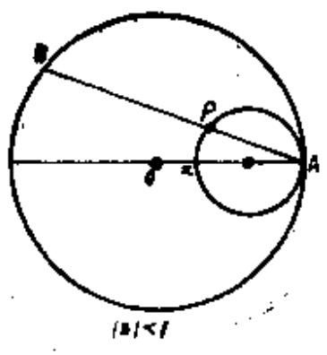
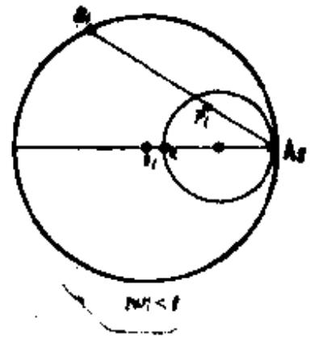
图5.14
结果成立(见图):
$\frac{A_{1}P_{1}}{P_{1}B_{1}} \leq a\frac{AP}{PB}.$
也就是有
$\frac{|1 - w|^{2}}{1 - |w|^{2}} = \frac{{\overline{A_{1}P_{1}}}^{2}}{\overline{A_{1}P_{1}} \cdot \overline{P_{1}B_{1}}} \leq a\frac{{\overline{AP}}^{2}}{\overline{AP} \cdot \overline{PB}} = a\frac{|1 - z|^{2}}{1 - |z|^{2}},$
于是就证明了
$\frac{\left| 1 - f(z) \right|^{2}}{1 - \left| f(z) \right|^{2}} \leq a\frac{|1 - z|^{2}}{1 - |z|^{2}}.$
如果对于一点  $z_{0}$  ,有
$\frac{\left| 1 - f\left( z_{0} \right) \right|^{2}}{1 - \left| f\left( z_{0} \right) \right.\ ^{2}} = a_{0}\frac{\left| 1 - z_{0} \right|^{2}}{1 - \left| z_{0} \right|^{2}} \ast$
通过  $z_{0}$  并与单位圆相切于  $z = 1$  的圆设为  $C_{0}$  。并设  $z_{1}$  是通过三点  $z = 1,z_{0}, - 1$  的在  $C_{0}$  内部的圆弧上的一个点,通过  $z_{1}$  并与单位圆相切于  $z = 1$  的圆设为  $C_{1}$  ,则  $C_{0},C_{1}$  分别可表作:
$C_{01}\frac{|1 - z|^{2}}{1 - |z|^{2}} = \frac{\left| 1 - z_{0} \right|^{2}}{1 - \left| z_{0} \right|^{2}} = \rho_{0}$
$C_{1}:\frac{|1 - z|^{2}}{1 - |z|^{2}} = \frac{\left| 1 - z_{1} \right|^{2}}{1 - \left| z_{1} \right|^{2}} = \rho_{1}.$
与这些相对应,设  $\Gamma_{0}$  和  $\Gamma_{1}$  如下:
$\Gamma_{0}:\frac{|1 - w|^{2}}{1 - |w|^{2}} = \alpha_{0}\rho_{0}$
$\Gamma_{1}:\frac{|1 - w|^{2}}{1 - |w|^{2}} = \alpha_{0}\rho_{1}$
则点  $w_{0} = f(z_{0})$  在  $\Gamma_{0}$  上,点  $w_{1} = f(z_{1})$  在  $\Gamma_{1}$  上或者在  $\Gamma_{1}$  内。故
$\frac{\left| z_{0} - z_{1} \right|}{\left| 1 - {\overline{z}}_{0}z_{1} \right|} \leq \frac{\left| w_{0} - w_{1} \right|}{\left| 1 - {\overline{w}}_{0}w_{1} \right|}.$
另一方面,由例题[6],恒有
$\frac{\left| w_{0} - w_{1} \right|}{\left| 1 - {\overline{w}}_{0}w_{1} \right|} \leq \frac{\left| z_{0} - z_{1} \right|}{\left| 1 - {\overline{z}}_{0}z_{1} \right|},$
故
$\frac{\left| w_{0} - w_{1} \right|}{\left| 1 - {\overline{w}}_{0}w_{1} \right|} = \frac{\left| z_{0} - z_{1} \right|}{\left| 1 - {\overline{z}}_{0}z_{1} \right|}.$
因此,将  $|z| < 1$  映射为  $|w| < 1$  的一次变换  $w = f(z)$  有
$\frac{\left| 1 - f(z) \right|^{2}}{1 - \left| f(z) \right|^{2}} = a_{0}\frac{|1 - z|^{2}}{1 - |z|^{2}}.$
即
$\frac{1 + w}{1 - w} = \frac{1}{a_{0}}\left( \frac{1 + z}{1 - z} - i\beta \right).$

   **难度：5/5；出处：** 同事提供《复变函数简明教程_习题导出.xlsx》第54行；导出表无教材书名、原题号及页码，来源待核，原题号同事习题导出表第54行（非教材原题号）；**解答来源：** 同事导出原解析，数学正确性待逐题审核。

   **整理说明：** 原导出知识点标签：Schwarz引理和非欧几何介绍

<!-- source-exercise:TJX-XLSX-r058 -->
2. 设$f(z)$在$|z|<1$上正则,$|f(z)|\le1$,$f(0)=0$,$|f'(0)|=a$,证明
 $$|z|(a-|z|)\le(1-a|z|)|f(z)|.$$

   **答案：** $h(z)=\frac{f(z)}{z}$在$|z|<1$上正则,并且$|h(z)|\le1$。故由例题[9],有 $$\frac{|f(z)|}{|z|}=|h(z)|\ge\frac{|h(0)|-|z|}{1-|h(0)||z|}=\frac{a-|z|}{1-a|z|}.$$

   **难度：3/5；出处：** 同事提供《复变函数简明教程_习题导出.xlsx》第58行；导出表无教材书名、原题号及页码，来源待核，原题号同事习题导出表第58行（非教材原题号）；**解答来源：** 同事导出原解析，数学正确性待逐题审核。

   **整理说明：** 原导出知识点标签：Schwarz引理和非欧几何介绍

<!-- source-exercise:TJX-XLSX-r059 -->
3. 设$f(z)$在$|z|<1$上正则,$|f(z)|\le1$,$f(0)=0$。如果对于$|z_1|=|z_2|=r(<1)$有$f(z_1)=f(z_2)=\omega$,则$|\omega|\le r^2$。

   **答案：** 如设 $$F(z)=\frac{f(z)-\omega}{1-\overline{\omega}f(z)}\cdot\frac{1-\overline{z}_1 z}{z-z_1}\cdot\frac{1-\overline{z}_2 z}{z-z_2},$$
和例题[7]同样可证$F(z)$在$|z|<1$上正则,并且$|F(z)|\le1$。特别设$z=0$,则
 $$|F(0)|=\left|\frac{\omega}{z_1 z_2}\right|\le1.$$
故
 $$|\omega|\le r^2.$$

   **难度：4/5；出处：** 同事提供《复变函数简明教程_习题导出.xlsx》第59行；导出表无教材书名、原题号及页码，来源待核，原题号同事习题导出表第59行（非教材原题号）；**解答来源：** 同事导出原解析，数学正确性待逐题审核。

   **整理说明：** 原导出知识点标签：Schwarz引理和非欧几何介绍

<!-- source-exercise:TJX-XLSX-r062 -->
4. 设$f(z)$在$|z|<1$上正则,$|f(z)|\le1$,$f(0)=0$,则
 $$\left|f'(z)\right|\le
 \begin{cases}
 1 & (|z|\le\sqrt{2}-1)\\
 \dfrac{(1+|z|^2)^2}{4|z|(1-|z|^2)} & (\sqrt{2}-1<|z|<1)
 \end{cases}$$
成立。

   **答案：** 在$|z|<1$内任取一点$z_0$。与(7)式一样,如下定义函数$g(z)$: $$\frac{f(z)-f(z_0)}{z-z_0}=\frac{1-\overline{f(z_0)}f(z)}{1-\overline{z}_0 z}\cdot g(z)$$
取$z\to z_0$,得到
 $$f'(z_0)=\frac{1-|f(z_0)|^2}{1-|z_0|^2}\cdot g(z_0).$$
但由于$g(z)$在$|z|<1$上正则,并且$|g(z)|\le1$,故由例题[9],有
 $$|g(z_0)|\le\frac{|g(0)|+|z_0|}{1+|g(0)|\cdot|z_0|}.$$
再在(15)式中,设$z=0$,得
 $$f(z_0)=z_0\cdot g(0),$$
故
 $$
 \begin{aligned}
 \left|f'(z_0)\right|
 &=\frac{1-|f(z_0)|^2}{1-|z_0|^2}\cdot\left|g(z_0)\right| \\
 &\le \frac{1-|z_0|^2|g(0)|^2}{1-|z_0|^2}\cdot \frac{|g(0)|+|z_0|}{1+|g(0)|\cdot|z_0|}.
 \end{aligned}
 $$
如设$|g(0)|=a$,有
 $$\left|f'(z_0)\right|\le\frac{(1-a|z_0|)(a+|z_0|)}{1-|z_0|^2}.$$
上式的分子在$0\le a\le \frac{1-|z_0|^2}{2|z_0|}=a_0$上单调增大,且当$|z_0|\le\sqrt{2}-1$时,$a_0\ge1$。因此,当$|z_0|\le\sqrt{2}-1$时,上式右边的最大值是1。在$|z_0|>\sqrt{2}-1$时,上式右边当$a=a_0=\frac{1-|z_0|^2}{2|z_0|}$时最大,最大值是
 $$\frac{(1+|z_0|^2)^2}{4|z_0|(1-|z_0|^2)}.$$
这样就得到所求的不等式。在这些结果中,由于实际上存在等号成立的情况,所以不能用更小的值来代替右边。

   **难度：5/5；出处：** 同事提供《复变函数简明教程_习题导出.xlsx》第62行；导出表无教材书名、原题号及页码，来源待核，原题号同事习题导出表第62行（非教材原题号）；**解答来源：** 同事导出原解析，数学正确性待逐题审核。

   **整理说明：** 原导出知识点标签：Schwarz引理和非欧几何介绍

<!-- source-exercise:TJX-XLSX-r106 -->
5. 如设 $f(z)$ 在 $|z|<1$ 上正则, $\Re f(z) \geq0$ , $f(0)=1$ ,则 $a_{n}=\frac{f^{(n)}(0)}{n !}(n=1,2, \cdots)$ 的绝对值不超过2.

   **答案：** 设 $0<\lambda<1$ , $0 \leq t<2 \pi$ .如设 $f_{\lambda,t}(z)=f(\lambda e^{it} z)$ , $f_{\lambda,t}(z)$ 在 $|z| \leq1$ 上正则,并且 $\Re f_{\lambda,t}(z) \geq0$ , $f_{\lambda,t}(0)=1$ . 计算 $$I=\frac{1}{2 \pi i} \int_{|z|=1} f_{\lambda, t}(z)\left(2-z^{n}-\frac{1}{z^{n}}\right) \frac{d z}{z},$$
得 $I=2-\frac{f_{\lambda,t}^{(n)}(0)}{n !}=2-\lambda^{n} e^{i n t} a_{n}$
另一方面,在 $|z|=1$ 上
 $$2-z^{n}-\frac{1}{z^{n}}=2-e^{i n \theta}-e^{-i n \theta}=2(1-\cos n \theta)=4 \sin ^{2} \frac{n \theta}{2} .$$

 $$因此 I=\frac{2}{\pi} \int_{0}^{2 \pi} f_{\lambda, t}(z) \cdot \sin ^{2} \frac{n \theta}{2} d \theta.$$

 $$故 \begin{aligned}
 \Re\left\{2-\lambda^{n} e^{i n t} a_{n}\right\}=\Re[I]=\frac{2}{\pi} \int_{0}^{2 \pi}\left\{\Re f_{\lambda,t}(z)\right\} \cdot \sin ^{2} \frac{n \theta}{2} d \theta
 & \geq 0 .
 \end{aligned}$$

 $$所以 \Re\left\{\lambda^{n} e^{i n t} a_{n}\right\} \leq 2$$
特别取这样的 t ,使 $e^{i n t} a_{n}=|a_{n}|$ ,于是这时便有
 $$\lambda^{n}\left|a_{n}\right| \leq 2,$$
再取 $\lambda \to 1$ ,便得
 $$|a_{n}| \leq 2 .$$

   **难度：4/5；出处：** 同事提供《复变函数简明教程_习题导出.xlsx》第106行；导出表无教材书名、原题号及页码，来源待核，原题号同事习题导出表第106行（非教材原题号）；**解答来源：** 同事导出原解析，数学正确性待逐题审核。

   **整理说明：** 原导出知识点标签：Schwarz引理和非欧几何介绍

<!-- source-exercise:TJX-XLSX-r108 -->
6. 设 $f(z)$ 在 $|z|<1$ 上正则,并且 $\Re f(z) \leq A$ ,则
 $$|f(z)-f(0)| \leq \frac{2 \Re\{A-f(0)\} \cdot | z}{1-|z|} .$$

   **答案：** 不妨设 $A>0$ , $f(0)=0$ .如设 $$\omega(z)=\frac{f(z)}{f(z)-2 A},$$
由于 $\Re\{f(z)-2 A\} \leqslant-A<0$ ,故 $\omega(z)$ 在 $|z|<1$ 上正则,并且 $\omega(0)=0$ .又如设 $f(z)=u+i v$ ,由假设,恒有
 $$|u| \leq 2 A-u .$$
因此
 $$|\omega(z)|^{2}=\frac{u^{2}+v^{2}}{(2 A-u)^{2}+v^{2}} \leq 1 .$$
所以根据Schwarz引理,有 $|\omega(z)| \leqslant|z|$ .
 $$而 f(z)=\frac{2 A \omega(z)}{\omega(z)-1},$$
所以
 $$|f(z)| \leq \frac{2 A|\omega(z)|}{1-|\omega(z)|} \leq \frac{2 A|z|}{1-|z|} .$$

   **难度：3/5；出处：** 同事提供《复变函数简明教程_习题导出.xlsx》第108行；导出表无教材书名、原题号及页码，来源待核，原题号同事习题导出表第108行（非教材原题号）；**解答来源：** 同事导出原解析，数学正确性待逐题审核。

   **整理说明：** 原导出知识点标签：Schwarz引理和非欧几何介绍

<!-- source-exercise:TJX-XLSX-r109 -->
7. 设 $\psi(r)$ 为 $0 \leq r0$ , $f(z)$ 在 $|z|<1$ 上正则, $f(0)=0$ .如果 $|f(z)| \leq\psi(|z|)$ ,则
 $$|f(z)| \leq K \cdot|z| \cdot \psi(|z|) .$$
这里 $K=\frac{2 \psi\left(\frac{1}{2}\right)}{\psi(0)}$。

   **答案：** 在 $|z|>\frac{1}{2}$ 时。 $$|f(z)| \leq|z|\psi(|z|)<2|z| \cdot \psi(|z|) \leq K \cdot|z| \cdot \psi(|z|) .$$
在 $|z| \leq\frac{1}{2}$ 时, $z=0$ 是 $\frac{f(z)}{z}$ 的可去奇异点,所以
 $$\begin{aligned}
 \left|\frac{f(z)}{z}\right| & \leq \max _{|z|=\frac{1}{2}}\left|\frac{f(z)}{z}\right| \leq 2 \max _{|z|=\frac{1}{2}}|f(z)| \leq 2 \cdot \psi\left(\frac{1}{2}\right) \\
 & \leq \frac{2 \psi\left(\frac{1}{2}\right) \cdot \psi(|z|)}{\psi(0)} .
 \end{aligned}$$

   **难度：3/5；出处：** 同事提供《复变函数简明教程_习题导出.xlsx》第109行；导出表无教材书名、原题号及页码，来源待核，原题号同事习题导出表第109行（非教材原题号）；**解答来源：** 同事导出原解析，数学正确性待逐题审核。

   **整理说明：** 原导出知识点标签：Schwarz引理和非欧几何介绍

<!-- source-exercise:TJX-ch03-27 -->
8. 设 $f$ 在单位盘解析且 $\operatorname{Re}f(z)\ge0$，$f(0)=a>0$。(1) 证明 $|(f(z)-a)/(f(z)+a)|\le|z|$、$|f'(0)|\le2a$；(2) 当 $a=1$ 时，原书又写 $(1-|z|)/(1+|z|)\le f(z)\le(1+|z|)/(1-|z|)$，核查并给出正确形式。

   **答案：** (1) Cayley 变换 $g=(f-a)/(f+a)$ 把右半平面送到单位盘且 $g(0)=0$，Schwarz 引理给 $|g(z)|\le|z|$、$|g'(0)|=|f'(0)|/(2a)\le1$。(2) $f$ 一般复值，不能用实数不等号比较；正确结论为 $(1-r)/(1+r)\le\operatorname{Re}f(z)\le(1+r)/(1-r)$（$r=|z|$），可由 $|g(z)|\le r$ 及 $f=a(1+g)/(1-g)$ 得到。

   **难度：3/5；出处：** 谭小江、伍胜健《复变函数简明教程》（北京大学出版社，2005），习题三第27题，书页118，PDF页130，原题号习题三第27题；**解答来源：** 本次据主书原题自拟简解；题干已回PDF原页核读。

   **待核状态：** 原书以实数不等号比较复值 f，已改陈述为实部估计

   **勘误：** 原书以实数不等号比较复值 f，已改陈述为实部估计

<!-- source-exercise:TJX-ch03-29 -->
9. 设 $f$ 在单位圆盘解析，$|f(z)|\le1$，且 $f(0)=f'(0)=\cdots=f^{(k)}(0)=0$。证明 $|f(z)|\le|z|^{k+1}$；若某内点取等号，说明 $f(z)=e^{i\theta}z^{k+1}$。

   **答案：** 连续应用 Schwarz 引理：若 $f(0)=0$，$f(z)/z$ 在零点可去且模不超过1；重复 $k+1$ 次得 $f(z)=z^{k+1}g(z)$、$|g|\le1$。若非零内点取等号，最大模原理使 $g$ 为模1常数，即所述形式。

   **难度：3/5；出处：** 谭小江、伍胜健《复变函数简明教程》（北京大学出版社，2005），习题三第29题，书页119，PDF页131，原题号习题三第29题；**解答来源：** 本次据主书原题自拟简解；题干已回PDF原页核读。

<!-- source-exercise:TJX-ch03-30 -->
10. 若 $f$ 是上半平面到自身的解析映射，且 $f(i)=i$，原书要求证明 $|(f(z)-i)/(f(z)+i)|\le|(z+1)/(z-1)|$。核查该式并给出正确的 Schwarz 型不等式。

   **答案：** 原书右侧疑为排印错误：取恒等映射 $f(z)=z$，再令 $z=-1+i\varepsilon$ 且 $\varepsilon\downarrow0$，左侧趋于1而右侧趋于0，原式不成立。正确的归一化 Cayley 变换是 $C(z)=(z-i)/(z+i)$；$C\circ f\circ C^{-1}$ 固定盘原点，Schwarz 引理给 $|(f(z)-i)/(f(z)+i)|\le|(z-i)/(z+i)|$。

   **难度：3/5；出处：** 谭小江、伍胜健《复变函数简明教程》（北京大学出版社，2005），习题三第30题，书页119，PDF页131，原题号习题三第30题；**解答来源：** 本次据主书原题自拟简解；题干已回PDF原页核读。

   **待核状态：** 原书 Schwarz 型估计右侧公式错误，恒等映射反例已给

   **勘误：** 原书 Schwarz 型估计右侧公式错误，恒等映射反例已给

<!-- source-exercise:TJX-ch03-35 -->
11. 设 $f:\mathbb D\to\mathbb D$ 解析。证明任意盘内光滑曲线 $\gamma$ 满足 $s(f(\gamma))\le s(\gamma)$，其中 $s$ 是 Poincaré 弧长。

   **答案：** Schwarz–Pick 不等式为 $|f'(z)|/(1-|f(z)|^2)\le1/(1-|z|^2)$。沿 $\gamma(t)$ 乘以 $2|\gamma'(t)|dt$ 并积分，左、右两侧恰为像曲线和原曲线的 Poincaré 弧长。

   **难度：3/5；出处：** 谭小江、伍胜健《复变函数简明教程》（北京大学出版社，2005），习题三第35题，书页119，PDF页131，原题号习题三第35题；**解答来源：** 本次据主书原题自拟简解；题干已回PDF原页核读。

<!-- source-exercise:CONWAY-ch06-s02-1 -->
12. 设非恒定解析函数 $f:\mathbb D\to\mathbb D$，$a=f(0)$。通过盘自同构 $g(z)=(f(z)-a)/(1-\bar a f(z))$，证明对 $|z|<1$ 有 $(|a|-|z|)/(1+|a||z|)\le|f(z)|\le(|a|+|z|)/(1-|a||z|)$。

   **答案：** $g(0)=0$，Schwarz 引理给 $|g(z)|\le r=|z|$。反解 $f=(a+g)/(1+\bar a g)$ 后，用三角不等式得上界 $|f|\le(|a|+r)/(1-|a|r)$；下界可从 $|a|\le(|f|+r)/(1-|f|r)$ 解得 $|f|\ge(|a|-r)/(1+|a|r)$。当下界为负时它自动成立。

   **难度：3/5；出处：** John B. Conway, Functions of One Complex Variable, 2nd ed., Springer-Verlag，Chapter 6 §2 Exercises 1，书页132，PDF页145，原题号Chapter 6 §2 Exercises 1；**解答来源：** 本次据参考书原题自拟简解；题干已回PDF原页核读。

<!-- source-exercise:CA-TRAIN-007 -->
13. 求把单位盘内 $a$ 送到 $0$ 的一个盘自同构，并说明全部此类映射相差何种自由度。

   **答案：** $\phi_a(z)=(z-a)/(1-\bar a z)$，$|a|<1$，是盘自同构且 $\phi_a(a)=0$。任意另一个这样的自同构与它复合逆映射后固定 $0$，由 Schwarz 引理等号情形只能是旋转，故一般形为 $e^{i\theta}\phi_a$。

   **难度：3/5；出处：** 本项目根据所附教材知识点自拟训练题；非教材原题，书页及PDF页不适用，原题号本项目自拟训练题7；**解答来源：** 本次自拟简解，已按相关定理核算。

   **整理说明：** 教学训练题，不计原书独立习题数

#### 弧长微元

**图谱路径：** 复变函数 / Cauchy定理和Cauchy公式 / Schwarz引理和非欧几何介绍 / 弧长微元

**知识内容：** [定义、定理与方法](知识点.md#ca-087)

<!-- source-exercise:TJX-ch02-24 -->
1. 设 $w=(z-a)/(1-\bar a z)$，$|a|<1$。证明 $|dw|/(1-|w|^2)=|dz|/(1-|z|^2)$。

   **答案：** $w'=(1-|a|^2)/(1-\bar az)^2$，而 $1-|w|^2=(1-|a|^2)(1-|z|^2)/|1-\bar az|^2$。两式相除即得度量不变性。

   **难度：2/5；出处：** 谭小江、伍胜健《复变函数简明教程》（北京大学出版社，2005），习题二第24题，书页77，PDF页89，原题号习题二第24题；**解答来源：** 本次据主书原题自拟简解；题干已回PDF原页核读。

<!-- source-exercise:CA-TRAIN-024 -->
2. 在 Poincaré 单位圆盘度量 $ds=2|dz|/(1-|z|^2)$ 下，求从 $0$ 沿实轴到 $r\in(0,1)$ 的长度。

   **答案：** 积分 $\int_0^r2/(1-t^2)dt=\log[(1+r)/(1-r)]$。它在 $r\uparrow1$ 时发散，而欧氏长度仅为 $r$；这体现双曲几何的边界在无穷远。

   **难度：3/5；出处：** 本项目根据所附教材知识点自拟训练题；非教材原题，书页及PDF页不适用，原题号本项目自拟训练题24；**解答来源：** 本次自拟简解，已按相关定理核算。

   **整理说明：** 教学训练题，不计原书独立习题数

#### 欧氏几何

**图谱路径：** 复变函数 / Cauchy定理和Cauchy公式 / Schwarz引理和非欧几何介绍 / 欧氏几何

**知识内容：** [定义、定理与方法](知识点.md#ca-088)

<!-- source-exercise:CA-TRAIN-024 -->
1. 在 Poincaré 单位圆盘度量 $ds=2|dz|/(1-|z|^2)$ 下，求从 $0$ 沿实轴到 $r\in(0,1)$ 的长度。

   **答案：** 积分 $\int_0^r2/(1-t^2)dt=\log[(1+r)/(1-r)]$。它在 $r\uparrow1$ 时发散，而欧氏长度仅为 $r$；这体现双曲几何的边界在无穷远。

   **难度：3/5；出处：** 本项目根据所附教材知识点自拟训练题；非教材原题，书页及PDF页不适用，原题号本项目自拟训练题24；**解答来源：** 本次自拟简解，已按相关定理核算。

   **整理说明：** 教学训练题，不计原书独立习题数

#### 非欧几何

**图谱路径：** 复变函数 / Cauchy定理和Cauchy公式 / Schwarz引理和非欧几何介绍 / 非欧几何

**知识内容：** [定义、定理与方法](知识点.md#ca-089)

<!-- source-exercise:TJX-ch03-26 -->
1. 给定上半平面内 $z_1\ne z_2$、$w_1\ne w_2$。是否总存在上半平面的解析自同胚 $L$，使 $L(z_1)=w_1,L(z_2)=w_2$？

   **答案：** 不总存在。上半平面自同胚在 Poincaré 距离下等距，故必要条件是 $d_{\mathbb H}(z_1,z_2)=d_{\mathbb H}(w_1,w_2)$；这也是充分条件：先把 $z_1,w_1$ 分别送到盘原点，再用旋转把模相同的第二点对齐，复合得到所求。

   **难度：3/5；出处：** 谭小江、伍胜健《复变函数简明教程》（北京大学出版社，2005），习题三第26题，书页118，PDF页130，原题号习题三第26题；**解答来源：** 本次据主书原题自拟简解；题干已回PDF原页核读。

<!-- source-exercise:TJX-ch03-34 -->
2. 设 $ds=2|dz|/(1-|z|^2)$ 为单位盘非欧度量。(1) 证明经过 $z_1,z_2$ 且与单位圆正交的圆弧是二点间最短曲线，并讨论唯一性；(2) 给定测地线 $l$ 外点 $P$，证明有无穷多条过 $P$ 的盘内测地线与 $l$ 不交。

   **答案：** (1) 用盘自同构把该圆弧化为直径；在极坐标下 $ds^2=4(dr^2+r^2d\theta^2)/(1-r^2)^2$，任意偏离直径的曲线长度不小于直径的径向积分，等号仅为该直径段；映回得唯一测地线。(2) 把 $l$ 化为直径，在 $P$ 处改变正交边界圆的两理想端点，存在一整个开区间的端点对使圆弧停在 $l$ 同侧，故无穷多。

   **难度：4/5；出处：** 谭小江、伍胜健《复变函数简明教程》（北京大学出版社，2005），习题三第34题，书页119，PDF页131，原题号习题三第34题；**解答来源：** 本次据主书原题自拟简解；题干已回PDF原页核读。

<!-- source-exercise:CA-TRAIN-024 -->
3. 在 Poincaré 单位圆盘度量 $ds=2|dz|/(1-|z|^2)$ 下，求从 $0$ 沿实轴到 $r\in(0,1)$ 的长度。

   **答案：** 积分 $\int_0^r2/(1-t^2)dt=\log[(1+r)/(1-r)]$。它在 $r\uparrow1$ 时发散，而欧氏长度仅为 $r$；这体现双曲几何的边界在无穷远。

   **难度：3/5；出处：** 本项目根据所附教材知识点自拟训练题；非教材原题，书页及PDF页不适用，原题号本项目自拟训练题24；**解答来源：** 本次自拟简解，已按相关定理核算。

   **整理说明：** 教学训练题，不计原书独立习题数

## Laurent级数

**图谱路径：** 复变函数 / Laurent级数

**知识内容：** [定义、定理与方法](知识点.md#ca-090)

所给材料中未找到直接对应的独立未解题。

### Laurent级数

**图谱路径：** 复变函数 / Laurent级数 / Laurent级数

**知识内容：** [定义、定理与方法](知识点.md#ca-091)

所给材料中未找到直接对应的独立未解题。

#### Laurent级数

**图谱路径：** 复变函数 / Laurent级数 / Laurent级数 / Laurent级数

**知识内容：** [定义、定理与方法](知识点.md#ca-092)

<!-- source-exercise:TJX-XLSX-r012 -->
1. 分别以原点和无限远点作为中心,将如下函数展开:
 $$f(z)=z+\sqrt{z^{2}-1}$$

   **答案：** $f(z)$ 是双值函数,$z=0$ 和 $\infty$ 均不是支点。在 $z=0$ 处展开: $$
 \begin{aligned}
 f(z) &=z+i\left(1-z^{2}\right)^{\frac{1}{2}} \\
 &=z \pm i\left(1-\frac{1}{2} z^{2}-\frac{1}{8} z^{4}-\cdots\right) .
 \end{aligned}
 $$
因此以原点为中心的展开式是
 $$f(z)=i+z-\frac{i}{2} z^{2}-\frac{i}{8} z^{4} \cdots$$
 $$f(z)=-i+z+\frac{i}{2} z^{2}+\frac{i}{8} z^{4}+\cdots .$$
其次,设 $z=\frac{1}{\xi}$
 $$
 f\left(\frac{1}{\xi}\right)=\frac{1}{\xi} \pm \frac{1}{\xi}\left(1-\xi^{2}\right)^{\frac{1}{2}}
 =\frac{1}{\xi} \pm \frac{1}{\xi}\left(1-\frac{1}{2} \xi^{2}-\frac{1}{8} \xi^{4}+\cdots\right) .
 $$
将它写作 $z$ 的式子,有
 $$f(z)=z \pm z\left(1-\frac{1}{2} \cdot \frac{1}{z^{2}}-\frac{1}{8} \cdot \frac{1}{z^{4}}+\cdots\right) .$$
于是得到展开式为
 $$f(z)=2 z-\frac{1}{2 z}-\frac{1}{8 z^{3}}-\cdots,$$
 $$f(z)=\frac{1}{2 z}+\frac{1}{8 z^{3}}+\cdots .$$

   **难度：3/5；出处：** 同事提供《复变函数简明教程_习题导出.xlsx》第12行；导出表无教材书名、原题号及页码，来源待核，原题号同事习题导出表第12行（非教材原题号）；**解答来源：** 同事导出原解析，数学正确性待逐题审核。

   **整理说明：** 原导出知识点标签：Laurent级数/Laurent级数/Laurent级数

<!-- source-exercise:TJX-XLSX-r072 -->
2. 设 $f(z)$ 为 Jordan区域 D 的闭域 $\bar{D}$ 上的正则函数,证明在 D 上, $f(z)$ 可展开为
 $$f(z)=\sum_{n=1}^{\infty} \frac{A_{n}}{z-z_{n}} \quad\left(\text{其中 }\sum_{n=1}^{\infty}\left|A_{n}\right|<+\infty \right).$$
 (Wolff定理)。

   **答案：** 设  $\{ D_{n}\}$  是满足如下条件的区域列:(1)$D_{n} \supset {\bar{D}}_{n + 1}$
(2)$\bigcap_{n}D_{n} = D_{1}$
(3)$D_{n}$是有界区域,并且其境界 $\Gamma_{n}$  由有限条解析曲线构成。
由于  $\overline{D}$  是有界闭区域,故满足如上条件的区域列是能够作出的。
设  $\Gamma_{n}$  的长度为  $l_{n}$  ,选择正数  $\varepsilon_{1},\varepsilon_{2},\cdots,\varepsilon_{n},\cdots$  ,使  $\varepsilon_{n} = \frac{1}{2^{n}l_{n}}$  有  $\sum_{n = 1}^{\infty}\varepsilon_{n}l_{n} < + \infty,\lim_{n \rightarrow \infty}\varepsilon_{n} = 0$  。和例题[10]同样,选择 $\Gamma_{1}$  上的点  $\xi_{11},\xi_{12},\cdots,\xi_{1n_{1}}$  ,对于  ${\bar{D}}_{2}$  上的点z,有
$\left| f(z) - \frac{1}{2\pi i}\sum_{k = 1}^{n_{1}}\frac{f(\xi_{1,k})(\xi_{1,k + 1} - \xi_{1,k})}{z - \xi_{1,k}} \right| \leq e_{2},\quad z \in {\overline{D}}_{2}.$
如设
$f_{2}(z) = f(z) - \frac{1}{2\pi i}\sum_{k = 1}^{n_{1}}\frac{f(\xi_{1,k})(\xi_{1,k + 1} - \xi_{1,k})}{z - \xi_{1,k}},$
则  $f_{2}(z)$  在  ${\bar{D}}_{2}$  上正则。
在  $\Gamma_{2}$  上选择点  $\zeta_{21},\zeta_{22},\cdots,\zeta_{2,n_{2}}$  ,对于  ${\bar{D}}_{3}$  上的点z,有
$\left| f_{2}(z) - \frac{1}{2\pi i}\sum_{k = 1}^{n_{2}}\frac{f_{2}(\zeta_{2,k})(\zeta_{2,k + 1} - \zeta_{2,k})}{z - \zeta_{2,k}} \right| \leq e_{3},\quad z \in {\overline{D}}_{8}$
设
$f_{2}(z) = f_{2}(z) - \frac{1}{2\pi i}\sum_{k = 1}^{\pi_{2}}\frac{f_{2}(\zeta_{2,k})(\zeta_{2,k + 1} - \zeta_{2,k})}{z - \zeta_{2,k}},$
下面重复同样的方法,在 $\Gamma_{m}$  上选择点  $\zeta_{m,1},\zeta_{m,2},\cdots,\zeta_{m,m_{m}}$
对于  ${\bar{D}}_{m + 1}$  上的点  $z$  ,有
$\left| f_{m}(z) - \frac{1}{2\pi i}\sum_{k = 1}^{n_{m}}\frac{f_{m}(\xi_{m,k})(\xi_{m,k + 1} - \xi_{m,k})}{z - \xi_{m,k}} \right| \leq \varepsilon_{m + 1},z \in {\overline{D}}_{m + 1}$
这样,由以上不等式,对于 ${\bar{D}}_{m + 1}$  的点  $z$  ,有下式成立
$\left| f(z) - \frac{1}{2\pi i}\sum_{m = 1}^{m}{\sum_{k = 1}^{n}\frac{f_{m}(\zeta_{m,k})(\zeta_{m,k + 1} - \zeta_{m,k})}{z - \zeta_{m,k}}} \right| \leq e_{m + 1},$
在级数
$\frac{1}{2\pi i}\sum_{m = 1}^{\infty}{\sum_{k = 1}^{n_{m}}\frac{f_{m}(\zeta_{m,k})(\zeta_{m,k + 1} - \zeta_{m,k})}{z - \zeta_{m,k}}}$
中,如设
$\frac{f_{m}\left( \zeta_{m,k} \right)\left( \zeta_{m,k + 1} - \zeta_{m,k} \right)}{2\pi l} = A_{n_{1} + n_{2} + \ldots + n_{m - 1} + k}$
$\zeta_{m,k} = \zeta_{n_{1} + n_{2} + \ldots + n_{m - 1} + k}$
那么这个级数就成为
$\sum_{j = 1}^{\infty}\frac{A_{j}}{z - \xi_{j}}.$
其中设  $n_{0} = 0$  。
如果  $m > 1$  ,由于  $\left| f_{m}(z) \right| \leq \varepsilon_{m},z \in {\overline{D}}_{m}$  ,故
$\sum_{k = 1}^{\pi_{m}}\left| f_{m}(\xi_{m,k})(\xi_{m,k + 1} - \xi_{m,k}) \right| \leq \varepsilon_{m}l_{m}$
因此
$\sum_{j = 1}^{\infty}|A_{j}| \leq \sum_{m = 1}^{\infty}e_{m}l_{m} = 1.$
下面再证明  $\sum_{j = 1}^{\infty}\frac{A_{j}}{z - \zeta_{j}}$  在  $D$  上广义一致收敛于  $f(z)$.
设  $D^{\ast}$  是  $D$  的任意有界闭的部分集合,  $D^{\ast}$  和  $\Gamma$  的距离设为  $d(d > 0)$  ,对于任意的正数  $\varepsilon$  ,如取  $m$  充分大,可得
$\sum_{j = \pi_{1} + \pi_{2} + \ldots + \pi_{m + 1}}^{\infty}|A_{j}| < \frac{de}{2},\varepsilon_{m + 1} < \frac{\varepsilon}{2}.$
由于  $D^{\ast} \subset {\overline{D}}_{m + 1}$  ,所以
$\left| f(z) - \sum_{j = 1}^{\infty}\frac{A_{j}}{z - {\bar{\zeta}}_{j}} \right|$
$\begin{matrix} \leq \left| f(z) - \sum_{j = 1}^{n_{1} + n_{2} + \ldots + n_{m}}\frac{A_{j}}{z - \xi_{j}} \right| + \left| \sum_{j = n_{1} + n_{2} + \ldots + n_{m + 1}}^{\infty}\frac{A_{j}}{z - \xi_{j}} \right| \\ = \left| f(z) - \frac{1}{2\pi i}\sum_{m = 1}^{m}{\sum_{k = 1}^{n_{m}}\frac{f_{m}(\zeta_{m,k})(\zeta_{m,k + 1} - \zeta_{m,k})}{z - \xi_{m,k}}} \right| \\ + \left| \sum_{i = n_{1}}^{\infty}\frac{A_{j}}{z - \xi_{j}} \right| \\ \leq \varepsilon_{m + 1} + \frac{d\varepsilon}{2} \cdot \frac{1}{d} \leq \frac{\varepsilon}{2} + \frac{\varepsilon}{2} = \varepsilon. \end{matrix}$
因此在D上广义一致收敛。

   **难度：5/5；出处：** 同事提供《复变函数简明教程_习题导出.xlsx》第72行；导出表无教材书名、原题号及页码，来源待核，原题号同事习题导出表第72行（非教材原题号）；**解答来源：** 同事导出原解析，数学正确性待逐题审核。

   **整理说明：** 原导出知识点标签：Laurent级数/Laurent级数/Laurent级数

<!-- source-exercise:TJX-XLSX-r074 -->
3. 设 D 是由二条单闭曲线 $L_{1}$ 和 $L_{2}$ 所围成的环状区域,如 果 $f(z)$ 在 D 上正则,则可分解为
 $$f(z)=f_{1}(z)+f_{2}(z) .$$
  $f_{1}(z)$ 在 $L_{1}$ 内部, $f_{2}(z)$ 在 $L_{2}$ 的外部的正则函数(这里假设 $L_{2}$ 在 闭曲线 $L_{1}$ 的内部)。又 $f(z)$ 的这种分解,除常数外, $f_{1}(z)$ 和 $f_{2}(z)$ 是唯一确定的。

   **答案：** 画出如图所示的 $L_{1}^{\ast},L_{2}^{\ast}$, 则$\begin{aligned} f(z) & = \frac{1}{2\pi i}\int_{L_{1}}^{} + L_{2} \cdot \frac{f(\xi)}{\xi - z}d\xi \\ & = \frac{1}{2\pi i}\int_{L_{1}}^{}\frac{f(\xi)}{\xi - z}d\xi - \frac{1}{2\pi i}\int_{L_{2}}^{}\frac{f(\xi)}{\xi - z}d\xi. \end{aligned}$
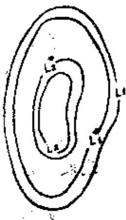
现设
$f_{1}(z) = \frac{1}{2\pi i}\int_{L_{1}}^{}\frac{f(\xi)}{\xi - z}d\xi$
图4.5
$f_{2}(z) = \frac{- 1}{2\pi i}\int_{L_{2}}^{}\frac{f(\xi)}{\xi - z}d\xi$
 (其中  $L_{1}^{\ast}$  ,  $L_{2}^{\ast}$  的正方向为积分的方向).
根据 Cauchy 积分定理,只要  $L_{1}^{\ast}$  和  $L_{2}^{\ast}$  都不通过 z,由于 $f_{1}(z)$  ,  $f_{2}(z)$  的值不变,故  $f_{1}(z)$  ,  $f_{2}(z)$  是一意确定的。因此,  $f_{1}(z)$  在  $L_{1}$  内部,  $f_{2}(z)$  在  $L_{2}$  的外部是正则函数。
其次,设  $f(z)$  的另一个分解为  $f(z) = f_{1}^{\ast}(z) + f_{2}^{\ast}(z)$
$\begin{matrix} f_{1}^{\ast}(z) + f_{2}^{\ast}(z) = f_{1}(z) + f_{2}(z) & z \in D \\ f_{1}^{\ast}(z) - f_{1}(z) = f_{2}(z) - f_{2}^{\ast}(z) & z \in D \end{matrix}$
如设  $f_{1}^{\ast}(z) - f_{1}(z) = F(z)$  ,则  $F(z)$  在  $L_{1}$  的内部正则。  $f_{2}(z) - f_{2}^{\ast}(z)$  在  $L_{2}$  的外部正则,并且,  $z \in D$  时,由于
$F(z) = f_{2}(z) - f_{2}^{\ast}(z),$
故根据 Painlevé 定理,  $F(z)$  在全平面上正则。因此,  $F(z)$  是常数。故  $f_{1}^{\ast}(z) = f_{1}(z) + M,\quad f_{2}^{\ast}(z) = f_{2}(z) - M$  ,所以除了一个常数外,这种分解是一意确定的。

   **难度：4/5；出处：** 同事提供《复变函数简明教程_习题导出.xlsx》第74行；导出表无教材书名、原题号及页码，来源待核，原题号同事习题导出表第74行（非教材原题号）；**解答来源：** 同事导出原解析，数学正确性待逐题审核。

   **整理说明：** 原导出知识点标签：Laurent级数/Laurent级数/Laurent级数

<!-- source-exercise:TJX-XLSX-r076 -->
4. 设 $\{a_{n}\}$ 为单位圆内互异的点列,其凝聚点在圆周上。 证明存在正则函数,它在 $a_{n}$ 处具有 $k_{n}$ 阶零点,除此之外无其它零点。

   **答案：** 首先证明在 $D$  上存在有理型函数,它在  $a_{n}$  处的主要部分是  $\frac{k_{n}}{z - a_{n}}$  ,以  $a_{n}$  为圆心画一与单位圆内切的圆,设切点为  $b_{n}$  ,这圆的半径为  $d_{n}$  ,由于  $\frac{k_{n}}{z - a_{n}}$  在  $|z - b_{n}| > d_{n}$  上正则,并且  $\lim_{n \rightarrow \infty}\frac{k_{n}}{z - a_{n}} = 0$  ,故$\frac{k_{n}}{z - a_{n}} = \frac{c_{n,1}}{z - b_{n}} + \frac{c_{n,2}}{(z - b_{n})^{2}} + \ldots$
这个级数在  $|z - b_{n}| \geq 2d_{n}$  上一致收敛。因此选取充分大的  $N$  ,取
$G_{n}(z) = \frac{c_{n,1}}{z - b_{n}} + \frac{c_{n,2}}{(z - b_{n})^{2}} + \ldots + \frac{c_{n,N}}{(z - b_{n})^{N}}$
可使  $\left| \frac{k_{n}}{z - a_{n}} - G_{n}(z) \right| < \frac{1}{2^{n}}$  (其中  $|z - b_{n}| \geq 2d_{n}$  )
于是考虑
$f(z) = \sum_{n = 1}^{\infty}\left\{ \frac{k_{n}}{z - a_{n}} - G_{n}(z) \right\},$
由于  $\lim_{n \rightarrow \infty}d_{n} = 0$  ,故  $f(z)$  在  $D$  上广义一致收敛,又若写作
$f(z) = \sum_{n = 1}^{\infty}\left\{ \frac{k_{n}}{z - a_{n}} - G_{n}(z) \right\} + \sum_{n = N + 1}^{\infty}\left\{ \frac{k_{n}}{z - a_{n}} - G_{n}(z) \right\},$
则  $\sum_{n = N + 1}^{\infty}\left\{ \frac{k_{n}}{z - a_{n}} - G_{n}(z) \right\}$  在  $|z - b_{n}| \geq 2d_{n}$  上正则。因此  $f(z)$  在  $z = a_{n}$  处的主要部分是  $\frac{k_{n}}{z - a_{n}}$  。
其次
$\begin{aligned} \frac{k_{n}}{z - a_{n}} & = \frac{k_{n}}{z - b_{n} - (a_{n} - b_{n})} \\ & = \frac{k_{n}}{z - b_{n}}\left\{ 1 + \frac{a_{n} - b_{n}}{z - b_{n}} + \left( \frac{a_{n} - b_{n}}{z - b_{n}} \right)^{2} + \ldots \right\} \\ & = \frac{k_{n}}{z - b_{n}} + \frac{k_{n}(a_{n} - b_{n})}{(z - b_{n})^{2}} + \frac{k_{n}(a_{n} - b_{n})^{2}}{(z - b_{n})^{3}} + \ldots. \end{aligned}$
故  $G_{n}(z) = \frac{k_{n}}{z - b_{n}} + \frac{k_{n}(a_{n} - b_{n})}{(z - b_{n})^{2}} + \ldots + \frac{k_{n}(a_{n} - b_{n})^{N - 1}}{(z - b_{n})^{N}}.$
设
$G_{n}(z) - \frac{k_{n}}{z - b_{n}} = H_{n}(z),$
这样
$\begin{aligned} f(z) & = \sum_{n = 1}^{\infty}\left\{ \frac{k_{n}}{z - a_{n}} - \frac{k_{n}}{z - b_{n}} - H_{n}(z) \right\} \\ & = \sum_{n = 1}^{\infty}\left\{ k_{n}\left( \frac{1}{z - a_{n}} - \frac{1}{z - b_{n}} \right) - H_{n}(z) \right\}. \end{aligned}$
现设  $z_{0}$  是单位圆内的一点,则
$\begin{aligned} g(z) & = \int_{z_{1}}^{z}f(z)dz \\ & = \sum_{n = 1}^{\infty}\left\{ k_{n}\log\left( \frac{z - a_{n}}{z_{0} - a_{n}} \cdot \frac{z_{0} - b_{n}}{z - b_{n}} \right) - \int_{z_{1}}^{z}H_{n}(z)dz \right\}. \end{aligned}$
由于
$H_{n}(z) = \frac{k_{n}(a_{n} - b_{n})}{(z - b_{n})^{2}} + \cdots + \frac{k_{n}(a_{n} - b_{n})^{N - 1}}{(z - b_{n})^{N}}$,故  $\int_{z}^{z}H_{n}(z)dz$  是  $\frac{1}{z - b_{n}}$  的多项式。这可用  $P_{n}\left( \frac{1}{z - b_{n}} \right)$  表示。  $g(z)$  是无限多值函数,其多值性是由  $\log\left( \frac{z - a_{n}}{z_{0} - a_{n}} \cdot \frac{z_{0} - b_{n}}{z - b_{n}} \right)$  产生的。因此  $e^{\pi(z)}$  是单值函数。这样
$F(z) = e^{g(z)} = \prod_{n = 1}^{\infty}\left( \frac{z - a_{n}}{z_{0} - a_{n}} \cdot \frac{z_{0} - b_{n}}{z - b_{n}} \right)e^{- P_{n}\left( \frac{1}{x - b_{n}} \right)}$
就是所求的函数。

   **难度：5/5；出处：** 同事提供《复变函数简明教程_习题导出.xlsx》第76行；导出表无教材书名、原题号及页码，来源待核，原题号同事习题导出表第76行（非教材原题号）；**解答来源：** 同事导出原解析，数学正确性待逐题审核。

   **整理说明：** 原导出知识点标签：Laurent级数/Laurent级数/Laurent级数

<!-- source-exercise:TJX-XLSX-r087 -->
5. 将如下函数在指定范围内展开为Laurent级数。
 (1) $\frac{1}{(z-1)(2-z)} \quad(1<|z|<2),$
 (2) $\log \frac{z}{1-z} \quad(|z|>1).$

   **答案：** $$\begin{aligned}
 \frac{1}{(z-1)(2-z)} &= \frac{1}{z-1}+\frac{1}{2-z} \\
 &= \frac1z \frac{1}{1-\frac1z}+\frac12\frac{1}{1-\frac z2} \\
 &=\frac1z\sum_{n=0}^{\infty}\frac1{z^n}+\frac12\sum_{n=0}^{\infty}\frac{z^n}{2^n}\\
 &=\sum_{n=1}^{\infty}\frac1{z^n}+\sum_{n=0}^{\infty}\frac{z^n}{2^{n+1}} .
 \end{aligned}$$

 $$\begin{aligned}
 \log \frac{z}{1-z} &= \log\left(1+\frac1{z-1}\right)= \log z-\log(1-z)\\
 &=\log z -\left[\log(-z)+\log\left(1-\frac1z\right)\right]\\
 &=i\pi-\sum_{n=1}^{\infty}\frac{(-1)^{n-1}}{n}\left(-\frac1z\right)^n\\
 &=i\pi+\sum_{n=1}^{\infty}\frac1{n z^n},\quad |z|>1.
 \end{aligned}$$

   **难度：3/5；出处：** 同事提供《复变函数简明教程_习题导出.xlsx》第87行；导出表无教材书名、原题号及页码，来源待核，原题号同事习题导出表第87行（非教材原题号）；**解答来源：** 同事导出原解析，数学正确性待逐题审核。

   **整理说明：** 原导出知识点标签：Laurent级数/Laurent级数/Laurent级数

<!-- source-exercise:TJX-XLSX-r105 -->
6. 证明 $z=\infty$ 是 $e^{z}$ 的孤立本性奇异点。

   **答案：** 由于 $e^{z}$ 在 $|z|<\infty$ 上正则,故 $z=\infty$ 为其孤立奇异点。 设 $z=x+i y$ ,固定 y 并使 $x \to +\infty$ ,则有 $e^{z} \to \infty$ ,同样,固定 y, $x \to -\infty$ , $e^{z} \to 0$ ,故 $z=\infty$ 既非 $e^{z}$ 的正则点又非极点,所以是孤立本性奇异点。

   **难度：2/5；出处：** 同事提供《复变函数简明教程_习题导出.xlsx》第105行；导出表无教材书名、原题号及页码，来源待核，原题号同事习题导出表第105行（非教材原题号）；**解答来源：** 同事导出原解析，数学正确性待逐题审核。

   **整理说明：** 原导出知识点标签：Laurent级数/Laurent级数/Laurent级数

<!-- source-exercise:TJX-ch04-1 -->
7. 求下列函数在指定区域的 Laurent 展开：(1) $3z/[(2-z)(2z-1)]$，分别在 $|z|<1/2$、$1/2<|z|<2$、$|z|>2$；(2) $1/[z^2(z+i)]$，在 $0<|z-i|<1$。

   **答案：** (1) 部分分式为 $2/(2-z)+1/(2z-1)$。三个区域依次得 $\sum_{n\ge0}(z/2)^n-\sum_{n\ge0}(2z)^n$；$\sum_{n\ge0}(z/2)^n+\sum_{n\ge1}(2z)^{-n}$；$-\sum_{n\ge1}2^nz^{-n}+\sum_{n\ge1}(2z)^{-n}$。(2) 令 $w=z-i$，$f=\frac{i}{2}(1+w/i)^{-2}(1+w/(2i))^{-1}$；两因子按二项/几何级数展开，$|w|<1$ 内局部一致收敛，因中心 $i$ 非奇点，Laurent 负幂系数全零。

   **难度：3/5；出处：** 谭小江、伍胜健《复变函数简明教程》（北京大学出版社，2005），习题四第1题，书页137，PDF页149，原题号习题四第1题；**解答来源：** 本次据主书原题自拟简解；题干已回PDF原页核读。

<!-- source-exercise:TJX-ch04-2 -->
8. 求 $\cos[z/(1+z)]$ 在 $z=-1$ 处的 Laurent 展开。

   **答案：** 令 $w=z+1$，则 $z/(1+z)=1-1/w$，所以 $\cos(1-1/w)=\cos1\sum_{k\ge0}(-1)^k w^{-2k}/(2k)!+\sin1\sum_{k\ge0}(-1)^{k+1}w^{-(2k+1)}/(2k+1)!$。在任意 $0<|w|<\infty$ 收敛，$w=0$ 为本性奇点。

   **难度：3/5；出处：** 谭小江、伍胜健《复变函数简明教程》（北京大学出版社，2005），习题四第2题，书页137，PDF页149，原题号习题四第2题；**解答来源：** 本次据主书原题自拟简解；题干已回PDF原页核读。

<!-- source-exercise:TJX-ch04-3 -->
9. 设 $f$ 在圆环 $r<|z-z_0|<R$ 解析，证明它在该圆环上的 Laurent 展开唯一。

   **答案：** 若两展开给出同一 $f$，逐项积分 $\frac1{2\pi i}\oint_{|z-z_0|=\rho}f(z)(z-z_0)^{-m-1}dz$（$r<\rho<R$），由正交性恰抽出第 $m$ 个系数，因此所有系数唯一。

   **难度：2/5；出处：** 谭小江、伍胜健《复变函数简明教程》（北京大学出版社，2005），习题四第3题，书页137，PDF页149，原题号习题四第3题；**解答来源：** 本次据主书原题自拟简解；题干已回PDF原页核读。

<!-- source-exercise:TJX-ch04-6 -->
10. 设 $f$ 在圆环 $0<r<|z-z_0|<R<\infty$ 解析，在闭圆环 $r\le|z-z_0|\le R$ 连续，且任意 $\theta\in[0,2\pi)$ 满足 $f(z_0+Re^{i\theta})=0$。证明 $f\equiv0$。

   **答案：** 任取 Laurent 系数 $a_n=(2\pi i)^{-1}\oint_{|z-z_0|=\rho}f(z)(z-z_0)^{-n-1}dz$，它与 $r<\rho<R$ 无关。令 $\rho\uparrow R$，边界上一致连续且 $f=0$，故积分趋零，所有 $a_n=0$，因此圆环上 $f=0$。

   **难度：3/5；出处：** 谭小江、伍胜健《复变函数简明教程》（北京大学出版社，2005），习题四第6题，书页137，PDF页149，原题号习题四第6题；**解答来源：** 本次据主书原题自拟简解；题干已回PDF原页核读。

<!-- source-exercise:TJX-ch04-12 -->
11. 设 $z=1$ 是 $f$ 在 $\mathbb C$ 上唯一的一阶极点，且 $f(z)=\sum_{n=0}^{\infty}a_nz^n$ 于 $|z|<1$。证明该级数在圆周 $|z|=1$ 处处发散，而 $\lim_{n\to\infty}a_n$ 收敛。

   **答案：** 写 $f(z)=A/(z-1)+h(z)$，其中 $A\ne0$、$h$ 整函数。$A/(z-1)=-A\sum_{n\ge0}z^n$，而 $h$ 的 Taylor 系数 $b_n\to0$，故 $a_n=b_n-A\to-A\ne0$。圆周上 $|a_nz^n|\to|A|$，项不趋零，级数发散。

   **难度：3/5；出处：** 谭小江、伍胜健《复变函数简明教程》（北京大学出版社，2005），习题四第12题，书页138，PDF页150，原题号习题四第12题；**解答来源：** 本次据主书原题自拟简解；题干已回PDF原页核读。

<!-- source-exercise:TJX-ch04-14 -->
12. 设 $f$ 在 $0<|z|<\infty$ 解析，存在 $0<|a|<1$ 使 $f(z)=zf(az)$。证明要么 $f\equiv0$，要么 $0$ 和 $\infty$ 都是本性奇点。

   **答案：** 令 $f(z)=\sum_{n\in\mathbb Z}c_nz^n$，方程给 $c_n=a^{n-1}c_{n-1}$。任一系数非零即所有整数指标系数非零，于是 $0$ 的负幂主部无限，$\infty$ 的正幂主部也无限；两处均本性。若无非零系数则 $f=0$。

   **难度：3/5；出处：** 谭小江、伍胜健《复变函数简明教程》（北京大学出版社，2005），习题四第14题，书页138，PDF页150，原题号习题四第14题；**解答来源：** 本次据主书原题自拟简解；题干已回PDF原页核读。

<!-- source-exercise:TJX-ch04-20 -->
13. (1) 设 $f$ 在圆环 $r<|z-z_0|<R<\infty$ 解析，证明其 Laurent 展开可逐项求导，并问何时有全局原函数；(2) 若 $f$ 在 $|z|>R$ 解析且 $\infty$ 为可去奇点，问 $f$ 是否必有原函数？

   **答案：** (1) Laurent 级数在任意紧子圆环一致收敛，逐项求导合法；有全局原函数当且仅当留数 $a_{-1}=0$，因为闭路周期是 $2\pi i a_{-1}$ 的整数倍。(2) 不必：$f(z)=1/z$ 在无穷远趋于0、为可去奇点，却在外圆环绕原点积分 $2\pi i$，无全局原函数。

   **难度：3/5；出处：** 谭小江、伍胜健《复变函数简明教程》（北京大学出版社，2005），习题四第20题，书页138，PDF页150，原题号习题四第20题；**解答来源：** 本次据主书原题自拟简解；题干已回PDF原页核读。

<!-- source-exercise:CA-TRAIN-001 -->
14. 在 $|z|<1$ 求 $f(z)=1/[z(z-1)]$ 关于 $0$ 的 Laurent 展开，指出主部、正则部分和奇点类别。

   **答案：** $1/[z(z-1)]=-1/z-1/(1-z)=-z^{-1}-\sum_{n=0}^{\infty}z^n$。主部是 $-z^{-1}$，正则部分是 $-\sum_{n\ge0}z^n$；$0$ 为一阶极点。

   **难度：3/5；出处：** 本项目根据所附教材知识点自拟训练题；非教材原题，书页及PDF页不适用，原题号本项目自拟训练题1；**解答来源：** 本次自拟简解，已按相关定理核算。

   **整理说明：** 教学训练题，不计原书独立习题数

#### 主部

**图谱路径：** 复变函数 / Laurent级数 / Laurent级数 / 主部

**知识内容：** [定义、定理与方法](知识点.md#ca-093)

<!-- source-exercise:CA-TRAIN-001 -->
1. 在 $|z|<1$ 求 $f(z)=1/[z(z-1)]$ 关于 $0$ 的 Laurent 展开，指出主部、正则部分和奇点类别。

   **答案：** $1/[z(z-1)]=-1/z-1/(1-z)=-z^{-1}-\sum_{n=0}^{\infty}z^n$。主部是 $-z^{-1}$，正则部分是 $-\sum_{n\ge0}z^n$；$0$ 为一阶极点。

   **难度：3/5；出处：** 本项目根据所附教材知识点自拟训练题；非教材原题，书页及PDF页不适用，原题号本项目自拟训练题1；**解答来源：** 本次自拟简解，已按相关定理核算。

   **整理说明：** 教学训练题，不计原书独立习题数

#### 正则部分

**图谱路径：** 复变函数 / Laurent级数 / Laurent级数 / 正则部分

**知识内容：** [定义、定理与方法](知识点.md#ca-094)

<!-- source-exercise:CA-TRAIN-001 -->
1. 在 $|z|<1$ 求 $f(z)=1/[z(z-1)]$ 关于 $0$ 的 Laurent 展开，指出主部、正则部分和奇点类别。

   **答案：** $1/[z(z-1)]=-1/z-1/(1-z)=-z^{-1}-\sum_{n=0}^{\infty}z^n$。主部是 $-z^{-1}$，正则部分是 $-\sum_{n\ge0}z^n$；$0$ 为一阶极点。

   **难度：3/5；出处：** 本项目根据所附教材知识点自拟训练题；非教材原题，书页及PDF页不适用，原题号本项目自拟训练题1；**解答来源：** 本次自拟简解，已按相关定理核算。

   **整理说明：** 教学训练题，不计原书独立习题数

### 孤立奇点的分类

**图谱路径：** 复变函数 / Laurent级数 / 孤立奇点的分类

**知识内容：** [定义、定理与方法](知识点.md#ca-095)

所给材料中未找到直接对应的独立未解题。

#### 孤立奇点

**图谱路径：** 复变函数 / Laurent级数 / 孤立奇点的分类 / 孤立奇点

**知识内容：** [定义、定理与方法](知识点.md#ca-096)

<!-- source-exercise:TJX-ch04-9 -->
1. 区域 $D$ 上的函数 $f$ 若满足 $f^2$ 和 $f^3$ 都在 $D$ 上解析，证明 $f$ 在 $D$ 上解析。

   **答案：** 在 $f^2\ne0$ 的点邻域，$f=f^3/f^2$，故解析。$f^2$ 的孤立零点附近 $|f|^2=|f^2|$ 有界，按可去奇点定理 $f$ 延拓解析；若 $f^2\equiv0$ 则 $f\equiv0$。

   **难度：3/5；出处：** 谭小江、伍胜健《复变函数简明教程》（北京大学出版社，2005），习题四第9题，书页138，PDF页150，原题号习题四第9题；**解答来源：** 本次据主书原题自拟简解；题干已回PDF原页核读。

<!-- source-exercise:TJX-ch04-10 -->
2. 若 $z_0$ 是 $f(z)$ 的极点，问 $z_0$ 是 $e^{f(z)}$ 的什么奇点？

   **答案：** 它是本性奇点。若 $f$ 在 $z_0$ 有 $m$ 阶极点，则主部首项为 $a_{-m}(z-z_0)^{-m}$；$e^{f}$ 的 Laurent 展开含任意高负幂，主部无限，故既非可去亦非极点。

   **难度：3/5；出处：** 谭小江、伍胜健《复变函数简明教程》（北京大学出版社，2005），习题四第10题，书页138，PDF页150，原题号习题四第10题；**解答来源：** 本次据主书原题自拟简解；题干已回PDF原页核读。

<!-- source-exercise:TJX-ch04-4 -->
3. 设 $g$ 在区域 $\Omega$ 解析且不恒零，$f$ 在 $g$ 的零点以外解析并有界。证明 $f$ 可延拓为 $\Omega$ 上解析函数。

   **答案：** 非零解析函数零点离散；在每个零点附近，$f$ 于去心圆盘解析且有界，由 Riemann 可去奇点定理延拓解析。各处局部延拓与原函数一致，拼成全域解析函数。

   **难度：2/5；出处：** 谭小江、伍胜健《复变函数简明教程》（北京大学出版社，2005），习题四第4题，书页137，PDF页149，原题号习题四第4题；**解答来源：** 本次据主书原题自拟简解；题干已回PDF原页核读。

<!-- source-exercise:TJX-ch04-5 -->
4. 问函数 $[1/(z^2+1)]\sin(1/\bar z)$ 在扩充复平面 $\widehat{\mathbb C}$ 上有什么样的奇点？

   **答案：** 按原式有 $\bar z$，故在一般有限点并非全纯；例如 $\partial_{\bar z}\sin(1/\bar z)=-\cos(1/\bar z)/\bar z^2$ 通常不为零。因此不能按解析函数的可去/极点/本性奇点分类。若原书本意是 $\sin(1/z)/(z^2+1)$，则 $0$ 本性、$\pm i$（除非分子恰零）为一阶极点；需核对原版。

   **难度：3/5；出处：** 谭小江、伍胜健《复变函数简明教程》（北京大学出版社，2005），习题四第5题，书页137，PDF页149，原题号习题四第5题；**解答来源：** 本次据主书原题自拟简解；题干已回PDF原页核读。

   **待核状态：** 原式含复共轭而非全纯，孤立奇点分类不适用，待原版核对

   **勘误：** 原式含复共轭而非全纯，孤立奇点分类不适用，待原版核对

<!-- source-exercise:CA-TRAIN-001 -->
5. 在 $|z|<1$ 求 $f(z)=1/[z(z-1)]$ 关于 $0$ 的 Laurent 展开，指出主部、正则部分和奇点类别。

   **答案：** $1/[z(z-1)]=-1/z-1/(1-z)=-z^{-1}-\sum_{n=0}^{\infty}z^n$。主部是 $-z^{-1}$，正则部分是 $-\sum_{n\ge0}z^n$；$0$ 为一阶极点。

   **难度：3/5；出处：** 本项目根据所附教材知识点自拟训练题；非教材原题，书页及PDF页不适用，原题号本项目自拟训练题1；**解答来源：** 本次自拟简解，已按相关定理核算。

   **整理说明：** 教学训练题，不计原书独立习题数

### 亚纯函数

**图谱路径：** 复变函数 / Laurent级数 / 亚纯函数

**知识内容：** [定义、定理与方法](知识点.md#ca-097)

所给材料中未找到直接对应的独立未解题。

#### 亚纯函数域

**图谱路径：** 复变函数 / Laurent级数 / 亚纯函数 / 亚纯函数域

**知识内容：** [定义、定理与方法](知识点.md#ca-098)

<!-- source-exercise:TJX-ch04-7 -->
1. 设 $f,g$ 都是 $\mathbb C$ 上的亚纯函数，且 $|f(z)|\le|g(z)|$（在两者取有限值处）。证明存在常数 $C$ 使 $f=Cg$。

   **答案：** 在 $g\ne0$ 处令 $h=f/g$，有 $|h|\le1$。$g$ 的零点附近此界排除 $h$ 的极点，故 $h$ 可去；$g$ 的极点附近也可按 Laurent 阶数比较延拓。于是 $h$ 是有界整函数，由 Liouville 定理为常数。

   **难度：3/5；出处：** 谭小江、伍胜健《复变函数简明教程》（北京大学出版社，2005），习题四第7题，书页138，PDF页150，原题号习题四第7题；**解答来源：** 本次据主书原题自拟简解；题干已回PDF原页核读。

<!-- source-exercise:TJX-ch04-11 -->
2. 设 $f$ 在 $\mathbb C$ 上仅有孤立奇点，$g$ 是 $\mathbb C$ 上非常值的亚纯函数。若 $g\circ f$ 在 $\mathbb C$ 上亚纯，证明 $f$ 在 $\mathbb C$ 上亚纯。

   **答案：** 若 $f$ 在某点有本性奇点，Casorati–Weierstrass 定理使 $f$ 在该点去心邻域的聚值遍布 Riemann 球面；取两个避开 $g$ 极点且 $g$ 值不同的有限聚值，复合函数在该点便有两个不同有限聚值，不可能是可去奇点或极点，违背亚纯性。故 $f$ 的孤立奇点只能可去或为极点。

   **难度：4/5；出处：** 谭小江、伍胜健《复变函数简明教程》（北京大学出版社，2005），习题四第11题，书页138，PDF页150，原题号习题四第11题；**解答来源：** 本次据主书原题自拟简解；题干已回PDF原页核读。

<!-- source-exercise:TJX-ch04-16 -->
3. 设 $f$ 是上半平面 $H$ 上的亚纯函数，在实轴连续，实轴上 $|f(x)|=1$ 且沿实轴 $x\to\infty$ 有 $|f(x)|\to1$。原书要求证明 $f$ 是有理函数；核查。

   **答案：** 按印出条件结论错误：$f(z)=e^{iz}$ 在上半平面整、实轴连续且 $|f(x)|=1$，沿实轴模恒为1，却不是有理函数。必须补充例如 $\infty$ 处亚纯延拓之类条件，才能由球面亚纯函数推出有理性。

   **难度：3/5；出处：** 谭小江、伍胜健《复变函数简明教程》（北京大学出版社，2005），习题四第16题，书页138，PDF页150，原题号习题四第16题；**解答来源：** 本次据主书原题自拟简解；题干已回PDF原页核读。

   **待核状态：** 原书有理性结论缺条件，反例 exp(iz) 已给

   **勘误：** 原书有理性结论缺条件，反例 exp(iz) 已给

<!-- source-exercise:TJX-ch04-19 -->
4. 设 $f$ 是 Riemann 球面 $\widehat{\mathbb C}$ 上的亚纯函数，证明其零点数与极点数相同，均按重数计。

   **答案：** 球面亚纯函数是有理函数，写成互素多项式商 $P/Q$。将无穷远处的零/极点阶数也计入后，两者各总计 $\max(\deg P,\deg Q)$；亦可将 $f'/f$ 沿大圆积分并用无穷远留数得到除子度数为零。

   **难度：3/5；出处：** 谭小江、伍胜健《复变函数简明教程》（北京大学出版社，2005），习题四第19题，书页138，PDF页150，原题号习题四第19题；**解答来源：** 本次据主书原题自拟简解；题干已回PDF原页核读。

<!-- source-exercise:TJX-ch04-22 -->
5. 设 $f$ 是区域 $D$ 上的亚纯函数且 $f(D)\ne\widehat{\mathbb C}$。证明存在 $D$ 上解析函数 $h,g$，使 $f=h/g$。

   **答案：** 取遗漏值 $a\in\widehat{\mathbb C}$。若 $a=\infty$，$f$ 本身解析，可取 $h=f,g=1$。若 $a$ 有限，$g=1/(f-a)$ 在 $f$ 的极点处延拓为零，且因 $f$ 不取 $a$ 无其他极点，故 $g$ 解析；置 $h=ag+1$，则 $f=h/g$。

   **难度：3/5；出处：** 谭小江、伍胜健《复变函数简明教程》（北京大学出版社，2005），习题四第22题，书页139，PDF页151，原题号习题四第22题；**解答来源：** 本次据主书原题自拟简解；题干已回PDF原页核读。

<!-- source-exercise:TJX-ch04-23 -->
6. 设 $f=u+iv$ 是全平面亚纯函数，且存在常数 $C$ 使 $u(z)\ge C$。证明 $f$ 为常数。

   **答案：** 若存在极点，极点附近 $f$ 值覆盖很大的各方向复数，实部不可能有统一下界，故极点不存在，$f$ 整。$e^{-f}$ 是有界整函数，因为 $|e^{-f}|=e^{-u}\le e^{-C}$；由 Liouville 定理为常数，故 $f$ 常数。

   **难度：3/5；出处：** 谭小江、伍胜健《复变函数简明教程》（北京大学出版社，2005），习题四第23题，书页139，PDF页151，原题号习题四第23题；**解答来源：** 本次据主书原题自拟简解；题干已回PDF原页核读。

<!-- source-exercise:TJX-ch04-25 -->
7. 求 $\mathbb C$ 上所有满足 $|z|=1$ 时 $|f(z)|=1$ 的亚纯函数。

   **答案：** 每个有限 Blaschke 型有理函数 $f(z)=e^{i\theta}z^m\prod_{j=1}^N\frac{z-a_j}{1-\bar a_jz}$（$m\in\mathbb Z$，$a_j\ne0$ 且不在单位圆；可允许倒数因子以表极点）在单位圆模为1。反向由球面反射恒等式 $f(z)\overline{f(1/\bar z)}=1$，单位盘闭包内仅有限零极点；反射把外部零极点与内部成对，故全平面零极点有限，剩余无零极点整因子由边界模1和反射约束为模1常数。具体规范形式需按零极点位于内外盘调整因子。

   **难度：5/5；出处：** 谭小江、伍胜健《复变函数简明教程》（北京大学出版社，2005），习题四第25题，书页139，PDF页151，原题号习题四第25题；**解答来源：** 本次据主书原题自拟简解；题干已回PDF原页核读。

<!-- source-exercise:CA-TRAIN-025 -->
8. 构造一个在每个整数 $n\in\mathbb Z$ 都有留数为 $1$ 的简单极点、在其他位置解析的亚纯函数。

   **答案：** 取 $F(z)=1/z+\sum_{n=1}^{\infty}\big(1/(z-n)+1/(z+n)\big)=1/z+\sum_{n\ge1}2z/(z^2-n^2)$。在避开整数的紧集上，第 $n$ 项为 $O(n^{-2})$，故局部一致收敛；每个整数附近只有对应项有一阶极点，留数为 $1$。

   **难度：4/5；出处：** 本项目根据所附教材知识点自拟训练题；非教材原题，书页及PDF页不适用，原题号本项目自拟训练题25；**解答来源：** 本次自拟简解，已按相关定理核算。

   **整理说明：** 教学训练题，不计原书独立习题数

<!-- source-exercise:CA-TRAIN-030 -->
9. 要求一个亚纯函数在 $z=0$ 有二阶极点、在 $z=1$ 有一阶零点、其他处无零极点。给出一个例子并说明局部数据怎样拼成全局函数。

   **答案：** $f(z)=(z-1)/z^2$ 满足要求；在 $0$ 的极点阶数为 $2$、在 $1$ 的零点阶数为 $1$，无其他零极点。这是有限个零极点数据的第二 Cousin 问题的直接例子。

   **难度：2/5；出处：** 本项目根据所附教材知识点自拟训练题；非教材原题，书页及PDF页不适用，原题号本项目自拟训练题30；**解答来源：** 本次自拟简解，已按相关定理核算。

   **整理说明：** 教学训练题，不计原书独立习题数

#### Mittag-Leffler定理

**图谱路径：** 复变函数 / Laurent级数 / 亚纯函数 / Mittag-Leffler定理

**知识内容：** [定义、定理与方法](知识点.md#ca-099)

<!-- source-exercise:TJX-ch04-21 -->
1. 对单位盘证明 Mittag-Leffler 定理：给定盘内无域内聚点的序列 $z_n$，每点给定一个有限主部 $L_n$，证明存在盘内亚纯函数以这些点为极点并有指定主部。

   **答案：** 取半径递增至1的紧圆盘穷竭 $K_j$，对落在当前环带的有限主部函数 $L_n$，在较内的 $K_{j-1}$ 上用其 Taylor 多项式 $P_n$ 逼近到总误差可求和（如 $2^{-n}$）。级数 $\sum_n(L_n-P_n)$ 在避开指定点的每个紧集上一致收敛，因而亚纯；每个 $P_n$ 整，故在 $z_n$ 的主部仍为 $L_n$。

   **难度：4/5；出处：** 谭小江、伍胜健《复变函数简明教程》（北京大学出版社，2005），习题四第21题，书页139，PDF页151，原题号习题四第21题；**解答来源：** 本次据主书原题自拟简解；题干已回PDF原页核读。

<!-- source-exercise:TJX-ch04-24 -->
2. 证明部分分式恒等式 $1/\sin^2z=\sum_{n=-\infty}^{\infty}1/(z-\pi n)^2$（$z\notin\pi\mathbb Z$）。

   **答案：** 经典余切部分分式 $\cot z=1/z+\sum_{n\ge1}[1/(z-n\pi)+1/(z+n\pi)]$ 在避开极点的紧集上局部一致收敛；逐项求导给 $-\csc^2z=-\sum_{n\in\mathbb Z}(z-n\pi)^{-2}$。余切展开可由 Mittag-Leffler 构造并用周期性、实轴/虚轴上的有界差及 Liouville 定理固定整函数差。

   **难度：4/5；出处：** 谭小江、伍胜健《复变函数简明教程》（北京大学出版社，2005），习题四第24题，书页139，PDF页151，原题号习题四第24题；**解答来源：** 本次据主书原题自拟简解；题干已回PDF原页核读。

<!-- source-exercise:CA-TRAIN-025 -->
3. 构造一个在每个整数 $n\in\mathbb Z$ 都有留数为 $1$ 的简单极点、在其他位置解析的亚纯函数。

   **答案：** 取 $F(z)=1/z+\sum_{n=1}^{\infty}\big(1/(z-n)+1/(z+n)\big)=1/z+\sum_{n\ge1}2z/(z^2-n^2)$。在避开整数的紧集上，第 $n$ 项为 $O(n^{-2})$，故局部一致收敛；每个整数附近只有对应项有一阶极点，留数为 $1$。

   **难度：4/5；出处：** 本项目根据所附教材知识点自拟训练题；非教材原题，书页及PDF页不适用，原题号本项目自拟训练题25；**解答来源：** 本次自拟简解，已按相关定理核算。

   **整理说明：** 教学训练题，不计原书独立习题数

#### 部分分式分解

**图谱路径：** 复变函数 / Laurent级数 / 亚纯函数 / 部分分式分解

**知识内容：** [定义、定理与方法](知识点.md#ca-100)

<!-- source-exercise:CA-TRAIN-003 -->
1. 计算 $\oint_{|z|=2}\frac{z+1}{z(z-1)}\,dz$（逆时针）。

   **答案：** $z=0$ 留数为 $-1$，$z=1$ 留数为 $2$；两极点都在圆内。留数定理给 $2\pi i(-1+2)=2\pi i$。

   **难度：2/5；出处：** 本项目根据所附教材知识点自拟训练题；非教材原题，书页及PDF页不适用，原题号本项目自拟训练题3；**解答来源：** 本次自拟简解，已按相关定理核算。

   **整理说明：** 教学训练题，不计原书独立习题数

#### Cousin问题2

**图谱路径：** 复变函数 / Laurent级数 / 亚纯函数 / Cousin问题2

**知识内容：** [定义、定理与方法](知识点.md#ca-101)

<!-- source-exercise:CA-TRAIN-030 -->
1. 要求一个亚纯函数在 $z=0$ 有二阶极点、在 $z=1$ 有一阶零点、其他处无零极点。给出一个例子并说明局部数据怎样拼成全局函数。

   **答案：** $f(z)=(z-1)/z^2$ 满足要求；在 $0$ 的极点阶数为 $2$、在 $1$ 的零点阶数为 $1$，无其他零极点。这是有限个零极点数据的第二 Cousin 问题的直接例子。

   **难度：2/5；出处：** 本项目根据所附教材知识点自拟训练题；非教材原题，书页及PDF页不适用，原题号本项目自拟训练题30；**解答来源：** 本次自拟简解，已按相关定理核算。

   **整理说明：** 教学训练题，不计原书独立习题数

## 留数

**图谱路径：** 复变函数 / 留数

**知识内容：** [定义、定理与方法](知识点.md#ca-102)

所给材料中未找到直接对应的独立未解题。

### 留数的概念与计算

**图谱路径：** 复变函数 / 留数 / 留数的概念与计算

**知识内容：** [定义、定理与方法](知识点.md#ca-103)

所给材料中未找到直接对应的独立未解题。

#### 留数

**图谱路径：** 复变函数 / 留数 / 留数的概念与计算 / 留数

**知识内容：** [定义、定理与方法](知识点.md#ca-104)

<!-- source-exercise:TJX-XLSX-r100 -->
1. 设函数 $f(z)$ 在 Jordan 闭曲线 $C$ 上及其内部正则,并且在 $C$ 上 $|f(z)|=\mathrm{const}$。如果在 $C$ 的内部 $f(z)$ 具有 $n$ 个零点,则 $f'(z)$ 在 $C$ 内具有 $n-1$ 个零点。

   **答案：** 如设  $f(z) = ce^{i\varphi}$  ,  $f^{\prime}(z) = ice^{i\varphi}\frac{d\varphi}{dz}$. 故$\begin{matrix} \arg f^{\prime}(z) = \varphi + arg\frac{d\varphi}{dz}\text{const} \\ \int_{z \in C}^{}d\arg f^{\prime}(z) = \int_{z \in C}^{}dargf(z) + \int_{z \in C}^{}d\arg\frac{d\varphi}{dz}. \end{matrix}$
设在C的内部 $f^{\prime}(z)$  的零点个数为  $n^{\prime}$  ,则
$2\pi n^{\prime} = 2\pi n + \int_{C}^{}d\arg\frac{d\varphi}{dz}$
设C的线元素为ds,与C相切的切线与实轴所成的角为 $\theta$  ,则
$\frac{d\varphi}{dz} = \frac{d\varphi}{ds} \cdot \frac{ds}{dz} = \frac{\frac{d\varphi}{ds}}{\frac{dx}{ds} + i\frac{dy}{ds}} = - \frac{d\varphi}{ds} \cdot e^{- i\theta}$
由于  $\frac{d\varphi}{ds}$  是正数,故(31)式成为
$2\pi n^{\prime} = 2\pi n - \int_{0}^{2\pi}d\theta = 2\pi n - 2\pi.$

   **难度：4/5；出处：** 同事提供《复变函数简明教程_习题导出.xlsx》第100行；导出表无教材书名、原题号及页码，来源待核，原题号同事习题导出表第100行（非教材原题号）；**解答来源：** 同事导出原解析，数学正确性待逐题审核。

   **整理说明：** 原导出知识点标签：留数/留数

<!-- source-exercise:TJX-XLSX-r102 -->
2. 设 $c>0$ ,直线 $z=c$ 用 $\Gamma$ 表示,证明
 $$\frac{1}{2 \pi i} \int_{\Gamma} \frac{a^{z}}{z} d z=\frac{1}{2 \pi i} \int_{-\infty}^{\infty} \frac{a^{c+iy}}{c+iy} i d y=\begin{cases}1 &(a>1) \\ 0 &(0<a<1) . \end{cases}$$

   **答案：** 在 $a>1$ 的情况。设 R 是比 c 大的实数,在直线 $z=c$ 的左侧作以 $z=c$ 为圆心以 R 为半径的左半圆,这半圆周和直线段 $c-iR$ 到 $c+iR$ 形成的闭曲线设为 C。函数 $\frac{a^{z}}{z}=\frac{e^{z \log a}}{z}$ 在 C 内部是单值有理型函数, $z=0$ 为其一阶极点,且在 $z=0$ 处函数的留数为1。 因此, $$\frac{1}{2 \pi i} \int_{C} \frac{a^{z}}{z} d z=1 .$$
 $$
 \frac{1}{2 \pi i}\left[\int_{c-i R}^{c+i R} \frac{a^{z}}{z} d z+\int_{\frac{\pi}{2}}^{\frac{3\pi}{2}} \frac{e^{(c+R e^{i\theta})\log a}}{c+R e^{i \theta}} i R e^{i \theta} d \theta\right)=1 .
 $$
由于 $\cos \theta \leq0$ ,$\log a>0$ ,故当 $R \to \infty$ 时,上式左端第二项趋于0。 故
 $$\frac{1}{2 \pi i} \int_{\Gamma} \frac{a^{z}}{z} d z=1 .$$

在 $0<a<1$ 的情况。则在直线 $z=c$ 的右侧画一个右半圆, 在这个积分线路内没有极点,故留数为0。并且由于 $\cos\theta \ge0,\log a<0$ ,沿半圆周的积分当 $R \to \infty$ 时为0,于是积分等于0。

   **难度：4/5；出处：** 同事提供《复变函数简明教程_习题导出.xlsx》第102行；导出表无教材书名、原题号及页码，来源待核，原题号同事习题导出表第102行（非教材原题号）；**解答来源：** 同事导出原解析，数学正确性待逐题审核。

   **整理说明：** 原导出知识点标签：留数/留数

<!-- source-exercise:TJX-XLSX-r103 -->
3. 计算
 $$\int_{|z|=1} \frac{e^{z}}{z} d z$$
的值。

   **答案：** $e^{z}$ 在 $|z| \leq1$ 上正则,故由Cauchy积分表示有 $$\int_{|z|=1} \frac{e^{z}}{z} d z=2 \pi i \cdot e^{0}=2 \pi i .$$

   **难度：2/5；出处：** 同事提供《复变函数简明教程_习题导出.xlsx》第103行；导出表无教材书名、原题号及页码，来源待核，原题号同事习题导出表第103行（非教材原题号）；**解答来源：** 同事导出原解析，数学正确性待逐题审核。

   **整理说明：** 原导出知识点标签：留数/留数

<!-- source-exercise:TJX-ch05-3 -->
4. 设 $z_k$ 是 $f(z)=1/(z^4+a^4)$（$a\ne0$）的极点，证明 $\operatorname{Res}(f,z_k)=-z_k/(4a^4)$。

   **答案：** 根 $z_k$ 均非零且为一阶极点，$\operatorname{Res}(f,z_k)=1/(4z_k^3)$。由 $z_k^4=-a^4$ 得 $1/z_k^3=-z_k/a^4$，即所求。

   **难度：2/5；出处：** 谭小江、伍胜健《复变函数简明教程》（北京大学出版社，2005），习题五第3题，书页162，PDF页174，原题号习题五第3题；**解答来源：** 本次据主书原题自拟简解；题干已回PDF原页核读。

<!-- source-exercise:TJX-ch05-1 -->
5. 指出下列函数在其孤立奇点的类型并求留数：(1) $1/[(z-z_1)^k(z-z_2)]$，$z_1\ne z_2$、$k\in\mathbb N$；(2) $z^3\cos[1/(z-1)]$；(3) $e^z/[z(z-a)]$，$a\ne0$；(4) $e^{1/z}/(1-z)$。

   **答案：** (1) $z_1$ 为 $k$ 阶极点、留数 $(-1)^{k-1}/(z_1-z_2)^k$；$z_2$ 为一阶极点、留数 $1/(z_2-z_1)^k$。(2) $z=1$ 本性，令 $w=z-1$，$z^3=(1+w)^3$ 与 $\cos(1/w)$ 相乘，$w^{-1}$ 系数为 $-3/2+1/24=-35/24$。(3) $z=0$ 留数 $-1/a$，$z=a$ 留数 $e^a/a$，均一阶极点。(4) $z=0$ 本性，留数 $\sum_{m\ge0}1/(m+1)!=e-1$；$z=1$ 一阶极点，留数 $-e$。

   **难度：4/5；出处：** 谭小江、伍胜健《复变函数简明教程》（北京大学出版社，2005），习题五第1题，书页161，PDF页173，原题号习题五第1题；**解答来源：** 本次据主书原题自拟简解；题干已回PDF原页核读。

<!-- source-exercise:TJX-ch05-2 -->
6. 求下列函数在指定点的留数：(1) $(z^2+1)^{-3}$ 在 $z=-i$；(2) $\sin(z^3)/(1-\cos z)^3$ 在 $z=0$；(3) $(z^2+1)/(e^{\pi z}+1)^4$ 在 $z=i$；(4) $z/\log^3(1-z)$ 在 $z=0$，取局部主值对数。

   **答案：** (1) 三阶极点公式给 $\tfrac12[(z-i)^{-3}]''_{z=-i}=3i/16$。(2) 级数起始为 $8z^{-3}+2z^{-1}+O(z)$，留数 $2$。(3) 令 $w=z-i$，展开 $e^{\pi z}+1=-(e^{\pi w}-1)$，取 $w^{-1}$ 系数，得 $-2/\pi^3+11i/(3\pi^2)$。(4) $\log(1-z)=-z-z^2/2-\cdots$，故 $z/\log^3(1-z)=-z^{-2}+(3/2)z^{-1}+O(1)$，留数 $3/2$。

   **难度：4/5；出处：** 谭小江、伍胜健《复变函数简明教程》（北京大学出版社，2005），习题五第2题，书页161，PDF页173，原题号习题五第2题；**解答来源：** 本次据主书原题自拟简解；题干已回PDF原页核读。

<!-- source-exercise:CONWAY-ch05-s02-3 -->
7. 令 $\gamma$ 为任何不经过 $z=0$ 的闭曲线。求 $\int_\gamma e^{1/z}dz$ 所有可能取值。

   **答案：** $e^{1/z}=\sum_{n\ge0}z^{-n}/n!$ 在去心平面解析，$z^{-1}$ 系数为1。故积分为 $2\pi i\operatorname{Ind}(\gamma,0)$；绕数可取任何整数，所有值恰为 $\{2\pi i k:k\in\mathbb Z\}$。

   **难度：2/5；出处：** John B. Conway, Functions of One Complex Variable, 2nd ed., Springer-Verlag，Chapter 5 §2 Exercises 3，书页121，PDF页134，原题号Chapter 5 §2 Exercises 3；**解答来源：** 本次据参考书原题自拟简解；题干已回PDF原页核读。

<!-- source-exercise:CA-TRAIN-003 -->
8. 计算 $\oint_{|z|=2}\frac{z+1}{z(z-1)}\,dz$（逆时针）。

   **答案：** $z=0$ 留数为 $-1$，$z=1$ 留数为 $2$；两极点都在圆内。留数定理给 $2\pi i(-1+2)=2\pi i$。

   **难度：2/5；出处：** 本项目根据所附教材知识点自拟训练题；非教材原题，书页及PDF页不适用，原题号本项目自拟训练题3；**解答来源：** 本次自拟简解，已按相关定理核算。

   **整理说明：** 教学训练题，不计原书独立习题数

#### 留数定理

**图谱路径：** 复变函数 / 留数 / 留数的概念与计算 / 留数定理

**知识内容：** [定义、定理与方法](知识点.md#ca-105)

<!-- source-exercise:TJX-ch05-4 -->
1. 设 $z_0$ 为解析函数 $f$ 的孤立奇点。证明 $\operatorname{Res}(f,z_0)\ne0$ 当且仅当 $f$ 在 $z_0$ 的任意去心邻域都不存在单值解析原函数。

   **答案：** 小圆积分为 $2\pi i\operatorname{Res}(f,z_0)$。若原函数存在，则该积分零，留数为零；若留数为零，去心圆盘内任意闭路的积分按绕数等于该小圆积分的整数倍，故都为零，路径积分给出原函数。

   **难度：3/5；出处：** 谭小江、伍胜健《复变函数简明教程》（北京大学出版社，2005），习题五第4题，书页162，PDF页174，原题号习题五第4题；**解答来源：** 本次据主书原题自拟简解；题干已回PDF原页核读。

<!-- source-exercise:TJX-ch03-7 -->
2. 计算：(1) $\int_{|z|=2}dz/[z^3(z+3)^2]$；(2) $\int_{|z|=R}dz/[(z-a)^n(z-b)]$，其中 $a,b$ 不在圆周上且 $a\ne b$、$n\in\mathbb N$；圆取逆时针。

   **答案：** (1) 圆内仅 $0$，其留数是 $(z+3)^{-2}$ 的 $z^2$ 系数 $1/27$，故积分 $2\pi i/27$。(2) 若两点同在圆内或同在圆外，积分为 $0$（两留数相消）；仅 $b$ 在内时为 $2\pi i/(b-a)^n$；仅 $a$ 在内时为其相反数。

   **难度：3/5；出处：** 谭小江、伍胜健《复变函数简明教程》（北京大学出版社，2005），习题三第7题，书页116，PDF页128，原题号习题三第7题；**解答来源：** 本次据主书原题自拟简解；题干已回PDF原页核读。

<!-- source-exercise:TJX-ch05-5 -->
3. 若 $f$ 是偶函数且为 $\mathbb C$ 内的亚纯函数，证明：(1) $\operatorname{Res}(f,a)=-\operatorname{Res}(f,-a)$；(2) 若 $f$ 在 $|z|=R$ 无极点，则 $\int_{|z|=R}f(z)dz=0$。

   **答案：** 由 $f(-z)=f(z)$，在 $a,-a$ 两处展开，$(z-a)^{-1}$ 的系数变号；$a=0$ 时 Laurent 级数只有偶幂，留数为零。圆内非零极点按 $\pm a$ 成对，留数抵消；留数定理给积分为零。

   **难度：3/5；出处：** 谭小江、伍胜健《复变函数简明教程》（北京大学出版社，2005），习题五第5题，书页162，PDF页174，原题号习题五第5题；**解答来源：** 本次据主书原题自拟简解；题干已回PDF原页核读。

<!-- source-exercise:CA-TRAIN-003 -->
4. 计算 $\oint_{|z|=2}\frac{z+1}{z(z-1)}\,dz$（逆时针）。

   **答案：** $z=0$ 留数为 $-1$，$z=1$ 留数为 $2$；两极点都在圆内。留数定理给 $2\pi i(-1+2)=2\pi i$。

   **难度：2/5；出处：** 本项目根据所附教材知识点自拟训练题；非教材原题，书页及PDF页不适用，原题号本项目自拟训练题3；**解答来源：** 本次自拟简解，已按相关定理核算。

   **整理说明：** 教学训练题，不计原书独立习题数

### 辐角原理与Rouché定理

**图谱路径：** 复变函数 / 留数 / 辐角原理与Rouché定理

**知识内容：** [定义、定理与方法](知识点.md#ca-106)

所给材料中未找到直接对应的独立未解题。

#### 辐角原理

**图谱路径：** 复变函数 / 留数 / 辐角原理与Rouché定理 / 辐角原理

**知识内容：** [定义、定理与方法](知识点.md#ca-107)

<!-- source-exercise:TJX-XLSX-r099 -->
1. 讨论代数方程式
 $$z^{4}+7z+1=0$$
的根的存在范围。

   **答案：** 在  $|z| = 2$  上,$|z|^{4} > 7|z| + 1 \geq |7z + 1|.$
故由Rouché定理,所给方程式的根均包含在 $|z| < 2$  内。又在  $|z| = \frac{3}{2}$  上
$|7z + 1| > 7|z| - 1 > |z|^{4}.$
故同样根据Rouché定理,可知所给方程式只有一个根在 $|z| < \frac{3}{2}$  内。结果是所给方程式有一个根在  $|z| < \frac{3}{2}$  内,另外三个根在  $\frac{3}{2} < |z| < 2$  内。

   **难度：3/5；出处：** 同事提供《复变函数简明教程_习题导出.xlsx》第99行；导出表无教材书名、原题号及页码，来源待核，原题号同事习题导出表第99行（非教材原题号）；**解答来源：** 同事导出原解析，数学正确性待逐题审核。

   **整理说明：** 原导出知识点标签：辐角原理与Rouché定理

<!-- source-exercise:TJX-ch05-10 -->
2. 设 $D$ 为包含 $\infty$ 的无界域，闭曲线 $\gamma$ 的外部包含于 $D$。亚纯函数 $f,g$ 在 $D$ 内且边界上 $|g|<|f|<\infty$。证明在 $\gamma$ 外部，$f$ 与 $f+g$ 的零点数减极点数相同。

   **答案：** 取外域的正向边界（相对平面通常为 $-\gamma$），对 $f+t g$（$0\le t\le1$）边界上始终非零，因为 $|tg|<|f|$；辐角原理中的边界绕数随 $t$ 连续取整数，故不变。于是在外域的零点数减极点数相同，必要时以包围 $\infty$ 的球面坐标计其阶数。

   **难度：3/5；出处：** 谭小江、伍胜健《复变函数简明教程》（北京大学出版社，2005），习题五第10题，书页162，PDF页174，原题号习题五第10题；**解答来源：** 本次据主书原题自拟简解；题干已回PDF原页核读。

<!-- source-exercise:TJX-ch05-16 -->
3. 设 $\Gamma$ 是区域 $D$ 内可求长 Jordan 曲线、内部仍属于 $D$，解析函数 $f,g$ 在 $\Gamma$ 上满足 $|f+g|<|f|+|g|$。证明 $f,g$ 在 $\Gamma$ 内零点数相同（计重数）。

   **答案：** 严格三角不等式排除边界上的 $f=0$ 或 $g=0$，并排除 $f/g$ 取非负实数。因此 $f/g$ 把 $\Gamma$ 映入割去非负实轴的平面，该域可选单值对数，边界绕数为零。辐角原理给 $N_f-N_g=(2\pi i)^{-1}\oint_\Gamma (f'/f-g'/g)dz=\operatorname{wind}(f/g,0)=0$。

   **难度：4/5；出处：** 谭小江、伍胜健《复变函数简明教程》（北京大学出版社，2005），习题五第16题，书页163，PDF页175，原题号习题五第16题；**解答来源：** 本次据主书原题自拟简解；题干已回PDF原页核读。

<!-- source-exercise:TJX-ch08-1 -->
4. 设 $f$ 在区域 $D\setminus\{z_0\}$（$z_0\in D$）解析，$z_0$ 是一阶极点。$\Gamma$ 是 $D$ 内 Jordan 曲线，内部 $D_1$ 满足 $z_0\in D_1\subset D$。若 $f$ 将 $\Gamma$ 一一映为 Jordan 曲线 $\gamma$，把 $\Gamma$ 正向映为 $\gamma$ 负向，证明 $f$ 将 $D_1\setminus\{z_0\}$ 单叶映为 $\gamma$ 外部。

   **答案：** 对 $w\notin\gamma$，辐角原理给 $N_{D_1}(f-w)-1=\operatorname{Ind}(f(\Gamma),w)$。若 $w$ 在 $\gamma$ 内部，右侧为 $-1$，故无原像；若 $w$ 在外部，右侧为0，故恰有一个原像（计重数），并且该原像为单点非临界。于是映像恰为外部且单叶。

   **难度：4/5；出处：** 谭小江、伍胜健《复变函数简明教程》（北京大学出版社，2005），习题八第1题，书页207，PDF页219，原题号习题八第1题；**解答来源：** 本次据主书原题自拟简解；题干已回PDF原页核读。

<!-- source-exercise:CA-TRAIN-002 -->
5. 用 Rouché 定理求多项式 $p(z)=z^4+3z+1$ 在 $|z|<2$ 内的零点数（计重数）。

   **答案：** 在 $|z|=2$ 上 $|z^4|=16>|3z+1|\le7$，故 $p$ 与 $z^4$ 在圆盘内的零点数相同，为 $4$。

   **难度：2/5；出处：** 本项目根据所附教材知识点自拟训练题；非教材原题，书页及PDF页不适用，原题号本项目自拟训练题2；**解答来源：** 本次自拟简解，已按相关定理核算。

   **整理说明：** 教学训练题，不计原书独立习题数

#### Rouché定理

**图谱路径：** 复变函数 / 留数 / 辐角原理与Rouché定理 / Rouché定理

**知识内容：** [定义、定理与方法](知识点.md#ca-108)

<!-- source-exercise:TJX-ch05-6 -->
1. 设 $n\in\mathbb N$，求 $p(z)=z^{3n}-5z^{2n}+z^n+1$ 在 $|z|<1$ 的零点数（计重数）。

   **答案：** 在 $|z|=1$ 上，$|-5z^{2n}|=5>|z^{3n}+z^n+1|\le3$。Rouché 定理说明 $p$ 与 $-5z^{2n}$ 在单位盘零点数相同，为 $2n$。

   **难度：2/5；出处：** 谭小江、伍胜健《复变函数简明教程》（北京大学出版社，2005），习题五第6题，书页162，PDF页174，原题号习题五第6题；**解答来源：** 本次据主书原题自拟简解；题干已回PDF原页核读。

<!-- source-exercise:TJX-ch05-9 -->
2. 若 $a>e$，证明方程 $e^z=az^n$ 在 $|z|<1$ 内恰有 $n$ 个根（按重数计）。

   **答案：** 在 $|z|=1$ 上 $|e^z|=e^{\operatorname{Re}z}\le e<a=|az^n|$，Rouché 定理使 $e^z-az^n$ 与 $-az^n$ 在单位盘内有相同零点数 $n$。

   **难度：2/5；出处：** 谭小江、伍胜健《复变函数简明教程》（北京大学出版社，2005），习题五第9题，书页162，PDF页174，原题号习题五第9题；**解答来源：** 本次据主书原题自拟简解；题干已回PDF原页核读。

<!-- source-exercise:TJX-ch05-11 -->
3. 设 $|a_k|<1$（$k=1,\ldots,n$），$f(z)=\prod_{k=1}^n(z-a_k)/(1-\bar a_kz)$。证明：(1) 若 $|b|<1$，$f(z)=b$ 在 $|z|<1$ 内恰有 $n$ 根；(2) 若 $|b|>1$，该方程在 $|z|>1$ 恰有 $n$ 根，均按重数计。

   **答案：** 令 $P=\prod(z-a_k)$、$Q=\prod(1-\bar a_kz)$，单位圆上 $|P|=|Q|$。(1) $|bQ|<|P|$，Rouché 定理使 $P-bQ$ 在盘内与 $P$ 同有 $n$ 根。(2) $|b^{-1}P|<|Q|$，$Q-b^{-1}P$ 在盘内无根；$P-bQ$ 在球面上总有 $n$ 个根，边界无根，故都在球面外域 $|z|>1$（包含 $\infty$）。若只数有限平面根，原题不总成立：$n=1,a_1=1/2,b=-2$ 时 $f(z)=-2$ 唯在 $z=\infty$ 成立。

   **难度：4/5；出处：** 谭小江、伍胜健《复变函数简明教程》（北京大学出版社，2005），习题五第11题，书页162，PDF页174，原题号习题五第11题；**解答来源：** 本次据主书原题自拟简解；题干已回PDF原页核读。

   **待核状态：** 第(2)问需把无穷远点计入球面外域，否则有反例

   **勘误：** 第(2)问需把无穷远点计入球面外域，否则有反例

<!-- source-exercise:CA-TRAIN-002 -->
4. 用 Rouché 定理求多项式 $p(z)=z^4+3z+1$ 在 $|z|<2$ 内的零点数（计重数）。

   **答案：** 在 $|z|=2$ 上 $|z^4|=16>|3z+1|\le7$，故 $p$ 与 $z^4$ 在圆盘内的零点数相同，为 $4$。

   **难度：2/5；出处：** 本项目根据所附教材知识点自拟训练题；非教材原题，书页及PDF页不适用，原题号本项目自拟训练题2；**解答来源：** 本次自拟简解，已按相关定理核算。

   **整理说明：** 教学训练题，不计原书独立习题数

#### 分歧覆盖定理

**图谱路径：** 复变函数 / 留数 / 辐角原理与Rouché定理 / 分歧覆盖定理

**知识内容：** [定义、定理与方法](知识点.md#ca-109)

<!-- source-exercise:CA-TRAIN-008 -->
1. 说明 $f(z)=z^3$ 在 $0$ 是否局部保角；求其局部分歧次数。

   **答案：** $f'(0)=0$，故它在 $0$ 不是局部解析同胚，也不在该点保持通常的有向角；在去心邻域的其他点导数非零。其局部标准式已是 $w=z^3$，分歧次数为 $3$。

   **难度：3/5；出处：** 本项目根据所附教材知识点自拟训练题；非教材原题，书页及PDF页不适用，原题号本项目自拟训练题8；**解答来源：** 本次自拟简解，已按相关定理核算。

   **整理说明：** 教学训练题，不计原书独立习题数

### 一些定积分的计算

**图谱路径：** 复变函数 / 留数 / 一些定积分的计算

**知识内容：** [定义、定理与方法](知识点.md#ca-110)

<!-- source-exercise:TJX-XLSX-r101 -->
1. 计算如下积分:
 (1) $\int_{0}^{\frac{\pi}{2}} \frac{d x}{a+\sin ^{2} x}(a>0)$,
 (2) $\int_{0}^{\pi} \frac{x \sin x}{1+a^{2}-2 a \cos x} d x(a>0)$,
 (3) $\int_{0}^{\infty} \frac{x^{2}}{x^{4}+6 x^{2}+13} d x$,
 (4) $\int_{-\infty}^{\infty} \frac{x^{2}-x+2}{x^{4}+10 x^{2}+9} d x$,
 (5) $\int_{-\infty}^{+\infty} \frac{d x}{\left(1+x^{2}\right)^{n+1}}$,
 (6) $\int_{0}^{\infty} \frac{x^{a}}{\left(1+x^{2}\right)^{2}} d x(-1<a<2)$,
 (7) $\int_{0}^{\infty} \frac{(\log x)^{2}}{1+x^{2}} d x$,
 (8) $\int_{0}^{\infty} \sin x^{2} d x$ (Fresnel 积分),
 (9) $\int_{0}^{\infty} x^{n} e^{-x^{\frac{1}{4}}} \sin x^{\frac{1}{4}} d x$,
 (10) $\int_{0}^{\pi} \log \sin \theta d \theta$.

   **答案：** (1)$I = \int_{0}^{\frac{\pi}{2}}\frac{dx}{a + \sin^{2}x} = \frac{1}{2}\int_{0}^{x}\frac{dx}{a + \sin^{2}x}$$= \frac{1}{2}\int_{0}^{\tau}\frac{2dx}{(2a + 1) - cos2x}$$= \frac{1}{2}\int_{0}^{2\pi}\frac{d\theta}{(2a + 1) - cos\theta}.$利用定理19注意1的变换,得 $I = i\int_{|z| = 1}^{}\frac{dz}{z^{2} - 2(2a + 1)z + 1} = i\int_{|z| = 1}^{}\frac{dz}{(z - a)(z - \beta)},$ 其中  $a = 2a + 1 + 2\sqrt{a(1 + a)}$  ,  $\beta = 2a + 1 - 2\sqrt{a(1 + a)}$  。和例题[13]同样,有 $I = i \cdot 2\pi iR_{j} = \frac{2\pi}{a - \beta} = \frac{\pi}{2\sqrt{a(1 + a)}}.$ (2)设 $f(z) = \frac{z}{a - e^{- iz}}.$ $f(z)$在  $z \neq \infty$  处是有理型的,且在  $z = iloga + 2n\pi(n = 0, \pm 1, \pm 2,\cdots)$  处具有一阶极点,设  $\lambda$  是充分大的实数,并设 D 是由 $x = \pm \pi,y = 0,y = \lambda$  所围成的矩形,则在 a > 1 的情况下, $f(z)$  在 D 内部仅有一阶极点 $iloga$  ,而在 a < 1 的情况下, $f(z)$  在 D 内部没有极点。故由留数定理有 $\begin{aligned} \int_{- \pi}^{\pi}f(x)dx & = i\int_{0}^{\lambda}\lbrack f( - \pi + iy) - f(\pi + iy)\rbrack dy + \\ & + \int_{- \pi}^{\pi}f(x + i\lambda)dx - \left\{ \begin{matrix} 2\pi iR_{iloga} & (a > 1) \\ 0 & (a < 1). \end{matrix} \right.\ \end{aligned}$ 然而在  $- \pi \leq x \leq \pi,y \rightarrow \infty$  时,一致地有  $f(x + iy) \rightarrow 0$  ,因此如将上式右边最后一项写作  $c$  ,故上式成为 $\int_{- \pi}^{\pi}f(x)dx = - 2\pi i\int_{0}^{\infty}\frac{dy}{a + e^{y}} + c = - \frac{2\pi i}{a}log(1 + a) + c,$ 亦即 $\begin{aligned} \int_{- \pi}^{\infty}\frac{xdx}{a - e^{- ix}} & = - \frac{2\pi i}{a}log(1 + a) + \left\{ \begin{matrix} \frac{2\pi i}{a}loga & (a > 1) \\ 0 & (a < 1) \end{matrix} \right.\  \\ & = \left\{ \begin{matrix} \frac{2\pi i}{a}\log\left( \frac{a}{1 + a} \right) & (a > 1) \\ \frac{2\pi i}{a}\log\left( \frac{1}{1 + a} \right) & (a < 1), \end{matrix} \right.\ \end{aligned}$ 比较两边的虚部,得 $\int_{0}^{\pi}\frac{xsinx}{1 + a^{2} - 2acosx}dx = \left\{ \begin{matrix} \frac{\pi}{a}\log\left( \frac{1 + a}{a} \right) & (a > 1) \\ \frac{\pi}{a}log(1 + a) & (a < 1), \end{matrix} \right.\ $ (3)设 $I = \int_{0}^{\infty}\frac{x^{2}}{x^{4} + 6x^{2} + 13}dx.$ 则 $\begin{aligned} 2I & = \int_{- \infty}^{+ \infty}\frac{x^{2}dx}{x^{4} + 6x^{2} + 13} \\ & = \left( \frac{1}{2} + \frac{3}{4}i \right)\int_{- \infty}^{+ \infty}\frac{dx}{x^{2} + (3 - 2i)} \\ & + \left( \frac{1}{2} - \frac{3}{4}i \right)\int_{- \infty}^{+ \infty}\frac{dx}{x^{2} + (3 + 2i)}. \end{aligned}$ 在上半平面上设  $\alpha$  、  $\beta$  分别为  $\frac{1}{z^{2} + (3 - 2i)}$  ,  $\frac{1}{z^{2} + (3 + 2i)}$  的极点,即 $\dot{\alpha} = \frac{1}{\sqrt{2}}(\sqrt{13 - 3\sqrt{13}} + i\sqrt{13 + 3\sqrt{13}}),$ $\beta = \frac{1}{\sqrt{2}}( - \sqrt{13 - 3\sqrt{13}} + i\sqrt{13 + 3\sqrt{13}}).$ 故由定理19的注意2,得 $\begin{aligned} & I = \pi i\left\lbrack \left( \frac{1}{2} + \frac{3}{4}i \right)R_{\alpha} + \left( \frac{1}{2} - \frac{3}{4}i \right)R_{\beta} \right\rbrack \\ & = \pi i\left\lbrack \left( \frac{1}{2} + \frac{3}{4}i \right)\frac{1}{2\alpha i} + \left( \frac{1}{2} - \frac{3}{4}i \right)\frac{1}{2\beta i} \right\rbrack \\ & = \frac{\pi}{\sqrt{26 + 6\sqrt{13}}}. \end{aligned}$ $\frac{x^{2} - x + 2}{x^{4} + 10x^{2} + 9} = \frac{1}{8}\left( \frac{- x + 1}{x^{2} + 1} + \frac{x + 7}{x^{2} + 9} \right)$ 故在上半平面内极点为 $z = i,3i$  ,留数分别为  $- \frac{1 + i}{16},\frac{3 - 7i}{48}$  ,和上题一样,有 $\int_{- \infty}^{+ \infty}\frac{x^{2} - x + 2}{x^{4} + 10x^{2} + 9}dx = 2\pi i\left( \frac{3 - 7i}{48} - \frac{1 + i}{16} \right) = \frac{5\pi}{12}.$ (5)以原点为圆心以充分大的 $R$  为半径在上半平面画一半圆,设这半圆和直径  $\lbrack - R,R\rbrack$  所成的闭曲线为  $C$  。由Cauchy定理 $\frac{1}{2\pi i}\int_{c}^{}\frac{dz}{(1 + z^{2})^{n - 1}} = \frac{1}{2\pi i}\int_{c}^{}\frac{\frac{1}{(z + i)^{n - 1}}}{(z - i)^{n - 1}}dz$ $\begin{matrix} = \frac{1}{n!}\left\lbrack \frac{d^{n}}{dz^{n}}\frac{1}{(z + i)^{n + 1}} \right\rbrack_{z = 1} \\ = \frac{(2n)!}{n!}\frac{1}{i}\frac{1}{2^{2^{n + 1}}} \cdot \end{matrix}$ 而 $\left| \int_{0}^{\pi}\frac{iRe^{i\theta}d\theta}{(1 + R^{2}e^{2i\theta})^{n - 1}} \right| \leq \frac{\pi R}{(R^{2} - 1)^{n - 1}} \rightarrow 0.(R \rightarrow \infty)$ 故 $\int_{- \infty}^{+ \infty}\frac{dx}{(1 + x^{2})^{n + 1}} = \pi \cdot \frac{1 \cdot 3 \cdot 5\cdots \cdot (2n - 1)}{2 \cdot 4 \cdot 6\cdots \cdot 2n}.$ (6)$\frac{z^{a}}{(1 + z^{2})^{2}}$除了二阶极点  $z = \pm i$  以外是正则的,当  $z \rightarrow 0$  和  $z \rightarrow \infty$  时,  $\frac{z^{a + 1}}{(1 + z^{2})^{2}} \rightarrow 0$  。可用例题[12]的方法计算在 $z = \pm i$  的留数,分别求得  $\mp \frac{i}{4}(1 - a)e^{\pm \frac{\pi ia}{3}}$  ,故由定理19的注意4,有 $\begin{aligned} \int_{0}^{\infty}\frac{x^{a}}{(1 + x^{2})^{2}}dx & = 2\pi i\frac{\frac{i}{4}(1 - a)(e^{- \frac{8\pi ia}{2}} - e^{\frac{\pi ia}{2}})}{1 - e^{2\pi i(a - 1)}} \\ & = \frac{\frac{\pi}{2}(1 - a)(e^{\frac{\pi ia}{2}} - e^{- \frac{\pi ia}{2}})}{e^{\pi ia} - e^{- \pi ia}} = \frac{\pi(1 - a)_{i}}{4cos\frac{\pi a}{2}}. \end{aligned}$ (7)函数 $f(z) = \frac{z^{0}}{1 + z^{2}}$(  $0 < \varepsilon < 1$  ) 除了一阶极点  $z = \pm i$  以外是正则的,  $z \rightarrow 0$  及  $z \rightarrow \infty$  时,有  $\frac{z^{n + 1}}{1 + z^{2}} \rightarrow 0$  。所以,如设在极点  $\pm i$  处  $f(z)$  的留数为  $R_{\pm i}$  ,则 $\int_{0}^{\infty}\frac{x^{i}}{1 + x^{2}}dx = \frac{2\pi i}{1 - e^{2\pi is}}\sum R_{\pm i} = \frac{\pi}{2cos\frac{\pi\varepsilon}{2}}.$ 对这个式子的两边关于 $\varepsilon$  求导两次,并令  $\varepsilon \rightarrow 0$  ,即得 $\int_{0}^{\infty}\frac{(logx)^{2}}{1 - x^{2}}dx = \frac{\pi^{3}}{8}.$ (8)函数 $e^{- z^{2}}$  在图示的扇形及其境界OAB上正则,故 $\int_{OAB}^{}e^{- z^{2}}dz = 0.$ 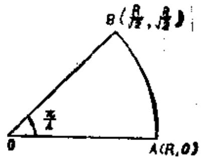 在  $\widehat{AB}$  上设  $z = Re^{i\theta}$  ,BO上 图3.9 $z = \frac{1 + i}{\sqrt{2}}x,$于是 $\begin{aligned} \int_{0}^{R}e^{- x^{\prime}}dx + \int_{0}^{\frac{\pi}{4}}e^{- R^{2}(cos2\theta + isin2\theta)}iRe^{- i\theta}d\theta + & \\ + \int_{0}^{R}e^{- x^{\prime}}i \cdot \frac{1 + i}{\sqrt{2}}dx = 0 \end{aligned}$ 而 $\begin{matrix} \left| \int_{0}^{\frac{\pi}{4}}e^{- R^{2}(cos2\theta + isin2\theta)}iRe^{i\theta}d\theta \right| \leq R\int_{0}^{\frac{\pi}{4}}e^{- R^{2}cos2\theta}d\theta \\ = \frac{R}{2}\int_{0}^{\frac{\pi}{2}}e^{- R^{2}sint}dt. \end{matrix}$ 但由于当  $0 < t < \frac{\pi}{2}$  时,  $sint > \frac{2t}{\pi}$  ,故 $\int_{0}^{\frac{\pi}{2}}e^{- R^{2}sint}dt < \int_{0}^{\frac{\pi}{2}}e^{- \frac{3R^{2}}{\pi}t}dt = \frac{\pi}{2R^{2}} - (1 - e^{- R^{2}})$ 因此,在  $R \rightarrow \infty$  时,(30)式中的第一个积分收敛于 $\frac{\sqrt{\pi}}{2}$  ,第二个积分收敛于0,故得 $\frac{\sqrt{\pi}}{2} - \frac{1 + i}{\sqrt{2}}\left\lbrack \int_{0}^{\infty}\cos x^{2}dx - i\int_{0}^{\infty}\sin x^{2}dx \right\rbrack = 0.$ 比较两边的实部,有 $\int_{0}^{\infty}\sin x^{2}dx = \frac{\sqrt{\pi}}{2\sqrt{2}}.$ (9)如设 $x = t^{4}$  ,则 $\int_{0}^{\infty}x^{n}e^{- x^{\frac{1}{4}}}sin(x^{\frac{1}{4}})dx = 4\int_{0}^{\infty}t^{4n + 3}e^{- t}sintdt.$ 设C为例题[17]所示的闭曲线,沿C积分 $z^{4n + 3}e^{(i - 1)z}$  ,则由Cauchy积分定理,有 $\begin{aligned} \int_{0}^{R}x^{4n + 8}e^{(i - 1)x}dx + & \int_{0}^{\frac{\pi}{2}}(Re^{i\theta})^{4n + 8}e^{(i - 1)R(cos\theta + isin\theta)}iRe^{i\theta}d\theta \\ & + \int_{R}^{0}(iy)^{4n + 8}e^{(i - 1)iy}idy = 0. \end{aligned}$ 而 $\left| e^{(i - 1)R(cos\theta + isin\theta)} \right| = e^{- R(cos\theta + isin\theta)} \leq e^{- R},$ 因此,上式第二个积分的绝对值不超过 $\frac{\pi}{2}R^{4n + 4}e^{- R}$  它当  $R \rightarrow \infty$  时收敛于0,故 $\int_{0}^{\infty}x^{4n + 3}e^{(i - 1)x}dx - \int_{0}^{\infty}(iy)^{4n + 3}e^{(i - 1)iy}idy = 0.$ 在第二项中将  $y$  换作  $x$  ,得 $\int_{0}^{\infty}x^{4m + 3}e^{- x}\left( e^{ix} - e^{- ix} \right)dx = 0,$ 亦即 $\int_{0}^{\infty}x^{4n + 3}e^{- x}sinxdx = 0.$ (10)$log(1 - e^{2ix})$在由直线 x=0, $x = \pi$  , y=0,  $y = \lambda$和圆周  $|z| = \delta$,  $|z - \pi| = \delta$所围成的区域 D 上正则(如图)。将这个函数沿 D 的周界 C 积分,则 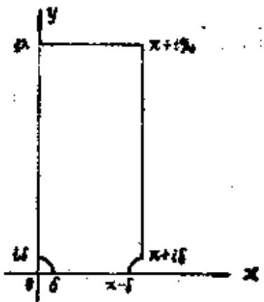 图3.10 $\int_{C_{i}}^{}\log(1 - e^{2iz})dz = \int_{C}^{}\log( - 2ie^{iz}sinz)dz = 0.$ 根据被积函数的周期性,沿虚轴和沿 $x = \pi$  的积分互相抵消,在  $y = \lambda$  上的积分当  $\lambda \rightarrow \infty$  时趋于零,沿圆弧的积分当  $\sigma \rightarrow 0$  时趋于0,结果有 $\int_{0}^{x}\log( - 2ie^{ix}sinx)dx = 0,$ 亦即 $\pi log2 - \frac{\pi^{2}}{2}i + \int_{0}^{\pi}\log sinxdx + \frac{\pi^{2}}{2}i = 0,\}$ 故得到 $\int_{0}^{x}\log sinxdx = - \pi log2.$

   **难度：5/5；出处：** 同事提供《复变函数简明教程_习题导出.xlsx》第101行；导出表无教材书名、原题号及页码，来源待核，原题号同事习题导出表第101行（非教材原题号）；**解答来源：** 同事导出原解析，数学正确性待逐题审核。

   **整理说明：** 原导出知识点标签：一些定积分的计算

<!-- source-exercise:TJX-ch05-15 -->
2. 计算：(1) $\int_{-\infty}^{\infty}(x^2-x+2)/(x^4+10x^2+9)dx$；(2) $\int_0^{\infty}dx/(1+x^n)$，$n\ge3$；(3) $\int_0^{2\pi}d\theta/(2-\sin\theta)$；(4) $\int_0^{2\pi}d\theta/(1-2a\cos\theta+a^2)$，$|a|<1$；(5) $\int_0^{\infty}x\sin(ax)/(a^2+x^2)dx$，$a>0$；(6) $\int_0^{\infty}(\cos x-e^{-x})/x\,dx$；(7) $\int_0^{\infty}\log x/(x^2-1)dx$；(8) $\int_0^{\infty}x^{p-1}\cos x\,dx$，$0<p<1$；(9) $\int_{-\infty}^{\infty}dx/[(x^2+1)(x^2+4)]$；(10) $\int_0^{\infty}x\sin x/(x^2+1)^2dx$。

   **答案：** 十项依次为：(1) $5\pi/12$（分母分解 $(x^2+1)(x^2+9)$，奇部积分为零）；(2) $(\pi/n)\csc(\pi/n)$（Beta 积分）；(3) $2\pi/\sqrt3$；(4) $2\pi/(1-a^2)$（Poisson 核）；(5) $(\pi/2)e^{-a^2}$（对 $\int\cos(ax)/(x^2+a^2)$ 求参）；(6) $0$（Frullani/指数正则化）；(7) $\pi^2/4$（分拆 $0,1,\infty$ 后级数求和）；(8) $\Gamma(p)\cos(\pi p/2)$；(9) $\pi/6$；(10) $\pi/(4e)$。各广义积分按题设范围收敛，第(6)(8)为条件收敛。

   **难度：5/5；出处：** 谭小江、伍胜健《复变函数简明教程》（北京大学出版社，2005），习题五第15题，书页163，PDF页175，原题号习题五第15题；**解答来源：** 本次据主书原题自拟简解；题干已回PDF原页核读。

## 调和函数

**图谱路径：** 复变函数 / 调和函数

**知识内容：** [定义、定理与方法](知识点.md#ca-111)

所给材料中未找到直接对应的独立未解题。

### 调和函数的基本性质

**图谱路径：** 复变函数 / 调和函数 / 调和函数的基本性质

**知识内容：** [定义、定理与方法](知识点.md#ca-112)

所给材料中未找到直接对应的独立未解题。

#### 平均值定理

**图谱路径：** 复变函数 / 调和函数 / 调和函数的基本性质 / 平均值定理

**知识内容：** [定义、定理与方法](知识点.md#ca-113)

<!-- source-exercise:TJX-XLSX-r127 -->
1. 设函数 $f(z)$ 在区域 D 上正则,如果在 D 上 $f(z)$ 不是常数,则 $f(z)$ 的实部与虚部在 D 内的点处不能取得最大值与最小值。

   **答案：** 设 $f(z)$ 的实部与虚部分别为 $u(z)$ , $v(z)$ ,如果设 $u(z)$ 在 D 内的一点 a 处取得最大值。以 a 为圆心充分小的 r 为半径作圆,使它包含在 D 内,则由平均值定理,有 $$u(a)=\frac{1}{2 \pi} \int_{0}^{2 \pi} u\left(a+r e^{i \theta}\right) d \theta.$$
如果 $u(a)=M$ ,则在 $0 \leq\theta \leq2 \pi$ 上, $u(a+r e^{i \theta})$ 等于 M .由于这对所有满足 $0<\rho \leq r$ 的 ρ 均成立,所以在 a 的 r‑近傍内处处有 $u(z)=M$ .作出使 $u(z)=M$ 的全体点的开集合 $S_{1}$ .并且也作出使 $u(z) \neq M$ 的全体点的开集合 $S_{2}$ ,显然 $D=S_{1}+S_{2}$ ,但 $S_{2}$ 必是空集。因此, $f(z)$ 在 D 上是常数,但这和假设矛盾。又如果在 D 内的点处 $u(z)$ 取得最小值,那么 $-u(z)$ 在该点取得最大值,这是不可能的。所以 $u(z)$ 在 D 内既不能取最大值也不能取最小值。对于 $v(z)$ 也同样证明。

   **难度：3/5；出处：** 同事提供《复变函数简明教程_习题导出.xlsx》第127行；导出表无教材书名、原题号及页码，来源待核，原题号同事习题导出表第127行（非教材原题号）；**解答来源：** 同事导出原解析，数学正确性待逐题审核。

   **整理说明：** 原导出知识点标签：调和函数的基本性质

#### 最大、最小值原理

**图谱路径：** 复变函数 / 调和函数 / 调和函数的基本性质 / 最大、最小值原理

**知识内容：** [定义、定理与方法](知识点.md#ca-114)

<!-- source-exercise:TJX-ch06-8 -->
1. 设 $u$ 在全平面调和且非常数，证明 $u$ 在全平面既无上界也无下界。

   **答案：** 因 $\mathbb C$ 单连通，存在整函数 $F$ 使 $\operatorname{Re}F=u$。若 $u$ 有上界，$e^F$ 是有界整函数，由 Liouville 定理为常数，故 $u$ 常数，矛盾。若有下界，对 $-u$ 同理。

   **难度：3/5；出处：** 谭小江、伍胜健《复变函数简明教程》（北京大学出版社，2005），习题六第8题，书页170，PDF页182，原题号习题六第8题；**解答来源：** 本次据主书原题自拟简解；题干已回PDF原页核读。

<!-- source-exercise:TJX-ch06-9 -->
2. 设 $u$ 在区域 $D$ 调和，等值集 $\{z\in D:u(z)=c\}$ 是 $D$ 内一条简单闭曲线。证明 $D$ 不是单连通的。

   **答案：** 若 $D$ 单连通，闭曲线围成的有界 Jordan 内部也在 $D$ 中。$u=c$ 于其边界，由调和最大/最小值原理 $u=c$ 于内部，再由调和函数唯一性在 $D$ 恒为 $c$，此时等值集是整个 $D$，与其恰为一条曲线矛盾。

   **难度：3/5；出处：** 谭小江、伍胜健《复变函数简明教程》（北京大学出版社，2005），习题六第9题，书页170，PDF页182，原题号习题六第9题；**解答来源：** 本次据主书原题自拟简解；题干已回PDF原页核读。

<!-- source-exercise:TJX-ch06-13 -->
3. 称区域 $D$ 内实函数 $u$ 满足次平均值性质，若任意 $z_0\in D$ 附近小圆均有 $u(z_0)\le(2\pi)^{-1}\int_0^{2\pi}v(z_0+re^{it})dt$（原书所印）。证明这样的 $u$ 满足最大值原理。

   **答案：** 原书积分中 $v$ 未定义，应改成 $u$；即便如此，若只要求‘实函数’而不要求上半连续，强最大值原理仍不成立。反例：在连通盘 $D$ 内令 $u(p)=-1$ 于一点 $p$，其余点 $u=0$；每个圆平均均为0，满足 $u(z_0)\le$ 圆平均，但 $u$ 在众多内点取最大0且不恒定。补充上半连续性（标准次调和函数定义）后，强最大值原理才成立。

   **难度：3/5；出处：** 谭小江、伍胜健《复变函数简明教程》（北京大学出版社，2005），习题六第13题，书页171，PDF页183，原题号习题六第13题；**解答来源：** 本次据主书原题自拟简解；题干已回PDF原页核读。

   **待核状态：** 原书积分函数 v 未定义；即改成 u，若不加上半连续条件仍有反例

   **勘误：** 原书积分函数 v 未定义；即改成 u，若不加上半连续条件仍有反例

<!-- source-exercise:CA-TRAIN-023 -->
4. 求 $u(x,y)=x^2-y^2$ 在闭单位圆盘上的最大值与最小值，并指出是否在盘内取得。

   **答案：** $u(r,\theta)=r^2\cos2\theta$，最大值 $1$ 在边界 $\theta=0,\pi$ 取得，最小值 $-1$ 在边界 $\theta=\pi/2,3\pi/2$ 取得；内点不取极值，符合调和函数最大最小值原理。

   **难度：2/5；出处：** 本项目根据所附教材知识点自拟训练题；非教材原题，书页及PDF页不适用，原题号本项目自拟训练题23；**解答来源：** 本次自拟简解，已按相关定理核算。

   **整理说明：** 教学训练题，不计原书独立习题数

### 圆盘上的Dirichlet问题

**图谱路径：** 复变函数 / 调和函数 / 圆盘上的Dirichlet问题

**知识内容：** [定义、定理与方法](知识点.md#ca-115)

所给材料中未找到直接对应的独立未解题。

#### Poisson公式

**图谱路径：** 复变函数 / 调和函数 / 圆盘上的Dirichlet问题 / Poisson公式

**知识内容：** [定义、定理与方法](知识点.md#ca-116)

<!-- source-exercise:TJX-XLSX-r124 -->
1. 设 $f(z)$ 在 $|z|<1$ 上正则,如果$|\Re f(z)| \leq1$ ,则
 $$|\Re\{f(z)-f(0)\}| \leq \frac{4}{\pi} \arcsin |z|,$$
 $$|\Im\{f(z)-f(0)\}| \leq \frac{2}{\pi} \log \frac{1+|z|}{1-|z|} .$$

   **答案：** 如设 $\rho<1$ , $z=r e^{i \theta}$,则由Cauchy积分公式,有 $$f(z)=\frac{1}{2 \pi i} \int_{|\zeta|=\rho} \frac{f(\zeta)}{\zeta-z} d \zeta=\frac{1}{2 \pi} \int_{0}^{2 \pi} f\left(\rho e^{i \varphi}\right) \frac{\rho e^{i \varphi}}{\rho e^{i \varphi}-r e^{i \theta}} d \varphi$$
由泊松核的性质,
 $$0=\frac{1}{2 \pi i} \int_{|\zeta|=\rho} \frac{f(\zeta)}{\zeta-\frac{\rho^{2}}{\overline{z}}} d \zeta=\frac{1}{2 \pi} \int_{0}^{2 \pi} f\left(\rho e^{i \varphi}\right) \frac{r e^{i \theta}}{r e^{i \theta}-\rho e^{i \varphi}} d \varphi$$
两式做加减得到实部虚部的泊松积分表达式。
 $$u\left(r e^{i \theta}\right)-u(0)=\frac{1}{\pi} \int_{0}^{2 \pi} u\left(\rho e^{i \varphi}\right) \frac{\rho r \cos (\varphi-\theta)-r^{2}}{\rho^{2}-2 \rho r \cos (\varphi-\theta)+r^{2}} d \varphi$$
 $$v\left(r e^{i \theta}\right)-v(0)=\frac{1}{\pi} \int_{0}^{2 \pi} u\left(\rho e^{i \varphi}\right) \frac{\rho r \sin (\theta-\varphi)}{\rho^{2}-2 \rho r \cos (\varphi-\theta)+r^{2}} d \varphi$$
在 $| u(\rho e^{i \varphi}) | \leq1$ 的条件下取使积分取到极值的边界函数,积分计算后令 $\rho \to1$ 就得到所需的不等式。

   **难度：5/5；出处：** 同事提供《复变函数简明教程_习题导出.xlsx》第124行；导出表无教材书名、原题号及页码，来源待核，原题号同事习题导出表第124行（非教材原题号）；**解答来源：** 同事导出原解析，数学正确性待逐题审核。

   **整理说明：** 原导出知识点标签：圆盘上的Dirichlet问题

<!-- source-exercise:TJX-ch06-4 -->
2. 证明 §6.2 定理2：若 $u$ 在 $|z|<R$ 调和并在 $|z|\le R$ 连续，则对 $|z|<R$ 有 $u(z)=\frac1{2\pi}\int_0^{2\pi}\frac{R^2-|z|^2}{|Re^{it}-z|^2}u(Re^{it})dt$。

   **答案：** 任取 $\rho<R$ 且 $|z|<\rho$，$u$ 在闭圆 $|\zeta|\le\rho$ 的邻域调和，由书中 §6.2 定理1 的 Poisson 公式有半径 $\rho$ 的表达式。令 $\rho\uparrow R$；$u$ 在闭盘一致连续，分母对固定内点 $z$ 远离零，核和边界值一致收敛，故可在积分下取极限得到半径 $R$ 的式子。

   **难度：3/5；出处：** 谭小江、伍胜健《复变函数简明教程》（北京大学出版社，2005），习题六第4题，书页170，PDF页182，原题号习题六第4题；**解答来源：** 本次据主书原题自拟简解；题干已回PDF原页核读。

<!-- source-exercise:TJX-ch06-14 -->
3. 写出圆盘 $|z-a|<R$ 上的 Poisson 公式。

   **答案：** 若 $u$ 在圆盘调和、闭盘连续，则 $u(a+re^{i\theta})=\frac1{2\pi}\int_0^{2\pi}\frac{R^2-r^2}{R^2-2Rr\cos(\theta-t)+r^2}\,u(a+Re^{it})dt$，$0\le r<R$。由平移 $w=z-a$ 把 §6.2 的圆心零公式直接移来。

   **难度：2/5；出处：** 谭小江、伍胜健《复变函数简明教程》（北京大学出版社，2005），习题六第14题，书页171，PDF页183，原题号习题六第14题；**解答来源：** 本次据主书原题自拟简解；题干已回PDF原页核读。

<!-- source-exercise:CA-TRAIN-004 -->
4. 设 $u(re^{i\theta})=r^2\cos2\theta$。验证 $u$ 调和，并指出它在单位圆上的边界值和相应 Poisson 积分。

   **答案：** $u(x,y)=x^2-y^2$，故 $\Delta u=2-2=0$；边界值是 $\cos2\theta$。Poisson 积分把 Fourier 模 $\cos2\theta$ 延拓为 $r^2\cos2\theta$，由唯一性确证。

   **难度：3/5；出处：** 本项目根据所附教材知识点自拟训练题；非教材原题，书页及PDF页不适用，原题号本项目自拟训练题4；**解答来源：** 本次自拟简解，已按相关定理核算。

   **整理说明：** 教学训练题，不计原书独立习题数

#### Poisson积分

**图谱路径：** 复变函数 / 调和函数 / 圆盘上的Dirichlet问题 / Poisson积分

**知识内容：** [定义、定理与方法](知识点.md#ca-117)

<!-- source-exercise:TJX-ch06-11 -->
1. 设 $u$ 是单位盘内正的调和函数，$u(0)=1$。证明 $1/3\le u(1/2)\le3$，并举例表明常数最佳。

   **答案：** Harnack 不等式 $(1-r)/(1+r)\,u(0)\le u(z)\le(1+r)/(1-r)\,u(0)$，取 $r=1/2$ 得界。Poisson 核 $u_+(z)=\operatorname{Re}[(1+z)/(1-z)]$ 在 $z=1/2$ 取3；$u_-(z)=\operatorname{Re}[(1-z)/(1+z)]$ 取1/3，故最佳。

   **难度：3/5；出处：** 谭小江、伍胜健《复变函数简明教程》（北京大学出版社，2005），习题六第11题，书页171，PDF页183，原题号习题六第11题；**解答来源：** 本次据主书原题自拟简解；题干已回PDF原页核读。

<!-- source-exercise:TJX-ch06-16 -->
2. 设单位圆边界数据 $h(\theta)=1$ 于 $\theta_1\le\theta\le\theta_2$，其余角度为0（$0\le\theta_1<\theta_2\le2\pi$）。试解单位盘 Dirichlet 问题。

   **答案：** 盘内取 Poisson 积分 $u(re^{i\varphi})=\frac1{2\pi}\int_{\theta_1}^{\theta_2}\frac{1-r^2}{1-2r\cos(\varphi-t)+r^2}dt$，它调和；在边界连续点径向趋于给定的0或1，在跳点 $\theta_1,\theta_2$ 趋于 $1/2$。因此若‘解’要求在闭盘连续并逐点取原始阶跃值，则不存在这样的解；上式是分段连续边值的广义 Poisson 解。

   **难度：4/5；出处：** 谭小江、伍胜健《复变函数简明教程》（北京大学出版社，2005），习题六第16题，书页171，PDF页183，原题号习题六第16题；**解答来源：** 本次据主书原题自拟简解；题干已回PDF原页核读。

   **待核状态：** 阶跃边值在跳点不可能由闭盘连续调和函数逐点满足

   **勘误：** 阶跃边值在跳点不可能由闭盘连续调和函数逐点满足

<!-- source-exercise:CONWAY-ch10-s02-1 -->
3. 设 $f$ 在闭单位盘连续，且其实部、虚部在开盘调和。(1) 写出 $f$ 的 Poisson 积分表达式；(2) 证明 $f$ 在盘内解析当且仅当所有 $n\ge1$ 满足 $\int_{-\pi}^{\pi}f(e^{it})e^{int}dt=0$。

   **答案：** (1) 对实部和虚部分别用 Poisson 公式，合成 $f(re^{i\theta})=(2\pi)^{-1}\int_{-\pi}^{\pi}f(e^{it})P_r(\theta-t)dt$。(2) Poisson 核的 Fourier 展开含正负频率；解析性等价于局部展开只有 $z^n$ 而无 $\bar z^n$，即边界数据所有负频系数（按本题符号为 $\int f(e^{it})e^{int}dt$）消失。

   **难度：4/5；出处：** John B. Conway, Functions of One Complex Variable, 2nd ed., Springer-Verlag，Chapter 10 §2 Exercises 1，书页262，PDF页275，原题号Chapter 10 §2 Exercises 1；**解答来源：** 本次据参考书原题自拟简解；题干已回PDF原页核读。

<!-- source-exercise:CA-TRAIN-004 -->
4. 设 $u(re^{i\theta})=r^2\cos2\theta$。验证 $u$ 调和，并指出它在单位圆上的边界值和相应 Poisson 积分。

   **答案：** $u(x,y)=x^2-y^2$，故 $\Delta u=2-2=0$；边界值是 $\cos2\theta$。Poisson 积分把 Fourier 模 $\cos2\theta$ 延拓为 $r^2\cos2\theta$，由唯一性确证。

   **难度：3/5；出处：** 本项目根据所附教材知识点自拟训练题；非教材原题，书页及PDF页不适用，原题号本项目自拟训练题4；**解答来源：** 本次自拟简解，已按相关定理核算。

   **整理说明：** 教学训练题，不计原书独立习题数

## 解析开拓

**图谱路径：** 复变函数 / 解析开拓

**知识内容：** [定义、定理与方法](知识点.md#ca-118)

所给材料中未找到直接对应的独立未解题。

### 解析开拓的幂级数方法与单值性定理

**图谱路径：** 复变函数 / 解析开拓 / 解析开拓的幂级数方法与单值性定理

**知识内容：** [定义、定理与方法](知识点.md#ca-119)

所给材料中未找到直接对应的独立未解题。

#### 完全解析函数

**图谱路径：** 复变函数 / 解析开拓 / 解析开拓的幂级数方法与单值性定理 / 完全解析函数

**知识内容：** [定义、定理与方法](知识点.md#ca-120)

<!-- source-exercise:TJX-XLSX-r013 -->
1. 证明幂级数 $\sum_{n=0}^{\infty} z^{2^{n}}$ 以单位圆周作为自然境界。

   **答案：** $f(z)=\sum_{n=0}^{\infty} z^{2^{n}}$ 的收敛半径是1,现设 $z=r e^{2 p i}$ $$f(z)=\sum_{n=0}^{p} z^{2^{n}}+\sum_{n=p+1}^{\infty} z^{2^{n}}=f_{1}(z)+f_{2}(z) .$$
由于 $f_{1}(z)$ 是多项式,当 $r \to 1$ 时,具有有限的极限值、而当 $n \ge p+1$ 时,有
 $$z^{2^{n}}=r^{2^{n}} \cdot e^{2^{n-p} q \pi i}, z^{2^{n}}=r^{2^{n}}$$
于是 $f_{2}(z)=\sum_{n=p+1}^{\infty} r^{2^{n}}.$
因此,$r \to 1$ 时,$f(z) \to \infty$,亦即 $|z|=1$ 上的点 $e^{2 \frac{q}{p}\pi i}$ 是 $f(z)$ 的奇异点。由于点 $e^{2 \frac{q}{p}\pi i}$ 在单位圆周上是稠密分布的,故单位圆周是自然境界。

   **难度：4/5；出处：** 同事提供《复变函数简明教程_习题导出.xlsx》第13行；导出表无教材书名、原题号及页码，来源待核，原题号同事习题导出表第13行（非教材原题号）；**解答来源：** 同事导出原解析，数学正确性待逐题审核。

   **整理说明：** 原导出知识点标签：解析开拓的幂级数方法与单值性定理

<!-- source-exercise:TJX-XLSX-r116 -->
2. 设 $f(z)$ 在单位圆内部 $|z|<1$ 正则有界。设 c 为单位圆内部的一个端点是圆周上一点 $\zeta_{0}$ 的Jordan开曲线。如果沿 $C, z \to \zeta_{0}$ 时, $f(z) \to a$ ,则 z 沿Stolz路趋近于 $\zeta_{0}$ 时,一致地 $f(z) \to a$ .
注意:设一扇形区域全部包含在区域 D 的内部(区域D是由光滑的Jordan闭曲线所围成),其顶点 P 是 D 的境界点,通过扇形区域的内部而到达 P 的曲线称为以 P 为终点的Stolz路.

   **答案：** 不妨设 $\zeta_{0}=1$ .且设 C 关于实轴的对称图形为 $\bar{C}$ ,设 $|f(z)| \leq M$ , $F(z)=f(z) \cdot \overline{f(\overline{z})}$ (i) c 在1的近傍穿过实轴无限多次的情况。考虑以 c 、 $\bar{C}$ 作为境界的集合的充分接近1的分集 D ,在 D 的境界上,有
 $$|F(z)|=|f(z)| \cdot|\overline{f(\overline{z})}| \leq M \varepsilon .$$
故在实轴上 $|F(x)|=|f(x)|^{2}<M \varepsilon$ ,故由上题,在Stolz路上 $z \to 1$ 时,一致地有 $f(z) \to a$ .
 (ii)除(i)以外的情况。由上题,由 C 、 $\bar{C}$ 围成的区域内部 $z \to 1$ 时,一致地 $F(z) \to |a|^2$ .故在实轴上 $f(x) \to a (x \to 1)$ .从而由上题得到所求的结果。
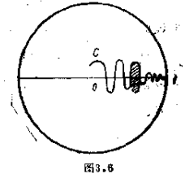

   **难度：5/5；出处：** 同事提供《复变函数简明教程_习题导出.xlsx》第116行；导出表无教材书名、原题号及页码，来源待核，原题号同事习题导出表第116行（非教材原题号）；**解答来源：** 同事导出原解析，数学正确性待逐题审核。

   **整理说明：** 原导出知识点标签：解析开拓

<!-- source-exercise:TJX-XLSX-r117 -->
3. 设 $f(z)$ 在角状区域 $\angle A O B$ 上正则有界,如果在 $A O$ 上 $z \to 0$ 时, $f(z) \to a$ ,则在包含在 $\angle A O B$ 内的任意角状区域$\angle A O B'$ 内, $z \to 0$ 时,一致地 $f(z) \to a$。

   **答案：** 设 $\angle A O B$ 的顶点为 $z=0$ ,并且被正的实轴二等分,且可以设 $a=0$ .由Cauchy‑Riemann关系式, $\overline{f(\overline{z})}$ 在 $\angle A O B$ 上正则有界。因此 $$F(z)=f(z) \cdot \overline{f(\overline{z})}$$
在 $\angle A O B$ 上也正则有界,在 $A O$ 上,有
 $$f(z) \to 0 \quad(z \to 0) .$$
在 $BO$ 上,有
 $$\overline{f(\overline{z})} \to 0 \quad(z \to 0) .$$
因此,在角的边上 $z \to 0$ 时,
 $$F(z) \to 0 .$$
因此,根据Lindelof定理,在角的内部 一致地有
 $$F(z) \to 0 \quad(z \to 0)$$
特别,在实轴OX上,有
 $$F(x)=|f(x)|^{2} \to 0 \quad(x \to 0) .$$
因此由Lindelof定理,在 $\angle A O X$ 内部一致地有
 $$f(z) \to 0 .$$
再绕原点进行适当的旋转,则对 $\angle X O B$ 也可应用上述方法。如此反复进行,有限次后就可达到任意部分区域 $\angle A O B'$。
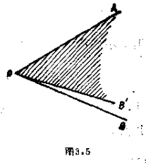

   **难度：4/5；出处：** 同事提供《复变函数简明教程_习题导出.xlsx》第117行；导出表无教材书名、原题号及页码，来源待核，原题号同事习题导出表第117行（非教材原题号）；**解答来源：** 同事导出原解析，数学正确性待逐题审核。

   **整理说明：** 原导出知识点标签：解析开拓

<!-- source-exercise:TJX-XLSX-r118 -->
4. 设 $D=\{z:|\arg z|<\theta_0\}$ 为对称角状区域, $f(z)$ 在 D 上正则有界,在角的边上除 $\infty$ 外连续。如果在 $\arg z=\theta_{0}$ 上, $z \to \infty$ 时, $f(z) \to a$ ,在 $\arg z=-\theta_{0}$ 上, $z \to \infty$ 时, $f(z) \to b$ ,则必有 $a=b$ .并且在 D 的内部 $z \to \infty$ 时,一致地 $f(z) \to a$ (Lindelof定理)。

   **答案：** 对 D 上正则有界的函数 $$\left(f(z)-\frac{1}{2}(a+b)\right)^{2}$$
应用上题的结果,则在 D 上一致地有
 $$\left\{f(z)-\frac{1}{2}(a+b)\right\}^{2} \to \frac{1}{4}(a-b)^{2}(z \to \infty) .$$
因此,对于 $\varepsilon>0$ ,如选取充分大的 $r_{0}(\varepsilon)$ ,在 $|z|=r_{0}(\varepsilon)$ 和D的公共部分上,有
 $$|f(z)-a| \cdot|f(z)-b|=\left|\left(f(z)-\frac{1}{2}(a+b)\right)^{2}-\frac{1}{4}(a-b)^{2}\right|<\varepsilon .$$
因此在这段弧上,
 $$|f(z)-a|<\sqrt{\varepsilon} \quad \text{或者} \quad |f(z)-b|<\sqrt{\varepsilon}$$
至少有一个必须成立,可以认为在 $\theta=\theta_{0}$ 处,$|f(z)-a|<\sqrt{\varepsilon}$,在 $\theta=-\theta_{0}$ 处$|f(z)-b|<\sqrt{\varepsilon}$。由连续性,存在中间点 $z_1$ 两处不等式同时成立,
 $$|a-b| \leq\left|f\left(z_{1}\right)-a\right|+\left|f\left(z_{1}\right)-b\right|<2 \sqrt{\varepsilon} .$$
再设 $\varepsilon\to0$ ,则得 $a=b$ .余下则归结为和前题相同。

   **难度：5/5；出处：** 同事提供《复变函数简明教程_习题导出.xlsx》第118行；导出表无教材书名、原题号及页码，来源待核，原题号同事习题导出表第118行（非教材原题号）；**解答来源：** 同事导出原解析，数学正确性待逐题审核。

   **待核状态：** 上下文已补，原题来源待核

   **整理说明：** 原导出知识点标签：解析开拓；已据相邻第119行和本题边界条件补写对称角域 $|\arg z|<\theta_0$；仍需原始题号核对。

<!-- source-exercise:TJX-XLSX-r119 -->
5. 设函数 $f(z)$ 在角状区域 $D:|\arg z|<\theta_{0}$ 上正则有界, 在境界上除去 $\infty$ 外是连续的。如果在边 $\arg z=\theta_{0}$ 上当 $z \to \infty$ 时, $f(z) \to a$ ,则在 D 的内部,当 $z \to \infty$ 时,一致地 $f(z) \to a$ (Lindelof定理)。

   **答案：** 可设 $a=0$ 而不失一般性,并且可以假定 $\theta_{0}<\frac{\pi}{2}$ (在一般情况下,可作变换 $z=w^{k}$ ).设 $\lambda>0$ ,如取 $$F_{\lambda}(z)=\frac{z}{z+\lambda} f(z)$$
那么 $F_{\lambda}(z)$ 在 D 上正则。设 $z=r e^{i \theta}$ . $|\theta|<\frac{\pi}{2}$ 有
 $$\left|F_{\lambda}\left(r e^{i \theta}\right)\right|=\frac{r}{\sqrt{r^{2}+2 r \lambda \cos \theta+\lambda^{2}}}|f(z)|<\frac{r}{\sqrt{r^{2}+\lambda^{2}}}|f(z)|$$
根据假设,在 D 上, $|f(z)| \leq M$ ,并且在 $\theta= \pm \theta_{0}$ , $r>r_{1}=r_{1}(\varepsilon)$ 上, $|f(z)|<\varepsilon$ .这样如取 $\lambda=\frac{r_{1} M}{\varepsilon}$ ,则在 $|z| \leq r_{1}$ 上,有
 $$|F_{\lambda}(z)|<\frac{|z| M}{\lambda} \leq \varepsilon$$
而在 $|z|>r_{1}$ , $\theta= \pm \theta_{0}$ 上,有
 $$|F_{\lambda}(z)|<|f(z)|<\varepsilon .$$
故由有界无限区域最大模原理,在满足 $|z|>r_{1}$ 的 D 内的点 z 处,有
 $$|F_{\lambda}(z)|<\varepsilon .$$
因此,如果 $|z|>\lambda$ ,则
 $$|f(z)|=\left(1+\frac{\lambda}{|z|}\right)\left|F_{\lambda}(z)\right|<2 \varepsilon .$$
由 $\varepsilon$ 任意,得到在D内 $z\to\infty$ 一致趋于0。

   **难度：4/5；出处：** 同事提供《复变函数简明教程_习题导出.xlsx》第119行；导出表无教材书名、原题号及页码，来源待核，原题号同事习题导出表第119行（非教材原题号）；**解答来源：** 同事导出原解析，数学正确性待逐题审核。

   **整理说明：** 原导出知识点标签：解析开拓

<!-- source-exercise:CA-TRAIN-006 -->
6. 将 $\log z$ 的局部解析分支沿一条绕 $0$ 正向一周的闭路解析开拓，说明终值与初值之差。

   **答案：** 沿闭路有 $\int dz/z=2\pi i$，故终点虽回到同一 $z$，延拓分支的值增加 $2\pi i$。这说明穿孔平面上 $\log z$ 无单值解析分支；可在其对数 Riemann 曲面上单值化。

   **难度：3/5；出处：** 本项目根据所附教材知识点自拟训练题；非教材原题，书页及PDF页不适用，原题号本项目自拟训练题6；**解答来源：** 本次自拟简解，已按相关定理核算。

   **整理说明：** 教学训练题，不计原书独立习题数

#### 自然定义域

**图谱路径：** 复变函数 / 解析开拓 / 解析开拓的幂级数方法与单值性定理 / 自然定义域

**知识内容：** [定义、定理与方法](知识点.md#ca-121)

<!-- source-exercise:TJX-ch07-6 -->
1. 设 $f(z)=\sum_{n\ge0}a_nz^n$ 收敛半径为1，且 $a_n\ge0$。证明 $z=1$ 是奇异点。

   **答案：** 反设 $f$ 在 $1$ 解析并可延拓到其邻域。对 $r<1$，各阶导数 $f^{(k)}(r)$ 是非负项级数；令 $r\uparrow1$，由单调收敛得 $f^{(k)}(1)=\sum_{n\ge k}n(n-1)\cdots(n-k+1)a_n$ 有限。对充分小 $\varepsilon>0$，在 $1+\varepsilon$ 的 Taylor 级数收敛，用非负项交换求和推出 $\sum a_n(1+\varepsilon)^n<\infty$，与半径1矛盾。

   **难度：4/5；出处：** 谭小江、伍胜健《复变函数简明教程》（北京大学出版社，2005），习题七第6题，书页186，PDF页198，原题号习题七第6题；**解答来源：** 本次据主书原题自拟简解；题干已回PDF原页核读。

<!-- source-exercise:TJX-ch07-10 -->
2. 原书写 $f(z)=\sum_{n=0}^{\infty}z^n/(1-z^n)$，要求证明其在单位盘解析且单位圆周是自然边界。核查求和下标。

   **答案：** $n=0$ 项分母 $1-z^0=0$，原式未定义。若改从 $n=1$ 开始，在每个 $|z|\le r<1$ 上有 $|z^n/(1-z^n)|\le r^n/(1-r)$，故局部一致收敛并解析。每个单位根 $\omega$ 的若干项（$n$ 为其阶的倍数）沿半径趋近时同向发散，使它成为奇点；单位根在圆周稠密，故无法穿越任何圆周弧，单位圆是自然边界。

   **难度：4/5；出处：** 谭小江、伍胜健《复变函数简明教程》（北京大学出版社，2005），习题七第10题，书页187，PDF页199，原题号习题七第10题；**解答来源：** 本次据主书原题自拟简解；题干已回PDF原页核读。

   **待核状态：** 原书 n=0 项分母为零，已给 n≥1 修订

   **勘误：** 原书 n=0 项分母为零，已给 n≥1 修订

<!-- source-exercise:CA-TRAIN-031 -->
3. 幂级数 $\sum_{n=0}^\infty z^n$ 的收敛半径为 $1$。单位圆是它的自然边界吗？

   **答案：** 不是。盘内和函数 $1/(1-z)$ 可解析延拓到 $\mathbb C\setminus\{1\}$；单位圆上除 $1$ 外每一点都可穿越。只有 $z=1$ 是该表达式的真正奇点，不能把收敛圆误作自然边界。

   **难度：2/5；出处：** 本项目根据所附教材知识点自拟训练题；非教材原题，书页及PDF页不适用，原题号本项目自拟训练题31；**解答来源：** 本次自拟简解，已按相关定理核算。

   **整理说明：** 教学训练题，不计原书独立习题数

#### 直接解析开拓

**图谱路径：** 复变函数 / 解析开拓 / 解析开拓的幂级数方法与单值性定理 / 直接解析开拓

**知识内容：** [定义、定理与方法](知识点.md#ca-122)

<!-- source-exercise:CA-TRAIN-005 -->
1. 在 $\mathbb C\setminus\{0\}$ 上，函数 $f(z)=1/z$ 是否有全局解析原函数？在去掉负实轴后的割域上如何构造？

   **答案：** 沿单位圆积分 $\oint dz/z=2\pi i\ne0$，故穿孔平面上无全局原函数。在主值割域 $\mathbb C\setminus(-\infty,0]$ 上取 $\operatorname{Log} z=\ln|z|+i\operatorname{Arg} z$，$\operatorname{Arg} z\in(-\pi,\pi)$，其导数为 $1/z$。

   **难度：3/5；出处：** 本项目根据所附教材知识点自拟训练题；非教材原题，书页及PDF页不适用，原题号本项目自拟训练题5；**解答来源：** 本次自拟简解，已按相关定理核算。

   **整理说明：** 教学训练题，不计原书独立习题数

<!-- source-exercise:CA-TRAIN-031 -->
2. 幂级数 $\sum_{n=0}^\infty z^n$ 的收敛半径为 $1$。单位圆是它的自然边界吗？

   **答案：** 不是。盘内和函数 $1/(1-z)$ 可解析延拓到 $\mathbb C\setminus\{1\}$；单位圆上除 $1$ 外每一点都可穿越。只有 $z=1$ 是该表达式的真正奇点，不能把收敛圆误作自然边界。

   **难度：2/5；出处：** 本项目根据所附教材知识点自拟训练题；非教材原题，书页及PDF页不适用，原题号本项目自拟训练题31；**解答来源：** 本次自拟简解，已按相关定理核算。

   **整理说明：** 教学训练题，不计原书独立习题数

#### 单值性定理

**图谱路径：** 复变函数 / 解析开拓 / 解析开拓的幂级数方法与单值性定理 / 单值性定理

**知识内容：** [定义、定理与方法](知识点.md#ca-123)

<!-- source-exercise:TJX-ch07-9 -->
1. 在 $-1<x<1$ 上定义 $f(x)=e^{-1/x^2}$（$x\ne0$），$f(0)=0$。它能否解析开拓到复平面？

   **答案：** 不能。实函数在 $0$ 的所有阶导数均为零；若有包含 $0$ 的复解析延拓，其 Taylor 级数恒零，按唯一性定理在邻域为零，然而 $e^{-1/x^2}>0$ 于 $x\ne0$，矛盾。

   **难度：3/5；出处：** 谭小江、伍胜健《复变函数简明教程》（北京大学出版社，2005），习题七第9题，书页186，PDF页198，原题号习题七第9题；**解答来源：** 本次据主书原题自拟简解；题干已回PDF原页核读。

<!-- source-exercise:CONWAY-ch09-s02-7 -->
2. 设解析元素 $(f_0,D_0)$ 沿路径 $\gamma:[0,1]\to\mathbb C$ 解析开拓为 $(f_t,D_t)$。若存在区域 $G$ 包含所有 $f_t(D_t)$，以及解析函数 $h:G\to\mathbb C$ 满足 $h(f_0(z))=z$ 于 $D_0$，证明 $h(f_t(z))=z$ 对所有 $t$、$z\in D_t$ 成立。

   **答案：** 设 $T$ 为使恒等式在 $D_t$ 成立的参数集。相邻解析元素在重叠圆盘上相等，恒等定理使若一处成立便在邻近参数成立，故 $T$ 开；同样借局部连续拼接得 $T$ 闭。$0\in T$，区间连通，故 $T=[0,1]$。

   **难度：4/5；出处：** John B. Conway, Functions of One Complex Variable, 2nd ed., Springer-Verlag，Chapter 9 §2 Exercises 7，书页217，PDF页230，原题号Chapter 9 §2 Exercises 7；**解答来源：** 本次据参考书原题自拟简解；题干已回PDF原页核读。

<!-- source-exercise:CA-TRAIN-006 -->
3. 将 $\log z$ 的局部解析分支沿一条绕 $0$ 正向一周的闭路解析开拓，说明终值与初值之差。

   **答案：** 沿闭路有 $\int dz/z=2\pi i$，故终点虽回到同一 $z$，延拓分支的值增加 $2\pi i$。这说明穿孔平面上 $\log z$ 无单值解析分支；可在其对数 Riemann 曲面上单值化。

   **难度：3/5；出处：** 本项目根据所附教材知识点自拟训练题；非教材原题，书页及PDF页不适用，原题号本项目自拟训练题6；**解答来源：** 本次自拟简解，已按相关定理核算。

   **整理说明：** 教学训练题，不计原书独立习题数

### 完全解析元素与二元多项式方程

**图谱路径：** 复变函数 / 解析开拓 / 完全解析元素与二元多项式方程

**知识内容：** [定义、定理与方法](知识点.md#ca-124)

所给材料中未找到直接对应的独立未解题。

#### 直接解析开拓

**图谱路径：** 复变函数 / 解析开拓 / 完全解析元素与二元多项式方程 / 直接解析开拓

**知识内容：** [定义、定理与方法](知识点.md#ca-125)

<!-- source-exercise:TJX-ch07-1 -->
1. 设 $a=i$。证明幂级数 $1+az+a^2z^2+\cdots$ 与级数 $\frac1{1-z}-\frac{(1-a)z}{(1-z)^2}+\frac{(1-a)^2z^2}{(1-z)^3}-\cdots$ 定义的函数互为直接解析开拓。

   **答案：** 前者在 $|z|<1$ 和为 $1/(1-az)$。后者令 $t=-(1-a)z/(1-z)$，在 $|t|<1$ 处按几何级数求和，等于 $[1/(1-z)]/[1+(1-a)z/(1-z)]=1/(1-az)$。两收敛域有开交且在交上同值，故互为直接解析开拓。

   **难度：3/5；出处：** 谭小江、伍胜健《复变函数简明教程》（北京大学出版社，2005），习题七第1题，书页185，PDF页197，原题号习题七第1题；**解答来源：** 本次据主书原题自拟简解；题干已回PDF原页核读。

<!-- source-exercise:TJX-ch07-2 -->
2. 幂级数 $\sum_{n=1}^{\infty}z^n/n$ 与 $i\pi+\sum_{n=1}^{\infty}(-1)^n(z-2)^n/n$ 的收敛圆盘没有公共部分。证明它们仍互为解析延拓。

   **答案：** 第一式为 $-\log(1-z)$ 在 $0$ 附近的分支；第二式在 $2$ 附近为 $i\pi-\log(z-1)$。把第一分支沿绕过 $z=1$ 的上半平面路径延拓到 $2$，使 $\arg(1-z)$ 从0连续降到 $-\pi$，终值为 $i\pi$；局部 Taylor 级数即第二式。解析延拓可经中间圆盘进行，不要求起终两个圆盘直接相交。

   **难度：3/5；出处：** 谭小江、伍胜健《复变函数简明教程》（北京大学出版社，2005），习题七第2题，书页186，PDF页198，原题号习题七第2题；**解答来源：** 本次据主书原题自拟简解；题干已回PDF原页核读。

<!-- source-exercise:CA-TRAIN-005 -->
3. 在 $\mathbb C\setminus\{0\}$ 上，函数 $f(z)=1/z$ 是否有全局解析原函数？在去掉负实轴后的割域上如何构造？

   **答案：** 沿单位圆积分 $\oint dz/z=2\pi i\ne0$，故穿孔平面上无全局原函数。在主值割域 $\mathbb C\setminus(-\infty,0]$ 上取 $\operatorname{Log} z=\ln|z|+i\operatorname{Arg} z$，$\operatorname{Arg} z\in(-\pi,\pi)$，其导数为 $1/z$。

   **难度：3/5；出处：** 本项目根据所附教材知识点自拟训练题；非教材原题，书页及PDF页不适用，原题号本项目自拟训练题5；**解答来源：** 本次自拟简解，已按相关定理核算。

   **整理说明：** 教学训练题，不计原书独立习题数

<!-- source-exercise:CA-TRAIN-031 -->
4. 幂级数 $\sum_{n=0}^\infty z^n$ 的收敛半径为 $1$。单位圆是它的自然边界吗？

   **答案：** 不是。盘内和函数 $1/(1-z)$ 可解析延拓到 $\mathbb C\setminus\{1\}$；单位圆上除 $1$ 外每一点都可穿越。只有 $z=1$ 是该表达式的真正奇点，不能把收敛圆误作自然边界。

   **难度：2/5；出处：** 本项目根据所附教材知识点自拟训练题；非教材原题，书页及PDF页不适用，原题号本项目自拟训练题31；**解答来源：** 本次自拟简解，已按相关定理核算。

   **整理说明：** 教学训练题，不计原书独立习题数

#### 完全解析元素

**图谱路径：** 复变函数 / 解析开拓 / 完全解析元素与二元多项式方程 / 完全解析元素

**知识内容：** [定义、定理与方法](知识点.md#ca-126)

<!-- source-exercise:CA-TRAIN-026 -->
1. 对方程 $F(z,w)=w^2-z=0$，分别讨论 $(z,w)=(1,1)$ 与 $(0,0)$ 附近能否把 $w$ 唯一解析表示为 $z$ 的函数。

   **答案：** $F_w=2w$；在 $(1,1)$ 非零，隐函数定理给唯一分支 $w=\sqrt z$ 且 $w(1)=1$。在 $(0,0)$ 导数为零，若存在解析 $w(z)$ 则其零点阶数的两倍为 $z$ 的一阶零点，不可能；此处为分歧点。

   **难度：3/5；出处：** 本项目根据所附教材知识点自拟训练题；非教材原题，书页及PDF页不适用，原题号本项目自拟训练题26；**解答来源：** 本次自拟简解，已按相关定理核算。

   **整理说明：** 教学训练题，不计原书独立习题数

#### 隐函数定理

**图谱路径：** 复变函数 / 解析开拓 / 完全解析元素与二元多项式方程 / 隐函数定理

**知识内容：** [定义、定理与方法](知识点.md#ca-127)

<!-- source-exercise:CA-TRAIN-026 -->
1. 对方程 $F(z,w)=w^2-z=0$，分别讨论 $(z,w)=(1,1)$ 与 $(0,0)$ 附近能否把 $w$ 唯一解析表示为 $z$ 的函数。

   **答案：** $F_w=2w$；在 $(1,1)$ 非零，隐函数定理给唯一分支 $w=\sqrt z$ 且 $w(1)=1$。在 $(0,0)$ 导数为零，若存在解析 $w(z)$ 则其零点阶数的两倍为 $z$ 的一阶零点，不可能；此处为分歧点。

   **难度：3/5；出处：** 本项目根据所附教材知识点自拟训练题；非教材原题，书页及PDF页不适用，原题号本项目自拟训练题26；**解答来源：** 本次自拟简解，已按相关定理核算。

   **整理说明：** 教学训练题，不计原书独立习题数

### 对称原理

**图谱路径：** 复变函数 / 解析开拓 / 对称原理

**知识内容：** [定义、定理与方法](知识点.md#ca-128)

<!-- source-exercise:TJX-XLSX-r011 -->
1. 设 $D_{1}$ 是以实轴上的线段 $\Gamma:a<x<b$,作为部分境界的上半平面内的一个区域,$D_{2}$ 是 $D_{1}$ 关于实轴的对称区域。现设 $f_{1}(z)$,$f_{2}(z)$分别在 $D_{1}$,$D_{2}$ 上正则,并且对于 $\Gamma$ 上的任意点有
 $$\lim_{y\to 0^{+}}\left\{f_{1}(x+i y)-f_{2}(x-i y)\right\}=0(y>0),$$
则 $f_{1}(z)$ 可越过 $\Gamma$ 延拓到 $D_{2}$,在 $D_{2}$ 上和 $f_{2}(z)$ 一致,试证明之。

   **答案：** 如设 $$F(z)=f_{1}(z)+\overline{f_{2}(\overline{z})},$$
则 $F(z)$ 在 $D_1$ 上正则。现设
 $$f_{1}(z)=u_{1}(x, y)+i v_{1}(x, y), f_{2}(z)=u_{2}(x, y)+i v_{2}(x, y),$$
则 $\Im[F(z)]=v_{1}(x, y)-v_{2}(x,-y)=w_{1}(x, y).$
根据假设,对于 $\Gamma$ 上的点,有
 $$\lim _{y \to 0} w_{1}(x, y)=0, y>0 .$$
因此根据镜象原理,$F(z)$ 可以越过 $\Gamma$ 延拓到 $D_{2}$。设 $\varphi(z)$ 是延拓到 $D_{2}$ 的函数,且有
 $$F(z)=f_{1}(z)+\overline{f_{2}(\overline{z})}=\varphi(z), z \in D_{1}. \tag{1}$$
同样,如设
 $$G(z)=i\left[f_{1}(z)-\overline{f_{2}(\overline{z})}\right],$$
 $\Im[G(z)]=u_{1}(x, y)-u_{2}(x,-y)=w_{2}(x, y).$
由假设 $\lim _{y \to 0} w_{2}(x, y)=0, y>0,$
因此,$G(z)$ 也可以越过 $\Gamma$ 延拓到 $D_{2}$。设 $\psi(z)$ 是延拓到 $D_{2}$ 的函数,且有
 $$G(z)=i\left[f_{1}(z)-\overline{f_{2}(\overline{z})}\right]=\psi(z), z \in D_{1} \tag{2}$$
由(1)与(2)有
 $$f_{1}(z)=\frac{\varphi(z)-i \psi(z)}{2}, \tag{3}$$
 $$\overline{f_{2}(\overline{z})}=\frac{\varphi(z)+i \psi(z)}{2}. \tag{4}$$
由于 $\varphi(z)$ , $\psi(z)$ 均在 $D_{1}+D_{2}+\Gamma$ 上正则,故由(3),$f_{1}(z)$ 也在 $D_{1}+D_{2}+\Gamma$ 上正则,亦即 $f_{1}(z)$ 可以延拓到 $D_{2}$,又由于 $\varphi(z)$ , $\psi(z)$ 在 $\Gamma$ 上取实数值,由(4),在 $\Gamma$ 上 $f_{1}(z)=f_{2}(z)$ . 因此,$f_{1}(z)$ 的延拓在 $D_{2}$ 上与 $f_{2}(z)$ 一致。

   **难度：5/5；出处：** 同事提供《复变函数简明教程_习题导出.xlsx》第11行；导出表无教材书名、原题号及页码，来源待核，原题号同事习题导出表第11行（非教材原题号）；**解答来源：** 同事导出原解析，数学正确性待逐题审核。

   **整理说明：** 原导出知识点标签：对称原理

<!-- source-exercise:TJX-XLSX-r045 -->
2. 设$f(z)$是区域$D$上的正则函数,$\alpha$是含于$D$的境界上的解析曲线。当$z\to \alpha$时,如果$\Re f(z),\Im f(z),|f(z)-\gamma|$($\gamma$:常数)中的任何一个在$\alpha$的所有点上恒取一定值,则$f(z)$在$\alpha$上正则。

   **答案：** 如果设$z=\varphi(\zeta)$是$\zeta$平面的实轴上的某线段$[\xi_1,\xi_2]$上的正则函数,那么由于$\alpha$是解析曲线,故可设$\alpha$是线段$[\xi_1,\xi_2]$的像(由映射$z=\varphi(\zeta)$而成的像),首先在$\lim\limits_{z\to\alpha}\Re f(z)=b$的情况下,$f[\varphi(\zeta)]-ib$在$[\xi_1,\xi_2]$近傍的半平面上正则,并且在$[\xi_1,\xi_2]$上具有实的境界值,故由镜像原理,$f[\varphi(\zeta)]-ib$在$[\xi_1,\xi_2]$上正则,因此$f(z)$在$\alpha$上正则。在$\lim\limits_{z\to\alpha}\Im f(z)=a$的情况下也同样证明。
最后在$\lim\limits_{z\to\alpha}|f(z)-\gamma|=c$的情况下,可设$\gamma=0$。如果$c=0$,则可归结为第一种情况。如果$c\neq0$,则$\log f(z)$在接近于$\alpha$的$D$的点上正则,由于$\log|f(z)|=\Re\log f(z)$,故由上述第二种情况,$\log f(z)$在$\alpha$上正则,从而$f(z)$在$\alpha$上正则。

   **难度：4/5；出处：** 同事提供《复变函数简明教程_习题导出.xlsx》第45行；导出表无教材书名、原题号及页码，来源待核，原题号同事习题导出表第45行（非教材原题号）；**解答来源：** 同事导出原解析，数学正确性待逐题审核。

   **整理说明：** 原导出知识点标签：对称原理

<!-- source-exercise:TJX-ch08-3 -->
3. 设整函数 $f$ 把实轴映为实轴、虚轴映为虚轴。证明 $f$ 是奇函数。

   **答案：** 实轴条件与 Schwarz 反射给 $f(\bar z)=\overline{f(z)}$；虚轴条件对 $-\overline{f(-\bar z)}$ 给同样解析延拓，从而 $f(-z)=-f(z)$。也可展开 $f(z)=\sum a_nz^n$：实轴条件使 $a_n\in\mathbb R$，虚轴条件令偶次系数为零。

   **难度：3/5；出处：** 谭小江、伍胜健《复变函数简明教程》（北京大学出版社，2005），习题八第3题，书页207，PDF页219，原题号习题八第3题；**解答来源：** 本次据主书原题自拟简解；题干已回PDF原页核读。

<!-- source-exercise:TJX-ch07-7 -->
4. 设 $f$ 在单位盘解析，连续延拓到一段边界弧 $\gamma\subset\partial\mathbb D$，且 $f$ 非常数。证明 $f(\gamma)$ 不可能是单点集。

   **答案：** 若整段弧上 $f=c$，则 $g=f-c$ 连续到弧且边界值0。通过局部共形坐标把弧化为实线段，再按 Schwarz 反射原理以零值反射，得跨弧的解析延拓；延拓在一段线上的零点有聚点，恒等定理迫使 $g\equiv0$，矛盾。

   **难度：3/5；出处：** 谭小江、伍胜健《复变函数简明教程》（北京大学出版社，2005），习题七第7题，书页186，PDF页198，原题号习题七第7题；**解答来源：** 本次据主书原题自拟简解；题干已回PDF原页核读。

<!-- source-exercise:TJX-ch07-12 -->
5. 设 $f$ 是全平面 $\mathbb C$ 上的亚纯函数，存在两个圆周 $K,K'$ 使 $f(K)\subset K'$。证明 $f$ 是有理函数。

   **答案：** 以两个 Möbius 变换分别把 $K,K'$ 化为单位圆，得到亚纯函数 $F$ 在单位圆上模为1。反射式 $F(z)=1/\overline{F(1/\bar z)}$ 使外盘函数由内盘函数确定；内盘闭包仅有有限零极点，反射后全平面（含无穷远）仅有有限零极点且在无穷远亚纯。故 $F$ 是球面亚纯函数，即有理函数；Möbius 复合后 $f$ 仍有理。

   **难度：4/5；出处：** 谭小江、伍胜健《复变函数简明教程》（北京大学出版社，2005），习题七第12题，书页187，PDF页199，原题号习题七第12题；**解答来源：** 本次据主书原题自拟简解；题干已回PDF原页核读。

## 共形映射

**图谱路径：** 复变函数 / 共形映射

**知识内容：** [定义、定理与方法](知识点.md#ca-129)

所给材料中未找到直接对应的独立未解题。

### 共形映射的性质

**图谱路径：** 复变函数 / 共形映射 / 共形映射的性质

**知识内容：** [定义、定理与方法](知识点.md#ca-130)

所给材料中未找到直接对应的独立未解题。

#### 共形（保形）映射

**图谱路径：** 复变函数 / 共形映射 / 共形映射的性质 / 共形（保形）映射

**知识内容：** [定义、定理与方法](知识点.md#ca-131)

<!-- source-exercise:TJX-XLSX-r006 -->
1. 单位圆内正则单叶的函数
 $$
 w=f(z)=z+\sum_{n=2}^{\infty} a_n z^n
 $$
如果将 $|z|<1$ 映射为关于 $w=0$ 的星型区域,则证明 $|a_n|\le n$。

   **答案：** 令 $g(z)=\dfrac{z f'(z)}{f(z)}$,在 $|z|<1$ 上正则,由第3题 $\Re\{g(z)\}\ge 0$,可写 $$
 g(z)=1+\sum_{n=1}^{\infty} b_n z^n.
 $$
由练习题三的第27题,$|b_n|\le 2$。
 $$
 \begin{aligned}
 \sum_{n=1}^{\infty} n a_n z^n
 &=z f'(z)=\frac{z f'(z)}{f(z)}\cdot f(z)\\
 &=\left(1+\sum_{n=1}^{\infty}b_n z^n\right)\left(z+\sum_{n=2}^{\infty}a_n z^n\right)
 =\sum_{n=1}^{\infty} c_n z^n,
 \end{aligned}
 $$
则 $c_n = a_n + b_1 a_{n-1}+\cdots+b_{n-1}$。
 $$
 (n-1)|a_n|=\big|b_1 a_{n-1}+\cdots+b_{n-1}\big|
 \le 2\big(|a_{n-1}|+\cdots+|a_2|+1\big).
 $$
 $n=2$ 时,$|a_2|\le 2$;$n=3$ 时,$2|a_3|\le 2(1+|a_2|)\le 6$,$|a_3|\le 3$。
归纳假设 $n=2,3,\dots,m$ 成立 $|a_n|\le n$,则 $n=m+1$:
 $$
 m|a_{m+1}|\le 2(1+2+\cdots+m)=m(m+1)\implies |a_{m+1}|\le m+1.
 $$
由数学归纳法对一切 $n\ge2$,$|a_n|\le n$。
该界是最优,例子 $f(z)=\dfrac{z}{(1-z)^2}=z+2z^2+3z^3+\cdots$,$a_n=n$,是星形函数。

   **难度：4/5；出处：** 同事提供《复变函数简明教程_习题导出.xlsx》第6行；导出表无教材书名、原题号及页码，来源待核，原题号同事习题导出表第6行（非教材原题号）；**解答来源：** 同事导出原解析，数学正确性待逐题审核。

   **整理说明：** 原导出知识点标签：共形（保形）映射

<!-- source-exercise:TJX-XLSX-r007 -->
2. 设 $w=f(z)$ 在 $|z|<1$ 上正则,$|f(z)|\le 1$,$f(0)=0$,$|f'(0)|=a$,证明这个函数将圆域
 $$
 |z|<\frac{a}{1+\sqrt{1-a^2}}=\rho
 $$
映射为关于 $w=0$ 的星型区域。

   **答案：** $\varphi(z)=\dfrac{f(z)}{z}$ 在 $|z|<1$ 上正则,$|\varphi(z)|\le 1,\;|\varphi(0)|=a$,故由第五章例题[9], $$
 |\varphi(z)|\ge \frac{a-|z|}{1-a|z|}.
 $$
又由第五章例题[7],
 $$
 |\varphi'(z)|\le \frac{1-|\varphi(z)|^2}{1-|z|^2}.
 $$
代入得
 $$
 |\varphi'(z)|\le \frac{1-\left(\frac{a-|z|}{1-a|z|}\right)^2}{1-|z|^2}
 =\frac{1-a^2}{(1-a|z|)^2},
 $$
故
 $$
 \left|\frac{z\varphi'(z)}{\varphi(z)}\right|
 \le \frac{|z|(1-a^2)}{|a-|z||\cdot(1-a|z|)}.
 $$
当 $|z|<\dfrac{a}{1+\sqrt{1-a^2}}$ 时,
 $$
 \frac{|z|(1-a^2)}{(a-|z|)(1-a|z|)}<1,
 $$
这时
 $$
 \left|\frac{z\varphi'(z)}{\varphi(z)}\right|<1,
 $$
因此
 $$
 \Re\left\{\frac{z\varphi'(z)}{\varphi(z)}\right\}>-1,
 $$
改写即得
 $$
 \Re\left\{\frac{z f'(z)}{f(z)}\right\}>0.
 $$
故由上题,$f(z)$ 将 $|z|<\dfrac{a}{1+\sqrt{1-a^2}}$ 保角映射为关于原点的星型区域。

   **难度：4/5；出处：** 同事提供《复变函数简明教程_习题导出.xlsx》第7行；导出表无教材书名、原题号及页码，来源待核，原题号同事习题导出表第7行（非教材原题号）；**解答来源：** 同事导出原解析，数学正确性待逐题审核。

   **整理说明：** 原导出知识点标签：共形（保形）映射

<!-- source-exercise:TJX-XLSX-r008 -->
3. 应用练习题五的第8题,证明在单位圆内正则单叶的函数 $w=f(z)\,(f(0)=0)$ 将 $|z|<1$ 映射为关于 $w=0$ 的星型区域的必要充分条件是
 $$
 \Re\left\{\frac{z f'(z)}{f(z)}\right\}\ge 0,\quad |z|<1.
 $$

   **答案：** 如果 $w=f(z)$ 将 $|z|<1$ 保角映射为关于 $w=0$ 的星型区域,则由练习题五的习题8,对于一切 $r\,(r<1)$,$|z|<r$ 由映射 $f(z)$ 的像是关于 $w=0$ 的星型区域。故点 $z=re^{i\theta}$ 沿 $|z|=r$ 的正方向旋转时,其像点 $w=f(re^{i\theta})=Re^{i\varphi}$ 恒以正方向运动,因此 $$
 \frac{\partial \varphi}{\partial \theta}\ge 0.
 $$
反之,如果满足这个条件,显然像区域关于原点是星型的。而由Cauchy‑Riemann关系式,有
 $$
 \frac{\partial \varphi}{\partial \theta}=-\frac{\partial \log R}{\partial \log r}
 =\Re\left\{\frac{d\log f(z)}{d\log z}\right\}
 =\Re\left\{\frac{z f'(z)}{f(z)}\right\}.
 $$
所以条件等价于
 $$
 \Re\left\{\frac{z f'(z)}{f(z)}\right\}\ge 0.
 $$

   **难度：4/5；出处：** 同事提供《复变函数简明教程_习题导出.xlsx》第8行；导出表无教材书名、原题号及页码，来源待核，原题号同事习题导出表第8行（非教材原题号）；**解答来源：** 同事导出原解析，数学正确性待逐题审核。

   **整理说明：** 原导出知识点标签：共形（保形）映射

<!-- source-exercise:TJX-XLSX-r009 -->
4. 如果 $f(z)$ 在 $|z|<1$ 上是正则单叶的,并且 $f(0)=0$,$f'(0)=1$,则
 $$
 \frac{-4}{1-|z|^2}\le \frac{d}{d|z|}\arg f'(z)\le \frac{4}{1-|z|^2},
 $$
同时有 $|\arg f'(z)|\le 2\log\frac{1+|z|}{1-|z|}$(Bieberbach旋转定理)。

   **答案：** 一次变换 $$
 z=\frac{w+\zeta}{1+\overline{\zeta}w}\;(|\zeta|<1)
 $$
将 $|z|<1$ 一一对应地保角映射为 $|w|<1$,由于 $f(z)$ 在 $|z|<1$ 上是正则单叶的,故 $f\!\left(\frac{w+\zeta}{1+\overline{\zeta}w}\right)$ 在 $|w|<1$ 上是正则单叶的。进而设
 $$
 g(w)=\frac{f\!\left(\frac{w+\zeta}{1+\overline{\zeta}w}\right)-f(\zeta)}{f'(\zeta)(1-|\zeta|^2)},
 $$
则 $g(w)$ 在 $|w|<1$ 上正则单叶,$g(0)=0,\,g'(0)=1$。故由定理2,有
 $$
 \left|\frac{g''(0)}{2}\right|=\frac12\left|\frac{f''(\zeta)(1-|\zeta|^2)}{f'(\zeta)}-2\overline{\zeta}\right|\le 2.
 $$
如以 $z$ 代换 $\zeta$ 并且变形,即得
 $$
 \left|\frac{z f''(z)}{f'(z)}-\frac{2|z|^2}{1-|z|^2}\right|\le \frac{4|z|}{1-|z|^2},
 $$
这表示点 $\dfrac{z f''(z)}{f'(z)}$ 在圆心为 $\dfrac{2|z|^2}{1-|z|^2}$ 半径为 $\dfrac{4|z|}{1-|z|^2}$ 的圆内,从而
 $$
 \frac{-4|z|}{1-|z|^2}\le \Im\left\{\frac{z f''(z)}{f'(z)}\right\}\le \frac{4|z|}{1-|z|^2}.
 $$
而
 $$
 \frac{z f''(z)}{f'(z)}=\frac{d\log f'(z)}{d\log z}
 =\frac{d\log|f'(z)|+d\arg f'(z)}{d\log|z|},
 $$
故
 $$
 \Im\left\{\frac{z f''(z)}{f'(z)}\right\}=|z|\cdot\frac{d\arg f'(z)}{d|z|}.
 $$
所以
 $$
 -\frac{4}{1-|z|^2}\le \frac{d\arg f'(z)}{d|z|}\le \frac{4}{1-|z|^2}.
 $$
如果将它从 $0$ 到 $|z|$ 积分,得
 $$
 |\arg f'(z)|\le 2\log\frac{1+|z|}{1-|z|}.
 $$

   **难度：5/5；出处：** 同事提供《复变函数简明教程_习题导出.xlsx》第9行；导出表无教材书名、原题号及页码，来源待核，原题号同事习题导出表第9行（非教材原题号）；**解答来源：** 同事导出原解析，数学正确性待逐题审核。

   **整理说明：** 原导出知识点标签：共形（保形）映射

<!-- source-exercise:TJX-XLSX-r020 -->
5. 设 $D$ 是有限重连通的Jordan区域,其一部分境界是弧 $\alpha$,$\alpha$ 以外的境界是 $\beta$。$\omega(z, \alpha, D)$ 在 $D$ 上调和并且有界,在弧 $\alpha$ 的内点处等于1,在 $\beta$ 的内点处等于0的调和函数。我们称这个函数是区域 $D$ 的关于弧 $\alpha$ 的调和测度。证明调和测度关于 $D$ 的保角映射是不变的。

   **答案：** 设  $w = f(z)$  是将  $D$  保角映射为  $\Delta$  的函数,  $f(z)$  在  $D$  的境界上连续,并设这个映射分别把弧  $\alpha$  和  $\beta$  映射为  $\Delta$  的境界上的弧  $\alpha^{\prime}$  和  $\beta^{\prime}$  ,  $\Delta$  的关于  $\alpha^{\prime}$  的调和测度设为  $\omega(w,a^{\prime},\Delta)$  ,由于保角映射中调和性是不变的,故  $\omega(f(z),a^{\prime},\Delta) = u(z)$  在  $D$  上是调和的。又显然可知在  $\alpha$  上  $u(z) = 1$  ,在  $\beta$  上,  $U(z) = 0$  。再考虑  $u(z) - \omega(z,\alpha,D)$  ,这个函数在  $\alpha$  和  $\beta$  的内点处为 0,在 $D$  上是有界的,故由例题①,有$u(z) - \omega(z,\alpha,D) \equiv 0,z \in D,$
即  $\omega(w,a^{\prime},\Delta) = u(z) = \omega(z,\alpha,D)$

   **难度：3/5；出处：** 同事提供《复变函数简明教程_习题导出.xlsx》第20行；导出表无教材书名、原题号及页码，来源待核，原题号同事习题导出表第20行（非教材原题号）；**解答来源：** 同事导出原解析，数学正确性待逐题审核。

   **整理说明：** 原导出知识点标签：共形映射

<!-- source-exercise:TJX-XLSX-r024 -->
6. 设区域 $D$ 可保角映射为区域 $\Delta$,则在 $D$ 上的次(超)调和函数在 $\Delta$ 上也是次(超)调和函数。

   **答案：** 设  $u(z)$  在区域  $D$  上是次调和函数,将区域  $\Delta$  保角映射为  $D$  的函数为  $z = f(w)$  。现设  $u(z) = u\lbrack f(w)\rbrack - U(w)$  ,  $w_{0}$  是  $\Delta$  的任意一点,  $C_{r}$  是以  $w_{0}$  为圆心  $r$  为半径的圆。由映射  $z = f(w)$  ,  $C_{r}$ $①\text{原文是}^{u}f\left\lbrack \frac{1}{2\pi}\int_{0}^{2\pi}u(z_{0} + re^{i\theta})d\theta \right\rbrack \leq \frac{1}{2\pi}\int_{0}^{2\pi}f(z_{0} + re^{i\theta})d\theta^{\prime\prime}.$
 ——译者注
$\begin{aligned} \text{原文是}^{\alpha}v(z_{0}) & \leq \frac{1}{2\pi}\int_{0}^{2\pi}f(z_{0} + re^{i\theta})d\theta \\ & = \frac{1}{2\pi}\int_{0}^{2\pi}v(z_{0} + re^{i\theta})d\theta^{\alpha}. \end{aligned}\quad - 译者注$
的内部区域的像区域是以 $z_{0}( = f(w_{0}))$  为内点的单闭曲线  $\Gamma_{r}$  所围成的区域,设  $u^{\ast}(z)$  是在  $\Gamma_{r}$  内部调和,在  $\Gamma_{r}$  上具有境界值  $u(z)(z \in \Gamma_{r})$  的函数,并设
$u^{\ast}(z) = u^{\ast}\lbrack f(w)\rbrack = U^{\ast}(w),\text{由于}$
$u(z) \leq u^{\ast}(z),\quad ①$
故
$u(z_{0}) \leq u^{\ast}(z_{0}).$
然而  $u^{\ast}(z_{0}) = U^{\ast}(w_{0}),U^{\ast}(w)$  在  $C_{r}$  上调和,故
$U(w_{0}) = u(z_{0}) \leq u^{\ast}(z_{0}) = U^{\ast}(w_{0}) = \frac{1}{2\pi}\int_{0}^{2}U(w_{0} + re^{i\theta})d\theta.$
因此  $U(w)$  在  $C_{r}$  上是次调和函数。
$u(z)$在  $D$  上是超调和函数时也完全同样证明。

   **难度：3/5；出处：** 同事提供《复变函数简明教程_习题导出.xlsx》第24行；导出表无教材书名、原题号及页码，来源待核，原题号同事习题导出表第24行（非教材原题号）；**解答来源：** 同事导出原解析，数学正确性待逐题审核。

   **整理说明：** 原导出知识点标签：共形映射

<!-- source-exercise:TJX-XLSX-r032 -->
7. 证明右半平面关于点 $\zeta(\Re \zeta>0)$ 的Green函数是
 $$g(z, \zeta)=\frac{1}{2} \log \frac{(x+\xi)^{2}+(y-\eta)^{2}}{(x-\xi)^{2}+(y-\eta)^{2}} .$$
其中 $z=x+i y$,$\zeta=\xi+i \eta$。

   **答案：** 将右半平面映射为单位圆内部并将点 $\zeta(\Re \zeta>0)$ 对应于原点的变换是 $$w=e^{i\theta} \frac{z-\zeta}{z+\overline{\zeta}} .$$
由练习题10,知所求的Green函数是
 $$\begin{aligned}
 g(z, \zeta) & =-\log |w| \\
 & =\log \left|\frac{z+\overline{\zeta}}{z-\zeta}\right| \\
 & =\frac{1}{2} \log \frac{(x+\xi)^{2}+(y-\eta)^{2}}{(x-\xi)^{2}+(y-\eta)^{2}} .
 \end{aligned}$$

   **难度：3/5；出处：** 同事提供《复变函数简明教程_习题导出.xlsx》第32行；导出表无教材书名、原题号及页码，来源待核，原题号同事习题导出表第32行（非教材原题号）；**解答来源：** 同事导出原解析，数学正确性待逐题审核。

   **整理说明：** 原导出知识点标签：共形映射

<!-- source-exercise:TJX-XLSX-r033 -->
8. 设函数 $w=f(z)$ 是将单连通区域 $D$ 映射为单位圆域的保角映射,$\zeta$ 是 $D$ 的任一点,证明 $D$ 的关于 $\zeta$ 的Green函数是
 $$g(z, \zeta)=\log \left|\frac{1-\overline{f(\zeta)} \cdot f(z)}{f(z)-f(\zeta)}\right| .$$

   **答案：** 变换  $\frac{w - f(\zeta)}{1 - w \cdot f(\zeta)}$  将单位圆域映射为单位圆域,并且点  $f(\zeta)$  映射为原点。单位圆域关于原点的Green函数是 $- log|z|$  ,故由上题,  $D$  的关于  $\zeta$  的Green函数是$g(z,\xi) = log\left| \frac{1 - \overline{f(\xi)} \cdot f(z)}{f(z) - f(\xi)} \right|.$

   **难度：4/5；出处：** 同事提供《复变函数简明教程_习题导出.xlsx》第33行；导出表无教材书名、原题号及页码，来源待核，原题号同事习题导出表第33行（非教材原题号）；**解答来源：** 同事导出原解析，数学正确性待逐题审核。

   **整理说明：** 原导出知识点标签：共形映射

<!-- source-exercise:TJX-XLSX-r034 -->
9. 设 $w=f(z)$ 是将区域 $D$ 映射为 $\Delta$ 的保角映射,如设 $g(z, \zeta_{0})$ 是 $D$ 的关于点 $\zeta_{0}$ 的Green函数,$g(w, w_{0})$ 是 $\Delta$ 的关于点 $w_{0}$ 的Green函数 $(w_{0}=f(\zeta_{0}))$,证明 $g\left(z, \zeta_{0}\right)=g\left(w, w_{0}\right)$。

   **答案：** 如设 $$F(z)=g\left(z, \zeta_{0}\right)-g\left(w, w_{0}\right)=g\left(z, \zeta_{0}\right)-g\left(f(z), f\left(\zeta_{0}\right)\right)$$
只要 $z \neq\zeta_{0}$,$F(z)$ 是调和的。由于 z 在 D 的境界上时,$f(z)$ 也是 $\Delta$ 的境界上的点,故 $F(z)$ 在 D 的境界上所具有的境界值为零。在 $z=\zeta_{0}$ 的近傍,
 $$g\left(z, \zeta_{0}\right)=-\log \left|z-\zeta_{0}\right|+u(z) \quad(u(z) \text{ 在 } z=\zeta_{0} \text{ 处调和})$$
 $$g\left(w, w_{0}\right)=-\log \left|w-w_{0}\right|+v(w)(v(w) \text{ 在 } w=w_{0} \text{ 处调和}).$$
又由于 $w=f(z)$ 在 $\zeta_{0}$ 处正则,故
 $$w-w_{0}=\left(z-\zeta_{0}\right)\left\{f'\left(\zeta_{0}\right)+\frac{f''\left(\zeta_{0}\right)}{2 !}\left(z-\zeta_{0}\right)+\cdots\right\},$$
故
 $$\log \left|w-w_{0}\right|=\log \left|z-\zeta_{0}\right|+\log \left|f'\left(\zeta_{0}\right)+\frac{f''\left(\zeta_{0}\right)}{2 !}\left(z-\zeta_{0}\right)+\cdots\right| .$$
由于 $f'\left(\zeta_{0}\right)+\frac{f''\left(\zeta_{0}\right)}{2 !}\left(z-\zeta_{0}\right)+\cdots$ 在 $z=\zeta_{0}$ 处是正则函数,故可写作
 $$\log \left|w-w_{0}\right|=\log \left|z-\zeta_{0}\right|+u^{*}(z) .$$
其中 $u^{*}(z)$ 在 $z=\zeta_{0}$ 是调和函数。这样就有
 $$F(z)=u(z)-u^{*}(z)-v(f(z)),$$
因此 $F(z)$ 在 $z=\zeta_{0}$ 处是调和函数,所以根据最大值定理,有
 $$F(z)=0,\ z \in D .$$
即
 $$g\left(z, \zeta_{0}\right)=g\left(w, w_{0}\right) .$$

   **难度：4/5；出处：** 同事提供《复变函数简明教程_习题导出.xlsx》第34行；导出表无教材书名、原题号及页码，来源待核，原题号同事习题导出表第34行（非教材原题号）；**解答来源：** 同事导出原解析，数学正确性待逐题审核。

   **整理说明：** 原导出知识点标签：共形映射

<!-- source-exercise:TJX-XLSX-r056 -->
10. 设$f_n(z)$在$|z|<1$上正则,$|f_n(z)|\le1$,$f_n'(0)=1-\varepsilon_n$($\varepsilon_n\ge0$)。如果$\lim\limits_{n\to\infty}\varepsilon_n=0$,则在$|z|<1$上广义一致地$\lim\limits_{n\to\infty}f_n(z)=z$。

   **答案：** 设$f_n(z)=\sum_{\nu=0}^{\infty}a_\nu^{(n)}z^\nu$,则当$z=re^{i\theta}$,$0<r<1$时,有 $$\sum_{\nu=0}^{\infty}|a_\nu^{(n)}|^2 r^{2\nu}=\frac{1}{2\pi}\int_{0}^{2\pi}|f_n(re^{i\theta})|^2 d\theta\le 1,$$
故
 $$\sum_{\nu=0}^{\infty}|a_\nu^{(n)}|^2\le 1.$$
由假定$a_1^{(n)}=f_n'(0)=1-\varepsilon_n$,故
 $$\sum_{\nu=2}^{\infty}|a_\nu^{(n)}|^2\le \varepsilon_n(2-\varepsilon_n).$$
所以根据Cauchy‑Schwarz不等式
 $$
 \begin{aligned}
 \left|f_n(z)-f_n'(0)\cdot z\right|^2
 &=\left|\sum_{\nu=2}^{\infty}a_\nu^{(n)}z^\nu\right|^2
 \le \left(\sum_{\nu=2}^{\infty}|a_\nu^{(n)}|\cdot |z|^\nu\right)^2 \\
 &\le \sum_{\nu=2}^{\infty}|a_\nu^{(n)}|^2 \sum_{\nu=2}^{\infty}r^{2\nu}
 \le \frac{\varepsilon_n(2-\varepsilon_n)}{1-r^2}.
 \end{aligned}
 $$
因此在$|z|\le r_0<1$上一致地
 $$\lim_{n\to\infty}f_n(z)=\lim_{n\to\infty}f_n'(0)\cdot z=z.$$

   **难度：4/5；出处：** 同事提供《复变函数简明教程_习题导出.xlsx》第56行；导出表无教材书名、原题号及页码，来源待核，原题号同事习题导出表第56行（非教材原题号）；**解答来源：** 同事导出原解析，数学正确性待逐题审核。

   **整理说明：** 原导出知识点标签：共形映射的性质

<!-- source-exercise:TJX-XLSX-r060 -->
11. 任取属于集合$E$的二点$z_1,z_2$,线段$[z_1,z_2]$属于$E$时,集合$E$称为凸的。如果函数$w=f(z)$将$|z|<1$保角映射为$w$平面上的凸区域,则$f(z)$将$|z|<r(<1)$映射为凸区域。

   **答案：** 设$z_1,z_2\,(|z_1|\le|z_2|)$是$|z|<1$内任意相异的两点。设$w_1=f(z_1),w_2=f(z_2),w_t=tw_1+(1-t)w_2\,(0\le t\le1)$,显然,$|z_2|\neq0$时,$\left|\frac{z_1 z}{z_2}\right|\le|z|$,故$f\left(\frac{z_1 z}{z_2}\right)$定义在$|z|<1$上,并且属于$|z|<1$的像区域$D$($D$由$f(z)$将$|z|<1$映射而成)。因此 $$g(z)=t f\left(\frac{z_1 z}{z_2}\right)+(1-t) f(z)$$
也定义于$|z|<1$,并且也属于$D$。故$f^{-1}[g(z)]$在$|z|<1$上正则,$|f^{-1}[g(z)]|\le1$,并且$f^{-1}[g(0)]=0$,由Schwarz定理
 $$\left|f^{-1}[g(z)]\right|\le|z|.$$
特别如设$z=z_2$,并且注意到$g(z_2)=w_t$,就得到
 $$\left|f^{-1}(w_t)\right|\le|z_2|<r.$$
这就表示由映射$f(z)$形成的$|z|<r$的像区域包含$w_t$。

   **难度：4/5；出处：** 同事提供《复变函数简明教程_习题导出.xlsx》第60行；导出表无教材书名、原题号及页码，来源待核，原题号同事习题导出表第60行（非教材原题号）；**解答来源：** 同事导出原解析，数学正确性待逐题审核。

   **整理说明：** 原导出知识点标签：共形映射的性质

<!-- source-exercise:TJX-XLSX-r061 -->
12. 区域$D$内的任意一点$z$和$D$的定点$a$连接的线段$[a,z]$如果恒属于$D$,则称区域$D$关于$a$是星型的。设函数$w=f(z)$将$|z|<1$保角映射为$w$平面的区域$D$,并且$D$关于$f(0)$是星型的,则$|z|<r(<1)$由映射$w=f(z)$形成的像区域也是关于$f(0)$是星型的。

   **答案：** 可设$f(0)=0$而不失一般性。由于$D$关于$w=0$是星型的,故对于$0<t<1$中的任意$t$,有$tf(z)\in D\,(|z|<1)$,因此存在函数$\varphi(z)$,它在$|z|<1$上正则,$|\varphi(z)|\le1$,且 $$tf(z)=f[\varphi(z)].$$
如取$0<r<1$上的任意$r$,则
 $$tf(rz)=f[\varphi(rz)].$$
由Schwarz定理
 $$|\varphi(rz)|<r|z|.$$
故由映射$f(rz)$,$|z|<1$的像,亦即由映射$f(z)$,$|z|<r$的像是关于$w=0$是星型的。

   **难度：4/5；出处：** 同事提供《复变函数简明教程_习题导出.xlsx》第61行；导出表无教材书名、原题号及页码，来源待核，原题号同事习题导出表第61行（非教材原题号）；**解答来源：** 同事导出原解析，数学正确性待逐题审核。

   **整理说明：** 原导出知识点标签：共形映射的性质

<!-- source-exercise:TJX-XLSX-r069 -->
13. 设函数 $f(z)$ 满足如下三个条件。
 (1)在以‑1和1为焦点的一个椭圆的内部 $f(z)$ 正则,并且 $|f(z)|<1$ ;
 (2)当 z 在实轴上时, $f(z)$ 是实数;
 (3) $f(+1)=f(-1)=0,\ f(0)=a_{0}(\neq 0).$
这时存在实数 $\theta,\ 0<\theta<1$ ,并且在 $(-\theta,+\theta)$ 中 $f'(z)$ 至少有 一个零点(Montel定理)。

   **答案：** 如果结论不成立,则对于任意整数 $n$  ,在区间$\left( - 1 + \frac{1}{n},1 - \frac{1}{n} \right)$
上,存在函数  $f_{n}(z)$  ,其导函数在该区间上没有零点。考虑函数列  $f_{1}(z),f_{2}(z),\cdots,f_{n}(z),\cdots$  ,由于  $|f_{n}(z)| < 1$  ,故  $\{ f_{n}(z)\}$  构成正规族,因此,可以选择部分序列  $\{ f_{n_{k}}(z)\}$  ,在E的内部且与E共焦点的椭圆 $E^{\prime}$  上  $\{ f_{n_{k}}(z)\}$  一致收敛。
设  $\lim_{k \rightarrow \infty}f_{n_{k}}(z) = f_{0}(z)$  ,则  $f_{0}(z)$  在  $E^{\prime}$  上正则,并且当  $z$  是实数时,  $f_{0}(z)$  的值也是实数。又由于  $f_{0}( + 1) = f_{0}( - 1) = 0$  ,  $f_{0}(0) = a_{0} \neq 0$  ,故  $f_{0}(z)$  不为常数。根据 Rolle 定理, $f_{0}^{\prime}(z)$  在区间  $( - 1,1)$  上至少存在一个零点  $x_{0}$  。考虑以  $x_{0}$  为圆心充分小的数为半径的圆  $\gamma$  ,可使  $f_{0}^{\prime}(z)$  在这个圆的圆周及其内部除了  $x_{0}$  以外设有其它零点。根据 Hurwitz 定理10, $n_{k}$  如果充分大,在  $\gamma$  内,  $f_{n_{k}}^{\prime}(z)$  恰好具有与  $f_{0}^{\prime}(z)$  在  $x_{0}$  处重复度相同个数的零点。但是,由于  $f_{n_{k}}^{\prime}(z)$  在  $z$  为实数时取实数值,因此,它的零点不能全部是虚数。也就是说, $f_{n_{k}}^{\prime}(z)$  在圆内至少具有一个实的零点,当  $n_{k}$  充分大时,这个零点含于
$\left( - 1 + \frac{1}{n_{k}},1 - \frac{1}{n_{k}} \right)$
内,这与假定矛盾,故命题正确。

   **难度：5/5；出处：** 同事提供《复变函数简明教程_习题导出.xlsx》第69行；导出表无教材书名、原题号及页码，来源待核，原题号同事习题导出表第69行（非教材原题号）；**解答来源：** 同事导出原解析，数学正确性待逐题审核。

   **整理说明：** 原导出知识点标签：共形映射

<!-- source-exercise:TJX-XLSX-r070 -->
14. 在区域 D 上正则并且其值在 w 平面的右半平面 $\Re w>0$ 上的函数的集合在 D 上是正规的。试证明之。

   **答案：** 设  $x = F(w)$  是由$w = i\frac{\alpha x - \overline{\alpha}}{\beta x - \overline{\beta}}\quad\left( \text{其中}\Re\left( \frac{\alpha}{\beta} \right) > 0 \right)$
确定的函数。设  $f(z)$  是在  $D$  上正则,并且其值在  $w$  平面的右半平面上的某个函数,则  $x = F\lbrack f(z)\rbrack$  在  $D$  上正则,并且  $\{ F\lbrack f(z)\rbrack\} < 1$  。因此函族  $\{ F\lbrack f(z)\rbrack\}$  构成正规族,所以  $\{ f(z)\}$  是在  $D$  上正规族。

   **难度：3/5；出处：** 同事提供《复变函数简明教程_习题导出.xlsx》第70行；导出表无教材书名、原题号及页码，来源待核，原题号同事习题导出表第70行（非教材原题号）；**解答来源：** 同事导出原解析，数学正确性待逐题审核。

   **整理说明：** 原导出知识点标签：共形映射

<!-- source-exercise:TJX-XLSX-r071 -->
15. 设 $\{f(z)\}$ 为在区域 D 上正则函数所组成的正规族。如 果 $F(w)$ 是在正规族 $\{f(z)\}$ 中的任意函数 $w=f(z)$ 的值域上的正 则函数,则由 $g(z)=F[f(z)]$ 所成的函数族 $\{g(z)\}$ 也是正规族。

   **答案：** 设  $D^{\prime}$  是  $D$  的任意有界闭集合,  $\{ f_{n}(z)\}$  是在  $D^{\prime}$  上一致收敛的  $\{ f(z)\}$  的部分序列,并设  $f_{n}(z) \rightarrow f(z)$  ,如果设$f(D^{\prime}) = D_{0}^{\ast},f_{i}(D^{\prime}) = D_{i}^{\ast}\quad(i = 1,2,3,\ldots),$
由于各个  $D_{i}^{\ast}$ $(i = 1,2,\ldots)$  是有界闭集合,且  $f_{n}(z) \rightarrow f(z)$  故从某个号码以后,  $D_{i}^{\ast}$  和  $D_{0}^{\ast}$  的距离不超过  $\varepsilon$  ,因此  $\sum_{j = 0}^{n}D_{i}^{\ast}$  是有界集合.设 $D^{\prime}$  是包含有  $\sum_{j = 0}^{n}D_{i}^{\ast}$  的有界闭集合,  $F(w)$  在  $D^{\ast}$  上正则,因此是一致连续的,故设  $\varepsilon$  为任意正数,总存在正数  $\delta_{\text{上}}$  只要  $|w - w^{\prime}| < \delta$  ,恒有
$\left| F(w) - F\left( w^{\prime} \right) \right| < e\quad w,w^{\prime} \in D^{\ast}.$
又由于  $\{ f_{n}(z)\}$  是一致收敛的,所以总存在号码  $n_{0}$  ,只要  $n \geq n_{0}$  ,  $p$  为任意的自然数,恒有
$\left| f_{n + p}(z) - f_{n}(z) \right| < \delta$
因此
$\left| F\left\lbrack f_{n + p}(z) \right\rbrack - F\left\lbrack f_{n}(z) \right\rbrack \right| < \varepsilon$
亦即  $\{ F\lbrack f_{n}(z)\rbrack\}$  在  $D^{\prime}$  上一致收敛,所以  $\{ F\lbrack f(z)\rbrack\}$  是正规族。

   **难度：3/5；出处：** 同事提供《复变函数简明教程_习题导出.xlsx》第71行；导出表无教材书名、原题号及页码，来源待核，原题号同事习题导出表第71行（非教材原题号）；**解答来源：** 同事导出原解析，数学正确性待逐题审核。

   **整理说明：** 原导出知识点标签：共形映射

<!-- source-exercise:TJX-XLSX-r073 -->
16. 互为外部的k个单连通区域 $D_{i}(i=1,2, \cdots, k)$ 上分别给定正则函数 $f_{i}(z) (i=1,2, \cdots, k)$ ,则存在多项式序列,它在各区域 $D_{i}$ 上广义一致收敛于 $f_{i}(z)$ .试证明之.

   **答案：** 对每个 $D_i$,作一条自边界点出发走向无穷远的割线 $\Gamma_i$,$\Gamma_i$ 和其余区域 $D_j\ (j\neq i)$ 不交。对每个 $f_i(z)$,存在多项式序列 $\{P_n^i(z)\}$ 在 $D_i$ 上广义一致收敛到 $f_i(z)$,在割线外侧广义一致收敛到0。令 $$P_n(z)=P_n^1(z)+P_n^2(z)+\dots+P_n^k(z),$$
则 $\{P_n(z)\}$ 在每个 $D_i$ 上广义一致收敛于 $f_i(z)$。

   **难度：4/5；出处：** 同事提供《复变函数简明教程_习题导出.xlsx》第73行；导出表无教材书名、原题号及页码，来源待核，原题号同事习题导出表第73行（非教材原题号）；**解答来源：** 同事导出原解析，数学正确性待逐题审核。

   **整理说明：** 原导出知识点标签：共形映射

<!-- source-exercise:TJX-ch08-8 -->
17. 设 $R_j=\{z:1\le|z|\le r_j\}$（$j=1,2$）为两圆环。证明其内域存在共形映射的充要条件是 $r_1=r_2$。

   **答案：** 圆环的共形模数为 $(2\pi)^{-1}\log r_j$，在共形映射下不变；可由环域极值长度或 Laurent/Fourier 能量计算证明。因此同构蕴含 $\log r_1=\log r_2$，即半径相同。反之恒等映射即为共形同构。

   **难度：4/5；出处：** 谭小江、伍胜健《复变函数简明教程》（北京大学出版社，2005），习题八第8题，书页207，PDF页219，原题号习题八第8题；**解答来源：** 本次据主书原题自拟简解；题干已回PDF原页核读。

<!-- source-exercise:CA-TRAIN-007 -->
18. 求把单位盘内 $a$ 送到 $0$ 的一个盘自同构，并说明全部此类映射相差何种自由度。

   **答案：** $\phi_a(z)=(z-a)/(1-\bar a z)$，$|a|<1$，是盘自同构且 $\phi_a(a)=0$。任意另一个这样的自同构与它复合逆映射后固定 $0$，由 Schwarz 引理等号情形只能是旋转，故一般形为 $e^{i\theta}\phi_a$。

   **难度：3/5；出处：** 本项目根据所附教材知识点自拟训练题；非教材原题，书页及PDF页不适用，原题号本项目自拟训练题7；**解答来源：** 本次自拟简解，已按相关定理核算。

   **整理说明：** 教学训练题，不计原书独立习题数

<!-- source-exercise:CA-TRAIN-027 -->
19. 盘自同构 $\phi_a(z)=(z-a)/(1-\bar a z)$（$|a|<1$）对单位圆边界有什么作用？

   **答案：** 当 $|z|=1$ 时 $|z-a|=|1-\bar a z|$，故 $|\phi_a(z)|=1$；分母在闭盘无零，映射与逆映射连续延拓到闭盘，边界上给出圆周的同胚。

   **难度：2/5；出处：** 本项目根据所附教材知识点自拟训练题；非教材原题，书页及PDF页不适用，原题号本项目自拟训练题27；**解答来源：** 本次自拟简解，已按相关定理核算。

   **整理说明：** 教学训练题，不计原书独立习题数

#### Hurwitz定理

**图谱路径：** 复变函数 / 共形映射 / 共形映射的性质 / Hurwitz定理

**知识内容：** [定义、定理与方法](知识点.md#ca-132)

<!-- source-exercise:CA-TRAIN-013 -->
1. 证明常函数族 $f_n(z)=1+1/n$ 在单位盘局部一致收敛，其极限仍无零点；再说明把极限换成零函数时 Hurwitz 定理的例外。

   **答案：** $f_n\to1$ 一致，故极限处处非零；若取 $g_n\equiv1/n$，各 $g_n$ 无零点而极限恒零。Hurwitz 定理允许这一个例外，不能断言极限必处处非零。

   **难度：2/5；出处：** 本项目根据所附教材知识点自拟训练题；非教材原题，书页及PDF页不适用，原题号本项目自拟训练题13；**解答来源：** 本次自拟简解，已按相关定理核算。

   **整理说明：** 教学训练题，不计原书独立习题数

### Riemann存在定理

**图谱路径：** 复变函数 / 共形映射 / Riemann存在定理

**知识内容：** [定义、定理与方法](知识点.md#ca-133)

所给材料中未找到直接对应的独立未解题。

#### Riemann存在定理

**图谱路径：** 复变函数 / 共形映射 / Riemann存在定理 / Riemann存在定理

**知识内容：** [定义、定理与方法](知识点.md#ca-134)

所给材料中未找到直接对应的独立未解题。

##### Riemann映射

**图谱路径：** 复变函数 / 共形映射 / Riemann存在定理 / Riemann存在定理 / Riemann映射

**知识内容：** [定义、定理与方法](知识点.md#ca-135)

<!-- source-exercise:TJX-XLSX-r003 -->
1. 设将 $|z|<1$ 映射为 $|w|<1$,$z=0$ 对应于 $w=0$ 的拟保角映射列 $\{f_n(z)\}$ 在 $|z|<1$ 上广义一致收敛,如果 $Q(f_n(z))=K_n$,$\lim\limits_{n\to\infty} K_n=1$,证明:
 $$
 \lim_{n\to\infty} f_n(z)=e^{i\theta} z\quad(0\le \theta<2\pi).
 $$

   **答案：** 设 $C$ 是含于 $|z|<1$ 内的任意矩形的周界,矩形的内部记为 $[C]$,则由定理12, $$
 \int_{C} f_n(z)dz=2i\iint_{[C]} P[f_n(z)]dxdy.
 $$
由例题(6)和Schwarz不等式,有
 $$
 \begin{aligned}
 \left|\int_{C} f_n(z)dz\right|^2
 &=4\left|\iint_{[C]} P[f_n(z)]dxdy\right|^2\\
 &\le 4\left(\iint_{[C]} |P[f_n(z)]|dxdy\right)^2\\
 &\le 4\iint_{[C]}dxdy \iint_{[C]} |P[f_n(z)]|^2 dxdy\\
 &<4\pi(K_n-1)^2 \iint_{[C]} J(f_n(z))dxdy.
 \end{aligned}
 $$
故设 $\lim\limits_{n\to\infty} f_n(z)=f(z)$,有
 $$
 \int_{C} f(z)dz=\lim_{n\to\infty}\int_{C}f_n(z)dz=0.
 $$
因此,由Morera定理,$f(z)$ 在 $|z|<1$ 上正则,由上题。$w=f(z)$ 是由 $|z|<1$ 到 $|w|<1$ 的一一对应的连续映射,所以 $w=f(z)$ 是将 $|z|<1$ 一一对应地保角映射为 $|w|<1$ 的函数、又显然有 $f(0)=0$,故由第三章例题10,$f(z)=e^{i\theta} z\;(0\le\theta<2\pi)$。

   **难度：5/5；出处：** 同事提供《复变函数简明教程_习题导出.xlsx》第3行；导出表无教材书名、原题号及页码，来源待核，原题号同事习题导出表第3行（非教材原题号）；**解答来源：** 同事导出原解析，数学正确性待逐题审核。

   **整理说明：** 原导出知识点标签：Riemann映射

<!-- source-exercise:TJX-XLSX-r044 -->
2. 设$\{D_n\}$是$w$平面上的内部含有原点的单连通区域序列,如下集合$K$称为区域序列$\{D_n\}$的核。即,如果不存在$w=0$的一个近傍,它含于一切$D_n$中,则$K$仅由一点$w=0$组成。如果不是这种情况,则$K$定义作满足如下条件的一切单连通区域$D$的最大者:对于充分大的所有的$n$,$D$含于$D_n$中并且$D$含有$w=0$。其次,如果取这个区域序列$\{D_n\}$的任意部分序列$\{D_{n'}\}$,$\{D_{n'}\}$的核与$\{D_n\}$的核一致,则称$\{D_n\}$收敛于$K$。设有界的单连通区域序列$\{D_n\}$收敛于至少具有两个境界点的核$K$,将$|z|<1$保角映射为$D_n$的函数设为
 $$w=f_n(z),\quad f_n(0)=0,\quad f_n'(0)>0.$$
则这时$\{f_n(z)\}$在$|z|<1$上广义一致收敛,其极限函数
 $$w=f(z)=\lim_{n\to\infty}f_n(z)$$
将$|z|<1$保角映射为$K$。(Carathéodory定理)。

   **答案：** 如设$K_0$是$K$的任意的闭部分区域,则对于大于某个号码的所有的$n$,有$K_0\subset D_n$。$\{f_n(z)\}$在$|z|<1$上一致有界,故构成正规族,如选取适当的部分序列,可在$|z|<1$上广义一致收敛。为简单计,这个部分序列仍以$\{f_n(z)\}$表示。由于$w=f_n(z)$的反函数$z=\varphi_n(w)\ (n\ge N)$在$K_0$上一致有界,故可在$\{\varphi_n(w)\}$中选取适当的部分序列$\{\varphi_{n_\nu}(w)\}$在$K_0$上一致收敛。由于所有的$D_n$含有一定圆域$|w|<\rho$,故$\varphi_{n_\nu}(w)$在$|w|<\rho$上正则,并且$|\varphi_{n_\nu}(w)|\le1$。因此,由Schwarz定理有 $$0<\varphi_{n_\nu}'(0)\le\frac1\rho.$$
如设$\{f_{n_\nu}(z)\}$的极限函数为$f(z)$,则
 $$f'(0)=\lim_{\nu\to\infty}\frac1{\varphi_{n_\nu}'(0)}\ge\rho>0.$$
故$f(z)$不是常数,因此它将$|z|<1$一一对应地保角映射为某个区域$K'$。设任意的$w_0\in K'$由$w_0=f(z_0)$可一意的确定$z_0$。如果设$D'_{n_\nu}$是含有$z_0$的圆域$|z|<r$的由$w=f_{n_\nu}(z)$映射的像区域,则在$|z|\le r$上一致地$f_{n_\nu}(z)\to f(z)$,故由Hurwitz定理,对于$\nu\ge\nu_0$,$w_0\in D'_{n_\nu}$。故$w_0\in K$。亦即$K'\subset K$。其次,设在$K_0$上,$\{\varphi_{n_\nu}(w)\}$的极限函数为$\varphi(w)$,则$\varphi(w)$在$K_0$上是单叶的。故$z=\varphi(w)$将$w_1\,(w_1\in K_0\subset K)$的任意近傍$U\,(\subset K)$保角映射为$z_1=\varphi(w_1)$的近傍。如设$V_{n_\nu}$是由映射$z=\varphi_{n_\nu}(w)$形成的$U$的像,则由Hurwitz定理,有$z_1\in V_{n_\nu}\,(\nu\ge\nu_1)$。故$f_{n_\nu}(z)\in U$。因此$f(z_1)\in U$。但是,由于$U$可为任意小的区域,故$w_1=f(z_1)$。由于$w_1$是$K$的任意一点,从而$K\subset K'$。结果$K=K'$,$\varphi(w)$是$f(z)$的反函数。最后,再证明原来的$\{f_n(z)\}$在$|z|<1$上广义一致收敛于$f(z)$。如果不是这样,那么由于$\{f_n(z)\}$构成正规族,故包含有在$|z|<1$上广义一致收敛于异于$f(z)$的极限函数$f^{*}(z)$的部分序列。但由上证明可知,$f^{*}(z)$将$|z|<1$保角映射为$K$,并且$f(0)=f^{*}(0)=0$,$f'(0)>0$,$f^{*'}(0)>0$。这与映射函数的唯一性矛盾。所以,原来的$\{f_n(z)\}$在$|z|<1$上广义一致收敛于$f(z)$。

   **难度：5/5；出处：** 同事提供《复变函数简明教程_习题导出.xlsx》第44行；导出表无教材书名、原题号及页码，来源待核，原题号同事习题导出表第44行（非教材原题号）；**解答来源：** 同事导出原解析，数学正确性待逐题审核。

   **整理说明：** 原导出知识点标签：Riemann存在定理/Riemann存在定理

<!-- source-exercise:TJX-ch08-5 -->
3. 设 $D\subsetneq\mathbb C$ 非空单连通，$z_0\in D$。证明存在唯一正数 $r$，使有共形映射 $f:D\to\{|w|<r\}$ 且 $f(z_0)=0,f'(z_0)=1$。

   **答案：** 取归一化 Riemann 映射 $g:D\to\mathbb D$，$g(z_0)=0,g'(z_0)>0$。置 $r=1/g'(z_0)$、$f=rg$ 即得。若另一半径 $s$ 与映射 $h$ 满足同样条件，$h/f$ 经单位盘自同构归一化只能为恒等，导数迫使 $s=r$。

   **难度：3/5；出处：** 谭小江、伍胜健《复变函数简明教程》（北京大学出版社，2005），习题八第5题，书页207，PDF页219，原题号习题八第5题；**解答来源：** 本次据主书原题自拟简解；题干已回PDF原页核读。

<!-- source-exercise:TJX-ch08-10 -->
4. 设单连通区域 $D\subsetneq\mathbb C$ 满足 $0\in D$，且 $z\in D$ 时 $-z\in D$。若 $f:D\to\mathbb D$ 是满足 $f(0)=0$ 的 Riemann 映射，证明 $f$ 为奇函数。

   **答案：** $g(z)=-f(-z)$ 也是 $D\to\mathbb D$ 的共形映射，且 $g(0)=0$、$g'(0)=f'(0)$。盘的归一化映射唯一性给 $g=f$，故 $f(-z)=-f(z)$。

   **难度：3/5；出处：** 谭小江、伍胜健《复变函数简明教程》（北京大学出版社，2005），习题八第10题，书页208，PDF页220，原题号习题八第10题；**解答来源：** 本次据主书原题自拟简解；题干已回PDF原页核读。

<!-- source-exercise:TJX-ch08-4 -->
5. 设非空真单连通域 $D\subsetneq\mathbb C$、$z_0\in D$，已知存在共形映射 $f:D\to\mathbb D$ 满足 $f(z_0)=0,f'(z_0)=1$。从 $f$ 构造另一共形映射 $g:D\to\mathbb D$，使 $g(z_0)=1/2$ 且 $g'(z_0)>0$。

   **答案：** 取盘自同构 $\psi(w)=(w+1/2)/(1+w/2)$，令 $g=\psi\circ f$。于是 $g(z_0)=1/2$，$g'(z_0)=\psi'(0)f'(z_0)=1-1/4=3/4>0$。

   **难度：2/5；出处：** 谭小江、伍胜健《复变函数简明教程》（北京大学出版社，2005），习题八第4题，书页207，PDF页219，原题号习题八第4题；**解答来源：** 本次据主书原题自拟简解；题干已回PDF原页核读。

#### Montel定理

**图谱路径：** 复变函数 / 共形映射 / Riemann存在定理 / Montel定理

**知识内容：** [定义、定理与方法](知识点.md#ca-136)

所给材料中未找到直接对应的独立未解题。

##### Riemann存在定理的证明

**图谱路径：** 复变函数 / 共形映射 / Riemann存在定理 / Montel定理 / Riemann存在定理的证明

**知识内容：** [定义、定理与方法](知识点.md#ca-137)

<!-- source-exercise:TJX-XLSX-r004 -->
1. 设 $\{f_n(z)\}$ 是将 $|z|<1$ 映射为 $|w|<1$,$z=0$ 对应于 $w=0$ 的拟保角映射列,如果 $Q[f_n(z)]\le K\;(n=1,2,\cdots)$,并且 $\{f_n(z)\}$ 在 $|z|<1$ 上广义一致收敛于 $f(z)$,证明:$f(z)$ 是将 $|z|<1$ 连续映射为 $|w|<1$ 的函数。

   **答案：** (i)显然可知 $f(z)$ 在 $|z|<1$ 上是连续的单值函数,$|f(z)|\le1$。首先,证明在 $|z|<1$ 上,$|f(z)|<1$。如果不是这样,则在 $|z|<1$ 上存在一点 $z_0$,有 $|f(z_0)|=1$。设 $w_0=f(z_0)$。对于任意小的 $\varepsilon>0$,取充分大的 $n$,$f_n(z_0)$ 进入 $|w-w_0|<\varepsilon$ 和 $|w|<1$ 的公共部分。圆弧 $|w-w_0|=r\,(0<r<\varepsilon)$ 在 $|w|<1$ 中的部分由 $w=f_n(z)$ 的反函数 $z=f_n^{-1}(w)$ 映射为 $|z|<1$ 的横断线。设它的长度为 $L(r)$,则 $L(r)>1-|z_0|$。又圆环 $r<|w-w_0|<1$ 和 $|w|<1$ 的公共部分由 $z=f_n^{-1}(w)$ 映射为 $|z|<1$ 的部分区域。它的面积如设为 $A(r)$,则由定理11,
 $$
 \int_{0}^{1}\frac{dr}{r}<\frac{2\pi K}{(1-|z_0|)^2}\int_{A(0)}^{A(1)}dA(r)<\frac{2\pi^2 K}{(1-|z_0|)^2}.
 $$
 $r$ 近于零时,左边可以任意大,这就产生矛盾,因此,$|z|<1$ 时,$|f(z)|<1$。

 (ii)其次,设 $\{z_m\}$ 是 $|z|<1$ 内的收敛于 $|z|=1$ 上一点 $z_0$ 的任意点列,如设 $w_0$ 是 $\{f(z_m)\}$ 的一个凝聚点,则 $\{f(z_m)\}$ 中存在部分序列,它收敛于 $w_0$。为简单计,就设 $\{f(z_m)\}$ 收敛于 $w_0$。这时,可以证明,$|w_0|=1$。这是因为,如设 $|w_0|<1$,那么对于任意的正数 $\varepsilon$,如取充分大的号码 $N$,只要 $n\ge N$,$|z-z_0|=\varepsilon$ 和 $|z|<1$ 的公共部分由映射 $w=f_n(z)$ 所成的像曲线与圆域 $|w-w_0|<\frac12(1-|w_0|)$ 具有公共点。这时,$|z-z_0|=r\,(\varepsilon<r<1)$ 内的部分由映射 $w=f_n(z)$ 所成的像曲线的长度显然不小于 $1-|w_0|$。另一方面,$r<|z-z_0|<1$ 和 $|z|<1$ 的公共部分的像区域的面积恒比 $\pi$ 小。由此与(i)同样出现矛盾。故须 $|w_0|=1$。

 (iii)$f(z)$ 在 $|z|<1$ 上是单叶的。如果不是单叶的,则在 $|z|<1$ 内存在相异的两点 $z_0,z_0'$,有 $f(z_0)=f(z_0')=w_0$。由(i),$|w_0|<1$。不管 $\varepsilon>0$ 多么小,只要 $n\ge N$,$f_n(z_0)$,$f_n(z_0')$ 进入 $|w-w_0|<\varepsilon$ 中。$|w-w_0|=r\,(\varepsilon<r<1-|w_0|)$ 由 $z=f_n^{-1}(w)$ 映射的像曲线的长度大于 $|z_0-z_0'|$。但是,$r<|w-w_0|<1-|w_0|$ 与 $|w|<1$ 的公共部分由相同函数所成的像区域显然包含在 $|z|<1$ 内。由此与(i)同样产生矛盾。故 $w=f(z)$ 在 $|z|<1$ 上是单叶的。
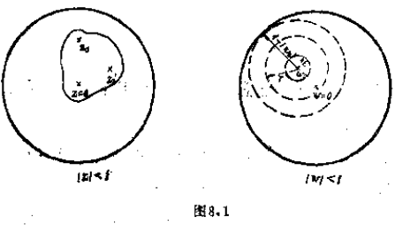
由(i),(ii),(iii),$w=f(z)$ 是由 $|z|<1$ 到 $|w|<1$ 的一对一的连续映射。

   **难度：5/5；出处：** 同事提供《复变函数简明教程_习题导出.xlsx》第4行；导出表无教材书名、原题号及页码，来源待核，原题号同事习题导出表第4行（非教材原题号）；**解答来源：** 同事导出原解析，数学正确性待逐题审核。

   **整理说明：** 原导出知识点标签：Montel定理

### 边界对应

**图谱路径：** 复变函数 / 共形映射 / 边界对应

**知识内容：** [定义、定理与方法](知识点.md#ca-138)

所给材料中未找到直接对应的独立未解题。

#### 边界对应原理

**图谱路径：** 复变函数 / 共形映射 / 边界对应 / 边界对应原理

**知识内容：** [定义、定理与方法](知识点.md#ca-139)

<!-- source-exercise:TJX-ch08-2 -->
1. 设 $f$ 在 Jordan 区域 $D$ 内解析，连续到 $D\cup\partial D$。若存在边界弧 $\gamma\subset\partial D$ 使 $f(z)=a$（$z\in\gamma$），证明 $f\equiv a$ 于 $D$。

   **答案：** 由 Carathéodory 边界对应定理取盘到 $D$ 的共形映射并连续延拓到边界；$f-a$ 拉回盘内解析且在一段圆弧连续为零。将该圆弧局部化直后按 Schwarz 反射原理零值延拓，恒等定理迫使拉回函数零，故 $f\equiv a$。

   **难度：4/5；出处：** 谭小江、伍胜健《复变函数简明教程》（北京大学出版社，2005），习题八第2题，书页207，PDF页219，原题号习题八第2题；**解答来源：** 本次据主书原题自拟简解；题干已回PDF原页核读。

<!-- source-exercise:TJX-ch08-6 -->
2. 设 Jordan 曲线 $\Gamma$ 围成区域 $D$，$z_1,z_2,z_3$ 是 $\Gamma$ 上按正向排列的三点，$w_1,w_2,w_3$ 是单位圆周上按正向排列的三点。证明存在唯一共形映射 $f:D\to\mathbb D$，其边界延拓满足 $f(z_j)=w_j$。

   **答案：** Riemann 映射由 Carathéodory 定理延拓为边界同胚，保持边界正向循环序。盘自同构群对圆周有向三元组简单传递：给定任一边界延拓映射，用唯一盘自同构把它的三个像送到 $w_1,w_2,w_3$，得存在和唯一。

   **难度：4/5；出处：** 谭小江、伍胜健《复变函数简明教程》（北京大学出版社，2005），习题八第6题，书页207，PDF页219，原题号习题八第6题；**解答来源：** 本次据主书原题自拟简解；题干已回PDF原页核读。

<!-- source-exercise:CA-TRAIN-027 -->
3. 盘自同构 $\phi_a(z)=(z-a)/(1-\bar a z)$（$|a|<1$）对单位圆边界有什么作用？

   **答案：** 当 $|z|=1$ 时 $|z-a|=|1-\bar a z|$，故 $|\phi_a(z)|=1$；分母在闭盘无零，映射与逆映射连续延拓到闭盘，边界上给出圆周的同胚。

   **难度：2/5；出处：** 本项目根据所附教材知识点自拟训练题；非教材原题，书页及PDF页不适用，原题号本项目自拟训练题27；**解答来源：** 本次自拟简解，已按相关定理核算。

   **整理说明：** 教学训练题，不计原书独立习题数

### 共形映射的例子

**图谱路径：** 复变函数 / 共形映射 / 共形映射的例子

**知识内容：** [定义、定理与方法](知识点.md#ca-140)

<!-- source-exercise:TJX-XLSX-r046 -->
1. 求将单位圆内部保角映射为正$n$边形内部的函数。

   **答案：** 在例题[13]中,设 $$b_\nu=e^{i\frac{2\pi\nu}{n}},\quad \mu_\nu=\frac{2}{n}\quad(\nu=1,2,\cdots,n).$$
映射函数实质上成为
 $$w=f(z)=\int_{0}^{z}\prod_{\nu=1}^{n}\big(1-b_\nu^{-1}t\big)^{-\frac2n}dt=\int_{0}^{z}(1-t^n)^{-\frac2n}dt.$$
这时边长为
 $$
 \begin{aligned}
 \left|\int_{b_p}^{b_{p+1}}(1-t^n)^{-\frac2n}dt\right|
 &=\left|i\int_{\frac{2\pi p}{n}}^{\frac{2\pi(p+1)}{n}}(1-e^{in\theta})^{-\frac2n}e^{i\theta}d\theta\right| \\
 &=\int_{0}^{\frac{2\pi}{n}}\big(2\sin\frac{n\theta}{2}\big)^{-\frac2n}d\theta
 =\frac{2^{1-\frac4n}\left[\Gamma\left(\frac12-\frac1n\right)\right]^2}{n\Gamma\left(1-\frac2n\right)}.
 \end{aligned}
 $$

   **难度：5/5；出处：** 同事提供《复变函数简明教程_习题导出.xlsx》第46行；导出表无教材书名、原题号及页码，来源待核，原题号同事习题导出表第46行（非教材原题号）；**解答来源：** 同事导出原解析，数学正确性待逐题审核。

   **整理说明：** 原导出知识点标签：共形映射的例子

<!-- source-exercise:TJX-XLSX-r047 -->
2. 求将$\Im z>0$保角映射为半带状区域$\Im w>0$,$0<\Re w<a$的函数。

   **答案：** 在Schwarz-Christoffel变换中, $\mu_{1} = \mu_{2} = \frac{1}{2},\mu_{3} = 0$  。和上面一样,如设  $z = 0,1,\infty$  分别对应于  $w = 0,a,\infty$  ,除去从原点的扩大外,所求的映射函数是$w = f(z) = \int_{0}^{z}\frac{dt}{\sqrt{t(1 - t)}}$
积分得
$w = 2arcsin\sqrt{z}$
它确将  $\mathfrak{S}z > 0$  保角映射为  $\mathfrak{S}w > 0,0 < \Re w < \pi.$
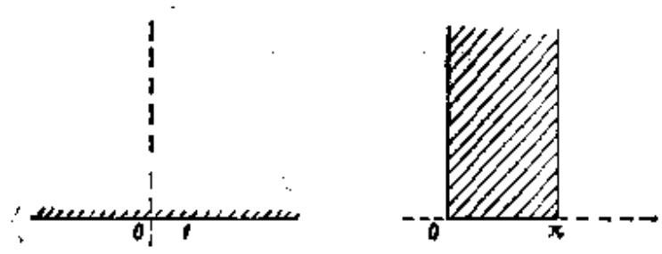
图5.18

   **难度：3/5；出处：** 同事提供《复变函数简明教程_习题导出.xlsx》第47行；导出表无教材书名、原题号及页码，来源待核，原题号同事习题导出表第47行（非教材原题号）；**解答来源：** 同事导出原解析，数学正确性待逐题审核。

   **整理说明：** 原导出知识点标签：共形映射的例子

<!-- source-exercise:TJX-XLSX-r048 -->
3. 求将上半平面保角映射为一角为$\frac{\pi}{3}$的直角三角形内部的函数。

   **答案：** $\mu_{1} = \frac{1}{2},\mu_{2} = \frac{2}{3},\mu_{3} = \frac{5}{6}$. 故  $0,1,\infty$  对应于顶点的函数同样为$w = f(z) = \int_{0}^{z}\frac{dt}{\sqrt[6]{t^{3}(1 - t)^{4}}}.$
在这种情况下,斜边的长度是
$2\sqrt{\pi} \cdot \frac{\Gamma(\frac{1}{3})}{\Gamma(\frac{5}{6})}.$
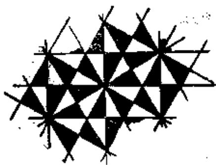
图5.17

   **难度：4/5；出处：** 同事提供《复变函数简明教程_习题导出.xlsx》第48行；导出表无教材书名、原题号及页码，来源待核，原题号同事习题导出表第48行（非教材原题号）；**解答来源：** 同事导出原解析，数学正确性待逐题审核。

   **整理说明：** 原导出知识点标签：共形映射的例子

<!-- source-exercise:TJX-XLSX-r049 -->
4. 求将上半平面保角映射为等腰直角三角形内部的函数。

   **答案：** $\mu_{1} = \frac{1}{2},\mu_{2} = \mu_{3} = \frac{3}{4}$. 故0, 1,  $\infty$对应于三角形顶点,所求函数是$w = f(z) = \int_{0}^{z}\frac{dt}{\sqrt[4]{t^{2}(1 - t)^{3}}}.$
在这种情况下,斜边的长度是 $\sqrt{2\pi} \cdot \frac{\Gamma\left( \frac{1}{4} \right)}{\Gamma\left( \frac{3}{4} \right)}$  。
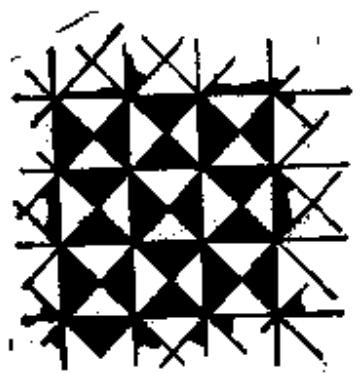
图5.16

   **难度：4/5；出处：** 同事提供《复变函数简明教程_习题导出.xlsx》第49行；导出表无教材书名、原题号及页码，来源待核，原题号同事习题导出表第49行（非教材原题号）；**解答来源：** 同事导出原解析，数学正确性待逐题审核。

   **整理说明：** 原导出知识点标签：共形映射的例子

<!-- source-exercise:TJX-XLSX-r050 -->
5. 求将上半平面保角映射为正三角形内部的函数。

   **答案：** 在 Schwarz-Christoffel 变换中,令 $\mu_{1} = \mu_{2} = \mu_{3} = \frac{2}{3}$  。故如设将  $z = 0,1,\infty$  对应于  $w$  平面的三角形的三顶点,则除去相似变换外,所求的函数是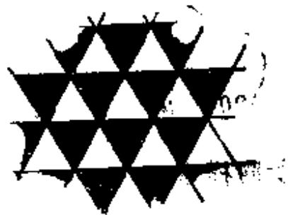
图5.15
$w = f(z) = \int_{0}^{z}\frac{dt}{\sqrt[3]{t^{2}(1 - t)^{2}}}.$
在这种情况下,三角形的边长是 $\frac{\left( \Gamma\left( \frac{1}{3} \right) \right)^{2}}{\Gamma\left( \frac{2}{3} \right)}$  。

   **难度：4/5；出处：** 同事提供《复变函数简明教程_习题导出.xlsx》第50行；导出表无教材书名、原题号及页码，来源待核，原题号同事习题导出表第50行（非教材原题号）；**解答来源：** 同事导出原解析，数学正确性待逐题审核。

   **整理说明：** 原导出知识点标签：共形映射的例子

<!-- source-exercise:TJX-XLSX-r051 -->
6. 求将椭圆的外部保角映射为单位圆内部的函数。

   **答案：** 由第二章练习题19(i), $$\zeta=z+\frac{1}{z}$$
将$|z|<k<1$保角映射为以$\zeta=\pm2$为焦点的椭圆:
 $$\frac{\xi^2}{\left(k+\frac1k\right)^2}+\frac{\eta^2}{\left(k-\frac1k\right)^2}=1$$
的外部。故将$|z|<k$映射为
 $$\frac{u^2}{a^2}+\frac{v^2}{b^2}=1$$
的外部可如下进行。由
 $$\frac{a}{\frac1k+k}=\frac{b}{\frac1k-k}$$
确定$k\,(0<k<1)$:
 $$k=\sqrt{\frac{a-b}{a+b}}.$$
则
 $$w=\frac{\sqrt{a^2-b^2}}{2}\left(z+\frac1z\right)$$
将$|z|<\sqrt{\frac{a-b}{a+b}}$映射为椭圆的外部。因此将$|z|<1$映射为该椭圆外部的函数是
 $$w=\frac{\sqrt{a^2-b^2}}{2}\left(\sqrt{\frac{a-b}{a+b}}\,z+\sqrt{\frac{a+b}{a-b}}\,\frac1z\right).$$

   **难度：4/5；出处：** 同事提供《复变函数简明教程_习题导出.xlsx》第51行；导出表无教材书名、原题号及页码，来源待核，原题号同事习题导出表第51行（非教材原题号）；**解答来源：** 同事导出原解析，数学正确性待逐题审核。

   **整理说明：** 原导出知识点标签：共形映射的例子

<!-- source-exercise:TJX-XLSX-r052 -->
7. 求将单位圆的上半圆保角映射为上半平面的函数。

   **答案：** 映射 $$Z=\frac{1-z}{1+z}$$
将$|z|<1,\Im z>0$映射为$Z$平面的第四象限,而映射$\zeta=-Z^2$将$Z$平面的第四象限映射为$\Im\zeta>0$。故
 $$\zeta=-\left(\frac{1-z}{1+z}\right)^2$$
就是所求函数的一个。一般地将它与将$\Im z>0$映射为$\Im w>0$的一次变换复合:
 $$w=\frac{a\zeta+b}{c\zeta+d}\quad(a,b,c,d为实数,ad-bc>0).$$

   **难度：3/5；出处：** 同事提供《复变函数简明教程_习题导出.xlsx》第52行；导出表无教材书名、原题号及页码，来源待核，原题号同事习题导出表第52行（非教材原题号）；**解答来源：** 同事导出原解析，数学正确性待逐题审核。

   **整理说明：** 原导出知识点标签：共形映射的例子

<!-- source-exercise:TJX-XLSX-r133 -->
8. 设 $z=w+e^{w},\ z=x+iy,\ w=u+iv$,对应于 $u=\mathrm{const},\ v=\mathrm{const}$ 的 $z$ 平面的曲线是什么?对应于直线 $v=0,\ v=\pi$ 的又是什么?

   **答案：** $\begin{aligned} & x + iy = u + iv + e^{u + iv} = u + iv + e^{u}(cosv + isinv) \\ & = (u + e^{u}cosv) + i(v + e^{u}sinv), \end{aligned}$故
$x = u + e^{\mu}cosv,$
$y = v + e^{u}sinv.$
由(1)和(2),有
$(x - u)^{2} + (y - v)^{2} = e^{2n},$
$x - u = (y - v)cotv_{\bullet}$
因此,由(1),(3)可知,对应于u=c的z平面上的曲线为
$x - c = e^{c}cos(y \pm \sqrt{e^{2c} - (x - c)^{2}}).$
又由(2),(4)知,对应于 $v = c^{\prime}$  的z平面上的曲线为
$y - c^{\prime} = e^{x - (y - c^{\prime})cotc^{\prime}}\sin c^{\prime}.$
特别,直线  $v = 0$  对应于  $y = 0$  ,而直线  $v = \pi$  对应于半直线  $y = \pi$ $- \infty < x \leq - 1.$

   **难度：4/5；出处：** 同事提供《复变函数简明教程_习题导出.xlsx》第133行；导出表无教材书名、原题号及页码，来源待核，原题号同事习题导出表第133行（非教材原题号）；**解答来源：** 同事导出原解析，数学正确性待逐题审核。

   **整理说明：** 原导出知识点标签：共形映射的例子

<!-- source-exercise:TJX-XLSX-r139 -->
9. 分别求 $\Re z=x=\mathrm{const}$,$\Im z=y=\mathrm{const}$ 在映射 $w=\cos z$ 下的像。

   **答案：** 如设  $w = u + iv$  ,则$\begin{aligned} u + iv & = \frac{e^{i( - i + is)} + e^{- i(x + is)}}{2} \\ & = \frac{1}{2}\left\lbrack cosx \cdot (e^{- x} + e^{x}) + isinx \cdot (e^{- x} - e^{x}) \right\rbrack \end{aligned}$
故
$u = \frac{cosx}{2}(e^{- y} + e^{x}),$
$v = \frac{sinx}{2}(e^{- y} - e^{y}).$
因此,对应于  $x = c$  的曲线是双曲线
$\frac{u^{2}}{\cos^{2}c} - \frac{v^{2}}{\sin^{2}c} = 1.$
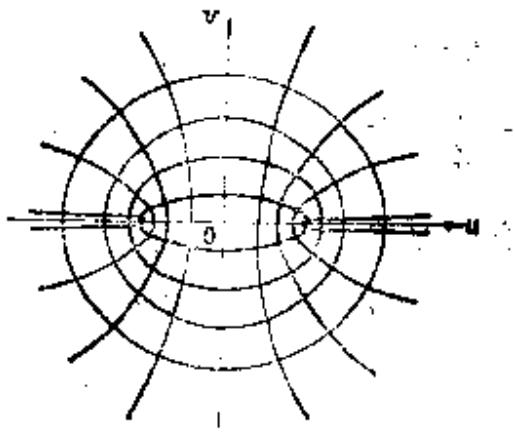
图2.12
对应于  $y = c^{\prime}$  的曲线是与上述双曲线正交的椭圆
$\frac{u^{2}}{\left( \frac{e^{c/} + e^{- c/}}{2} \right)^{2}} + \frac{v^{2}}{\left( \frac{e^{- c/} - e^{c/}}{2} \right)^{\frac{2}{2}}} = 1_{\text{质}}$
它们的焦点均是  $w = \pm 1$  。

   **难度：3/5；出处：** 同事提供《复变函数简明教程_习题导出.xlsx》第139行；导出表无教材书名、原题号及页码，来源待核，原题号同事习题导出表第139行（非教材原题号）；**解答来源：** 同事导出原解析，数学正确性待逐题审核。

   **整理说明：** 原导出知识点标签：共形映射的例子

<!-- source-exercise:TJX-XLSX-r140 -->
10. 如下函数将 $|z|<1$ 映射成什么?
 (ⅰ) $\displaystyle w=\frac{1+z}{1-z}$, (ii) $\displaystyle w=\frac12\left(z+\frac1z\right)$,
 (iii) $w=\arctan z$, (iv) $w^2=1-z$。

   **答案：** (i)如设 $z - 1 = re^{i\theta},w = u + iv$  ,则$u + iv = - \frac{z + 1}{z - 1} = - \frac{2 + re^{i\theta}}{re^{i\theta}} = - 1 - \frac{2e^{- i\theta}}{r}.$
在  $z = 1$  处与  $|z = 1$  内切的圆的参数方程式(以  $\alpha \sim 0$  为参数)为
$r = - 2acos\theta\left( - \frac{\pi}{2} \leq \theta \leq \frac{\pi}{2} \right).$
 [Unreadable]
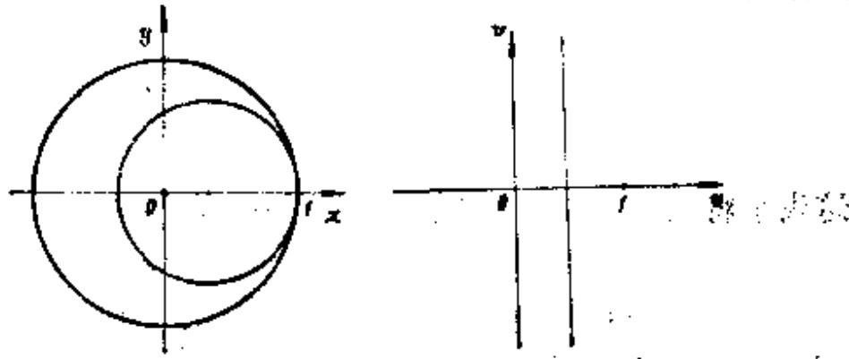
图2.8
故这个圆的像曲线为
$u + iv = - 1 + \frac{cos\theta - isin\theta}{acos\theta} = \frac{1 - a}{a} - \frac{itg\theta}{a}.$
由此得
$u = \frac{1 - a}{a}, - \infty \leq v \leq + \infty.$
干油罗
特别,如设  $a = 1$  ,就得到  $|z| = 1$  的像是  $w$-平面的虚轴。除 $z = 1$ $z = \infty$  以外  $\frac{1 + z}{1 - z}$  是正则的。这个函数将  $|z| < 1$  ——对应地保角映射为  $\Re w > 0$  。
(ii)如设 $z = re^{i\theta}$,  $w = u + tv$  , 则
$\begin{aligned} u + iv & = \frac{1}{2}\left( re^{i\theta} + \frac{1}{re^{i\theta}} \right) = \frac{1}{2}\left( r + \frac{1}{r} \right)cos\theta \\ & + \frac{i}{2}\left( r - \frac{1}{r} \right)sin\theta. \end{aligned}$
 [Unreadable]
因此
$u = \frac{1}{2}\left( r + \frac{1}{r} \right)cos\theta,v = \frac{1}{2}\left( r - \frac{1}{r} \right)sin\theta,$
从这两个式子如果消去 $\theta$  ,得
$\frac{u^{2}}{\left\lbrack \frac{1}{2}\left( r + \frac{1}{r} \right) \right\rbrack^{2}} + \frac{v^{2}}{\left\lbrack \frac{1}{2}\left( r - \frac{1}{r} \right) \right\rbrack^{2}} = 1.$
这表示将圆  $|z| = r$  映射为以  $w = 0$  为中心的椭圆。
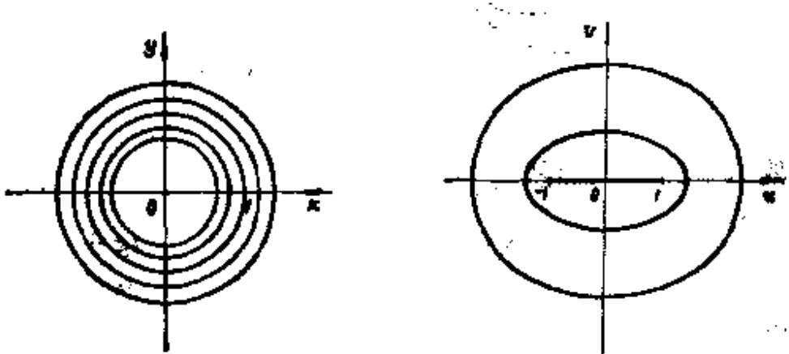
图2.9
又由于
$\frac{1}{4}\left( r + \frac{1}{r} \right)^{2} - \frac{1}{4}\left( r - \frac{1}{r} \right)^{2} = 1,$
所以上述椭圆的焦点是 $w = \pm 1$  。又显然可知,圆  $|z| = r$  和  $|z| = \frac{1}{r}$  映射为相同的椭圆。在  $r = 1$  时,椭圆退化为闭线段  $\lbrack - 1,1\rbrack$  。由于映射函数在  $0 < |z| < 1$  内是正则的,所以这个函数将  $|z| < 1$  ——对应地保角映射为除去线段  $\lbrack - 1,1\rbrack$  外的  $w$  平面。
注意 如果将沿着线段  $( - 1,1\rbrack$  剪开的二张w平面将切口交叉贴合而作成两叶的Riemann曲面F,则全平面与F一一保角地对应(除去支点 $w = \pm 1$  对应的点外)。
$\begin{aligned} z = tanw & = \frac{sinw}{cosw} = \frac{e^{iw} - e^{- iw}}{i(e^{iw} + e^{- iw})} \\ & = \frac{1}{i}\frac{e^{2iw} - 1}{e^{2iw} + 1}. \end{aligned}$
如设  $\zeta = e^{2i\omega}$  ,则
$\xi = \frac{i - z}{i + z},\quad w = \frac{1}{2i}log\zeta.$
所给函数是上述二个正则函数的复合函数,故 $|z| < 1$  ——对应地保角地映射为  $\Re\zeta > 0$  ,而  $\Re\zeta > 0$  ——对应地保角映射为  $- \frac{\pi}{4} < \Re w < \frac{\pi}{4}$  。(对数函数在右半平面是单值的)。
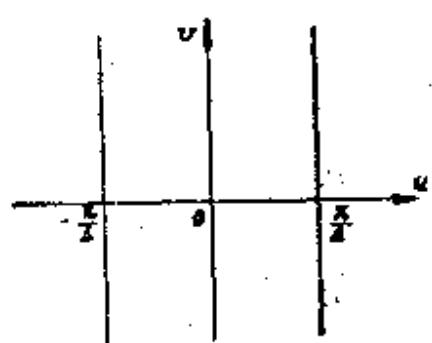
图2.10
(iv)如设 $w = \mathbb{R}e^{i\theta}$,  $|z| = 1$的像曲线为
$\left| 1 - R^{2}e^{i\theta} \right| = 1,$
$\left| \left( 1 - R^{2}cos2\Theta \right) + iR^{2}sin2\Theta \right| = 1.$
故  $R^{2} = 2cos2\theta$
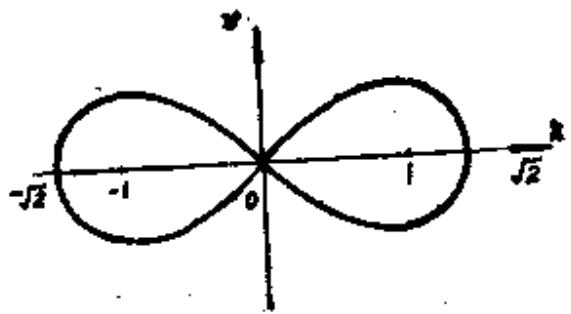
图2.11
这是对称于实轴与虚轴且在原点自己相交的曲线。如果被这个曲线在左半平面和右半平面的部分为 $C^{-}$  和  $C^{+}$  ,那么映射  $w = \sqrt{1 - z}$  将  $|z| < 1$  保角映射为  $C^{+}$  的内部。映射  $w = - \sqrt{1 - z}$  将  $|z| < 1$  保角映射为  $C^{-}$  的内部。

   **难度：4/5；出处：** 同事提供《复变函数简明教程_习题导出.xlsx》第140行；导出表无教材书名、原题号及页码，来源待核，原题号同事习题导出表第140行（非教材原题号）；**解答来源：** 同事导出原解析，数学正确性待逐题审核。

   **整理说明：** 原导出知识点标签：共形映射的例子

<!-- source-exercise:TJX-ch08-12 -->
11. 求原书图示八个区域 $D$ 到上半平面的共形映射，八个图分别为：(1) 上半平面去掉闭单位半圆盘；(2) 圆心3半径3的盘减去圆心1半径1的内盘（两圆在0相切）；(3) 复平面沿从 $1+i$ 向东北方向的射线割开；(4) 垂直带 $-\pi/2<\operatorname{Re}z<\pi/2$；(5) 水平带 $0<\operatorname{Im}z<\pi$；(6) 半带 $\operatorname{Re}z>0,|\operatorname{Im}z|<1$；(7) 图示水平带；(8) 单位圆上半盘与圆 $|z+\sqrt3 i|=2$ 上半弧之间的月牙域。原图：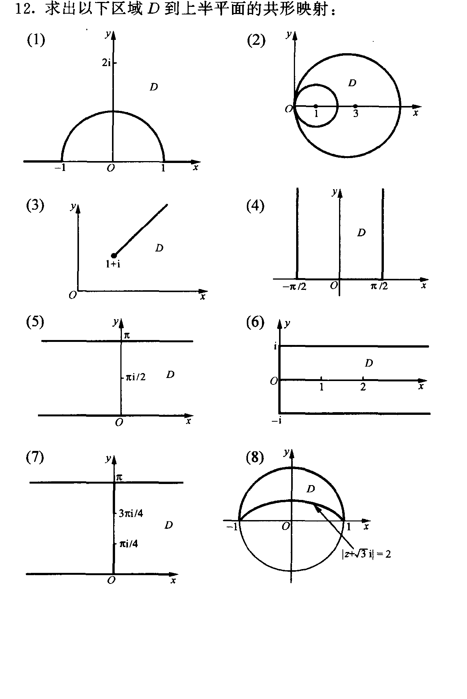

   **答案：** 取适合的支，八个可用映射依次为：(1) $w=z+1/z$；(2) 先 $t=1/z$ 把相切圆变成 $1/6<\operatorname{Re}t<1/2$，再 $w=\exp[3\pi i(t-1/6)]$；(3) $w=\sqrt{e^{-i\pi/4}(z-1-i)}$，取辐角 $0<\arg<2\pi$ 的平方根；(4) $w=e^{i(z+\pi/2)}$；(5) $w=e^z$；(6) $w=i\sinh(\pi z/2)$；(7) 若图中仍为 $0<\operatorname{Im}z<\pi$，同(5)取 $w=e^z$；(8) 令 $T=(z-1)/(z+1)$，两圆弧被送到辐角 $\pi/2$ 与 $5\pi/6$ 的射线，取 $w=(-iT)^3$。每步可直接检查两侧边界映实轴、域内映上半平面。第(7)图中 $\pi/4,3\pi/4$ 是内部标度，若原版把它们作额外边界需重核。

   **难度：5/5；出处：** 谭小江、伍胜健《复变函数简明教程》（北京大学出版社，2005），习题八第12题，书页208，PDF页220，原题号习题八第12题；**解答来源：** 本次据主书原题自拟简解；题干已回PDF原页核读。

   **待核状态：** 第(7)图域界标记待原版核对；八图与映射公式均已附

   **勘误：** 第(7)图域界标记待原版核对；八图与映射公式均已附

#### Cauchy积分定理

**图谱路径：** 复变函数 / Cauchy定理和Cauchy公式 / 路径积分 / Cauchy积分定理

**知识内容：** [定义、定理与方法](知识点.md#ca-cauchy-theorem)

<!-- source-exercise:CA-TRAIN-032 -->
1. 计算沿逆时针单位圆的积分 $\oint_{|z|=1}e^z\,dz$，并说明所用定理的解析域条件。

   **答案：** $e^z$ 在整个复平面解析，单位圆和内部均位于其解析域，故由 Cauchy 积分定理积分为 $0$；也可取原函数 $e^z$。

   **难度：1/5；出处：** 本项目根据所附教材知识点自拟训练题；非教材原题，书页及PDF页不适用，原题号本项目自拟训练题32；**解答来源：** 本次自拟简解，已按相关定理核算。

   **整理说明：** 教学训练题，不计原书独立习题数

#### Cauchy积分公式

**图谱路径：** 复变函数 / Cauchy定理和Cauchy公式 / Cauchy公式 / Cauchy积分公式

**知识内容：** [定义、定理与方法](知识点.md#ca-cauchy-formula)

<!-- source-exercise:TJX-ch03-4 -->
1. 设 $f$ 在 $z_0$ 邻域定义且在 $z_0$ 连续。证明 $\lim_{\varepsilon\downarrow0}\frac1{2\pi i}\int_{|w-z_0|=\varepsilon}\frac{f(w)}{w-z_0}\,dw=f(z_0)$（圆正向）。

   **答案：** 把 $f(w)=f(z_0)+[f(w)-f(z_0)]$。常数项的积分为 $f(z_0)$；余项绝对值不超过 $\sup_{|w-z_0|=\varepsilon}|f(w)-f(z_0)|$，由连续性趋于零。

   **难度：2/5；出处：** 谭小江、伍胜健《复变函数简明教程》（北京大学出版社，2005），习题三第4题，书页116，PDF页128，原题号习题三第4题；**解答来源：** 本次据主书原题自拟简解；题干已回PDF原页核读。

#### 幂级数

**图谱路径：** 复变函数 / 解析函数 / 幂级数 / 幂级数

**知识内容：** [定义、定理与方法](知识点.md#ca-power-series)

<!-- source-exercise:TJX-XLSX-r068 -->
1. 设 $\{f_{n}(z)\}$ 为在区域 D 上收敛的正则函数列,如果在 D 的点 z 处 $\{f_{n}(z)\}$ 不一致收敛,则称点 z 为 $\{f_{n}(z)\}$ 的不正规 点。设不正规点的集合为 E .证明
 (1) E 是疏朗完全集;
 (2) E 的任何分集与 D 的境界具有公共点。
注意集合 E 的闭包 $\overline{E}$ 不具有内点时,称 E 为疏朗的(nowhere dense)。

   **答案：** 设 $z_{0}$ 为 $E$ 的任意凝聚点,如果 $z_{0}$ 不是 $E$ 的点,则在 $z_{0}$ 的某个近傍 $\{ f_{n}(z)\}$ 一致收敛,这与 $z_{0}$ 的近傍有 $E$ 的点相矛盾。故 $E$ 是闭集合。又如果 $E$ 的任意一点 $z$ 的某个近傍不全是 $E$ 的点,那么在这近傍中,能够取出一个区域 $D^{\prime}$ ,它包含 $z$ 以及全部不是 $E$ 的点。由于在 $D^{\prime}$ 的境界上, $\{ f_{n}(z)\}$ 一致收敛,从而在点 $z$ 也一致收敛,但这与 $z \in E$ 的假定矛盾。因此 $E^{\prime} \subseteq E$ ,这表示 $E = \overline{E}$ 。
其次,设 $E( = \overline{E})$ 包含其内点,作一区域 $D$ ,它仅由 $E$ 的点构成。由例题[1i],在 $D$ 的部分区域 $G$ 上 $\{ f_{n}(z)\}$ 一致收敛。但这与 $G$ 的所有点是 $E$ 的点矛盾。因此 $E$ 是疏朗集。
再次,如果 $E$ 的某个分集与 $D$ 的境界没有公共点,由于这个分集及其境界和 $E$ 的其它分集的和集的距离是正的,因此,存在 $D$ 的一个部分区域 $G$ ,它包含该分集,并且 $G$ 的境界和 $D$ 的境界以及和 $E$ 的其它分集的和集没有公共点。由于 $G$ 的境界上不存在 $E$ 的点,故 $\{ f_{n}(z)\}$ 在 $G$ 的境界上一致收敛,从而在 $G$ 上也一致收敛。但这与 $G$ 包含有 $E$ 的点相矛盾。因此, $E$ 的任何分集与 $D$ 的境界具有公共点。

   **难度：5/5；出处：** 同事提供《复变函数简明教程_习题导出.xlsx》第68行；导出表无教材书名、原题号及页码，来源待核，原题号同事习题导出表第68行（非教材原题号）；**解答来源：** 同事导出原解析，数学正确性待逐题审核。

   **整理说明：** 原导出知识点标签：幂级数

<!-- source-exercise:TJX-XLSX-r088 -->
2. Legendre多项式定义作如下展开式的系数 $P_{n}(\alpha)$
 $$\left(1-2 \alpha z+z^{2}\right)^{-\frac{1}{2}}=1+P_{1}(\alpha) z+P_{2}(\alpha) z^{2}+P_{3}(\alpha) z^{3}+\cdots$$
求 $P_{1}(\alpha)$ , $P_{2}(\alpha)$ , $P_{3}(\alpha)$ 和 $P_{4}(\alpha)$ .

   **答案：** $$\begin{aligned}
 & \left(1-2 \alpha z+z^{2}\right)^{-\frac{1}{2}}=\left\{1-\left(2 \alpha z-z^{2}\right)\right\}^{-\frac{1}{2}} \\
 = & 1+\frac{1}{2}\left(2 \alpha z-z^{2}\right)+\frac{3}{8}\left(2 \alpha z-z^{2}\right)^{2}+\frac{15}{48}\left(2 \alpha z-z^{2}\right)^{3} \\
 & +\frac{35}{128}\left(2 \alpha z-z^{2}\right)^{4}+\cdots \\
 = & 1+\alpha z+\frac{1}{2}\left(3 \alpha^{2}-1\right) z^{2}+\frac{1}{2}\left(5 \alpha^{3}-3 \alpha\right) z^{3} \\
 & +\frac{1}{8}\left(35 \alpha^{4}-30 \alpha^{2}+3\right) z^{4}+\cdots
 \end{aligned}$$
故 $P_{0}=1,\ P_{1}=\alpha,\ P_{2}=\frac{1}{2}\left(3 \alpha^{2}-1\right),$
 $P_{3}=\frac{1}{2}\left(5 \alpha^{3}-3 \alpha\right),\ P_{4}=\frac{1}{8}\left(35 \alpha^{4}-30 \alpha^{2}+3\right).$

   **难度：3/5；出处：** 同事提供《复变函数简明教程_习题导出.xlsx》第88行；导出表无教材书名、原题号及页码，来源待核，原题号同事习题导出表第88行（非教材原题号）；**解答来源：** 同事导出原解析，数学正确性待逐题审核。

   **整理说明：** 原导出知识点标签：幂级数

<!-- source-exercise:TJX-XLSX-r089 -->
3. 将如下各函数展开成 z 的泰勒级数。
 (1) $(1+z)^{m},$
 (2) $\log (1+z),$
 (3) $e^{z},$
 (4) $\sin z,$
 (5) $\cos z.$

   **答案：** (1) $(1+z)^{m}=1+\frac{m}{1} z+\frac{m(m-1)}{2 !} z^{2}+\cdots +\frac{m(m-1) \cdots(m-n+1)}{n !} z^{n}+\cdots$
 (2) $\log (1+z)=z-\frac{z^{2}}{2}+\frac{z^{3}}{3}+\cdots+(-1)^{n-1} \frac{z^{n}}{n}+\cdots$
 (3) $e^{z}=1+z+\frac{z^{2}}{2 !}+\cdots+\frac{z^{n}}{n !}+\cdots$
 (4) $\sin z=z-\frac{z^{3}}{3 !}+\frac{z^{5}}{5 !}-\frac{z^{7}}{7 !}+\cdots$
 (5) $\cos z=1-\frac{z^{2}}{2 !}+\frac{z^{4}}{4 !}-\frac{z^{6}}{6 !}+\cdots$

   **难度：2/5；出处：** 同事提供《复变函数简明教程_习题导出.xlsx》第89行；导出表无教材书名、原题号及页码，来源待核，原题号同事习题导出表第89行（非教材原题号）；**解答来源：** 同事导出原解析，数学正确性待逐题审核。

   **整理说明：** 原导出知识点标签：幂级数

<!-- source-exercise:TJX-XLSX-r090 -->
4. 如果
 $$\lim _{n \to \infty} \left|\frac{a_{n}}{a_{n+1}}\right|=R$$
则 $\sum_{n=0}^{\infty} a_{n} z^{n}$ 的收敛半径为 R 。试证明之。

   **答案：** 设 $|z| ≤R_{1}<R$ . $\left|\frac{a_{n+1} z^{n+1}}{a_{n} z^{n}}\right|=\frac{|a_{n+1}|}{|a_{n}|}|z|$ ,设ε为任意正数,存在号码 $n_{0}$ ,当 $n>n_{0}$ 时, $$\left|\frac{a_{n+1} z^{n+1}}{a_{n} z^{n}}\right| \leq \frac{|z|}{R}+\varepsilon,$$
于是 $\left|\frac{a_{n_{0}+p} z^{n_{0}+p}}{a_{n_{0}} z^{n_{0}}}\right| \leq\left(\frac{|z|}{R}+\varepsilon\right)^{p},$
于是 $\left|a_{n_{0}+p} z^{n_{0}+p}\right| \leq\left(\frac{R_{1}}{R}+\varepsilon\right)^{p} \cdot\left|a_{n_{0}} R_{1}^{n_{0}}\right|.$
故级数 $\sum_{n=n_{0}}^{\infty} a_{n} z^{n}$ 绝对且一致收款,在这级较上加上最初的 $n_{0}$ 项,可知级数绝对且一致收敛。
又当 $|z|>R$ 时,同样可得
 $$\left|a_{n_{0}+p} z^{n_{0}+p}\right| \geq\left(\frac{|z|}{R}-\varepsilon\right)^{p}\left|a_{n_{0}} R^{n_{0}}\right| .$$
由于 $\frac{|z|}{R}>1$ ,故 $\lim _{p \to \infty}|a_{n_{0}+p} z^{n_{0}+p}|=\infty$ ,级数发散。

   **难度：3/5；出处：** 同事提供《复变函数简明教程_习题导出.xlsx》第90行；导出表无教材书名、原题号及页码，来源待核，原题号同事习题导出表第90行（非教材原题号）；**解答来源：** 同事导出原解析，数学正确性待逐题审核。

   **整理说明：** 原导出知识点标签：幂级数

<!-- source-exercise:TJX-XLSX-r091 -->
5. 幂级数 $\sum_{n=0}^{\infty} a_{n} z^{n}$ 和 $\sum_{n=0}^{\infty} b_{n} z^{n}$ 的收敛半径各为 $\alpha,\beta$。
 (1) $\sum_{n=0}^{\infty}(a_{n}+b_{n}) z^{n}$ 和 $\sum_{n=0}^{\infty}(a_{n}-b_{n}) z^{n}$ 的收敛半径当 $\alpha \neq\beta$ 时 是 $\min (\alpha, \beta)$ . $\alpha=\beta$ 时,又怎样?
 (2) $\sum_{n=0}^{\infty} a_{n} b_{n} z^{n}$ 的收敛半径不小于 $\alpha \beta$ .
 (3) $\sum_{n=0}^{\infty} \frac{a_{n}}{b_{n}} z^{n}$ 的收敛半径不大于 $\frac{\alpha}{\beta}$ .其中设 $b_{n} \neq0$
 (4)如设 $\sum_{n=0}^{\infty} c_{n} z^{n}$ 为Causchy乘积级数,则其收敛半径至少为 $\min (\alpha, \beta)$ ,并且
 $$\sum_{n=0}^{\infty} a_{n} z^{n} \cdot \sum_{n=0}^{\infty} b_{n} z^{n}=\sum_{n=0}^{\infty} c_{n} z^{n} .$$

   **答案：** 由问题6显然有(1),(4)。在(1)中当 $\alpha=\beta$ 时收敛半径不小于 $\alpha$。 (2) $\varlimsup_{n \to \infty} \sqrt[n]{\left|a_{n} b_{n}\right|} \leq \varlimsup_{n \to \infty} \sqrt[n]{\left|a_{n}\right|} \cdot \varlimsup_{n \to \infty} \sqrt[n]{\left|b_{n}\right|}=\frac{1}{\alpha \beta},$
故 $\frac{1}{\varlimsup_{n \to \infty} \sqrt[n]{\left|a_{n} b_{n}\right|}} \geq \alpha \cdot \beta.$
 (3) $\varlimsup_{n \to \infty} \sqrt[n]{\left|\frac{a_{n}}{b_{n}}\right|} \geq \frac{\varlimsup_{n \to \infty} \sqrt[n]{\left|a_{n}\right|}}{\varliminf_{n \to \infty} \sqrt[n]{\left|b_{n}\right|}}=\frac{\beta}{\alpha},$
故 $\frac{\alpha}{\beta} \geq \frac{1}{\varlimsup_{n \to \infty} \sqrt[n]{\left|\frac{a_{n}}{b_{n}}\right|}}.$

   **难度：4/5；出处：** 同事提供《复变函数简明教程_习题导出.xlsx》第91行；导出表无教材书名、原题号及页码，来源待核，原题号同事习题导出表第91行（非教材原题号）；**解答来源：** 同事导出原解析，数学正确性待逐题审核。

   **整理说明：** 原导出知识点标签：幂级数

<!-- source-exercise:TJX-XLSX-r092 -->
6. 设幂级数 $\sum_{n=0}^{\infty} a_{n} z^{n}$ 和 $\sum_{n=0}^{\infty} b_{n} z^{n}$ 均在 $|z|<\alpha$ 上绝对且一致收敛,证明级数
 $$\sum_{n=0}^{\infty}\left(a_{n}+b_{n}\right) z^{n},\ \sum_{n=0}^{\infty}\left(a_{n}-b_{n}\right) z^{n},\ \sum_{n=0}^{\infty} c_{n} z^{n}$$
均在 $|z|<\alpha$ 上绝对且一致收敛。其中 $\sum_{n=0}^{\infty} c_{n} z^{n}$ 为Cauchy乘积级数。

   **答案：** 设 ε 为任意正数时,总存在号码 N , p 为任意自然数,只要 $n ≥N$ ,对于 $|z|<\alpha$ 中的 z ,有 $$\left|\sum_{k=n}^{n+p} a_{k} z^{k}\right|<\frac{\varepsilon}{2},$$
 $$\left|\sum_{k=n}^{n+p} b_{k} z^{k}\right|<\frac{\varepsilon}{2},$$
因此,
 $$\begin{aligned}
 \left|\sum_{k=n}^{n+p}\left(a_{k}+b_{k}\right) z^{k}\right| & \leq\left|\sum_{k=n}^{n+p} a_{k} z^{k}\right|+\left|\sum_{k=n}^{n+p} b_{k} z^{k}\right| \\
 & <\frac{\varepsilon}{2}+\frac{\varepsilon}{2}=\varepsilon,
 \end{aligned}$$
 $$\left|\sum_{k=n}^{n+p}\left(a_{k}-b_{k}\right) z^{k}\right| \leq\left|\sum_{k=n}^{n+p} a_{k} z^{k}\right|+\left|\sum_{k=n}^{n+p} b_{k} z^{k}\right|<\varepsilon,$$
又根据问题5,在 $|z|<\alpha$ 上, $\sum_{n=0}^{\infty} c_{n} z^{n}$ 一致收敛,因此。 $\sum_{n=0}^{\infty}(a_{n}+b_{n}) z^{n}$ $\sum_{n=0}^{\infty}(a_{n}-b_{n}) z^{n}$ . $\sum_{n=0}^{\infty} c_{n} z^{n}$ 在 $|z|<\alpha$ 上绝对且一致收敛。

   **难度：3/5；出处：** 同事提供《复变函数简明教程_习题导出.xlsx》第92行；导出表无教材书名、原题号及页码，来源待核，原题号同事习题导出表第92行（非教材原题号）；**解答来源：** 同事导出原解析，数学正确性待逐题审核。

   **整理说明：** 原导出知识点标签：幂级数

<!-- source-exercise:TJX-XLSX-r093 -->
7. 设 $\{f_{n}(z)\}$ , $\{g_{n}(z)\}$ 各为有界闭区域 D 上一致收敛的 正则函数列, $\lim _{n \to \infty} f_{n}(z)=f(z)$ , $\lim _{n \to \infty} g_{n}(z)=g(z)$ ,证明
 (1) $\lim _{n \to \infty} \frac{f_{1}(z)+f_{2}(z)+\cdots+f_{n}(z)}{n}=f(z)$,
 (2) $\lim _{n \to \infty} \frac{f_{1}(z) g_{n}(z)+f_{2}(z) g_{n-1}(z)+\cdots+f_{n}(z) g_{1}(z)}{n}=f(z)g(z)$.
并且这些收敛是一致的。

   **答案：** (1)由于 $\{f_{n}(z)\}$ 在 D 上一致收敛,故对于任意正数 $\varepsilon$ ,总存在号码 $n_{0}$ ,如果 $n>n_{0}$ ,对于 D 的点 z ,有 $$\left|f_{n}(z)-f(z)\right|<\varepsilon .$$
于是 $\left|\sum_{i=n_{0}+1}^n f_{i}(z)-\left(n-n_{0}\right) f(z)\right|<\left(n-n_{0}\right) \varepsilon.$
现设
 $$A_{n}=\frac{f_{1}(z)+f_{2}(z)+\cdots+f_{n}(z)}{n},$$
由上述不等式,有
 $$\left|n A_{n}-n_{0} A_{n_{0}}-\left(n-n_{0}\right) f(z)\right|<\left(n-n_{0}\right) \varepsilon,$$
 $$\left|A_{n}-\frac{n_{0} A_{n_{0}}}{n}-\left(1-\frac{n_{0}}{n}\right) f(z)\right|<\left(1-\frac{n_{0}}{n}\right) \varepsilon,$$
即 $\left|A_{n}-f(z)-\frac{n_{0}}{n}\left(A_{n_{0}}-f(z)\right)\right|<\left(1-\frac{n_{0}}{n}\right) \varepsilon.$
由于 $f(z)$ 是有界的,故当 $n \to \infty$ 时, $A_{n}$ 一致收敛于 $f(z)$ .

 (2)设 $f_{n}(z)=f(z)+p_{n}(z)$ ,则 $p_{n}(z)$ 在 D 上一致收敛于 零。由(1)知 $\frac{p_{1}(z)+p_{2}(z)+\cdots+p_{n}(z)}{n}$ 也一致收敛于零。
而
 $$\begin{aligned}
 & \frac{1}{n}\left(f_{1} \cdot g_{n}+f_{2} \cdot g_{n-1}+\cdots+f_{n} \cdot g_{1}\right) \\
 =& \frac{f}{n}\left(g_{1}+g_{2}+\cdots+g_{n}\right)+\frac{1}{n}\left(p_{1} g_{n}+p_{2} g_{n-1}+\cdots+p_{n} g_{1}\right)
 \end{aligned}$$
但是由于 $\{p_{n}(z)\}$ 在 D 上一致收敛于零,故
 $$\frac{1}{n}\left(p_{1} g_{n}+p_{2} g_{n-1}+\cdots+p_{n} g_{1}\right)$$
也一致收敛于零,而由(1), $\frac{1}{n}(g_{1}+g_{2}+\cdots+g_{n})$ 一致收敛于 g ,故当 $n \to \infty$ 时, $\frac{1}{n}(f_{1} \cdot g_{n}+f_{2} \cdot g_{n-1}+\cdots+f_{n} \cdot g_{1})$ 一致收 敛于 $f \cdot g$ .

   **难度：4/5；出处：** 同事提供《复变函数简明教程_习题导出.xlsx》第93行；导出表无教材书名、原题号及页码，来源待核，原题号同事习题导出表第93行（非教材原题号）；**解答来源：** 同事导出原解析，数学正确性待逐题审核。

   **整理说明：** 原导出知识点标签：幂级数

<!-- source-exercise:TJX-XLSX-r094 -->
8. 求如下级数的收敛半径。
 (1) $\sum_{n=1}^{\infty} n^{p} z^{n}$ (p为实数);
 (2) $\sum_{n=1}^{\infty} \frac{z^{n}}{n !}$;
 (3) $\sum_{n=1}^{\infty} q^{n^{2}} z^{n}(|q|<1)$,
 (4) $\sum_{n=1}^{\infty}(-1)^{n+1} \frac{z^{n}}{n}$;
 (5)$1+\frac{1}{2} z+\frac{z^{2}}{2 \cdot 3}+\frac{z^{3}}{2^{2} \cdot 3}+\frac{z^{4}}{2^{2} \cdot 3^{2}}+\cdots+\frac{z^{2 n-1}}{2^{n} \cdot 3^{n-1}}+\frac{z^{2n}}{2^n\cdot3^n}+\cdots$

   **答案：** (1)由于 $\varlimsup_{n \to \infty} \sqrt[n]{n^{p}}=1$ ,故收敛半径为1。 (2)设 $n_0$ 为任意自然数,只要 $n ≥n_0$ ,有
 $$n!=1 \cdot 2 \cdot \cdots \cdot n_{0} \cdot\left(n_{0}+1\right) \cdots \cdot n>n_{0}^{n-n_{0}}$$
因此 $\sqrt[n]{n!}>n_{0}^{1-\frac{n_0}{n}}$。
亦即 $\varlimsup\limits_{n \to \infty} \frac{1}{\sqrt[n]{n!}}=0$。
故收敛半径为 $\infty$。
 (3) $\lim _{n \to \infty} \sqrt[n]{|q|^{n^{2}}}=\varlimsup_{n \to \infty}|q|^{n}=0$。
故收敛半径为 $\infty$。
 (4) $\lim _{n \to \infty} \sqrt[n]{\left|\frac{(-1)^{n+1}}{n}\right|}=\lim _{n \to \infty} \sqrt[n]{\frac{1}{n}}=1$。
故收敛半径为1。
 (5)这个级数中,
 $$a_{2 n-1}=\frac{1}{2^{n} \cdot 3^{n-1}},\ a_{2 n}=\frac{1}{2^{n} \cdot 3^{n}} \quad(n=0,1,2, \cdots)$$
 $$\varlimsup_{n \to \infty} \frac{1}{\sqrt[2 n-1]{2^{n} \cdot 3^{n-1}}}=\lim _{n \to \infty} \frac{1}{2^{\frac{n}{2 n-1}} \cdot 3^{\frac{n-1}{2 n-1}}}=\frac{1}{\sqrt{6}}$$
 $$\varlimsup_{n \to \infty} \frac{1}{\sqrt[2n]{2^{n}\cdot3^{n}}}=\lim_{n\to\infty}\frac1{2^{\frac12}\cdot3^{\frac12}}=\frac1{\sqrt6}$$
因此收敛半径为 $\sqrt{6}$。

   **难度：3/5；出处：** 同事提供《复变函数简明教程_习题导出.xlsx》第94行；导出表无教材书名、原题号及页码，来源待核，原题号同事习题导出表第94行（非教材原题号）；**解答来源：** 同事导出原解析，数学正确性待逐题审核。

   **整理说明：** 原导出知识点标签：幂级数

<!-- source-exercise:TJX-XLSX-r097 -->
9. 设 $f(z)$ 在 $|z|<1$ 正则, $f(0)=0$ ,证明级数
 $$f(z)+f\left(z^{2}\right)+f\left(z^{3}\right)+\cdots+f\left(z^{n}\right)+\cdots$$
收敛,并且在$|z|<1$ 上正则。

   **答案：** 由于 $\lim _{n \to \infty}|z|^{n}=0$ ,并且 $f(0)=0$ ,故存在号码 $n_0$ ; 如果 $n ≥n_{0}$ ,有 $|f(z^{n})|<1$ .因此由Schwarz定理,有 $$\left|f\left(z^{n}\right)\right| \leq\left|z^{n}\right| .$$
设 $D'$ 为 D 的任意有界闭区域, δ 为 $1-|z|$ 在 $D'$ 上的最小值。对于任意的正数 ε ,可以选择号码 $n_{0}$ ,使得只要 $n ≥n_{0}$ ,有 $|f(z^{n})|<1$ 及 $|z^{n}|<\delta \varepsilon$ 成立。
对于任意自然数 p ,如果 $z \in D'$ (其中设 $n ≥n_{0}$ )有
 $$\left|f_{n+1}(z)+f_{n+2}(z)+\cdots+f_{n+p}(z)\right| \leq \sum_{i=n}^{\infty}\left|f_{i}(z)\right|$$
 $$\leq \frac{|z^{n_0}|}{1-|z|} \leq \frac{1}{\delta} × \delta \varepsilon=\varepsilon$$
因此级数在 $D'$ 上广义一致收敛。故该级数和函数在 $|z|<1$ 上正则。

   **难度：3/5；出处：** 同事提供《复变函数简明教程_习题导出.xlsx》第97行；导出表无教材书名、原题号及页码，来源待核，原题号同事习题导出表第97行（非教材原题号）；**解答来源：** 同事导出原解析，数学正确性待逐题审核。

   **整理说明：** 原导出知识点标签：幂级数

<!-- source-exercise:TJX-XLSX-r172 -->
10. 设级数
   $\sum n^{-\mu}$(其中
   $\mu=\alpha+i\beta,\ \alpha>0$),证明,如果
   $\alpha>1$,该级数收敛,如果
   $0<\alpha<1$,级数发散。又当
   $\alpha=1$
   时,如何?

   **答案：** 设   $I_n=\frac1{n^\mu}-\int_{n}^{n+1}\frac{dx}{x^\mu}$(其中
   $n\le x\le n+1$)
 于是
   $I_n=\int_{n}^{n+1}\left(\frac1{n^\mu}-\frac1{x^\mu}\right)dx=\int_{n}^{n+1}dx\int_{n}^{x}\frac{\mu}{\xi^{\mu+1}}d\xi$
 由于
   $|\xi^{\mu+1}|=\xi^{\alpha+1}$,故
 $$
 |I_n|\le    \int_{n}^{n+1}dx\int_{n}^{x}\frac{|\mu|}{\xi^{\alpha+1}}d\xi=\frac{|\mu|}{\alpha}\int_{n}^{n+1}\left(\frac1{n^\alpha}-\frac1{x^\alpha}\right)dx
 $$
 又由于
   $\alpha>0$,$n\le x\le n+1$,故
 $\frac1{n^\alpha}-\frac1{(n+1)^\alpha}\ge    \frac1{n^\alpha}-\frac1{x^\alpha}$
 代入得
   $|I_n|\le\frac{|\mu|}{\alpha}\left\{\frac1{n^\alpha}-\frac1{(n+1)^\alpha}\right\}$。
 因此
   $|I_1|+|I_2|+\cdots+|I_n|\le\frac{|\mu|}{\alpha}\left\{1-\frac1{(n+1)^\alpha}\right\}$。
 由此可知级数
   $\sum_{n=1}^{\infty}I_n$
   绝对收敛。当
   $n\to\infty$
   时,$1+\frac1{2^\mu}+\cdots+\frac1{n^\mu}-\int_{1}^{n}\frac{dx}{x^\mu}$
   具有有限的极限值。
 然而
   $\int_{1}^{n}\frac{dx}{x^\mu}=\frac1{\mu-1}\left(1-\frac1{n^{\mu-1}}\right)$。
 由于
   $\left|\frac1{n^{\mu-1}}\right|=\frac1{n^{\alpha-1}}$,因此,如果
   $\alpha>1$,当
   $n\to\infty$
   时,这个积分收敛于
   $\frac1{\mu-1}$,故级数
   $\sum_{n=1}^{\infty}n^{-\mu}$
   当
   $\alpha>1$
   时收敛。
 如果
   $0<\alpha<1$,$n\to\infty$
   时,上述积分的绝对值发散
   $(+\infty)$,因此级数发散。当
   $\alpha=1$
   时,如果
   $\beta=0$,所给级数显然发散。当
   $\beta\neq0$
   时,$n^{\mu-1}=n^{i\beta}$,当
   $n\to\infty$
   时,$n^{i\beta}$
   不具有一定的极限。因此,级数也不具有一定的极限,故发散。

   **难度：4/5；出处：** 同事提供《复变函数简明教程_习题导出.xlsx》第172行；导出表无教材书名、原题号及页码，来源待核，原题号同事习题导出表第172行（非教材原题号）；**解答来源：** 同事导出原解析，数学正确性待逐题审核。

   **整理说明：** 原导出知识点标签：幂级数

<!-- source-exercise:TJX-XLSX-r173 -->
11. 试判别如下级数收敛,发散还是绝对收敛,(1)
   $\sum_{n=1}^{\infty}\left(\frac1n+\frac{i}{2^n}\right)$,(2)
   $\sum_{n=1}^{\infty}\frac{i^n}{n}$。

   **答案：** (1)    $\sum_{n=1}^{\infty}\left(\frac1n+\frac{i}{2^n}\right)=\sum_{n=1}^{\infty}\frac1n+i\sum_{n=1}^{\infty}\frac1{2^n}$。由于
   $\sum_{n=1}^{\infty}\frac1n$
   发散,故所给级数发散。
 (2)
 $$
 \sum_{n=1}^{\infty}\frac{i^n}{n}=-\left(\frac12-\frac14+\frac16-\frac18+\cdots\right)+i\left(1-\frac13+\frac15-\frac17+\cdots\right)
 $$
 由于实部与虚部同时收敛,故所给级数收敛。

   **难度：3/5；出处：** 同事提供《复变函数简明教程_习题导出.xlsx》第173行；导出表无教材书名、原题号及页码，来源待核，原题号同事习题导出表第173行（非教材原题号）；**解答来源：** 同事导出原解析，数学正确性待逐题审核。

   **整理说明：** 原导出知识点标签：幂级数

<!-- source-exercise:TJX-ch02-14 -->
12. 设 $f(z)=\sum_{n=0}^{\infty}n^2z^n$、$g(z)=\sum_{n=1}^{\infty}(n^2+1)z^n$。(1) 若 $g(z)/f(z)=a_0+a_1z+a_2z^2+\cdots$，求前三系数；(2) 若 $f[g(z)]=a_0+a_1z+a_2z^2+\cdots$，求前三系数。

   **答案：** $f=z+4z^2+9z^3+\cdots$，$g=2z+5z^2+10z^3+\cdots$。(1) 比较 $g=f(a_0+a_1z+a_2z^2+\cdots)$ 得 $(a_0,a_1,a_2)=(2,-3,4)$。(2) $f(g)=g+4g^2+\cdots=2z+21z^2+\cdots$，故 $(0,2,21)$。

   **难度：3/5；出处：** 谭小江、伍胜健《复变函数简明教程》（北京大学出版社，2005），习题二第14题，书页76，PDF页88，原题号习题二第14题；**解答来源：** 本次据主书原题自拟简解；题干已回PDF原页核读。

<!-- source-exercise:TJX-ch02-16 -->
13. 设 $\sum_{n\ge0}|a_n|$、$\sum_{n\ge0}|b_n|$ 都收敛。(1) 证明 Cauchy 乘积 $\sum_{n\ge0}\sum_{k=0}^n a_{n-k}b_k$ 收敛，和等于 $(\sum a_n)(\sum b_n)$；(2) 推出收敛半径为 $r_1,r_2$ 的两幂级数之乘积收敛半径至少为 $\min(r_1,r_2)$。

   **答案：** (1) 双重级数 $\sum_{j,k}|a_jb_k|=(\sum|a_j|)(\sum|b_k|)<\infty$，故可按 $j+k=n$ 重排，得到所求等式。(2) 对任意 $|z|<\min(r_1,r_2)$，代入 $a_jz^j,b_kz^k$ 应用(1)，乘积级数绝对收敛。

   **难度：3/5；出处：** 谭小江、伍胜健《复变函数简明教程》（北京大学出版社，2005），习题二第16题，书页76，PDF页88，原题号习题二第16题；**解答来源：** 本次据主书原题自拟简解；题干已回PDF原页核读。

<!-- source-exercise:TJX-ch03-5 -->
14. 设 $f$ 在区域 $\Omega$ 解析，$z_0\in\Omega$。(1) 证明 $f$ 在 $z_0$ 邻域展开为 $\sum_{n\ge0}f^{(n)}(z_0)(z-z_0)^n/n!$；(2) 证明收敛半径至少为 $\operatorname{dist}(z_0,\partial\Omega)$；(3) 若 $f$ 在实区间 $(z_0-r,z_0+r)$ 实值且其 Taylor 级数于 $z_0$ 收敛半径 $R>r$，证明 $f$ 在任意 $z'\in(z_0-r,z_0+r)$ 的 Taylor 级数收敛于 $f(z')$。

   **答案：** (1)(2) 对任意半径 $\rho<\operatorname{dist}(z_0,\partial\Omega)$ 用 Cauchy 公式展开核 $1/(\zeta-z)$ 并逐项积分，系数为导数公式；$\rho$ 任意给半径下界。(3) 原级数在 $|z-z_0|<R$ 表示解析函数，与实轴上 $f$ 一致，故在每个区间内点的某复邻域解析，局部 Taylor 展开收敛于原值。

   **难度：3/5；出处：** 谭小江、伍胜健《复变函数简明教程》（北京大学出版社，2005），习题三第5题，书页116，PDF页128，原题号习题三第5题；**解答来源：** 本次据主书原题自拟简解；题干已回PDF原页核读。

<!-- source-exercise:TJX-ch03-12 -->
15. (1) 若 $f,g$ 在 $z_0$ 邻域解析且 $g(z_0)\ne0$，讨论把两者在 $z_0$ 的幂级数相除所得级数的收敛半径；(2) 若 $f$ 在 $z_0$ 邻域解析、$g$ 在 $w_0$ 邻域解析且 $z_0=g(w_0)$，讨论把两幂级数复合后所得级数在 $w_0$ 的收敛半径。

   **答案：** 两种结果在中心附近都代表解析函数，故有正收敛半径，但不能仅由原两级数半径取简单最小值。(1) 商的半径受 $g$ 的最近零点限制，如 $f=1,g=1-2z$ 给半径 $1/2$。(2) 复合要受 $g$ 的像碰到 $f$ 奇点限制，如 $f(z)=1/(1-z),g(w)=2w$ 给半径 $1/2$。

   **难度：3/5；出处：** 谭小江、伍胜健《复变函数简明教程》（北京大学出版社，2005），习题三第12题，书页117，PDF页129，原题号习题三第12题；**解答来源：** 本次据主书原题自拟简解；题干已回PDF原页核读。

<!-- source-exercise:TJX-ch03-33 -->
16. 设 $f$ 在单位圆盘解析且 $|f(z)|\le1$。证明任意 $n$ 存在一个 $n$ 次多项式 $p(z)$，使所有 $|z|<1$ 满足 $|f(z)-p(z)|\le(n+2)|z|^n$。

   **答案：** 取 $f$ 的 $n$ 次 Taylor 截断 $p(z)=\sum_{k=0}^na_kz^k$，由 Cauchy 估计 $|a_k|\le1$。函数 $h(z)=(f(z)-p(z))/z^n$ 在零点可去；在半径趋于1的圆上 $|h|\le|f|+\sum_{k=0}^n|a_k|\le n+2$，由最大模原理在全盘成立。

   **难度：3/5；出处：** 谭小江、伍胜健《复变函数简明教程》（北京大学出版社，2005），习题三第33题，书页119，PDF页131，原题号习题三第33题；**解答来源：** 本次据主书原题自拟简解；题干已回PDF原页核读。

<!-- source-exercise:TJX-ch07-4 -->
17. 设 $f(z)=\sum_{n\ge0}a_nz^n$ 的收敛圆周上只有唯一一个极点。证明该幂级数在圆周每一点都发散。

   **答案：** 若极点在 $\zeta_0$、阶数 $m$，减去该点有限主部后，余项在略大于原收敛圆盘的圆盘解析，故其 Taylor 系数指数衰减；主部的系数则为 $\zeta_0^{-n}$ 乘一个次数 $m-1$ 的非零多项式（最高项不消失）。在 $|z|=|\zeta_0|$ 上，$a_nz^n$ 不趋零，故各处级数发散。

   **难度：3/5；出处：** 谭小江、伍胜健《复变函数简明教程》（北京大学出版社，2005），习题七第4题，书页186，PDF页198，原题号习题七第4题；**解答来源：** 本次据主书原题自拟简解；题干已回PDF原页核读。

<!-- source-exercise:TJX-ch07-5 -->
18. 设 $f(z)=\sum_{n\ge0}C_nz^n$ 的收敛圆周上只有一个奇异点 $\zeta_0$，且它是一阶极点。证明 $\lim_{n\to\infty}C_n/C_{n+1}=\zeta_0$。

   **答案：** 写 $f(z)=A/(z-\zeta_0)+h(z)$，$A\ne0$，且 $h$ 的 Taylor 级数半径严格大于 $|\zeta_0|$。于是 $C_n=-A\zeta_0^{-n-1}+o(|\zeta_0|^{-n})$；分子分母首项相除得极限 $\zeta_0$。

   **难度：3/5；出处：** 谭小江、伍胜健《复变函数简明教程》（北京大学出版社，2005），习题七第5题，书页186，PDF页198，原题号习题七第5题；**解答来源：** 本次据主书原题自拟简解；题干已回PDF原页核读。

#### 路径积分

**图谱路径：** 复变函数 / Cauchy定理和Cauchy公式 / 路径积分 / 路径积分

**知识内容：** [定义、定理与方法](知识点.md#ca-contour-integral)

<!-- source-exercise:TJX-ch03-1 -->
1. 设 $f$ 在区域 $\Omega$ 解析，$\gamma:t\mapsto z(t)$（$0\le t\le b$）是 $\Omega$ 中光滑曲线，且 $f$ 在 $\gamma$ 上不为零。令 $\Gamma:t\mapsto f(z(t))$。证明变元代换式 $\int_\gamma f'(z)/f(z)\,dz=\int_\Gamma dw/w$。

   **答案：** 参数化右侧得 $\int_0^b [1/f(z(t))]f'(z(t))z'(t)dt$，正是左侧的参数积分；$f$ 在路径上无零保证分母有意义。

   **难度：2/5；出处：** 谭小江、伍胜健《复变函数简明教程》（北京大学出版社，2005），习题三第1题，书页115，PDF页127，原题号习题三第1题；**解答来源：** 本次据主书原题自拟简解；题干已回PDF原页核读。

<!-- source-exercise:TJX-ch03-2 -->
2. 设 $\gamma$ 是不过原点的闭曲线。由 $dw/w=d\ln w=d(\ln|w|+i\operatorname{Arg} w)$ 证明 $\int_\gamma dw/w=i\int_\gamma d\operatorname{Arg} w$，并问该积分何时为零。

   **答案：** 沿曲线取连续辐角提升，$\ln|w|$ 的终值等于初值，故其积分零；辐角净变化为 $2\pi$ 乘绕原点的整数绕数，所以积分为 $2\pi i\operatorname{Ind}(\gamma,0)$。它为零当且仅当绕数为零。

   **难度：3/5；出处：** 谭小江、伍胜健《复变函数简明教程》（北京大学出版社，2005），习题三第2题，书页115，PDF页127，原题号习题三第2题；**解答来源：** 本次据主书原题自拟简解；题干已回PDF原页核读。

<!-- source-exercise:TJX-ch03-6 -->
3. 计算：(1) $\int_{|z|=2}dz/(z^2+1)$；(2) $\int_{|z+i|=1}e^z/(1+z^2)\,dz$；(3) $\int_{|z|=2}|dz|/(z-1)$；(4) $\int_{|z|=1}\bar z\,dz$。各圆均取逆时针方向。

   **答案：** (1) 两极点 $\pm i$ 留数之和为零，故积分 $0$。(2) 圆内仅极点 $-i$，留数 $e^{-i}/(-2i)$，积分为 $-\pi e^{-i}$。(3) $z=2e^{it}$ 后积分为 $\int_0^{2\pi}2/(2e^{it}-1)dt$，展开成无常数项的负频 Fourier 级数，故 $0$。(4) 单位圆上 $\bar z=1/z$，积分为 $2\pi i$。

   **难度：3/5；出处：** 谭小江、伍胜健《复变函数简明教程》（北京大学出版社，2005），习题三第6题，书页116，PDF页128，原题号习题三第6题；**解答来源：** 本次据主书原题自拟简解；题干已回PDF原页核读。

<!-- source-exercise:TJX-ch03-18 -->
4. 设 $f$ 在闭单位盘的邻域解析，令 $\gamma=f(\partial D(0,1))$。证明像曲线的弧长 $L\ge2\pi|f'(0)|$。

   **答案：** 沿参数 $z=e^{it}$，$L=\int_0^{2\pi}|f'(e^{it})|dt$。Cauchy 平均公式给 $f'(0)=(2\pi)^{-1}\int_0^{2\pi}f'(e^{it})dt$，取模即得。

   **难度：2/5；出处：** 谭小江、伍胜健《复变函数简明教程》（北京大学出版社，2005），习题三第18题，书页117，PDF页129，原题号习题三第18题；**解答来源：** 本次据主书原题自拟简解；题干已回PDF原页核读。

<!-- source-exercise:CA-TRAIN-012 -->
5. 设 $f$ 在区域 $D$ 连续，沿 $D$ 内每个闭三角形边界的积分为零。证明 $f$ 解析。

   **答案：** 在每个小凸圆盘固定 $z_0$，因三角形积分为零，积分 $F(z)=\int_{z_0}^zf(\zeta)\,d\zeta$ 与折线路径无关，且 $F'=f$。所以 $f$ 是解析函数 $F$ 的导数，因而解析。

   **难度：3/5；出处：** 本项目根据所附教材知识点自拟训练题；非教材原题，书页及PDF页不适用，原题号本项目自拟训练题12；**解答来源：** 本次自拟简解，已按相关定理核算。

   **整理说明：** 教学训练题，不计原书独立习题数

<!-- source-exercise:CA-TRAIN-032 -->
6. 计算沿逆时针单位圆的积分 $\oint_{|z|=1}e^z\,dz$，并说明所用定理的解析域条件。

   **答案：** $e^z$ 在整个复平面解析，单位圆和内部均位于其解析域，故由 Cauchy 积分定理积分为 $0$；也可取原函数 $e^z$。

   **难度：1/5；出处：** 本项目根据所附教材知识点自拟训练题；非教材原题，书页及PDF页不适用，原题号本项目自拟训练题32；**解答来源：** 本次自拟简解，已按相关定理核算。

   **整理说明：** 教学训练题，不计原书独立习题数

#### 平方可积解析函数

**图谱路径：** 复变函数 / Cauchy定理和Cauchy公式 / 平方可积解析函数 / 平方可积解析函数

**知识内容：** [定义、定理与方法](知识点.md#ca-bergman-space)

<!-- source-exercise:TJX-ch03-25 -->
1. 证明：若整函数 $f$ 在 $\mathbb C$ 上平方可积，即 $\iint_{\mathbb C}|f|^2dA<\infty$，则 $f\equiv0$。

   **答案：** 对任意 $z_0$、$R>0$，由圆盘上 $|f|^2$ 的平均不等式，$|f(z_0)|^2\le(\pi R^2)^{-1}\iint_{D(z_0,R)}|f|^2dA\le C/(\pi R^2)$。令 $R\to\infty$ 得 $f(z_0)=0$，点任意。

   **难度：2/5；出处：** 谭小江、伍胜健《复变函数简明教程》（北京大学出版社，2005），习题三第25题，书页118，PDF页130，原题号习题三第25题；**解答来源：** 本次据主书原题自拟简解；题干已回PDF原页核读。

#### 圆盘Dirichlet问题

**图谱路径：** 复变函数 / 调和函数 / 圆盘上的Dirichlet问题 / 圆盘Dirichlet问题

**知识内容：** [定义、定理与方法](知识点.md#ca-disk-dirichlet)

<!-- source-exercise:TJX-ch06-10 -->
1. 证明 $|z|<1$ 内函数 $u(z)=\operatorname{Im}[((1-z)/(1+z))^2]$ 调和，且对每个 $0\le\theta\le2\pi$ 都满足 $\lim_{r\uparrow1}u(re^{i\theta})=0$。

   **答案：** $1+z$ 在开盘无零，括号平方为解析函数，虚部调和。若 $e^{i\theta}\ne-1$，边界比值 $(1-e^{i\theta})/(1+e^{i\theta})=-i\tan(\theta/2)$ 为纯虚，平方实，故虚部极限0；在 $\theta=\pi$ 的径向路径 $z=-r$，比值为实，也得0。函数内部并非恒零，表明仅逐点径向边值不足以保证 Dirichlet 唯一性。

   **难度：3/5；出处：** 谭小江、伍胜健《复变函数简明教程》（北京大学出版社，2005），习题六第10题，书页170，PDF页182，原题号习题六第10题；**解答来源：** 本次据主书原题自拟简解；题干已回PDF原页核读。

