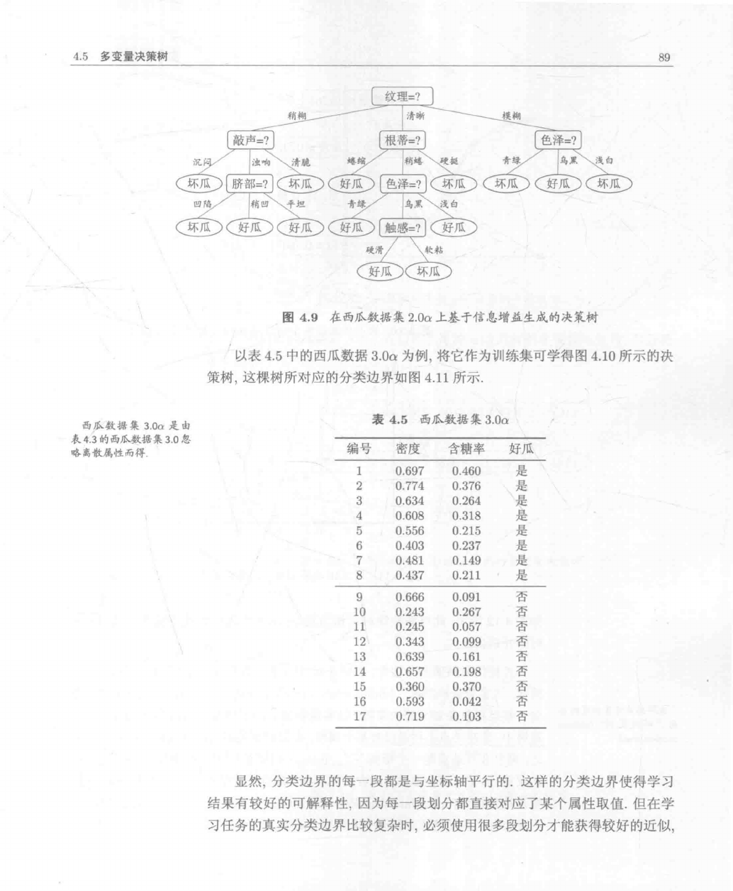
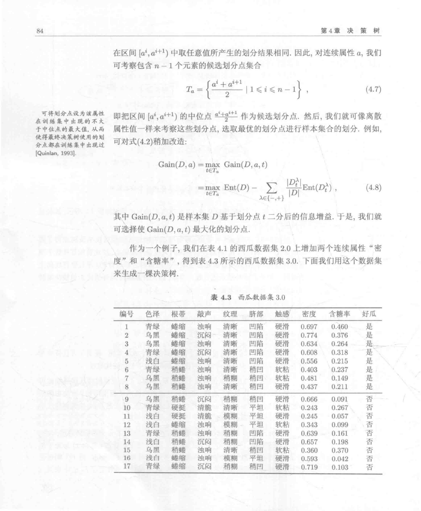
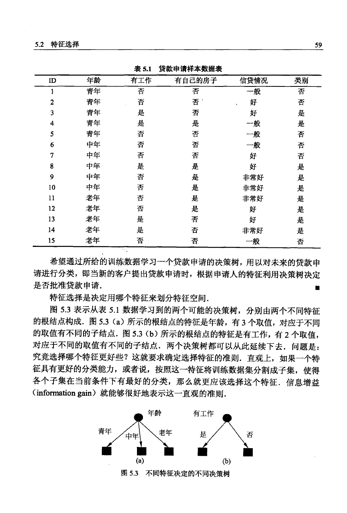
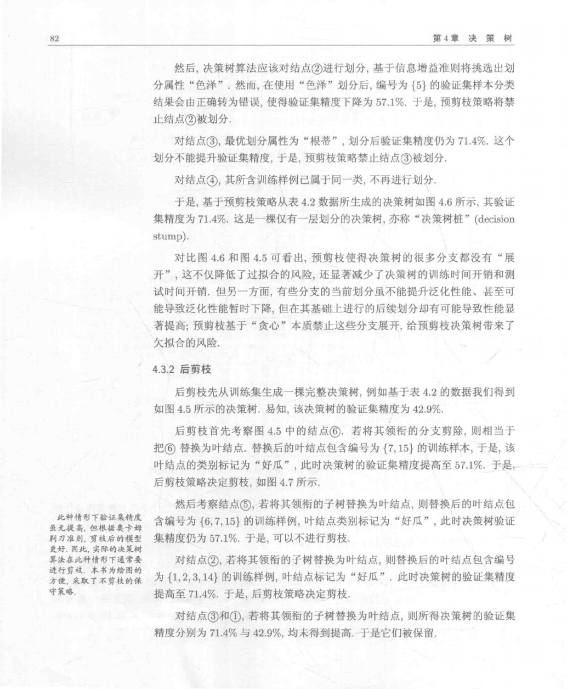
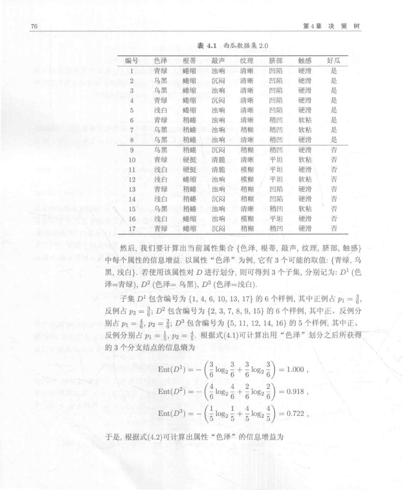
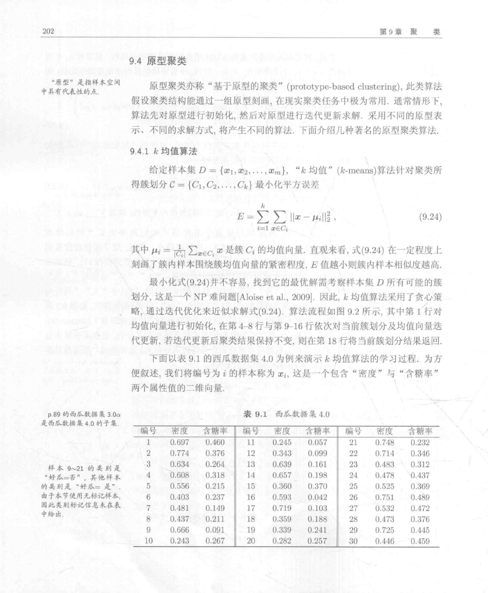
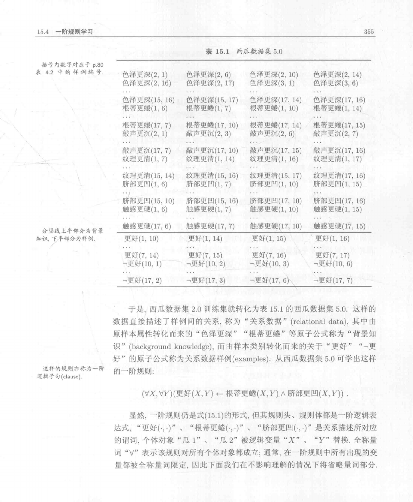
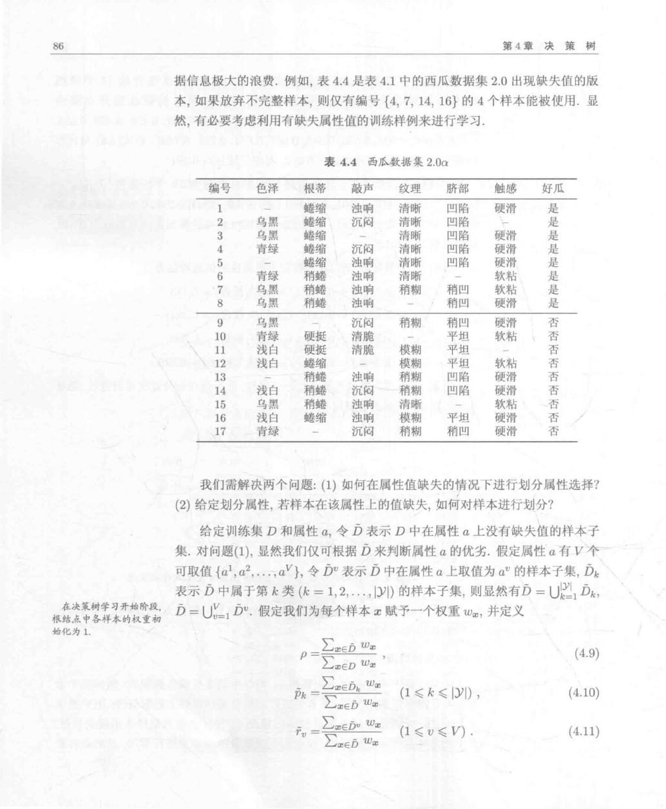

# 机器学习习题与简解

**版本日期：** 2026-10-10。

**状态：** 当前登记190道独立教材题，按直接关联知识点展示191条；187道有中文题干和简解，3道原题冲突、0道依赖缺失资料、0道证明待补，均不计入可直接采用的完整解答数。逐章处理状态另记覆盖表。扩展题库另置空目录。

## 来源、版本与范围

- **主源判定：** 周志华《机器学习》，清华大学出版社，2016年；书页 p = PDF 第 p+15 页。大纲列至第12章，本次按主教材并集保留第13—16章。
- **主教材：** 《机器学习》原件（不随资源包附送）；SHA-256：`cecfad179b1ceffd8dcbdec0294f4f297059e1958a5f553a3e232b5dbcbabbc1`。
- **参考书：** 《统计学习方法》原件（不随资源包附送）；SHA-256：`d64e3b0e19cbbff38d211acb36a6b661b8282e5fbb0710600615aa9c28b43f99`。
- **课程大纲参考：** 《机器学习》原件（不随资源包附送）；SHA-256：`42d1b634a196cc7bfdd300cfb02da11853ea062d26f34e6dbbb636ae208992d7`。
- 主教材全章、附录及大纲并集已按覆盖表整理；参考书以逐项注明的相关节和原题精选补充。主教材与参考书的印刷页/PDF页对应分别见每条来源。
- 编号题原页及歧义公式按各课覆盖记录处理。自拟简解与教材提示整理分别标示；明确的原题冲突在题末记录。覆盖、数量与校验记录见根目录处理记录中的课程覆盖报告。教师最终审核及平台试导入尚未执行。

## 目录

- [第1章 绪论](#group-ch01)
- [第2章 模型评估与选择](#group-ch02)
- [第3章 线性模型](#group-ch03)
- [第4章 决策树](#group-ch04)
- [第5章 神经网络](#group-ch05)
- [第6章 支持向量机](#group-ch06)
- [第7章 贝叶斯分类器](#group-ch07)
- [第8章 集成学习](#group-ch08)
- [第9章 聚类](#group-ch09)
- [第10章 降维与度量学习](#group-ch10)
- [第11章 特征选择与稀疏学习](#group-ch11)
- [第12章 计算学习理论](#group-ch12)
- [第13章 半监督学习](#group-ch13)
- [第14章 概率图模型](#group-ch14)
- [第15章 规则学习](#group-ch15)
- [第16章 强化学习](#group-ch16)
- [附录1 矩阵](#group-app01)
- [附录2 优化](#group-app02)
- [附录3 概率分布](#group-app03)

## 课程总览

同题可在多个直接对应知识点下完整展示，重复展示不增加独立题数。原题的小问合并保留；难度按课程层次估为1—5，来源与自拟解答分别标示。

## 第1章 绪论

[学习问题与归纳偏好](#kp-ch01-inductive-bias)；[学习与泛化](#kp-a-ch01-learning)；[样本、属性与特征空间](#kp-a-ch01-sample)；[分类、回归和聚类](#kp-a-ch01-task)；[监督与无监督学习](#kp-a-ch01-supervision)；[归纳学习与演绎](#kp-a-ch01-induction)；[假设空间](#kp-a-ch01-hypothesis)；[版本空间](#kp-a-ch01-version)；[合取式与析合范式](#kp-a-ch01-conjunction)；[归纳偏好](#kp-a-ch01-bias)；[奥卡姆剃刀的范围](#kp-a-ch01-occam)；[没有免费的午餐的前提](#kp-a-ch01-nfl)；[搜索中的学习任务](#kp-a-ch01-search-application)；[Bernoulli的MLE与Bayes估计](#kp-b-ch01-bernoulli)

### 学习问题与归纳偏好

**图谱路径：** 机器学习 / 第1章 绪论 / 学习问题与归纳偏好

**知识内容：** [定义、定理与方法](知识点.md#kp-ch01-inductive-bias)

<!-- source-exercise:A-ch01-1.3 -->
1. 若数据含噪声，假设空间中可能不存在与全部训练样本一致的假设。设计一种用于选择假设的归纳偏好。

   **答案：** 可选择带复杂度惩罚的经验风险最小化：$\hat h=\arg\min_h[\sum_i\ell(h(x_i),y_i)+\lambda C(h)]$，例如以训练错分数作损失、树的叶节点数或规则数作复杂度。用验证集选 $\lambda$，允许少量训练错误而避免盲目拟合噪声。归纳偏好并非唯一，本答案是一个可行方案。

   **难度：3/5；出处：** 主教材第1章习题1.3，书页19（PDF第34页），原题号习题1.3；**解答来源：** 自拟简解。

### 学习与泛化

**图谱路径：** 机器学习 / 第1章 绪论 / 学习与泛化

**知识内容：** [定义、定理与方法](知识点.md#kp-a-ch01-learning)

已整理范围内未另选可直接对应此节点的独立未解题；相关已解例子见知识内容。

### 样本、属性与特征空间

**图谱路径：** 机器学习 / 第1章 绪论 / 样本、属性与特征空间

**知识内容：** [定义、定理与方法](知识点.md#kp-a-ch01-sample)

已整理范围内未另选可直接对应此节点的独立未解题；相关已解例子见知识内容。

### 分类、回归和聚类

**图谱路径：** 机器学习 / 第1章 绪论 / 分类、回归和聚类

**知识内容：** [定义、定理与方法](知识点.md#kp-a-ch01-task)

已整理范围内未另选可直接对应此节点的独立未解题；相关已解例子见知识内容。

### 监督与无监督学习

**图谱路径：** 机器学习 / 第1章 绪论 / 监督与无监督学习

**知识内容：** [定义、定理与方法](知识点.md#kp-a-ch01-supervision)

已整理范围内未另选可直接对应此节点的独立未解题；相关已解例子见知识内容。

### 归纳学习与演绎

**图谱路径：** 机器学习 / 第1章 绪论 / 归纳学习与演绎

**知识内容：** [定义、定理与方法](知识点.md#kp-a-ch01-induction)

已整理范围内未另选可直接对应此节点的独立未解题；相关已解例子见知识内容。

### 假设空间

**图谱路径：** 机器学习 / 第1章 绪论 / 假设空间

**知识内容：** [定义、定理与方法](知识点.md#kp-a-ch01-hypothesis)

已整理范围内未另选可直接对应此节点的独立未解题；相关已解例子见知识内容。

### 版本空间

**图谱路径：** 机器学习 / 第1章 绪论 / 版本空间

**知识内容：** [定义、定理与方法](知识点.md#kp-a-ch01-version)

<!-- source-exercise:A-ch01-1.1 -->
1. 表1.1只保留样例1（青绿、蜷缩、浊响、好瓜）和4（乌黑、稍蜷、沉闷、坏瓜），给出版本空间。

   **答案：** 合取式每属性只能取正例值或*，共$2^3=8$个能接纳正例的假设。负例在三属性均不同，因此只有全*错误接纳它，排除后余7个：分别只限定色泽、根蒂、敲声，限定三对属性以及限定全部三属性。恒假不能接纳正例。

   **难度：2/5；出处：** A：周志华《机器学习》，2016年第一版，ISBN9787302423287，第1章习题1.1，书页19（PDF第34页），原题号1.1；**解答来源：** 自拟简解。

### 合取式与析合范式

**图谱路径：** 机器学习 / 第1章 绪论 / 合取式与析合范式

**知识内容：** [定义、定理与方法](知识点.md#kp-a-ch01-conjunction)

<!-- source-exercise:A-ch01-1.2 -->
1. 最多$k$个合取式的析合范式表示表1.1分类假设，估算可能假设数。例：$(色泽=*)\wedge(根蒂=蜷缩)\wedge(敲声=*)$与$(色泽=乌黑)\wedge(根蒂=*)\wedge(敲声=沉闷)$的析取。须考虑冗余。

   **答案：** 设三属性取值数$n_1,n_2,n_3$，非空合取模式$M=\prod_j(n_j+1)$，取不重复项、忽略顺序的语法上界为$\sum_{r=0}^{\min(k,M)}\binom Mr$。吸收律仍使不同项集等价，实际语义数不超过$\min(2^{n_1n_2n_3},该上界)$；全*吸收所有项。精确数可枚举每项覆盖集合，以其并集为位图去重。§1.3假设的3、2、2域给$M=36$，$k=1,2,3,4,5,6$的枚举语义数分别37、412、1870、3484、4042、4096；若用表中其他取值域须重新枚举，不混用。

   **难度：4/5；出处：** A：周志华《机器学习》，2016年第一版，ISBN9787302423287，第1章习题1.2，书页19（PDF第34页），原题号1.2；**解答来源：** 自拟简解。

   **整理说明：** 枚举结果由有限集合动态规划复算，题目只要求估算；合取模式数不等于析合范式语义数。

### 归纳偏好

**图谱路径：** 机器学习 / 第1章 绪论 / 归纳偏好

**知识内容：** [定义、定理与方法](知识点.md#kp-a-ch01-bias)

<!-- source-exercise:A-ch01-1.3 -->
1. 若数据含噪声，假设空间中可能不存在与全部训练样本一致的假设。设计一种用于选择假设的归纳偏好。

   **答案：** 可选择带复杂度惩罚的经验风险最小化：$\hat h=\arg\min_h[\sum_i\ell(h(x_i),y_i)+\lambda C(h)]$，例如以训练错分数作损失、树的叶节点数或规则数作复杂度。用验证集选 $\lambda$，允许少量训练错误而避免盲目拟合噪声。归纳偏好并非唯一，本答案是一个可行方案。

   **难度：3/5；出处：** 主教材第1章习题1.3，书页19（PDF第34页），原题号习题1.3；**解答来源：** 自拟简解。

### 奥卡姆剃刀的范围

**图谱路径：** 机器学习 / 第1章 绪论 / 奥卡姆剃刀的范围

**知识内容：** [定义、定理与方法](知识点.md#kp-a-ch01-occam)

已整理范围内未另选可直接对应此节点的独立未解题；相关已解例子见知识内容。

### 没有免费的午餐的前提

**图谱路径：** 机器学习 / 第1章 绪论 / 没有免费的午餐的前提

**知识内容：** [定义、定理与方法](知识点.md#kp-a-ch01-nfl)

<!-- source-exercise:A-ch01-1.4 -->
1. 把分类错误率换任意性能度量$\ell$：$E_{\rm ote}=\sum_{h,x\notin X}P(x)\ell(h(x),f(x))P(h|X,\mathcal L)$，证明NFL仍成立。

   **答案：** 原题对任意$\ell$的结论过强。反例二类损失$\ell(0,0)=\ell(0,1)=0$，$\ell(1,0)=\ell(1,1)=1$，恒预测0比恒预测1平均更优。若补充各预测标签的损失行和相同，在均匀遍历全部目标时每未见点真实标签均匀，$E_f\ell(a,f(x))$与$a$无关，再对算法预测分布求和得到相同风险。对称0/1损失满足此条件。

   **难度：4/5；出处：** A：周志华《机器学习》，2016年第一版，ISBN9787302423287，第1章习题1.4，书页19（PDF第34页），原题号1.4；**解答来源：** 自拟简解。

   **勘误：** 书页19习题1.4未限定损失对称/各预测行和相同，任意损失版本存在上述反例。保留原题并给条件化结论，不能伪写无条件证明。

### 搜索中的学习任务

**图谱路径：** 机器学习 / 第1章 绪论 / 搜索中的学习任务

**知识内容：** [定义、定理与方法](知识点.md#kp-a-ch01-search-application)

<!-- source-exercise:A-ch01-1.5 -->
1. 机器学习可在互联网搜索哪些环节发挥什么作用？

   **答案：** 查询理解识别意图和实体，召回学习相关表示，排序估计相关性，点击预测作反馈，垃圾检测过滤低质内容。各环节分别定义输入、标签和指标；点击数据有曝光/位置偏差，训练离线排序改善需独立评价。

   **难度：2/5；出处：** A：周志华《机器学习》，2016年第一版，ISBN9787302423287，第1章习题1.5，书页19（PDF第34页），原题号1.5；**解答来源：** 自拟简解。

### Bernoulli的MLE与Bayes估计

**图谱路径：** 机器学习 / 第1章 绪论 / Bernoulli的MLE与Bayes估计

**知识内容：** [定义、定理与方法](知识点.md#kp-b-ch01-bernoulli)

<!-- source-exercise:B-ch01-1.1 -->
1. Bernoulli n次观测k个1，说明MLE和Bayes估计的模型、策略、算法三要素。

   **答案：** 模型$p^y(1-p)^{1-y}$，MLE策略最大$k\log p+(n-k)\log(1-p)$，求导给k/n，边界k=0或n处理。Bayes加Beta(a,b)先验，后验同族；平方损失Bayes估计为后验均值$(a+k)/(a+b+n)$，算法共轭更新。若采用MAP须说明先验和边界。

   **难度：2/5；出处：** B：李航《统计学习方法》，2012年第一版，ISBN9787302275954（实际附件，非大纲书号版本），第1章习题1.1，书页23（PDF第39页），原题号1.1；**解答来源：** 自拟简解。

## 第2章 模型评估与选择

[模型评估与选择](#kp-ch02-cross-validation)；[经验误差与泛化误差](#kp-a-ch02-error)；[过拟合与欠拟合](#kp-a-ch02-overfit)；[留出法](#kp-a-ch02-holdout)；[分层采样](#kp-a-ch02-stratified)；[交叉验证](#kp-a-ch02-cross-validation)；[留一法](#kp-a-ch02-loo)；[自助采样](#kp-a-ch02-bootstrap)；[调参与验证集](#kp-a-ch02-validation)；[二分类混淆矩阵](#kp-a-ch02-confusion)；[错误率和精度](#kp-a-ch02-accuracy)；[查准率与查全率](#kp-a-ch02-precision-recall)；[F1与Fβ](#kp-a-ch02-fmeasure)；[宏平均和微平均](#kp-a-ch02-macro-micro)；[P-R曲线和BEP](#kp-a-ch02-pr)；[ROC曲线](#kp-a-ch02-roc)；[AUC的排序解释](#kp-a-ch02-auc)；[非均等误判代价](#kp-a-ch02-cost)；[代价曲线](#kp-a-ch02-cost-curve)；[Min-max与Z-score](#kp-a-ch02-normalization)；[二项检验](#kp-a-ch02-binomial-test)；[配对t检验](#kp-a-ch02-paired-t)；[McNemar检验](#kp-a-ch02-mcnemar)；[Friedman与后续比较](#kp-a-ch02-friedman)；[偏差—方差—噪声分解](#kp-a-ch02-bias-variance)

### 模型评估与选择

**图谱路径：** 机器学习 / 第2章 模型评估与选择 / 模型评估与选择

**知识内容：** [定义、定理与方法](知识点.md#kp-ch02-cross-validation)

已整理范围内未另选可直接对应此节点的独立未解题；相关已解例子见知识内容。

### 经验误差与泛化误差

**图谱路径：** 机器学习 / 第2章 模型评估与选择 / 经验误差与泛化误差

**知识内容：** [定义、定理与方法](知识点.md#kp-a-ch02-error)

已整理范围内未另选可直接对应此节点的独立未解题；相关已解例子见知识内容。

### 过拟合与欠拟合

**图谱路径：** 机器学习 / 第2章 模型评估与选择 / 过拟合与欠拟合

**知识内容：** [定义、定理与方法](知识点.md#kp-a-ch02-overfit)

已整理范围内未另选可直接对应此节点的独立未解题；相关已解例子见知识内容。

### 留出法

**图谱路径：** 机器学习 / 第2章 模型评估与选择 / 留出法

**知识内容：** [定义、定理与方法](知识点.md#kp-a-ch02-holdout)

已整理范围内未另选可直接对应此节点的独立未解题；相关已解例子见知识内容。

### 分层采样

**图谱路径：** 机器学习 / 第2章 模型评估与选择 / 分层采样

**知识内容：** [定义、定理与方法](知识点.md#kp-a-ch02-stratified)

<!-- source-exercise:A-ch02-2.1 -->
1. 1000样本（500正、500反）划70%训练、30%测试，估算划分方式数。

   **答案：** 若要求保持类比例，训练各350，方式$\binom{500}{350}^2$。若只要求总训练700、未限定分层，则$\binom{1000}{700}$。两种计数条件不同，教材留出法建议分层但原题需说明采用哪一约束。

   **难度：2/5；出处：** A：周志华《机器学习》，2016年第一版，ISBN9787302423287，第2章习题2.1，书页48（PDF第63页），原题号2.1；**解答来源：** 自拟简解。

### 交叉验证

**图谱路径：** 机器学习 / 第2章 模型评估与选择 / 交叉验证

**知识内容：** [定义、定理与方法](知识点.md#kp-a-ch02-cross-validation)

已整理范围内未另选可直接对应此节点的独立未解题；相关已解例子见知识内容。

### 留一法

**图谱路径：** 机器学习 / 第2章 模型评估与选择 / 留一法

**知识内容：** [定义、定理与方法](知识点.md#kp-a-ch02-loo)

<!-- source-exercise:A-ch02-2.2 -->
1. 100样本正反各50，模型总预测训练多数类，平数随机猜。比较10折交叉验证和留一错误率。

   **答案：** 分层10折每测试折正反各5，训练各45，随机猜期望错误率1/2。非分层时第折有$k_j$正例，训练多数类与测试多数类相反，期望错数$\max(k_j,10-k_j)$，总体$\sum_j\max(k_j,10-k_j)/100$，不一定1/2。留一删正则训练反多数、删反则正多数，每次必错，错误率1。

   **难度：3/5；出处：** A：周志华《机器学习》，2016年第一版，ISBN9787302423287，第2章习题2.2，书页48（PDF第63页），原题号2.2；**解答来源：** 自拟简解。

### 自助采样

**图谱路径：** 机器学习 / 第2章 模型评估与选择 / 自助采样

**知识内容：** [定义、定理与方法](知识点.md#kp-a-ch02-bootstrap)

已整理范围内未另选可直接对应此节点的独立未解题；相关已解例子见知识内容。

### 调参与验证集

**图谱路径：** 机器学习 / 第2章 模型评估与选择 / 调参与验证集

**知识内容：** [定义、定理与方法](知识点.md#kp-a-ch02-validation)

已整理范围内未另选可直接对应此节点的独立未解题；相关已解例子见知识内容。

### 二分类混淆矩阵

**图谱路径：** 机器学习 / 第2章 模型评估与选择 / 二分类混淆矩阵

**知识内容：** [定义、定理与方法](知识点.md#kp-a-ch02-confusion)

已整理范围内未另选可直接对应此节点的独立未解题；相关已解例子见知识内容。

### 错误率和精度

**图谱路径：** 机器学习 / 第2章 模型评估与选择 / 错误率和精度

**知识内容：** [定义、定理与方法](知识点.md#kp-a-ch02-accuracy)

已整理范围内未另选可直接对应此节点的独立未解题；相关已解例子见知识内容。

### 查准率与查全率

**图谱路径：** 机器学习 / 第2章 模型评估与选择 / 查准率与查全率

**知识内容：** [定义、定理与方法](知识点.md#kp-a-ch02-precision-recall)

<!-- source-exercise:A-ch02-2.4 -->
1. 说明TPR、FPR、查准率P和查全率R的联系。

   **答案：** $R=TPR$。正例先验$\pi=N_+/N$时$P=\pi TPR/[\pi TPR+(1-\pi)FPR]$。同ROC点改变类先验可改变P，故P-R曲线与ROC的归一化信息不同。分母0另定约定。

   **难度：2/5；出处：** A：周志华《机器学习》，2016年第一版，ISBN9787302423287，第2章习题2.4，书页48（PDF第63页），原题号2.4；**解答来源：** 自拟简解。

### F1与Fβ

**图谱路径：** 机器学习 / 第2章 模型评估与选择 / F1与Fβ

**知识内容：** [定义、定理与方法](知识点.md#kp-a-ch02-fmeasure)

已整理范围内未另选可直接对应此节点的独立未解题；相关已解例子见知识内容。

### 宏平均和微平均

**图谱路径：** 机器学习 / 第2章 模型评估与选择 / 宏平均和微平均

**知识内容：** [定义、定理与方法](知识点.md#kp-a-ch02-macro-micro)

已整理范围内未另选可直接对应此节点的独立未解题；相关已解例子见知识内容。

### P-R曲线和BEP

**图谱路径：** 机器学习 / 第2章 模型评估与选择 / P-R曲线和BEP

**知识内容：** [定义、定理与方法](知识点.md#kp-a-ch02-pr)

<!-- source-exercise:A-ch02-2.3 -->
1. A的F1大于B，A的BEP是否也更大？

   **答案：** 不一定。F1是某阈值单点，BEP取整条曲线$P=R$交点。构造交叉P-R曲线，使A在所选点较高、在平衡点较低即可；阈值不指定时甚至同模型可有不同F1。只有整曲线适当支配且平衡定义一致时才能推相应排序。

   **难度：2/5；出处：** A：周志华《机器学习》，2016年第一版，ISBN9787302423287，第2章习题2.3，书页48（PDF第63页），原题号2.3；**解答来源：** 自拟简解。

### ROC曲线

**图谱路径：** 机器学习 / 第2章 模型评估与选择 / ROC曲线

**知识内容：** [定义、定理与方法](知识点.md#kp-a-ch02-roc)

<!-- source-exercise:A-ch02-2.6 -->
1. 错误率与ROC曲线的联系？

   **答案：** 指定阈值ROC点$(FPR,TPR)$，错误率$\pi(1-TPR)+(1-\pi)FPR$。曲线能给各阈值点，但需先验$\pi$才能算误差；AUC只给整体排序，不确定单点错误率。

   **难度：2/5；出处：** A：周志华《机器学习》，2016年第一版，ISBN9787302423287，第2章习题2.6，书页48（PDF第63页），原题号2.6；**解答来源：** 自拟简解。

### AUC的排序解释

**图谱路径：** 机器学习 / 第2章 模型评估与选择 / AUC的排序解释

**知识内容：** [定义、定理与方法](知识点.md#kp-a-ch02-auc)

<!-- source-exercise:A-ch02-2.5 -->
1. 证明（2.22）$AUC=1-\ell_{\rm rank}$，排序损失把正例低于负例记1，并列记1/2。

   **答案：** 每正负对，正分数高贡献1、低贡献0、同分贡献1/2到AUC的排序解释，三者恰为对应损失的补数。对$m_+m_-$对平均得结论；ROC阶梯/并列梯形面积与这一计数一致。须正负样本数均非零。

   **难度：2/5；出处：** A：周志华《机器学习》，2016年第一版，ISBN9787302423287，第2章习题2.5，书页48（PDF第63页），原题号2.5；**解答来源：** 自拟简解。

### 非均等误判代价

**图谱路径：** 机器学习 / 第2章 模型评估与选择 / 非均等误判代价

**知识内容：** [定义、定理与方法](知识点.md#kp-a-ch02-cost)

已整理范围内未另选可直接对应此节点的独立未解题；相关已解例子见知识内容。

### 代价曲线

**图谱路径：** 机器学习 / 第2章 模型评估与选择 / 代价曲线

**知识内容：** [定义、定理与方法](知识点.md#kp-a-ch02-cost-curve)

<!-- source-exercise:A-ch02-2.7 -->
1. 证明ROC与代价曲线的对应，反之亦然。

   **答案：** ROC点$(u,v)$对应成本直线$y(P_c)=u(1-P_c)+(1-v)P_c$，端点可恢复$u$和$1-v$。整ROC点族形成直线族及下包络。若“代价曲线”仅指最小成本包络，劣于包络的ROC点丢失，逆只能恢复相关凸包部分而非原曲线全部细节。

   **难度：3/5；出处：** A：周志华《机器学习》，2016年第一版，ISBN9787302423287，第2章习题2.7，书页48（PDF第63页），原题号2.7；**解答来源：** 自拟简解。

   **整理说明：** 一一对应成立于保留全部点对应直线的表示；只保留包络时信息不可逆。

### Min-max与Z-score

**图谱路径：** 机器学习 / 第2章 模型评估与选择 / Min-max与Z-score

**知识内容：** [定义、定理与方法](知识点.md#kp-a-ch02-normalization)

<!-- source-exercise:A-ch02-2.8 -->
1. 比较$x'=x'_{\min}+\frac{x-x_{\min}}{x_{\max}-x_{\min}}(x'_{\max}-x'_{\min})$与$x'=(x-\bar x)/s$的优缺点。

   **答案：** Min-max固定训练范围，便于统一界，但异常极值会压缩其他点且新点可超界。Z-score固定均值/尺度，保留无界范围，对异常仍敏感。常数特征单独处理，统计仅训练估计；没有普遍优胜，模型正则与距离解释须一起考虑。

   **难度：2/5；出处：** A：周志华《机器学习》，2016年第一版，ISBN9787302423287，第2章习题2.8，书页48（PDF第63页），原题号2.8；**解答来源：** 自拟简解。

### 二项检验

**图谱路径：** 机器学习 / 第2章 模型评估与选择 / 二项检验

**知识内容：** [定义、定理与方法](知识点.md#kp-a-ch02-binomial-test)

已整理范围内未另选可直接对应此节点的独立未解题；相关已解例子见知识内容。

### 配对t检验

**图谱路径：** 机器学习 / 第2章 模型评估与选择 / 配对t检验

**知识内容：** [定义、定理与方法](知识点.md#kp-a-ch02-paired-t)

已整理范围内未另选可直接对应此节点的独立未解题；相关已解例子见知识内容。

### McNemar检验

**图谱路径：** 机器学习 / 第2章 模型评估与选择 / McNemar检验

**知识内容：** [定义、定理与方法](知识点.md#kp-a-ch02-mcnemar)

<!-- source-exercise:A-ch02-2.9 -->
1. 说明χ²检验过程。

   **答案：** 建立零假设、列联表和零假设期望计数，计算$\sum(O-E)^2/E$并按相应自由度比较临界值或p值，报告显著水平及条件。教材分类器配对场景用McNemar不一致两格，连续性修正$(|b-c|-1)^2/(b+c)$；小计数宜精确二项，不能随意当独立表。

   **难度：3/5；出处：** A：周志华《机器学习》，2016年第一版，ISBN9787302423287，第2章习题2.9，书页48（PDF第63页），原题号2.9；**解答来源：** 自拟简解。

### Friedman与后续比较

**图谱路径：** 机器学习 / 第2章 模型评估与选择 / Friedman与后续比较

**知识内容：** [定义、定理与方法](知识点.md#kp-a-ch02-friedman)

<!-- source-exercise:A-ch02-2.10 -->
1. Friedman检验中（2.34）和（2.35）的区别？

   **答案：** $N$数据集、$K$算法平均秩$\bar r_j$，$\chi_F^2=\frac{12N}{K(K+1)}[\sum_j\bar r_j^2-\frac{K(K+1)^2}4]$用$\chi^2_{K-1}$近似；Iman-Davenport修正$F_F=(N-1)\chi_F^2/[N(K-1)-\chi_F^2]$用$F_{K-1,(K-1)(N-1)}$，有限样本近似不同。并列秩与退化分母须处理，后续比较需控制多重检验。

   **难度：3/5；出处：** A：周志华《机器学习》，2016年第一版，ISBN9787302423287，第2章习题2.10，书页48（PDF第63页），原题号2.10；**解答来源：** 自拟简解。

### 偏差—方差—噪声分解

**图谱路径：** 机器学习 / 第2章 模型评估与选择 / 偏差—方差—噪声分解

**知识内容：** [定义、定理与方法](知识点.md#kp-a-ch02-bias-variance)

已整理范围内未另选可直接对应此节点的独立未解题；相关已解例子见知识内容。

## 第3章 线性模型

[线性模型](#kp-ch03-logistic-regression)；[线性模型](#kp-a-ch03-linear)；[最小二乘回归](#kp-a-ch03-ols)；[偏置与中心化](#kp-a-ch03-centering)；[多元回归的矩阵解](#kp-a-ch03-multivariate)；[广义线性模型](#kp-a-ch03-glm)；[对率回归](#kp-a-ch03-logistic)；[对率回归负对数似然](#kp-a-ch03-likelihood)；[Newton法优化对率模型](#kp-a-ch03-newton)；[线性判别分析](#kp-a-ch03-lda)；[类内和类间散度](#kp-a-ch03-scatter)；[多类LDA](#kp-a-ch03-multiclass-lda)；[一对一多分类](#kp-a-ch03-ovo)；[一对其余多分类](#kp-a-ch03-ovr)；[多对多与ECOC](#kp-a-ch03-mvm)；[海明距离与纠错能力](#kp-a-ch03-hamming)；[类别不平衡的再缩放](#kp-a-ch03-imbalance)；[欠采样与过采样](#kp-a-ch03-resampling)；[多类代价敏感决策](#kp-a-ch03-cost-sensitive)；[连续Logistic分布与Bernoulli回归](#kp-b-ch06-logistic-distribution)；[最大熵的特征约束](#kp-b-ch06-maximum-entropy)；[DFP逆Hessian更新](#kp-b-ch06-dfp)；[改进迭代尺度法](#kp-b-supp-ch06-iis)

### 线性模型

**图谱路径：** 机器学习 / 第3章 线性模型 / 线性模型

**知识内容：** [定义、定理与方法](知识点.md#kp-ch03-logistic-regression)

已整理范围内未另选可直接对应此节点的独立未解题；相关已解例子见知识内容。

### 线性模型

**图谱路径：** 机器学习 / 第3章 线性模型 / 线性模型

**知识内容：** [定义、定理与方法](知识点.md#kp-a-ch03-linear)

已整理范围内未另选可直接对应此节点的独立未解题；相关已解例子见知识内容。

### 最小二乘回归

**图谱路径：** 机器学习 / 第3章 线性模型 / 最小二乘回归

**知识内容：** [定义、定理与方法](知识点.md#kp-a-ch03-ols)

已整理范围内未另选可直接对应此节点的独立未解题；相关已解例子见知识内容。

### 偏置与中心化

**图谱路径：** 机器学习 / 第3章 线性模型 / 偏置与中心化

**知识内容：** [定义、定理与方法](知识点.md#kp-a-ch03-centering)

<!-- source-exercise:A-ch03-3.1 -->
1. 何时线性模型$w^Tx+b$可不考虑偏置b？

   **答案：** 真实关系由领域约束过原点时可设0；平方回归输入、目标均中心化时最优偏置0。已有常数特征可把偏置并入权重。只中心化输入而目标均值不0不够；分类模型省偏置会限制边界必须过原点。

   **难度：2/5；出处：** A：周志华《机器学习》，2016年第一版，ISBN9787302423287，第3章习题3.1，书页69（PDF第84页），原题号3.1；**解答来源：** 自拟简解。

### 多元回归的矩阵解

**图谱路径：** 机器学习 / 第3章 线性模型 / 多元回归的矩阵解

**知识内容：** [定义、定理与方法](知识点.md#kp-a-ch03-multivariate)

已整理范围内未另选可直接对应此节点的独立未解题；相关已解例子见知识内容。

### 广义线性模型

**图谱路径：** 机器学习 / 第3章 线性模型 / 广义线性模型

**知识内容：** [定义、定理与方法](知识点.md#kp-a-ch03-glm)

已整理范围内未另选可直接对应此节点的独立未解题；相关已解例子见知识内容。

### 对率回归

**图谱路径：** 机器学习 / 第3章 线性模型 / 对率回归

**知识内容：** [定义、定理与方法](知识点.md#kp-a-ch03-logistic)

<!-- source-exercise:A-ch03-3.3 -->
1. 实现对率回归，给西瓜3.0α结果（表4.5）。

   **答案：** 用含偏置的设计矩阵，Newton迭代解Hessian方程，必要时线搜索。工具verify_book_examples.py在原17点上float64复算无正则负log似然，系数（密度、含糖率、偏置）约$(3.158330,12.521196,-4.428865)$，阈值0.5训练正确12/17，负log似然8.683661。这是训练拟合，不是独立泛化成绩。

   **难度：3/5；出处：** A：周志华《机器学习》，2016年第一版，ISBN9787302423287，第3章习题3.3，书页69（PDF第84页），原题号3.3；**解答来源：** 自拟简解。

<!-- source-exercise:A-ch03-3.4 -->
2. 选择两个UCI数据集，比较10折和留一估计对率回归错误率。

   **答案：** 每数据分别分层10折和留一，训练折内做规范化/调参，按每测试样本累积错误，报告差异与成本。10折与留一训练规模不同且折间相关；不得从本书无原始UCI附件编造分数。本轮提供复现协议，未获取外部数据。

   **难度：3/5；出处：** A：周志华《机器学习》，2016年第一版，ISBN9787302423287，第3章习题3.4，书页69（PDF第84页），原题号3.4；**解答来源：** 自拟简解。

   **实验执行状态：** 给核心实现/可复现方案；未执行外部数据实验，不提供虚构成绩

### 对率回归负对数似然

**图谱路径：** 机器学习 / 第3章 线性模型 / 对率回归负对数似然

**知识内容：** [定义、定理与方法](知识点.md#kp-a-ch03-likelihood)

<!-- source-exercise:A-ch03-3.2 -->
1. 证明对率回归平方误差目标（3.18）非凸，而（3.27）对数似然目标凸。

   **答案：** 单样本$y=0,x=1$平方项$\sigma(w)^2$二阶导$2p^2(1-p)(2-3p)$，$p>2/3$时负，因此一般非凸。式3.27实际为负对数似然，其Hessian$\sum_ip_i(1-p_i)x_ix_i^T\succeq0$，故凸；正log似然是凹，需区分符号。

   **难度：3/5；出处：** A：周志华《机器学习》，2016年第一版，ISBN9787302423287，第3章习题3.2，书页69（PDF第84页），原题号3.2；**解答来源：** 自拟简解。

   **整理说明：** 以原公式符号确定正/负对数似然，名称不能颠倒曲率。

<!-- source-exercise:B-ch06-6.2 -->
2. 写Logistic回归梯度下降算法。

   **答案：** 加常数列，初始化β，每轮$p=\sigma(X\beta)$、$g=X^T(p-y)$，以线搜索或合适η更新β−ηg，梯度/损失变化停止。平均损失则g除N。正则加相应梯度，稳定计算log-sum-exp，完全可分无正则时有限最优可能不存在。

   **难度：3/5；出处：** B：李航《统计学习方法》，2012年第一版，ISBN9787302275954（实际附件，非大纲书号版本），第6章习题6.2，书页94（PDF第110页），原题号6.2；**解答来源：** 自拟简解。

### Newton法优化对率模型

**图谱路径：** 机器学习 / 第3章 线性模型 / Newton法优化对率模型

**知识内容：** [定义、定理与方法](知识点.md#kp-a-ch03-newton)

已整理范围内未另选可直接对应此节点的独立未解题；相关已解例子见知识内容。

### 线性判别分析

**图谱路径：** 机器学习 / 第3章 线性模型 / 线性判别分析

**知识内容：** [定义、定理与方法](知识点.md#kp-a-ch03-lda)

<!-- source-exercise:A-ch03-3.5 -->
1. 实现LDA，给西瓜3.0α结果。

   **答案：** 按两类均值和类内散度求$w=S_w^{-1}(\mu_1-\mu_0)$，等先验中点阈值$b=-w^T(\mu_0+\mu_1)/2$。原17点复算$w=(0.146510,0.738716),b=-0.238294$，训练正确12/17。工具保存散度和逐点预测；改先验则阈值变化。

   **难度：3/5；出处：** A：周志华《机器学习》，2016年第一版，ISBN9787302423287，第3章习题3.5，书页69（PDF第84页），原题号3.5；**解答来源：** 自拟简解。

<!-- source-exercise:A-ch03-3.6 -->
2. 改进LDA以用于非线性可分数据。

   **答案：** 用$\phi(x)$非线性特征映射后LDA，或采用核LDA，以核矩阵表达散度并正则化。另一方案为多类/混合成分局部模型。方法扩大假设空间，需要验证核与参数，不保证任何非可分任务都高精度；LDA并非只能在完全可分数据使用。

   **难度：3/5；出处：** A：周志华《机器学习》，2016年第一版，ISBN9787302423287，第3章习题3.6，书页69（PDF第84页），原题号3.6；**解答来源：** 自拟简解。

### 类内和类间散度

**图谱路径：** 机器学习 / 第3章 线性模型 / 类内和类间散度

**知识内容：** [定义、定理与方法](知识点.md#kp-a-ch03-scatter)

已整理范围内未另选可直接对应此节点的独立未解题；相关已解例子见知识内容。

### 多类LDA

**图谱路径：** 机器学习 / 第3章 线性模型 / 多类LDA

**知识内容：** [定义、定理与方法](知识点.md#kp-a-ch03-multiclass-lda)

已整理范围内未另选可直接对应此节点的独立未解题；相关已解例子见知识内容。

### 一对一多分类

**图谱路径：** 机器学习 / 第3章 线性模型 / 一对一多分类

**知识内容：** [定义、定理与方法](知识点.md#kp-a-ch03-ovo)

已整理范围内未另选可直接对应此节点的独立未解题；相关已解例子见知识内容。

### 一对其余多分类

**图谱路径：** 机器学习 / 第3章 线性模型 / 一对其余多分类

**知识内容：** [定义、定理与方法](知识点.md#kp-a-ch03-ovr)

<!-- source-exercise:A-ch03-3.9 -->
1. OvR和MvM分解多分类，为何通常无需专门处理类别不平衡？

   **答案：** 教材经验建议不能无条件证明：OvR某类只有1%时子问题显著不平衡，MvM分组也可能不等。若分解与决策保持正确先验、损失和分数可比，类别比例可由原多类目标处理；否则需要阈值、加权或采样。必须区分原任务比例和人为分解引入的比例。

   **难度：3/5；出处：** A：周志华《机器学习》，2016年第一版，ISBN9787302423287，第3章习题3.9，书页69（PDF第84页），原题号3.9；**解答来源：** 自拟简解。

   **整理说明：** 给出适用条件与反例，不把经验建议扩成普遍命题。

### 多对多与ECOC

**图谱路径：** 机器学习 / 第3章 线性模型 / 多对多与ECOC

**知识内容：** [定义、定理与方法](知识点.md#kp-a-ch03-mvm)

<!-- source-exercise:A-ch03-3.8 -->
1. ECOC纠错理想条件为各位误码率相当且独立，讨论二类学习器是否满足及影响。

   **答案：** 同数据、相近任务和共享特征使错误相关，类别分组难度不同使误码率不等；理想条件通常只是近似。相关错误可多位同时错，独立二项尾界失效。可用不同划分/属性/算法并验证成对错误，但不能通过设计自动保证独立。

   **难度：3/5；出处：** A：周志华《机器学习》，2016年第一版，ISBN9787302423287，第3章习题3.8，书页69（PDF第84页），原题号3.8；**解答来源：** 自拟简解。

### 海明距离与纠错能力

**图谱路径：** 机器学习 / 第3章 线性模型 / 海明距离与纠错能力

**知识内容：** [定义、定理与方法](知识点.md#kp-a-ch03-hamming)

<!-- source-exercise:A-ch03-3.7 -->
1. 码长9、类别4，构造海明距离理论最优二元ECOC码并证明。

   **答案：** 取000000000、111111000、111000111、000111111，六对距离均6。任一位把4码分成$r$与$4-r$，贡献$r(4-r)\le4$，故六对总距不超过36，最小距不超过6。所给码达上界，可纠2位错。

   **难度：3/5；出处：** A：周志华《机器学习》，2016年第一版，ISBN9787302423287，第3章习题3.7，书页69（PDF第84页），原题号3.7；**解答来源：** 自拟简解。

### 类别不平衡的再缩放

**图谱路径：** 机器学习 / 第3章 线性模型 / 类别不平衡的再缩放

**知识内容：** [定义、定理与方法](知识点.md#kp-a-ch03-imbalance)

已整理范围内未另选可直接对应此节点的独立未解题；相关已解例子见知识内容。

### 欠采样与过采样

**图谱路径：** 机器学习 / 第3章 线性模型 / 欠采样与过采样

**知识内容：** [定义、定理与方法](知识点.md#kp-a-ch03-resampling)

已整理范围内未另选可直接对应此节点的独立未解题；相关已解例子见知识内容。

### 多类代价敏感决策

**图谱路径：** 机器学习 / 第3章 线性模型 / 多类代价敏感决策

**知识内容：** [定义、定理与方法](知识点.md#kp-a-ch03-cost-sensitive)

<!-- source-exercise:A-ch03-3.10 -->
1. 多类仅按真实类别设置误判代价时，再缩放何时理论最优？

   **答案：** 若正确代价0、错把真实$c$判任何别类均为$\lambda_c>0$，风险$R(a|x)=\sum_{c\ne a}\lambda_cp_c=\sum_c\lambda_cp_c-\lambda_ap_a$，故取最大$\lambda_ap_a$。任意矩阵只有各行错判同代价等结构才这样化简；若估计先验被重采样改变，还需目标先验修正。

   **难度：4/5；出处：** A：周志华《机器学习》，2016年第一版，ISBN9787302423287，第3章习题3.10，书页69（PDF第84页），原题号3.10；**解答来源：** 自拟简解。

### 连续Logistic分布与Bernoulli回归

**图谱路径：** 机器学习 / 第3章 线性模型 / 连续Logistic分布与Bernoulli回归

**知识内容：** [定义、定理与方法](知识点.md#kp-b-ch06-logistic-distribution)

<!-- source-exercise:B-ch06-6.1 -->
1. 确认Logistic分布属于指数族。

   **答案：** 若指回归中Bernoulli：$p(y|z)=\exp(yz-\log(1+e^z))$是指数族。但本章定义的连续Logistic位置族一般不是有限维正则指数族。固定s=1、t=e^{-x}，位置score为$1-2e^\mu t/(1+e^\mu t)$；不同μ有不同极点，任意有限组非平凡线性组合不能消各独有极点，故scores张成无限维，违反有限充分统计指数族。不能把Bernoulli证明当连续分布证明。

   **难度：5/5；出处：** B：李航《统计学习方法》，2012年第一版，ISBN9787302275954（实际附件，非大纲书号版本），第6章习题6.1，书页94（PDF第110页），原题号6.1；**解答来源：** 自拟简解。

   **勘误：** 书页94习题6.1混淆连续Logistic分布与Logistic回归的条件Bernoulli族。可确认后者；原连续位置尺度族的有限指数族断言不成立。

### 最大熵的特征约束

**图谱路径：** 机器学习 / 第3章 线性模型 / 最大熵的特征约束

**知识内容：** [定义、定理与方法](知识点.md#kp-b-ch06-maximum-entropy)

已整理范围内未另选可直接对应此节点的独立未解题；相关已解例子见知识内容。

### DFP逆Hessian更新

**图谱路径：** 机器学习 / 第3章 线性模型 / DFP逆Hessian更新

**知识内容：** [定义、定理与方法](知识点.md#kp-b-ch06-dfp)

<!-- source-exercise:B-ch06-6.3 -->
1. 写最大熵模型的DFP学习。

   **答案：** 目标负条件log似然，$g_k=\sum_iE_{p_w(\cdot|x_i)}f_k(x_i,Y)-\sum_if_k(x_i,y_i)$。初始化G正定，d=−Gg，线搜索η，s=ηd、z=g_new−g，按DFP更新。检验sTz>0及分母，失败重置/阻尼；计算配分和期望按模型，最后返回w。

   **难度：4/5；出处：** B：李航《统计学习方法》，2012年第一版，ISBN9787302275954（实际附件，非大纲书号版本），第6章习题6.3，书页94（PDF第110页），原题号6.3；**解答来源：** 自拟简解。

### 改进迭代尺度法

**图谱路径：** 机器学习 / 第3章 线性模型 / 改进迭代尺度法

**知识内容：** [定义、定理与方法](知识点.md#kp-b-supp-ch06-iis)

已整理范围内未另选可直接对应此节点的独立未解题；相关已解例子见知识内容。

## 第4章 决策树

[决策树](#kp-ch04-decision-tree)；[决策树结构与预测](#kp-a-ch04-tree)；[树生成的停止条件](#kp-a-ch04-stopping)；[信息熵](#kp-a-ch04-entropy)；[信息增益](#kp-a-ch04-information-gain)；[增益率](#kp-a-ch04-gain-ratio)；[基尼指数](#kp-a-ch04-gini)；[预剪枝](#kp-a-ch04-pre-pruning)；[后剪枝](#kp-a-ch04-post-pruning)；[连续属性的二分阈值](#kp-a-ch04-continuous)；[缺失属性的划分评价](#kp-a-ch04-missing-gain)；[缺失样本的权重传播](#kp-a-ch04-missing-route)；[多变量决策树](#kp-a-ch04-multivariate)；[队列式树生成](#kp-a-ch04-breadth-first)；[最小训练误差划分的不足](#kp-a-ch04-training-error)；[树算法的受控比较](#kp-a-ch04-validation-comparison)；[西瓜表的离散与连续输入](#kp-a-ch04-watermelon)；[CART平方误差回归树](#kp-b-ch05-cart-regression)；[CART代价复杂度剪枝](#kp-b-ch05-cost-complexity)

### 决策树

**图谱路径：** 机器学习 / 第4章 决策树 / 决策树

**知识内容：** [定义、定理与方法](知识点.md#kp-ch04-decision-tree)

已整理范围内未另选可直接对应此节点的独立未解题；相关已解例子见知识内容。

### 决策树结构与预测

**图谱路径：** 机器学习 / 第4章 决策树 / 决策树结构与预测

**知识内容：** [定义、定理与方法](知识点.md#kp-a-ch04-tree)

已整理范围内未另选可直接对应此节点的独立未解题；相关已解例子见知识内容。

### 树生成的停止条件

**图谱路径：** 机器学习 / 第4章 决策树 / 树生成的停止条件

**知识内容：** [定义、定理与方法](知识点.md#kp-a-ch04-stopping)

<!-- source-exercise:A-ch04-4.1 -->
1. 不含相同特征不同标签的有限训练集，证明存在零训练误差树。

   **答案：** 任意异类样本至少一属性不同，依次用属性值/有限连续阈值区分全部不同向量，叶中相同向量标签一致，输出该标签。有限属性和样本使树有限；若完全相同向量异标签，任何确定输入函数都不能同时满足。

   **难度：2/5；出处：** A：周志华《机器学习》，2016年第一版，ISBN9787302423287，第4章习题4.1，书页93（PDF第108页），原题号4.1；**解答来源：** 自拟简解。

### 信息熵

**图谱路径：** 机器学习 / 第4章 决策树 / 信息熵

**知识内容：** [定义、定理与方法](知识点.md#kp-a-ch04-entropy)

已整理范围内未另选可直接对应此节点的独立未解题；相关已解例子见知识内容。

### 信息增益

**图谱路径：** 机器学习 / 第4章 决策树 / 信息增益

**知识内容：** [定义、定理与方法](知识点.md#kp-a-ch04-information-gain)

<!-- source-exercise:A-ch04-4.3 -->
1. 实现信息熵划分树，为表4.3生成决策树。

   **答案：** 每结点评估离散分支与连续相邻中点，最大化加权熵下降，再递归。原17样本按属性顺序破同值平局复算，根为纹理；清晰分支密度阈值0.3815，稍糊分支触感，模糊为坏瓜，完整树见工具输出，训练17/17正确。连续属性可重复使用。

   **难度：3/5；出处：** A：周志华《机器学习》，2016年第一版，ISBN9787302423287，第4章习题4.3，书页93（PDF第108页），原题号4.3；**解答来源：** 自拟简解。

### 增益率

**图谱路径：** 机器学习 / 第4章 决策树 / 增益率

**知识内容：** [定义、定理与方法](知识点.md#kp-a-ch04-gain-ratio)

<!-- source-exercise:B-ch05-5.1 -->
1. 表5.1贷款15例用C4.5信息增益率生成树。

   **答案：** 根“有自己房子”增益率约.4325，高于工作约.352与信贷约.232（按原15例）；有房→同意，无房再按有工作，有工作→同意、无工作→拒绝，训练15/15。先按高于平均增益筛属性再比比率，采用原表及类别，不用西瓜表替代。

   **难度：3/5；出处：** B：李航《统计学习方法》，2012年第一版，ISBN9787302275954（实际附件，非大纲书号版本），第5章习题5.1，书页75（PDF第91页），原题号5.1；**解答来源：** 自拟简解。

### 基尼指数

**图谱路径：** 机器学习 / 第4章 决策树 / 基尼指数

**知识内容：** [定义、定理与方法](知识点.md#kp-a-ch04-gini)

已整理范围内未另选可直接对应此节点的独立未解题；相关已解例子见知识内容。

### 预剪枝

**图谱路径：** 机器学习 / 第4章 决策树 / 预剪枝

**知识内容：** [定义、定理与方法](知识点.md#kp-a-ch04-pre-pruning)

已整理范围内未另选可直接对应此节点的独立未解题；相关已解例子见知识内容。

### 后剪枝

**图谱路径：** 机器学习 / 第4章 决策树 / 后剪枝

**知识内容：** [定义、定理与方法](知识点.md#kp-a-ch04-post-pruning)

<!-- source-exercise:A-ch04-4.4 -->
1. 实现Gini树，在表4.2上生成预剪枝、后剪枝并与未剪枝比较。

   **答案：** 用表4.2指定训练/验证，不混入测试：离散属性按分支加权Gini比较，叶多数类；预剪枝在创建划分前比较验证错数，后剪枝从底向上替子树为训练多数叶并比较。记录三树结构、叶数和验证错数，未剪枝偏拟合、预剪枝可能欠拟合。此题输出依平局和剪枝规则，需按表实际运行，不能由训练误差预测排序。

   **难度：3/5；出处：** A：周志华《机器学习》，2016年第一版，ISBN9787302423287，第4章习题4.4，书页93（PDF第108页），原题号4.4；**解答来源：** 自拟简解。

   **实验执行状态：** 给核心实现/可复现方案；未执行外部数据实验，不提供虚构成绩

### 连续属性的二分阈值

**图谱路径：** 机器学习 / 第4章 决策树 / 连续属性的二分阈值

**知识内容：** [定义、定理与方法](知识点.md#kp-a-ch04-continuous)

已整理范围内未另选可直接对应此节点的独立未解题；相关已解例子见知识内容。

### 缺失属性的划分评价

**图谱路径：** 机器学习 / 第4章 决策树 / 缺失属性的划分评价

**知识内容：** [定义、定理与方法](知识点.md#kp-a-ch04-missing-gain)

<!-- source-exercise:A-ch04-4.9 -->
1. 把缺失值机制推广至Gini计算。

   **答案：** 设已知权重占比$\rho$，已知子集类比估计Gini，已知分支权重比$r_v$。划分下降取$\rho[\operatorname{Gini}(D_{\rm known})-\sum_vr_v\operatorname{Gini}(D^v_{\rm known})]$；未知样本以$r_v$拆权传播，类计数用权重。若改用整个节点含未知的其他目标，需重新定义而不混公式。

   **难度：3/5；出处：** A：周志华《机器学习》，2016年第一版，ISBN9787302423287，第4章习题4.9，书页93（PDF第108页），原题号4.9；**解答来源：** 自拟简解。

### 缺失样本的权重传播

**图谱路径：** 机器学习 / 第4章 决策树 / 缺失样本的权重传播

**知识内容：** [定义、定理与方法](知识点.md#kp-a-ch04-missing-route)

已整理范围内未另选可直接对应此节点的独立未解题；相关已解例子见知识内容。

### 多变量决策树

**图谱路径：** 机器学习 / 第4章 决策树 / 多变量决策树

**知识内容：** [定义、定理与方法](知识点.md#kp-a-ch04-multivariate)

<!-- source-exercise:A-ch04-4.5 -->
1. 实现以对率回归作划分选择的树，为表4.3生成树。

   **答案：** 每结点对可用特征编码/缩放，用正则对率回归拟合局部线性分数，阈值把样本分两支，按Gini/熵和停止准则评估，递归。明确编码、正则、阈值和平局；纯节点直接叶，不在分离数据上无正则迭代到无穷参数。它是一种明确斜树方案，非唯一树。

   **难度：4/5；出处：** A：周志华《机器学习》，2016年第一版，ISBN9787302423287，第4章习题4.5，书页93（PDF第108页），原题号4.5；**解答来源：** 自拟简解。

   **实验执行状态：** 给核心实现/可复现方案；未执行外部数据实验，不提供虚构成绩

<!-- source-exercise:A-ch04-4.10 -->
2. 实现一种多变量树，观察西瓜3.0结果。

   **答案：** 可采用4.5明定的正则对率斜划分，在所有原属性独热及连续特征上训练，保存每节点权和阈值。比较轴对齐树的节点数与验证表现，给出真实结构再评价；所给方案不声称未运行的树有固定成绩。

   **难度：4/5；出处：** A：周志华《机器学习》，2016年第一版，ISBN9787302423287，第4章习题4.10，书页93（PDF第108页），原题号4.10；**解答来源：** 自拟简解。

   **实验执行状态：** 给核心实现/可复现方案；未执行外部数据实验，不提供虚构成绩

### 队列式树生成

**图谱路径：** 机器学习 / 第4章 决策树 / 队列式树生成

**知识内容：** [定义、定理与方法](知识点.md#kp-a-ch04-breadth-first)

<!-- source-exercise:A-ch04-4.7 -->
1. 用队列、MaxDepth实现图4.2等价的非递归树，避免栈溢出。

   **答案：** 队列初存(根,D,属性,深度0)，取任务后按原停止条件赋叶；若未停止且深度小于上限，计算最佳划分、建各子、把子任务入队，否则多数叶。保持原平局和空分支处理才能与递归一致。MaxDepth控制新建深度而非仅计队列长度。

   **难度：3/5；出处：** A：周志华《机器学习》，2016年第一版，ISBN9787302423287，第4章习题4.7，书页93（PDF第108页），原题号4.7；**解答来源：** 自拟简解。

<!-- source-exercise:A-ch04-4.8 -->
2. 改成广度优先、MaxNode控制最大节点数，并比较内存控制。

   **答案：** 队列先入先出按层处理。拟创建$s$子时先检查已有结点数+s是否超过MaxNode，超则保留叶或按明确定义的局部策略。深度上限无法独自限制分支宽度，结点预算直接界定树存储；数据子集、候选缓存和队列仍另占内存。

   **难度：3/5；出处：** A：周志华《机器学习》，2016年第一版，ISBN9787302423287，第4章习题4.8，书页93（PDF第108页），原题号4.8；**解答来源：** 自拟简解。

### 最小训练误差划分的不足

**图谱路径：** 机器学习 / 第4章 决策树 / 最小训练误差划分的不足

**知识内容：** [定义、定理与方法](知识点.md#kp-a-ch04-training-error)

<!-- source-exercise:A-ch04-4.2 -->
1. 用最小训练误差作划分准则的缺陷？

   **答案：** 仅计多数类误分可能多个划分并列，虽后续可改善纯度却当前误分不降；逐样本拆叶可零误差但不泛化。需更细纯度准则及验证剪枝，不能仅训练计数选复杂树。

   **难度：2/5；出处：** A：周志华《机器学习》，2016年第一版，ISBN9787302423287，第4章习题4.2，书页93（PDF第108页），原题号4.2；**解答来源：** 自拟简解。

### 树算法的受控比较

**图谱路径：** 机器学习 / 第4章 决策树 / 树算法的受控比较

**知识内容：** [定义、定理与方法](知识点.md#kp-a-ch04-validation-comparison)

<!-- source-exercise:A-ch04-4.6 -->
1. 选4个UCI集，比较上述3算法未剪、预剪和后剪，作适当显著性检验。

   **答案：** 同集共用分层外层划分，每训练折内部调参剪枝；保存逐样本预测。两算法同测试样本可McNemar，多算法多集可平均秩Friedman及后续校正比较。先说明显著水平和多重测试，不编造附件不存在数据的p值。

   **难度：4/5；出处：** A：周志华《机器学习》，2016年第一版，ISBN9787302423287，第4章习题4.6，书页93（PDF第108页），原题号4.6；**解答来源：** 自拟简解。

   **实验执行状态：** 给核心实现/可复现方案；未执行外部数据实验，不提供虚构成绩

### 西瓜表的离散与连续输入

**图谱路径：** 机器学习 / 第4章 决策树 / 西瓜表的离散与连续输入

**知识内容：** [定义、定理与方法](知识点.md#kp-a-ch04-watermelon)

已整理范围内未另选可直接对应此节点的独立未解题；相关已解例子见知识内容。

### CART平方误差回归树

**图谱路径：** 机器学习 / 第4章 决策树 / CART平方误差回归树

**知识内容：** [定义、定理与方法](知识点.md#kp-b-ch05-cart-regression)

<!-- source-exercise:B-ch05-5.2 -->
1. x=1…10，y=(4.50,4.75,4.91,5.34,5.80,7.05,7.90,8.23,8.70,9.00)，平方损失建二叉回归树。

   **答案：** 枚举半整数阈值，两叶均值最优。复算根5.5，左右均值5.06与8.176，SSE=3.35872；左子根3.5、右子根7.5。继续递归到单点叶为零训练SSE；完整树和各阈值在参考书数值例核查.json。若要求剪枝树还需停止/复杂度参数，本题未限定。

   **难度：3/5；出处：** B：李航《统计学习方法》，2012年第一版，ISBN9787302275954（实际附件，非大纲书号版本），第5章习题5.2，书页75（PDF第91页），原题号5.2；**解答来源：** 自拟简解。

### CART代价复杂度剪枝

**图谱路径：** 机器学习 / 第4章 决策树 / CART代价复杂度剪枝

**知识内容：** [定义、定理与方法](知识点.md#kp-b-ch05-cost-complexity)

<!-- source-exercise:B-ch05-5.3 -->
1. 固定α，证明CART有唯一最小子树最小化$C_\alpha(T)$。

   **答案：** 有限候选树存在最小值。每结点动态规划比较“剪成叶”的成本和保留孩子各最优成本；严格小选相应项，相等选剪成叶。按子树归纳，此选择包含于所有其他最优树，因此是唯一按包含关系最小的最优子树。其他同成本较大树可并存，不能说所有最优树唯一。

   **难度：4/5；出处：** B：李航《统计学习方法》，2012年第一版，ISBN9787302275954（实际附件，非大纲书号版本），第5章习题5.3，书页75（PDF第91页），原题号5.3；**解答来源：** 自拟简解。

<!-- source-exercise:B-ch05-5.4 -->
2. 证明弱链剪枝序列在α区间分别最优。

   **答案：** 对每候选树成本是关于α的斜率为叶数的直线，增α最优叶数不增。节点当前子树与叶成本交点$g(t)=[C(t)-C(T_t)]/(|\tilde T_t|-1)$，最小g先触及下包络；同时剪所有最小节点并重复。由上题DP最小最优规则，区间[α_i,α_{i+1})保持该嵌套树；断点取最小最优对应右侧。

   **难度：4/5；出处：** B：李航《统计学习方法》，2012年第一版，ISBN9787302275954（实际附件，非大纲书号版本），第5章习题5.4，书页75（PDF第91页），原题号5.4；**解答来源：** 自拟简解。

## 第5章 神经网络

[神经网络与反向传播](#kp-ch05-backpropagation)；[M-P神经元](#kp-a-ch05-neuron)；[Sigmoid神经元](#kp-a-ch05-sigmoid)；[感知机与线性可分性](#kp-a-ch05-perceptron)；[异或与多层网络](#kp-a-ch05-xor)；[多层前馈网络](#kp-a-ch05-feedforward)；[BP链式法则](#kp-a-ch05-bp)；[隐藏与输出权重更新](#kp-a-ch05-bp-weights)；[标准与累积BP](#kp-a-ch05-standard-bp)；[学习率与收敛](#kp-a-ch05-learning-rate)；[网络正则化](#kp-a-ch05-regularization)；[局部极小与全局最小](#kp-a-ch05-local-global)；[径向基函数网络](#kp-a-ch05-rbf)；[自组织映射](#kp-a-ch05-som)；[级联相关网络](#kp-a-ch05-cascade)；[Elman循环网络](#kp-a-ch05-elman)；[Boltzmann机与能量](#kp-a-ch05-boltzmann)；[受限Boltzmann机](#kp-a-ch05-rbm)；[深度学习与表示学习](#kp-a-ch05-deep-learning)；[卷积网络的局部共享](#kp-a-ch05-cnn)；[网络实验的指标与协议](#kp-a-ch05-network-experiment)；[凸包分离与可分性](#kp-b-ch02-convex-hull)

### 神经网络与反向传播

**图谱路径：** 机器学习 / 第5章 神经网络 / 神经网络与反向传播

**知识内容：** [定义、定理与方法](知识点.md#kp-ch05-backpropagation)

已整理范围内未另选可直接对应此节点的独立未解题；相关已解例子见知识内容。

### M-P神经元

**图谱路径：** 机器学习 / 第5章 神经网络 / M-P神经元

**知识内容：** [定义、定理与方法](知识点.md#kp-a-ch05-neuron)

已整理范围内未另选可直接对应此节点的独立未解题；相关已解例子见知识内容。

### Sigmoid神经元

**图谱路径：** 机器学习 / 第5章 神经网络 / Sigmoid神经元

**知识内容：** [定义、定理与方法](知识点.md#kp-a-ch05-sigmoid)

<!-- source-exercise:A-ch05-5.2 -->
1. 图5.2(b)的Sigmoid神经元与对率回归的联系？

   **答案：** 同样先线性加偏置再Sigmoid，可解释二分类概率，阈值给线性边界。若用Bernoulli交叉熵学习则是对率回归；若用BP平方误差学习，前向相同但优化目标与估计性质不同。

   **难度：2/5；出处：** A：周志华《机器学习》，2016年第一版，ISBN9787302423287，第5章习题5.2，书页116（PDF第131页），原题号5.2；**解答来源：** 自拟简解。

### 感知机与线性可分性

**图谱路径：** 机器学习 / 第5章 神经网络 / 感知机与线性可分性

**知识内容：** [定义、定理与方法](知识点.md#kp-a-ch05-perceptron)

<!-- source-exercise:B-ch02-2.2 -->
1. 模仿例2.1构造从训练数据求感知机的例子。

   **答案：** 可取正(1,1),(2,2)，负(−1,−1)，初w=b=0、η=1，把首正误分点更新w=(1,1),b=1，此后两正分数3、5，负分数−1，都正确，得到sign(x1+x2+1)。这是原题要求构造的解答例，不新增题。

   **难度：2/5；出处：** B：李航《统计学习方法》，2012年第一版，ISBN9787302275954（实际附件，非大纲书号版本），第2章习题2.2，书页36（PDF第52页），原题号2.2；**解答来源：** 自拟简解。

<!-- source-exercise:B-ch07-1.1 -->
2. 比较感知机对偶与线性可分SVM对偶（原印刷1.1）。

   **答案：** 两者权均可写训练样本加权和并用Gram内积。感知机系数来自错误驱动次数，不最大间隔；SVM解凹二次目标、有非负和平衡约束，支持向量决定最优边界。不能把感知机“对偶表示”等同Lagrange优化对偶。

   **难度：3/5；出处：** B：李航《统计学习方法》，2012年第一版，ISBN9787302275954（实际附件，非大纲书号版本），第7章习题1.1，书页134（PDF第150页），原题号1.1；**解答来源：** 自拟简解。

### 异或与多层网络

**图谱路径：** 机器学习 / 第5章 神经网络 / 异或与多层网络

**知识内容：** [定义、定理与方法](知识点.md#kp-a-ch05-xor)

<!-- source-exercise:B-ch02-2.1 -->
1. 验证感知机不能表示XOR。

   **答案：** 令(0,0),(1,1)负，(1,0),(0,1)正。负约束$b<0,w_1+w_2+b<0$，正约束$w_1+b>0,w_2+b>0$相加得$w_1+w_2+b>-b>0$矛盾。对应凸包在(.5,.5)相交。

   **难度：2/5；出处：** B：李航《统计学习方法》，2012年第一版，ISBN9787302275954（实际附件，非大纲书号版本），第2章习题2.1，书页36（PDF第52页），原题号2.1；**解答来源：** 自拟简解。

### 多层前馈网络

**图谱路径：** 机器学习 / 第5章 神经网络 / 多层前馈网络

**知识内容：** [定义、定理与方法](知识点.md#kp-a-ch05-feedforward)

<!-- source-exercise:A-ch05-5.1 -->
1. 以线性函数$f(x)=w^Tx$作神经元激活有何缺陷？

   **答案：** 多层仿射复合仍仿射，无法仅凭加深表达异或等非线性边界；参数冗余又增加优化成本。线性输出层在回归适当，但隐藏层全部线性限制表示能力。

   **难度：2/5；出处：** A：周志华《机器学习》，2016年第一版，ISBN9787302423287，第5章习题5.1，书页116（PDF第131页），原题号5.1；**解答来源：** 自拟简解。

### BP链式法则

**图谱路径：** 机器学习 / 第5章 神经网络 / BP链式法则

**知识内容：** [定义、定理与方法](知识点.md#kp-a-ch05-bp)

已整理范围内未另选可直接对应此节点的独立未解题；相关已解例子见知识内容。

### 隐藏与输出权重更新

**图谱路径：** 机器学习 / 第5章 神经网络 / 隐藏与输出权重更新

**知识内容：** [定义、定理与方法](知识点.md#kp-a-ch05-bp-weights)

<!-- source-exercise:A-ch05-5.3 -->
1. 对图5.7输入至隐藏权$v_{ih}$，推导更新式（5.13）。

   **答案：** $b_h=\sigma(\sum_iv_{ih}x_i-\gamma_h)$、$\hat y_j=\sigma(\sum_hw_{hj}b_h-\theta_j)$，$E=\frac12\sum_j(\hat y_j-y_j)^2$。链式法则$\partial E/\partial v_{ih}=-x_ib_h(1-b_h)\sum_jw_{hj}g_j=-e_hx_i$，故$v_{ih}\leftarrow v_{ih}+\eta e_hx_i$，$g_j=(y_j-\hat y_j)\hat y_j(1-\hat y_j)$。

   **难度：3/5；出处：** A：周志华《机器学习》，2016年第一版，ISBN9787302423287，第5章习题5.3，书页116（PDF第131页），原题号5.3；**解答来源：** 自拟简解。

### 标准与累积BP

**图谱路径：** 机器学习 / 第5章 神经网络 / 标准与累积BP

**知识内容：** [定义、定理与方法](知识点.md#kp-a-ch05-standard-bp)

<!-- source-exercise:A-ch05-5.5 -->
1. 实现标准BP和累积BP，在西瓜3.0上训练单隐藏层并比较。

   **答案：** 按原表离散独热、连续训练规范化，单隐藏Sigmoid网络依5.3反向。标准逐样本更新，累积按全样本平均梯度一次更新，分别验证学习率使预算可比。固定划分和种子保存双曲线与最佳模型，报告真实运行；本轮给核心方案，不把未执行网络成绩当结果。

   **难度：3/5；出处：** A：周志华《机器学习》，2016年第一版，ISBN9787302423287，第5章习题5.5，书页116（PDF第131页），原题号5.5；**解答来源：** 自拟简解。

   **实验执行状态：** 给核心实现/可复现方案；未执行外部数据实验，不提供虚构成绩

### 学习率与收敛

**图谱路径：** 机器学习 / 第5章 神经网络 / 学习率与收敛

**知识内容：** [定义、定理与方法](知识点.md#kp-a-ch05-learning-rate)

<!-- source-exercise:A-ch05-5.4 -->
1. 学习率取值如何影响训练？

   **答案：** 小步下降慢，大步可跨越局部下降区并振荡发散。梯度尺度随损失平均/求和而变，网络层尺度也影响稳定率。用训练/验证曲线选择衰减或自适应策略，不能只按训练终值最大率。

   **难度：2/5；出处：** A：周志华《机器学习》，2016年第一版，ISBN9787302423287，第5章习题5.4，书页116（PDF第131页），原题号5.4；**解答来源：** 自拟简解。

<!-- source-exercise:A-ch05-5.6 -->
2. 设计动态学习率BP以提升收敛，实现并在两个UCI集对比标准BP。

   **答案：** 可用回溯线搜索：候选更新使批目标足够下降才接受，否则缩步；或验证平台期衰减。给最小率和停止保护，额外前向开销计入预算。固定数据划分并分别选合理基准学习率，实际评价迭代数、时间和误差；不保证任何任务显著更快。

   **难度：4/5；出处：** A：周志华《机器学习》，2016年第一版，ISBN9787302423287，第5章习题5.6，书页116（PDF第131页），原题号5.6；**解答来源：** 自拟简解。

   **实验执行状态：** 给核心实现/可复现方案；未执行外部数据实验，不提供虚构成绩

### 网络正则化

**图谱路径：** 机器学习 / 第5章 神经网络 / 网络正则化

**知识内容：** [定义、定理与方法](知识点.md#kp-a-ch05-regularization)

已整理范围内未另选可直接对应此节点的独立未解题；相关已解例子见知识内容。

### 局部极小与全局最小

**图谱路径：** 机器学习 / 第5章 神经网络 / 局部极小与全局最小

**知识内容：** [定义、定理与方法](知识点.md#kp-a-ch05-local-global)

已整理范围内未另选可直接对应此节点的独立未解题；相关已解例子见知识内容。

### 径向基函数网络

**图谱路径：** 机器学习 / 第5章 神经网络 / 径向基函数网络

**知识内容：** [定义、定理与方法](知识点.md#kp-a-ch05-rbf)

<!-- source-exercise:A-ch05-5.7 -->
1. 按高斯RBF形式构造可解异或的单隐藏层RBF网络。

   **答案：** 取正类中心$c_1=(0,1),c_2=(1,0)$，$\rho_j=e^{-\beta\|x-c_j\|^2}$，$\beta>0$，输出分数$s=\rho_1+\rho_2$。正点$s=1+e^{-2\beta}$，负点$s=2e^{-\beta}$，差$(1-e^{-\beta})^2>0$；取二者中间阈值即可准确异或。

   **难度：3/5；出处：** A：周志华《机器学习》，2016年第一版，ISBN9787302423287，第5章习题5.7，书页116（PDF第131页），原题号5.7；**解答来源：** 自拟简解。

### 自组织映射

**图谱路径：** 机器学习 / 第5章 神经网络 / 自组织映射

**知识内容：** [定义、定理与方法](知识点.md#kp-a-ch05-som)

<!-- source-exercise:A-ch05-5.8 -->
1. 实现SOM并观察西瓜3.0α结果。

   **答案：** 设置小二维网格原型，以最近原型为胜者，更新其与邻居$w_j\leftarrow w_j+\eta h(j,j^*)(x-w_j)$，逐步减$\eta$和邻域。记录17点映射、量化误差和网格位置。SOM无监督输出不是自动好坏分类，图解释需叠真实标签，未运行结果不编造。

   **难度：3/5；出处：** A：周志华《机器学习》，2016年第一版，ISBN9787302423287，第5章习题5.8，书页116（PDF第131页），原题号5.8；**解答来源：** 自拟简解。

   **实验执行状态：** 给核心实现/可复现方案；未执行外部数据实验，不提供虚构成绩

### 级联相关网络

**图谱路径：** 机器学习 / 第5章 神经网络 / 级联相关网络

**知识内容：** [定义、定理与方法](知识点.md#kp-a-ch05-cascade)

已整理范围内未另选可直接对应此节点的独立未解题；相关已解例子见知识内容。

### Elman循环网络

**图谱路径：** 机器学习 / 第5章 神经网络 / Elman循环网络

**知识内容：** [定义、定理与方法](知识点.md#kp-a-ch05-elman)

<!-- source-exercise:A-ch05-5.9 -->
1. 推导Elman网络的BP。

   **答案：** 设$h_t=\phi(W_xx_t+W_hh_{t-1}+b)$，输出$o_t=W_oh_t+c$，总损失$\sum_t\ell_t$。$\delta_t^h=(W_o^T\delta_t^o+W_h^T\delta_{t+1}^h)\odot\phi'(z_t)$，末未来项0。梯度$\partial W_h=\sum_t\delta_t^hh_{t-1}^T$、$\partial W_x=\sum_t\delta_t^hx_t^T$、$\partial b=\sum_t\delta_t^h$，输出参数同理。权重共享使跨时贡献相加。

   **难度：4/5；出处：** A：周志华《机器学习》，2016年第一版，ISBN9787302423287，第5章习题5.9，书页116（PDF第131页），原题号5.9；**解答来源：** 自拟简解。

### Boltzmann机与能量

**图谱路径：** 机器学习 / 第5章 神经网络 / Boltzmann机与能量

**知识内容：** [定义、定理与方法](知识点.md#kp-a-ch05-boltzmann)

已整理范围内未另选可直接对应此节点的独立未解题；相关已解例子见知识内容。

### 受限Boltzmann机

**图谱路径：** 机器学习 / 第5章 神经网络 / 受限Boltzmann机

**知识内容：** [定义、定理与方法](知识点.md#kp-a-ch05-rbm)

已整理范围内未另选可直接对应此节点的独立未解题；相关已解例子见知识内容。

### 深度学习与表示学习

**图谱路径：** 机器学习 / 第5章 神经网络 / 深度学习与表示学习

**知识内容：** [定义、定理与方法](知识点.md#kp-a-ch05-deep-learning)

已整理范围内未另选可直接对应此节点的独立未解题；相关已解例子见知识内容。

### 卷积网络的局部共享

**图谱路径：** 机器学习 / 第5章 神经网络 / 卷积网络的局部共享

**知识内容：** [定义、定理与方法](知识点.md#kp-a-ch05-cnn)

<!-- source-exercise:A-ch05-5.10 -->
1. 实现卷积网络并在MNIST手写字符上测试。

   **答案：** 可用两组卷积—ReLU—汇聚后全连接10类，记录逐层形状，交叉熵训练。训练/验证/测试分开，验证选步长和正则，保存最佳参数后测试。与附件实践LeNet机制对应；本轮未下载外部数据，不给虚构成绩。

   **难度：3/5；出处：** A：周志华《机器学习》，2016年第一版，ISBN9787302423287，第5章习题5.10，书页116（PDF第131页），原题号5.10；**解答来源：** 自拟简解。

   **实验执行状态：** 给核心实现/可复现方案；未执行外部数据实验，不提供虚构成绩

### 网络实验的指标与协议

**图谱路径：** 机器学习 / 第5章 神经网络 / 网络实验的指标与协议

**知识内容：** [定义、定理与方法](知识点.md#kp-a-ch05-network-experiment)

已整理范围内未另选可直接对应此节点的独立未解题；相关已解例子见知识内容。

### 凸包分离与可分性

**图谱路径：** 机器学习 / 第5章 神经网络 / 凸包分离与可分性

**知识内容：** [定义、定理与方法](知识点.md#kp-b-ch02-convex-hull)

<!-- source-exercise:B-ch02-2.3 -->
1. 有限正负样本线性可分当且仅当凸包不交。

   **答案：** 若严格超平面分样本，线性函数对凸组合仍保持对应严格号，凸包不交。反向紧凸包取最近a,b，w=a−b；最小距离的一阶条件给对正凸包x有w·(x−a)≥0，对负z有w·(z−b)≤0。以两点中点为阈值，间隔$\|a-b\|^2/2>0$，得严格分离。

   **难度：4/5；出处：** B：李航《统计学习方法》，2012年第一版，ISBN9787302275954（实际附件，非大纲书号版本），第2章习题2.3，书页36（PDF第52页），原题号2.3；**解答来源：** 自拟简解。

## 第6章 支持向量机

[支持向量机与核方法](#kp-ch06-support-vector-machine)；[超平面与点距](#kp-a-ch06-hyperplane)；[硬间隔最大化](#kp-a-ch06-margin)；[支持向量](#kp-a-ch06-support)；[SVM的Lagrange函数](#kp-a-ch06-lagrangian)；[SVM二次规划对偶](#kp-a-ch06-dual)；[互补松弛与KKT](#kp-a-ch06-kkt)；[SMO的两变量更新](#kp-a-ch06-smo)；[非线性特征映射](#kp-a-ch06-feature-map)；[核函数与Gram矩阵](#kp-a-ch06-kernel)；[线性核与多项式核](#kp-a-ch06-linear-polynomial)；[高斯核](#kp-a-ch06-gaussian)；[核函数的组合](#kp-a-ch06-kernel-closure)；[软间隔与松弛变量](#kp-a-ch06-soft-margin)；[合页损失](#kp-a-ch06-hinge)；[正则化与间隔](#kp-a-ch06-regularization)；[软间隔对偶边界](#kp-a-ch06-soft-dual)；[ε不敏感回归](#kp-a-ch06-svr)；[SVR的两组对偶变量](#kp-a-ch06-svr-dual)；[核对率回归](#kp-a-ch06-kernel-logistic)；[核化线性判别](#kp-a-ch06-kernel-lda)；[减少支持向量的方法](#kp-a-ch06-sparsity)；[平方松弛SVM](#kp-b-ch07-squared-slack)

### 支持向量机与核方法

**图谱路径：** 机器学习 / 第6章 支持向量机 / 支持向量机与核方法

**知识内容：** [定义、定理与方法](知识点.md#kp-ch06-support-vector-machine)

已整理范围内未另选可直接对应此节点的独立未解题；相关已解例子见知识内容。

### 超平面与点距

**图谱路径：** 机器学习 / 第6章 支持向量机 / 超平面与点距

**知识内容：** [定义、定理与方法](知识点.md#kp-a-ch06-hyperplane)

<!-- source-exercise:A-ch06-6.1 -->
1. 证明点$x$到$(w,b)$超平面距离$|w^Tx+b|/\|w\|$。

   **答案：** 单位法向$n=w/\|w\|$，投影点$x-tn$满足$w^T(x-tn)+b=0$，故$t=(w^Tx+b)/\|w\|$，距$|t|$。垂直投影是最近点，因为任意平面点与投影差正交于法向，勾股给更大距离。要求$w\ne0$。

   **难度：2/5；出处：** A：周志华《机器学习》，2016年第一版，ISBN9787302423287，第6章习题6.1，书页141（PDF第156页），原题号6.1；**解答来源：** 自拟简解。

### 硬间隔最大化

**图谱路径：** 机器学习 / 第6章 支持向量机 / 硬间隔最大化

**知识内容：** [定义、定理与方法](知识点.md#kp-a-ch06-margin)

<!-- source-exercise:B-ch07-1.2 -->
1. 正(1,2),(2,3),(3,3)，负(2,1),(3,2)，求最大间隔、边界及支持向量（原印刷1.2）。

   **答案：** $w=(-1,2),b=-2$，边界−x+2y−2=0，支持边界−x+2y−2=±1，支持正(1,2),(3,3)、负(3,2)，宽2/√5。对偶系数(.5,0,2,0,2.5)满足驻点、平衡与互补，故凸KKT证最优。图据三直线和五点完整绘出，非支持点间隔更大。

   **难度：3/5；出处：** B：李航《统计学习方法》，2012年第一版，ISBN9787302275954（实际附件，非大纲书号版本），第7章习题1.2，书页134（PDF第150页），原题号1.2；**解答来源：** 自拟简解。

### 支持向量

**图谱路径：** 机器学习 / 第6章 支持向量机 / 支持向量

**知识内容：** [定义、定理与方法](知识点.md#kp-a-ch06-support)

<!-- source-exercise:A-ch06-6.2 -->
1. 用LIBSVM在西瓜3.0α分别线性核、高斯核SVM，比较支持向量。

   **答案：** 标签转$\pm1$，特征同尺度，分别验证$C$及高斯$\gamma$，提取非零对偶系数对应原样本号。线性核受原空间边界限制，高斯核可有更多局部支持；具体数随$C,\gamma$而变，不能未指定参数给唯一支持集合。本轮未运行LIBSVM，提供完整比较协议。

   **难度：3/5；出处：** A：周志华《机器学习》，2016年第一版，ISBN9787302423287，第6章习题6.2，书页141（PDF第156页），原题号6.2；**解答来源：** 自拟简解。

   **实验执行状态：** 给核心实现/可复现方案；未执行外部数据实验，不提供虚构成绩

### SVM的Lagrange函数

**图谱路径：** 机器学习 / 第6章 支持向量机 / SVM的Lagrange函数

**知识内容：** [定义、定理与方法](知识点.md#kp-a-ch06-lagrangian)

已整理范围内未另选可直接对应此节点的独立未解题；相关已解例子见知识内容。

### SVM二次规划对偶

**图谱路径：** 机器学习 / 第6章 支持向量机 / SVM二次规划对偶

**知识内容：** [定义、定理与方法](知识点.md#kp-a-ch06-dual)

已整理范围内未另选可直接对应此节点的独立未解题；相关已解例子见知识内容。

### 互补松弛与KKT

**图谱路径：** 机器学习 / 第6章 支持向量机 / 互补松弛与KKT

**知识内容：** [定义、定理与方法](知识点.md#kp-a-ch06-kkt)

已整理范围内未另选可直接对应此节点的独立未解题；相关已解例子见知识内容。

### SMO的两变量更新

**图谱路径：** 机器学习 / 第6章 支持向量机 / SMO的两变量更新

**知识内容：** [定义、定理与方法](知识点.md#kp-a-ch06-smo)

已整理范围内未另选可直接对应此节点的独立未解题；相关已解例子见知识内容。

### 非线性特征映射

**图谱路径：** 机器学习 / 第6章 支持向量机 / 非线性特征映射

**知识内容：** [定义、定理与方法](知识点.md#kp-a-ch06-feature-map)

已整理范围内未另选可直接对应此节点的独立未解题；相关已解例子见知识内容。

### 核函数与Gram矩阵

**图谱路径：** 机器学习 / 第6章 支持向量机 / 核函数与Gram矩阵

**知识内容：** [定义、定理与方法](知识点.md#kp-a-ch06-kernel)

已整理范围内未另选可直接对应此节点的独立未解题；相关已解例子见知识内容。

### 线性核与多项式核

**图谱路径：** 机器学习 / 第6章 支持向量机 / 线性核与多项式核

**知识内容：** [定义、定理与方法](知识点.md#kp-a-ch06-linear-polynomial)

<!-- source-exercise:B-ch07-1.4 -->
1. 证明$(x^Tz)^p$，正整数p，是正定核（原印刷1.4）。

   **答案：** 取p重张量$\phi(x)=x^{\otimes p}$，内积等$(x^Tz)^p$；任意系数$\sum_{ij}c_ic_jK(x_i,x_j)=\|\sum_ic_i\phi(x_i)\|^2\ge0$。这里“正定核”按半正定Gram习惯，不保证不同点Gram严格正定。

   **难度：3/5；出处：** B：李航《统计学习方法》，2012年第一版，ISBN9787302275954（实际附件，非大纲书号版本），第7章习题1.4，书页134（PDF第150页），原题号1.4；**解答来源：** 自拟简解。

   **整理说明：** 第7章本页原印刷题号1.1—1.4，保留原号并用章节和来源B消歧。

### 高斯核

**图谱路径：** 机器学习 / 第6章 支持向量机 / 高斯核

**知识内容：** [定义、定理与方法](知识点.md#kp-a-ch06-gaussian)

<!-- source-exercise:A-ch06-6.5 -->
1. 高斯核SVM与RBF网络的联系？

   **答案：** SVM$f(x)=\sum_i\alpha_iy_i e^{-\gamma\|x-x_i\|^2}+b$就是以支持向量为中心的径向基线性组合。RBF网络中心和宽度可另行选学，训练可平方损失等；形式相似不等于目标、稀疏性和概率输出相同。

   **难度：2/5；出处：** A：周志华《机器学习》，2016年第一版，ISBN9787302423287，第6章习题6.5，书页141（PDF第156页），原题号6.5；**解答来源：** 自拟简解。

### 核函数的组合

**图谱路径：** 机器学习 / 第6章 支持向量机 / 核函数的组合

**知识内容：** [定义、定理与方法](知识点.md#kp-a-ch06-kernel-closure)

已整理范围内未另选可直接对应此节点的独立未解题；相关已解例子见知识内容。

### 软间隔与松弛变量

**图谱路径：** 机器学习 / 第6章 支持向量机 / 软间隔与松弛变量

**知识内容：** [定义、定理与方法](知识点.md#kp-a-ch06-soft-margin)

<!-- source-exercise:A-ch06-6.3 -->
1. 两个UCI集比较线性核、高斯核SVM、BP及C4.5。

   **答案：** 共用外层分层划分，内层分别调SVM核参数、BP网络和C4.5剪枝；预处理只训练拟合。保存逐点预测、误差和耗时，配对检验并控制多重比较。不能用同一默认配置或不存在附件数据的分数作结论。

   **难度：4/5；出处：** A：周志华《机器学习》，2016年第一版，ISBN9787302423287，第6章习题6.3，书页141（PDF第156页），原题号6.3；**解答来源：** 自拟简解。

   **实验执行状态：** 给核心实现/可复现方案；未执行外部数据实验，不提供虚构成绩

<!-- source-exercise:A-ch06-6.6 -->
2. SVM为何对噪声敏感？

   **答案：** 硬间隔中噪声点可破可分性或移动极端边界；软间隔大$C$强调违约样本，噪声可成为高权支持向量。降低$C$、稳健损失与核/尺度选择可缓解，但改变偏差与目标，需验证。

   **难度：2/5；出处：** A：周志华《机器学习》，2016年第一版，ISBN9787302423287，第6章习题6.6，书页141（PDF第156页），原题号6.6；**解答来源：** 自拟简解。

### 合页损失

**图谱路径：** 机器学习 / 第6章 支持向量机 / 合页损失

**知识内容：** [定义、定理与方法](知识点.md#kp-a-ch06-hinge)

已整理范围内未另选可直接对应此节点的独立未解题；相关已解例子见知识内容。

### 正则化与间隔

**图谱路径：** 机器学习 / 第6章 支持向量机 / 正则化与间隔

**知识内容：** [定义、定理与方法](知识点.md#kp-a-ch06-regularization)

已整理范围内未另选可直接对应此节点的独立未解题；相关已解例子见知识内容。

### 软间隔对偶边界

**图谱路径：** 机器学习 / 第6章 支持向量机 / 软间隔对偶边界

**知识内容：** [定义、定理与方法](知识点.md#kp-a-ch06-soft-dual)

已整理范围内未另选可直接对应此节点的独立未解题；相关已解例子见知识内容。

### ε不敏感回归

**图谱路径：** 机器学习 / 第6章 支持向量机 / ε不敏感回归

**知识内容：** [定义、定理与方法](知识点.md#kp-a-ch06-svr)

<!-- source-exercise:A-ch06-6.8 -->
1. 以西瓜3.0α密度为输入、含糖率为输出，用LIBSVM训练SVR。

   **答案：** 原17对作为回归数据，选择ε-SVR而非分类接口，验证$C,\varepsilon,\gamma$，用MSE/MAE报告而非分类准确率。训练预测均同尺度，画回归与ε管。保存参数、支持样本和训练/验证误差；未实际运行LIBSVM，不编造唯一曲线。

   **难度：3/5；出处：** A：周志华《机器学习》，2016年第一版，ISBN9787302423287，第6章习题6.8，书页141（PDF第156页），原题号6.8；**解答来源：** 自拟简解。

   **实验执行状态：** 给核心实现/可复现方案；未执行外部数据实验，不提供虚构成绩

### SVR的两组对偶变量

**图谱路径：** 机器学习 / 第6章 支持向量机 / SVR的两组对偶变量

**知识内容：** [定义、定理与方法](知识点.md#kp-a-ch06-svr-dual)

<!-- source-exercise:A-ch06-6.7 -->
1. 给出SVR式（6.52）的完整KKT。原约束$f_i-y_i\le\varepsilon+\xi_i$、$y_i-f_i\le\varepsilon+\hat\xi_i$，$\xi_i,\hat\xi_i\ge0$。

   **答案：** 原可行；对偶$\alpha,\hat\alpha,\mu,\hat\mu\ge0$；驻点$w=\sum_i(\hat\alpha_i-\alpha_i)x_i$，$\sum_i(\hat\alpha_i-\alpha_i)=0$，$C-\alpha_i-\mu_i=0$、$C-\hat\alpha_i-\hat\mu_i=0$；互补$\alpha_i(f_i-y_i-\varepsilon-\xi_i)=0$、$\hat\alpha_i(y_i-f_i-\varepsilon-\hat\xi_i)=0$、$\mu_i\xi_i=\hat\mu_i\hat\xi_i=0$。由此$0\le\alpha_i,\hat\alpha_i\le C$。核时替$x_i$为$\phi(x_i)$。

   **难度：3/5；出处：** A：周志华《机器学习》，2016年第一版，ISBN9787302423287，第6章习题6.7，书页141（PDF第156页），原题号6.7；**解答来源：** 自拟简解。

### 核对率回归

**图谱路径：** 机器学习 / 第6章 支持向量机 / 核对率回归

**知识内容：** [定义、定理与方法](知识点.md#kp-a-ch06-kernel-logistic)

<!-- source-exercise:A-ch06-6.9 -->
1. 用核技巧推广对率回归。

   **答案：** 最小化$\sum_i[\log(1+e^{f_i})-y_if_i]+\lambda\|f\|_{\mathcal H}^2/2$。代表式$f(x)=\sum_j\beta_jk(x_j,x)+b$，训练$f=K\beta+b1$、惩罚$\beta^TK\beta$；梯度$K(p-y)+\lambda K\beta$和$1^T(p-y)$。可用凸优化，核需半正定，奇异时解系数不一定唯一。

   **难度：3/5；出处：** A：周志华《机器学习》，2016年第一版，ISBN9787302423287，第6章习题6.9，书页141（PDF第156页），原题号6.9；**解答来源：** 自拟简解。

### 核化线性判别

**图谱路径：** 机器学习 / 第6章 支持向量机 / 核化线性判别

**知识内容：** [定义、定理与方法](知识点.md#kp-a-ch06-kernel-lda)

<!-- source-exercise:A-ch06-6.4 -->
1. LDA与线性核SVM在何种条件下等价？

   **答案：** 一般不等价：LDA依类均值/类内散度，SVM依支持边界。充分例为类中心$\mu_\pm$、类内散度各向同性且支持凸包具有相同围绕中心的球形对称，等先验且可分，两者法向都沿$\mu_+-\mu_-$、边界过中点。更一般须核$S_w^{-1}(\mu_+-\mu_-)$是否平行SVM法向及偏置是否一致；仅“同方差高斯”不保证有限样本等价。

   **难度：3/5；出处：** A：周志华《机器学习》，2016年第一版，ISBN9787302423287，第6章习题6.4，书页141（PDF第156页），原题号6.4；**解答来源：** 自拟简解。

### 减少支持向量的方法

**图谱路径：** 机器学习 / 第6章 支持向量机 / 减少支持向量的方法

**知识内容：** [定义、定理与方法](知识点.md#kp-a-ch06-sparsity)

<!-- source-exercise:A-ch06-6.10 -->
1. 减少支持向量且尽量不损泛化的方法？

   **答案：** 预算核近似：对小贡献核中心尝试删减或合并，重新拟合剩余系数，用验证误差和原目标变化作准入，超阈值撤回。控制预算并报告预测成本；只能在指定数据容忍范围内保证，不应承诺所有分布都显著减数无损。

   **难度：4/5；出处：** A：周志华《机器学习》，2016年第一版，ISBN9787302423287，第6章习题6.10，书页141（PDF第156页），原题号6.10；**解答来源：** 自拟简解。

### 平方松弛SVM

**图谱路径：** 机器学习 / 第6章 支持向量机 / 平方松弛SVM

**知识内容：** [定义、定理与方法](知识点.md#kp-b-ch07-squared-slack)

<!-- source-exercise:B-ch07-1.3 -->
1. $\min\frac12\|w\|^2+C\sum\xi_i^2$，$y_if_i\ge1-\xi_i,\xi_i\ge0$，求对偶（原印刷1.3）。

   **答案：** 极小w、b给w=Σαyx、Σαy=0，极小ξ给ξ=α/(2C)（α≥0）。对偶最大$\sum\alpha_i-\frac12\alpha^TQ\alpha-\frac1{4C}\sum\alpha_i^2$，α≥0、Σαy=0，无α≤C上界。C>0；非负ξ乘子在正α点为0。

   **难度：4/5；出处：** B：李航《统计学习方法》，2012年第一版，ISBN9787302275954（实际附件，非大纲书号版本），第7章习题1.3，书页134（PDF第150页），原题号1.3；**解答来源：** 自拟简解。

## 第7章 贝叶斯分类器

[贝叶斯分类与 EM](#kp-ch07-expectation-maximization)；[Bayes决策风险](#kp-a-ch07-bayes-risk)；[Bayes公式与生成式模型](#kp-a-ch07-bayes-rule)；[极大似然估计](#kp-a-ch07-mle)；[高斯参数估计](#kp-a-ch07-gaussian-mle)；[朴素Bayes条件独立](#kp-a-ch07-naive)；[离散类条件概率](#kp-a-ch07-categorical)；[连续属性条件密度](#kp-a-ch07-continuous)；[Laplace修正](#kp-a-ch07-laplace)；[log域分类防下溢](#kp-a-ch07-log-probability)；[单依赖估计](#kp-a-ch07-ode)；[TAN的树结构](#kp-a-ch07-tan)；[AODE平均单依赖](#kp-a-ch07-aode)；[Bayes网的有向分解](#kp-a-ch07-bayes-network)；[链、叉与碰撞结构](#kp-a-ch07-conditional-independence)；[BIC结构评分](#kp-a-ch07-bic)；[精确与近似推断](#kp-a-ch07-inference)；[EM的E步与M步](#kp-a-ch07-em)；[隐变量和不可识别性](#kp-a-ch07-identifiability)；[Dirichlet伪计数估计](#kp-b-ch04-dirichlet)；[EM自由能与后验等号](#kp-b-ch09-free-energy)

### 贝叶斯分类与 EM

**图谱路径：** 机器学习 / 第7章 贝叶斯分类器 / 贝叶斯分类与 EM

**知识内容：** [定义、定理与方法](知识点.md#kp-ch07-expectation-maximization)

已整理范围内未另选可直接对应此节点的独立未解题；相关已解例子见知识内容。

### Bayes决策风险

**图谱路径：** 机器学习 / 第7章 贝叶斯分类器 / Bayes决策风险

**知识内容：** [定义、定理与方法](知识点.md#kp-a-ch07-bayes-risk)

已整理范围内未另选可直接对应此节点的独立未解题；相关已解例子见知识内容。

### Bayes公式与生成式模型

**图谱路径：** 机器学习 / 第7章 贝叶斯分类器 / Bayes公式与生成式模型

**知识内容：** [定义、定理与方法](知识点.md#kp-a-ch07-bayes-rule)

已整理范围内未另选可直接对应此节点的独立未解题；相关已解例子见知识内容。

### 极大似然估计

**图谱路径：** 机器学习 / 第7章 贝叶斯分类器 / 极大似然估计

**知识内容：** [定义、定理与方法](知识点.md#kp-a-ch07-mle)

<!-- source-exercise:B-ch01-1.2 -->
1. 条件概率模型和对数损失下，经验风险最小等价极大似然。

   **答案：** 风险$N^{-1}\sum_i[-\log p_\theta(y_i|x_i)]=-\log\prod_ip_\theta(y_i|x_i)/N$，最小等价最大独立样本条件似然。加正则则对应惩罚似然/MAP等条件，不再无惩罚MLE。

   **难度：2/5；出处：** B：李航《统计学习方法》，2012年第一版，ISBN9787302275954（实际附件，非大纲书号版本），第1章习题1.2，书页23（PDF第39页），原题号1.2；**解答来源：** 自拟简解。

### 高斯参数估计

**图谱路径：** 机器学习 / 第7章 贝叶斯分类器 / 高斯参数估计

**知识内容：** [定义、定理与方法](知识点.md#kp-a-ch07-gaussian-mle)

<!-- source-exercise:A-ch07-7.5 -->
1. 二分类同方差Gaussian、等先验时，LDA是Bayes最优分类。

   **答案：** 多元类条件共同正定协方差$\Sigma$，log似然比化为$(\mu_1-\mu_0)^T\Sigma^{-1}x-\frac12(\mu_1^T\Sigma^{-1}\mu_1-\mu_0^T\Sigma^{-1}\mu_0)$，是LDA方向与中点阈值。先验不等则加log先验比；各属性同方差但协方差不共用不足以成立。

   **难度：3/5；出处：** A：周志华《机器学习》，2016年第一版，ISBN9787302423287，第7章习题7.5，书页166（PDF第181页），原题号7.5；**解答来源：** 自拟简解。

### 朴素Bayes条件独立

**图谱路径：** 机器学习 / 第7章 贝叶斯分类器 / 朴素Bayes条件独立

**知识内容：** [定义、定理与方法](知识点.md#kp-a-ch07-naive)

<!-- source-exercise:A-ch07-7.2 -->
1. 条件独立不成立时，朴素Bayes仍可能为Bayes最优分类，证明存在。

   **答案：** 构造每类$x_1=x_2$几乎必然，显然类内相关。类1的$P(x_1=1)=p$、类0为$q$，等先验且$p>q$；真实支持只有(1,1)、(0,0)，真实与朴素似然比分别$p/q$及其平方、$(1-p)/(1-q)$及其平方，符号排序相同，故分类完全Bayes最优。

   **难度：3/5；出处：** A：周志华《机器学习》，2016年第一版，ISBN9787302423287，第7章习题7.2，书页166（PDF第181页），原题号7.2；**解答来源：** 自拟简解。

### 离散类条件概率

**图谱路径：** 机器学习 / 第7章 贝叶斯分类器 / 离散类条件概率

**知识内容：** [定义、定理与方法](知识点.md#kp-a-ch07-categorical)

<!-- source-exercise:A-ch07-7.1 -->
1. 极大似然估计西瓜3.0前3属性类条件概率。

   **答案：** 好类8个：色泽(青绿3,乌黑4,浅白1)/8；根蒂(蜷缩5,稍蜷3,硬挺0)/8；敲声(浊响6,沉闷2,清脆0)/8。坏类9个：色泽(青绿3,乌黑2,浅白4)/9；根蒂(蜷缩3,稍蜷4,硬挺2)/9；敲声(浊响4,沉闷3,清脆2)/9。原表逐图转录计数，不在本题加Laplace。

   **难度：2/5；出处：** A：周志华《机器学习》，2016年第一版，ISBN9787302423287，第7章习题7.1，书页166（PDF第181页），原题号7.1；**解答来源：** 自拟简解。

<!-- source-exercise:B-ch04-4.1 -->
2. 推导朴素Bayes先验和条件概率ML公式（4.8）、（4.9）。

   **答案：** 分组multinomial log似然$\sum_kn_k\log p_k$，用乘子约束和1，得$p_k=n_k/N$。类条件固定c、属性j同样得到$n_{cjv}/N_c$。未出现类$N_c=0$需平滑或未定义处理，不能0/0。

   **难度：2/5；出处：** B：李航《统计学习方法》，2012年第一版，ISBN9787302275954（实际附件，非大纲书号版本），第4章习题4.1，书页53（PDF第69页），原题号4.1；**解答来源：** 自拟简解。

### 连续属性条件密度

**图谱路径：** 机器学习 / 第7章 贝叶斯分类器 / 连续属性条件密度

**知识内容：** [定义、定理与方法](知识点.md#kp-a-ch07-continuous)

已整理范围内未另选可直接对应此节点的独立未解题；相关已解例子见知识内容。

### Laplace修正

**图谱路径：** 机器学习 / 第7章 贝叶斯分类器 / Laplace修正

**知识内容：** [定义、定理与方法](知识点.md#kp-a-ch07-laplace)

<!-- source-exercise:A-ch07-7.3 -->
1. 实现Laplace修正朴素Bayes，以西瓜3.0判书页151测1。

   **答案：** 测1为(青绿、蜷缩、浊响、清晰、凹陷、硬滑、0.697、0.460)，离散按Laplace计数，连续按类内Gaussian的ML均值/方差，log域相加。原17点复算log联合好类−3.825788、坏类−9.920464，归一化好类后验约0.997750，判好。工具记录参数约定；改变方差归一化可变数值。

   **难度：3/5；出处：** A：周志华《机器学习》，2016年第一版，ISBN9787302423287，第7章习题7.3，书页166（PDF第181页），原题号7.3；**解答来源：** 自拟简解。

### log域分类防下溢

**图谱路径：** 机器学习 / 第7章 贝叶斯分类器 / log域分类防下溢

**知识内容：** [定义、定理与方法](知识点.md#kp-a-ch07-log-probability)

<!-- source-exercise:A-ch07-7.4 -->
1. 高维类条件连乘接近0下溢，怎样避免？

   **答案：** 改为log先验加log条件概率，比较log分数；后验归一化用log-sum-exp。模型本来0概率用平滑处理而非只改浮点数。提高精度不能根本替代log域。

   **难度：2/5；出处：** A：周志华《机器学习》，2016年第一版，ISBN9787302423287，第7章习题7.4，书页166（PDF第181页），原题号7.4；**解答来源：** 自拟简解。

### 单依赖估计

**图谱路径：** 机器学习 / 第7章 贝叶斯分类器 / 单依赖估计

**知识内容：** [定义、定理与方法](知识点.md#kp-a-ch07-ode)

已整理范围内未另选可直接对应此节点的独立未解题；相关已解例子见知识内容。

### TAN的树结构

**图谱路径：** 机器学习 / 第7章 贝叶斯分类器 / TAN的树结构

**知识内容：** [定义、定理与方法](知识点.md#kp-a-ch07-tan)

已整理范围内未另选可直接对应此节点的独立未解题；相关已解例子见知识内容。

### AODE平均单依赖

**图谱路径：** 机器学习 / 第7章 贝叶斯分类器 / AODE平均单依赖

**知识内容：** [定义、定理与方法](知识点.md#kp-a-ch07-aode)

<!-- source-exercise:A-ch07-7.6 -->
1. 实现AODE并以西瓜3.0判测1。

   **答案：** 对满足频次阈值的父属性值$x_i$累积$P(c,x_i)\prod_{j\ne i}P(x_j|c,x_i)$，各模型用明确平滑；连续属性如何作父（离散化或密度）须指定，不能把Gaussian密度计数混用。以log-sum-exp聚合、比较类分数。阈值/连续处理不同结果不唯一，报告完整约定再运行，未编造数值。

   **难度：4/5；出处：** A：周志华《机器学习》，2016年第一版，ISBN9787302423287，第7章习题7.6，书页166（PDF第181页），原题号7.6；**解答来源：** 自拟简解。

   **实验执行状态：** 给核心实现/可复现方案；未执行外部数据实验，不提供虚构成绩

<!-- source-exercise:A-ch07-7.7 -->
2. d个二值属性二分类，每先验项估计至少30样例。朴素Bayes先验2项需60，AODE的$P(c,x_i)$最好最坏需要多少？

   **答案：** 每属性4个类—取值组合，若所有样本完整可同时服务不同属性计数，平衡构造最好120样本可使每组合30。若某取值概率任意小，不存在与分布无关的有限最坏样本数；某组合概率0更不能收30。若人为要求每完整$(c,x)$组合都有30，则$30\cdot2^{d+1}$是该额外平衡设计的充分数，不是任意分布最坏界。

   **难度：3/5；出处：** A：周志华《机器学习》，2016年第一版，ISBN9787302423287，第7章习题7.7，书页166（PDF第181页），原题号7.7；**解答来源：** 自拟简解。

   **整理说明：** 最坏数需要额外采样/最小概率假设，原题未给，不能任意乘d冒充唯一结论。

### Bayes网的有向分解

**图谱路径：** 机器学习 / 第7章 贝叶斯分类器 / Bayes网的有向分解

**知识内容：** [定义、定理与方法](知识点.md#kp-a-ch07-bayes-network)

已整理范围内未另选可直接对应此节点的独立未解题；相关已解例子见知识内容。

### 链、叉与碰撞结构

**图谱路径：** 机器学习 / 第7章 贝叶斯分类器 / 链、叉与碰撞结构

**知识内容：** [定义、定理与方法](知识点.md#kp-a-ch07-conditional-independence)

<!-- source-exercise:A-ch07-7.8 -->
1. 图7.3中同父结构父$x_1$未知时子不独立；顺序结构给中间时两端独立、不给时一般不独立。

   **答案：** 同父叉$p(x_2,x_3)=\sum_{x_1}p(x_1)p(x_2|x_1)p(x_3|x_1)$一般不是边缘乘积，给$x_1$后分解。链$x_1\to x_2\to x_3$给$x_2$后分解，边缘混合通常相关。“不独立”是一般情形非对所有参数必然，可取无效边使偶然独立。

   **难度：3/5；出处：** A：周志华《机器学习》，2016年第一版，ISBN9787302423287，第7章习题7.8，书页166（PDF第181页），原题号7.8；**解答来源：** 自拟简解。

   **整理说明：** 采用对应图的父/中间/两端角色恢复自足数学说明，图位置命名不改变机制。

### BIC结构评分

**图谱路径：** 机器学习 / 第7章 贝叶斯分类器 / BIC结构评分

**知识内容：** [定义、定理与方法](知识点.md#kp-a-ch07-bic)

<!-- source-exercise:A-ch07-7.9 -->
1. 以西瓜2.0按BIC构建Bayes网。

   **答案：** 离散表去连续列，对候选DAG估计条件表并算log似然−参数数log17/2，单边加删反向搜索，每步检测无环；平局固定规则，有限预算保存最佳图。17样本全复杂表易过拟合，BIC限制但不证明图为因果。具体图依搜索和平滑约定，需运行后报告。

   **难度：4/5；出处：** A：周志华《机器学习》，2016年第一版，ISBN9787302423287，第7章习题7.9，书页166（PDF第181页），原题号7.9；**解答来源：** 自拟简解。

   **实验执行状态：** 给核心实现/可复现方案；未执行外部数据实验，不提供虚构成绩

### 精确与近似推断

**图谱路径：** 机器学习 / 第7章 贝叶斯分类器 / 精确与近似推断

**知识内容：** [定义、定理与方法](知识点.md#kp-a-ch07-inference)

已整理范围内未另选可直接对应此节点的独立未解题；相关已解例子见知识内容。

### EM的E步与M步

**图谱路径：** 机器学习 / 第7章 贝叶斯分类器 / EM的E步与M步

**知识内容：** [定义、定理与方法](知识点.md#kp-a-ch07-em)

<!-- source-exercise:A-ch07-7.10 -->
1. 把西瓜2.0脐部作为隐变量，用EM构建Bayes网。

   **答案：** 观测数据去脐部列，明确3状态隐变量和DAG结构；E步求每样本隐状态后验，M步按软计数更新条件表，记录似然并多起点。若同时学结构则用结构EM外层。隐状态可置换，不能用完整脐部标签训练又声称隐变量无监督恢复。

   **难度：4/5；出处：** A：周志华《机器学习》，2016年第一版，ISBN9787302423287，第7章习题7.10，书页166（PDF第181页），原题号7.10；**解答来源：** 自拟简解。

   **实验执行状态：** 给核心实现/可复现方案；未执行外部数据实验，不提供虚构成绩

<!-- source-exercise:B-ch09-9.1 -->
2. 三硬币观测(1,1,0,1,0,0,1,0,1,1)，初π=.46,p=.55,q=.67，求EM估计。

   **答案：** 责任$r_i=\pi p^{y_i}(1-p)^{1-y_i}/[\pi p^{y_i}(1-p)^{1-y_i}+(1-\pi)q^{y_i}(1-q)^{1-y_i}]$，更新π为均r、p为r加权正率、q为1−r加权。复算到固定得(.461862835,.534595004,.656134642)，混合正率.6。观测只识别πp+(1−π)q=.6，三参数不唯一，初值影响不只是局部坏解。

   **难度：3/5；出处：** B：李航《统计学习方法》，2012年第一版，ISBN9787302275954（实际附件，非大纲书号版本），第9章习题9.1，书页170（PDF第186页），原题号9.1；**解答来源：** 自拟简解。

<!-- source-exercise:B-ch09-9.4 -->
3. 写朴素Bayes无监督EM。

   **答案：** 隐类初参数，E步$r_{ic}\propto\pi_c\prod_jp(x_{ij}|c)$，M步先验软计数归一，各离散条件表软计数、连续Gaussian软均值方差，迭代观测似然。类名无标识别可置换，预先类数及退化保护明确，不能用标签初始化又称完全无监督。

   **难度：3/5；出处：** B：李航《统计学习方法》，2012年第一版，ISBN9787302275954（实际附件，非大纲书号版本），第9章习题9.4，书页170（PDF第186页），原题号9.4；**解答来源：** 自拟简解。

### 隐变量和不可识别性

**图谱路径：** 机器学习 / 第7章 贝叶斯分类器 / 隐变量和不可识别性

**知识内容：** [定义、定理与方法](知识点.md#kp-a-ch07-identifiability)

已整理范围内未另选可直接对应此节点的独立未解题；相关已解例子见知识内容。

### Dirichlet伪计数估计

**图谱路径：** 机器学习 / 第7章 贝叶斯分类器 / Dirichlet伪计数估计

**知识内容：** [定义、定理与方法](知识点.md#kp-b-ch04-dirichlet)

<!-- source-exercise:B-ch04-4.2 -->
1. Bayes估计推出加λ公式（4.10）、（4.11）。

   **答案：** 对先验类概率用对称Dirichlet λ，后验参数$n_c+\lambda$，均值$(n_c+\lambda)/(N+C\lambda)$；条件属性V值同法$(n_{cjv}+\lambda)/(N_c+V\lambda)$。λ=1是Laplace。推导为后验均值，MAP通常加λ−1，不能混用。

   **难度：3/5；出处：** B：李航《统计学习方法》，2012年第一版，ISBN9787302275954（实际附件，非大纲书号版本），第4章习题4.2，书页53（PDF第69页），原题号4.2；**解答来源：** 自拟简解。

### EM自由能与后验等号

**图谱路径：** 机器学习 / 第7章 贝叶斯分类器 / EM自由能与后验等号

**知识内容：** [定义、定理与方法](知识点.md#kp-b-ch09-free-energy)

<!-- source-exercise:B-ch09-9.2 -->
1. 证明引理9.2：q(Z)=p(Z|Y,θ)时F(q,θ)=log p(Y|θ)。

   **答案：** 把log联合拆为log p(Y|θ)+log后验，$F=E_q\log p(Y,Z)-E_q\log q$，后两项组成−KL(q||后验)，后验取q时KL0，等号成立。0概率按支持和0log0规则处理。正文同引理书页167/PDF183留读者是同一道来源任务，不额外计数。

   **难度：3/5；出处：** B：李航《统计学习方法》，2012年第一版，ISBN9787302275954（实际附件，非大纲书号版本），第9章习题9.2，书页170（PDF第186页），原题号9.2；**解答来源：** 自拟简解。

## 第8章 集成学习

[集成学习](#kp-ch08-bagging)；[个体学习器与集成](#kp-a-ch08-ensemble)；[独立投票的误差界](#kp-a-ch08-vote-bound)；[Boosting的序贯训练](#kp-a-ch08-boosting)；[AdaBoost权重更新](#kp-a-ch08-adaboost)；[指数损失与分类](#kp-a-ch08-exponential)；[梯度提升的残差方向](#kp-a-ch08-gradient-boosting)；[Bagging与袋外评价](#kp-a-ch08-bagging)；[随机森林](#kp-a-ch08-random-forest)；[简单和加权平均](#kp-a-ch08-averaging)；[绝对、多数与加权投票](#kp-a-ch08-voting)；[Stacking的层间防泄漏](#kp-a-ch08-stacking)；[多样性与误差关系](#kp-a-ch08-diversity)；[成对分歧和Q统计量](#kp-a-ch08-disagreement)；[数据、属性、参数和输出扰动](#kp-a-ch08-diversity-generation)；[稳定与不稳定基学习器](#kp-a-ch08-unstable)；[组合Boosting和Bagging](#kp-a-ch08-mixed-ensembles)

### 集成学习

**图谱路径：** 机器学习 / 第8章 集成学习 / 集成学习

**知识内容：** [定义、定理与方法](知识点.md#kp-ch08-bagging)

已整理范围内未另选可直接对应此节点的独立未解题；相关已解例子见知识内容。

### 个体学习器与集成

**图谱路径：** 机器学习 / 第8章 集成学习 / 个体学习器与集成

**知识内容：** [定义、定理与方法](知识点.md#kp-a-ch08-ensemble)

已整理范围内未另选可直接对应此节点的独立未解题；相关已解例子见知识内容。

### 独立投票的误差界

**图谱路径：** 机器学习 / 第8章 集成学习 / 独立投票的误差界

**知识内容：** [定义、定理与方法](知识点.md#kp-a-ch08-vote-bound)

<!-- source-exercise:A-ch08-8.1 -->
1. 给独立硬币正概率p和Hoeffding下尾$P(H(n)\le(p-\delta)n)\le e^{-2\delta^2n}$，推导多数投票误差界（8.3）。

   **答案：** 把正确投票视正面，$p=1-\varepsilon>1/2$，集成错意味着正确票不超过$n/2$。取$\delta=p-1/2=1/2-\varepsilon$，得$P(\text{错})\le\exp[-2n(1/2-\varepsilon)^2]$，并列规则可纳上界。须独立同错误率；相关分类器不能套此界。

   **难度：2/5；出处：** A：周志华《机器学习》，2016年第一版，ISBN9787302423287，第8章习题8.1，书页192（PDF第207页），原题号8.1；**解答来源：** 自拟简解。

### Boosting的序贯训练

**图谱路径：** 机器学习 / 第8章 集成学习 / Boosting的序贯训练

**知识内容：** [定义、定理与方法](知识点.md#kp-a-ch08-boosting)

已整理范围内未另选可直接对应此节点的独立未解题；相关已解例子见知识内容。

### AdaBoost权重更新

**图谱路径：** 机器学习 / 第8章 集成学习 / AdaBoost权重更新

**知识内容：** [定义、定理与方法](知识点.md#kp-a-ch08-adaboost)

<!-- source-exercise:A-ch08-8.3 -->
1. 以未剪树为基学习器，在西瓜3.0α训练AdaBoost并与图8.4比较。

   **答案：** 按加权熵训练树，算加权错率，若0则停止，若≥1/2重训/处理；按$\alpha=\frac12\log((1-e)/e)$更新样本权。保存逐轮基树、误差和分界，验证轮数。完全拟合基树可能一轮已0误差，必须说明树复杂度，不能强凑多轮或编造图。

   **难度：3/5；出处：** A：周志华《机器学习》，2016年第一版，ISBN9787302423287，第8章习题8.3，书页192（PDF第207页），原题号8.3；**解答来源：** 自拟简解。

   **实验执行状态：** 给核心实现/可复现方案；未执行外部数据实验，不提供虚构成绩

<!-- source-exercise:B-ch08-8.1 -->
2. 招聘身体、业务、潜力10人，树桩AdaBoost（原表身体0,0,1,1,1,0,1,1,1,0；业务1,3,2,1,2,1,1,3,2,2；潜力3,1,2,3,3,2,2,1,1,1；标签−,−,−,−,−,−,+,+,−,−）。

   **答案：** 本轮枚举各属性阈值两方向及常数桩，均匀初权，按最小加权错稳定破平局。5轮依次常负、身体>0.5、业务>2.5、业务≤1.5、潜力≤2.5，系数约(.693147,.549306,.667501,.585036,.571521)，加权sign对原10例全正确。逐轮误差、权和分数有脚本复算记录；若排除常数桩，序列不同，不宣称唯一解。

   **难度：4/5；出处：** B：李航《统计学习方法》，2012年第一版，ISBN9787302275954（实际附件，非大纲书号版本），第8章习题8.1，书页153（PDF第169页），原题号8.1；**解答来源：** 自拟简解。

### 指数损失与分类

**图谱路径：** 机器学习 / 第8章 集成学习 / 指数损失与分类

**知识内容：** [定义、定理与方法](知识点.md#kp-a-ch08-exponential)

<!-- source-exercise:A-ch08-8.2 -->
1. 除指数损失外，讨论对0/1损失一致替代的单调损失条件。原题称在规定负侧区间单调递减即可。

   **答案：** 仅单调不够。按标准margin写风险$R(h)=p\phi(h)+(1-p)\phi(-h)$，取$\phi(t)=\max(0,1-t,1-2t)$，在$(-\infty,\delta]$（$0<\delta<1$）严格递减，但$p\in(1/3,2/3)$时最小值唯一在$h=0$，固定破平局规则不可能同时给$p=.4$和$.6$正确Bayes类别。例如$p=.6$，0右导数$.2$、左导数$-.8$。一个充分修正是凸margin损失在0可微且$\phi'(0)<0$；条件风险0处导数$(2p-1)\phi'(0)$，凸性给正确方向。原$\ell(-fH)$号需对应$\phi(fH)$，不能把局部单调当任意loss保证。

   **难度：4/5；出处：** A：周志华《机器学习》，2016年第一版，ISBN9787302423287，第8章习题8.2，书页192（PDF第207页），原题号8.2；**解答来源：** 自拟简解。

   **整理说明：** 主书以ℓ(−fH)记号书写，margin号须统一；这里明确采用φ(yf)。

   **勘误：** 书页192习题8.2单调区间条件不足，分段线性反例在0不可微导致后验.4和.6都取零分数。保持原题，另写0处可微等充分条件；不伪写无条件证明。

<!-- source-exercise:B-ch08-8.2 -->
2. 比较SVM、AdaBoost、Logistic回归策略与算法。

   **答案：** 三者可解释为正则/加法模型的经验风险优化：SVM合页及范数，AdaBoost经典指数加法前向分步，Logistic交叉熵。SVM凸QP/SMO、Logistic梯度或二阶、AdaBoost逐轮基模型与闭式系数。输出概率校准与支持稀疏不同，不能只说都分类而忽略目标。

   **难度：3/5；出处：** B：李航《统计学习方法》，2012年第一版，ISBN9787302275954（实际附件，非大纲书号版本），第8章习题8.2，书页153（PDF第169页），原题号8.2；**解答来源：** 自拟简解。

### 梯度提升的残差方向

**图谱路径：** 机器学习 / 第8章 集成学习 / 梯度提升的残差方向

**知识内容：** [定义、定理与方法](知识点.md#kp-a-ch08-gradient-boosting)

<!-- source-exercise:A-ch08-8.4 -->
1. GradientBoosting和AdaBoost异同？

   **答案：** 均为加法序贯模型。AdaBoost以重加权样本和指数损失解释，经典基模型输出±1并有闭式系数；GradientBoosting拟合任意可微损失负梯度，常配线搜索/缩减率。平方目标伪残差为$y-f$，不同损失不同，不是统一重权。

   **难度：3/5；出处：** A：周志华《机器学习》，2016年第一版，ISBN9787302423287，第8章习题8.4，书页192（PDF第207页），原题号8.4；**解答来源：** 自拟简解。

### Bagging与袋外评价

**图谱路径：** 机器学习 / 第8章 集成学习 / Bagging与袋外评价

**知识内容：** [定义、定理与方法](知识点.md#kp-a-ch08-bagging)

<!-- source-exercise:A-ch08-8.5 -->
1. 以决策树桩Bagging，在西瓜3.0α与图8.6比较。

   **答案：** 有放回抽17点训练各树桩，树桩只一次最佳阈值/属性划分，多数投票，记录种子、基模型数与袋外/验证误差。画二维网格预测后与书图比较。抽样和并列改变有限结果，不能未指定随机实验给固定边界。

   **难度：3/5；出处：** A：周志华《机器学习》，2016年第一版，ISBN9787302423287，第8章习题8.5，书页192（PDF第207页），原题号8.5；**解答来源：** 自拟简解。

   **实验执行状态：** 给核心实现/可复现方案；未执行外部数据实验，不提供虚构成绩

### 随机森林

**图谱路径：** 机器学习 / 第8章 集成学习 / 随机森林

**知识内容：** [定义、定理与方法](知识点.md#kp-a-ch08-random-forest)

<!-- source-exercise:A-ch08-8.7 -->
1. 随机森林为何通常比树Bagging训练快？

   **答案：** 每结点只查随机属性子集，候选搜索更少；在同树数和停止条件下可降低开销。树大小、并行实现和属性维数也影响，不能无条件保证更快。随机属性还降低树相关性。

   **难度：2/5；出处：** A：周志华《机器学习》，2016年第一版，ISBN9787302423287，第8章习题8.7，书页192（PDF第207页），原题号8.7；**解答来源：** 自拟简解。

### 简单和加权平均

**图谱路径：** 机器学习 / 第8章 集成学习 / 简单和加权平均

**知识内容：** [定义、定理与方法](知识点.md#kp-a-ch08-averaging)

已整理范围内未另选可直接对应此节点的独立未解题；相关已解例子见知识内容。

### 绝对、多数与加权投票

**图谱路径：** 机器学习 / 第8章 集成学习 / 绝对、多数与加权投票

**知识内容：** [定义、定理与方法](知识点.md#kp-a-ch08-voting)

已整理范围内未另选可直接对应此节点的独立未解题；相关已解例子见知识内容。

### Stacking的层间防泄漏

**图谱路径：** 机器学习 / 第8章 集成学习 / Stacking的层间防泄漏

**知识内容：** [定义、定理与方法](知识点.md#kp-a-ch08-stacking)

已整理范围内未另选可直接对应此节点的独立未解题；相关已解例子见知识内容。

### 多样性与误差关系

**图谱路径：** 机器学习 / 第8章 集成学习 / 多样性与误差关系

**知识内容：** [定义、定理与方法](知识点.md#kp-a-ch08-diversity)

已整理范围内未另选可直接对应此节点的独立未解题；相关已解例子见知识内容。

### 成对分歧和Q统计量

**图谱路径：** 机器学习 / 第8章 集成学习 / 成对分歧和Q统计量

**知识内容：** [定义、定理与方法](知识点.md#kp-a-ch08-disagreement)

<!-- source-exercise:A-ch08-8.9 -->
1. 设计可视多样性指标，对8.3和8.5集成评估并与κ—误差图比较。

   **答案：** 在共同验证样本形成基模型错误0/1矩阵，画成对错误相关热图与分歧热图，并把各模型误差作为边侧轴。κ—误差图强调成对一致与平均误差，热图保留具体模型配对结构。必须同时看错误率，随机坏模型的高分歧不代表有用。

   **难度：4/5；出处：** A：周志华《机器学习》，2016年第一版，ISBN9787302423287，第8章习题8.9，书页192（PDF第207页），原题号8.9；**解答来源：** 自拟简解。

   **实验执行状态：** 给核心实现/可复现方案；未执行外部数据实验，不提供虚构成绩

### 数据、属性、参数和输出扰动

**图谱路径：** 机器学习 / 第8章 集成学习 / 数据、属性、参数和输出扰动

**知识内容：** [定义、定理与方法](知识点.md#kp-a-ch08-diversity-generation)

<!-- source-exercise:A-ch08-8.10 -->
1. 设计提升k近邻性能的集成。

   **答案：** 多个训练子采样/属性子集/不同k的近邻模型，训练统计尺度一致，验证后以投票或概率平均组合。袋外或交叉预测估权，避免同训练拟合输出泄漏。扰动应保留邻域信息，最终增益需测试，不保证任意数据改善。

   **难度：3/5；出处：** A：周志华《机器学习》，2016年第一版，ISBN9787302423287，第8章习题8.10，书页192（PDF第207页），原题号8.10；**解答来源：** 自拟简解。

### 稳定与不稳定基学习器

**图谱路径：** 机器学习 / 第8章 集成学习 / 稳定与不稳定基学习器

**知识内容：** [定义、定理与方法](知识点.md#kp-a-ch08-unstable)

<!-- source-exercise:A-ch08-8.6 -->
1. Bagging为何通常难提高朴素Bayes？

   **答案：** 样本微扰下朴素Bayes参数和边界较稳定，误差可能主要来自条件独立偏差；Bagging平均主要降方差，不能修复共享偏差。小样本、参数不稳定情形仍可改善，故是通常机制而非普遍不可能。

   **难度：2/5；出处：** A：周志华《机器学习》，2016年第一版，ISBN9787302423287，第8章习题8.6，书页192（PDF第207页），原题号8.6；**解答来源：** 自拟简解。

### 组合Boosting和Bagging

**图谱路径：** 机器学习 / 第8章 集成学习 / 组合Boosting和Bagging

**知识内容：** [定义、定理与方法](知识点.md#kp-a-ch08-mixed-ensembles)

<!-- source-exercise:A-ch08-8.8 -->
1. 比较MultiBoosting（外Bagging内AdaBoost）与Iterative Bagging（外AdaBoost内Bagging）。

   **答案：** 前者自助构建多个序贯模型平均，兼顾波动与偏差但代价高；后者每轮以Bagging为较强且稳定基学习器，外层重权可能强调噪声。训练预算、权重传入方式和验证停止共同决定表现，无统一优胜。

   **难度：3/5；出处：** A：周志华《机器学习》，2016年第一版，ISBN9787302423287，第8章习题8.8，书页192（PDF第207页），原题号8.8；**解答来源：** 自拟简解。

## 第9章 聚类

[聚类](#kp-ch09-clustering)；[聚类任务](#kp-a-ch09-clustering)；[内部与外部评价](#kp-a-ch09-internal-external)；[外部指标的样本对计数](#kp-a-ch09-pairwise)；[Davies-Bouldin指数](#kp-a-ch09-db-index)；[Dunn指数](#kp-a-ch09-dunn)；[距离度量四性质](#kp-a-ch09-metric)；[Minkowski距离](#kp-a-ch09-minkowski)；[有序、无序与混合属性](#kp-a-ch09-mixed)；[Hausdorff集合距离](#kp-a-ch09-hausdorff)；[k均值目标](#kp-a-ch09-kmeans)；[Lloyd交替迭代](#kp-a-ch09-lloyd)；[聚类中心初始化](#kp-a-ch09-initialization)；[学习向量量化](#kp-a-ch09-lvq)；[高斯混合模型](#kp-a-ch09-gmm)；[高斯混合EM更新](#kp-a-ch09-gmm-em)；[核心、边界与噪声](#kp-a-ch09-dbscan)；[密度可达和密度相连](#kp-a-ch09-density-reachability)；[层次聚类](#kp-a-ch09-hierarchical)；[单链接、全链接与平均链接](#kp-a-ch09-linkage)；[AGNES的凝聚过程](#kp-a-ch09-agnes)；[凸区域与数据簇凸包](#kp-a-ch09-convexity)

### 聚类

**图谱路径：** 机器学习 / 第9章 聚类 / 聚类

**知识内容：** [定义、定理与方法](知识点.md#kp-ch09-clustering)

已整理范围内未另选可直接对应此节点的独立未解题；相关已解例子见知识内容。

### 聚类任务

**图谱路径：** 机器学习 / 第9章 聚类 / 聚类任务

**知识内容：** [定义、定理与方法](知识点.md#kp-a-ch09-clustering)

已整理范围内未另选可直接对应此节点的独立未解题；相关已解例子见知识内容。

### 内部与外部评价

**图谱路径：** 机器学习 / 第9章 聚类 / 内部与外部评价

**知识内容：** [定义、定理与方法](知识点.md#kp-a-ch09-internal-external)

<!-- source-exercise:A-ch09-9.8 -->
1. 设计一个聚类指标并与§9.2比较。

   **答案：** 可用平均轮廓：$a_i$为同簇其他点平均距，$b_i$为最近其他簇平均距，$s_i=(b_i-a_i)/\max(a_i,b_i)$，单点簇设0。范围$[-1,1]$，高好；比DB/Dunn提供逐点诊断，仍依距离、簇数和形状，单簇需另处理。

   **难度：3/5；出处：** A：周志华《机器学习》，2016年第一版，ISBN9787302423287，第9章习题9.8，书页220（PDF第235页），原题号9.8；**解答来源：** 自拟简解。

### 外部指标的样本对计数

**图谱路径：** 机器学习 / 第9章 聚类 / 外部指标的样本对计数

**知识内容：** [定义、定理与方法](知识点.md#kp-a-ch09-pairwise)

已整理范围内未另选可直接对应此节点的独立未解题；相关已解例子见知识内容。

### Davies-Bouldin指数

**图谱路径：** 机器学习 / 第9章 聚类 / Davies-Bouldin指数

**知识内容：** [定义、定理与方法](知识点.md#kp-a-ch09-db-index)

已整理范围内未另选可直接对应此节点的独立未解题；相关已解例子见知识内容。

### Dunn指数

**图谱路径：** 机器学习 / 第9章 聚类 / Dunn指数

**知识内容：** [定义、定理与方法](知识点.md#kp-a-ch09-dunn)

已整理范围内未另选可直接对应此节点的独立未解题；相关已解例子见知识内容。

### 距离度量四性质

**图谱路径：** 机器学习 / 第9章 聚类 / 距离度量四性质

**知识内容：** [定义、定理与方法](知识点.md#kp-a-ch09-metric)

已整理范围内未另选可直接对应此节点的独立未解题；相关已解例子见知识内容。

### Minkowski距离

**图谱路径：** 机器学习 / 第9章 聚类 / Minkowski距离

**知识内容：** [定义、定理与方法](知识点.md#kp-a-ch09-minkowski)

<!-- source-exercise:A-ch09-9.1 -->
1. 证明$p\ge1$的Minkowski距离四性质；$0<p<1$不满足三角但保留另三性质；$p\to\infty$为最大绝对分量差。

   **答案：** 非负、同一、对称由绝对值；$p\ge1$三角由Minkowski不等式。$0<p<1$取$(0,0),(1,0),(1,1)$，端距$2^{1/p}>2$。若最大差为$M$，$M\le d_p\le d^{1/p}M$，夹逼得极限$M$。

   **难度：3/5；出处：** A：周志华《机器学习》，2016年第一版，ISBN9787302423287，第9章习题9.1，书页220（PDF第235页），原题号9.1；**解答来源：** 自拟简解。

   **勘误：** 书页220原题写$0\le p<1$，$p=0$原式含$1/p$未定义；改$0<p<1$，不把p=0当同一公式的距离。

### 有序、无序与混合属性

**图谱路径：** 机器学习 / 第9章 聚类 / 有序、无序与混合属性

**知识内容：** [定义、定理与方法](知识点.md#kp-a-ch09-mixed)

<!-- source-exercise:A-ch09-9.9 -->
1. 设计用于混合属性的非度量距离。

   **答案：** 取规范化连续分量平方差和加无序属性不相同指示的正权和。非负、对称且所有属性正权时满足同一性，但平方差不满足三角：连续0、1、2，端差4大于1+1。明确称差异度，不把不成立三角藏为距离保证。

   **难度：3/5；出处：** A：周志华《机器学习》，2016年第一版，ISBN9787302423287，第9章习题9.9，书页220（PDF第235页），原题号9.9；**解答来源：** 自拟简解。

### Hausdorff集合距离

**图谱路径：** 机器学习 / 第9章 聚类 / Hausdorff集合距离

**知识内容：** [定义、定理与方法](知识点.md#kp-a-ch09-hausdorff)

<!-- source-exercise:A-ch09-9.2 -->
1. 有限非空样本集合的$D_H(X,Z)=\max\{\max_x\min_z\|x-z\|,\max_z\min_x\|z-x\|\}$满足距离四性质。

   **答案：** 非负、对称直接。距离0使每$x$等某$z$，互含得相同。给$X,Y,Z$，每$x$选近$y$再近$z$，三角得$\operatorname{dist}(x,Z)\le D_H(X,Y)+D_H(Y,Z)$，取最大并反向同理。紧集合用sup/inf可推广；任意非闭集合如$(0,1),[0,1]$距0不同，不能无条件推广。

   **难度：3/5；出处：** A：周志华《机器学习》，2016年第一版，ISBN9787302423287，第9章习题9.2，书页220（PDF第235页），原题号9.2；**解答来源：** 自拟简解。

   **整理说明：** 按教材有限数据集语境恢复必要非空、有限条件。

### k均值目标

**图谱路径：** 机器学习 / 第9章 聚类 / k均值目标

**知识内容：** [定义、定理与方法](知识点.md#kp-a-ch09-kmeans)

<!-- source-exercise:A-ch09-9.10 -->
1. 改进k均值以自动确定k，实现并用于西瓜4.0。

   **答案：** 给$k=1,\ldots,k_{\max}$多重启，比较平方误差加复杂度惩罚或Gaussian共享方差假设下BIC，选最优；单纯最小误差必偏大k。明确惩罚、最小簇大小与上限，保存各k结果。候选筛选定义了自动算法，原30点未运行结果不编造。

   **难度：4/5；出处：** A：周志华《机器学习》，2016年第一版，ISBN9787302423287，第9章习题9.10，书页220（PDF第235页），原题号9.10；**解答来源：** 自拟简解。

   **实验执行状态：** 给核心实现/可复现方案；未执行外部数据实验，不提供虚构成绩

### Lloyd交替迭代

**图谱路径：** 机器学习 / 第9章 聚类 / Lloyd交替迭代

**知识内容：** [定义、定理与方法](知识点.md#kp-a-ch09-lloyd)

<!-- source-exercise:A-ch09-9.3 -->
1. k均值能否找到最小簇内平方误差全局解？

   **答案：** 交替两步每次不增，但联合目标非凸，初值可决定不同局部最优。有限划分并设一致平局规则可停于稳定划分，不保证全局。多重启择最小目标改进经验结果而非全局证明。

   **难度：2/5；出处：** A：周志华《机器学习》，2016年第一版，ISBN9787302423287，第9章习题9.3，书页220（PDF第235页），原题号9.3；**解答来源：** 自拟简解。

### 聚类中心初始化

**图谱路径：** 机器学习 / 第9章 聚类 / 聚类中心初始化

**知识内容：** [定义、定理与方法](知识点.md#kp-a-ch09-initialization)

<!-- source-exercise:A-ch09-9.4 -->
1. 实现k均值，3组k与3组初中心，在西瓜4.0比较并讨论初值。

   **答案：** 用原30点，对$k=2,3,4$及固定首点、分散最远点、随机种子三初始化，循环最近分配/均值，空簇用最远点重置。记录中心、簇号和平方目标，簇标签对比先做置换匹配。分散且覆盖不同区域的中心通常较好，需实际输出；本轮方案不代替未执行九组成绩。

   **难度：3/5；出处：** A：周志华《机器学习》，2016年第一版，ISBN9787302423287，第9章习题9.4，书页220（PDF第235页），原题号9.4；**解答来源：** 自拟简解。

   **实验执行状态：** 给核心实现/可复现方案；未执行外部数据实验，不提供虚构成绩

### 学习向量量化

**图谱路径：** 机器学习 / 第9章 聚类 / 学习向量量化

**知识内容：** [定义、定理与方法](知识点.md#kp-a-ch09-lvq)

已整理范围内未另选可直接对应此节点的独立未解题；相关已解例子见知识内容。

### 高斯混合模型

**图谱路径：** 机器学习 / 第9章 聚类 / 高斯混合模型

**知识内容：** [定义、定理与方法](知识点.md#kp-a-ch09-gmm)

已整理范围内未另选可直接对应此节点的独立未解题；相关已解例子见知识内容。

### 高斯混合EM更新

**图谱路径：** 机器学习 / 第9章 聚类 / 高斯混合EM更新

**知识内容：** [定义、定理与方法](知识点.md#kp-a-ch09-gmm-em)

<!-- source-exercise:B-ch09-9.3 -->
1. 样本−67,−48,6,8,14,16,23,24,28,29,41,49,56,60,75，估二Gaussian混合5参数。

   **答案：** 给初始化权(.2,.8)、均(−50,30)、方差(100,400)，EM加方差下限1复算，权(.133172281,.866827719)、均(−57.511077,32.984887)、方差(90.249878,429.458343)。这是有限局部方案。原无约束混合可把一成分均值置一个样本、方差→0使似然无界，因此不能声称存在唯一有限全局MLE。

   **难度：4/5；出处：** B：李航《统计学习方法》，2012年第一版，ISBN9787302275954（实际附件，非大纲书号版本），第9章习题9.3，书页170（PDF第186页），原题号9.3；**解答来源：** 自拟简解。

   **整理说明：** 方差下限和初值公开记录，不将受约束EM结果冒充原无约束全局最大。

### 核心、边界与噪声

**图谱路径：** 机器学习 / 第9章 聚类 / 核心、边界与噪声

**知识内容：** [定义、定理与方法](知识点.md#kp-a-ch09-dbscan)

已整理范围内未另选可直接对应此节点的独立未解题；相关已解例子见知识内容。

### 密度可达和密度相连

**图谱路径：** 机器学习 / 第9章 聚类 / 密度可达和密度相连

**知识内容：** [定义、定理与方法](知识点.md#kp-a-ch09-density-reachability)

<!-- source-exercise:A-ch09-9.5 -->
1. 核心点$x$密度可达全体组成X，证明连接性与最大性。

   **答案：** 任意$p,q\in X$皆由$x$密度可达，故以同核心$x$为见证密度相连。若$p\in X$、$q$从$p$密度可达，拼接$x\to p$与$p\to q$链得$q\in X$；若$p$非核心只能自身这类退化链，不破结论。以定义证明，不把直接可达误当对称。

   **难度：3/5；出处：** A：周志华《机器学习》，2016年第一版，ISBN9787302423287，第9章习题9.5，书页220（PDF第235页），原题号9.5；**解答来源：** 自拟简解。

### 层次聚类

**图谱路径：** 机器学习 / 第9章 聚类 / 层次聚类

**知识内容：** [定义、定理与方法](知识点.md#kp-a-ch09-hierarchical)

已整理范围内未另选可直接对应此节点的独立未解题；相关已解例子见知识内容。

### 单链接、全链接与平均链接

**图谱路径：** 机器学习 / 第9章 聚类 / 单链接、全链接与平均链接

**知识内容：** [定义、定理与方法](知识点.md#kp-a-ch09-linkage)

<!-- source-exercise:A-ch09-9.6 -->
1. AGNES最小距和最大距区别？

   **答案：** 单链接只需两簇一点对近就合，易沿链连成长形、对桥点敏感；全链接控制最大点距，倾向紧凑并可被异常点阻碍。两者均贪心，既定相似度和数据结构决定适用，不存在普遍最好。

   **难度：2/5；出处：** A：周志华《机器学习》，2016年第一版，ISBN9787302423287，第9章习题9.6，书页220（PDF第235页），原题号9.6；**解答来源：** 自拟简解。

### AGNES的凝聚过程

**图谱路径：** 机器学习 / 第9章 聚类 / AGNES的凝聚过程

**知识内容：** [定义、定理与方法](知识点.md#kp-a-ch09-agnes)

已整理范围内未另选可直接对应此节点的独立未解题；相关已解例子见知识内容。

### 凸区域与数据簇凸包

**图谱路径：** 机器学习 / 第9章 聚类 / 凸区域与数据簇凸包

**知识内容：** [定义、定理与方法](知识点.md#kp-a-ch09-convexity)

<!-- source-exercise:A-ch09-9.7 -->
1. 簇凸包不相交称凸聚类，哪些方法只能凸、哪些可非凸？

   **答案：** 欧氏k均值最近中心区域凸，严格无并列分配使有限簇位于互不交区域；多原型LVQ、Gaussian混合一般可复杂非凸，DBSCAN和层次聚类可非凸。边界并列、重复点会使凸包接触，应明确原题的“不交”是否排接触；算法判别区域凸与数据凸包严格不交不完全同一。

   **难度：3/5；出处：** A：周志华《机器学习》，2016年第一版，ISBN9787302423287，第9章习题9.7，书页220（PDF第235页），原题号9.7；**解答来源：** 自拟简解。

## 第10章 降维与度量学习

[降维与度量学习](#kp-ch10-principal-component-analysis)；[k近邻分类](#kp-a-ch10-knn)；[最近邻的渐近误差界](#kp-a-ch10-nearest-bound)；[维数灾难](#kp-a-ch10-curse)；[多维缩放](#kp-a-ch10-mds)；[中心化矩阵](#kp-a-ch10-centering)；[PCA的投影目标](#kp-a-ch10-pca)；[PCA重构误差与谱](#kp-a-ch10-pca-error)；[SVD计算PCA](#kp-a-ch10-svd-pca)；[核PCA](#kp-a-ch10-kernel-pca)；[核LDA与监督方向](#kp-a-ch10-kernel-lda)；[流形学习的局部结构假设](#kp-a-ch10-manifold)；[Isomap测地距离近似](#kp-a-ch10-isomap)；[局部线性嵌入](#kp-a-ch10-lle)；[LLE新样本扩展](#kp-a-ch10-out-of-sample)；[距离度量学习](#kp-a-ch10-metric-learning)；[Mahalanobis距离](#kp-a-ch10-mahalanobis)；[近邻成分分析](#kp-a-ch10-nca)；[正交与非正交投影](#kp-a-ch10-orthogonal)；[降维结果的验证](#kp-a-ch10-embedding-validation)；[kd树的空间划分](#kp-b-ch03-kd-tree)；[k近邻的候选堆搜索](#kp-b-ch03-knn-search)

### 降维与度量学习

**图谱路径：** 机器学习 / 第10章 降维与度量学习 / 降维与度量学习

**知识内容：** [定义、定理与方法](知识点.md#kp-ch10-principal-component-analysis)

已整理范围内未另选可直接对应此节点的独立未解题；相关已解例子见知识内容。

### k近邻分类

**图谱路径：** 机器学习 / 第10章 降维与度量学习 / k近邻分类

**知识内容：** [定义、定理与方法](知识点.md#kp-a-ch10-knn)

<!-- source-exercise:A-ch10-10.1 -->
1. 实现k近邻，在西瓜3.0α比较与树分类边界。

   **答案：** 标准化两连续特征后，网格逐点找k近邻并投票，固定距离与平局，k经验证。近邻边界由局部样本形成，轴对齐树由矩形区间形成；不能把训练样本自己作k=1邻居评价泛化。记录边界图与独立验证，本轮未编造网格结果。

   **难度：3/5；出处：** A：周志华《机器学习》，2016年第一版，ISBN9787302423287，第10章习题10.1，书页242（PDF第257页），原题号10.1；**解答来源：** 自拟简解。

   **实验执行状态：** 给核心实现/可复现方案；未执行外部数据实验，不提供虚构成绩

<!-- source-exercise:B-ch03-3.1 -->
2. 给二维点，画k=1与2的近邻划分并比较。

   **答案：** 取(0,0)+、(2,0)−、(4,0)+。1NN分割直线x=1、x=3，中带负、外正。2NN最近对均一正一负，规定票平局取正则全平面正；若改平局规则结果不同。例显示k=2更平滑也丢中带，不保证新分布更准。图可据给出的直线完整绘出。

   **难度：3/5；出处：** B：李航《统计学习方法》，2012年第一版，ISBN9787302275954（实际附件，非大纲书号版本），第3章习题3.1，书页45（PDF第61页），原题号3.1；**解答来源：** 自拟简解。

### 最近邻的渐近误差界

**图谱路径：** 机器学习 / 第10章 降维与度量学习 / 最近邻的渐近误差界

**知识内容：** [定义、定理与方法](知识点.md#kp-a-ch10-nearest-bound)

<!-- source-exercise:A-ch10-10.2 -->
1. 证明渐近$R^*\le R_{\rm NN}\le R^*(2-\frac C{C-1}R^*)$。

   **答案：** 在最近点趋$x$、后验连续等渐近条件下，预测和新标签给$x$独立同分布，条件错率$1-\sum_cp_c^2$。令$r=1-\max p_c$，由$\sum p_c^2\le\max p_c$得下界$r$；其他$C-1$项平方和≥$r^2/(C-1)$得上界$2r-Cr^2/(C-1)$。积分并用二次函数凹性Jensen得总体界。条件不满足时不能套有限样本无条件界。

   **难度：4/5；出处：** A：周志华《机器学习》，2016年第一版，ISBN9787302423287，第10章习题10.2，书页242（PDF第257页），原题号10.2；**解答来源：** 自拟简解。

### 维数灾难

**图谱路径：** 机器学习 / 第10章 降维与度量学习 / 维数灾难

**知识内容：** [定义、定理与方法](知识点.md#kp-a-ch10-curse)

已整理范围内未另选可直接对应此节点的独立未解题；相关已解例子见知识内容。

### 多维缩放

**图谱路径：** 机器学习 / 第10章 降维与度量学习 / 多维缩放

**知识内容：** [定义、定理与方法](知识点.md#kp-a-ch10-mds)

已整理范围内未另选可直接对应此节点的独立未解题；相关已解例子见知识内容。

### 中心化矩阵

**图谱路径：** 机器学习 / 第10章 降维与度量学习 / 中心化矩阵

**知识内容：** [定义、定理与方法](知识点.md#kp-a-ch10-centering)

<!-- source-exercise:A-ch10-10.3 -->
1. $H=I-\frac1m11^T$，中心化把$XX^T$变$XHH^TX^T$，分析效果。

   **答案：** 列样本约定下$XH$把每列减样本均值，$H^T=H,H^2=H$。原矩阵$XX^T$含$m\bar x\bar x^T$均值项，中心化去此项，PCA测围绕均值波动而非从原点距离。不是对行样本左乘同一矩阵。

   **难度：2/5；出处：** A：周志华《机器学习》，2016年第一版，ISBN9787302423287，第10章习题10.3，书页242（PDF第257页），原题号10.3；**解答来源：** 自拟简解。

### PCA的投影目标

**图谱路径：** 机器学习 / 第10章 降维与度量学习 / PCA的投影目标

**知识内容：** [定义、定理与方法](知识点.md#kp-a-ch10-pca)

<!-- source-exercise:A-ch10-10.6 -->
1. 用MATLAB PCA对Yale脸降维，观察前20特征图。

   **答案：** 图像同尺寸展平，按样本矩阵中心化，调用PCA并取前20方向，reshape回图像显示，说明符号±任意。特征脸是方向非真实脸，亮暗正负同尺度展示。原数据未附，本轮未获取运行，不给虚构脸图或解释。

   **难度：3/5；出处：** A：周志华《机器学习》，2016年第一版，ISBN9787302423287，第10章习题10.6，书页242（PDF第257页），原题号10.6；**解答来源：** 自拟简解。

   **实验执行状态：** 给核心实现/可复现方案；未执行外部数据实验，不提供虚构成绩

### PCA重构误差与谱

**图谱路径：** 机器学习 / 第10章 降维与度量学习 / PCA重构误差与谱

**知识内容：** [定义、定理与方法](知识点.md#kp-a-ch10-pca-error)

已整理范围内未另选可直接对应此节点的独立未解题；相关已解例子见知识内容。

### SVD计算PCA

**图谱路径：** 机器学习 / 第10章 降维与度量学习 / SVD计算PCA

**知识内容：** [定义、定理与方法](知识点.md#kp-a-ch10-svd-pca)

<!-- source-exercise:A-ch10-10.4 -->
1. 为何常用中心化样本SVD代替协方差特征分解？

   **答案：** $X=U\Sigma V^T$给$XX^T=U\Sigma^2U^T$，可直接得主方向和谱。避免形成正规矩阵使条件数平方，维数悬殊时节省算量/存储；还可取截断SVD。中心化和样本数归一化须一致。

   **难度：2/5；出处：** A：周志华《机器学习》，2016年第一版，ISBN9787302423287，第10章习题10.4，书页242（PDF第257页），原题号10.4；**解答来源：** 自拟简解。

### 核PCA

**图谱路径：** 机器学习 / 第10章 降维与度量学习 / 核PCA

**知识内容：** [定义、定理与方法](知识点.md#kp-a-ch10-kernel-pca)

已整理范围内未另选可直接对应此节点的独立未解题；相关已解例子见知识内容。

### 核LDA与监督方向

**图谱路径：** 机器学习 / 第10章 降维与度量学习 / 核LDA与监督方向

**知识内容：** [定义、定理与方法](知识点.md#kp-a-ch10-kernel-lda)

已整理范围内未另选可直接对应此节点的独立未解题；相关已解例子见知识内容。

### 流形学习的局部结构假设

**图谱路径：** 机器学习 / 第10章 降维与度量学习 / 流形学习的局部结构假设

**知识内容：** [定义、定理与方法](知识点.md#kp-a-ch10-manifold)

<!-- source-exercise:A-ch10-10.7 -->
1. 核化线性降维与流形学习联系和优缺点？

   **答案：** 两者都可在原输入给非线性坐标，核PCA从全局核内积谱，Isomap/LLE强调邻域距离/重构。某些流形方法可写核谱形式；核选择与邻接图选择是不同假设，噪声、断路、新点扩展和成本分别评估。

   **难度：3/5；出处：** A：周志华《机器学习》，2016年第一版，ISBN9787302423287，第10章习题10.7，书页242（PDF第257页），原题号10.7；**解答来源：** 自拟简解。

### Isomap测地距离近似

**图谱路径：** 机器学习 / 第10章 降维与度量学习 / Isomap测地距离近似

**知识内容：** [定义、定理与方法](知识点.md#kp-a-ch10-isomap)

<!-- source-exercise:A-ch10-10.8 -->
1. 缓解k近邻/ε近邻图短路与断路。

   **答案：** 用互为近邻和局部尺度限制长边，检测异常边；若图断开，可分别嵌入分量或仅在有数据依据时接最短可靠桥。验证邻域大小与连通性，不能为保证连通任意加跨结构边，因为会引入短路。

   **难度：4/5；出处：** A：周志华《机器学习》，2016年第一版，ISBN9787302423287，第10章习题10.8，书页242（PDF第257页），原题号10.8；**解答来源：** 自拟简解。

### 局部线性嵌入

**图谱路径：** 机器学习 / 第10章 降维与度量学习 / 局部线性嵌入

**知识内容：** [定义、定理与方法](知识点.md#kp-a-ch10-lle)

已整理范围内未另选可直接对应此节点的独立未解题；相关已解例子见知识内容。

### LLE新样本扩展

**图谱路径：** 机器学习 / 第10章 降维与度量学习 / LLE新样本扩展

**知识内容：** [定义、定理与方法](知识点.md#kp-a-ch10-out-of-sample)

<!-- source-exercise:A-ch10-10.9 -->
1. 给新样本LLE低维坐标的方法。

   **答案：** 在原空间找训练邻居，解$\min_w\|x-\sum_jw_jx_j\|^2$且$\sum w_j=1$，奇异加正则，再$z=\sum_jw_jz_j$。固定训练嵌入不重新全部学习，样本远离已学结构时报告插值风险。

   **难度：3/5；出处：** A：周志华《机器学习》，2016年第一版，ISBN9787302423287，第10章习题10.9，书页242（PDF第257页），原题号10.9；**解答来源：** 自拟简解。

### 距离度量学习

**图谱路径：** 机器学习 / 第10章 降维与度量学习 / 距离度量学习

**知识内容：** [定义、定理与方法](知识点.md#kp-a-ch10-metric-learning)

<!-- source-exercise:A-ch10-10.10 -->
1. 怎样确保度量学习输出满足四性质？

   **答案：** 学$M\succ0$，用$d=\sqrt{(x-z)^TM(x-z)}$；如参数化$M=L^TL+\epsilon I,\epsilon>0$。线性变换欧氏范数给三角，正定给同一性；仅$M\succeq0$或秩亏$L$只能半度量，不足四性质。

   **难度：3/5；出处：** A：周志华《机器学习》，2016年第一版，ISBN9787302423287，第10章习题10.10，书页242（PDF第257页），原题号10.10；**解答来源：** 自拟简解。

### Mahalanobis距离

**图谱路径：** 机器学习 / 第10章 降维与度量学习 / Mahalanobis距离

**知识内容：** [定义、定理与方法](知识点.md#kp-a-ch10-mahalanobis)

已整理范围内未另选可直接对应此节点的独立未解题；相关已解例子见知识内容。

### 近邻成分分析

**图谱路径：** 机器学习 / 第10章 降维与度量学习 / 近邻成分分析

**知识内容：** [定义、定理与方法](知识点.md#kp-a-ch10-nca)

已整理范围内未另选可直接对应此节点的独立未解题；相关已解例子见知识内容。

### 正交与非正交投影

**图谱路径：** 机器学习 / 第10章 降维与度量学习 / 正交与非正交投影

**知识内容：** [定义、定理与方法](知识点.md#kp-a-ch10-orthogonal)

<!-- source-exercise:A-ch10-10.5 -->
1. 正交与非正交降维投影优缺点？

   **答案：** 正交基去冗余且几何清楚，重构投影最小二乘简洁；非正交可按任务缩放/变换方向，但坐标距离和条件数改变，需要度量说明。非正交不可只按$WW^T$当正交逆投影。

   **难度：2/5；出处：** A：周志华《机器学习》，2016年第一版，ISBN9787302423287，第10章习题10.5，书页242（PDF第257页），原题号10.5；**解答来源：** 自拟简解。

### 降维结果的验证

**图谱路径：** 机器学习 / 第10章 降维与度量学习 / 降维结果的验证

**知识内容：** [定义、定理与方法](知识点.md#kp-a-ch10-embedding-validation)

已整理范围内未另选可直接对应此节点的独立未解题；相关已解例子见知识内容。

### kd树的空间划分

**图谱路径：** 机器学习 / 第10章 降维与度量学习 / kd树的空间划分

**知识内容：** [定义、定理与方法](知识点.md#kp-b-ch03-kd-tree)

<!-- source-exercise:B-ch03-3.2 -->
1. 用例3.2 kd树找x=(3,4.5)最近邻；原点集(2,3),(5,4),(9,6),(4,7),(8,1),(7,2)。

   **答案：** 先沿查询分支至叶、回溯维护半径并搜索可能跨面的另一支。直接各点距交叉核查：最近(2,3)，距离$\sqrt{1^2+1.5^2}=\sqrt{3.25}\approx1.802776$，次近(5,4)距$\sqrt{4.25}$。正确剪枝不得漏最近点。

   **难度：2/5；出处：** B：李航《统计学习方法》，2012年第一版，ISBN9787302275954（实际附件，非大纲书号版本），第3章习题3.2，书页45（PDF第61页），原题号3.2；**解答来源：** 自拟简解。

### k近邻的候选堆搜索

**图谱路径：** 机器学习 / 第10章 降维与度量学习 / k近邻的候选堆搜索

**知识内容：** [定义、定理与方法](知识点.md#kp-b-ch03-knn-search)

<!-- source-exercise:B-ch03-3.3 -->
1. 把算法3.3改为输出k近邻。

   **答案：** 候选用容量k最大堆，访问点入堆/替换最远；未满时无限搜索半径，满后用堆顶距离。回溯比较区域最小可能距离，若≤半径搜另一支（并列策略明确）。结束堆中k点按距离排序，k>N则报条件错误或返回全部。

   **难度：3/5；出处：** B：李航《统计学习方法》，2012年第一版，ISBN9787302275954（实际附件，非大纲书号版本），第3章习题3.3，书页45（PDF第61页），原题号3.3；**解答来源：** 自拟简解。

## 第11章 特征选择与稀疏学习

[特征选择与稀疏学习](#kp-ch11-sparse-representation)；[特征选择与降维的区别](#kp-a-ch11-feature-selection)；[前向、后向与双向搜索](#kp-a-ch11-subset-search)；[过滤式选择](#kp-a-ch11-filter)；[Relief相关统计量](#kp-a-ch11-relief)；[Relief-F多类推广](#kp-a-ch11-relief-f)；[包裹式选择](#kp-a-ch11-wrapper)；[LVW随机子集搜索](#kp-a-ch11-lvw)；[L1与L2正则化](#kp-a-ch11-l1-l2)；[LASSO目标](#kp-a-ch11-lasso)；[近端梯度与软阈值](#kp-a-ch11-proximal)；[L0稀疏性与组合困难](#kp-a-ch11-l0)；[稀疏表示与字典](#kp-a-ch11-dictionary)；[压缩感知的测量与恢复](#kp-a-ch11-compressed-sensing)；[分组稀疏](#kp-a-ch11-group-sparsity)

### 特征选择与稀疏学习

**图谱路径：** 机器学习 / 第11章 特征选择与稀疏学习 / 特征选择与稀疏学习

**知识内容：** [定义、定理与方法](知识点.md#kp-ch11-sparse-representation)

已整理范围内未另选可直接对应此节点的独立未解题；相关已解例子见知识内容。

### 特征选择与降维的区别

**图谱路径：** 机器学习 / 第11章 特征选择与稀疏学习 / 特征选择与降维的区别

**知识内容：** [定义、定理与方法](知识点.md#kp-a-ch11-feature-selection)

已整理范围内未另选可直接对应此节点的独立未解题；相关已解例子见知识内容。

### 前向、后向与双向搜索

**图谱路径：** 机器学习 / 第11章 特征选择与稀疏学习 / 前向、后向与双向搜索

**知识内容：** [定义、定理与方法](知识点.md#kp-a-ch11-subset-search)

已整理范围内未另选可直接对应此节点的独立未解题；相关已解例子见知识内容。

### 过滤式选择

**图谱路径：** 机器学习 / 第11章 特征选择与稀疏学习 / 过滤式选择

**知识内容：** [定义、定理与方法](知识点.md#kp-a-ch11-filter)

已整理范围内未另选可直接对应此节点的独立未解题；相关已解例子见知识内容。

### Relief相关统计量

**图谱路径：** 机器学习 / 第11章 特征选择与稀疏学习 / Relief相关统计量

**知识内容：** [定义、定理与方法](知识点.md#kp-a-ch11-relief)

<!-- source-exercise:A-ch11-11.1 -->
1. 实现Relief并观察西瓜3.0。

   **答案：** 连续按原训练极差、离散按同异；全17样本各一次，最近同类/异类按平方差总距离且平局取小编号。逐属性累积“异类差平方−同类差平方”。工具复算平均得(−.411765,.235294,−.058824,.529412,.411765,−.235294,−.029469,.120289)，顺序为色泽、根蒂、敲声、纹理、脐部、触感、密度、含糖率。随机抽样及度量不同会变值，非唯一书中标准答案。

   **难度：3/5；出处：** A：周志华《机器学习》，2016年第一版，ISBN9787302423287，第11章习题11.1，书页262（PDF第277页），原题号11.1；**解答来源：** 自拟简解。

<!-- source-exercise:A-ch11-11.3 -->
2. 改Relief以考虑每对属性重要性。

   **答案：** 对属性对(j,k)构造联合差/局部两维距离，比较同类与异类邻居的联合差统计，包含交互特征如二值异或指示。把所有对作为候选并验证后选择，成本$O(d^2)$；单纯相加原两分数不能识别纯交互。

   **难度：4/5；出处：** A：周志华《机器学习》，2016年第一版，ISBN9787302423287，第11章习题11.3，书页262（PDF第277页），原题号11.3；**解答来源：** 自拟简解。

### Relief-F多类推广

**图谱路径：** 机器学习 / 第11章 特征选择与稀疏学习 / Relief-F多类推广

**知识内容：** [定义、定理与方法](知识点.md#kp-a-ch11-relief-f)

<!-- source-exercise:A-ch11-11.2 -->
1. 写Relief-F算法。

   **答案：** 随机抽$x$，取k个同类最近邻和每异类k邻；对属性j减平均同类差平方，加$\sum_{c\ne y}P(c)/(1-P(y))$加权异类平均差平方，最后按抽样数归一。连续差规范化，离散同异；k、采样与缺失规则明确。

   **难度：3/5；出处：** A：周志华《机器学习》，2016年第一版，ISBN9787302423287，第11章习题11.2，书页262（PDF第277页），原题号11.2；**解答来源：** 自拟简解。

### 包裹式选择

**图谱路径：** 机器学习 / 第11章 特征选择与稀疏学习 / 包裹式选择

**知识内容：** [定义、定理与方法](知识点.md#kp-a-ch11-wrapper)

已整理范围内未另选可直接对应此节点的独立未解题；相关已解例子见知识内容。

### LVW随机子集搜索

**图谱路径：** 机器学习 / 第11章 特征选择与稀疏学习 / LVW随机子集搜索

**知识内容：** [定义、定理与方法](知识点.md#kp-a-ch11-lvw)

<!-- source-exercise:A-ch11-11.4 -->
1. 给LVW时间限制下总能返回解的改进。

   **答案：** 先训练全属性或固定可用初始子集作为当前最好，随后每次候选评价完成才原子更新最好模型与子集。到时立即返回最后已完成最好，不返回半训练候选；记录预算和评价次数。这是anytime机制，不保证有限预算全局最优。

   **难度：3/5；出处：** A：周志华《机器学习》，2016年第一版，ISBN9787302423287，第11章习题11.4，书页262（PDF第277页），原题号11.4；**解答来源：** 自拟简解。

### L1与L2正则化

**图谱路径：** 机器学习 / 第11章 特征选择与稀疏学习 / L1与L2正则化

**知识内容：** [定义、定理与方法](知识点.md#kp-a-ch11-l1-l2)

<!-- source-exercise:A-ch11-11.5 -->
1. 何时L1不产生稀疏解？

   **答案：** 可取独立平方损失$f(w)=\frac12\|w-a\|^2$且每$|a_j|>\lambda$，软阈值$w_j=\operatorname{sign}(a_j)(|a_j|-\lambda)$全非0。L1球最优接触平滑面时可不落坐标角，故“促稀疏”不是任何系数都强制0。

   **难度：3/5；出处：** A：周志华《机器学习》，2016年第一版，ISBN9787302423287，第11章习题11.5，书页262（PDF第277页），原题号11.5；**解答来源：** 自拟简解。

<!-- source-exercise:A-ch11-11.6 -->
2. 岭回归与SVM联系？

   **答案：** 均可用L2参数范数约束复杂度，代表式可用核。岭回归平方残差，SVM分类合页或回归ε不敏感，解稀疏性与预测语义不同。相同正则不等于相同估计；最小二乘SVM是特定变种。

   **难度：2/5；出处：** A：周志华《机器学习》，2016年第一版，ISBN9787302423287，第11章习题11.6，书页262（PDF第277页），原题号11.6；**解答来源：** 自拟简解。

### LASSO目标

**图谱路径：** 机器学习 / 第11章 特征选择与稀疏学习 / LASSO目标

**知识内容：** [定义、定理与方法](知识点.md#kp-a-ch11-lasso)

已整理范围内未另选可直接对应此节点的独立未解题；相关已解例子见知识内容。

### 近端梯度与软阈值

**图谱路径：** 机器学习 / 第11章 特征选择与稀疏学习 / 近端梯度与软阈值

**知识内容：** [定义、定理与方法](知识点.md#kp-a-ch11-proximal)

<!-- source-exercise:A-ch11-11.8 -->
1. 推导（11.14）软阈值闭式解：$\min_x\frac L2\|x-u\|^2+\lambda\|x\|_1$。

   **答案：** 坐标独立，正$x_j$导数$L(x_j-u_j)+\lambda=0$需$u_j>\lambda/L$，负解$x_j=u_j+\lambda/L$需$u_j<-\lambda/L$；0处次梯度条件$Lu_j\in[-\lambda,\lambda]$。合得$\operatorname{sign}(u_j)\max(|u_j|-\lambda/L,0)$。

   **难度：3/5；出处：** A：周志华《机器学习》，2016年第一版，ISBN9787302423287，第11章习题11.8，书页262（PDF第277页），原题号11.8；**解答来源：** 自拟简解。

### L0稀疏性与组合困难

**图谱路径：** 机器学习 / 第11章 特征选择与稀疏学习 / L0稀疏性与组合困难

**知识内容：** [定义、定理与方法](知识点.md#kp-a-ch11-l0)

<!-- source-exercise:A-ch11-11.7 -->
1. 直接L0正则困难？

   **答案：** 选择非零支持是组合搜索，d维有$2^d$支持，目标不连续且一般非凸；对固定支持可解并不消整体困难。贪心或L1替代依条件近似恢复，不能普遍等同原L0最优。

   **难度：2/5；出处：** A：周志华《机器学习》，2016年第一版，ISBN9787302423287，第11章习题11.7，书页262（PDF第277页），原题号11.7；**解答来源：** 自拟简解。

### 稀疏表示与字典

**图谱路径：** 机器学习 / 第11章 特征选择与稀疏学习 / 稀疏表示与字典

**知识内容：** [定义、定理与方法](知识点.md#kp-a-ch11-dictionary)

已整理范围内未另选可直接对应此节点的独立未解题；相关已解例子见知识内容。

### 压缩感知的测量与恢复

**图谱路径：** 机器学习 / 第11章 特征选择与稀疏学习 / 压缩感知的测量与恢复

**知识内容：** [定义、定理与方法](知识点.md#kp-a-ch11-compressed-sensing)

<!-- source-exercise:A-ch11-11.9 -->
1. 字典学习与压缩感知对稀疏性的使用异同？

   **答案：** 字典学习同时从数据学习表示原子和稀疏系数，压缩感知通常给测量与稀疏基、恢复未知信号。均借稀疏约束不适定问题，但测量保证、可识别性及优化变量不同，不能把学到字典自动当满足RIP的测量矩阵。

   **难度：2/5；出处：** A：周志华《机器学习》，2016年第一版，ISBN9787302423287，第11章习题11.9，书页262（PDF第277页），原题号11.9；**解答来源：** 自拟简解。

### 分组稀疏

**图谱路径：** 机器学习 / 第11章 特征选择与稀疏学习 / 分组稀疏

**知识内容：** [定义、定理与方法](知识点.md#kp-a-ch11-group-sparsity)

<!-- source-exercise:A-ch11-11.10 -->
1. 修改字典目标（11.15）以获得分组稀疏。

   **答案：** 用$\min_{D,A}\|X-DA\|_F^2+\lambda\sum_{i,g}\|a_{ig}\|_2$并约束字典列范数，固定字典时作组近端，固定系数更新字典。组软阈值$(1-\tau/\|u_g\|)_+u_g$，零向量直接0。组定义/重叠情形另说明，不能靠字典放大规避系数惩罚。

   **难度：4/5；出处：** A：周志华《机器学习》，2016年第一版，ISBN9787302423287，第11章习题11.10，书页262（PDF第277页），原题号11.10；**解答来源：** 自拟简解。

## 第12章 计算学习理论

[计算学习理论](#kp-ch12-rademacher-complexity)；[泛化分析的随机性](#kp-a-ch12-probability)；[Jensen不等式](#kp-a-ch12-jensen)；[Hoeffding界](#kp-a-ch12-hoeffding)；[PAC学习的量词](#kp-a-ch12-pac)；[可实现与不可实现情形](#kp-a-ch12-realizable)；[有限假设的可实现样本界](#kp-a-ch12-finite-realizable)；[有限空间一致收敛](#kp-a-ch12-uniform-convergence)；[打散与增长函数](#kp-a-ch12-shattering)；[VC维](#kp-a-ch12-vc)；[有限VC维的增长限制](#kp-a-ch12-growth-bound)；[无深度限制模型的VC](#kp-a-ch12-infinite-vc)；[经验Rademacher复杂度](#kp-a-ch12-rademacher)；[函数空间和的复杂度](#kp-a-ch12-rademacher-sum)；[对称化的作用](#kp-a-ch12-symmetrization)；[算法稳定性](#kp-a-ch12-stability)；[交叉验证的理论解释](#kp-a-ch12-cv-theory)

### 计算学习理论

**图谱路径：** 机器学习 / 第12章 计算学习理论 / 计算学习理论

**知识内容：** [定义、定理与方法](知识点.md#kp-ch12-rademacher-complexity)

已整理范围内未另选可直接对应此节点的独立未解题；相关已解例子见知识内容。

### 泛化分析的随机性

**图谱路径：** 机器学习 / 第12章 计算学习理论 / 泛化分析的随机性

**知识内容：** [定义、定理与方法](知识点.md#kp-a-ch12-probability)

已整理范围内未另选可直接对应此节点的独立未解题；相关已解例子见知识内容。

### Jensen不等式

**图谱路径：** 机器学习 / 第12章 计算学习理论 / Jensen不等式

**知识内容：** [定义、定理与方法](知识点.md#kp-a-ch12-jensen)

<!-- source-exercise:A-ch12-12.1 -->
1. 证明Jensen（12.4）。

   **答案：** 有限凸组合可由凸定义归纳得$f(\sum_i\lambda_ix_i)\le\sum_i\lambda_if(x_i)$。一般可积随机变量用均值处支撑仿射函数$f(x)\ge f(EX)+a(x-EX)$，取期望得结论，需凸有效域与适当可积。

   **难度：3/5；出处：** A：周志华《机器学习》，2016年第一版，ISBN9787302423287，第12章习题12.1，书页289（PDF第304页），原题号12.1；**解答来源：** 自拟简解。

### Hoeffding界

**图谱路径：** 机器学习 / 第12章 计算学习理论 / Hoeffding界

**知识内容：** [定义、定理与方法](知识点.md#kp-a-ch12-hoeffding)

<!-- source-exercise:A-ch12-12.2 -->
1. 证明引理12.1：固定h、m个独立同分布0/1损失，单侧偏差概率≤$e^{-2m\epsilon^2}$，双侧≤$2e^{-2m\epsilon^2}$。

   **答案：** 单变量$Z_i\in[0,1]$的中心矩母函数≤$e^{t^2/8}$。独立乘积、指数Markov给$P(\hat R-R\ge\epsilon)\le e^{-tm\epsilon+mt^2/8}$，取$t=4\epsilon$得单侧；对负差同理，合并两尾。数据选择h需一致界另处理。

   **难度：3/5；出处：** A：周志华《机器学习》，2016年第一版，ISBN9787302423287，第12章习题12.2，书页289（PDF第304页），原题号12.2；**解答来源：** 自拟简解。

<!-- source-exercise:A-ch12-12.3 -->
2. 证明推论12.1：以至少$1-\delta$，固定h的泛化误差位于经验误差±$\sqrt{\log(2/\delta)/(2m)}$。

   **答案：** 把双侧界$2e^{-2m\epsilon^2}$设为$\delta$，解$\epsilon=\sqrt{\log(2/\delta)/(2m)}$即可。概率对训练抽样，不对任意数据事后确定宣称保证；超出[0,1]时可截到合法风险范围。

   **难度：2/5；出处：** A：周志华《机器学习》，2016年第一版，ISBN9787302423287，第12章习题12.3，书页289（PDF第304页），原题号12.3；**解答来源：** 自拟简解。

### PAC学习的量词

**图谱路径：** 机器学习 / 第12章 计算学习理论 / PAC学习的量词

**知识内容：** [定义、定理与方法](知识点.md#kp-a-ch12-pac)

已整理范围内未另选可直接对应此节点的独立未解题；相关已解例子见知识内容。

### 可实现与不可实现情形

**图谱路径：** 机器学习 / 第12章 计算学习理论 / 可实现与不可实现情形

**知识内容：** [定义、定理与方法](知识点.md#kp-a-ch12-realizable)

已整理范围内未另选可直接对应此节点的独立未解题；相关已解例子见知识内容。

### 有限假设的可实现样本界

**图谱路径：** 机器学习 / 第12章 计算学习理论 / 有限假设的可实现样本界

**知识内容：** [定义、定理与方法](知识点.md#kp-a-ch12-finite-realizable)

已整理范围内未另选可直接对应此节点的独立未解题；相关已解例子见知识内容。

### 有限空间一致收敛

**图谱路径：** 机器学习 / 第12章 计算学习理论 / 有限空间一致收敛

**知识内容：** [定义、定理与方法](知识点.md#kp-a-ch12-uniform-convergence)

已整理范围内未另选可直接对应此节点的独立未解题；相关已解例子见知识内容。

### 打散与增长函数

**图谱路径：** 机器学习 / 第12章 计算学习理论 / 打散与增长函数

**知识内容：** [定义、定理与方法](知识点.md#kp-a-ch12-shattering)

已整理范围内未另选可直接对应此节点的独立未解题；相关已解例子见知识内容。

### VC维

**图谱路径：** 机器学习 / 第12章 计算学习理论 / VC维

**知识内容：** [定义、定理与方法](知识点.md#kp-a-ch12-vc)

<!-- source-exercise:A-ch12-12.4 -->
1. 证明$\mathbb R^d$仿射线性超平面二分类VC维$d+1$。

   **答案：** 下界取d维单纯形$d+1$顶点，任意顶点值可由仿射函数插值得符号。上界任意$d+2$点仿射依赖$\sum a_ix_i=0,\sum a_i=0$且正负系数均有；按系数符号标记，两类凸包相交，不能严格超平面分。齐次过原点版本维数为d。

   **难度：4/5；出处：** A：周志华《机器学习》，2016年第一版，ISBN9787302423287，第12章习题12.4，书页289（PDF第304页），原题号12.4；**解答来源：** 自拟简解。

<!-- source-exercise:A-ch12-12.5 -->
2. 计算决策树桩假设空间VC维。

   **答案：** 若一个连续属性、两方向阈值，任意2点四标记都可（含常数叶），3有序点的交替标签不可，故VC=2。若固定方向仅阈值则VC=1；若可选d属性，维数还依d和属性类型，一维答案不适用。原题未明确输入维数和方向，本条给明确一维结论及适用边界，多维完整条件待核。

   **难度：3/5；出处：** A：周志华《机器学习》，2016年第一版，ISBN9787302423287，第12章习题12.5，书页289（PDF第304页），原题号12.5；**解答来源：** 自拟简解。

   **整理说明：** 不能把一个未指定的假设空间报成唯一VC数。

### 有限VC维的增长限制

**图谱路径：** 机器学习 / 第12章 计算学习理论 / 有限VC维的增长限制

**知识内容：** [定义、定理与方法](知识点.md#kp-a-ch12-growth-bound)

已整理范围内未另选可直接对应此节点的独立未解题；相关已解例子见知识内容。

### 无深度限制模型的VC

**图谱路径：** 机器学习 / 第12章 计算学习理论 / 无深度限制模型的VC

**知识内容：** [定义、定理与方法](知识点.md#kp-a-ch12-infinite-vc)

<!-- source-exercise:A-ch12-12.6 -->
1. 证明不限制结构决策树VC可无穷。

   **答案：** 任意m个互异实数点，每相邻点中间阈值形成单点区间叶，可按任意标签输出；所以任意m可打散。若固定深度/结点数则不再此空间，不能沿用结论。

   **难度：3/5；出处：** A：周志华《机器学习》，2016年第一版，ISBN9787302423287，第12章习题12.6，书页289（PDF第304页），原题号12.6；**解答来源：** 自拟简解。

<!-- source-exercise:A-ch12-12.7 -->
2. 证明不限制训练样本的最近邻假设空间VC無穷。

   **答案：** 给任意m互异点及任意标记，把它们本身作为1近邻存储样本，在这些点预测时自身距离0且唯一，逐点正确。m任意故VC无穷；固定存储预算则是另空间。

   **难度：2/5；出处：** A：周志华《机器学习》，2016年第一版，ISBN9787302423287，第12章习题12.7，书页289（PDF第304页），原题号12.7；**解答来源：** 自拟简解。

### 经验Rademacher复杂度

**图谱路径：** 机器学习 / 第12章 计算学习理论 / 经验Rademacher复杂度

**知识内容：** [定义、定理与方法](知识点.md#kp-a-ch12-rademacher)

<!-- source-exercise:A-ch12-12.8 -->
1. 常数单函数c的Rademacher复杂度0。

   **答案：** 采用教材无绝对值定义，sup只唯一函数，$\frac cm\sum_iE\sigma_i=0$。若空间是所有有界常数且sup可随符号选值，或定义含绝对值，则一般不0，不能混同。

   **难度：2/5；出处：** A：周志华《机器学习》，2016年第一版，ISBN9787302423287，第12章习题12.8，书页289（PDF第304页），原题号12.8；**解答来源：** 自拟简解。

### 函数空间和的复杂度

**图谱路径：** 机器学习 / 第12章 计算学习理论 / 函数空间和的复杂度

**知识内容：** [定义、定理与方法](知识点.md#kp-a-ch12-rademacher-sum)

<!-- source-exercise:A-ch12-12.9 -->
1. 证明$R_m(\mathcal F_1+\mathcal F_2)\le R_m(\mathcal F_1)+R_m(\mathcal F_2)$。

   **答案：** 每固定样本和符号，把$\sup_{f,g}(A_f+B_g)$界为$\sup_fA_f+\sup_gB_g$，取符号期望再样本期望，得结论。自由所有两函数相加时可等号，约束耦合时未必。需各sup/期望定义有限或合法。

   **难度：2/5；出处：** A：周志华《机器学习》，2016年第一版，ISBN9787302423287，第12章习题12.9，书页289（PDF第304页），原题号12.9；**解答来源：** 自拟简解。

### 对称化的作用

**图谱路径：** 机器学习 / 第12章 计算学习理论 / 对称化的作用

**知识内容：** [定义、定理与方法](知识点.md#kp-a-ch12-symmetrization)

已整理范围内未另选可直接对应此节点的独立未解题；相关已解例子见知识内容。

### 算法稳定性

**图谱路径：** 机器学习 / 第12章 计算学习理论 / 算法稳定性

**知识内容：** [定义、定理与方法](知识点.md#kp-a-ch12-stability)

已整理范围内未另选可直接对应此节点的独立未解题；相关已解例子见知识内容。

### 交叉验证的理论解释

**图谱路径：** 机器学习 / 第12章 计算学习理论 / 交叉验证的理论解释

**知识内容：** [定义、定理与方法](知识点.md#kp-a-ch12-cv-theory)

<!-- source-exercise:A-ch12-12.10 -->
1. 结合稳定性定理12.8讨论交叉验证泛化估计合理性。

   **答案：** 若删除少量样本对每点损失影响受稳定系数控制，则折训练模型与全训练模型风险近似，可解释以留出预测估原模型。折重叠使误差相关，训练规模差还可带偏，验证调参需嵌套。稳定性不是任意学习器交叉验证准确的无条件证明。

   **难度：3/5；出处：** A：周志华《机器学习》，2016年第一版，ISBN9787302423287，第12章习题12.10，书页289（PDF第304页），原题号12.10；**解答来源：** 自拟简解。

## 第13章 半监督学习

[半监督学习](#kp-ch13-semi-supervised-learning)；[未标记数据的作用与假设](#kp-a-ch13-unlabeled)；[直推与归纳半监督](#kp-a-ch13-transductive)；[生成式半监督](#kp-a-ch13-generative)；[有标记约束的EM](#kp-a-ch13-semi-em)；[半监督支持向量机](#kp-a-ch13-tsvm)；[TSVM标签交换](#kp-a-ch13-label-switch)；[图半监督的平滑性](#kp-a-ch13-graph)；[图Laplacian](#kp-a-ch13-laplacian)；[固定标签的调和解](#kp-a-ch13-harmonic)；[图方法的新样本扩展](#kp-a-ch13-new-point)；[协同训练与双视图](#kp-a-ch13-co-training)；[自训练的确认偏差](#kp-a-ch13-self-training)；[必须/不能连接约束](#kp-a-ch13-constrained-clustering)

### 半监督学习

**图谱路径：** 机器学习 / 第13章 半监督学习 / 半监督学习

**知识内容：** [定义、定理与方法](知识点.md#kp-ch13-semi-supervised-learning)

已整理范围内未另选可直接对应此节点的独立未解题；相关已解例子见知识内容。

### 未标记数据的作用与假设

**图谱路径：** 机器学习 / 第13章 半监督学习 / 未标记数据的作用与假设

**知识内容：** [定义、定理与方法](知识点.md#kp-a-ch13-unlabeled)

已整理范围内未另选可直接对应此节点的独立未解题；相关已解例子见知识内容。

### 直推与归纳半监督

**图谱路径：** 机器学习 / 第13章 半监督学习 / 直推与归纳半监督

**知识内容：** [定义、定理与方法](知识点.md#kp-a-ch13-transductive)

已整理范围内未另选可直接对应此节点的独立未解题；相关已解例子见知识内容。

### 生成式半监督

**图谱路径：** 机器学习 / 第13章 半监督学习 / 生成式半监督

**知识内容：** [定义、定理与方法](知识点.md#kp-a-ch13-generative)

<!-- source-exercise:A-ch13-13.2 -->
1. 从朴素Bayes推导生成式半监督。

   **答案：** 观测似然有标$p(y_i)\prod_jp(x_{ij}|y_i)$、无标$\sum_cp(c)\prod_jp(x_{uj}|c)$。E步算无标类后验，有标为0/1；M步类先验用软总计数、离散属性用软计数归一，连续Gaussian用软均值方差。加先验伪计数时按同模型更新，迭代验证并防模型错配。

   **难度：3/5；出处：** A：周志华《机器学习》，2016年第一版，ISBN9787302423287，第13章习题13.2，书页313（PDF第328页），原题号13.2；**解答来源：** 自拟简解。

### 有标记约束的EM

**图谱路径：** 机器学习 / 第13章 半监督学习 / 有标记约束的EM

**知识内容：** [定义、定理与方法](知识点.md#kp-a-ch13-semi-em)

<!-- source-exercise:A-ch13-13.1 -->
1. 推导生成式半监督高斯混合（13.5）—（13.8）：未标记责任、混合系数、均值与协方差更新。

   **答案：** E步未标$r_{ij}=\alpha_j\mathcal N(x_i;\mu_j,\Sigma_j)/\sum_k\alpha_k\mathcal N(x_i;\mu_k,\Sigma_k)$，有标责任为相应类指示。$N_j=l_j+\sum_{u}r_{uj}$。最大化完整期望log似然，在权和1约束下$\alpha_j=N_j/m$，$\mu_j=(\sum_{label\,j}x_i+\sum_ur_{uj}x_u)/N_j$，协方差同权平均$(x-\mu_j)(x-\mu_j)^T$。零责任和奇异协方差需处理。

   **难度：3/5；出处：** A：周志华《机器学习》，2016年第一版，ISBN9787302423287，第13章习题13.1，书页313（PDF第328页），原题号13.1；**解答来源：** 自拟简解。

<!-- source-exercise:A-ch13-13.3 -->
2. 混合专家$p(x)=\sum_{j=1}^k\alpha_jp(x|\theta_j)$，每成分属一类别、每类可含多成分，推导半监督学习。

   **答案：** 设成分类别映射$c(j)$。未标责任按全部成分归一；有标$y$只在$c(j)=y$成分归一，即$r_{ij}\propto1_{c(j)=y_i}\alpha_jp(x_i|\theta_j)$。M步$\alpha_j=\sum_ir_{ij}/m$，各$\theta_j$最大化加权log似然。预测类后验把所属成分责任求和，不把一个标签强制成唯一成分。

   **难度：4/5；出处：** A：周志华《机器学习》，2016年第一版，ISBN9787302423287，第13章习题13.3，书页313（PDF第328页），原题号13.3；**解答来源：** 自拟简解。

### 半监督支持向量机

**图谱路径：** 机器学习 / 第13章 半监督学习 / 半监督支持向量机

**知识内容：** [定义、定理与方法](知识点.md#kp-a-ch13-tsvm)

<!-- source-exercise:A-ch13-13.4 -->
1. 两个UCI集分别30%测试、10%有标、60%无标，比较TSVM和仅有标SVM。

   **答案：** 统一随机划分和预处理，只把10%标签供训练；60%原标签不参与拟合。在训练范围内选核/C和无标权，TSVM标签初始化、交换和类比例约束记录；测试比较配对预测。禁止把无标真标签用于选最佳伪标签，未执行外部数据不编造结果。

   **难度：4/5；出处：** A：周志华《机器学习》，2016年第一版，ISBN9787302423287，第13章习题13.4，书页313（PDF第328页），原题号13.4；**解答来源：** 自拟简解。

   **实验执行状态：** 给核心实现/可复现方案；未执行外部数据实验，不提供虚构成绩

### TSVM标签交换

**图谱路径：** 机器学习 / 第13章 半监督学习 / TSVM标签交换

**知识内容：** [定义、定理与方法](知识点.md#kp-a-ch13-label-switch)

<!-- source-exercise:A-ch13-13.5 -->
1. 改进TSVM以控制未标标签不平衡。

   **答案：** 从有标或先验估目标正类比例，约束未标正数区间；初始化按分数排取相应数量，标签交换优先正负成对保证计数，或添加类比例惩罚。先验未知需验证敏感性，不能把测试真实比例偷作约束。

   **难度：4/5；出处：** A：周志华《机器学习》，2016年第一版，ISBN9787302423287，第13章习题13.5，书页313（PDF第328页），原题号13.5；**解答来源：** 自拟简解。

<!-- source-exercise:A-ch13-13.6 -->
2. 提高TSVM标签指派调整效率。

   **答案：** 缓存分数和违约量，只对接近边界/大违约候选搜索正负交换；用warm start更新对偶，分阶段增无标惩罚并设目标降低阈值。限制候选是近似启发，节省计算可能漏改进，需与原算法目标和测试比较。

   **难度：4/5；出处：** A：周志华《机器学习》，2016年第一版，ISBN9787302423287，第13章习题13.6，书页313（PDF第328页），原题号13.6；**解答来源：** 自拟简解。

### 图半监督的平滑性

**图谱路径：** 机器学习 / 第13章 半监督学习 / 图半监督的平滑性

**知识内容：** [定义、定理与方法](知识点.md#kp-a-ch13-graph)

已整理范围内未另选可直接对应此节点的独立未解题；相关已解例子见知识内容。

### 图Laplacian

**图谱路径：** 机器学习 / 第13章 半监督学习 / 图Laplacian

**知识内容：** [定义、定理与方法](知识点.md#kp-a-ch13-laplacian)

已整理范围内未另选可直接对应此节点的独立未解题；相关已解例子见知识内容。

### 固定标签的调和解

**图谱路径：** 机器学习 / 第13章 半监督学习 / 固定标签的调和解

**知识内容：** [定义、定理与方法](知识点.md#kp-a-ch13-harmonic)

已整理范围内未另选可直接对应此节点的独立未解题；相关已解例子见知识内容。

### 图方法的新样本扩展

**图谱路径：** 机器学习 / 第13章 半监督学习 / 图方法的新样本扩展

**知识内容：** [定义、定理与方法](知识点.md#kp-a-ch13-new-point)

<!-- source-exercise:A-ch13-13.7 -->
1. 设计能分类新点的图半监督。

   **答案：** 先求训练图软标签$f_i$，新$x$连训练邻居，输出$\sum_iw(x,x_i)f_i/\sum_iw(x,x_i)$并取最大类。若权和0需拒判或回退。可另在RKHS函数上加$f^TLf$训练可归纳模型，明确扩展而非仅既有图解。

   **难度：4/5；出处：** A：周志华《机器学习》，2016年第一版，ISBN9787302423287，第13章习题13.7，书页313（PDF第328页），原题号13.7；**解答来源：** 自拟简解。

### 协同训练与双视图

**图谱路径：** 机器学习 / 第13章 半监督学习 / 协同训练与双视图

**知识内容：** [定义、定理与方法](知识点.md#kp-a-ch13-co-training)

<!-- source-exercise:A-ch13-13.9 -->
1. 属性含两个未知视图，设计分离算法。

   **答案：** 可计算训练标记下属性条件关联图，把强关联属性聚组，再搜索两组使各自验证预测充分、类条件跨组关联小；用交叉验证评估协同训练。此启发不能唯一识别任意数据的真实双视图，充分性/条件独立未必存在，必须报告不确定与失败情况。

   **难度：4/5；出处：** A：周志华《机器学习》，2016年第一版，ISBN9787302423287，第13章习题13.9，书页313（PDF第328页），原题号13.9；**解答来源：** 自拟简解。

### 自训练的确认偏差

**图谱路径：** 机器学习 / 第13章 半监督学习 / 自训练的确认偏差

**知识内容：** [定义、定理与方法](知识点.md#kp-a-ch13-self-training)

<!-- source-exercise:A-ch13-13.8 -->
1. 反复自身伪标后重训的自训练有什么缺陷？

   **答案：** 错伪标签被当证据放大，置信度可因过拟合虚高，类不平衡进一步失衡，早期模型偏差难纠。用阈值、类平衡和软权缓解仍需验证；未标分布不同可继续恶化，不能保证添加伪标签收益。

   **难度：2/5；出处：** A：周志华《机器学习》，2016年第一版，ISBN9787302423287，第13章习题13.8，书页313（PDF第328页），原题号13.8；**解答来源：** 自拟简解。

### 必须/不能连接约束

**图谱路径：** 机器学习 / 第13章 半监督学习 / 必须/不能连接约束

**知识内容：** [定义、定理与方法](知识点.md#kp-a-ch13-constrained-clustering)

<!-- source-exercise:A-ch13-13.10 -->
1. 为图13.7第10行写must-link/cannot-link违约检测。

   **答案：** 尝试把$x_i$入簇$C$前，检查所有已分配must-link邻点是否在C，cannot-link邻点是否在C；有前者不同或后者相同则违约。先用并查集求must-link闭包，再检查cannot-link在同闭包的不可行冲突，按组件分配可减少遗漏。无合法簇须返回失败，不能无限循环。

   **难度：3/5；出处：** A：周志华《机器学习》，2016年第一版，ISBN9787302423287，第13章习题13.10，书页313（PDF第328页），原题号13.10；**解答来源：** 自拟简解。

## 第14章 概率图模型

[概率图模型](#kp-ch14-probabilistic-graphical-model)；[隐Markov模型](#kp-a-ch14-hmm)；[HMM前向概率](#kp-a-ch14-hmm-forward)；[HMM后向与平滑后验](#kp-a-ch14-hmm-backward)；[Viterbi路径](#kp-a-ch14-viterbi)；[Baum-Welch学习](#kp-a-ch14-baum-welch)；[Markov随机场](#kp-a-ch14-mrf)；[团与极大团](#kp-a-ch14-clique)；[局部和成对Markov性质](#kp-a-ch14-markov-properties)；[条件随机场](#kp-a-ch14-crf)；[线性链CRF](#kp-a-ch14-linear-chain)；[变量消去](#kp-a-ch14-variable-elimination)；[诱导宽度与计算量](#kp-a-ch14-treewidth)；[随机采样推断](#kp-a-ch14-sampling)；[Metropolis-Hastings](#kp-a-ch14-mh)；[Gibbs逐条件采样](#kp-a-ch14-gibbs)；[变分推断与KL方向](#kp-a-ch14-variational)；[平均场因子分解](#kp-a-ch14-mean-field)；[话题模型的文档结构](#kp-a-ch14-topic)；[潜在狄利克雷分配（话题LDA）](#kp-a-ch14-lda-topic)；[自动话题数的方案](#kp-a-ch14-topic-number)

### 概率图模型

**图谱路径：** 机器学习 / 第14章 概率图模型 / 概率图模型

**知识内容：** [定义、定理与方法](知识点.md#kp-ch14-probabilistic-graphical-model)

已整理范围内未另选可直接对应此节点的独立未解题；相关已解例子见知识内容。

### 隐Markov模型

**图谱路径：** 机器学习 / 第14章 概率图模型 / 隐Markov模型

**知识内容：** [定义、定理与方法](知识点.md#kp-a-ch14-hmm)

已整理范围内未另选可直接对应此节点的独立未解题；相关已解例子见知识内容。

### HMM前向概率

**图谱路径：** 机器学习 / 第14章 概率图模型 / HMM前向概率

**知识内容：** [定义、定理与方法](知识点.md#kp-a-ch14-hmm-forward)

<!-- source-exercise:B-ch10-10.4 -->
1. 证明P(O|λ)=Σij αt(i)aij bj(o_{t+1})β_{t+1}(j)。

   **答案：** 按相邻隐藏状态it=i,it+1=j划分全路径，前缀、转移、发射与后缀分解为四项。对全部i,j求和覆盖互斥所有隐藏路径，得似然；任1≤t<T成立，是前后向一致性检查。

   **难度：3/5；出处：** B：李航《统计学习方法》，2012年第一版，ISBN9787302275954（实际附件，非大纲书号版本），第10章习题10.4，书页189（PDF第205页），原题号10.4；**解答来源：** 自拟简解。

### HMM后向与平滑后验

**图谱路径：** 机器学习 / 第14章 概率图模型 / HMM后向与平滑后验

**知识内容：** [定义、定理与方法](知识点.md#kp-a-ch14-hmm-backward)

<!-- source-exercise:B-ch10-10.1 -->
1. A=[[.5,.2,.3],[.3,.5,.2],[.2,.3,.5]]，B=[[.5,.5],[.4,.6],[.7,.3]]，π=(.2,.4,.4)，O=(红,白,红,白)，后向求概率。

   **答案：** β4=1，βt(i)=Σj aij bj(o_{t+1})β_{t+1}(j)，再P(O)=Σiπi bi(o1)β1(i)。原矩阵复算P=.0600908，与前向一致；不是最大路径联合概率。

   **难度：3/5；出处：** B：李航《统计学习方法》，2012年第一版，ISBN9787302275954（实际附件，非大纲书号版本），第10章习题10.1，书页188（PDF第204页），原题号10.1；**解答来源：** 自拟简解。

<!-- source-exercise:B-ch10-10.2 -->
2. A=[[.5,.1,.4],[.3,.5,.2],[.2,.2,.6]]，同B，π=(.2,.3,.5)，O=(红,白,红,红,白,红,白,白)，求P(i4=q3|O)。

   **答案：** α与β按原矩阵递推，γ4(3)=α4(3)β4(3)/Σiα4(i)β4(i)。复算约.5369518161，似然.0034767094492824。4为时间、3为状态，不把i4当第4状态。

   **难度：3/5；出处：** B：李航《统计学习方法》，2012年第一版，ISBN9787302275954（实际附件，非大纲书号版本），第10章习题10.2，书页189（PDF第205页），原题号10.2；**解答来源：** 自拟简解。

### Viterbi路径

**图谱路径：** 机器学习 / 第14章 概率图模型 / Viterbi路径

**知识内容：** [定义、定理与方法](知识点.md#kp-a-ch14-viterbi)

<!-- source-exercise:B-ch10-10.3 -->
1. 在10.1原HMM用Viterbi求最优四状态路径。

   **答案：** δ1(i)=πi bi(o1)，δt(j)=bj(ot)max_iδ_{t−1}(i)aij并存argmax回溯。原题复算最优(3,2,2,2)，联合.003024；条件路径概率再除观测似然。独立逐时后验最大不是此算法。

   **难度：3/5；出处：** B：李航《统计学习方法》，2012年第一版，ISBN9787302275954（实际附件，非大纲书号版本），第10章习题10.3，书页189（PDF第205页），原题号10.3；**解答来源：** 自拟简解。

<!-- source-exercise:B-ch10-10.5 -->
2. Viterbi的δ与前向α区别？

   **答案：** α累加结束当前状态的全部路径联合概率，δ仅保其中最大路径值；递推求和与最大不同，δ还需回溯指针。Σ末α得总似然，max末δ得最优路径联合，通常不同。

   **难度：2/5；出处：** B：李航《统计学习方法》，2012年第一版，ISBN9787302275954（实际附件，非大纲书号版本），第10章习题10.5，书页189（PDF第205页），原题号10.5；**解答来源：** 自拟简解。

### Baum-Welch学习

**图谱路径：** 机器学习 / 第14章 概率图模型 / Baum-Welch学习

**知识内容：** [定义、定理与方法](知识点.md#kp-a-ch14-baum-welch)

已整理范围内未另选可直接对应此节点的独立未解题；相关已解例子见知识内容。

### Markov随机场

**图谱路径：** 机器学习 / 第14章 概率图模型 / Markov随机场

**知识内容：** [定义、定理与方法](知识点.md#kp-a-ch14-mrf)

已整理范围内未另选可直接对应此节点的独立未解题；相关已解例子见知识内容。

### 团与极大团

**图谱路径：** 机器学习 / 第14章 概率图模型 / 团与极大团

**知识内容：** [定义、定理与方法](知识点.md#kp-a-ch14-clique)

<!-- source-exercise:A-ch14-14.4 -->
1. MRF为何只需极大团势？

   **答案：** 每小团含于某极大团，把其势并入该大团，其乘积仍原联合未归一因子。没用的额外变量可不实质依赖；极大团不等于仅保留全图最大团。

   **难度：2/5；出处：** A：周志华《机器学习》，2016年第一版，ISBN9787302423287，第14章习题14.4，书页341（PDF第356页），原题号14.4；**解答来源：** 自拟简解。

<!-- source-exercise:B-ch11-11.1 -->
2. 图11.3四点边12、13、23、24、34的因子分解。

   **答案：** 极大团{1,2,3}和{2,3,4}，p(y)=Z^{-1}ψ123(y1,y2,y3)ψ234(y2,y3,y4)，Z对所有y求和。14无边，四点不是团。其他小团势可并入极大团。

   **难度：2/5；出处：** B：李航《统计学习方法》，2012年第一版，ISBN9787302275954（实际附件，非大纲书号版本），第11章习题11.1，书页209（PDF第225页），原题号11.1；**解答来源：** 自拟简解。

### 局部和成对Markov性质

**图谱路径：** 机器学习 / 第14章 概率图模型 / 局部和成对Markov性质

**知识内容：** [定义、定理与方法](知识点.md#kp-a-ch14-markov-properties)

<!-- source-exercise:A-ch14-14.2 -->
1. 无向图局部Markov：给邻居，变量独立于其余，证明。

   **答案：** 对团因子化正分布，固定其他变量后，含$x_i$的因子只含其邻居，不含其他非邻点；不含$x_i$因子在条件归一化中约掉。所以$p(x_i|x_{-i})=p(x_i|x_{\rm nb(i)})$。DAG需用Markov blanket而不是仅无向邻居条件。

   **难度：3/5；出处：** A：周志华《机器学习》，2016年第一版，ISBN9787302423287，第14章习题14.2，书页341（PDF第356页），原题号14.2；**解答来源：** 自拟简解。

<!-- source-exercise:A-ch14-14.3 -->
2. 无向图成对Markov：给所有其余，两非邻变量条件独立。

   **答案：** 非邻i,j不共团，固定其余后未归一分布为$a(x_i)b(x_j)c$，归一分母分解乘积，故条件分布分解。有效条件事件/正分布假设保证条件定义。

   **难度：3/5；出处：** A：周志华《机器学习》，2016年第一版，ISBN9787302423287，第14章习题14.3，书页341（PDF第356页），原题号14.3；**解答来源：** 自拟简解。

### 条件随机场

**图谱路径：** 机器学习 / 第14章 概率图模型 / 条件随机场

**知识内容：** [定义、定理与方法](知识点.md#kp-a-ch14-crf)

<!-- source-exercise:A-ch14-14.5 -->
1. CRF与对率回归异同？

   **答案：** 均为条件log线性分布并极大似然训练，单标签、局部特征的CRF可退化为多类对率。序列CRF加标签相互作用和整体配分，可建模结构依赖，推断和梯度需要动态规划或近似。对率逐点分类无这些结构。

   **难度：3/5；出处：** A：周志华《机器学习》，2016年第一版，ISBN9787302423287，第14章习题14.5，书页341（PDF第356页），原题号14.5；**解答来源：** 自拟简解。

### 线性链CRF

**图谱路径：** 机器学习 / 第14章 概率图模型 / 线性链CRF

**知识内容：** [定义、定理与方法](知识点.md#kp-a-ch14-linear-chain)

<!-- source-exercise:A-ch14-14.1 -->
1. 用盘式记法表达CRF和朴素Bayes。

   **答案：** 朴素Bayes：类别c指向d个属性$x_j$，属性盘j=1…d，样本盘i=1…m，参数在盘外共享；因子$p(c)\prod_jp(x_j|c)$。链CRF：观测序列x为已知，标签$y_t$邻接无向因子，时间盘t，条件分布$Z(x)^{-1}\prod_t\psi_t(y_{t-1},y_t;x)$。不能把CRF画成生成观测的Bayes箭头图。

   **难度：3/5；出处：** A：周志华《机器学习》，2016年第一版，ISBN9787302423287，第14章习题14.1，书页341（PDF第356页），原题号14.1；**解答来源：** 自拟简解。

<!-- source-exercise:B-ch11-11.2 -->
2. 证明线性链CRF Z(x)=α_n(x)^T1=1^Tβ_1(x)，1为全1向量。

   **答案：** 按教材边界定义，αn各项累加到末标签的未归一路径权，求和覆盖所有标签序列，等Z。后向β1按起始边界全和同理；矩阵乘积的结合律把从左累积与从右累积转成相同标量。边界状态固定/自由须与原矩阵定义一致，不能任意换起点。

   **难度：3/5；出处：** B：李航《统计学习方法》，2012年第一版，ISBN9787302275954（实际附件，非大纲书号版本），第11章习题11.2，书页209（PDF第225页），原题号11.2；**解答来源：** 自拟简解。

<!-- source-exercise:B-ch11-11.3 -->
3. 写CRF梯度下降学习。

   **答案：** 负log似然$J=\sum_i[\log Z_w(x_i)-w^TF(x_i,y_i)]+\lambda\|w\|^2/2$，梯度Σi(E_model F−F_obs)+λw，线性链期望用前后向边缘。初始化w，线搜索梯度更新并检查目标/梯度收敛；保模型特征字典，预测Viterbi。

   **难度：3/5；出处：** B：李航《统计学习方法》，2012年第一版，ISBN9787302275954（实际附件，非大纲书号版本），第11章习题11.3，书页209（PDF第225页），原题号11.3；**解答来源：** 自拟简解。

### 变量消去

**图谱路径：** 机器学习 / 第14章 概率图模型 / 变量消去

**知识内容：** [定义、定理与方法](知识点.md#kp-a-ch14-variable-elimination)

已整理范围内未另选可直接对应此节点的独立未解题；相关已解例子见知识内容。

### 诱导宽度与计算量

**图谱路径：** 机器学习 / 第14章 概率图模型 / 诱导宽度与计算量

**知识内容：** [定义、定理与方法](知识点.md#kp-a-ch14-treewidth)

<!-- source-exercise:A-ch14-14.6 -->
1. 变量消去复杂度为何对团规模可指数，对节点数未必指数？

   **答案：** 若中间因子含w个变量、每变量q状态，表有$q^w$项，乘和操作随w指数。固定宽链/树可$O(nq^2)$，n增长线性。消去填充使诱导团大于原团，准确控制量是所选消去顺序最大中间因子/树宽，不能仅原图最大团概括。

   **难度：3/5；出处：** A：周志华《机器学习》，2016年第一版，ISBN9787302423287，第14章习题14.6，书页341（PDF第356页），原题号14.6；**解答来源：** 自拟简解。

### 随机采样推断

**图谱路径：** 机器学习 / 第14章 概率图模型 / 随机采样推断

**知识内容：** [定义、定理与方法](知识点.md#kp-a-ch14-sampling)

已整理范围内未另选可直接对应此节点的独立未解题；相关已解例子见知识内容。

### Metropolis-Hastings

**图谱路径：** 机器学习 / 第14章 概率图模型 / Metropolis-Hastings

**知识内容：** [定义、定理与方法](知识点.md#kp-a-ch14-mh)

已整理范围内未另选可直接对应此节点的独立未解题；相关已解例子见知识内容。

### Gibbs逐条件采样

**图谱路径：** 机器学习 / 第14章 概率图模型 / Gibbs逐条件采样

**知识内容：** [定义、定理与方法](知识点.md#kp-a-ch14-gibbs)

<!-- source-exercise:A-ch14-14.7 -->
1. Gibbs为MH特例但无拒绝，有何好处？

   **答案：** 选单变量完整条件提议，MH目标与正反提议比恰抵消，接受率1。每提议无需丢弃，计算直接；但条件更新可能混合慢、状态空间不连通时无法探索所有模式，无拒绝不等于独立高效样本。

   **难度：3/5；出处：** A：周志华《机器学习》，2016年第一版，ISBN9787302423287，第14章习题14.7，书页341（PDF第356页），原题号14.7；**解答来源：** 自拟简解。

### 变分推断与KL方向

**图谱路径：** 机器学习 / 第14章 概率图模型 / 变分推断与KL方向

**知识内容：** [定义、定理与方法](知识点.md#kp-a-ch14-variational)

已整理范围内未另选可直接对应此节点的独立未解题；相关已解例子见知识内容。

### 平均场因子分解

**图谱路径：** 机器学习 / 第14章 概率图模型 / 平均场因子分解

**知识内容：** [定义、定理与方法](知识点.md#kp-a-ch14-mean-field)

<!-- source-exercise:A-ch14-14.8 -->
1. 平均场近似与原问题差异，如何选择变量分布？

   **答案：** 将后验限制$q=\prod_iq_i$，最小化KL(q||p)的结果不能表示真实相关，可能低估不确定性/漏模态。q_i族按变量支持选Bernoulli、类别、Gaussian等，参数作坐标更新并多初值。生成模型先验与变分族/初始化不同，不能把自由q_i当原先验任意改变。

   **难度：3/5；出处：** A：周志华《机器学习》，2016年第一版，ISBN9787302423287，第14章习题14.8，书页341（PDF第356页），原题号14.8；**解答来源：** 自拟简解。

### 话题模型的文档结构

**图谱路径：** 机器学习 / 第14章 概率图模型 / 话题模型的文档结构

**知识内容：** [定义、定理与方法](知识点.md#kp-a-ch14-topic)

已整理范围内未另选可直接对应此节点的独立未解题；相关已解例子见知识内容。

### 潜在狄利克雷分配（话题LDA）

**图谱路径：** 机器学习 / 第14章 概率图模型 / 潜在狄利克雷分配（话题LDA）

**知识内容：** [定义、定理与方法](知识点.md#kp-a-ch14-lda-topic)

<!-- source-exercise:A-ch14-14.9 -->
1. 实现LDA，分析《天龙八部》每10回的话题演变。

   **答案：** 各10回作为文档，分词、停用词和词表固定，用LDA责任/采样估文档话题比例和词分布，画各文档比例与top词。训练种子与话题数验证，话题标签置换对齐后比较。作品文本未附，本轮不获取、不虚构话题/情节结果。

   **难度：4/5；出处：** A：周志华《机器学习》，2016年第一版，ISBN9787302423287，第14章习题14.9，书页341（PDF第356页），原题号14.9；**解答来源：** 自拟简解。

   **实验执行状态：** 给核心实现/可复现方案；未执行外部数据实验，不提供虚构成绩

### 自动话题数的方案

**图谱路径：** 机器学习 / 第14章 概率图模型 / 自动话题数的方案

**知识内容：** [定义、定理与方法](知识点.md#kp-a-ch14-topic-number)

<!-- source-exercise:A-ch14-14.10 -->
1. 设计无需预定话题数的LDA改进。

   **答案：** 从小K开始，按留出预测似然/复杂度准则尝试分裂或合并话题，每候选重新优化并接受改进，直到无改善；数据量给可行上限，不把训练似然单调增长当选K标准。明确初值、准则、预算和停机，这是一种自适应模型选择方案，非原固定K模型自动保证正确数。

   **难度：4/5；出处：** A：周志华《机器学习》，2016年第一版，ISBN9787302423287，第14章习题14.10，书页341（PDF第356页），原题号14.10；**解答来源：** 自拟简解。

## 第15章 规则学习

[规则学习](#kp-ch15-rule-learning)；[规则与文字](#kp-a-ch15-rule)；[规则覆盖与准确性](#kp-a-ch15-coverage)；[序贯覆盖](#kp-a-ch15-sequential)；[自顶向下规则特化](#kp-a-ch15-top-down)；[自底向上规则泛化](#kp-a-ch15-bottom-up)；[规则剪枝与RIPPER](#kp-a-ch15-pruning)；[一阶规则与关系](#kp-a-ch15-first-order)；[代换与合一](#kp-a-ch15-substitution)；[最小一般泛化](#kp-a-ch15-lgg)；[归纳逻辑程序设计](#kp-a-ch15-ilp)；[规则中的缺失属性](#kp-a-ch15-missing)；[保留样本的加权覆盖](#kp-a-ch15-weighted-covering)；[规则集的冲突与默认输出](#kp-a-ch15-rule-sets)；[逻辑归结](#kp-a-supp-ch15-resolution)；[逆归结的候选不唯一](#kp-a-supp-ch15-inverse-resolution)；[相对最小一般泛化](#kp-a-supp-ch15-relative-lgg)

### 规则学习

**图谱路径：** 机器学习 / 第15章 规则学习 / 规则学习

**知识内容：** [定义、定理与方法](知识点.md#kp-ch15-rule-learning)

已整理范围内未另选可直接对应此节点的独立未解题；相关已解例子见知识内容。

### 规则与文字

**图谱路径：** 机器学习 / 第15章 规则学习 / 规则与文字

**知识内容：** [定义、定理与方法](知识点.md#kp-a-ch15-rule)

已整理范围内未另选可直接对应此节点的独立未解题；相关已解例子见知识内容。

### 规则覆盖与准确性

**图谱路径：** 机器学习 / 第15章 规则学习 / 规则覆盖与准确性

**知识内容：** [定义、定理与方法](知识点.md#kp-a-ch15-coverage)

已整理范围内未另选可直接对应此节点的独立未解题；相关已解例子见知识内容。

### 序贯覆盖

**图谱路径：** 机器学习 / 第15章 规则学习 / 序贯覆盖

**知识内容：** [定义、定理与方法](知识点.md#kp-a-ch15-sequential)

已整理范围内未另选可直接对应此节点的独立未解题；相关已解例子见知识内容。

### 自顶向下规则特化

**图谱路径：** 机器学习 / 第15章 规则学习 / 自顶向下规则特化

**知识内容：** [定义、定理与方法](知识点.md#kp-a-ch15-top-down)

<!-- source-exercise:A-ch15-15.1 -->
1. 西瓜2.0允许否定文字，自顶向下学命题规则集。

   **答案：** 以宽规则逐加文字提高纯度，可得到可核零训练错分规则：清晰且蜷缩→好；清晰、稍蜷、青绿→好；清晰、稍蜷、乌黑、硬滑→好；稍糊且软粘→好；默认坏。分别覆盖1—5、6、8、7，无坏样本。允许否定不要求必须用否定；不同搜索可得不同规则，零训练误差不证明泛化。

   **难度：3/5；出处：** A：周志华《机器学习》，2016年第一版，ISBN9787302423287，第15章习题15.1，书页365（PDF第380页），原题号15.1；**解答来源：** 自拟简解。

### 自底向上规则泛化

**图谱路径：** 机器学习 / 第15章 规则学习 / 自底向上规则泛化

**知识内容：** [定义、定理与方法](知识点.md#kp-a-ch15-bottom-up)

<!-- source-exercise:A-ch15-15.2 -->
1. 西瓜2.0通过删文字/常量换变量自底向上学规则。

   **答案：** 从各正例全属性合取开始，删除仍不覆盖负例的文字，再合并同区域样例，固定候选次序。可形成15.1的四正规则及默认坏，逐条与原17行核查。替常量为变量对应放宽条件，必须验证不会把15等负例吸收；这给具体可用集合，不称唯一最简。

   **难度：3/5；出处：** A：周志华《机器学习》，2016年第一版，ISBN9787302423287，第15章习题15.2，书页365（PDF第380页），原题号15.2；**解答来源：** 自拟简解。

### 规则剪枝与RIPPER

**图谱路径：** 机器学习 / 第15章 规则学习 / 规则剪枝与RIPPER

**知识内容：** [定义、定理与方法](知识点.md#kp-a-ch15-pruning)

<!-- source-exercise:A-ch15-15.3 -->
1. 实现RIPPER，在西瓜2.0学规则。

   **答案：** 按类频次选择目标类，划生长/剪枝部分，贪心加文字生长、剪枝改泛化，加入后移已覆盖例；再为各规则生成替换/修订候选，按整体描述长度或既定评价选。小样本需固定划分、默认类和平局；可用15.1集合核对覆盖机制，未运行RIPPER输出不冒充其实际结果。

   **难度：4/5；出处：** A：周志华《机器学习》，2016年第一版，ISBN9787302423287，第15章习题15.3，书页365（PDF第380页），原题号15.3；**解答来源：** 自拟简解。

   **实验执行状态：** 给核心实现/可复现方案；未执行外部数据实验，不提供虚构成绩

### 一阶规则与关系

**图谱路径：** 机器学习 / 第15章 规则学习 / 一阶规则与关系

**知识内容：** [定义、定理与方法](知识点.md#kp-a-ch15-first-order)

<!-- source-exercise:A-ch15-15.5 -->
1. 允许否定文字，扩展RIPPER在西瓜5.0学一阶规则。

   **答案：** 经典命题RIPPER需增加变量绑定/关系候选文字引擎：由背景谓词扩展规则体，枚举合法绑定，按覆盖的正反关系计数，生长—剪枝—整体替换修订。否定文字采用明确闭世界或显式负事实语义，且变量范围受约束。用原关系表检验覆盖，不能直接把对象ID当连续特征或宣称普通命题接口已学一阶规则。

   **难度：5/5；出处：** A：周志华《机器学习》，2016年第一版，ISBN9787302423287，第15章习题15.5，书页365（PDF第380页），原题号15.5；**解答来源：** 自拟简解。

   **实验执行状态：** 给核心实现/可复现方案；未执行外部数据实验，不提供虚构成绩

### 代换与合一

**图谱路径：** 机器学习 / 第15章 规则学习 / 代换与合一

**知识内容：** [定义、定理与方法](知识点.md#kp-a-ch15-substitution)

<!-- source-exercise:A-ch15-15.9 -->
1. 递归项原子集合S={E1,…,En}，设计最一般合一MGU，无解时输出无解。

   **答案：** 维护待解等式与代换。相同项删去；变量x=t且x不在t中则把x→t代入全部待解和既有代换；同函数/谓词同元数拆成对应子项；符号/元数不同或occurs check失败则无解。空队列返回复合代换。每步保持所有统一解可经该代换实例化，因此结果最一般，变量重命名等价。

   **难度：4/5；出处：** A：周志华《机器学习》，2016年第一版，ISBN9787302423287，第15章习题15.9，书页365（PDF第380页），原题号15.9；**解答来源：** 自拟简解。

### 最小一般泛化

**图谱路径：** 机器学习 / 第15章 规则学习 / 最小一般泛化

**知识内容：** [定义、定理与方法](知识点.md#kp-a-ch15-lgg)

<!-- source-exercise:A-ch15-15.7 -->
1. 证明不存在既可特化为r1和r2、又可泛化为其LGG的一阶r′。

   **答案：** 将“泛化”理解为严格操作：r′仍为r1,r2共同泛化但比LGG更特殊，与LGG的最小一般性矛盾。若允许非严格操作，r′=LGG本身就是反例；因此正式命题须排除等价公式并按变量重命名商空间。

   **难度：3/5；出处：** A：周志华《机器学习》，2016年第一版，ISBN9787302423287，第15章习题15.7，书页365（PDF第380页），原题号15.7；**解答来源：** 自拟简解。

   **勘误：** 书页359/365的非存在句缺“严格”或“不等价”限定；非严格代换下自身成立。此补充恢复最小一般泛化的预期命题。

<!-- source-exercise:A-ch15-15.8 -->
2. 生成西瓜5.0的一个LGG集合。

   **答案：** 按教材同(X,Y)关系的简化初始规则，对正例(1,10)、(1,15)共同谓词求LGG得到更好(1,Y)←根蒂更蜷(1,Y)∧脐部更凹(1,Y)∧触感更硬(1,Y)。以该规则为一集合元素；对其余正例初始规则逐对同法生成，参数项对用一致新变量，删无共同谓词并去重。可明确取上述单元素LGG集合；若要求全正例候选集则需执行全部对，不能声称单元素已枚举全部。

   **难度：4/5；出处：** A：周志华《机器学习》，2016年第一版，ISBN9787302423287，第15章习题15.8，书页365（PDF第380页），原题号15.8；**解答来源：** 自拟简解。

### 归纳逻辑程序设计

**图谱路径：** 机器学习 / 第15章 规则学习 / 归纳逻辑程序设计

**知识内容：** [定义、定理与方法](知识点.md#kp-a-ch15-ilp)

<!-- source-exercise:A-ch15-15.6 -->
1. 西瓜5.0用ILP学习更坏(X,Y)。

   **答案：** 先明确目标：若更坏定义为更好(Y,X)，则把原正负关系均交换参数建立目标样例，背景关系方向相应使用，按LGG/逆归结和负例检验学习。单纯−更好(X,Y)不意味着更坏，可能等质或未知；未给更坏标签/定义时不存在唯一推断。该区分不可省。

   **难度：4/5；出处：** A：周志华《机器学习》，2016年第一版，ISBN9787302423287，第15章习题15.6，书页365（PDF第380页），原题号15.6；**解答来源：** 自拟简解。

### 规则中的缺失属性

**图谱路径：** 机器学习 / 第15章 规则学习 / 规则中的缺失属性

**知识内容：** [定义、定理与方法](知识点.md#kp-a-ch15-missing)

<!-- source-exercise:A-ch15-15.4 -->
1. 仿决策树缺失处理，在西瓜2.0α序贯覆盖学规则。

   **答案：** 已知文字估匹配频率，缺失样本以匹配概率权参与覆盖与正确计数，序贯更新剩余权而非复制全权。按同权重准则生长剪枝，预测汇总规则并定默认。原缺失表另附；全部未知的属性需回退，具体规则依训练/剪枝协议。

   **难度：4/5；出处：** A：周志华《机器学习》，2016年第一版，ISBN9787302423287，第15章习题15.4，书页365（PDF第380页），原题号15.4；**解答来源：** 自拟简解。

   **实验执行状态：** 给核心实现/可复现方案；未执行外部数据实验，不提供虚构成绩

### 保留样本的加权覆盖

**图谱路径：** 机器学习 / 第15章 规则学习 / 保留样本的加权覆盖

**知识内容：** [定义、定理与方法](知识点.md#kp-a-ch15-weighted-covering)

<!-- source-exercise:A-ch15-15.10 -->
1. 设计不删已覆盖样本的规则学习。

   **答案：** 保留全样本并对正确覆盖样本降权，错误/未覆盖样本保留或加权。新规则按加权覆盖与错分准则评价，限制权下界与总轮数，所有规则联合验证剪枝。这样保留旧区域但增加规则相关性处理，不能沿用删除算法的独立覆盖计数。

   **难度：4/5；出处：** A：周志华《机器学习》，2016年第一版，ISBN9787302423287，第15章习题15.10，书页365（PDF第380页），原题号15.10；**解答来源：** 自拟简解。

### 规则集的冲突与默认输出

**图谱路径：** 机器学习 / 第15章 规则学习 / 规则集的冲突与默认输出

**知识内容：** [定义、定理与方法](知识点.md#kp-a-ch15-rule-sets)

已整理范围内未另选可直接对应此节点的独立未解题；相关已解例子见知识内容。

### 逻辑归结

**图谱路径：** 机器学习 / 第15章 规则学习 / 逻辑归结

**知识内容：** [定义、定理与方法](知识点.md#kp-a-supp-ch15-resolution)

已整理范围内未另选可直接对应此节点的独立未解题；相关已解例子见知识内容。

### 逆归结的候选不唯一

**图谱路径：** 机器学习 / 第15章 规则学习 / 逆归结的候选不唯一

**知识内容：** [定义、定理与方法](知识点.md#kp-a-supp-ch15-inverse-resolution)

已整理范围内未另选可直接对应此节点的独立未解题；相关已解例子见知识内容。

### 相对最小一般泛化

**图谱路径：** 机器学习 / 第15章 规则学习 / 相对最小一般泛化

**知识内容：** [定义、定理与方法](知识点.md#kp-a-supp-ch15-relative-lgg)

已整理范围内未另选可直接对应此节点的独立未解题；相关已解例子见知识内容。

## 第16章 强化学习

[强化学习](#kp-ch16-reinforcement-learning)；[Markov决策过程](#kp-a-ch16-mdp)；[有限步平均与折扣回报](#kp-a-ch16-return)；[K臂赌博机](#kp-a-ch16-bandit)；[ε贪心](#kp-a-ch16-epsilon)；[Softmax动作选择](#kp-a-ch16-softmax)；[上置信界探索](#kp-a-ch16-ucb)；[策略评价Bellman方程](#kp-a-ch16-bellman)；[策略改进](#kp-a-ch16-policy-improvement)；[策略迭代](#kp-a-ch16-policy-iteration)；[值迭代](#kp-a-ch16-value-iteration)；[Monte Carlo策略评价](#kp-a-ch16-monte-carlo)；[时序差分](#kp-a-ch16-td)；[Sarsa同策略更新](#kp-a-ch16-sarsa)；[Q学习异策略更新](#kp-a-ch16-q-learning)；[线性值函数近似](#kp-a-ch16-linear-approximation)；[网络与核值函数](#kp-a-ch16-nonlinear-approximation)；[模仿学习与分布漂移](#kp-a-ch16-imitation)

### 强化学习

**图谱路径：** 机器学习 / 第16章 强化学习 / 强化学习

**知识内容：** [定义、定理与方法](知识点.md#kp-ch16-reinforcement-learning)

已整理范围内未另选可直接对应此节点的独立未解题；相关已解例子见知识内容。

### Markov决策过程

**图谱路径：** 机器学习 / 第16章 强化学习 / Markov决策过程

**知识内容：** [定义、定理与方法](知识点.md#kp-a-ch16-mdp)

<!-- source-exercise:A-ch16-16.4 -->
1. 先从随机采样估MDP再有模型学习，与免模型比较。

   **答案：** 估模型可复用规划、分析未访问动作，但误差在多步累积，有限样本稀有转移易漏。免模型直接估值/策略省完整模型，却常需更多交互、重用有限。比较同采样预算、模型误差、规划成本和测试回报，不以“有模型”必然更准。

   **难度：3/5；出处：** A：周志华《机器学习》，2016年第一版，ISBN9787302423287，第16章习题16.4，书页394（PDF第409页），原题号16.4；**解答来源：** 自拟简解。

### 有限步平均与折扣回报

**图谱路径：** 机器学习 / 第16章 强化学习 / 有限步平均与折扣回报

**知识内容：** [定义、定理与方法](知识点.md#kp-a-ch16-return)

<!-- source-exercise:A-ch16-16.9 -->
1. 目标到某状态，设计奖励，比较未到目标每步0、−1或1。

   **答案：** 终点终止并给明确终奖。未到−1鼓励短路径，0只靠终奖信号较稀疏，+1可能鼓励拖延甚至循环，尤其无折扣。折扣、终奖与时间上限一起决定偏好；势函数塑形$\gamma\Phi(s')-\Phi(s)$在相应条件下可保持最优策略。

   **难度：3/5；出处：** A：周志华《机器学习》，2016年第一版，ISBN9787302423287，第16章习题16.9，书页394（PDF第409页），原题号16.9；**解答来源：** 自拟简解。

### K臂赌博机

**图谱路径：** 机器学习 / 第16章 强化学习 / K臂赌博机

**知识内容：** [定义、定理与方法](知识点.md#kp-a-ch16-bandit)

已整理范围内未另选可直接对应此节点的独立未解题；相关已解例子见知识内容。

### ε贪心

**图谱路径：** 机器学习 / 第16章 强化学习 / ε贪心

**知识内容：** [定义、定理与方法](知识点.md#kp-a-ch16-epsilon)

已整理范围内未另选可直接对应此节点的独立未解题；相关已解例子见知识内容。

### Softmax动作选择

**图谱路径：** 机器学习 / 第16章 强化学习 / Softmax动作选择

**知识内容：** [定义、定理与方法](知识点.md#kp-a-ch16-softmax)

已整理范围内未另选可直接对应此节点的独立未解题；相关已解例子见知识内容。

### 上置信界探索

**图谱路径：** 机器学习 / 第16章 强化学习 / 上置信界探索

**知识内容：** [定义、定理与方法](知识点.md#kp-a-ch16-ucb)

<!-- source-exercise:A-ch16-16.1 -->
1. 比较UCB $Q(k)+\sqrt{2\log n/n_k}$、ε贪心和Softmax。

   **答案：** UCB按次数给不确定性奖励，未试臂先试；ε贪心随机探索与奖赏差无关，Softmax按分数差和温度随机。UCB在经典静态有界独立奖赏下有理论控制，动态任务需改；另两法的衰减与温度决定覆盖，没有无条件统一排序。

   **难度：3/5；出处：** A：周志华《机器学习》，2016年第一版，ISBN9787302423287，第16章习题16.1，书页394（PDF第409页），原题号16.1；**解答来源：** 自拟简解。

### 策略评价Bellman方程

**图谱路径：** 机器学习 / 第16章 强化学习 / 策略评价Bellman方程

**知识内容：** [定义、定理与方法](知识点.md#kp-a-ch16-bellman)

<!-- source-exercise:A-ch16-16.2 -->
1. 改图16.7为γ折扣策略评价。

   **答案：** 初始化V=0，循环同步$V'(s)=\sum_a\pi(a|s)\sum_{s'}P(s'|s,a)[R(s,a,s')+\gamma V(s')]$，最大差小于δ停止，否则V=V′。有限有界、$0\le\gamma<1$时误差可由压缩控制；输出停止时实际新表，避免漏最后更新。

   **难度：3/5；出处：** A：周志华《机器学习》，2016年第一版，ISBN9787302423287，第16章习题16.2，书页394（PDF第409页），原题号16.2；**解答来源：** 自拟简解。

### 策略改进

**图谱路径：** 机器学习 / 第16章 强化学习 / 策略改进

**知识内容：** [定义、定理与方法](知识点.md#kp-a-ch16-policy-improvement)

已整理范围内未另选可直接对应此节点的独立未解题；相关已解例子见知识内容。

### 策略迭代

**图谱路径：** 机器学习 / 第16章 强化学习 / 策略迭代

**知识内容：** [定义、定理与方法](知识点.md#kp-a-ch16-policy-iteration)

<!-- source-exercise:A-ch16-16.3 -->
1. 改图16.8为γ折扣策略迭代。

   **答案：** 初始化策略，按16.2评价至精度，算$Q(s,a)=\sum_{s'}P[R+\gamma V]$，逐状态改最大动作，平局保旧动作，若无改变停止。若评价只近似，需要精度/停止准则防误改；精确有限折扣情形可有限改进。

   **难度：3/5；出处：** A：周志华《机器学习》，2016年第一版，ISBN9787302423287，第16章习题16.3，书页394（PDF第409页），原题号16.3；**解答来源：** 自拟简解。

### 值迭代

**图谱路径：** 机器学习 / 第16章 强化学习 / 值迭代

**知识内容：** [定义、定理与方法](知识点.md#kp-a-ch16-value-iteration)

已整理范围内未另选可直接对应此节点的独立未解题；相关已解例子见知识内容。

### Monte Carlo策略评价

**图谱路径：** 机器学习 / 第16章 强化学习 / Monte Carlo策略评价

**知识内容：** [定义、定理与方法](知识点.md#kp-a-ch16-monte-carlo)

已整理范围内未另选可直接对应此节点的独立未解题；相关已解例子见知识内容。

### 时序差分

**图谱路径：** 机器学习 / 第16章 强化学习 / 时序差分

**知识内容：** [定义、定理与方法](知识点.md#kp-a-ch16-td)

已整理范围内未另选可直接对应此节点的独立未解题；相关已解例子见知识内容。

### Sarsa同策略更新

**图谱路径：** 机器学习 / 第16章 强化学习 / Sarsa同策略更新

**知识内容：** [定义、定理与方法](知识点.md#kp-a-ch16-sarsa)

<!-- source-exercise:A-ch16-16.5 -->
1. 推导Sarsa更新（16.31）。

   **答案：** 同策略Bellman $Q^\pi(s,a)=E[r+\gamma Q^\pi(s',a')|s,a]$，$a'\sim\pi(\cdot|s')$。以单次转移目标近似期望，指数步长更新旧估计得$Q\leftarrow Q+\alpha[r+\gamma Q(s',a')-Q(s,a)]$。终止状态未来项0。

   **难度：3/5；出处：** A：周志华《机器学习》，2016年第一版，ISBN9787302423287，第16章习题16.5，书页394（PDF第409页），原题号16.5；**解答来源：** 自拟简解。

### Q学习异策略更新

**图谱路径：** 机器学习 / 第16章 强化学习 / Q学习异策略更新

**知识内容：** [定义、定理与方法](知识点.md#kp-a-ch16-q-learning)

已整理范围内未另选可直接对应此节点的独立未解题；相关已解例子见知识内容。

### 线性值函数近似

**图谱路径：** 机器学习 / 第16章 强化学习 / 线性值函数近似

**知识内容：** [定义、定理与方法](知识点.md#kp-a-ch16-linear-approximation)

<!-- source-exercise:A-ch16-16.6 -->
1. 借图16.14给线性近似Q学习。

   **答案：** 初始化θ，按行为策略选a、观察r,s′，$\delta=r+\gamma\max_{a'}\theta^T\phi(s',a')-\theta^T\phi(s,a)$，$\theta\leftarrow\theta+\alpha\delta\phi(s,a)$，终止未来项0。此为半梯度，不反传目标，函数近似下不继承所有表格收敛保证。

   **难度：3/5；出处：** A：周志华《机器学习》，2016年第一版，ISBN9787302423287，第16章习题16.6，书页394（PDF第409页），原题号16.6；**解答来源：** 自拟简解。

### 网络与核值函数

**图谱路径：** 机器学习 / 第16章 强化学习 / 网络与核值函数

**知识内容：** [定义、定理与方法](知识点.md#kp-a-ch16-nonlinear-approximation)

<!-- source-exercise:A-ch16-16.7 -->
1. 用BP网络推广线性近似Sarsa。

   **答案：** 网络输入(s,a)或按s输出各动作Q，按实际后续$a'$求$\delta=r+\gamma Q_\theta(s',a')-Q_\theta(s,a)$，只对当前Q反传$\theta\leftarrow\theta+\alpha\delta\nabla Q_\theta(s,a)$，目标停止梯度。缓存必须区分两个前向调用；保同策略，不误换最大动作。

   **难度：4/5；出处：** A：周志华《机器学习》，2016年第一版，ISBN9787302423287，第16章习题16.7，书页394（PDF第409页），原题号16.7；**解答来源：** 自拟简解。

<!-- source-exercise:A-ch16-16.8 -->
2. 用核推广非线性Sarsa值函数。

   **答案：** 取$Q(z)=\sum_j\beta_jk(z_j,z)$，$z=(s,a)$，TD误差同Sarsa，RKHS更新$f\leftarrow f+\alpha\delta k(z,\cdot)$，可加范数衰减。新样本扩字典或采用预算近似，核正定与动作编码明确；字典增长影响计算，非线性不自动保收敛。

   **难度：4/5；出处：** A：周志华《机器学习》，2016年第一版，ISBN9787302423287，第16章习题16.8，书页394（PDF第409页），原题号16.8；**解答来源：** 自拟简解。

### 模仿学习与分布漂移

**图谱路径：** 机器学习 / 第16章 强化学习 / 模仿学习与分布漂移

**知识内容：** [定义、定理与方法](知识点.md#kp-a-ch16-imitation)

<!-- source-exercise:A-ch16-16.10 -->
1. 考虑自身执行中状态分布随时间变化，设计模仿学习。

   **答案：** 先专家数据训练策略，执行当前策略收访问状态，在这些状态请求专家动作并加至数据集，重训反复，可混专家策略控制初期覆盖。数据聚合针对自身偏移，需专家可查询与预算；不把原专家固定分布保证直接套自行轨迹。

   **难度：4/5；出处：** A：周志华《机器学习》，2016年第一版，ISBN9787302423287，第16章习题16.10，书页394（PDF第409页），原题号16.10；**解答来源：** 自拟简解。

## 附录1 矩阵

[向量范数](#kp-a-app01-ch00-vector)；[矩阵乘与转置](#kp-a-app01-ch00-matrix)；[特征值与对称谱分解](#kp-a-app01-ch00-eigen)；[奇异值分解](#kp-a-app01-ch00-svd)；[正定与半正定](#kp-a-app01-ch00-psd)；[矩阵和向量求导](#kp-a-app01-ch00-gradient)；[矩阵迹与循环换位](#kp-a-app01-supp-ch00-trace)；[行列式与可逆性](#kp-a-app01-supp-ch00-determinant)；[Frobenius范数](#kp-a-app01-supp-ch00-frobenius)；[梯度与Hessian](#kp-a-app01-supp-ch00-hessian)；[矩阵函数链式法则](#kp-a-app01-supp-ch00-chain)；[Eckart–Young–Mirsky近似](#kp-a-app01-supp-ch00-low-rank)

### 向量范数

**图谱路径：** 机器学习 / 附录1 矩阵 / 向量范数

**知识内容：** [定义、定理与方法](知识点.md#kp-a-app01-ch00-vector)

已整理范围内未另选可直接对应此节点的独立未解题；相关已解例子见知识内容。

### 矩阵乘与转置

**图谱路径：** 机器学习 / 附录1 矩阵 / 矩阵乘与转置

**知识内容：** [定义、定理与方法](知识点.md#kp-a-app01-ch00-matrix)

已整理范围内未另选可直接对应此节点的独立未解题；相关已解例子见知识内容。

### 特征值与对称谱分解

**图谱路径：** 机器学习 / 附录1 矩阵 / 特征值与对称谱分解

**知识内容：** [定义、定理与方法](知识点.md#kp-a-app01-ch00-eigen)

已整理范围内未另选可直接对应此节点的独立未解题；相关已解例子见知识内容。

### 奇异值分解

**图谱路径：** 机器学习 / 附录1 矩阵 / 奇异值分解

**知识内容：** [定义、定理与方法](知识点.md#kp-a-app01-ch00-svd)

已整理范围内未另选可直接对应此节点的独立未解题；相关已解例子见知识内容。

### 正定与半正定

**图谱路径：** 机器学习 / 附录1 矩阵 / 正定与半正定

**知识内容：** [定义、定理与方法](知识点.md#kp-a-app01-ch00-psd)

已整理范围内未另选可直接对应此节点的独立未解题；相关已解例子见知识内容。

### 矩阵和向量求导

**图谱路径：** 机器学习 / 附录1 矩阵 / 矩阵和向量求导

**知识内容：** [定义、定理与方法](知识点.md#kp-a-app01-ch00-gradient)

已整理范围内未另选可直接对应此节点的独立未解题；相关已解例子见知识内容。

### 矩阵迹与循环换位

**图谱路径：** 机器学习 / 附录1 矩阵 / 矩阵迹与循环换位

**知识内容：** [定义、定理与方法](知识点.md#kp-a-app01-supp-ch00-trace)

已整理范围内未另选可直接对应此节点的独立未解题；相关已解例子见知识内容。

### 行列式与可逆性

**图谱路径：** 机器学习 / 附录1 矩阵 / 行列式与可逆性

**知识内容：** [定义、定理与方法](知识点.md#kp-a-app01-supp-ch00-determinant)

已整理范围内未另选可直接对应此节点的独立未解题；相关已解例子见知识内容。

### Frobenius范数

**图谱路径：** 机器学习 / 附录1 矩阵 / Frobenius范数

**知识内容：** [定义、定理与方法](知识点.md#kp-a-app01-supp-ch00-frobenius)

已整理范围内未另选可直接对应此节点的独立未解题；相关已解例子见知识内容。

### 梯度与Hessian

**图谱路径：** 机器学习 / 附录1 矩阵 / 梯度与Hessian

**知识内容：** [定义、定理与方法](知识点.md#kp-a-app01-supp-ch00-hessian)

已整理范围内未另选可直接对应此节点的独立未解题；相关已解例子见知识内容。

### 矩阵函数链式法则

**图谱路径：** 机器学习 / 附录1 矩阵 / 矩阵函数链式法则

**知识内容：** [定义、定理与方法](知识点.md#kp-a-app01-supp-ch00-chain)

已整理范围内未另选可直接对应此节点的独立未解题；相关已解例子见知识内容。

### Eckart–Young–Mirsky近似

**图谱路径：** 机器学习 / 附录1 矩阵 / Eckart–Young–Mirsky近似

**知识内容：** [定义、定理与方法](知识点.md#kp-a-app01-supp-ch00-low-rank)

已整理范围内未另选可直接对应此节点的独立未解题；相关已解例子见知识内容。

## 附录2 优化

[凸函数与局部最优](#kp-a-app02-ch00-convex)；[梯度下降与步长](#kp-a-app02-ch00-gradient)；[Newton法](#kp-a-app02-ch00-newton)；[约束优化与Lagrange乘子](#kp-a-app02-ch00-lagrange)；[弱对偶性](#kp-a-app02-supp-ch00-weak-dual)；[强对偶与Slater条件](#kp-a-app02-supp-ch00-strong-dual)；[凸二次规划](#kp-a-app02-supp-ch00-qp)；[半正定规划](#kp-a-app02-supp-ch00-sdp)；[坐标下降](#kp-a-app02-supp-ch00-coordinate)；[拟Newton近似曲率](#kp-a-app02-supp-ch00-quasi-newton)

### 凸函数与局部最优

**图谱路径：** 机器学习 / 附录2 优化 / 凸函数与局部最优

**知识内容：** [定义、定理与方法](知识点.md#kp-a-app02-ch00-convex)

已整理范围内未另选可直接对应此节点的独立未解题；相关已解例子见知识内容。

### 梯度下降与步长

**图谱路径：** 机器学习 / 附录2 优化 / 梯度下降与步长

**知识内容：** [定义、定理与方法](知识点.md#kp-a-app02-ch00-gradient)

已整理范围内未另选可直接对应此节点的独立未解题；相关已解例子见知识内容。

### Newton法

**图谱路径：** 机器学习 / 附录2 优化 / Newton法

**知识内容：** [定义、定理与方法](知识点.md#kp-a-app02-ch00-newton)

已整理范围内未另选可直接对应此节点的独立未解题；相关已解例子见知识内容。

### 约束优化与Lagrange乘子

**图谱路径：** 机器学习 / 附录2 优化 / 约束优化与Lagrange乘子

**知识内容：** [定义、定理与方法](知识点.md#kp-a-app02-ch00-lagrange)

已整理范围内未另选可直接对应此节点的独立未解题；相关已解例子见知识内容。

### 弱对偶性

**图谱路径：** 机器学习 / 附录2 优化 / 弱对偶性

**知识内容：** [定义、定理与方法](知识点.md#kp-a-app02-supp-ch00-weak-dual)

已整理范围内未另选可直接对应此节点的独立未解题；相关已解例子见知识内容。

### 强对偶与Slater条件

**图谱路径：** 机器学习 / 附录2 优化 / 强对偶与Slater条件

**知识内容：** [定义、定理与方法](知识点.md#kp-a-app02-supp-ch00-strong-dual)

已整理范围内未另选可直接对应此节点的独立未解题；相关已解例子见知识内容。

### 凸二次规划

**图谱路径：** 机器学习 / 附录2 优化 / 凸二次规划

**知识内容：** [定义、定理与方法](知识点.md#kp-a-app02-supp-ch00-qp)

已整理范围内未另选可直接对应此节点的独立未解题；相关已解例子见知识内容。

### 半正定规划

**图谱路径：** 机器学习 / 附录2 优化 / 半正定规划

**知识内容：** [定义、定理与方法](知识点.md#kp-a-app02-supp-ch00-sdp)

已整理范围内未另选可直接对应此节点的独立未解题；相关已解例子见知识内容。

### 坐标下降

**图谱路径：** 机器学习 / 附录2 优化 / 坐标下降

**知识内容：** [定义、定理与方法](知识点.md#kp-a-app02-supp-ch00-coordinate)

已整理范围内未另选可直接对应此节点的独立未解题；相关已解例子见知识内容。

### 拟Newton近似曲率

**图谱路径：** 机器学习 / 附录2 优化 / 拟Newton近似曲率

**知识内容：** [定义、定理与方法](知识点.md#kp-a-app02-supp-ch00-quasi-newton)

已整理范围内未另选可直接对应此节点的独立未解题；相关已解例子见知识内容。

## 附录3 概率分布

[概率、期望与条件分布](#kp-a-app03-ch00-expectation)；[Gaussian分布](#kp-a-app03-ch00-gaussian)；[Bernoulli与分类分布](#kp-a-app03-ch00-bernoulli)；[Beta与Dirichlet先验](#kp-a-app03-ch00-beta-dirichlet)；[连续均匀分布](#kp-a-app03-supp-ch00-uniform)；[二项分布](#kp-a-app03-supp-ch00-binomial)；[独热类别分布](#kp-a-app03-supp-ch00-categorical)；[多项计数分布](#kp-a-app03-supp-ch00-multinomial)；[Beta密度和矩](#kp-a-app03-supp-ch00-beta)；[Dirichlet矩和支持](#kp-a-app03-supp-ch00-dirichlet)；[共轭先验的更新](#kp-a-app03-supp-ch00-conjugacy)；[已知方差Gaussian均值先验](#kp-a-app03-supp-ch00-gaussian-conjugate)；[KL散度与支撑条件](#kp-a-app03-supp-ch00-kl)；[熵和交叉熵关系](#kp-a-app03-supp-ch00-cross-entropy)

### 概率、期望与条件分布

**图谱路径：** 机器学习 / 附录3 概率分布 / 概率、期望与条件分布

**知识内容：** [定义、定理与方法](知识点.md#kp-a-app03-ch00-expectation)

已整理范围内未另选可直接对应此节点的独立未解题；相关已解例子见知识内容。

### Gaussian分布

**图谱路径：** 机器学习 / 附录3 概率分布 / Gaussian分布

**知识内容：** [定义、定理与方法](知识点.md#kp-a-app03-ch00-gaussian)

已整理范围内未另选可直接对应此节点的独立未解题；相关已解例子见知识内容。

### Bernoulli与分类分布

**图谱路径：** 机器学习 / 附录3 概率分布 / Bernoulli与分类分布

**知识内容：** [定义、定理与方法](知识点.md#kp-a-app03-ch00-bernoulli)

已整理范围内未另选可直接对应此节点的独立未解题；相关已解例子见知识内容。

### Beta与Dirichlet先验

**图谱路径：** 机器学习 / 附录3 概率分布 / Beta与Dirichlet先验

**知识内容：** [定义、定理与方法](知识点.md#kp-a-app03-ch00-beta-dirichlet)

已整理范围内未另选可直接对应此节点的独立未解题；相关已解例子见知识内容。

### 连续均匀分布

**图谱路径：** 机器学习 / 附录3 概率分布 / 连续均匀分布

**知识内容：** [定义、定理与方法](知识点.md#kp-a-app03-supp-ch00-uniform)

已整理范围内未另选可直接对应此节点的独立未解题；相关已解例子见知识内容。

### 二项分布

**图谱路径：** 机器学习 / 附录3 概率分布 / 二项分布

**知识内容：** [定义、定理与方法](知识点.md#kp-a-app03-supp-ch00-binomial)

已整理范围内未另选可直接对应此节点的独立未解题；相关已解例子见知识内容。

### 独热类别分布

**图谱路径：** 机器学习 / 附录3 概率分布 / 独热类别分布

**知识内容：** [定义、定理与方法](知识点.md#kp-a-app03-supp-ch00-categorical)

已整理范围内未另选可直接对应此节点的独立未解题；相关已解例子见知识内容。

### 多项计数分布

**图谱路径：** 机器学习 / 附录3 概率分布 / 多项计数分布

**知识内容：** [定义、定理与方法](知识点.md#kp-a-app03-supp-ch00-multinomial)

已整理范围内未另选可直接对应此节点的独立未解题；相关已解例子见知识内容。

### Beta密度和矩

**图谱路径：** 机器学习 / 附录3 概率分布 / Beta密度和矩

**知识内容：** [定义、定理与方法](知识点.md#kp-a-app03-supp-ch00-beta)

已整理范围内未另选可直接对应此节点的独立未解题；相关已解例子见知识内容。

### Dirichlet矩和支持

**图谱路径：** 机器学习 / 附录3 概率分布 / Dirichlet矩和支持

**知识内容：** [定义、定理与方法](知识点.md#kp-a-app03-supp-ch00-dirichlet)

已整理范围内未另选可直接对应此节点的独立未解题；相关已解例子见知识内容。

### 共轭先验的更新

**图谱路径：** 机器学习 / 附录3 概率分布 / 共轭先验的更新

**知识内容：** [定义、定理与方法](知识点.md#kp-a-app03-supp-ch00-conjugacy)

已整理范围内未另选可直接对应此节点的独立未解题；相关已解例子见知识内容。

### 已知方差Gaussian均值先验

**图谱路径：** 机器学习 / 附录3 概率分布 / 已知方差Gaussian均值先验

**知识内容：** [定义、定理与方法](知识点.md#kp-a-app03-supp-ch00-gaussian-conjugate)

已整理范围内未另选可直接对应此节点的独立未解题；相关已解例子见知识内容。

### KL散度与支撑条件

**图谱路径：** 机器学习 / 附录3 概率分布 / KL散度与支撑条件

**知识内容：** [定义、定理与方法](知识点.md#kp-a-app03-supp-ch00-kl)

已整理范围内未另选可直接对应此节点的独立未解题；相关已解例子见知识内容。

### 熵和交叉熵关系

**图谱路径：** 机器学习 / 附录3 概率分布 / 熵和交叉熵关系

**知识内容：** [定义、定理与方法](知识点.md#kp-a-app03-supp-ch00-cross-entropy)

已整理范围内未另选可直接对应此节点的独立未解题；相关已解例子见知识内容。

