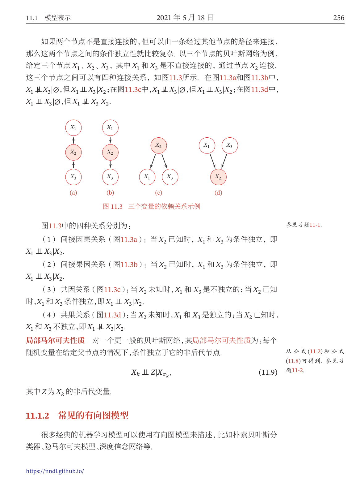
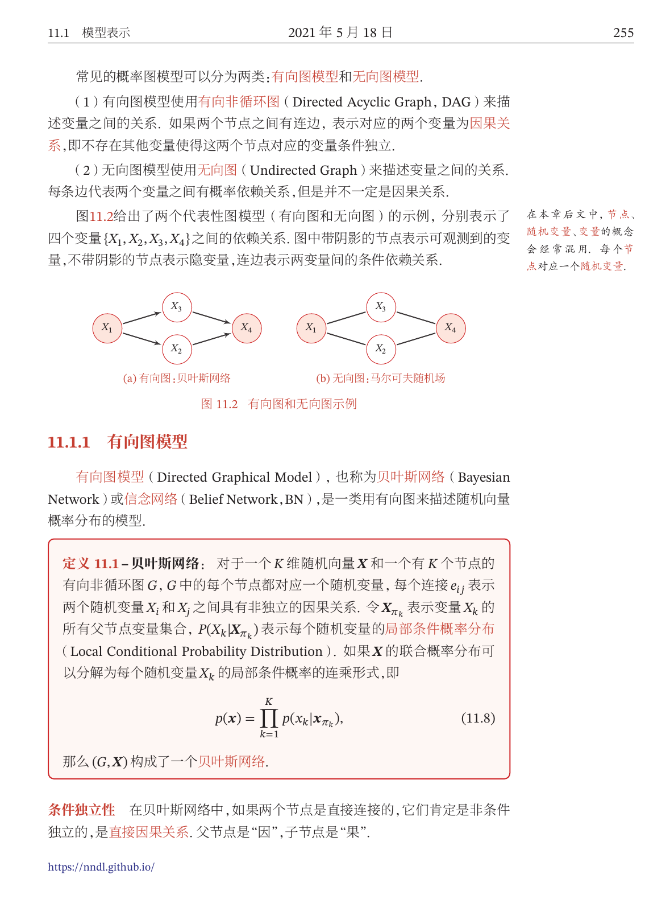

# 神经网络与深度学习习题与简解

**版本日期：** 2026-10-10。

**状态：** 当前登记169道独立教材题，按直接关联知识点展示172条；169道有中文题干和简解，0道原题冲突、0道依赖缺失资料、0道证明待补，均不计入可直接采用的完整解答数。逐章处理状态另记覆盖表。扩展题库另置空目录。

## 来源、版本与范围

- **主源判定：** 邱锡鹏《神经网络与深度学习》2021-05-18作者公开第一版稿（444 PDF页）为本轮理论主源；与大纲指定ISBN9787111649687印刷版有版本差异。邱锡鹏、飞桨教材编写组《神经网络与深度学习：案例与实践》2022第一版ISBN9787111711971为实践参考源。两书题号和书页按各自实际版本记录。
- **实践参考教材：《神经网络与深度学习：案例与实践》，2022第一版：** 《神经网络与深度学习》原件（不随资源包附送）；SHA-256：`aaea0bff96b54cba01fdca3df60386b82599987fa499aded98ef180215916ccd`。
- **课程大纲参考：** 《神经网络与深度学习》原件（不随资源包附送）；SHA-256：`008bf4b04e532b39e44d8a505a2b91ed0d626d4976a0fabfd08c4d54416640b0`。
- **理论主源：邱锡鹏《神经网络与深度学习》2021-05-18作者公开第一版稿；与大纲指定印刷版有版本差异：** 《邱锡鹏-神经网络与深度学习-作者第一版公开稿》原件（不随资源包附送）；SHA-256：`db5504e8400d2bbe54ba22a1e5e1f67366e04842a1ef24c156ce762971bb4d1a`。作者公开地址：[来源](https://github.com/nndl/nndl/blob/main/legacy/nndl-v1/main.pdf)。
- 主教材全章、附录及大纲并集已按覆盖表整理；参考书以逐项注明的相关节和原题精选补充。主教材与参考书的印刷页/PDF页对应分别见每条来源。
- 编号题原页及歧义公式按各课覆盖记录处理。自拟简解与教材提示整理分别标示；明确的原题冲突在题末记录。覆盖、数量与校验记录见根目录处理记录中的课程覆盖报告。教师最终审核及平台试导入尚未执行。

## 目录

- [第1章 绪论与实践基础](#group-ch01)
- [第2章 机器学习概述](#group-ch02)
- [第3章 线性模型与线性分类](#group-ch03)
- [第4章 前馈神经网络](#group-ch04)
- [第5章 卷积神经网络](#group-ch05)
- [第6章 循环神经网络](#group-ch06)
- [第7章 网络优化与正则化](#group-ch07)
- [第8章 注意力机制与外部记忆](#group-ch08)
- [第9章 无监督学习](#group-ch09)
- [第10章 模型独立的学习方式](#group-ch10)
- [第11章 概率图模型](#group-ch11)
- [第12章 深度信念网络](#group-ch12)
- [第13章 深度生成模型](#group-ch13)
- [第14章 深度强化学习](#group-ch14)
- [第15章 序列生成模型](#group-ch15)
- [附录1 线性代数](#group-app01)
- [附录2 微积分](#group-app02)
- [附录3 数学优化](#group-app03)
- [附录4 概率论](#group-app04)
- [附录5 信息论](#group-app05)

## 课程总览

同题可在多个直接对应知识点下完整展示，重复展示不增加独立题数。原题的小问合并保留；难度按课程层次估为1—5，来源与自拟解答分别标示。

## 第1章 绪论与实践基础

[深度学习框架的任务](#kp-p-ch01-framework)；[教材环境与实验复现](#kp-p-ch01-environment)；[Notebook的执行状态](#kp-p-ch01-notebook)；[张量与阶数](#kp-p-ch01-tensor)；[按数据和形状创建张量](#kp-p-ch01-creation)；[形状、轴和元素数](#kp-p-ch01-shape)；[重塑形状的守恒条件](#kp-p-ch01-reshape)；[增加和消去单元素轴](#kp-p-ch01-expand-axis)；[数据类型与转换](#kp-p-ch01-dtype)；[设备与固定内存](#kp-p-ch01-device)；[张量与NumPy数组转换](#kp-p-ch01-numpy)；[索引与切片](#kp-p-ch01-index)；[逐元素算术](#kp-p-ch01-elementwise)；[逻辑比较与掩码](#kp-p-ch01-logical)；[矩阵乘与批量乘法](#kp-p-ch01-matmul)；[广播的形状规则](#kp-p-ch01-broadcast)；[向量与矩阵乘的轴约定](#kp-p-ch01-matmul-broadcast)；[原位与非原位运算](#kp-p-ch01-inplace)；[算子的前向和反向接口](#kp-p-ch01-operator)；[向量链式法则](#kp-p-ch01-chain)；[加法算子的反向](#kp-p-ch01-add-gradient)；[乘法算子的反向](#kp-p-ch01-multiply-gradient)；[指数算子的反向](#kp-p-ch01-exp-gradient)；[计算图与自动微分](#kp-p-ch01-autodiff)；[梯度开关](#kp-p-ch01-stop-gradient)；[Layer和参数管理](#kp-p-ch01-layer)；[算子库的组合契约](#kp-p-ch01-operator-library)；[优化器与梯度清零](#kp-p-ch01-optimizer-contract)；[Dataset的样本接口](#kp-p-ch01-dataset)；[数据集与任务对应](#kp-p-ch01-datasets)；[Runner学习流程](#kp-p-ch01-runner)；[按行存储样本](#kp-p-ch01-row-convention)；[人工智能的研究范式](#kp-t-ch01-ai-paradigms)；[机器学习问题](#kp-t-ch01-ml-task)；[局部表示与分布式表示](#kp-t-ch01-local-distributed)；[表示学习](#kp-t-ch01-representation)；[深度学习](#kp-t-ch01-deep-learning)；[端到端学习](#kp-t-ch01-end-to-end)；[人工神经元](#kp-t-ch01-artificial-neuron)；[神经网络训练](#kp-t-ch01-network-train)

### 深度学习框架的任务

**图谱路径：** 神经网络与深度学习 / 第1章 绪论与实践基础 / 深度学习框架的任务

**知识内容：** [定义、定理与方法](知识点.md#kp-p-ch01-framework)

已整理范围内未另选可直接对应此节点的独立未解题；相关已解例子见知识内容。

### 教材环境与实验复现

**图谱路径：** 神经网络与深度学习 / 第1章 绪论与实践基础 / 教材环境与实验复现

**知识内容：** [定义、定理与方法](知识点.md#kp-p-ch01-environment)

<!-- source-exercise:P-ch01-1.1 -->
1. （1）进入Python解释器，导入paddle验证安装。（2）读取paddle.__version__检查版本。（3）运行paddle.utils.run_check()，检查是否出现安装成功提示。

   **答案：** 依次执行三项自检：导入失败说明解释器未找到相应包；版本不符先检查所用解释器及包环境；运行检查失败再区分设备、动态库和框架配置问题。教材目标环境为飞桨2.2系列，版本输出及成功提示以实际运行记录为准，本整理未在该环境执行。

   **难度：1/5；出处：** P：邱锡鹏、飞桨教材编写组《神经网络与深度学习：案例与实践》，2022年第一版，ISBN9787111711971，动手练习1.1，书页3（PDF第15页），原题号1.1；**解答来源：** 自拟简解。

### Notebook的执行状态

**图谱路径：** 神经网络与深度学习 / 第1章 绪论与实践基础 / Notebook的执行状态

**知识内容：** [定义、定理与方法](知识点.md#kp-p-ch01-notebook)

已整理范围内未另选可直接对应此节点的独立未解题；相关已解例子见知识内容。

### 张量与阶数

**图谱路径：** 神经网络与深度学习 / 第1章 绪论与实践基础 / 张量与阶数

**知识内容：** [定义、定理与方法](知识点.md#kp-p-ch01-tensor)

已整理范围内未另选可直接对应此节点的独立未解题；相关已解例子见知识内容。

### 按数据和形状创建张量

**图谱路径：** 神经网络与深度学习 / 第1章 绪论与实践基础 / 按数据和形状创建张量

**知识内容：** [定义、定理与方法](知识点.md#kp-p-ch01-creation)

已整理范围内未另选可直接对应此节点的独立未解题；相关已解例子见知识内容。

### 形状、轴和元素数

**图谱路径：** 神经网络与深度学习 / 第1章 绪论与实践基础 / 形状、轴和元素数

**知识内容：** [定义、定理与方法](知识点.md#kp-p-ch01-shape)

已整理范围内未另选可直接对应此节点的独立未解题；相关已解例子见知识内容。

### 重塑形状的守恒条件

**图谱路径：** 神经网络与深度学习 / 第1章 绪论与实践基础 / 重塑形状的守恒条件

**知识内容：** [定义、定理与方法](知识点.md#kp-p-ch01-reshape)

已整理范围内未另选可直接对应此节点的独立未解题；相关已解例子见知识内容。

### 增加和消去单元素轴

**图谱路径：** 神经网络与深度学习 / 第1章 绪论与实践基础 / 增加和消去单元素轴

**知识内容：** [定义、定理与方法](知识点.md#kp-p-ch01-expand-axis)

已整理范围内未另选可直接对应此节点的独立未解题；相关已解例子见知识内容。

### 数据类型与转换

**图谱路径：** 神经网络与深度学习 / 第1章 绪论与实践基础 / 数据类型与转换

**知识内容：** [定义、定理与方法](知识点.md#kp-p-ch01-dtype)

已整理范围内未另选可直接对应此节点的独立未解题；相关已解例子见知识内容。

### 设备与固定内存

**图谱路径：** 神经网络与深度学习 / 第1章 绪论与实践基础 / 设备与固定内存

**知识内容：** [定义、定理与方法](知识点.md#kp-p-ch01-device)

已整理范围内未另选可直接对应此节点的独立未解题；相关已解例子见知识内容。

### 张量与NumPy数组转换

**图谱路径：** 神经网络与深度学习 / 第1章 绪论与实践基础 / 张量与NumPy数组转换

**知识内容：** [定义、定理与方法](知识点.md#kp-p-ch01-numpy)

已整理范围内未另选可直接对应此节点的独立未解题；相关已解例子见知识内容。

### 索引与切片

**图谱路径：** 神经网络与深度学习 / 第1章 绪论与实践基础 / 索引与切片

**知识内容：** [定义、定理与方法](知识点.md#kp-p-ch01-index)

已整理范围内未另选可直接对应此节点的独立未解题；相关已解例子见知识内容。

### 逐元素算术

**图谱路径：** 神经网络与深度学习 / 第1章 绪论与实践基础 / 逐元素算术

**知识内容：** [定义、定理与方法](知识点.md#kp-p-ch01-elementwise)

已整理范围内未另选可直接对应此节点的独立未解题；相关已解例子见知识内容。

### 逻辑比较与掩码

**图谱路径：** 神经网络与深度学习 / 第1章 绪论与实践基础 / 逻辑比较与掩码

**知识内容：** [定义、定理与方法](知识点.md#kp-p-ch01-logical)

已整理范围内未另选可直接对应此节点的独立未解题；相关已解例子见知识内容。

### 矩阵乘与批量乘法

**图谱路径：** 神经网络与深度学习 / 第1章 绪论与实践基础 / 矩阵乘与批量乘法

**知识内容：** [定义、定理与方法](知识点.md#kp-p-ch01-matmul)

已整理范围内未另选可直接对应此节点的独立未解题；相关已解例子见知识内容。

### 广播的形状规则

**图谱路径：** 神经网络与深度学习 / 第1章 绪论与实践基础 / 广播的形状规则

**知识内容：** [定义、定理与方法](知识点.md#kp-p-ch01-broadcast)

<!-- source-exercise:P-ch01-1.2 -->
1. 尝试§1.2中的各种张量运算，特别掌握广播机制。

   **答案：** 用教材例$(2,3,1,5)$和$(3,4,1)$相加，从后往前比较得结果$(2,3,4,5)$；再试$(2,3,4)$和$(2,3,6)$，末轴4与6不相容。分别核对逐元素乘、矩阵乘和高阶批量矩阵乘；先手算输出形状，再与运行形状比较。广播不允许随意修补矩阵乘的内维。

   **难度：2/5；出处：** P：邱锡鹏、飞桨教材编写组《神经网络与深度学习：案例与实践》，2022年第一版，ISBN9787111711971，动手练习1.2，书页20（PDF第32页），原题号1.2；**解答来源：** 自拟简解。

### 向量与矩阵乘的轴约定

**图谱路径：** 神经网络与深度学习 / 第1章 绪论与实践基础 / 向量与矩阵乘的轴约定

**知识内容：** [定义、定理与方法](知识点.md#kp-p-ch01-matmul-broadcast)

已整理范围内未另选可直接对应此节点的独立未解题；相关已解例子见知识内容。

### 原位与非原位运算

**图谱路径：** 神经网络与深度学习 / 第1章 绪论与实践基础 / 原位与非原位运算

**知识内容：** [定义、定理与方法](知识点.md#kp-p-ch01-inplace)

已整理范围内未另选可直接对应此节点的独立未解题；相关已解例子见知识内容。

### 算子的前向和反向接口

**图谱路径：** 神经网络与深度学习 / 第1章 绪论与实践基础 / 算子的前向和反向接口

**知识内容：** [定义、定理与方法](知识点.md#kp-p-ch01-operator)

已整理范围内未另选可直接对应此节点的独立未解题；相关已解例子见知识内容。

### 向量链式法则

**图谱路径：** 神经网络与深度学习 / 第1章 绪论与实践基础 / 向量链式法则

**知识内容：** [定义、定理与方法](知识点.md#kp-p-ch01-chain)

已整理范围内未另选可直接对应此节点的独立未解题；相关已解例子见知识内容。

### 加法算子的反向

**图谱路径：** 神经网络与深度学习 / 第1章 绪论与实践基础 / 加法算子的反向

**知识内容：** [定义、定理与方法](知识点.md#kp-p-ch01-add-gradient)

已整理范围内未另选可直接对应此节点的独立未解题；相关已解例子见知识内容。

### 乘法算子的反向

**图谱路径：** 神经网络与深度学习 / 第1章 绪论与实践基础 / 乘法算子的反向

**知识内容：** [定义、定理与方法](知识点.md#kp-p-ch01-multiply-gradient)

已整理范围内未另选可直接对应此节点的独立未解题；相关已解例子见知识内容。

### 指数算子的反向

**图谱路径：** 神经网络与深度学习 / 第1章 绪论与实践基础 / 指数算子的反向

**知识内容：** [定义、定理与方法](知识点.md#kp-p-ch01-exp-gradient)

<!-- source-exercise:P-ch01-1.3 -->
1. 执行加法、乘法和指数算子的反向过程，验证$g=\exp(ab+cd)$的梯度。教材给$a=2,b=3,c=2,d=2$。

   **答案：** 从$\bar g=1$反传得到$\partial_ag=bg,\partial_bg=ag,\partial_cg=dg,\partial_dg=cg$。此时$g=e^{10}$，四个梯度为$(3e^{10},2e^{10},2e^{10},2e^{10})$。两个乘法结点应使用两个算子实例，分别缓存$(a,b)$和$(c,d)$；先反传指数，再加法，再两支乘法。有限差分可核查四项。

   **难度：2/5；出处：** P：邱锡鹏、飞桨教材编写组《神经网络与深度学习：案例与实践》，2022年第一版，ISBN9787111711971，动手练习1.3，书页24（PDF第36页），原题号1.3；**解答来源：** 自拟简解。

   **勘误：** 书页24代码重复调用同一个缓存输入的multiply_op，第二次前向覆盖第一次缓存。前向值仍正确，但照此缓存无法分别反传两支；改为两个实例或为每次调用保存独立上下文。

### 计算图与自动微分

**图谱路径：** 神经网络与深度学习 / 第1章 绪论与实践基础 / 计算图与自动微分

**知识内容：** [定义、定理与方法](知识点.md#kp-p-ch01-autodiff)

已整理范围内未另选可直接对应此节点的独立未解题；相关已解例子见知识内容。

### 梯度开关

**图谱路径：** 神经网络与深度学习 / 第1章 绪论与实践基础 / 梯度开关

**知识内容：** [定义、定理与方法](知识点.md#kp-p-ch01-stop-gradient)

已整理范围内未另选可直接对应此节点的独立未解题；相关已解例子见知识内容。

### Layer和参数管理

**图谱路径：** 神经网络与深度学习 / 第1章 绪论与实践基础 / Layer和参数管理

**知识内容：** [定义、定理与方法](知识点.md#kp-p-ch01-layer)

已整理范围内未另选可直接对应此节点的独立未解题；相关已解例子见知识内容。

### 算子库的组合契约

**图谱路径：** 神经网络与深度学习 / 第1章 绪论与实践基础 / 算子库的组合契约

**知识内容：** [定义、定理与方法](知识点.md#kp-p-ch01-operator-library)

已整理范围内未另选可直接对应此节点的独立未解题；相关已解例子见知识内容。

### 优化器与梯度清零

**图谱路径：** 神经网络与深度学习 / 第1章 绪论与实践基础 / 优化器与梯度清零

**知识内容：** [定义、定理与方法](知识点.md#kp-p-ch01-optimizer-contract)

已整理范围内未另选可直接对应此节点的独立未解题；相关已解例子见知识内容。

### Dataset的样本接口

**图谱路径：** 神经网络与深度学习 / 第1章 绪论与实践基础 / Dataset的样本接口

**知识内容：** [定义、定理与方法](知识点.md#kp-p-ch01-dataset)

已整理范围内未另选可直接对应此节点的独立未解题；相关已解例子见知识内容。

### 数据集与任务对应

**图谱路径：** 神经网络与深度学习 / 第1章 绪论与实践基础 / 数据集与任务对应

**知识内容：** [定义、定理与方法](知识点.md#kp-p-ch01-datasets)

已整理范围内未另选可直接对应此节点的独立未解题；相关已解例子见知识内容。

### Runner学习流程

**图谱路径：** 神经网络与深度学习 / 第1章 绪论与实践基础 / Runner学习流程

**知识内容：** [定义、定理与方法](知识点.md#kp-p-ch01-runner)

已整理范围内未另选可直接对应此节点的独立未解题；相关已解例子见知识内容。

### 按行存储样本

**图谱路径：** 神经网络与深度学习 / 第1章 绪论与实践基础 / 按行存储样本

**知识内容：** [定义、定理与方法](知识点.md#kp-p-ch01-row-convention)

已整理范围内未另选可直接对应此节点的独立未解题；相关已解例子见知识内容。

### 人工智能的研究范式

**图谱路径：** 神经网络与深度学习 / 第1章 绪论与实践基础 / 人工智能的研究范式

**知识内容：** [定义、定理与方法](知识点.md#kp-t-ch01-ai-paradigms)

已整理范围内未另选可直接对应此节点的独立未解题；相关已解例子见知识内容。

### 机器学习问题

**图谱路径：** 神经网络与深度学习 / 第1章 绪论与实践基础 / 机器学习问题

**知识内容：** [定义、定理与方法](知识点.md#kp-t-ch01-ml-task)

已整理范围内未另选可直接对应此节点的独立未解题；相关已解例子见知识内容。

### 局部表示与分布式表示

**图谱路径：** 神经网络与深度学习 / 第1章 绪论与实践基础 / 局部表示与分布式表示

**知识内容：** [定义、定理与方法](知识点.md#kp-t-ch01-local-distributed)

已整理范围内未另选可直接对应此节点的独立未解题；相关已解例子见知识内容。

### 表示学习

**图谱路径：** 神经网络与深度学习 / 第1章 绪论与实践基础 / 表示学习

**知识内容：** [定义、定理与方法](知识点.md#kp-t-ch01-representation)

已整理范围内未另选可直接对应此节点的独立未解题；相关已解例子见知识内容。

### 深度学习

**图谱路径：** 神经网络与深度学习 / 第1章 绪论与实践基础 / 深度学习

**知识内容：** [定义、定理与方法](知识点.md#kp-t-ch01-deep-learning)

已整理范围内未另选可直接对应此节点的独立未解题；相关已解例子见知识内容。

### 端到端学习

**图谱路径：** 神经网络与深度学习 / 第1章 绪论与实践基础 / 端到端学习

**知识内容：** [定义、定理与方法](知识点.md#kp-t-ch01-end-to-end)

已整理范围内未另选可直接对应此节点的独立未解题；相关已解例子见知识内容。

### 人工神经元

**图谱路径：** 神经网络与深度学习 / 第1章 绪论与实践基础 / 人工神经元

**知识内容：** [定义、定理与方法](知识点.md#kp-t-ch01-artificial-neuron)

已整理范围内未另选可直接对应此节点的独立未解题；相关已解例子见知识内容。

### 神经网络训练

**图谱路径：** 神经网络与深度学习 / 第1章 绪论与实践基础 / 神经网络训练

**知识内容：** [定义、定理与方法](知识点.md#kp-t-ch01-network-train)

已整理范围内未另选可直接对应此节点的独立未解题；相关已解例子见知识内容。

## 第2章 机器学习概述

[机器学习实践五要素](#kp-p-ch02-five-elements)；[训练、验证、测试的职责](#kp-p-ch02-split)；[带噪声线性数据](#kp-p-ch02-linear-data)；[仿射回归模型](#kp-p-ch02-regression-model)；[平方损失与经验风险](#kp-p-ch02-squared-loss)；[最小二乘正规方程](#kp-p-ch02-normal-equation)；[二次正则的解析解](#kp-p-ch02-ridge)；[共线性与求解稳定性](#kp-p-ch02-singular-design)；[解析解训练和预测](#kp-p-ch02-fit-predict)；[回归误差评价](#kp-p-ch02-regression-evaluation)；[多项式特征映射](#kp-p-ch02-polynomial-feature)；[ToySin25的非线性任务](#kp-p-ch02-toysin)；[多项式设计矩阵](#kp-p-ch02-vandermonde)；[欠拟合的表现](#kp-p-ch02-underfit)；[过拟合和模型次数](#kp-p-ch02-overfit)；[正则化限制复杂度](#kp-p-ch02-regularization)；[样本量和复杂度的对照](#kp-p-ch02-sample-complexity-experiment)；[RunnerV1的接口](#kp-p-ch02-runner-v1)；[房价回归的输入和目标](#kp-p-ch02-housing)；[预处理中的训练统计](#kp-p-ch02-preprocessing)；[特征规范化](#kp-p-ch02-normalization)；[尺度和优化几何](#kp-p-ch02-feature-scale)；[回归组件组装](#kp-p-ch02-model-components)；[单样本预测的批量轴](#kp-p-ch02-prediction-shape)；[异常样本与平方损失](#kp-p-ch02-outliers)；[复杂模型正则化和简单模型](#kp-p-ch02-selection-comparison)；[训练准则和评价指标](#kp-p-ch02-learning-criterion)；[受控实验记录](#kp-p-ch02-reproducibility)；[样本、分布与泛化](#kp-t-ch02-data-distribution)；[模型与假设空间](#kp-t-ch02-model-hypothesis)；[损失、经验风险与结构风险](#kp-t-ch02-loss-risk)；[优化算法与梯度下降](#kp-t-ch02-optimization)；[线性回归与最小二乘](#kp-t-ch02-linear-regression)；[岭回归](#kp-t-ch02-ridge)；[最大似然与最大后验](#kp-t-ch02-mle-map)；[偏差方差分解](#kp-t-ch02-bias-variance)；[机器学习算法类型](#kp-t-ch02-learning-types)；[数据特征表示](#kp-t-ch02-feature-repr)；[分类评价指标](#kp-t-ch02-metrics)；[PAC学习思想](#kp-t-ch02-pac)；[没有免费午餐定理](#kp-t-ch02-no-free-lunch)；[奥卡姆剃刀原理](#kp-t-ch02-occam)；[丑小鸭定理](#kp-t-ch02-ugly-duckling)；[归纳偏置](#kp-t-ch02-inductive-bias)

### 机器学习实践五要素

**图谱路径：** 神经网络与深度学习 / 第2章 机器学习概述 / 机器学习实践五要素

**知识内容：** [定义、定理与方法](知识点.md#kp-p-ch02-five-elements)

已整理范围内未另选可直接对应此节点的独立未解题；相关已解例子见知识内容。

### 训练、验证、测试的职责

**图谱路径：** 神经网络与深度学习 / 第2章 机器学习概述 / 训练、验证、测试的职责

**知识内容：** [定义、定理与方法](知识点.md#kp-p-ch02-split)

已整理范围内未另选可直接对应此节点的独立未解题；相关已解例子见知识内容。

### 带噪声线性数据

**图谱路径：** 神经网络与深度学习 / 第2章 机器学习概述 / 带噪声线性数据

**知识内容：** [定义、定理与方法](知识点.md#kp-p-ch02-linear-data)

已整理范围内未另选可直接对应此节点的独立未解题；相关已解例子见知识内容。

### 仿射回归模型

**图谱路径：** 神经网络与深度学习 / 第2章 机器学习概述 / 仿射回归模型

**知识内容：** [定义、定理与方法](知识点.md#kp-p-ch02-regression-model)

已整理范围内未另选可直接对应此节点的独立未解题；相关已解例子见知识内容。

### 平方损失与经验风险

**图谱路径：** 神经网络与深度学习 / 第2章 机器学习概述 / 平方损失与经验风险

**知识内容：** [定义、定理与方法](知识点.md#kp-p-ch02-squared-loss)

已整理范围内未另选可直接对应此节点的独立未解题；相关已解例子见知识内容。

### 最小二乘正规方程

**图谱路径：** 神经网络与深度学习 / 第2章 机器学习概述 / 最小二乘正规方程

**知识内容：** [定义、定理与方法](知识点.md#kp-p-ch02-normal-equation)

已整理范围内未另选可直接对应此节点的独立未解题；相关已解例子见知识内容。

### 二次正则的解析解

**图谱路径：** 神经网络与深度学习 / 第2章 机器学习概述 / 二次正则的解析解

**知识内容：** [定义、定理与方法](知识点.md#kp-p-ch02-ridge)

<!-- source-exercise:P-ch02-2.1 -->
1. 验证公式（2.14）：令$X_c=X-\mathbf1\bar x^T$、$y_c=y-\bar y\mathbf1$，在仅对$w$施加L2正则的线性回归中，$w^*=(X_c^TX_c+\lambda I)^{-1}X_c^Ty_c$，$\lambda>0$。

   **答案：** 对$\|Xw+b\mathbf1-y\|^2+\lambda\|w\|^2$先对$b$求导，得到$b=\bar y-\bar x^Tw$。代回得$\|X_cw-y_c\|^2+\lambda\|w\|^2$，令梯度0即$(X_c^TX_c+\lambda I)w=X_c^Ty_c$。$\lambda>0$使矩阵正定，故解唯一。

   **难度：2/5；出处：** P：邱锡鹏、飞桨教材编写组《神经网络与深度学习：案例与实践》，2022年第一版，ISBN9787111711971，动手练习2.1，书页44（PDF第56页），原题号2.1；**解答来源：** 自拟简解。

### 共线性与求解稳定性

**图谱路径：** 神经网络与深度学习 / 第2章 机器学习概述 / 共线性与求解稳定性

**知识内容：** [定义、定理与方法](知识点.md#kp-p-ch02-singular-design)

<!-- source-exercise:P-ch02-思考-52 -->
1. 教材多项式次数大于等于5时训练误差未下降，特别7次误差很大，分析原因。

   **答案：** 嵌套多项式函数族在精确最小化时最小训练平方误差应不增，因此观察不能由“次数更高”本身解释。高次Vandermonde矩阵病态，float32下正规方程求逆放大误差；检查条件数、有效秩，用float64与QR/SVD对照。若有正则或未充分优化也须固定准则后比较。

   **难度：3/5；出处：** P：邱锡鹏、飞桨教材编写组《神经网络与深度学习：案例与实践》，2022年第一版，ISBN9787111711971，第2章正文思考（以书页识别未编号原题），书页52（PDF第64页），原题号思考-52；**解答来源：** 自拟简解。

### 解析解训练和预测

**图谱路径：** 神经网络与深度学习 / 第2章 机器学习概述 / 解析解训练和预测

**知识内容：** [定义、定理与方法](知识点.md#kp-p-ch02-fit-predict)

已整理范围内未另选可直接对应此节点的独立未解题；相关已解例子见知识内容。

### 回归误差评价

**图谱路径：** 神经网络与深度学习 / 第2章 机器学习概述 / 回归误差评价

**知识内容：** [定义、定理与方法](知识点.md#kp-p-ch02-regression-evaluation)

已整理范围内未另选可直接对应此节点的独立未解题；相关已解例子见知识内容。

### 多项式特征映射

**图谱路径：** 神经网络与深度学习 / 第2章 机器学习概述 / 多项式特征映射

**知识内容：** [定义、定理与方法](知识点.md#kp-p-ch02-polynomial-feature)

已整理范围内未另选可直接对应此节点的独立未解题；相关已解例子见知识内容。

### ToySin25的非线性任务

**图谱路径：** 神经网络与深度学习 / 第2章 机器学习概述 / ToySin25的非线性任务

**知识内容：** [定义、定理与方法](知识点.md#kp-p-ch02-toysin)

已整理范围内未另选可直接对应此节点的独立未解题；相关已解例子见知识内容。

### 多项式设计矩阵

**图谱路径：** 神经网络与深度学习 / 第2章 机器学习概述 / 多项式设计矩阵

**知识内容：** [定义、定理与方法](知识点.md#kp-p-ch02-vandermonde)

已整理范围内未另选可直接对应此节点的独立未解题；相关已解例子见知识内容。

### 欠拟合的表现

**图谱路径：** 神经网络与深度学习 / 第2章 机器学习概述 / 欠拟合的表现

**知识内容：** [定义、定理与方法](知识点.md#kp-p-ch02-underfit)

已整理范围内未另选可直接对应此节点的独立未解题；相关已解例子见知识内容。

### 过拟合和模型次数

**图谱路径：** 神经网络与深度学习 / 第2章 机器学习概述 / 过拟合和模型次数

**知识内容：** [定义、定理与方法](知识点.md#kp-p-ch02-overfit)

已整理范围内未另选可直接对应此节点的独立未解题；相关已解例子见知识内容。

### 正则化限制复杂度

**图谱路径：** 神经网络与深度学习 / 第2章 机器学习概述 / 正则化限制复杂度

**知识内容：** [定义、定理与方法](知识点.md#kp-p-ch02-regularization)

已整理范围内未另选可直接对应此节点的独立未解题；相关已解例子见知识内容。

### 样本量和复杂度的对照

**图谱路径：** 神经网络与深度学习 / 第2章 机器学习概述 / 样本量和复杂度的对照

**知识内容：** [定义、定理与方法](知识点.md#kp-p-ch02-sample-complexity-experiment)

<!-- source-exercise:P-ch02-2.2 -->
1. （1）把线性回归训练数据由100条增加至5000条，观察模型性能。（2）调整正则化系数，观察性能。

   **答案：** 保持真实线性参数、噪声分布和独立测试集不变，分别生成100与5000样本，拟合后报告训练/测试MSE并重复种子。再固定样本，把$\lambda$取含0的小、中、大值，记录参数范数与误差。样本增加通常减少方差；过大$\lambda$引入偏差。只给实验设计，不声称某次实测数值。

   **难度：2/5；出处：** P：邱锡鹏、飞桨教材编写组《神经网络与深度学习：案例与实践》，2022年第一版，ISBN9787111711971，动手练习2.2，书页46（PDF第58页），原题号2.2；**解答来源：** 自拟简解。

   **实验执行状态：** 给出可复现方案；未执行原题外部数据实验，不提供虚构成绩

<!-- source-exercise:P-ch02-2.3 -->
2. 调整训练样本数量，观察不同模型复杂度下避免过拟合对样本量的要求。

   **答案：** 固定噪声与测试集，对多项式次数和样本量组成网格，分别以相同最小二乘/正则方案训练。画训练与测试误差随样本数的曲线，观察高次模型误差间隙是否缩小。数据增加也不能消除不合适函数族的偏差，应同时检查设计矩阵条件数。

   **难度：2/5；出处：** P：邱锡鹏、飞桨教材编写组《神经网络与深度学习：案例与实践》，2022年第一版，ISBN9787111711971，动手练习2.3，书页53（PDF第65页），原题号2.3；**解答来源：** 自拟简解。

   **实验执行状态：** 给出可复现方案；未执行原题外部数据实验，不提供虚构成绩

### RunnerV1的接口

**图谱路径：** 神经网络与深度学习 / 第2章 机器学习概述 / RunnerV1的接口

**知识内容：** [定义、定理与方法](知识点.md#kp-p-ch02-runner-v1)

已整理范围内未另选可直接对应此节点的独立未解题；相关已解例子见知识内容。

### 房价回归的输入和目标

**图谱路径：** 神经网络与深度学习 / 第2章 机器学习概述 / 房价回归的输入和目标

**知识内容：** [定义、定理与方法](知识点.md#kp-p-ch02-housing)

已整理范围内未另选可直接对应此节点的独立未解题；相关已解例子见知识内容。

### 预处理中的训练统计

**图谱路径：** 神经网络与深度学习 / 第2章 机器学习概述 / 预处理中的训练统计

**知识内容：** [定义、定理与方法](知识点.md#kp-p-ch02-preprocessing)

已整理范围内未另选可直接对应此节点的独立未解题；相关已解例子见知识内容。

### 特征规范化

**图谱路径：** 神经网络与深度学习 / 第2章 机器学习概述 / 特征规范化

**知识内容：** [定义、定理与方法](知识点.md#kp-p-ch02-normalization)

已整理范围内未另选可直接对应此节点的独立未解题；相关已解例子见知识内容。

### 尺度和优化几何

**图谱路径：** 神经网络与深度学习 / 第2章 机器学习概述 / 尺度和优化几何

**知识内容：** [定义、定理与方法](知识点.md#kp-p-ch02-feature-scale)

<!-- source-exercise:P-ch02-2.4 -->
1. 在§2.5.1.4中若不做特征归一化，对模型学习有什么影响？

   **答案：** 固定步长梯度法面对各特征尺度差异会有狭长等高线，容易一方向震荡、另一方向缓慢。精确无正则最小二乘的预测可经参数变换保持相同，但条件数、舍入误差和正则化相对惩罚改变。分别比较优化轨迹和测试误差，不能说归一化必定降低最优误差。

   **难度：2/5；出处：** P：邱锡鹏、飞桨教材编写组《神经网络与深度学习：案例与实践》，2022年第一版，ISBN9787111711971，动手练习2.4，书页65（PDF第77页），原题号2.4；**解答来源：** 自拟简解。

### 回归组件组装

**图谱路径：** 神经网络与深度学习 / 第2章 机器学习概述 / 回归组件组装

**知识内容：** [定义、定理与方法](知识点.md#kp-p-ch02-model-components)

已整理范围内未另选可直接对应此节点的独立未解题；相关已解例子见知识内容。

### 单样本预测的批量轴

**图谱路径：** 神经网络与深度学习 / 第2章 机器学习概述 / 单样本预测的批量轴

**知识内容：** [定义、定理与方法](知识点.md#kp-p-ch02-prediction-shape)

已整理范围内未另选可直接对应此节点的独立未解题；相关已解例子见知识内容。

### 异常样本与平方损失

**图谱路径：** 神经网络与深度学习 / 第2章 机器学习概述 / 异常样本与平方损失

**知识内容：** [定义、定理与方法](知识点.md#kp-p-ch02-outliers)

<!-- source-exercise:P-ch02-思考-65 -->
1. 训练中异常样本如何影响最终模型，如何减少影响？

   **答案：** 平方损失梯度与残差成正比，极端样本可拉动拟合。先区分错误录入、分布变化和真实极端样本；纠错后可比较Huber损失、绝对误差回归或稳健加权。所有阈值在训练/验证流程中确定，不能按测试误差挑要删除的样本。

   **难度：2/5；出处：** P：邱锡鹏、飞桨教材编写组《神经网络与深度学习：案例与实践》，2022年第一版，ISBN9787111711971，第2章正文思考（以书页识别未编号原题），书页65（PDF第77页），原题号思考-65；**解答来源：** 自拟简解。

### 复杂模型正则化和简单模型

**图谱路径：** 神经网络与深度学习 / 第2章 机器学习概述 / 复杂模型正则化和简单模型

**知识内容：** [定义、定理与方法](知识点.md#kp-p-ch02-selection-comparison)

<!-- source-exercise:P-ch02-思考-53 -->
1. 现实任务中选择复杂模型加大正则化，还是直接使用简单模型？

   **答案：** 两者的函数族和偏好不同，复杂模型保留较多模式但缩小系数，简单模型排除某些模式。共用验证划分比较误差、计算成本、稳定性和可解释性。数据足够且存在非线性结构可支持复杂模型；样本少或规律简单时简单模型可能更稳，不能作普遍排序。

   **难度：2/5；出处：** P：邱锡鹏、飞桨教材编写组《神经网络与深度学习：案例与实践》，2022年第一版，ISBN9787111711971，第2章正文思考（以书页识别未编号原题），书页53（PDF第65页），原题号思考-53；**解答来源：** 自拟简解。

### 训练准则和评价指标

**图谱路径：** 神经网络与深度学习 / 第2章 机器学习概述 / 训练准则和评价指标

**知识内容：** [定义、定理与方法](知识点.md#kp-p-ch02-learning-criterion)

已整理范围内未另选可直接对应此节点的独立未解题；相关已解例子见知识内容。

### 受控实验记录

**图谱路径：** 神经网络与深度学习 / 第2章 机器学习概述 / 受控实验记录

**知识内容：** [定义、定理与方法](知识点.md#kp-p-ch02-reproducibility)

已整理范围内未另选可直接对应此节点的独立未解题；相关已解例子见知识内容。

### 样本、分布与泛化

**图谱路径：** 神经网络与深度学习 / 第2章 机器学习概述 / 样本、分布与泛化

**知识内容：** [定义、定理与方法](知识点.md#kp-t-ch02-data-distribution)

已整理范围内未另选可直接对应此节点的独立未解题；相关已解例子见知识内容。

### 模型与假设空间

**图谱路径：** 神经网络与深度学习 / 第2章 机器学习概述 / 模型与假设空间

**知识内容：** [定义、定理与方法](知识点.md#kp-t-ch02-model-hypothesis)

已整理范围内未另选可直接对应此节点的独立未解题；相关已解例子见知识内容。

### 损失、经验风险与结构风险

**图谱路径：** 神经网络与深度学习 / 第2章 机器学习概述 / 损失、经验风险与结构风险

**知识内容：** [定义、定理与方法](知识点.md#kp-t-ch02-loss-risk)

<!-- source-exercise:T-ch02-2-1 -->
1. 分析为什么平方损失函数不适用于分类问题。

   **答案：** 平方损失可以用于分类，但它把类别标签当欧氏数值，惩罚随编码改变；与Bernoulli/分类概率模型的对数损失相比，可能产生非凸的参数目标和弱梯度，且不能自然评价概率校准。故“绝对不适用”不成立，宜理解为通常不理想。

   **难度：2/5；出处：** T：邱锡鹏《神经网络与深度学习》作者公开第一版稿（2021-05-18；非大纲所列2022印刷ISBN版），第2章习题2-1，书页51（PDF第66页），原题号2-1；**解答来源：** 自拟简解。

### 优化算法与梯度下降

**图谱路径：** 神经网络与深度学习 / 第2章 机器学习概述 / 优化算法与梯度下降

**知识内容：** [定义、定理与方法](知识点.md#kp-t-ch02-optimization)

已整理范围内未另选可直接对应此节点的独立未解题；相关已解例子见知识内容。

### 线性回归与最小二乘

**图谱路径：** 神经网络与深度学习 / 第2章 机器学习概述 / 线性回归与最小二乘

**知识内容：** [定义、定理与方法](知识点.md#kp-t-ch02-linear-regression)

<!-- source-exercise:T-ch02-2-2 -->
1. 在线性回归中，给每个样本 $(\boldsymbol x^{(n)},y^{(n)})$ 权重 $r^{(n)}$，经验风险 $R(\boldsymbol w)=\frac12\sum_n r^{(n)}(y^{(n)}-\boldsymbol w^{\mathsf T}\boldsymbol x^{(n)})^2$。求最优 $\boldsymbol w^*$，并分析权重作用。

   **答案：** 令 $X$ 的列为 $\boldsymbol x^{(n)}$，$R=\operatorname{diag}(r^{(n)})$，$\boldsymbol y$ 为标签列向量。$\nabla R=XR(X^{\mathsf T}\boldsymbol w-\boldsymbol y)=0$；若 $XRX^{\mathsf T}$ 可逆，$\boldsymbol w^*=(XRX^{\mathsf T})^{-1}XR\boldsymbol y$，否则用伪逆给出一个最小范数解。$r^{(n)}\ge0$ 时它调节每个样本残差贡献；$r^{(n)}=0$ 等于忽略样本，负权重则不再保证凸性。

   **难度：3/5；出处：** T：邱锡鹏《神经网络与深度学习》作者公开第一版稿（2021-05-18；非大纲所列2022印刷ISBN版），第2章习题2-2，书页51（PDF第66页），原题号2-2；**解答来源：** 自拟简解。

<!-- source-exercise:T-ch02-2-3 -->
2. 证明在线性回归中，若样本数 $N$ 小于特征数 $D+1$，则 $XX^{\mathsf T}$ 的秩最大为 $N$。

   **答案：** $X$ 为 $(D+1)\times N$ 矩阵，$\operatorname{rank}(XX^{\mathsf T})=\operatorname{rank}(X)\le\min(D+1,N)=N$，故不可能满 $D+1$ 秩。

   **难度：2/5；出处：** T：邱锡鹏《神经网络与深度学习》作者公开第一版稿（2021-05-18；非大纲所列2022印刷ISBN版），第2章习题2-3，书页51（PDF第66页），原题号2-3；**解答来源：** 自拟简解。

### 岭回归

**图谱路径：** 神经网络与深度学习 / 第2章 机器学习概述 / 岭回归

**知识内容：** [定义、定理与方法](知识点.md#kp-t-ch02-ridge)

<!-- source-exercise:T-ch02-2-4 -->
1. 验证岭回归的解是结构风险最小化准则下的最小二乘估计，见公式(2.44)。

   **答案：** 目标 $\frac12\lVert\boldsymbol y-X^{\mathsf T}\boldsymbol w\rVert^2+\frac\lambda2\lVert\boldsymbol w\rVert^2$ 求导得 $(XX^{\mathsf T}+\lambda I)\boldsymbol w=X\boldsymbol y$，$\lambda>0$ 时 $\boldsymbol w=(XX^{\mathsf T}+\lambda I)^{-1}X\boldsymbol y$，即带 $\ell_2$ 复杂度项的结构风险极小解；若书中 $\lambda$ 的系数约定不同，按相应倍数换算。

   **难度：3/5；出处：** T：邱锡鹏《神经网络与深度学习》作者公开第一版稿（2021-05-18；非大纲所列2022印刷ISBN版），第2章习题2-4，书页51（PDF第66页），原题号2-4；**解答来源：** 自拟简解。

### 最大似然与最大后验

**图谱路径：** 神经网络与深度学习 / 第2章 机器学习概述 / 最大似然与最大后验

**知识内容：** [定义、定理与方法](知识点.md#kp-t-ch02-mle-map)

<!-- source-exercise:T-ch02-2-5 -->
1. 在线性回归中，假设标签 $y\sim\mathcal N(\boldsymbol w^{\mathsf T}\boldsymbol x,\beta)$，用最大似然估计优化参数，验证最优参数为公式(2.52)的解。

   **答案：** 独立样本的负对数似然在固定 $\beta>0$ 下为常数加 $(2\beta)^{-1}\sum_n(y^{(n)}-\boldsymbol w^{\mathsf T}\boldsymbol x^{(n)})^2$，因此极大似然与最小二乘具有相同最优解；满秩时 $\boldsymbol w=(XX^{\mathsf T})^{-1}X\boldsymbol y$。

   **难度：3/5；出处：** T：邱锡鹏《神经网络与深度学习》作者公开第一版稿（2021-05-18；非大纲所列2022印刷ISBN版），第2章习题2-5，书页51（PDF第66页），原题号2-5；**解答来源：** 自拟简解。

<!-- source-exercise:T-ch02-2-6 -->
2. $N$ 个样本 $x^{(1)},\ldots,x^{(N)}$ 独立服从 $\mathcal N(\mu,\sigma^2)$，$\mu$ 未知。(1) 求最大似然估计 $\mu_{\rm ML}$；(2) 若 $\mu$ 的先验为 $\mathcal N(\mu_0,\sigma_0^2)$，求最大后验估计 $\mu_{\rm MAP}$。

   **答案：** (1) 对数似然对 $\mu$ 求导为 $\sum_n(x^{(n)}-\mu)/\sigma^2$，故 $\mu_{\rm ML}=\bar x$。(2) 后验精度为 $N/\sigma^2+1/\sigma_0^2$，故 $\mu_{\rm MAP}=[(N/\sigma^2)\bar x+(1/\sigma_0^2)\mu_0]/[N/\sigma^2+1/\sigma_0^2]$。

   **难度：3/5；出处：** T：邱锡鹏《神经网络与深度学习》作者公开第一版稿（2021-05-18；非大纲所列2022印刷ISBN版），第2章习题2-6，书页51（PDF第66页），原题号2-6；**解答来源：** 自拟简解。

<!-- source-exercise:T-ch02-2-7 -->
3. 在习题2-6中，证明 $N\to\infty$ 时最大后验估计趋向最大似然估计。

   **答案：** 两估计差为 $(\mu_0-\bar x)/(1+N\sigma_0^2/\sigma^2)$，固定有限先验方差且 $\bar x$ 有界或依大数定律收敛时趋于 $0$。

   **难度：2/5；出处：** T：邱锡鹏《神经网络与深度学习》作者公开第一版稿（2021-05-18；非大纲所列2022印刷ISBN版），第2章习题2-7，书页51（PDF第66页），原题号2-7；**解答来源：** 自拟简解。

### 偏差方差分解

**图谱路径：** 神经网络与深度学习 / 第2章 机器学习概述 / 偏差方差分解

**知识内容：** [定义、定理与方法](知识点.md#kp-t-ch02-bias-variance)

<!-- source-exercise:T-ch02-2-8 -->
1. 验证公式(2.61)：平方损失下最优预测函数 $f^*(x)=\mathbb E[Y\mid X=x]$。

   **答案：** 对固定 $x$，$\mathbb E[(Y-a)^2\mid x]=\operatorname{Var}(Y\mid x)+(a-\mathbb E[Y\mid x])^2$，在 $a=\mathbb E[Y\mid x]$ 处取最小；再对 $X$ 积分即得。

   **难度：2/5；出处：** T：邱锡鹏《神经网络与深度学习》作者公开第一版稿（2021-05-18；非大纲所列2022印刷ISBN版），第2章习题2-8，书页51（PDF第66页），原题号2-8；**解答来源：** 自拟简解。

<!-- source-exercise:T-ch02-2-9 -->
2. 分析什么因素会导致图2.6所示的高偏差和高方差情况。

   **答案：** 高偏差常由模型容量不足、过强正则化、特征遗漏或欠训练造成；高方差常由容量相对样本量过大、噪声/异常点、弱正则化或不稳定拟合造成。图示是定性模式，具体归因要比较训练与验证误差。

   **难度：2/5；出处：** T：邱锡鹏《神经网络与深度学习》作者公开第一版稿（2021-05-18；非大纲所列2022印刷ISBN版），第2章习题2-9，书页51（PDF第66页），原题号2-9；**解答来源：** 自拟简解。

<!-- source-exercise:T-ch02-2-10 -->
3. 验证公式(2.66)：不同训练集所得预测与最优预测之间的平方差可分解为偏差平方加方差。

   **答案：** 设 $m=\mathbb E_{\mathcal D}f_{\mathcal D}(x)$，将 $f_{\mathcal D}-f^*=(f_{\mathcal D}-m)+(m-f^*)$ 平方展开；交叉项含 $\mathbb E_{\mathcal D}(f_{\mathcal D}-m)=0$，故 $\mathbb E_{\mathcal D}(f_{\mathcal D}-f^*)^2=(m-f^*)^2+\mathbb E_{\mathcal D}(f_{\mathcal D}-m)^2$。

   **难度：2/5；出处：** T：邱锡鹏《神经网络与深度学习》作者公开第一版稿（2021-05-18；非大纲所列2022印刷ISBN版），第2章习题2-10，书页52（PDF第67页），原题号2-10；**解答来源：** 自拟简解。

### 机器学习算法类型

**图谱路径：** 神经网络与深度学习 / 第2章 机器学习概述 / 机器学习算法类型

**知识内容：** [定义、定理与方法](知识点.md#kp-t-ch02-learning-types)

已整理范围内未另选可直接对应此节点的独立未解题；相关已解例子见知识内容。

### 数据特征表示

**图谱路径：** 神经网络与深度学习 / 第2章 机器学习概述 / 数据特征表示

**知识内容：** [定义、定理与方法](知识点.md#kp-t-ch02-feature-repr)

<!-- source-exercise:T-ch02-2-11 -->
1. 分别用一元、二元和三元特征的词袋模型表示“我打了张三”和“张三打了我”，并分析模型优缺点。

   **答案：** 按词分割为“我/打/了/张三”与“张三/打/了/我”。一元词袋两者完全相同：我、打、了、张三各 $1$。二元分别为“我打/打了/了张三”与“张三打/打了/了我”，可区分。三元分别为“我打了/打了张三”与“张三打了/打了我”。$n$ 越大保留的局部顺序越多，但词表更大、更稀疏；分词约定影响结果。

   **难度：3/5；出处：** T：邱锡鹏《神经网络与深度学习》作者公开第一版稿（2021-05-18；非大纲所列2022印刷ISBN版），第2章习题2-11，书页52（PDF第67页），原题号2-11；**解答来源：** 自拟简解。

### 分类评价指标

**图谱路径：** 神经网络与深度学习 / 第2章 机器学习概述 / 分类评价指标

**知识内容：** [定义、定理与方法](知识点.md#kp-t-ch02-metrics)

<!-- source-exercise:T-ch02-2-12 -->
1. 三分类真实标签为 $(1,1,2,2,2,3,3,3,3)$，预测标签为 $(1,2,2,2,3,3,3,1,2)$。分别计算各类精确率、召回率、$F_1$ 及其宏平均、微平均。

   **答案：** 类 $1$ 的 $(TP,FP,FN)=(1,1,1)$，$P=R=F_1=1/2$；类 $2$ 的三元组为 $(2,2,1)$，$P=1/2$、$R=2/3$、$F_1=4/7$；类 $3$ 为 $(2,1,2)$，$P=2/3$、$R=1/2$、$F_1=4/7$。宏平均 $P_{\rm macro}=R_{\rm macro}=5/9$，$F_{1,\rm macro}=23/42$；微观汇总 $TP=5$、$FP=FN=4$，微平均 $P_{\rm micro}=R_{\rm micro}=F_{1,\rm micro}=5/9$。

   **难度：3/5；出处：** T：邱锡鹏《神经网络与深度学习》作者公开第一版稿（2021-05-18；非大纲所列2022印刷ISBN版），第2章习题2-12，书页52（PDF第67页），原题号2-12；**解答来源：** 自拟简解。

### PAC学习思想

**图谱路径：** 神经网络与深度学习 / 第2章 机器学习概述 / PAC学习思想

**知识内容：** [定义、定理与方法](知识点.md#kp-t-ch02-pac)

已整理范围内未另选可直接对应此节点的独立未解题；相关已解例子见知识内容。

### 没有免费午餐定理

**图谱路径：** 神经网络与深度学习 / 第2章 机器学习概述 / 没有免费午餐定理

**知识内容：** [定义、定理与方法](知识点.md#kp-t-ch02-no-free-lunch)

已整理范围内未另选可直接对应此节点的独立未解题；相关已解例子见知识内容。

### 奥卡姆剃刀原理

**图谱路径：** 神经网络与深度学习 / 第2章 机器学习概述 / 奥卡姆剃刀原理

**知识内容：** [定义、定理与方法](知识点.md#kp-t-ch02-occam)

已整理范围内未另选可直接对应此节点的独立未解题；相关已解例子见知识内容。

### 丑小鸭定理

**图谱路径：** 神经网络与深度学习 / 第2章 机器学习概述 / 丑小鸭定理

**知识内容：** [定义、定理与方法](知识点.md#kp-t-ch02-ugly-duckling)

已整理范围内未另选可直接对应此节点的独立未解题；相关已解例子见知识内容。

### 归纳偏置

**图谱路径：** 神经网络与深度学习 / 第2章 机器学习概述 / 归纳偏置

**知识内容：** [定义、定理与方法](知识点.md#kp-t-ch02-inductive-bias)

已整理范围内未另选可直接对应此节点的独立未解题；相关已解例子见知识内容。

## 第3章 线性模型与线性分类

[二分类标签和划分](#kp-p-ch03-binary-label)；[线性logit与Logistic函数](#kp-p-ch03-logit)；[Logistic函数的导数](#kp-p-ch03-sigmoid-derivative)；[二分类交叉熵](#kp-p-ch03-binary-ce)；[Logistic回归梯度](#kp-p-ch03-binary-gradient)；[梯度下降的更新](#kp-p-ch03-gradient-descent)；[分类准确率](#kp-p-ch03-accuracy)；[RunnerV2的验证监控](#kp-p-ch03-runner-v2)；[早停与最佳模型](#kp-p-ch03-early-stop)；[线性边界的表达限制](#kp-p-ch03-boundary)；[多分类类别索引](#kp-p-ch03-multiclass-data)；[Softmax概率映射](#kp-p-ch03-softmax)；[多分类线性层形状](#kp-p-ch03-softmax-model)；[独热标签](#kp-p-ch03-onehot)；[多分类交叉熵](#kp-p-ch03-multiclass-ce)；[多分类交叉熵梯度](#kp-p-ch03-softmax-gradient)；[最大概率预测](#kp-p-ch03-argmax)；[一对其余多分类](#kp-p-ch03-ovr)；[鸢尾花数据与预处理](#kp-p-ch03-iris-data)；[鸢尾花Softmax模型](#kp-p-ch03-iris-model)；[检查点的保存与恢复](#kp-p-ch03-save-load)；[评价模式与梯度记录](#kp-p-ch03-evaluation-mode)；[概率、logit与损失契约](#kp-p-ch03-loss-contract)；[标签形状的广播陷阱](#kp-p-ch03-label-shape)；[学习率与训练回合对照](#kp-p-ch03-hyperparameters)；[线性分类器之间的比较](#kp-p-ch03-classifier-comparison)；[分类流程检查](#kp-p-ch03-pipeline)；[线性判别函数与决策边界](#kp-t-ch03-linear-boundary)；[多分类线性判别](#kp-t-ch03-multiclass-linear)；[Logistic回归](#kp-t-ch03-logistic)；[Softmax回归](#kp-t-ch03-softmax)；[感知器更新](#kp-t-ch03-perceptron)；[平均感知器](#kp-t-ch03-averaged-perceptron)；[广义感知器](#kp-t-ch03-structured-perceptron)；[广义感知器收敛界](#kp-t-ch03-perceptron-bound)；[硬间隔支持向量机](#kp-t-ch03-hard-margin)；[SVM对偶与支持向量](#kp-t-ch03-svm-dual)；[核技巧](#kp-t-ch03-kernel)；[软间隔与hinge损失](#kp-t-ch03-soft-margin)；[线性分类的损失比较](#kp-t-ch03-linear-losses)

### 二分类标签和划分

**图谱路径：** 神经网络与深度学习 / 第3章 线性模型与线性分类 / 二分类标签和划分

**知识内容：** [定义、定理与方法](知识点.md#kp-p-ch03-binary-label)

<!-- source-exercise:P-ch03-3.1 -->
1. 打印前5条数据标签，检查划分后的格式。

   **答案：** 从同一数据对象读取前5条特征和标签，核对索引和对应关系；本章二分类标签应为0或1，形状与预测一致，教材训练张量为$(640,2)$及$(640,1)$。随机生成数据的具体前5项依种子与实现，不能脱离实际数据给固定列表。

   **难度：1/5；出处：** P：邱锡鹏、飞桨教材编写组《神经网络与深度学习：案例与实践》，2022年第一版，ISBN9787111711971，动手练习3.1，书页71（PDF第83页），原题号3.1；**解答来源：** 自拟简解。

### 线性logit与Logistic函数

**图谱路径：** 神经网络与深度学习 / 第3章 线性模型与线性分类 / 线性logit与Logistic函数

**知识内容：** [定义、定理与方法](知识点.md#kp-p-ch03-logit)

<!-- source-exercise:P-ch03-思考-72 -->
1. 预测时无需算Logistic函数，只判断score是否大于0；还有更好的改进方法吗？

   **答案：** 阈值0.5下$\sigma(z)>0.5\iff z>0$，可直接计算线性分数并批量判断，省指数。阈值$\tau$时比较$z>\log(\tau/(1-\tau))$。若需要概率校准、排序指标或不对称代价则保留分数/概率，不能只输出标签。

   **难度：2/5；出处：** P：邱锡鹏、飞桨教材编写组《神经网络与深度学习：案例与实践》，2022年第一版，ISBN9787111711971，第3章正文思考（以书页识别未编号原题），书页72（PDF第84页），原题号思考-72；**解答来源：** 自拟简解。

### Logistic函数的导数

**图谱路径：** 神经网络与深度学习 / 第3章 线性模型与线性分类 / Logistic函数的导数

**知识内容：** [定义、定理与方法](知识点.md#kp-p-ch03-sigmoid-derivative)

已整理范围内未另选可直接对应此节点的独立未解题；相关已解例子见知识内容。

### 二分类交叉熵

**图谱路径：** 神经网络与深度学习 / 第3章 线性模型与线性分类 / 二分类交叉熵

**知识内容：** [定义、定理与方法](知识点.md#kp-p-ch03-binary-ce)

已整理范围内未另选可直接对应此节点的独立未解题；相关已解例子见知识内容。

### Logistic回归梯度

**图谱路径：** 神经网络与深度学习 / 第3章 线性模型与线性分类 / Logistic回归梯度

**知识内容：** [定义、定理与方法](知识点.md#kp-p-ch03-binary-gradient)

已整理范围内未另选可直接对应此节点的独立未解题；相关已解例子见知识内容。

### 梯度下降的更新

**图谱路径：** 神经网络与深度学习 / 第3章 线性模型与线性分类 / 梯度下降的更新

**知识内容：** [定义、定理与方法](知识点.md#kp-p-ch03-gradient-descent)

已整理范围内未另选可直接对应此节点的独立未解题；相关已解例子见知识内容。

### 分类准确率

**图谱路径：** 神经网络与深度学习 / 第3章 线性模型与线性分类 / 分类准确率

**知识内容：** [定义、定理与方法](知识点.md#kp-p-ch03-accuracy)

已整理范围内未另选可直接对应此节点的独立未解题；相关已解例子见知识内容。

### RunnerV2的验证监控

**图谱路径：** 神经网络与深度学习 / 第3章 线性模型与线性分类 / RunnerV2的验证监控

**知识内容：** [定义、定理与方法](知识点.md#kp-p-ch03-runner-v2)

<!-- source-exercise:P-ch03-思考-80 -->
1. RunnerV2引入梯度下降和早停，找出不足并改进实现。

   **答案：** 可加入耐心回合、最小改善阈值、非有限损失检查、模型和优化器状态保存，并使预测恢复验证最佳模型。训练/评价分开模式，指标按实际样本数聚合；预处理统计只取训练数据。这些是具体改进点，不是对未核代码的错误宣判。

   **难度：3/5；出处：** P：邱锡鹏、飞桨教材编写组《神经网络与深度学习：案例与实践》，2022年第一版，ISBN9787111711971，第3章正文思考（以书页识别未编号原题），书页80（PDF第92页），原题号思考-80；**解答来源：** 自拟简解。

### 早停与最佳模型

**图谱路径：** 神经网络与深度学习 / 第3章 线性模型与线性分类 / 早停与最佳模型

**知识内容：** [定义、定理与方法](知识点.md#kp-p-ch03-early-stop)

已整理范围内未另选可直接对应此节点的独立未解题；相关已解例子见知识内容。

### 线性边界的表达限制

**图谱路径：** 神经网络与深度学习 / 第3章 线性模型与线性分类 / 线性边界的表达限制

**知识内容：** [定义、定理与方法](知识点.md#kp-p-ch03-boundary)

已整理范围内未另选可直接对应此节点的独立未解题；相关已解例子见知识内容。

### 多分类类别索引

**图谱路径：** 神经网络与深度学习 / 第3章 线性模型与线性分类 / 多分类类别索引

**知识内容：** [定义、定理与方法](知识点.md#kp-p-ch03-multiclass-data)

已整理范围内未另选可直接对应此节点的独立未解题；相关已解例子见知识内容。

### Softmax概率映射

**图谱路径：** 神经网络与深度学习 / 第3章 线性模型与线性分类 / Softmax概率映射

**知识内容：** [定义、定理与方法](知识点.md#kp-p-ch03-softmax)

已整理范围内未另选可直接对应此节点的独立未解题；相关已解例子见知识内容。

### 多分类线性层形状

**图谱路径：** 神经网络与深度学习 / 第3章 线性模型与线性分类 / 多分类线性层形状

**知识内容：** [定义、定理与方法](知识点.md#kp-p-ch03-softmax-model)

已整理范围内未另选可直接对应此节点的独立未解题；相关已解例子见知识内容。

### 独热标签

**图谱路径：** 神经网络与深度学习 / 第3章 线性模型与线性分类 / 独热标签

**知识内容：** [定义、定理与方法](知识点.md#kp-p-ch03-onehot)

已整理范围内未另选可直接对应此节点的独立未解题；相关已解例子见知识内容。

### 多分类交叉熵

**图谱路径：** 神经网络与深度学习 / 第3章 线性模型与线性分类 / 多分类交叉熵

**知识内容：** [定义、定理与方法](知识点.md#kp-p-ch03-multiclass-ce)

已整理范围内未另选可直接对应此节点的独立未解题；相关已解例子见知识内容。

### 多分类交叉熵梯度

**图谱路径：** 神经网络与深度学习 / 第3章 线性模型与线性分类 / 多分类交叉熵梯度

**知识内容：** [定义、定理与方法](知识点.md#kp-p-ch03-softmax-gradient)

已整理范围内未另选可直接对应此节点的独立未解题；相关已解例子见知识内容。

### 最大概率预测

**图谱路径：** 神经网络与深度学习 / 第3章 线性模型与线性分类 / 最大概率预测

**知识内容：** [定义、定理与方法](知识点.md#kp-p-ch03-argmax)

已整理范围内未另选可直接对应此节点的独立未解题；相关已解例子见知识内容。

### 一对其余多分类

**图谱路径：** 神经网络与深度学习 / 第3章 线性模型与线性分类 / 一对其余多分类

**知识内容：** [定义、定理与方法](知识点.md#kp-p-ch03-ovr)

<!-- source-exercise:P-ch03-3.3 -->
1. 多分类可把每个类别拆成是否属于该类的二分类，分别尝试它与Softmax回归，比较结果。

   **答案：** 对$C$类分别构造$y^{(c)}=1_{\{y=c\}}$训练$C$个Logistic分类器，预测比较各类分数；Softmax同时训练归一化类概率。共用划分、特征处理与验证选模预算，报告总体及每类指标。OvR可能各类均低或多类均高，需统一决策规则，不能直接把其分数当和为1的概率。

   **难度：2/5；出处：** P：邱锡鹏、飞桨教材编写组《神经网络与深度学习：案例与实践》，2022年第一版，ISBN9787111711971，动手练习3.3，书页92（PDF第104页），原题号3.3；**解答来源：** 自拟简解。

   **实验执行状态：** 给出可复现方案；未执行原题外部数据实验，不提供虚构成绩

### 鸢尾花数据与预处理

**图谱路径：** 神经网络与深度学习 / 第3章 线性模型与线性分类 / 鸢尾花数据与预处理

**知识内容：** [定义、定理与方法](知识点.md#kp-p-ch03-iris-data)

已整理范围内未另选可直接对应此节点的独立未解题；相关已解例子见知识内容。

### 鸢尾花Softmax模型

**图谱路径：** 神经网络与深度学习 / 第3章 线性模型与线性分类 / 鸢尾花Softmax模型

**知识内容：** [定义、定理与方法](知识点.md#kp-p-ch03-iris-model)

已整理范围内未另选可直接对应此节点的独立未解题；相关已解例子见知识内容。

### 检查点的保存与恢复

**图谱路径：** 神经网络与深度学习 / 第3章 线性模型与线性分类 / 检查点的保存与恢复

**知识内容：** [定义、定理与方法](知识点.md#kp-p-ch03-save-load)

已整理范围内未另选可直接对应此节点的独立未解题；相关已解例子见知识内容。

### 评价模式与梯度记录

**图谱路径：** 神经网络与深度学习 / 第3章 线性模型与线性分类 / 评价模式与梯度记录

**知识内容：** [定义、定理与方法](知识点.md#kp-p-ch03-evaluation-mode)

已整理范围内未另选可直接对应此节点的独立未解题；相关已解例子见知识内容。

### 概率、logit与损失契约

**图谱路径：** 神经网络与深度学习 / 第3章 线性模型与线性分类 / 概率、logit与损失契约

**知识内容：** [定义、定理与方法](知识点.md#kp-p-ch03-loss-contract)

已整理范围内未另选可直接对应此节点的独立未解题；相关已解例子见知识内容。

### 标签形状的广播陷阱

**图谱路径：** 神经网络与深度学习 / 第3章 线性模型与线性分类 / 标签形状的广播陷阱

**知识内容：** [定义、定理与方法](知识点.md#kp-p-ch03-label-shape)

已整理范围内未另选可直接对应此节点的独立未解题；相关已解例子见知识内容。

### 学习率与训练回合对照

**图谱路径：** 神经网络与深度学习 / 第3章 线性模型与线性分类 / 学习率与训练回合对照

**知识内容：** [定义、定理与方法](知识点.md#kp-p-ch03-hyperparameters)

<!-- source-exercise:P-ch03-3.2 -->
1. 尝试调整学习率、训练回合数，观察训练并努力提高准确率。

   **答案：** 固定数据划分及初始化，学习率作对数网格，回合数作递增网格，按验证准确率选最佳检查点，同时记录交叉熵。最终只测试选定配置。线性Logistic对弯月的表达限制仍存在，不能仅靠延长训练保证达到任意准确率。

   **难度：2/5；出处：** P：邱锡鹏、飞桨教材编写组《神经网络与深度学习：案例与实践》，2022年第一版，ISBN9787111711971，动手练习3.2，书页82（PDF第94页），原题号3.2；**解答来源：** 自拟简解。

   **实验执行状态：** 给出可复现方案；未执行原题外部数据实验，不提供虚构成绩

### 线性分类器之间的比较

**图谱路径：** 神经网络与深度学习 / 第3章 线性模型与线性分类 / 线性分类器之间的比较

**知识内容：** [定义、定理与方法](知识点.md#kp-p-ch03-classifier-comparison)

<!-- source-exercise:P-ch03-3.4 -->
1. 实现理论教材第3章其他模型，用于鸢尾花识别，观察能否提高准确率。

   **答案：** 理论稿第3章除Logistic/Softmax外还给出感知器与支持向量机。可在同一鸢尾花训练/验证划分上实现平均感知器（逐误分类样本更新 $w\leftarrow w+\eta yx$，保存权重平均）与线性软间隔SVM（最小化 $\frac12\|w\|^2+C\sum_i\max(0,1-y_i(w^Tx_i+b))$），并与现有Softmax模型比较验证准确率。多分类SVM明确采用一对其余或一对一方案；标准化参数只用训练集估计。原题要求“观察”，实际准确率须运行后报告，本轮不编造。

   **难度：3/5；出处：** P：邱锡鹏、飞桨教材编写组《神经网络与深度学习：案例与实践》，2022年第一版，ISBN9787111711971，动手练习3.4，书页97（PDF第109页），原题号3.4；**解答来源：** 自拟简解。

   **合并出处：** T：邱锡鹏《神经网络与深度学习》，2021-05-18作者公开第一版稿，第3章§3.4—3.5，书页62—73（PDF第77—88页）

   **实验执行状态：** 给出可复现方案；未执行原题外部数据实验，不提供虚构成绩

### 分类流程检查

**图谱路径：** 神经网络与深度学习 / 第3章 线性模型与线性分类 / 分类流程检查

**知识内容：** [定义、定理与方法](知识点.md#kp-p-ch03-pipeline)

已整理范围内未另选可直接对应此节点的独立未解题；相关已解例子见知识内容。

### 线性判别函数与决策边界

**图谱路径：** 神经网络与深度学习 / 第3章 线性模型与线性分类 / 线性判别函数与决策边界

**知识内容：** [定义、定理与方法](知识点.md#kp-t-ch03-linear-boundary)

<!-- source-exercise:T-ch03-3-1 -->
1. 证明两类线性分类中，权重向量 $\boldsymbol w$ 与决策平面正交。

   **答案：** 边界上任意 $\boldsymbol x_1,\boldsymbol x_2$ 满足 $\boldsymbol w^{\mathsf T}\boldsymbol x_1+b=\boldsymbol w^{\mathsf T}\boldsymbol x_2+b=0$，故 $\boldsymbol w^{\mathsf T}(\boldsymbol x_1-\boldsymbol x_2)=0$；平面内任意切向量均与 $\boldsymbol w$ 垂直。

   **难度：2/5；出处：** T：邱锡鹏《神经网络与深度学习》作者公开第一版稿（2021-05-18；非大纲所列2022印刷ISBN版），第3章习题3-1，书页75（PDF第90页），原题号3-1；**解答来源：** 自拟简解。

<!-- source-exercise:T-ch03-3-2 -->
2. 证明点 $\boldsymbol x$ 到超平面 $f(\boldsymbol x;\boldsymbol w)=\boldsymbol w^{\mathsf T}\boldsymbol x+b=0$ 的距离为 $|f(\boldsymbol x;\boldsymbol w)|/\lVert\boldsymbol w\rVert$。

   **答案：** 沿单位法向 $\boldsymbol w/\lVert\boldsymbol w\rVert$ 投影，令 $\boldsymbol x_0=\boldsymbol x-[(\boldsymbol w^{\mathsf T}\boldsymbol x+b)/\lVert\boldsymbol w\rVert^2]\boldsymbol w$，则 $\boldsymbol x_0$ 在平面上，$\lVert\boldsymbol x-\boldsymbol x_0\rVert=|\boldsymbol w^{\mathsf T}\boldsymbol x+b|/\lVert\boldsymbol w\rVert$。

   **难度：2/5；出处：** T：邱锡鹏《神经网络与深度学习》作者公开第一版稿（2021-05-18；非大纲所列2022印刷ISBN版），第3章习题3-2，书页75（PDF第90页），原题号3-2；**解答来源：** 自拟简解。

### 多分类线性判别

**图谱路径：** 神经网络与深度学习 / 第3章 线性模型与线性分类 / 多分类线性判别

**知识内容：** [定义、定理与方法](知识点.md#kp-t-ch03-multiclass-linear)

<!-- source-exercise:T-ch03-3-3 -->
1. 证明线性分类决策区域是凸的：若 $\boldsymbol x_1,\boldsymbol x_2$ 都判为类 $c$，则 $\rho\boldsymbol x_1+(1-\rho)\boldsymbol x_2$ 也判为 $c$，$\rho\in(0,1)$。

   **答案：** 多类 $\operatorname*{arg\,max}$ 规则下每个竞争类 $j$ 有 $g_c(\boldsymbol x_i)-g_j(\boldsymbol x_i)\ge0$；差是仿射函数，故凸组合仍非负。二类是半空间的特例。

   **难度：2/5；出处：** T：邱锡鹏《神经网络与深度学习》作者公开第一版稿（2021-05-18；非大纲所列2022印刷ISBN版），第3章习题3-3，书页75（PDF第90页），原题号3-3；**解答来源：** 自拟简解。

<!-- source-exercise:T-ch03-3-4 -->
2. 给定多分类数据集，证明：(1) 每类样本与其余样本线性可分，则整体线性可分；(2) 每两类分别线性可分，整体却未必线性可分。

   **答案：** (1) 对每类 $c$ 取一对多分离仿射函数 $h_c$，使其在该类为正、其余为负；$\operatorname*{arg\,max}_c h_c$ 正确分类。(2) 取平面上 $A=\{(-1,0),(1,0)\}$、$B=\{(0,1)\}$、$C=\{(0,-1)\}$。各两类凸包不交，故成对线性可分；但 $A$ 的线段与 $B\cup C$ 的凸包在原点相交，$A$ 不能一对多分离。

   **难度：4/5；出处：** T：邱锡鹏《神经网络与深度学习》作者公开第一版稿（2021-05-18；非大纲所列2022印刷ISBN版），第3章习题3-4，书页75（PDF第90页），原题号3-4；**解答来源：** 自拟简解。

### Logistic回归

**图谱路径：** 神经网络与深度学习 / 第3章 线性模型与线性分类 / Logistic回归

**知识内容：** [定义、定理与方法](知识点.md#kp-t-ch03-logistic)

<!-- source-exercise:T-ch03-3-5 -->
1. Logistic回归能否以 $\hat y=\sigma(\boldsymbol w^{\mathsf T}\boldsymbol x)$ 逼近标签 $y$，并最小化平方损失 $(y-\hat y)^2$ 来优化 $\boldsymbol w$？

   **答案：** 可以定义并数值优化，但此目标一般对 $\boldsymbol w$ 非凸，概率模型下不再是Bernoulli最大似然；$\sigma$ 饱和时平方损失梯度含额外 $\sigma(1-\sigma)$，错误且高置信预测可能梯度很小。交叉熵更合适。

   **难度：2/5；出处：** T：邱锡鹏《神经网络与深度学习》作者公开第一版稿（2021-05-18；非大纲所列2022印刷ISBN版），第3章习题3-5，书页75（PDF第90页），原题号3-5；**解答来源：** 自拟简解。

### Softmax回归

**图谱路径：** 神经网络与深度学习 / 第3章 线性模型与线性分类 / Softmax回归

**知识内容：** [定义、定理与方法](知识点.md#kp-t-ch03-softmax)

<!-- source-exercise:T-ch03-3-6 -->
1. Softmax回归风险函数(3.39)加入正则化项会有什么影响？

   **答案：** 如加 $\lambda\lVert W\rVert^2/2$，梯度在交叉熵梯度之外增加 $\lambda W$，倾向较小权重、缓解过拟合；也打破共同平移造成的部分参数不唯一性。截距通常不惩罚；过强 $\lambda$ 会欠拟合。

   **难度：2/5；出处：** T：邱锡鹏《神经网络与深度学习》作者公开第一版稿（2021-05-18；非大纲所列2022印刷ISBN版），第3章习题3-6，书页76（PDF第91页），原题号3-6；**解答来源：** 自拟简解。

### 感知器更新

**图谱路径：** 神经网络与深度学习 / 第3章 线性模型与线性分类 / 感知器更新

**知识内容：** [定义、定理与方法](知识点.md#kp-t-ch03-perceptron)

已整理范围内未另选可直接对应此节点的独立未解题；相关已解例子见知识内容。

### 平均感知器

**图谱路径：** 神经网络与深度学习 / 第3章 线性模型与线性分类 / 平均感知器

**知识内容：** [定义、定理与方法](知识点.md#kp-t-ch03-averaged-perceptron)

<!-- source-exercise:T-ch03-3-7 -->
1. 验证平均感知器算法3.2的平均权重计算与公式(3.77)等价。

   **答案：** 若第 $t$ 步发生更新 $\Delta\boldsymbol w_t$，该增量出现在之后 $T-t$ 次累计权重中，因此 $\sum_{s=1}^T\boldsymbol w_s=T\boldsymbol w_T-\sum_t t\Delta\boldsymbol w_t$（下标起点按算法约定）。算法仅误判时累加 $\boldsymbol u\leftarrow\boldsymbol u+t\Delta\boldsymbol w_t$，最后 $\bar{\boldsymbol w}=\boldsymbol w_T-\boldsymbol u/T$，与逐步累计再除 $T$ 相同。

   **难度：3/5；出处：** T：邱锡鹏《神经网络与深度学习》作者公开第一版稿（2021-05-18；非大纲所列2022印刷ISBN版），第3章习题3-7，书页76（PDF第91页），原题号3-7；**解答来源：** 自拟简解。

### 广义感知器

**图谱路径：** 神经网络与深度学习 / 第3章 线性模型与线性分类 / 广义感知器

**知识内容：** [定义、定理与方法](知识点.md#kp-t-ch03-structured-perceptron)

已整理范围内未另选可直接对应此节点的独立未解题；相关已解例子见知识内容。

### 广义感知器收敛界

**图谱路径：** 神经网络与深度学习 / 第3章 线性模型与线性分类 / 广义感知器收敛界

**知识内容：** [定义、定理与方法](知识点.md#kp-t-ch03-perceptron-bound)

<!-- source-exercise:T-ch03-3-8 -->
1. 证明定理3.2：广义感知器收敛性，错误更新次数不超过 $R^2/\gamma^2$。

   **答案：** 记错误更新差向量 $\Delta_t=\phi(\boldsymbol x_t,y_t)-\phi(\boldsymbol x_t,\hat y_t)$。单位分隔向量满足 $\boldsymbol w^*\cdot\Delta_t\ge\gamma$；预测错误使 $\boldsymbol w_{t-1}\cdot\Delta_t\le0$，且 $\lVert\Delta_t\rVert\le R$。$M$ 次更新后 $\boldsymbol w^*\cdot\boldsymbol w_M\ge M\gamma$，而 $\lVert\boldsymbol w_M\rVert^2\le MR^2$；由Cauchy得 $M\gamma\le R\sqrt M$，即 $M\le R^2/\gamma^2$。

   **难度：4/5；出处：** T：邱锡鹏《神经网络与深度学习》作者公开第一版稿（2021-05-18；非大纲所列2022印刷ISBN版），第3章习题3-8，书页76（PDF第91页），原题号3-8；**解答来源：** 自拟简解。

### 硬间隔支持向量机

**图谱路径：** 神经网络与深度学习 / 第3章 线性模型与线性分类 / 硬间隔支持向量机

**知识内容：** [定义、定理与方法](知识点.md#kp-t-ch03-hard-margin)

<!-- source-exercise:T-ch03-3-9 -->
1. 若数据集线性可分，证明SVM正确分割两类的最大间隔超平面存在且唯一。

   **答案：** 将任意严格分离超平面按最小函数间隔缩放成 $\ge1$，故可行集非空闭凸；目标 $\lVert\boldsymbol w\rVert^2/2$ 强制 $\boldsymbol w$ 有界并在 $\boldsymbol w$ 方向严格凸，最优 $\boldsymbol w$ 唯一。最优时正负两类均有紧约束，否则可移动 $b$ 并改善间隔，因此 $b$ 也由两侧接触阈值唯一确定；超平面唯一。

   **难度：4/5；出处：** T：邱锡鹏《神经网络与深度学习》作者公开第一版稿（2021-05-18；非大纲所列2022印刷ISBN版），第3章习题3-9，书页76（PDF第91页），原题号3-9；**解答来源：** 自拟简解。

### SVM对偶与支持向量

**图谱路径：** 神经网络与深度学习 / 第3章 线性模型与线性分类 / SVM对偶与支持向量

**知识内容：** [定义、定理与方法](知识点.md#kp-t-ch03-svm-dual)

已整理范围内未另选可直接对应此节点的独立未解题；相关已解例子见知识内容。

### 核技巧

**图谱路径：** 神经网络与深度学习 / 第3章 线性模型与线性分类 / 核技巧

**知识内容：** [定义、定理与方法](知识点.md#kp-t-ch03-kernel)

<!-- source-exercise:T-ch03-3-10 -->
1. 验证公式(3.97)：$(1+\boldsymbol x^{\mathsf T}\boldsymbol z)^2$ 等于书中六维特征映射的内积。

   **答案：** $\boldsymbol x,\boldsymbol z\in\mathbb R^2$ 时展开为 $1+2x_1z_1+2x_2z_2+x_1^2z_1^2+2x_1x_2z_1z_2+x_2^2z_2^2$；令 $\phi(\boldsymbol x)=(1,\sqrt2x_1,\sqrt2x_2,\sqrt2x_1x_2,x_1^2,x_2^2)^{\mathsf T}$，则正是 $\phi(\boldsymbol x)^{\mathsf T}\phi(\boldsymbol z)$。

   **难度：2/5；出处：** T：邱锡鹏《神经网络与深度学习》作者公开第一版稿（2021-05-18；非大纲所列2022印刷ISBN版），第3章习题3-10，书页76（PDF第91页），原题号3-10；**解答来源：** 自拟简解。

### 软间隔与hinge损失

**图谱路径：** 神经网络与深度学习 / 第3章 线性模型与线性分类 / 软间隔与hinge损失

**知识内容：** [定义、定理与方法](知识点.md#kp-t-ch03-soft-margin)

<!-- source-exercise:T-ch03-3-11 -->
1. 给出软间隔SVM原始优化问题的对偶问题，并列出KKT条件。

   **答案：** 原始问题 $\min_{\boldsymbol w,b,\boldsymbol\xi}\lVert\boldsymbol w\rVert^2/2+C\sum_n\xi_n$，约束 $1-\xi_n-y_n(\boldsymbol w^{\mathsf T}\boldsymbol x_n+b)\le0$、$-\xi_n\le0$。对偶 $\max_{\boldsymbol\alpha}\sum_n\alpha_n-\frac12\sum_{n,m}\alpha_n\alpha_m y_ny_m\boldsymbol x_n^{\mathsf T}\boldsymbol x_m$，约束 $0\le\alpha_n\le C$、$\sum_n\alpha_ny_n=0$。KKT还包括原始可行、对偶可行、$\boldsymbol w=\sum_n\alpha_ny_n\boldsymbol x_n$、$\alpha_n[1-\xi_n-y_ng_n]=0$、$(C-\alpha_n)\xi_n=0$。

   **难度：5/5；出处：** T：邱锡鹏《神经网络与深度学习》作者公开第一版稿（2021-05-18；非大纲所列2022印刷ISBN版），第3章习题3-11，书页76（PDF第91页），原题号3-11；**解答来源：** 自拟简解。

### 线性分类的损失比较

**图谱路径：** 神经网络与深度学习 / 第3章 线性模型与线性分类 / 线性分类的损失比较

**知识内容：** [定义、定理与方法](知识点.md#kp-t-ch03-linear-losses)

已整理范围内未另选可直接对应此节点的独立未解题；相关已解例子见知识内容。

## 第4章 前馈神经网络

[神经元与净活性值](#kp-p-ch04-neuron)；[激活函数的作用](#kp-p-ch04-activation)；[Logistic激活的饱和](#kp-p-ch04-logistic)；[Tanh激活](#kp-p-ch04-tanh)；[ReLU与零点约定](#kp-p-ch04-relu)；[分段线性激活](#kp-p-ch04-hard-activations)；[前馈网络层次结构](#kp-p-ch04-ffn)；[两层网络参数形状](#kp-p-ch04-two-layer)；[损失算子接口](#kp-p-ch04-loss-layer)；[误差反向传播](#kp-p-ch04-backprop)；[线性层算子前向](#kp-p-ch04-linear-forward)；[线性层算子反向](#kp-p-ch04-linear-backward)；[激活算子的反向](#kp-p-ch04-activation-backward)；[手写反向的运行器](#kp-p-ch04-runner-v21)；[梯度有限差分检查](#kp-p-ch04-finite-difference)；[弯月数据的非线性表示](#kp-p-ch04-moon-experiment)；[预定义层与同一数学模型](#kp-p-ch04-autograd-ffn)；[自动梯度训练流程](#kp-p-ch04-runner-v22)；[相同初始化的对称性](#kp-p-ch04-symmetry)；[高斯和均匀初始化](#kp-p-ch04-random-init)；[深层梯度消失](#kp-p-ch04-vanishing)；[死亡ReLU](#kp-p-ch04-dead-relu)；[小批量梯度下降](#kp-p-ch04-minibatch)；[数据加载器组批](#kp-p-ch04-dataloader)；[RunnerV3按步验证](#kp-p-ch04-runner-v3)；[评价按样本数聚合](#kp-p-ch04-weighted-metric)；[鸢尾花前馈网络](#kp-p-ch04-iris-mlp)；[图像展平与前馈分类](#kp-p-ch04-flatten-image)；[最佳模型的预测闭环](#kp-p-ch04-checkpoint-predict)；[宽度和深度的比较](#kp-p-ch04-capacity-depth)；[神经元与仿射激活](#kp-t-ch04-neuron)；[Sigmoid与Tanh激活](#kp-t-ch04-sigmoid-tanh)；[ReLU及变体](#kp-t-ch04-relu)；[Swish与GELU](#kp-t-ch04-swish-gelu)；[Maxout单元](#kp-t-ch04-maxout)；[前馈、记忆与图网络](#kp-t-ch04-network-types)；[多层前馈网络](#kp-t-ch04-feedforward)；[通用近似定理](#kp-t-ch04-universal-approx)；[反向传播](#kp-t-ch04-backprop)；[自动微分](#kp-t-ch04-autodiff)；[非凸优化与鞍点](#kp-t-ch04-nonconvex)；[梯度消失与爆炸](#kp-t-ch04-vanishing-grad)

### 神经元与净活性值

**图谱路径：** 神经网络与深度学习 / 第4章 前馈神经网络 / 神经元与净活性值

**知识内容：** [定义、定理与方法](知识点.md#kp-p-ch04-neuron)

已整理范围内未另选可直接对应此节点的独立未解题；相关已解例子见知识内容。

### 激活函数的作用

**图谱路径：** 神经网络与深度学习 / 第4章 前馈神经网络 / 激活函数的作用

**知识内容：** [定义、定理与方法](知识点.md#kp-p-ch04-activation)

已整理范围内未另选可直接对应此节点的独立未解题；相关已解例子见知识内容。

### Logistic激活的饱和

**图谱路径：** 神经网络与深度学习 / 第4章 前馈神经网络 / Logistic激活的饱和

**知识内容：** [定义、定理与方法](知识点.md#kp-p-ch04-logistic)

已整理范围内未另选可直接对应此节点的独立未解题；相关已解例子见知识内容。

### Tanh激活

**图谱路径：** 神经网络与深度学习 / 第4章 前馈神经网络 / Tanh激活

**知识内容：** [定义、定理与方法](知识点.md#kp-p-ch04-tanh)

已整理范围内未另选可直接对应此节点的独立未解题；相关已解例子见知识内容。

### ReLU与零点约定

**图谱路径：** 神经网络与深度学习 / 第4章 前馈神经网络 / ReLU与零点约定

**知识内容：** [定义、定理与方法](知识点.md#kp-p-ch04-relu)

<!-- source-exercise:P-ch04-4.2 -->
1. 实现ReLU算子，并支持反向梯度；教材§7.6.5.1有实现。

   **答案：** 前向保存掩码$M=1_{\{X>0\}}$并返回$\max(X,0)$，反向返回$G\odot M$。零点按约定取导数0。检查全正、全负及混合输入，有限差分避开0；不能重新生成掩码或改变输入缓存。

   **难度：2/5；出处：** P：邱锡鹏、飞桨教材编写组《神经网络与深度学习：案例与实践》，2022年第一版，ISBN9787111711971，动手练习4.2，书页112（PDF第124页），原题号4.2；**解答来源：** 自拟简解。

### 分段线性激活

**图谱路径：** 神经网络与深度学习 / 第4章 前馈神经网络 / 分段线性激活

**知识内容：** [定义、定理与方法](知识点.md#kp-p-ch04-hard-activations)

<!-- source-exercise:P-ch04-4.1 -->
1. 实现其他激活函数，如Hard-Logistic、Hard-Tanh、ELU、Softplus和Swish。

   **答案：** 按理论稿式(4.11)，Hard-Logistic为 $\max(0,\min(0.25x+0.5,1))$；式(4.15) Hard-Tanh为 $\max(-1,\min(x,1))$。ELU为 $x>0$ 时 $x$、$x\le0$ 时 $\gamma(e^x-1)$；Softplus为稳定计算的 $\log(1+e^x)$；Swish为 $x\sigma(\beta x)$，导数 $\sigma(\beta x)+\beta x\sigma(\beta x)(1-\sigma(\beta x))$。实现时给折点规定次梯度，核前向和有限差分导数；$\gamma,\beta$ 必须标明。

   **难度：3/5；出处：** P：邱锡鹏、飞桨教材编写组《神经网络与深度学习：案例与实践》，2022年第一版，ISBN9787111711971，动手练习4.1，书页104（PDF第116页），原题号4.1；**解答来源：** 自拟简解。

   **合并出处：** T：邱锡鹏《神经网络与深度学习》，2021-05-18作者公开第一版稿，第4章§4.1，式(4.11)、(4.15)、(4.23)、(4.25)、(4.26)，书页82—85（PDF第97—100页）

### 前馈网络层次结构

**图谱路径：** 神经网络与深度学习 / 第4章 前馈神经网络 / 前馈网络层次结构

**知识内容：** [定义、定理与方法](知识点.md#kp-p-ch04-ffn)

已整理范围内未另选可直接对应此节点的独立未解题；相关已解例子见知识内容。

### 两层网络参数形状

**图谱路径：** 神经网络与深度学习 / 第4章 前馈神经网络 / 两层网络参数形状

**知识内容：** [定义、定理与方法](知识点.md#kp-p-ch04-two-layer)

已整理范围内未另选可直接对应此节点的独立未解题；相关已解例子见知识内容。

### 损失算子接口

**图谱路径：** 神经网络与深度学习 / 第4章 前馈神经网络 / 损失算子接口

**知识内容：** [定义、定理与方法](知识点.md#kp-p-ch04-loss-layer)

已整理范围内未另选可直接对应此节点的独立未解题；相关已解例子见知识内容。

### 误差反向传播

**图谱路径：** 神经网络与深度学习 / 第4章 前馈神经网络 / 误差反向传播

**知识内容：** [定义、定理与方法](知识点.md#kp-p-ch04-backprop)

已整理范围内未另选可直接对应此节点的独立未解题；相关已解例子见知识内容。

### 线性层算子前向

**图谱路径：** 神经网络与深度学习 / 第4章 前馈神经网络 / 线性层算子前向

**知识内容：** [定义、定理与方法](知识点.md#kp-p-ch04-linear-forward)

已整理范围内未另选可直接对应此节点的独立未解题；相关已解例子见知识内容。

### 线性层算子反向

**图谱路径：** 神经网络与深度学习 / 第4章 前馈神经网络 / 线性层算子反向

**知识内容：** [定义、定理与方法](知识点.md#kp-p-ch04-linear-backward)

已整理范围内未另选可直接对应此节点的独立未解题；相关已解例子见知识内容。

### 激活算子的反向

**图谱路径：** 神经网络与深度学习 / 第4章 前馈神经网络 / 激活算子的反向

**知识内容：** [定义、定理与方法](知识点.md#kp-p-ch04-activation-backward)

已整理范围内未另选可直接对应此节点的独立未解题；相关已解例子见知识内容。

### 手写反向的运行器

**图谱路径：** 神经网络与深度学习 / 第4章 前馈神经网络 / 手写反向的运行器

**知识内容：** [定义、定理与方法](知识点.md#kp-p-ch04-runner-v21)

已整理范围内未另选可直接对应此节点的独立未解题；相关已解例子见知识内容。

### 梯度有限差分检查

**图谱路径：** 神经网络与深度学习 / 第4章 前馈神经网络 / 梯度有限差分检查

**知识内容：** [定义、定理与方法](知识点.md#kp-p-ch04-finite-difference)

已整理范围内未另选可直接对应此节点的独立未解题；相关已解例子见知识内容。

### 弯月数据的非线性表示

**图谱路径：** 神经网络与深度学习 / 第4章 前馈神经网络 / 弯月数据的非线性表示

**知识内容：** [定义、定理与方法](知识点.md#kp-p-ch04-moon-experiment)

已整理范围内未另选可直接对应此节点的独立未解题；相关已解例子见知识内容。

### 预定义层与同一数学模型

**图谱路径：** 神经网络与深度学习 / 第4章 前馈神经网络 / 预定义层与同一数学模型

**知识内容：** [定义、定理与方法](知识点.md#kp-p-ch04-autograd-ffn)

已整理范围内未另选可直接对应此节点的独立未解题；相关已解例子见知识内容。

### 自动梯度训练流程

**图谱路径：** 神经网络与深度学习 / 第4章 前馈神经网络 / 自动梯度训练流程

**知识内容：** [定义、定理与方法](知识点.md#kp-p-ch04-runner-v22)

已整理范围内未另选可直接对应此节点的独立未解题；相关已解例子见知识内容。

### 相同初始化的对称性

**图谱路径：** 神经网络与深度学习 / 第4章 前馈神经网络 / 相同初始化的对称性

**知识内容：** [定义、定理与方法](知识点.md#kp-p-ch04-symmetry)

<!-- source-exercise:P-ch04-4.3 -->
1. 把网络权重全部初始化为0，观察训练。

   **答案：** 同层神经元得到相同输出和梯度，对称性持续，无法学不同特征；若输出层权重也为0，隐藏层起初梯度为0。比较全部零与独立随机初始化，保持数据与训练参数相同，观察各层梯度和隐藏单元输出。具体损失取决于偏置和激活，不能给统一实测轨迹。

   **难度：2/5；出处：** P：邱锡鹏、飞桨教材编写组《神经网络与深度学习：案例与实践》，2022年第一版，ISBN9787111711971，动手练习4.3，书页125（PDF第137页），原题号4.3；**解答来源：** 自拟简解。

   **实验执行状态：** 给出可复现方案；未执行原题外部数据实验，不提供虚构成绩

### 高斯和均匀初始化

**图谱路径：** 神经网络与深度学习 / 第4章 前馈神经网络 / 高斯和均匀初始化

**知识内容：** [定义、定理与方法](知识点.md#kp-p-ch04-random-init)

已整理范围内未另选可直接对应此节点的独立未解题；相关已解例子见知识内容。

### 深层梯度消失

**图谱路径：** 神经网络与深度学习 / 第4章 前馈神经网络 / 深层梯度消失

**知识内容：** [定义、定理与方法](知识点.md#kp-p-ch04-vanishing)

已整理范围内未另选可直接对应此节点的独立未解题；相关已解例子见知识内容。

### 死亡ReLU

**图谱路径：** 神经网络与深度学习 / 第4章 前馈神经网络 / 死亡ReLU

**知识内容：** [定义、定理与方法](知识点.md#kp-p-ch04-dead-relu)

已整理范围内未另选可直接对应此节点的独立未解题；相关已解例子见知识内容。

### 小批量梯度下降

**图谱路径：** 神经网络与深度学习 / 第4章 前馈神经网络 / 小批量梯度下降

**知识内容：** [定义、定理与方法](知识点.md#kp-p-ch04-minibatch)

<!-- source-exercise:P-ch04-思考-131 -->
1. 样本数不能刚好分为$N$组时如何处理？

   **答案：** 若按批大小$B$分组，可保留不足$B$的末批，损失按该批实际大小平均；评价始终保留全部样本。确需固定形状时可丢末批或补齐并用掩码，但训练覆盖与统计会改变，必须记录。不能让补齐标签参与真实损失。

   **难度：2/5；出处：** P：邱锡鹏、飞桨教材编写组《神经网络与深度学习：案例与实践》，2022年第一版，ISBN9787111711971，第4章正文思考（以书页识别未编号原题），书页131（PDF第143页），原题号思考-131；**解答来源：** 自拟简解。

### 数据加载器组批

**图谱路径：** 神经网络与深度学习 / 第4章 前馈神经网络 / 数据加载器组批

**知识内容：** [定义、定理与方法](知识点.md#kp-p-ch04-dataloader)

已整理范围内未另选可直接对应此节点的独立未解题；相关已解例子见知识内容。

### RunnerV3按步验证

**图谱路径：** 神经网络与深度学习 / 第4章 前馈神经网络 / RunnerV3按步验证

**知识内容：** [定义、定理与方法](知识点.md#kp-p-ch04-runner-v3)

已整理范围内未另选可直接对应此节点的独立未解题；相关已解例子见知识内容。

### 评价按样本数聚合

**图谱路径：** 神经网络与深度学习 / 第4章 前馈神经网络 / 评价按样本数聚合

**知识内容：** [定义、定理与方法](知识点.md#kp-p-ch04-weighted-metric)

已整理范围内未另选可直接对应此节点的独立未解题；相关已解例子见知识内容。

### 鸢尾花前馈网络

**图谱路径：** 神经网络与深度学习 / 第4章 前馈神经网络 / 鸢尾花前馈网络

**知识内容：** [定义、定理与方法](知识点.md#kp-p-ch04-iris-mlp)

已整理范围内未另选可直接对应此节点的独立未解题；相关已解例子见知识内容。

### 图像展平与前馈分类

**图谱路径：** 神经网络与深度学习 / 第4章 前馈神经网络 / 图像展平与前馈分类

**知识内容：** [定义、定理与方法](知识点.md#kp-p-ch04-flatten-image)

<!-- source-exercise:P-ch04-4.4 -->
1. 用MNIST设计前馈网络，取得95%以上准确率。

   **答案：** 可从$784\to256\to128\to10$的ReLU前馈模型起步，输入归一化并展平，交叉熵、适当小批量与Adam/SGD训练，验证选学习率和正则化、保存最佳模型。独立测试计算正确数/总数；95%是原题验收阈值，方案本身不证明达标，本轮未获取外部数据运行。

   **难度：3/5；出处：** P：邱锡鹏、飞桨教材编写组《神经网络与深度学习：案例与实践》，2022年第一版，ISBN9787111711971，动手练习4.4，书页143（PDF第155页），原题号4.4；**解答来源：** 自拟简解。

   **实验执行状态：** 给出可复现方案；未执行原题外部数据实验，不提供虚构成绩

### 最佳模型的预测闭环

**图谱路径：** 神经网络与深度学习 / 第4章 前馈神经网络 / 最佳模型的预测闭环

**知识内容：** [定义、定理与方法](知识点.md#kp-p-ch04-checkpoint-predict)

已整理范围内未另选可直接对应此节点的独立未解题；相关已解例子见知识内容。

### 宽度和深度的比较

**图谱路径：** 神经网络与深度学习 / 第4章 前馈神经网络 / 宽度和深度的比较

**知识内容：** [定义、定理与方法](知识点.md#kp-p-ch04-capacity-depth)

已整理范围内未另选可直接对应此节点的独立未解题；相关已解例子见知识内容。

### 神经元与仿射激活

**图谱路径：** 神经网络与深度学习 / 第4章 前馈神经网络 / 神经元与仿射激活

**知识内容：** [定义、定理与方法](知识点.md#kp-t-ch04-neuron)

已整理范围内未另选可直接对应此节点的独立未解题；相关已解例子见知识内容。

### Sigmoid与Tanh激活

**图谱路径：** 神经网络与深度学习 / 第4章 前馈神经网络 / Sigmoid与Tanh激活

**知识内容：** [定义、定理与方法](知识点.md#kp-t-ch04-sigmoid-tanh)

<!-- source-exercise:T-ch04-4-1 -->
1. 对神经元 $\sigma(\boldsymbol w^{\mathsf T}\boldsymbol x+b)$ 用梯度下降优化 $\boldsymbol w$ 时，若输入 $\boldsymbol x$ 恒大于 $0$，分析为何可能比零均值输入收敛慢。

   **答案：** 单样本梯度含 $\boldsymbol x$；所有输入同号使不同权重坐标的梯度高度相关，优化路径呈锯齿，且偏置与权重难分离。中心化常改善条件数与更新方向，但收敛快慢依数据协方差和损失，并非对所有数据的无条件定理。

   **难度：2/5；出处：** T：邱锡鹏《神经网络与深度学习》作者公开第一版稿（2021-05-18；非大纲所列2022印刷ISBN版），第4章习题4-1，书页102（PDF第117页），原题号4-1；**解答来源：** 自拟简解。

### ReLU及变体

**图谱路径：** 神经网络与深度学习 / 第4章 前馈神经网络 / ReLU及变体

**知识内容：** [定义、定理与方法](知识点.md#kp-t-ch04-relu)

<!-- source-exercise:T-ch04-4-3 -->
1. 举例说明“死亡ReLU问题”，并给出解决方法。

   **答案：** 若 $z=\boldsymbol w^{\mathsf T}\boldsymbol x+b$ 对训练集始终 $<0$，则ReLU输出和局部梯度均为 $0$，此单元梯度下降无法自行恢复。可用Leaky ReLU/ELU、合适随机初始化、降低过大学习率并调整偏置或归一化。

   **难度：2/5；出处：** T：邱锡鹏《神经网络与深度学习》作者公开第一版稿（2021-05-18；非大纲所列2022印刷ISBN版），第4章习题4-3，书页102（PDF第117页），原题号4-3；**解答来源：** 自拟简解。

### Swish与GELU

**图谱路径：** 神经网络与深度学习 / 第4章 前馈神经网络 / Swish与GELU

**知识内容：** [定义、定理与方法](知识点.md#kp-t-ch04-swish-gelu)

<!-- source-exercise:T-ch04-4-4 -->
1. 计算Swish函数和GELU函数的导数。

   **答案：** $\operatorname{Swish}(x)=x\sigma(\beta x)$，导数为 $\sigma(\beta x)+\beta x\sigma(\beta x)[1-\sigma(\beta x)]$。标准 $\operatorname{GELU}(x)=x\Phi(x)$，导数为 $\Phi(x)+x\phi(x)$，其中 $\phi(x)=e^{-x^2/2}/\sqrt{2\pi}$；若用书中的近似式，需对该近似式另行求导。

   **难度：3/5；出处：** T：邱锡鹏《神经网络与深度学习》作者公开第一版稿（2021-05-18；非大纲所列2022印刷ISBN版），第4章习题4-4，书页103（PDF第118页），原题号4-4；**解答来源：** 自拟简解。

### Maxout单元

**图谱路径：** 神经网络与深度学习 / 第4章 前馈神经网络 / Maxout单元

**知识内容：** [定义、定理与方法](知识点.md#kp-t-ch04-maxout)

已整理范围内未另选可直接对应此节点的独立未解题；相关已解例子见知识内容。

### 前馈、记忆与图网络

**图谱路径：** 神经网络与深度学习 / 第4章 前馈神经网络 / 前馈、记忆与图网络

**知识内容：** [定义、定理与方法](知识点.md#kp-t-ch04-network-types)

已整理范围内未另选可直接对应此节点的独立未解题；相关已解例子见知识内容。

### 多层前馈网络

**图谱路径：** 神经网络与深度学习 / 第4章 前馈神经网络 / 多层前馈网络

**知识内容：** [定义、定理与方法](知识点.md#kp-t-ch04-feedforward)

<!-- source-exercise:T-ch04-4-2 -->
1. 设计使用两个ReLU隐藏神经元和一个输出神经元的前馈网络解决XOR。

   **答案：** 令 $x_1,x_2\in\{0,1\}$，$h_1=\operatorname{ReLU}(x_1-x_2)$，$h_2=\operatorname{ReLU}(x_2-x_1)$，输出 $y=h_1+h_2$；四种输入依次给 $0,1,1,0$。若输出层要求二值判别，可再阈值化。

   **难度：3/5；出处：** T：邱锡鹏《神经网络与深度学习》作者公开第一版稿（2021-05-18；非大纲所列2022印刷ISBN版），第4章习题4-2，书页102（PDF第117页），原题号4-2；**解答来源：** 自拟简解。

<!-- source-exercise:T-ch04-4-5 -->
2. 总神经元数（不计输入层）为 $N+1$，输入层大小 $M_0$，输出层大小 $1$，$L$ 个隐藏层各有 $N/L$ 个神经元。分析参数量与 $L$ 的关系。

   **答案：** 设 $m=N/L$（须为整数），相邻层全连接的权重数是 $M_0m+(L-1)m^2+m$；偏置数为 $N+1$。总数 $P(L)=M_0N/L+(L-1)N^2/L^2+N/L+N+1$。固定 $N$ 时随 $L$ 的变化由 $M_0,N$ 和整数约束共同决定，不能一概断言单调。

   **难度：4/5；出处：** T：邱锡鹏《神经网络与深度学习》作者公开第一版稿（2021-05-18；非大纲所列2022印刷ISBN版），第4章习题4-5，书页103（PDF第118页），原题号4-5；**解答来源：** 自拟简解。

<!-- source-exercise:T-ch04-4-7 -->
3. 为什么神经网络的结构风险函数通常不对偏置b正则化？

   **答案：** 偏置主要调节阈值/平移而非输入敏感度，惩罚它会使结果受输入中心位置影响；控制连接权重已限制映射的主要变化率。不过也可根据任务惩罚偏置，书中惯例并非数学禁令。

   **难度：2/5；出处：** T：邱锡鹏《神经网络与深度学习》作者公开第一版稿（2021-05-18；非大纲所列2022印刷ISBN版），第4章习题4-7，书页103（PDF第118页），原题号4-7；**解答来源：** 自拟简解。

### 通用近似定理

**图谱路径：** 神经网络与深度学习 / 第4章 前馈神经网络 / 通用近似定理

**知识内容：** [定义、定理与方法](知识点.md#kp-t-ch04-universal-approx)

<!-- source-exercise:T-ch04-4-6 -->
1. 证明通用近似定理对有线性输出层且至少一个ReLU隐藏层的前馈网络也适用。

   **答案：** 由定理4.1，对紧集 $K$ 上的连续 $f$ 和 $\varepsilon>0$，可取有限Sigmoid网络 $S(\boldsymbol x)=\sum_{j=1}^m v_j\sigma(\boldsymbol w_j^{\mathsf T}\boldsymbol x+b_j)$，使 $\lVert f-S\rVert_\infty<\varepsilon/2$。$K$ 紧使每个预激活 $z_j=\boldsymbol w_j^{\mathsf T}\boldsymbol x+b_j$ 都落在有界区间；在覆盖这些区间的共同闭区间上取连续分段线性 $g$，使 $\lVert\sigma-g\rVert_\infty<\varepsilon/[2(1+\sum_j|v_j|)]$。任意一元分段线性 $g(z)=a+bz+\sum_r c_r\operatorname{ReLU}(z-t_r)$，其中仿射项 $bz$ 又可写为 $b[\operatorname{ReLU}(z)-\operatorname{ReLU}(-z)]$，常数可由输出偏置给出。故 $\sum_jv_jg(z_j)$ 是单ReLU隐藏层加线性输出的网络，且 $\lVert f-\sum_jv_jg(z_j)\rVert_\infty<\varepsilon$。额外隐藏层可取实现恒等的ReLU通路，故至少一层的情形成立。

   **难度：5/5；出处：** T：邱锡鹏《神经网络与深度学习》作者公开第一版稿（2021-05-18；非大纲所列2022印刷ISBN版），第4章习题4-6，书页103（PDF第118页），原题号4-6；**解答来源：** 自拟简解。

### 反向传播

**图谱路径：** 神经网络与深度学习 / 第4章 前馈神经网络 / 反向传播

**知识内容：** [定义、定理与方法](知识点.md#kp-t-ch04-backprop)

<!-- source-exercise:T-ch04-4-8 -->
1. 反向传播训练为何使用随机初始化，而不是令 $W=0,\boldsymbol b=0$？

   **答案：** 同层神经元若参数全同，其输出及反传梯度完全相同，更新后仍同，无法打破置换对称；全零权重还使某些层梯度为零。独立随机初始化打破对称并可按层宽缩放方差稳定信号。

   **难度：2/5；出处：** T：邱锡鹏《神经网络与深度学习》作者公开第一版稿（2021-05-18；非大纲所列2022印刷ISBN版），第4章习题4-8，书页103（PDF第118页），原题号4-8；**解答来源：** 自拟简解。

### 自动微分

**图谱路径：** 神经网络与深度学习 / 第4章 前馈神经网络 / 自动微分

**知识内容：** [定义、定理与方法](知识点.md#kp-t-ch04-autodiff)

已整理范围内未另选可直接对应此节点的独立未解题；相关已解例子见知识内容。

### 非凸优化与鞍点

**图谱路径：** 神经网络与深度学习 / 第4章 前馈神经网络 / 非凸优化与鞍点

**知识内容：** [定义、定理与方法](知识点.md#kp-t-ch04-nonconvex)

已整理范围内未另选可直接对应此节点的独立未解题；相关已解例子见知识内容。

### 梯度消失与爆炸

**图谱路径：** 神经网络与深度学习 / 第4章 前馈神经网络 / 梯度消失与爆炸

**知识内容：** [定义、定理与方法](知识点.md#kp-t-ch04-vanishing-grad)

<!-- source-exercise:T-ch04-4-9 -->
1. 增大学习率能否缓解梯度消失？

   **答案：** 一般不能。学习率只整体缩放更新，不能恢复链式法则中已经指数衰减的早层梯度；过大学习率还会振荡或发散。应针对雅可比连乘和激活饱和等原因处理。

   **难度：2/5；出处：** T：邱锡鹏《神经网络与深度学习》作者公开第一版稿（2021-05-18；非大纲所列2022印刷ISBN版），第4章习题4-9，书页103（PDF第118页），原题号4-9；**解答来源：** 自拟简解。

## 第5章 卷积神经网络

[二维卷积的计算约定](#kp-p-ch05-cross-correlation)；[滑动窗口与局部连接](#kp-p-ch05-sliding)；[手写二维卷积算子](#kp-p-ch05-manual-conv)；[步长和输出尺寸](#kp-p-ch05-stride)；[零填充与边界](#kp-p-ch05-padding)；[拉普拉斯边缘检测](#kp-p-ch05-edge)；[多通道卷积](#kp-p-ch05-channels)；[卷积参数量](#kp-p-ch05-conv-params)；[卷积权共享](#kp-p-ch05-weight-sharing)；[卷积反向的梯度累积](#kp-p-ch05-conv-backward)；[汇聚层的作用](#kp-p-ch05-pooling)；[最大汇聚与反向](#kp-p-ch05-max-pooling)；[平均汇聚与反向](#kp-p-ch05-average-pooling)；[卷积网络的模块组合](#kp-p-ch05-cnn-architecture)；[MNIST图像输入](#kp-p-ch05-mnist)；[LeNet的特征提取和分类](#kp-p-ch05-lenet)；[从特征图到全连接层](#kp-p-ch05-flatten)；[卷积网络训练与选模](#kp-p-ch05-cnn-train)；[残差连接（案例与实践：ResNet实现）](#kp-p-ch05-residual)；[投影捷径](#kp-p-ch05-projection-shortcut)；[瓶颈残差单元](#kp-p-ch05-bottleneck)；[ResNet18的阶段结构](#kp-p-ch05-resnet18)；[残差连接的消融比较](#kp-p-ch05-ablation)；[CIFAR-10的图像分类](#kp-p-ch05-cifar)；[图像数据增强](#kp-p-ch05-augmentation)；[图像通道规范化](#kp-p-ch05-channel-normalization)；[框架高层接口组装模型](#kp-p-ch05-high-level-model)；[图像训练的学习率调整](#kp-p-ch05-learning-rate)；[加深残差网络的对照](#kp-p-ch05-depth-experiment)；[类别数变化与迁移实验](#kp-p-ch05-cifar100)；[图像预测预处理一致性](#kp-p-ch05-prediction-image)；[离散卷积与滤波](#kp-t-ch05-convolution)；[互相关与深度学习卷积惯例](#kp-t-ch05-cross-correlation)；[填充、步幅与输出尺寸](#kp-t-ch05-padding-stride)；[宽卷积及交换性](#kp-t-ch05-wide-conv)；[局部连接与参数共享](#kp-t-ch05-weight-sharing)；[多通道卷积层](#kp-t-ch05-conv-layer)；[1×1逐点卷积](#kp-t-ch05-pointwise-conv)；[汇聚层](#kp-t-ch05-pooling)；[卷积层反向传播](#kp-t-ch05-conv-backprop)；[LeNet-5](#kp-t-ch05-lenet)；[AlexNet](#kp-t-ch05-alexnet)；[Inception多尺度结构](#kp-t-ch05-inception)；[残差连接（理论稿：ResNet原理）](#kp-t-ch05-resnet)；[转置卷积](#kp-t-ch05-transpose-conv)；[空洞卷积](#kp-t-ch05-dilated-conv)

### 二维卷积的计算约定

**图谱路径：** 神经网络与深度学习 / 第5章 卷积神经网络 / 二维卷积的计算约定

**知识内容：** [定义、定理与方法](知识点.md#kp-p-ch05-cross-correlation)

已整理范围内未另选可直接对应此节点的独立未解题；相关已解例子见知识内容。

### 滑动窗口与局部连接

**图谱路径：** 神经网络与深度学习 / 第5章 卷积神经网络 / 滑动窗口与局部连接

**知识内容：** [定义、定理与方法](知识点.md#kp-p-ch05-sliding)

已整理范围内未另选可直接对应此节点的独立未解题；相关已解例子见知识内容。

### 手写二维卷积算子

**图谱路径：** 神经网络与深度学习 / 第5章 卷积神经网络 / 手写二维卷积算子

**知识内容：** [定义、定理与方法](知识点.md#kp-p-ch05-manual-conv)

已整理范围内未另选可直接对应此节点的独立未解题；相关已解例子见知识内容。

### 步长和输出尺寸

**图谱路径：** 神经网络与深度学习 / 第5章 卷积神经网络 / 步长和输出尺寸

**知识内容：** [定义、定理与方法](知识点.md#kp-p-ch05-stride)

<!-- source-exercise:P-ch05-思考-148 -->
1. $X\in\mathbb R^{M\times N}$、$W\in\mathbb R^{U\times V}$，步长$S$二维卷积输出大小？

   **答案：** 无填充时每个起点需满足$iS+U\le M,jS+V\le N$，所以输出$\bigl(\lfloor(M-U)/S\rfloor+1,\lfloor(N-V)/S\rfloor+1\bigr)$，假设$S\ge1$、$M\ge U,N\ge V$。边界不足时没有合法窗口；加入两侧填充后先替换输入尺寸。

   **难度：2/5；出处：** P：邱锡鹏、飞桨教材编写组《神经网络与深度学习：案例与实践》，2022年第一版，ISBN9787111711971，第5章正文思考（以书页识别未编号原题），书页148（PDF第160页），原题号思考-148；**解答来源：** 自拟简解。

### 零填充与边界

**图谱路径：** 神经网络与深度学习 / 第5章 卷积神经网络 / 零填充与边界

**知识内容：** [定义、定理与方法](知识点.md#kp-p-ch05-padding)

已整理范围内未另选可直接对应此节点的独立未解题；相关已解例子见知识内容。

### 拉普拉斯边缘检测

**图谱路径：** 神经网络与深度学习 / 第5章 卷积神经网络 / 拉普拉斯边缘检测

**知识内容：** [定义、定理与方法](知识点.md#kp-p-ch05-edge)

<!-- source-exercise:P-ch05-5.1 -->
1. 实现理论教材图5.3中的卷积，提取图像特征并比较不同。

   **答案：** 理论稿图5.3有三种 $3\times3$ 核：Gaussian平滑核 $\frac1{16}\begin{bmatrix}1&2&1\\2&4&2\\1&2&1\end{bmatrix}$；四邻域Laplacian边缘核 $\begin{bmatrix}0&1&0\\1&-4&1\\0&1&0\end{bmatrix}$；方向边缘核 $\begin{bmatrix}0&1&1\\-1&0&1\\-1&-1&0\end{bmatrix}$。在同一图像、步长、边界填充与色标下分别计算特征图：前者平滑去噪，后两者突出不同方向/频率的边缘。理论§5.1区分数学卷积与机器学习常用不翻转的互相关；第三核不对称，比较时须明确是否翻转。原题的实际图像输出须运行后填写，本轮只给核与可复现方案。

   **难度：3/5；出处：** P：邱锡鹏、飞桨教材编写组《神经网络与深度学习：案例与实践》，2022年第一版，ISBN9787111711971，动手练习5.1，书页152（PDF第164页），原题号5.1；**解答来源：** 自拟简解。

   **合并出处：** T：邱锡鹏《神经网络与深度学习》，2021-05-18作者公开第一版稿，第5章§5.1图5.3，书页108（PDF第123页）

### 多通道卷积

**图谱路径：** 神经网络与深度学习 / 第5章 卷积神经网络 / 多通道卷积

**知识内容：** [定义、定理与方法](知识点.md#kp-p-ch05-channels)

已整理范围内未另选可直接对应此节点的独立未解题；相关已解例子见知识内容。

### 卷积参数量

**图谱路径：** 神经网络与深度学习 / 第5章 卷积神经网络 / 卷积参数量

**知识内容：** [定义、定理与方法](知识点.md#kp-p-ch05-conv-params)

已整理范围内未另选可直接对应此节点的独立未解题；相关已解例子见知识内容。

### 卷积权共享

**图谱路径：** 神经网络与深度学习 / 第5章 卷积神经网络 / 卷积权共享

**知识内容：** [定义、定理与方法](知识点.md#kp-p-ch05-weight-sharing)

已整理范围内未另选可直接对应此节点的独立未解题；相关已解例子见知识内容。

### 卷积反向的梯度累积

**图谱路径：** 神经网络与深度学习 / 第5章 卷积神经网络 / 卷积反向的梯度累积

**知识内容：** [定义、定理与方法](知识点.md#kp-p-ch05-conv-backward)

已整理范围内未另选可直接对应此节点的独立未解题；相关已解例子见知识内容。

### 汇聚层的作用

**图谱路径：** 神经网络与深度学习 / 第5章 卷积神经网络 / 汇聚层的作用

**知识内容：** [定义、定理与方法](知识点.md#kp-p-ch05-pooling)

已整理范围内未另选可直接对应此节点的独立未解题；相关已解例子见知识内容。

### 最大汇聚与反向

**图谱路径：** 神经网络与深度学习 / 第5章 卷积神经网络 / 最大汇聚与反向

**知识内容：** [定义、定理与方法](知识点.md#kp-p-ch05-max-pooling)

已整理范围内未另选可直接对应此节点的独立未解题；相关已解例子见知识内容。

### 平均汇聚与反向

**图谱路径：** 神经网络与深度学习 / 第5章 卷积神经网络 / 平均汇聚与反向

**知识内容：** [定义、定理与方法](知识点.md#kp-p-ch05-average-pooling)

已整理范围内未另选可直接对应此节点的独立未解题；相关已解例子见知识内容。

### 卷积网络的模块组合

**图谱路径：** 神经网络与深度学习 / 第5章 卷积神经网络 / 卷积网络的模块组合

**知识内容：** [定义、定理与方法](知识点.md#kp-p-ch05-cnn-architecture)

已整理范围内未另选可直接对应此节点的独立未解题；相关已解例子见知识内容。

### MNIST图像输入

**图谱路径：** 神经网络与深度学习 / 第5章 卷积神经网络 / MNIST图像输入

**知识内容：** [定义、定理与方法](知识点.md#kp-p-ch05-mnist)

已整理范围内未另选可直接对应此节点的独立未解题；相关已解例子见知识内容。

### LeNet的特征提取和分类

**图谱路径：** 神经网络与深度学习 / 第5章 卷积神经网络 / LeNet的特征提取和分类

**知识内容：** [定义、定理与方法](知识点.md#kp-p-ch05-lenet)

已整理范围内未另选可直接对应此节点的独立未解题；相关已解例子见知识内容。

### 从特征图到全连接层

**图谱路径：** 神经网络与深度学习 / 第5章 卷积神经网络 / 从特征图到全连接层

**知识内容：** [定义、定理与方法](知识点.md#kp-p-ch05-flatten)

已整理范围内未另选可直接对应此节点的独立未解题；相关已解例子见知识内容。

### 卷积网络训练与选模

**图谱路径：** 神经网络与深度学习 / 第5章 卷积神经网络 / 卷积网络训练与选模

**知识内容：** [定义、定理与方法](知识点.md#kp-p-ch05-cnn-train)

已整理范围内未另选可直接对应此节点的独立未解题；相关已解例子见知识内容。

### 残差连接（案例与实践：ResNet实现）

**图谱路径：** 神经网络与深度学习 / 第5章 卷积神经网络 / 残差连接（案例与实践：ResNet实现）

**知识内容：** [定义、定理与方法](知识点.md#kp-p-ch05-residual)

已整理范围内未另选可直接对应此节点的独立未解题；相关已解例子见知识内容。

### 投影捷径

**图谱路径：** 神经网络与深度学习 / 第5章 卷积神经网络 / 投影捷径

**知识内容：** [定义、定理与方法](知识点.md#kp-p-ch05-projection-shortcut)

已整理范围内未另选可直接对应此节点的独立未解题；相关已解例子见知识内容。

### 瓶颈残差单元

**图谱路径：** 神经网络与深度学习 / 第5章 卷积神经网络 / 瓶颈残差单元

**知识内容：** [定义、定理与方法](知识点.md#kp-p-ch05-bottleneck)

<!-- source-exercise:P-ch05-5.2 -->
1. 实现图5.16第二种残差单元，分析加入$1\times1$核前后参数变化。

   **答案：** 第二种为$1\times1$降维、$3\times3$处理、$1\times1$升维后与捷径相加。输入输出$C$、中间$r$时主支权重$Cr+9r^2+rC$，等宽两个$3\times3$为$18C^2$；是否节省由$r$决定。若捷径需投影再加其权重，规范化与偏置按实际实现另计。实现前核查每支形状。

   **难度：3/5；出处：** P：邱锡鹏、飞桨教材编写组《神经网络与深度学习：案例与实践》，2022年第一版，ISBN9787111711971，动手练习5.2，书页170（PDF第182页），原题号5.2；**解答来源：** 自拟简解。

### ResNet18的阶段结构

**图谱路径：** 神经网络与深度学习 / 第5章 卷积神经网络 / ResNet18的阶段结构

**知识内容：** [定义、定理与方法](知识点.md#kp-p-ch05-resnet18)

已整理范围内未另选可直接对应此节点的独立未解题；相关已解例子见知识内容。

### 残差连接的消融比较

**图谱路径：** 神经网络与深度学习 / 第5章 卷积神经网络 / 残差连接的消融比较

**知识内容：** [定义、定理与方法](知识点.md#kp-p-ch05-ablation)

已整理范围内未另选可直接对应此节点的独立未解题；相关已解例子见知识内容。

### CIFAR-10的图像分类

**图谱路径：** 神经网络与深度学习 / 第5章 卷积神经网络 / CIFAR-10的图像分类

**知识内容：** [定义、定理与方法](知识点.md#kp-p-ch05-cifar)

已整理范围内未另选可直接对应此节点的独立未解题；相关已解例子见知识内容。

### 图像数据增强

**图谱路径：** 神经网络与深度学习 / 第5章 卷积神经网络 / 图像数据增强

**知识内容：** [定义、定理与方法](知识点.md#kp-p-ch05-augmentation)

已整理范围内未另选可直接对应此节点的独立未解题；相关已解例子见知识内容。

### 图像通道规范化

**图谱路径：** 神经网络与深度学习 / 第5章 卷积神经网络 / 图像通道规范化

**知识内容：** [定义、定理与方法](知识点.md#kp-p-ch05-channel-normalization)

已整理范围内未另选可直接对应此节点的独立未解题；相关已解例子见知识内容。

### 框架高层接口组装模型

**图谱路径：** 神经网络与深度学习 / 第5章 卷积神经网络 / 框架高层接口组装模型

**知识内容：** [定义、定理与方法](知识点.md#kp-p-ch05-high-level-model)

已整理范围内未另选可直接对应此节点的独立未解题；相关已解例子见知识内容。

### 图像训练的学习率调整

**图谱路径：** 神经网络与深度学习 / 第5章 卷积神经网络 / 图像训练的学习率调整

**知识内容：** [定义、定理与方法](知识点.md#kp-p-ch05-learning-rate)

<!-- source-exercise:P-ch05-5.4 -->
1. 原实验用Adam；使用SGD时验证收敛不佳，尝试其他优化策略提升精度。

   **答案：** 为SGD分别选择学习率、动量与衰减调度，比较预热、后期降低学习率和权重衰减；以验证集选参数，保留测试独立。学习率不合适导致欠优化和过拟合不同，须看双曲线。原书一次配置现象不能推出SGD必然较差。

   **难度：3/5；出处：** P：邱锡鹏、飞桨教材编写组《神经网络与深度学习：案例与实践》，2022年第一版，ISBN9787111711971，动手练习5.4，书页180（PDF第192页），原题号5.4；**解答来源：** 自拟简解。

   **实验执行状态：** 给出可复现方案；未执行原题外部数据实验，不提供虚构成绩

### 加深残差网络的对照

**图谱路径：** 神经网络与深度学习 / 第5章 卷积神经网络 / 加深残差网络的对照

**知识内容：** [定义、定理与方法](知识点.md#kp-p-ch05-depth-experiment)

<!-- source-exercise:P-ch05-5.3 -->
1. 加深残差网络，观察能否获得更高精度。

   **答案：** 在原网络各阶段增加同形残差单元，保持阶段转换和输出类别，比较不同深度参数量及验证指标。共用数据、初始化策略和调参预算；必要时调整学习率和正则化但单独报告。更深不保证更好，最终结论由多种子测试给出。

   **难度：3/5；出处：** P：邱锡鹏、飞桨教材编写组《神经网络与深度学习：案例与实践》，2022年第一版，ISBN9787111711971，动手练习5.3，书页175（PDF第187页），原题号5.3；**解答来源：** 自拟简解。

   **实验执行状态：** 给出可复现方案；未执行原题外部数据实验，不提供虚构成绩

### 类别数变化与迁移实验

**图谱路径：** 神经网络与深度学习 / 第5章 卷积神经网络 / 类别数变化与迁移实验

**知识内容：** [定义、定理与方法](知识点.md#kp-p-ch05-cifar100)

<!-- source-exercise:P-ch05-5.5 -->
1. 在CIFAR-100上实验，观察不同模型在不同数据集的效果。

   **答案：** 分类层改100类，标签和评价映射对应，输入仍按RGB处理。各模型统一划分、训练预算和增强，记录参数量、训练/验证/测试指标。不同数据集难度不同，不能由准确率绝对高低直接排序模型能力。本轮仅给复现流程，未编造外部数据结果。

   **难度：3/5；出处：** P：邱锡鹏、飞桨教材编写组《神经网络与深度学习：案例与实践》，2022年第一版，ISBN9787111711971，动手练习5.5，书页182（PDF第194页），原题号5.5；**解答来源：** 自拟简解。

   **实验执行状态：** 给出可复现方案；未执行原题外部数据实验，不提供虚构成绩

### 图像预测预处理一致性

**图谱路径：** 神经网络与深度学习 / 第5章 卷积神经网络 / 图像预测预处理一致性

**知识内容：** [定义、定理与方法](知识点.md#kp-p-ch05-prediction-image)

已整理范围内未另选可直接对应此节点的独立未解题；相关已解例子见知识内容。

### 离散卷积与滤波

**图谱路径：** 神经网络与深度学习 / 第5章 卷积神经网络 / 离散卷积与滤波

**知识内容：** [定义、定理与方法](知识点.md#kp-t-ch05-convolution)

<!-- source-exercise:T-ch05-5-1 -->
1. (1) 证明式(5.6)的三点滤波器 $[1,-2,1]$ 近似离散信号 $x(t)$ 对 $t$ 的二阶微分；(2) 设计二维卷积滤波器近似二维输入信号的二阶微分。

   **答案：** (1) Taylor展开 $x(t\pm h)=x(t)\pm hx'(t)+(h^2/2)x''(t)+O(h^3)$，相加减 $2x(t)$ 得 $h^2x''(t)+O(h^4)$，单位网格 $h=1$ 即式(5.6)。(2) 二维Laplacian可用核 $\begin{pmatrix}0&1&0\\1&-4&1\\0&1&0\end{pmatrix}$，除以网格距平方；它是两个坐标二阶中心差分之和。

   **难度：3/5；出处：** T：邱锡鹏《神经网络与深度学习》作者公开第一版稿（2021-05-18；非大纲所列2022印刷ISBN版），第5章习题5-1，书页127（PDF第142页），原题号5-1；**解答来源：** 自拟简解。

### 互相关与深度学习卷积惯例

**图谱路径：** 神经网络与深度学习 / 第5章 卷积神经网络 / 互相关与深度学习卷积惯例

**知识内容：** [定义、定理与方法](知识点.md#kp-t-ch05-cross-correlation)

已整理范围内未另选可直接对应此节点的独立未解题；相关已解例子见知识内容。

### 填充、步幅与输出尺寸

**图谱路径：** 神经网络与深度学习 / 第5章 卷积神经网络 / 填充、步幅与输出尺寸

**知识内容：** [定义、定理与方法](知识点.md#kp-t-ch05-padding-stride)

已整理范围内未另选可直接对应此节点的独立未解题；相关已解例子见知识内容。

### 宽卷积及交换性

**图谱路径：** 神经网络与深度学习 / 第5章 卷积神经网络 / 宽卷积及交换性

**知识内容：** [定义、定理与方法](知识点.md#kp-t-ch05-wide-conv)

<!-- source-exercise:T-ch05-5-2 -->
1. 证明宽卷积具有书中公式(5.13)的交换性：$\operatorname{rot}_{180}(W)$ 与 $X$ 的宽互相关等于 $\operatorname{rot}_{180}(X)$ 与 $W$ 的宽互相关。

   **答案：** 以二维指标定义全支撑真卷积 $(X*W)_{i,j}=\sum_{u,v}X_{u,v}W_{i-u,j-v}$。交换求和变量得 $X*W=W*X$。书中互相关符号需先旋转核，故两种写法均等于同一个真卷积。

   **难度：4/5；出处：** T：邱锡鹏《神经网络与深度学习》作者公开第一版稿（2021-05-18；非大纲所列2022印刷ISBN版），第5章习题5-2，书页127（PDF第142页），原题号5-2；**解答来源：** 自拟简解。

### 局部连接与参数共享

**图谱路径：** 神经网络与深度学习 / 第5章 卷积神经网络 / 局部连接与参数共享

**知识内容：** [定义、定理与方法](知识点.md#kp-t-ch05-weight-sharing)

已整理范围内未另选可直接对应此节点的独立未解题；相关已解例子见知识内容。

### 多通道卷积层

**图谱路径：** 神经网络与深度学习 / 第5章 卷积神经网络 / 多通道卷积层

**知识内容：** [定义、定理与方法](知识点.md#kp-t-ch05-conv-layer)

<!-- source-exercise:T-ch05-5-5 -->
1. 二维卷积输入 $3\times3$、核 $2\times2$，将卷积操作写为仿射变换。

   **答案：** 按深度学习互相关约定将 $X$ 按行展开 $\boldsymbol x=(x_{11},x_{12},x_{13},x_{21},x_{22},x_{23},x_{31},x_{32},x_{33})^{\mathsf T}$，核为 $(w_{11},w_{12},w_{21},w_{22})$。四个输出展开为 $\boldsymbol y=A\boldsymbol x+b\boldsymbol1$，其中 $A$ 四行分别为 $(w_{11},w_{12},0,w_{21},w_{22},0,0,0,0)$，$(0,w_{11},w_{12},0,w_{21},w_{22},0,0,0)$，$(0,0,0,w_{11},w_{12},0,w_{21},w_{22},0)$，$(0,0,0,0,w_{11},w_{12},0,w_{21},w_{22})$。真卷积约定需先翻转核。

   **难度：4/5；出处：** T：邱锡鹏《神经网络与深度学习》作者公开第一版稿（2021-05-18；非大纲所列2022印刷ISBN版），第5章习题5-5，书页127（PDF第142页），原题号5-5；**解答来源：** 自拟简解。

### 1×1逐点卷积

**图谱路径：** 神经网络与深度学习 / 第5章 卷积神经网络 / 1×1逐点卷积

**知识内容：** [定义、定理与方法](知识点.md#kp-t-ch05-pointwise-conv)

<!-- source-exercise:T-ch05-5-3 -->
1. 分析CNN中 $1\times1$ 卷积核的作用。

   **答案：** 它对每个空间位置做通道仿射变换，不改变空间核覆盖；可升/降维、在 $3\times3$ 等昂贵卷积前做瓶颈、跨通道融合。配激活后还能形成逐位置非线性网络。

   **难度：2/5；出处：** T：邱锡鹏《神经网络与深度学习》作者公开第一版稿（2021-05-18；非大纲所列2022印刷ISBN版），第5章习题5-3，书页127（PDF第142页），原题号5-3；**解答来源：** 自拟简解。

<!-- source-exercise:T-ch05-5-4 -->
2. 输入 $100\times100\times256$，经 $3\times3$ 卷积输出 $100\times100\times256$，求时间、空间复杂度；再先用 $1\times1$ 卷积降为 $100\times100\times64$，然后 $3\times3$ 卷积输出 $100\times100\times256$，分别求时间、空间复杂度。

   **答案：** 按乘加次数计，直接方案为 $10^4\times256\times256\times9=5{,}898{,}240{,}000$，核参数 $589{,}824$；瓶颈方案为 $10^4(256\times64+64\times256\times9)=1{,}638{,}400{,}000$，核参数 $163{,}840$。若计偏置分别再加 $256$、$64+256$；若计特征存储，直接需输入/输出各 $2{,}560{,}000$ 个标量，瓶颈另需 $640{,}000$ 个中间标量。故空间复杂度须说明计参数还是峰值激活。

   **难度：4/5；出处：** T：邱锡鹏《神经网络与深度学习》作者公开第一版稿（2021-05-18；非大纲所列2022印刷ISBN版），第5章习题5-4，书页127（PDF第142页），原题号5-4；**解答来源：** 自拟简解。

### 汇聚层

**图谱路径：** 神经网络与深度学习 / 第5章 卷积神经网络 / 汇聚层

**知识内容：** [定义、定理与方法](知识点.md#kp-t-ch05-pooling)

<!-- source-exercise:T-ch05-5-6 -->
1. 计算 $y=\max(x_1,\ldots,x_D)$ 及 $y=\operatorname*{arg\,max}(x_1,\ldots,x_D)$ 的梯度。

   **答案：** 最大值唯一于 $i^*$ 时，$\partial\max/\partial x_i=\boldsymbol1[i=i^*]$；平局时不可微，其次梯度是活跃坐标基向量的凸包。$\operatorname*{arg\,max}$ 是离散索引映射，在无平局的开区域内局部常值，导数为 $0$；平局处不连续/不可微，不能以通常梯度训练。

   **难度：3/5；出处：** T：邱锡鹏《神经网络与深度学习》作者公开第一版稿（2021-05-18；非大纲所列2022印刷ISBN版），第5章习题5-6，书页127（PDF第142页），原题号5-6；**解答来源：** 自拟简解。

### 卷积层反向传播

**图谱路径：** 神经网络与深度学习 / 第5章 卷积神经网络 / 卷积层反向传播

**知识内容：** [定义、定理与方法](知识点.md#kp-t-ch05-conv-backprop)

<!-- source-exercise:T-ch05-5-7 -->
1. 忽略激活函数，分析卷积层前向计算与反向传播公式(5.39)是一种转置关系。

   **答案：** 将固定核卷积写为 $\boldsymbol y=A\boldsymbol x$，标量损失的链式法则给 $\nabla_{\boldsymbol x}L=A^{\mathsf T}\nabla_{\boldsymbol y}L$。$A$ 是局部Toeplitz块矩阵，其转置把各输出梯度加回参与该输出的输入位置；按书中互相关约定恰为旋转核的宽卷积，即式(5.39)。

   **难度：4/5；出处：** T：邱锡鹏《神经网络与深度学习》作者公开第一版稿（2021-05-18；非大纲所列2022印刷ISBN版），第5章习题5-7，书页127（PDF第142页），原题号5-7；**解答来源：** 自拟简解。

### LeNet-5

**图谱路径：** 神经网络与深度学习 / 第5章 卷积神经网络 / LeNet-5

**知识内容：** [定义、定理与方法](知识点.md#kp-t-ch05-lenet)

已整理范围内未另选可直接对应此节点的独立未解题；相关已解例子见知识内容。

### AlexNet

**图谱路径：** 神经网络与深度学习 / 第5章 卷积神经网络 / AlexNet

**知识内容：** [定义、定理与方法](知识点.md#kp-t-ch05-alexnet)

已整理范围内未另选可直接对应此节点的独立未解题；相关已解例子见知识内容。

### Inception多尺度结构

**图谱路径：** 神经网络与深度学习 / 第5章 卷积神经网络 / Inception多尺度结构

**知识内容：** [定义、定理与方法](知识点.md#kp-t-ch05-inception)

已整理范围内未另选可直接对应此节点的独立未解题；相关已解例子见知识内容。

### 残差连接（理论稿：ResNet原理）

**图谱路径：** 神经网络与深度学习 / 第5章 卷积神经网络 / 残差连接（理论稿：ResNet原理）

**知识内容：** [定义、定理与方法](知识点.md#kp-t-ch05-resnet)

已整理范围内未另选可直接对应此节点的独立未解题；相关已解例子见知识内容。

### 转置卷积

**图谱路径：** 神经网络与深度学习 / 第5章 卷积神经网络 / 转置卷积

**知识内容：** [定义、定理与方法](知识点.md#kp-t-ch05-transpose-conv)

已整理范围内未另选可直接对应此节点的独立未解题；相关已解例子见知识内容。

### 空洞卷积

**图谱路径：** 神经网络与深度学习 / 第5章 卷积神经网络 / 空洞卷积

**知识内容：** [定义、定理与方法](知识点.md#kp-t-ch05-dilated-conv)

<!-- source-exercise:T-ch05-5-8 -->
1. 空洞卷积核大小 $K$、膨胀率 $D$，怎样设零填充 $P$ 以得到等宽卷积？

   **答案：** 步幅 $1$ 下有效核宽 $K_{\rm eff}=1+(K-1)D$，输出宽 $M+2P-K_{\rm eff}+1$。故对称整数填充需 $P=(K-1)D/2$；若 $(K-1)D$ 为奇数，则左右总填充 $(K-1)D$ 并作非对称分配。二维逐轴同理。

   **难度：3/5；出处：** T：邱锡鹏《神经网络与深度学习》作者公开第一版稿（2021-05-18；非大纲所列2022印刷ISBN版），第5章习题5-8，书页127（PDF第142页），原题号5-8；**解答来源：** 自拟简解。

## 第6章 循环神经网络

[数字求和与长程依赖](#kp-p-ch06-sequence-task)；[离散符号嵌入](#kp-p-ch06-embedding)；[独热编码与查表等价](#kp-p-ch06-onehot-embedding)；[简单循环网络（案例与实践：序列实验）](#kp-p-ch06-srn)；[循环初始状态与序列边界](#kp-p-ch06-initial-state)；[通过时间反向传播](#kp-p-ch06-bptt)；[序列状态的读出](#kp-p-ch06-readout)；[序列长度的受控比较](#kp-p-ch06-length-experiment)；[循环残差连接](#kp-p-ch06-residual-recurrent)；[循环梯度爆炸](#kp-p-ch06-gradient-explosion)；[梯度监控与打印](#kp-p-ch06-gradient-hook)；[全局梯度范数截断](#kp-p-ch06-clipping)；[LSTM的状态与门](#kp-p-ch06-lstm)；[LSTM门的公式](#kp-p-ch06-lstm-gates)；[LSTM单元更新](#kp-p-ch06-lstm-state)；[LSTM计算的批量化](#kp-p-ch06-lstm-vectorization)；[LSTM记忆能力实验](#kp-p-ch06-lstm-memory)；[GRU的门控结构](#kp-p-ch06-gru)；[双向循环网络](#kp-p-ch06-bidirectional)；[IMDB情感分类输入](#kp-p-ch06-imdb)；[词表与未知符号](#kp-p-ch06-vocabulary)；[变长序列补齐](#kp-p-ch06-padding)；[循环状态的长度掩码](#kp-p-ch06-state-mask)；[文本状态的掩码平均](#kp-p-ch06-mean-pooling)；[文本分类的输出层](#kp-p-ch06-text-output)；[文本模型的训练与选择](#kp-p-ch06-text-training)；[多层LSTM](#kp-p-ch06-stacked-lstm)；[序列模型的形状核查](#kp-p-ch06-sequence-invariants)；[序列与记忆能力](#kp-t-ch06-sequence-memory)；[有外部输入的非线性自回归模型](#kp-t-ch06-narx)；[简单循环网络（理论稿：状态递推）](#kp-t-ch06-simple-rnn)；[循环网络的计算能力](#kp-t-ch06-rnn-capacity)；[序列任务的三种模式](#kp-t-ch06-sequence-tasks)；[随时间反向传播](#kp-t-ch06-bptt)；[实时循环学习](#kp-t-ch06-rtrl)；[长程依赖与梯度乘积](#kp-t-ch06-long-range)；[门控机制](#kp-t-ch06-gates)；[LSTM状态与三个门](#kp-t-ch06-lstm)；[LSTM变体](#kp-t-ch06-lstm-variants)；[GRU更新与重置门](#kp-t-ch06-gru)；[堆叠与双向循环网络](#kp-t-ch06-deep-birnn)；[递归网络与图神经网络](#kp-t-ch06-recursive-graph)；[图神经网络的消息传递](#kp-t-ch06-gnn-message)；[图级读出与同步更新](#kp-t-ch06-gnn-readout)；[GCN、GAT与MPNN在理论稿中的范围](#kp-t-ch06-gnn-families)

### 数字求和与长程依赖

**图谱路径：** 神经网络与深度学习 / 第6章 循环神经网络 / 数字求和与长程依赖

**知识内容：** [定义、定理与方法](知识点.md#kp-p-ch06-sequence-task)

已整理范围内未另选可直接对应此节点的独立未解题；相关已解例子见知识内容。

### 离散符号嵌入

**图谱路径：** 神经网络与深度学习 / 第6章 循环神经网络 / 离散符号嵌入

**知识内容：** [定义、定理与方法](知识点.md#kp-p-ch06-embedding)

<!-- source-exercise:P-ch06-思考-190 -->
1. 不使用嵌入，直接用数字作为SRN输入会有什么问题？

   **答案：** 数字作为离散符号时标量编码把编号大小和差值作为固定几何，不能自由学习符号间关系。嵌入允许每符号独立向量；若任务本身确依数值大小，如数字求和，标量也可能合理，不能笼统说直接输入一定错误。

   **难度：2/5；出处：** P：邱锡鹏、飞桨教材编写组《神经网络与深度学习：案例与实践》，2022年第一版，ISBN9787111711971，第6章正文思考（以书页识别未编号原题），书页190（PDF第202页），原题号思考-190；**解答来源：** 自拟简解。

### 独热编码与查表等价

**图谱路径：** 神经网络与深度学习 / 第6章 循环神经网络 / 独热编码与查表等价

**知识内容：** [定义、定理与方法](知识点.md#kp-p-ch06-onehot-embedding)

<!-- source-exercise:P-ch06-思考-191 -->
1. 如何实现基于one-hot编码的嵌入？

   **答案：** 把每个ID$i$变为$V$维独热行向量$e_i^T$，乘嵌入表$E:(V,M)$得到$E_{i:}$。批序列独热$(B,L,V)$与表相乘得$(B,L,M)$。查表等价而更省存储，反向对同ID对应行累积。

   **难度：2/5；出处：** P：邱锡鹏、飞桨教材编写组《神经网络与深度学习：案例与实践》，2022年第一版，ISBN9787111711971，第6章正文思考（以书页识别未编号原题），书页191（PDF第203页），原题号思考-191；**解答来源：** 自拟简解。

### 简单循环网络（案例与实践：序列实验）

**图谱路径：** 神经网络与深度学习 / 第6章 循环神经网络 / 简单循环网络（案例与实践：序列实验）

**知识内容：** [定义、定理与方法](知识点.md#kp-p-ch06-srn)

已整理范围内未另选可直接对应此节点的独立未解题；相关已解例子见知识内容。

### 循环初始状态与序列边界

**图谱路径：** 神经网络与深度学习 / 第6章 循环神经网络 / 循环初始状态与序列边界

**知识内容：** [定义、定理与方法](知识点.md#kp-p-ch06-initial-state)

已整理范围内未另选可直接对应此节点的独立未解题；相关已解例子见知识内容。

### 通过时间反向传播

**图谱路径：** 神经网络与深度学习 / 第6章 循环神经网络 / 通过时间反向传播

**知识内容：** [定义、定理与方法](知识点.md#kp-p-ch06-bptt)

已整理范围内未另选可直接对应此节点的独立未解题；相关已解例子见知识内容。

### 序列状态的读出

**图谱路径：** 神经网络与深度学习 / 第6章 循环神经网络 / 序列状态的读出

**知识内容：** [定义、定理与方法](知识点.md#kp-p-ch06-readout)

已整理范围内未另选可直接对应此节点的独立未解题；相关已解例子见知识内容。

### 序列长度的受控比较

**图谱路径：** 神经网络与深度学习 / 第6章 循环神经网络 / 序列长度的受控比较

**知识内容：** [定义、定理与方法](知识点.md#kp-p-ch06-length-experiment)

<!-- source-exercise:P-ch06-6.1 -->
1. 把SRN数字求和实验length=10依次改15、20、25、30、35，重复并保存结果。

   **答案：** 每种长度按相同任务生成训练、验证、测试，保持隐藏宽和优化配置，保存验证最佳模型、损失曲线与测试准确率。记录长度、参数、种子和结果表；长序列训练好而验证差可说明泛化及记忆限制。表中成绩须实际运行填写，方案不承诺排序。

   **难度：3/5；出处：** P：邱锡鹏、飞桨教材编写组《神经网络与深度学习：案例与实践》，2022年第一版，ISBN9787111711971，动手练习6.1，书页195（PDF第207页），原题号6.1；**解答来源：** 自拟简解。

   **实验执行状态：** 给出可复现方案；未执行原题外部数据实验，不提供虚构成绩

### 循环残差连接

**图谱路径：** 神经网络与深度学习 / 第6章 循环神经网络 / 循环残差连接

**知识内容：** [定义、定理与方法](知识点.md#kp-p-ch06-residual-recurrent)

<!-- source-exercise:P-ch06-6.2 -->
1. 参考理论公式（6.50），给SRN隐状态加入残差连接，重复数字求和任务，观察长期依赖。

   **答案：** 理论稿式(6.50)的准确结构为 $h_t=h_{t-1}+g(x_t,h_{t-1};\theta)$。在SRN中可取同维残差分支 $g=\tanh(W_xx_t+W_hh_{t-1}+b)$，必要时以投影匹配维度；与无残差模型保持参数量、序列长度和训练预算可比。直接路径的Jacobian含单位项，但分支Jacobian仍可能使梯度增长，故监测状态范数与梯度，数字求和任务的长期依赖改善须以实际训练验证。

   **难度：3/5；出处：** P：邱锡鹏、飞桨教材编写组《神经网络与深度学习：案例与实践》，2022年第一版，ISBN9787111711971，动手练习6.2，书页196（PDF第208页），原题号6.2；**解答来源：** 自拟简解。

   **合并出处：** T：邱锡鹏《神经网络与深度学习》，2021-05-18作者公开第一版稿，第6章§6.5.1式(6.50)，书页140（PDF第155页）

   **实验执行状态：** 给出可复现方案；未执行原题外部数据实验，不提供虚构成绩

### 循环梯度爆炸

**图谱路径：** 神经网络与深度学习 / 第6章 循环神经网络 / 循环梯度爆炸

**知识内容：** [定义、定理与方法](知识点.md#kp-p-ch06-gradient-explosion)

已整理范围内未另选可直接对应此节点的独立未解题；相关已解例子见知识内容。

### 梯度监控与打印

**图谱路径：** 神经网络与深度学习 / 第6章 循环神经网络 / 梯度监控与打印

**知识内容：** [定义、定理与方法](知识点.md#kp-p-ch06-gradient-hook)

已整理范围内未另选可直接对应此节点的独立未解题；相关已解例子见知识内容。

### 全局梯度范数截断

**图谱路径：** 神经网络与深度学习 / 第6章 循环神经网络 / 全局梯度范数截断

**知识内容：** [定义、定理与方法](知识点.md#kp-p-ch06-clipping)

已整理范围内未另选可直接对应此节点的独立未解题；相关已解例子见知识内容。

### LSTM的状态与门

**图谱路径：** 神经网络与深度学习 / 第6章 循环神经网络 / LSTM的状态与门

**知识内容：** [定义、定理与方法](知识点.md#kp-p-ch06-lstm)

已整理范围内未另选可直接对应此节点的独立未解题；相关已解例子见知识内容。

### LSTM门的公式

**图谱路径：** 神经网络与深度学习 / 第6章 循环神经网络 / LSTM门的公式

**知识内容：** [定义、定理与方法](知识点.md#kp-p-ch06-lstm-gates)

已整理范围内未另选可直接对应此节点的独立未解题；相关已解例子见知识内容。

### LSTM单元更新

**图谱路径：** 神经网络与深度学习 / 第6章 循环神经网络 / LSTM单元更新

**知识内容：** [定义、定理与方法](知识点.md#kp-p-ch06-lstm-state)

已整理范围内未另选可直接对应此节点的独立未解题；相关已解例子见知识内容。

### LSTM计算的批量化

**图谱路径：** 神经网络与深度学习 / 第6章 循环神经网络 / LSTM计算的批量化

**知识内容：** [定义、定理与方法](知识点.md#kp-p-ch06-lstm-vectorization)

<!-- source-exercise:P-ch06-6.3 -->
1. 手写LSTM逐时计算，如何实现更高效算子？

   **答案：** 把四门参数沿输出维拼接，整段输入先一次矩阵乘$XW$；每时刻一次隐藏投影$H_{t-1}U$后切分四门。批量样本并行，复用缓存和减少临时拷贝。隐藏状态依赖前步，普通LSTM时间轴不能全部独立并行。与逐门版本核对前向和梯度。

   **难度：3/5；出处：** P：邱锡鹏、飞桨教材编写组《神经网络与深度学习：案例与实践》，2022年第一版，ISBN9787111711971，动手练习6.3，书页204（PDF第216页），原题号6.3；**解答来源：** 自拟简解。

### LSTM记忆能力实验

**图谱路径：** 神经网络与深度学习 / 第6章 循环神经网络 / LSTM记忆能力实验

**知识内容：** [定义、定理与方法](知识点.md#kp-p-ch06-lstm-memory)

已整理范围内未另选可直接对应此节点的独立未解题；相关已解例子见知识内容。

### GRU的门控结构

**图谱路径：** 神经网络与深度学习 / 第6章 循环神经网络 / GRU的门控结构

**知识内容：** [定义、定理与方法](知识点.md#kp-p-ch06-gru)

<!-- source-exercise:P-ch06-6.5 -->
1. 实现GRU，完成同实验并与LSTM比较。

   **答案：** 实现重置门$r$、更新门$z$、候选$\tilde h$，固定约定$h=(1-z)\odot h_{\rm old}+z\odot\tilde h$。用同长度数据和评价，报告参数数与收敛；GRU少一个内部单元状态且门更少，但不能因此推断准确率一定优于LSTM。

   **难度：3/5；出处：** P：邱锡鹏、飞桨教材编写组《神经网络与深度学习：案例与实践》，2022年第一版，ISBN9787111711971，动手练习6.5，书页206（PDF第218页），原题号6.5；**解答来源：** 自拟简解。

   **实验执行状态：** 给出可复现方案；未执行原题外部数据实验，不提供虚构成绩

### 双向循环网络

**图谱路径：** 神经网络与深度学习 / 第6章 循环神经网络 / 双向循环网络

**知识内容：** [定义、定理与方法](知识点.md#kp-p-ch06-bidirectional)

<!-- source-exercise:P-ch06-6.4 -->
1. 改进§6.3.1.1算子以支持双向LSTM。

   **答案：** 两个独立LSTM分别按$t=1\to L$和$L\to1$运行，反向输出再逆序对齐原位置，拼接$\overrightarrow H_t,\overleftarrow H_t$。两方向参数独立，输出宽加倍，分类层同步改维。反向分别累积两支输入梯度。

   **难度：3/5；出处：** P：邱锡鹏、飞桨教材编写组《神经网络与深度学习：案例与实践》，2022年第一版，ISBN9787111711971，动手练习6.4，书页206（PDF第218页），原题号6.4；**解答来源：** 自拟简解。

### IMDB情感分类输入

**图谱路径：** 神经网络与深度学习 / 第6章 循环神经网络 / IMDB情感分类输入

**知识内容：** [定义、定理与方法](知识点.md#kp-p-ch06-imdb)

已整理范围内未另选可直接对应此节点的独立未解题；相关已解例子见知识内容。

### 词表与未知符号

**图谱路径：** 神经网络与深度学习 / 第6章 循环神经网络 / 词表与未知符号

**知识内容：** [定义、定理与方法](知识点.md#kp-p-ch06-vocabulary)

已整理范围内未另选可直接对应此节点的独立未解题；相关已解例子见知识内容。

### 变长序列补齐

**图谱路径：** 神经网络与深度学习 / 第6章 循环神经网络 / 变长序列补齐

**知识内容：** [定义、定理与方法](知识点.md#kp-p-ch06-padding)

<!-- source-exercise:P-ch06-思考-212 -->
1. 双向LSTM补齐时，反向计算的PAD会否影响参数梯度，如何消除？

   **答案：** 会：若先读取末尾PAD，偏置和循环状态仍可产生非零状态，污染有效位置及梯度。按真实长度只反转有效段，状态更新对无效位置掩蔽；汇聚同样排除PAD。仅把PAD嵌入设0不够，因为偏置与循环项还在。

   **难度：3/5；出处：** P：邱锡鹏、飞桨教材编写组《神经网络与深度学习：案例与实践》，2022年第一版，ISBN9787111711971，第6章正文思考（以书页识别未编号原题），书页212（PDF第224页），原题号思考-212；**解答来源：** 自拟简解。

### 循环状态的长度掩码

**图谱路径：** 神经网络与深度学习 / 第6章 循环神经网络 / 循环状态的长度掩码

**知识内容：** [定义、定理与方法](知识点.md#kp-p-ch06-state-mask)

<!-- source-exercise:P-ch06-6.6 -->
1. 支持同批不同长度序列，并支持双向LSTM。

   **答案：** 保存长度$\ell_b$。每步有效掩码$M_{bt}=1_{t<\ell_b}$，只对有效样本更新$h,c$，无效位置输出0；反方向按每样本真实长度反转有效段再对齐。两支输入梯度相加，末状态取真实末步。测试变长结果与逐条无补齐运行一致。

   **难度：4/5；出处：** P：邱锡鹏、飞桨教材编写组《神经网络与深度学习：案例与实践》，2022年第一版，ISBN9787111711971，动手练习6.6，书页213（PDF第225页），原题号6.6；**解答来源：** 自拟简解。

### 文本状态的掩码平均

**图谱路径：** 神经网络与深度学习 / 第6章 循环神经网络 / 文本状态的掩码平均

**知识内容：** [定义、定理与方法](知识点.md#kp-p-ch06-mean-pooling)

已整理范围内未另选可直接对应此节点的独立未解题；相关已解例子见知识内容。

### 文本分类的输出层

**图谱路径：** 神经网络与深度学习 / 第6章 循环神经网络 / 文本分类的输出层

**知识内容：** [定义、定理与方法](知识点.md#kp-p-ch06-text-output)

已整理范围内未另选可直接对应此节点的独立未解题；相关已解例子见知识内容。

### 文本模型的训练与选择

**图谱路径：** 神经网络与深度学习 / 第6章 循环神经网络 / 文本模型的训练与选择

**知识内容：** [定义、定理与方法](知识点.md#kp-p-ch06-text-training)

已整理范围内未另选可直接对应此节点的独立未解题；相关已解例子见知识内容。

### 多层LSTM

**图谱路径：** 神经网络与深度学习 / 第6章 循环神经网络 / 多层LSTM

**知识内容：** [定义、定理与方法](知识点.md#kp-p-ch06-stacked-lstm)

<!-- source-exercise:P-ch06-6.7 -->
1. 用多层LSTM做情感分析，观察深度影响并考虑改进。

   **答案：** 逐层接收前层整段表示，保持真实长度掩码，双向输出宽决定后层输入宽。比较1、2、3层并报告参数数、训练/验证曲线；可加层间暂退、梯度截断和适当初始化。深度增加可能过拟合或欠优化，不能保证单调提升。

   **难度：3/5；出处：** P：邱锡鹏、飞桨教材编写组《神经网络与深度学习：案例与实践》，2022年第一版，ISBN9787111711971，动手练习6.7，书页216（PDF第228页），原题号6.7；**解答来源：** 自拟简解。

   **实验执行状态：** 给出可复现方案；未执行原题外部数据实验，不提供虚构成绩

### 序列模型的形状核查

**图谱路径：** 神经网络与深度学习 / 第6章 循环神经网络 / 序列模型的形状核查

**知识内容：** [定义、定理与方法](知识点.md#kp-p-ch06-sequence-invariants)

已整理范围内未另选可直接对应此节点的独立未解题；相关已解例子见知识内容。

### 序列与记忆能力

**图谱路径：** 神经网络与深度学习 / 第6章 循环神经网络 / 序列与记忆能力

**知识内容：** [定义、定理与方法](知识点.md#kp-t-ch06-sequence-memory)

<!-- source-exercise:T-ch06-6-1 -->
1. 分析延时神经网络、卷积神经网络和循环神经网络的异同。

   **答案：** 三者都可利用局部共享计算处理序列。延时网络以固定长度窗口输入，记忆范围受窗口限制；一维CNN以共享核提取局部模式，堆叠/空洞可扩大感受野；RNN用跨时间共享状态递推，理论上可依赖任意过去，但训练易受长程梯度问题影响。

   **难度：2/5；出处：** T：邱锡鹏《神经网络与深度学习》作者公开第一版稿（2021-05-18；非大纲所列2022印刷ISBN版），第6章习题6-1，书页150（PDF第165页），原题号6-1；**解答来源：** 自拟简解。

### 有外部输入的非线性自回归模型

**图谱路径：** 神经网络与深度学习 / 第6章 循环神经网络 / 有外部输入的非线性自回归模型

**知识内容：** [定义、定理与方法](知识点.md#kp-t-ch06-narx)

已整理范围内未另选可直接对应此节点的独立未解题；相关已解例子见知识内容。

### 简单循环网络（理论稿：状态递推）

**图谱路径：** 神经网络与深度学习 / 第6章 循环神经网络 / 简单循环网络（理论稿：状态递推）

**知识内容：** [定义、定理与方法](知识点.md#kp-t-ch06-simple-rnn)

已整理范围内未另选可直接对应此节点的独立未解题；相关已解例子见知识内容。

### 循环网络的计算能力

**图谱路径：** 神经网络与深度学习 / 第6章 循环神经网络 / 循环网络的计算能力

**知识内容：** [定义、定理与方法](知识点.md#kp-t-ch06-rnn-capacity)

已整理范围内未另选可直接对应此节点的独立未解题；相关已解例子见知识内容。

### 序列任务的三种模式

**图谱路径：** 神经网络与深度学习 / 第6章 循环神经网络 / 序列任务的三种模式

**知识内容：** [定义、定理与方法](知识点.md#kp-t-ch06-sequence-tasks)

已整理范围内未另选可直接对应此节点的独立未解题；相关已解例子见知识内容。

### 随时间反向传播

**图谱路径：** 神经网络与深度学习 / 第6章 循环神经网络 / 随时间反向传播

**知识内容：** [定义、定理与方法](知识点.md#kp-t-ch06-bptt)

<!-- source-exercise:T-ch06-6-2 -->
1. 推导公式(6.40)、(6.41)中关于W和b的梯度。

   **答案：** 令 $\boldsymbol z_k=U\boldsymbol h_{k-1}+W\boldsymbol x_k+\boldsymbol b$，$\boldsymbol\delta_{t,k}=\partial L_t/\partial\boldsymbol z_k$。因为 $\partial\boldsymbol z_k/\partial W$ 在矩阵坐标上给 $\boldsymbol x_k$，$\partial\boldsymbol z_k/\partial\boldsymbol b=I$，链式法则及共享参数跨时间求和得到 $\partial L/\partial W=\sum_{t=1}^{T}\sum_{k=1}^{t}\boldsymbol\delta_{t,k}\boldsymbol x_k^{\mathsf T}$，$\partial L/\partial\boldsymbol b=\sum_{t=1}^{T}\sum_{k=1}^{t}\boldsymbol\delta_{t,k}$。

   **难度：3/5；出处：** T：邱锡鹏《神经网络与深度学习》作者公开第一版稿（2021-05-18；非大纲所列2022印刷ISBN版），第6章习题6-2，书页150（PDF第165页），原题号6-2；**解答来源：** 自拟简解。

### 实时循环学习

**图谱路径：** 神经网络与深度学习 / 第6章 循环神经网络 / 实时循环学习

**知识内容：** [定义、定理与方法](知识点.md#kp-t-ch06-rtrl)

已整理范围内未另选可直接对应此节点的独立未解题；相关已解例子见知识内容。

### 长程依赖与梯度乘积

**图谱路径：** 神经网络与深度学习 / 第6章 循环神经网络 / 长程依赖与梯度乘积

**知识内容：** [定义、定理与方法](知识点.md#kp-t-ch06-long-range)

<!-- source-exercise:T-ch06-6-3 -->
1. 当以式(6.50) $\boldsymbol h_t=\boldsymbol h_{t-1}+g(\boldsymbol x_t,\boldsymbol h_{t-1};\boldsymbol\theta)$ 更新RNN状态时，分析梯度爆炸原因并给解决方法。

   **答案：** 反传Jacobian为 $J_t=I+\partial g/\partial\boldsymbol h_{t-1}$；虽有恒等项，若某方向上 $J_t$ 的奇异值反复大于 $1$，连乘仍指数增长。可按范数裁剪梯度、约束/正交初始化循环权重、用门控调节残差比例并缩短反传长度；裁剪只控制更新，不改变前向动力学。

   **难度：4/5；出处：** T：邱锡鹏《神经网络与深度学习》作者公开第一版稿（2021-05-18；非大纲所列2022印刷ISBN版），第6章习题6-3，书页150（PDF第165页），原题号6-3；**解答来源：** 自拟简解。

### 门控机制

**图谱路径：** 神经网络与深度学习 / 第6章 循环神经网络 / 门控机制

**知识内容：** [定义、定理与方法](知识点.md#kp-t-ch06-gates)

已整理范围内未另选可直接对应此节点的独立未解题；相关已解例子见知识内容。

### LSTM状态与三个门

**图谱路径：** 神经网络与深度学习 / 第6章 循环神经网络 / LSTM状态与三个门

**知识内容：** [定义、定理与方法](知识点.md#kp-t-ch06-lstm)

<!-- source-exercise:T-ch06-6-4 -->
1. 推导LSTM参数梯度，并分析其缓解梯度消失的效果。

   **答案：** 令 $d_h(t)=\partial L/\partial\boldsymbol h_t$（含未来贡献），$d_c(t)=d_h(t)\odot\boldsymbol o_t\odot[1-\tanh^2(\boldsymbol c_t)]+d_c(t+1)\odot\boldsymbol f_{t+1}$。各门预激活误差：$\delta_o=d_h\odot\tanh(\boldsymbol c_t)\odot\boldsymbol o_t(1-\boldsymbol o_t)$，$\delta_f=d_c\odot\boldsymbol c_{t-1}\odot\boldsymbol f_t(1-\boldsymbol f_t)$，$\delta_i=d_c\odot\tilde{\boldsymbol c}_t\odot\boldsymbol i_t(1-\boldsymbol i_t)$，$\delta_{\tilde c}=d_c\odot\boldsymbol i_t\odot(1-\tilde{\boldsymbol c}_t^2)$。每个门 $q\in\{o,f,i,\tilde c\}$ 有 $\partial L/\partial W_q=\sum_t\delta_q(t)\boldsymbol x_t^{\mathsf T}$、$\partial L/\partial U_q=\sum_t\delta_q(t)\boldsymbol h_{t-1}^{\mathsf T}$、$\partial L/\partial\boldsymbol b_q=\sum_t\delta_q(t)$，并将 $\sum_qU_q^{\mathsf T}\delta_q$ 传回 $\boldsymbol h_{t-1}$。$\boldsymbol c$ 通路的乘积 $\prod_t\boldsymbol f_t$ 在 $\boldsymbol f_t\approx\boldsymbol1$ 时缓解消失，但门饱和、其他路径及长序列仍可能出问题。

   **难度：5/5；出处：** T：邱锡鹏《神经网络与深度学习》作者公开第一版稿（2021-05-18；非大纲所列2022印刷ISBN版），第6章习题6-4，书页150（PDF第165页），原题号6-4；**解答来源：** 自拟简解。

### LSTM变体

**图谱路径：** 神经网络与深度学习 / 第6章 循环神经网络 / LSTM变体

**知识内容：** [定义、定理与方法](知识点.md#kp-t-ch06-lstm-variants)

已整理范围内未另选可直接对应此节点的独立未解题；相关已解例子见知识内容。

### GRU更新与重置门

**图谱路径：** 神经网络与深度学习 / 第6章 循环神经网络 / GRU更新与重置门

**知识内容：** [定义、定理与方法](知识点.md#kp-t-ch06-gru)

<!-- source-exercise:T-ch06-6-5 -->
1. 推导GRU参数梯度，并分析其缓解梯度消失的效果。

   **答案：** 设 $d_h=\partial L/\partial\boldsymbol h_t$，$\boldsymbol h_t=\boldsymbol z_t\odot\boldsymbol h_{t-1}+(1-\boldsymbol z_t)\odot\tilde{\boldsymbol h}_t$。则 $d_z=d_h\odot(\boldsymbol h_{t-1}-\tilde{\boldsymbol h}_t)$，$d_{\tilde h}=d_h\odot(1-\boldsymbol z_t)$，$\delta_z=d_z\odot\boldsymbol z_t(1-\boldsymbol z_t)$，$\delta_{\tilde h}=d_{\tilde h}\odot(1-\tilde{\boldsymbol h}_t^2)$，$d_r=[U_h^{\mathsf T}\delta_{\tilde h}]\odot\boldsymbol h_{t-1}$，$\delta_r=d_r\odot\boldsymbol r_t(1-\boldsymbol r_t)$。梯度为 $\sum_t\delta_q\boldsymbol x_t^{\mathsf T}$、$\sum_t\delta_q\boldsymbol h_{t-1}^{\mathsf T}$ 及 $\sum_t\delta_q$，$q=z,r$；候选 $W_h$ 同式，$U_h$ 梯度为 $\sum_t\delta_{\tilde h}(\boldsymbol r_t\odot\boldsymbol h_{t-1})^{\mathsf T}$。传回 $\boldsymbol h_{t-1}$ 的梯度含 $d_h\odot\boldsymbol z_t$、$U_z^{\mathsf T}\delta_z$、$U_r^{\mathsf T}\delta_r$、$\boldsymbol r_t\odot U_h^{\mathsf T}\delta_{\tilde h}$。$\boldsymbol z_t\approx\boldsymbol1$ 提供直接复制路径，但不保证全部梯度不消失。

   **难度：5/5；出处：** T：邱锡鹏《神经网络与深度学习》作者公开第一版稿（2021-05-18；非大纲所列2022印刷ISBN版），第6章习题6-5，书页150（PDF第165页），原题号6-5；**解答来源：** 自拟简解。

### 堆叠与双向循环网络

**图谱路径：** 神经网络与深度学习 / 第6章 循环神经网络 / 堆叠与双向循环网络

**知识内容：** [定义、定理与方法](知识点.md#kp-t-ch06-deep-birnn)

<!-- source-exercise:T-ch06-6-6 -->
1. 除堆叠RNN外，还有什么结构可增加循环网络深度？

   **答案：** 可在输入到状态的变换中加入多层非线性网络，也可加深状态到输出映射，或在同一时间步采用门控/残差等更复杂单元；这些增加的是时刻内计算路径，不只是时间展开长度。

   **难度：2/5；出处：** T：邱锡鹏《神经网络与深度学习》作者公开第一版稿（2021-05-18；非大纲所列2022印刷ISBN版），第6章习题6-6，书页150（PDF第165页），原题号6-6；**解答来源：** 自拟简解。

### 递归网络与图神经网络

**图谱路径：** 神经网络与深度学习 / 第6章 循环神经网络 / 递归网络与图神经网络

**知识内容：** [定义、定理与方法](知识点.md#kp-t-ch06-recursive-graph)

<!-- source-exercise:T-ch06-6-7 -->
1. 证明递归神经网络的结构退化为线性序列时，等价于简单RNN。

   **答案：** 递归网络若每个节点恰有前一节点作为唯一子节点，并按序列顺序组合当前 $\boldsymbol x_t$ 与子状态 $\boldsymbol h_{t-1}$，共享函数 $F(\boldsymbol x_t,\boldsymbol h_{t-1})=f(W\boldsymbol x_t+U\boldsymbol h_{t-1}+\boldsymbol b)$，则逐节点递归正是简单RNN的逐时刻更新；初始叶状态对应 $\boldsymbol h_0$。

   **难度：2/5；出处：** T：邱锡鹏《神经网络与深度学习》作者公开第一版稿（2021-05-18；非大纲所列2022印刷ISBN版），第6章习题6-7，书页150（PDF第165页），原题号6-7；**解答来源：** 自拟简解。

### 图神经网络的消息传递

**图谱路径：** 神经网络与深度学习 / 第6章 循环神经网络 / 图神经网络的消息传递

**知识内容：** [定义、定理与方法](知识点.md#kp-t-ch06-gnn-message)

已整理范围内未另选可直接对应此节点的独立未解题；相关已解例子见知识内容。

### 图级读出与同步更新

**图谱路径：** 神经网络与深度学习 / 第6章 循环神经网络 / 图级读出与同步更新

**知识内容：** [定义、定理与方法](知识点.md#kp-t-ch06-gnn-readout)

已整理范围内未另选可直接对应此节点的独立未解题；相关已解例子见知识内容。

### GCN、GAT与MPNN在理论稿中的范围

**图谱路径：** 神经网络与深度学习 / 第6章 循环神经网络 / GCN、GAT与MPNN在理论稿中的范围

**知识内容：** [定义、定理与方法](知识点.md#kp-t-ch06-gnn-families)

已整理范围内未另选可直接对应此节点的独立未解题；相关已解例子见知识内容。

## 第7章 网络优化与正则化

[小批量梯度估计](#kp-p-ch07-batch-gradient)；[回合和更新步](#kp-p-ch07-epoch-step)；[批大小与学习率关系](#kp-p-ch07-batch-lr)；[SGD更新](#kp-p-ch07-sgd)；[学习率衰减](#kp-p-ch07-lr-schedule)；[学习率预热](#kp-p-ch07-warmup)；[AdaGrad](#kp-p-ch07-adagrad)；[RMSprop](#kp-p-ch07-rmsprop)；[AdaDelta的尺度校正](#kp-p-ch07-adadelta)；[动量法](#kp-p-ch07-momentum)；[Nesterov加速梯度](#kp-p-ch07-nesterov)；[Adam的一阶二阶矩](#kp-p-ch07-adam)；[AdamW解耦权重衰减](#kp-p-ch07-adamw)；[二维和三维优化轨迹](#kp-p-ch07-optimization-landscape)；[鞍点和局部曲率](#kp-p-ch07-saddle)；[初始化尺度的影响](#kp-p-ch07-initialization)；[输入扇入和输出扇出](#kp-p-ch07-fan)；[Xavier初始化](#kp-p-ch07-xavier)；[He初始化（案例与实践：训练实验）](#kp-p-ch07-he)；[隐藏层规范化](#kp-p-ch07-normalization)；[批量规范化](#kp-p-ch07-batchnorm)；[批量规范化的训练与推断](#kp-p-ch07-bn-mode)；[层规范化](#kp-p-ch07-layernorm)；[批量与层规范化的比较](#kp-p-ch07-bn-ln)；[显式正则化损失](#kp-p-ch07-regularized-loss)；[权重衰减](#kp-p-ch07-weight-decay)；[暂退法的训练与推断](#kp-p-ch07-dropout)；[暂退算子的反向](#kp-p-ch07-dropout-backward)；[过强正则化的表现](#kp-p-ch07-regularization-strength)；[优化实验的状态记录](#kp-p-ch07-training-checklist)；[梯度噪声和批量尺度](#kp-p-ch07-gradient-variance)；[训练与泛化的双曲线](#kp-p-ch07-regularization-evaluation)；[深度网络优化地形](#kp-t-ch07-optimization-landscape)；[小批量随机梯度](#kp-t-ch07-minibatch)；[批量大小选择](#kp-t-ch07-batch-size)；[学习率调度](#kp-t-ch07-learning-rate)；[AdaGrad与RMSprop](#kp-t-ch07-adaptive)；[动量与Nesterov](#kp-t-ch07-momentum)；[Adam与偏差修正](#kp-t-ch07-adam)；[梯度裁剪](#kp-t-ch07-gradient-clipping)；[固定方差初始化](#kp-t-ch07-init-fixed)；[Xavier方差缩放初始化](#kp-t-ch07-xavier)；[He初始化（理论稿：方差推导）](#kp-t-ch07-he)；[正交初始化](#kp-t-ch07-orthogonal-init)；[数据预处理](#kp-t-ch07-preprocessing)；[批量归一化](#kp-t-ch07-batchnorm)；[层归一化](#kp-t-ch07-layernorm)；[权重归一化](#kp-t-ch07-weightnorm)；[超参数搜索](#kp-t-ch07-hyperparam)；[神经架构搜索](#kp-t-ch07-nas)；[权重衰减与ℓ₂正则化](#kp-t-ch07-weight-decay)；[提前停止](#kp-t-ch07-early-stop)；[丢弃法](#kp-t-ch07-dropout)；[数据增强](#kp-t-ch07-augmentation)；[标签平滑](#kp-t-ch07-label-smoothing)

### 小批量梯度估计

**图谱路径：** 神经网络与深度学习 / 第7章 网络优化与正则化 / 小批量梯度估计

**知识内容：** [定义、定理与方法](知识点.md#kp-p-ch07-batch-gradient)

已整理范围内未另选可直接对应此节点的独立未解题；相关已解例子见知识内容。

### 回合和更新步

**图谱路径：** 神经网络与深度学习 / 第7章 网络优化与正则化 / 回合和更新步

**知识内容：** [定义、定理与方法](知识点.md#kp-p-ch07-epoch-step)

<!-- source-exercise:P-ch07-7.1 -->
1. 按更新步画损失，比较不同批大小在按回合和按步曲线上的下降是否相同。

   **答案：** 每回合约$N/B$更新，大批同回合步数更少。保存每步损失与累计处理样本，再分别以步数和回合作横轴；曲线可能改变表面排序。损失应在同一固定评估集计算，避免用不同批的随机损失直接比较。

   **难度：2/5；出处：** P：邱锡鹏、飞桨教材编写组《神经网络与深度学习：案例与实践》，2022年第一版，ISBN9787111711971，动手练习7.1，书页221（PDF第233页），原题号7.1；**解答来源：** 自拟简解。

   **实验执行状态：** 给出可复现方案；未执行原题外部数据实验，不提供虚构成绩

### 批大小与学习率关系

**图谱路径：** 神经网络与深度学习 / 第7章 网络优化与正则化 / 批大小与学习率关系

**知识内容：** [定义、定理与方法](知识点.md#kp-p-ch07-batch-lr)

<!-- source-exercise:P-ch07-7.2 -->
1. 比较①批大小加倍、学习率不变；②批大小不变、学习率减半。

   **答案：** ①每回合更新数约减半，梯度估计方差通常减小；②更新次数不变但每步幅度减半。局部常梯度时一回合平均漂移可近似相同，噪声方差、动量时间尺度和非线性轨迹不同。不能当作等价训练。

   **难度：3/5；出处：** P：邱锡鹏、飞桨教材编写组《神经网络与深度学习：案例与实践》，2022年第一版，ISBN9787111711971，动手练习7.2，书页221（PDF第233页），原题号7.2；**解答来源：** 自拟简解。

### SGD更新

**图谱路径：** 神经网络与深度学习 / 第7章 网络优化与正则化 / SGD更新

**知识内容：** [定义、定理与方法](知识点.md#kp-p-ch07-sgd)

已整理范围内未另选可直接对应此节点的独立未解题；相关已解例子见知识内容。

### 学习率衰减

**图谱路径：** 神经网络与深度学习 / 第7章 网络优化与正则化 / 学习率衰减

**知识内容：** [定义、定理与方法](知识点.md#kp-p-ch07-lr-schedule)

<!-- source-exercise:P-ch07-7.3 -->
1. 尝试理论教材§7.2.3.1不同学习率衰减方法，重复实验并分析。

   **答案：** 理论稿§7.2.3.1列五类：分段常数衰减（各节点乘 $\beta_m<1$）、逆时 $\alpha_t=\alpha_0/(1+\beta t)$、指数 $\alpha_t=\alpha_0\beta^t$、自然指数 $\alpha_t=\alpha_0e^{-\beta t}$、余弦 $\alpha_t=\frac12\alpha_0[1+\cos(\pi t/T)]$。固定训练数据、总更新步、初始学习率与终止条件，分别记录学习率轨迹和训练/验证损失，再比较；原题需实际重复实验，当前不报虚构结果。

   **难度：3/5；出处：** P：邱锡鹏、飞桨教材编写组《神经网络与深度学习：案例与实践》，2022年第一版，ISBN9787111711971，动手练习7.3，书页230（PDF第242页），原题号7.3；**解答来源：** 自拟简解。

   **合并出处：** T：邱锡鹏《神经网络与深度学习》，2021-05-18作者公开第一版稿，第7章§7.2.3.1式(7.5)—(7.8)，书页158—159（PDF第173—174页）

   **实验执行状态：** 给出可复现方案；未执行原题外部数据实验，不提供虚构成绩

### 学习率预热

**图谱路径：** 神经网络与深度学习 / 第7章 网络优化与正则化 / 学习率预热

**知识内容：** [定义、定理与方法](知识点.md#kp-p-ch07-warmup)

已整理范围内未另选可直接对应此节点的独立未解题；相关已解例子见知识内容。

### AdaGrad

**图谱路径：** 神经网络与深度学习 / 第7章 网络优化与正则化 / AdaGrad

**知识内容：** [定义、定理与方法](知识点.md#kp-p-ch07-adagrad)

已整理范围内未另选可直接对应此节点的独立未解题；相关已解例子见知识内容。

### RMSprop

**图谱路径：** 神经网络与深度学习 / 第7章 网络优化与正则化 / RMSprop

**知识内容：** [定义、定理与方法](知识点.md#kp-p-ch07-rmsprop)

已整理范围内未另选可直接对应此节点的独立未解题；相关已解例子见知识内容。

### AdaDelta的尺度校正

**图谱路径：** 神经网络与深度学习 / 第7章 网络优化与正则化 / AdaDelta的尺度校正

**知识内容：** [定义、定理与方法](知识点.md#kp-p-ch07-adadelta)

<!-- source-exercise:P-ch07-7.4 -->
1. 实现AdaDelta。

   **答案：** 初始化$G=U=0$，每步$G\leftarrow\rho G+(1-\rho)g^2$，$\Delta=-\sqrt{U+\varepsilon}\,g/\sqrt{G+\varepsilon}$，$\theta\leftarrow\theta+\Delta$，最后$U\leftarrow\rho U+(1-\rho)\Delta^2$。均逐元素。检查先更新$G$、后算$\Delta$、最后更新$U$的顺序，并用同起点比较。

   **难度：3/5；出处：** P：邱锡鹏、飞桨教材编写组《神经网络与深度学习：案例与实践》，2022年第一版，ISBN9787111711971，动手练习7.4，书页234（PDF第246页），原题号7.4；**解答来源：** 自拟简解。

### 动量法

**图谱路径：** 神经网络与深度学习 / 第7章 网络优化与正则化 / 动量法

**知识内容：** [定义、定理与方法](知识点.md#kp-p-ch07-momentum)

已整理范围内未另选可直接对应此节点的独立未解题；相关已解例子见知识内容。

### Nesterov加速梯度

**图谱路径：** 神经网络与深度学习 / 第7章 网络优化与正则化 / Nesterov加速梯度

**知识内容：** [定义、定理与方法](知识点.md#kp-p-ch07-nesterov)

已整理范围内未另选可直接对应此节点的独立未解题；相关已解例子见知识内容。

### Adam的一阶二阶矩

**图谱路径：** 神经网络与深度学习 / 第7章 网络优化与正则化 / Adam的一阶二阶矩

**知识内容：** [定义、定理与方法](知识点.md#kp-p-ch07-adam)

已整理范围内未另选可直接对应此节点的独立未解题；相关已解例子见知识内容。

### AdamW解耦权重衰减

**图谱路径：** 神经网络与深度学习 / 第7章 网络优化与正则化 / AdamW解耦权重衰减

**知识内容：** [定义、定理与方法](知识点.md#kp-p-ch07-adamw)

<!-- source-exercise:P-ch07-7.5 -->
1. 用LeNet和MNIST，采用paddle.optimizer.AdamW训练，进行拟合实验。

   **答案：** LeNet输出10类logits，交叉熵反向；AdamW同时配置学习率、矩系数及解耦衰减，规范化参数和偏置是否衰减明确。更新、清零并按验证保存。比较无衰减Adam需共用预算和验证选参；本轮未执行MNIST外部数据实验。

   **难度：3/5；出处：** P：邱锡鹏、飞桨教材编写组《神经网络与深度学习：案例与实践》，2022年第一版，ISBN9787111711971，动手练习7.5，书页240（PDF第252页），原题号7.5；**解答来源：** 自拟简解。

   **实验执行状态：** 给出可复现方案；未执行原题外部数据实验，不提供虚构成绩

### 二维和三维优化轨迹

**图谱路径：** 神经网络与深度学习 / 第7章 网络优化与正则化 / 二维和三维优化轨迹

**知识内容：** [定义、定理与方法](知识点.md#kp-p-ch07-optimization-landscape)

已整理范围内未另选可直接对应此节点的独立未解题；相关已解例子见知识内容。

### 鞍点和局部曲率

**图谱路径：** 神经网络与深度学习 / 第7章 网络优化与正则化 / 鞍点和局部曲率

**知识内容：** [定义、定理与方法](知识点.md#kp-p-ch07-saddle)

已整理范围内未另选可直接对应此节点的独立未解题；相关已解例子见知识内容。

### 初始化尺度的影响

**图谱路径：** 神经网络与深度学习 / 第7章 网络优化与正则化 / 初始化尺度的影响

**知识内容：** [定义、定理与方法](知识点.md#kp-p-ch07-initialization)

已整理范围内未另选可直接对应此节点的独立未解题；相关已解例子见知识内容。

### 输入扇入和输出扇出

**图谱路径：** 神经网络与深度学习 / 第7章 网络优化与正则化 / 输入扇入和输出扇出

**知识内容：** [定义、定理与方法](知识点.md#kp-p-ch07-fan)

已整理范围内未另选可直接对应此节点的独立未解题；相关已解例子见知识内容。

### Xavier初始化

**图谱路径：** 神经网络与深度学习 / 第7章 网络优化与正则化 / Xavier初始化

**知识内容：** [定义、定理与方法](知识点.md#kp-p-ch07-xavier)

已整理范围内未另选可直接对应此节点的独立未解题；相关已解例子见知识内容。

### He初始化（案例与实践：训练实验）

**图谱路径：** 神经网络与深度学习 / 第7章 网络优化与正则化 / He初始化（案例与实践：训练实验）

**知识内容：** [定义、定理与方法](知识点.md#kp-p-ch07-he)

<!-- source-exercise:P-ch07-7.7 -->
1. 实现He初始化，把MLP激活改ReLU并观察。

   **答案：** 对扇入$n$取独立零均值正态权重标准差$\sqrt{2/n}$，偏置0；ReLU前向、反向配套。记录各层输出二阶矩、梯度与验证曲线，和固定方差/Xavier同种子比较。方差保持是近似推导，实际深层仍需检查。

   **难度：3/5；出处：** P：邱锡鹏、飞桨教材编写组《神经网络与深度学习：案例与实践》，2022年第一版，ISBN9787111711971，动手练习7.7，书页250（PDF第262页），原题号7.7；**解答来源：** 自拟简解。

   **实验执行状态：** 给出可复现方案；未执行原题外部数据实验，不提供虚构成绩

### 隐藏层规范化

**图谱路径：** 神经网络与深度学习 / 第7章 网络优化与正则化 / 隐藏层规范化

**知识内容：** [定义、定理与方法](知识点.md#kp-p-ch07-normalization)

已整理范围内未另选可直接对应此节点的独立未解题；相关已解例子见知识内容。

### 批量规范化

**图谱路径：** 神经网络与深度学习 / 第7章 网络优化与正则化 / 批量规范化

**知识内容：** [定义、定理与方法](知识点.md#kp-p-ch07-batchnorm)

已整理范围内未另选可直接对应此节点的独立未解题；相关已解例子见知识内容。

### 批量规范化的训练与推断

**图谱路径：** 神经网络与深度学习 / 第7章 网络优化与正则化 / 批量规范化的训练与推断

**知识内容：** [定义、定理与方法](知识点.md#kp-p-ch07-bn-mode)

已整理范围内未另选可直接对应此节点的独立未解题；相关已解例子见知识内容。

### 层规范化

**图谱路径：** 神经网络与深度学习 / 第7章 网络优化与正则化 / 层规范化

**知识内容：** [定义、定理与方法](知识点.md#kp-p-ch07-layernorm)

<!-- source-exercise:P-ch07-7.8 -->
1. 比较MNIST上有无层规范化网络的收敛速度。

   **答案：** 在同MLP层位置插入按每样本特征轴计算的LN，初始化$\gamma=1,\beta=0$。其余数据、宽度和预算一致，分别选择合理学习率，比较固定评估损失、准确率和时间。LN增加计算，不保证所有设置都更快。

   **难度：3/5；出处：** P：邱锡鹏、飞桨教材编写组《神经网络与深度学习：案例与实践》，2022年第一版，ISBN9787111711971，动手练习7.8，书页259（PDF第271页），原题号7.8；**解答来源：** 自拟简解。

   **实验执行状态：** 给出可复现方案；未执行原题外部数据实验，不提供虚构成绩

### 批量与层规范化的比较

**图谱路径：** 神经网络与深度学习 / 第7章 网络优化与正则化 / 批量与层规范化的比较

**知识内容：** [定义、定理与方法](知识点.md#kp-p-ch07-bn-ln)

已整理范围内未另选可直接对应此节点的独立未解题；相关已解例子见知识内容。

### 显式正则化损失

**图谱路径：** 神经网络与深度学习 / 第7章 网络优化与正则化 / 显式正则化损失

**知识内容：** [定义、定理与方法](知识点.md#kp-p-ch07-regularized-loss)

已整理范围内未另选可直接对应此节点的独立未解题；相关已解例子见知识内容。

### 权重衰减

**图谱路径：** 神经网络与深度学习 / 第7章 网络优化与正则化 / 权重衰减

**知识内容：** [定义、定理与方法](知识点.md#kp-p-ch07-weight-decay)

已整理范围内未另选可直接对应此节点的独立未解题；相关已解例子见知识内容。

### 暂退法的训练与推断

**图谱路径：** 神经网络与深度学习 / 第7章 网络优化与正则化 / 暂退法的训练与推断

**知识内容：** [定义、定理与方法](知识点.md#kp-p-ch07-dropout)

已整理范围内未另选可直接对应此节点的独立未解题；相关已解例子见知识内容。

### 暂退算子的反向

**图谱路径：** 神经网络与深度学习 / 第7章 网络优化与正则化 / 暂退算子的反向

**知识内容：** [定义、定理与方法](知识点.md#kp-p-ch07-dropout-backward)

已整理范围内未另选可直接对应此节点的独立未解题；相关已解例子见知识内容。

### 过强正则化的表现

**图谱路径：** 神经网络与深度学习 / 第7章 网络优化与正则化 / 过强正则化的表现

**知识内容：** [定义、定理与方法](知识点.md#kp-p-ch07-regularization-strength)

<!-- source-exercise:P-ch07-7.9 -->
1. 改变正则系数、权重衰减系数与暂退概率，观察过大时的现象。

   **答案：** 一次只增加一项并比较双曲线：大L2/衰减抑制参数，可能使训练和验证误差均高；大丢弃概率使有效网络很小、噪声大，接近1时缩放不稳定，等于1需特殊处理。欠拟合与数值发散须区分。

   **难度：2/5；出处：** P：邱锡鹏、飞桨教材编写组《神经网络与深度学习：案例与实践》，2022年第一版，ISBN9787111711971，动手练习7.9，书页272（PDF第284页），原题号7.9；**解答来源：** 自拟简解。

   **实验执行状态：** 给出可复现方案；未执行原题外部数据实验，不提供虚构成绩

### 优化实验的状态记录

**图谱路径：** 神经网络与深度学习 / 第7章 网络优化与正则化 / 优化实验的状态记录

**知识内容：** [定义、定理与方法](知识点.md#kp-p-ch07-training-checklist)

<!-- source-exercise:P-ch07-7.6 -->
1. 调用飞桨API比较不同优化器在MNIST上的收敛。

   **答案：** 同LeNet结构、种子、划分、批大小，对SGD、动量、AdaGrad、RMSprop、Adam分别验证学习率。以更新步、已处理样本和时间三横轴记录固定评估损失；测试只用于最终模型。默认学习率不同的比较不能代表算法结论。

   **难度：3/5；出处：** P：邱锡鹏、飞桨教材编写组《神经网络与深度学习：案例与实践》，2022年第一版，ISBN9787111711971，动手练习7.6，书页244（PDF第256页），原题号7.6；**解答来源：** 自拟简解。

   **实验执行状态：** 给出可复现方案；未执行原题外部数据实验，不提供虚构成绩

### 梯度噪声和批量尺度

**图谱路径：** 神经网络与深度学习 / 第7章 网络优化与正则化 / 梯度噪声和批量尺度

**知识内容：** [定义、定理与方法](知识点.md#kp-p-ch07-gradient-variance)

已整理范围内未另选可直接对应此节点的独立未解题；相关已解例子见知识内容。

### 训练与泛化的双曲线

**图谱路径：** 神经网络与深度学习 / 第7章 网络优化与正则化 / 训练与泛化的双曲线

**知识内容：** [定义、定理与方法](知识点.md#kp-p-ch07-regularization-evaluation)

已整理范围内未另选可直接对应此节点的独立未解题；相关已解例子见知识内容。

### 深度网络优化地形

**图谱路径：** 神经网络与深度学习 / 第7章 网络优化与正则化 / 深度网络优化地形

**知识内容：** [定义、定理与方法](知识点.md#kp-t-ch07-optimization-landscape)

已整理范围内未另选可直接对应此节点的独立未解题；相关已解例子见知识内容。

### 小批量随机梯度

**图谱路径：** 神经网络与深度学习 / 第7章 网络优化与正则化 / 小批量随机梯度

**知识内容：** [定义、定理与方法](知识点.md#kp-t-ch07-minibatch)

已整理范围内未另选可直接对应此节点的独立未解题；相关已解例子见知识内容。

### 批量大小选择

**图谱路径：** 神经网络与深度学习 / 第7章 网络优化与正则化 / 批量大小选择

**知识内容：** [定义、定理与方法](知识点.md#kp-t-ch07-batch-size)

<!-- source-exercise:T-ch07-7-1 -->
1. 在小批量梯度下降中，分析为什么学习率要和批量大小成正比。

   **答案：** 若训练样本数固定，批量从 $B$ 增至 $kB$，每epoch更新次数约缩为 $1/k$；为使初期一个epoch总参数位移近似不变，可把 $\eta$ 同步乘 $k$（线性缩放规则）。此推导假设相邻梯度方向变化小、平均梯度定义一致，且大批量仍处在噪声主导范围；实际常需warmup，不能称为必然定律。

   **难度：3/5；出处：** T：邱锡鹏《神经网络与深度学习》作者公开第一版稿（2021-05-18；非大纲所列2022印刷ISBN版），第7章习题7-1，书页189（PDF第204页），原题号7-1；**解答来源：** 自拟简解。

### 学习率调度

**图谱路径：** 神经网络与深度学习 / 第7章 网络优化与正则化 / 学习率调度

**知识内容：** [定义、定理与方法](知识点.md#kp-t-ch07-learning-rate)

已整理范围内未另选可直接对应此节点的独立未解题；相关已解例子见知识内容。

### AdaGrad与RMSprop

**图谱路径：** 神经网络与深度学习 / 第7章 网络优化与正则化 / AdaGrad与RMSprop

**知识内容：** [定义、定理与方法](知识点.md#kp-t-ch07-adaptive)

<!-- source-exercise:T-ch07-7-3 -->
1. 给出式(7.33)、(7.34)中 $\psi$ 和 $\phi$ 在不同优化算法中的具体形式。

   **答案：** 统一写 $\Delta\theta_t=-\alpha_t M_t/(\sqrt{G_t}+\varepsilon)$。SGD：$G_t=1$，$M_t=g_t$；动量：$G_t=1$，$M_t=\beta M_{t-1}+(1-\beta)g_t$；AdaGrad：$G_t=\sum_{s\le t}g_s^2$，$M_t=g_t$；RMSprop：$G_t=\rho G_{t-1}+(1-\rho)g_t^2$，$M_t=g_t$；Adam：$G_t=\hat v_t$，$M_t=\hat m_t$，两个指数平均均作初始偏差修正。式中平方与除法按坐标进行；常数 $\varepsilon$ 置于根号外时SGD可约定 $\sqrt G+\varepsilon\approx1$。

   **难度：4/5；出处：** T：邱锡鹏《神经网络与深度学习》作者公开第一版稿（2021-05-18；非大纲所列2022印刷ISBN版），第7章习题7-3，书页189（PDF第204页），原题号7-3；**解答来源：** 自拟简解。

### 动量与Nesterov

**图谱路径：** 神经网络与深度学习 / 第7章 网络优化与正则化 / 动量与Nesterov

**知识内容：** [定义、定理与方法](知识点.md#kp-t-ch07-momentum)

已整理范围内未另选可直接对应此节点的独立未解题；相关已解例子见知识内容。

### Adam与偏差修正

**图谱路径：** 神经网络与深度学习 / 第7章 网络优化与正则化 / Adam与偏差修正

**知识内容：** [定义、定理与方法](知识点.md#kp-t-ch07-adam)

<!-- source-exercise:T-ch07-7-2 -->
1. 说明Adam指数加权平均的偏差修正公式(7.27)、(7.28)合理性。

   **答案：** 若独立同分布梯度均值 $\mu$ 且 $m_0=0$，则 $\mathbb E[m_t]=(1-\beta_1)\sum_{j=1}^{t}\beta_1^{t-j}\mu=(1-\beta_1^t)\mu$；因此 $\hat m_t=m_t/(1-\beta_1^t)$ 消除零初始化偏差。对梯度平方的均值同理得 $\hat v_t=v_t/(1-\beta_2^t)$。非平稳梯度时仅是初始偏差修正，不保证无偏估计当前梯度。

   **难度：3/5；出处：** T：邱锡鹏《神经网络与深度学习》作者公开第一版稿（2021-05-18；非大纲所列2022印刷ISBN版），第7章习题7-2，书页189（PDF第204页），原题号7-2；**解答来源：** 自拟简解。

### 梯度裁剪

**图谱路径：** 神经网络与深度学习 / 第7章 网络优化与正则化 / 梯度裁剪

**知识内容：** [定义、定理与方法](知识点.md#kp-t-ch07-gradient-clipping)

已整理范围内未另选可直接对应此节点的独立未解题；相关已解例子见知识内容。

### 固定方差初始化

**图谱路径：** 神经网络与深度学习 / 第7章 网络优化与正则化 / 固定方差初始化

**知识内容：** [定义、定理与方法](知识点.md#kp-t-ch07-init-fixed)

已整理范围内未另选可直接对应此节点的独立未解题；相关已解例子见知识内容。

### Xavier方差缩放初始化

**图谱路径：** 神经网络与深度学习 / 第7章 网络优化与正则化 / Xavier方差缩放初始化

**知识内容：** [定义、定理与方法](知识点.md#kp-t-ch07-xavier)

<!-- source-exercise:T-ch07-7-4 -->
1. 证明式(7.43)：反向传播方差稳定时 $\operatorname{Var}(w_i^{(l)})\approx1/M_l$。

   **答案：** 设第 $l$ 层宽 $M_l$，反传误差信号 $\delta_i^{(l-1)}=\sum_{j=1}^{M_l}w_{ji}^{(l)}\delta_j^{(l)}$，假设权重与 $\delta$ 独立、零均值且各项同方差，则 $\operatorname{Var}(\delta_i^{(l-1)})=M_l\operatorname{Var}(w)\operatorname{Var}(\delta_j^{(l)})$。令相邻层方差近似相等即得 $\operatorname{Var}(w)=1/M_l$；激活导数若非 $1$，需把其二阶矩计入。

   **难度：3/5；出处：** T：邱锡鹏《神经网络与深度学习》作者公开第一版稿（2021-05-18；非大纲所列2022印刷ISBN版），第7章习题7-4，书页189（PDF第204页），原题号7-4；**解答来源：** 自拟简解。

### He初始化（理论稿：方差推导）

**图谱路径：** 神经网络与深度学习 / 第7章 网络优化与正则化 / He初始化（理论稿：方差推导）

**知识内容：** [定义、定理与方法](知识点.md#kp-t-ch07-he)

<!-- source-exercise:T-ch07-7-5 -->
1. 证明式(7.45)：ReLU网络前向稳定的权重方差约为 $2/M_{l-1}$。

   **答案：** 对称零均值净输入 $z$，ReLU截去约一半，近似 $\mathbb E[\operatorname{ReLU}(z)^2]\approx\frac12\mathbb E[z^2]$；若独立输入及权重，$\mathbb E[z^2]\approx M_{l-1}\operatorname{Var}(w)\mathbb E[a_{l-1}^2]$。令输出二阶矩维持不变，则 $M_{l-1}\operatorname{Var}(w)/2\approx1$，故 $\operatorname{Var}(w)\approx2/M_{l-1}$。严格方差还受非零输出均值影响，因此这是初始化近似。

   **难度：3/5；出处：** T：邱锡鹏《神经网络与深度学习》作者公开第一版稿（2021-05-18；非大纲所列2022印刷ISBN版），第7章习题7-5，书页189（PDF第204页），原题号7-5；**解答来源：** 自拟简解。

### 正交初始化

**图谱路径：** 神经网络与深度学习 / 第7章 网络优化与正则化 / 正交初始化

**知识内容：** [定义、定理与方法](知识点.md#kp-t-ch07-orthogonal-init)

已整理范围内未另选可直接对应此节点的独立未解题；相关已解例子见知识内容。

### 数据预处理

**图谱路径：** 神经网络与深度学习 / 第7章 网络优化与正则化 / 数据预处理

**知识内容：** [定义、定理与方法](知识点.md#kp-t-ch07-preprocessing)

已整理范围内未另选可直接对应此节点的独立未解题；相关已解例子见知识内容。

### 批量归一化

**图谱路径：** 神经网络与深度学习 / 第7章 网络优化与正则化 / 批量归一化

**知识内容：** [定义、定理与方法](知识点.md#kp-t-ch07-batchnorm)

<!-- source-exercise:T-ch07-7-6 -->
1. 以Logistic或ReLU激活 $f$ 为例，比较 $f(\operatorname{BN}(W\boldsymbol a^{(l-1)}+\boldsymbol b))$ 与 $f(W\operatorname{BN}(\boldsymbol a^{(l-1)})+\boldsymbol b)$。

   **答案：** 前者归一化每个输出神经元的净输入，含 $W$ 与样本协方差的作用，控制激活进入Logistic饱和区或ReLU负半轴的比例；后者先逐输入特征标准化，再经 $W$，输出净输入的方差和均值仍随 $W,\boldsymbol b$ 而变。BN不与一般矩阵 $W$、非线性 $f$ 交换，二者只在特殊权重/统计条件下接近。

   **难度：4/5；出处：** T：邱锡鹏《神经网络与深度学习》作者公开第一版稿（2021-05-18；非大纲所列2022印刷ISBN版），第7章习题7-6，书页189（PDF第204页），原题号7-6；**解答来源：** 自拟简解。

<!-- source-exercise:T-ch07-7-7 -->
2. 从再参数化角度分析BN中缩放γ和平移β的意义。

   **答案：** 归一化后 $\hat z=(z-\mu_B)/\sqrt{\sigma_B^2+\varepsilon}$，输出 $\gamma\odot\hat z+\beta$；$\gamma,\beta$ 可学习输出尺度和阈值，防止强制零均值单位方差缩小模型函数类。对固定批量统计，取 $\gamma=\sqrt{\sigma_B^2+\varepsilon}$、$\beta=\mu_B$ 可恢复原净输入；训练和推断统计不同，不能据此断言整个动态训练过程完全不变。

   **难度：3/5；出处：** T：邱锡鹏《神经网络与深度学习》作者公开第一版稿（2021-05-18；非大纲所列2022印刷ISBN版），第7章习题7-7，书页189（PDF第204页），原题号7-7；**解答来源：** 自拟简解。

<!-- source-exercise:T-ch07-7-8 -->
3. 分析为什么批量归一化不能直接应用于循环神经网络。

   **答案：** RNN同一参数跨时间使用，但各时刻状态分布可能不同；逐时刻BN需维护时间相关统计，序列长度和掩码变化使训练与推断不一致，批量很小时估计噪声大。可用时间步专门BN变体或不依赖批量的层归一化，故“不能”应理解为标准BN不能不加处理地直接套用。

   **难度：3/5；出处：** T：邱锡鹏《神经网络与深度学习》作者公开第一版稿（2021-05-18；非大纲所列2022印刷ISBN版），第7章习题7-8，书页189（PDF第204页），原题号7-8；**解答来源：** 自拟简解。

### 层归一化

**图谱路径：** 神经网络与深度学习 / 第7章 网络优化与正则化 / 层归一化

**知识内容：** [定义、定理与方法](知识点.md#kp-t-ch07-layernorm)

已整理范围内未另选可直接对应此节点的独立未解题；相关已解例子见知识内容。

### 权重归一化

**图谱路径：** 神经网络与深度学习 / 第7章 网络优化与正则化 / 权重归一化

**知识内容：** [定义、定理与方法](知识点.md#kp-t-ch07-weightnorm)

已整理范围内未另选可直接对应此节点的独立未解题；相关已解例子见知识内容。

### 超参数搜索

**图谱路径：** 神经网络与深度学习 / 第7章 网络优化与正则化 / 超参数搜索

**知识内容：** [定义、定理与方法](知识点.md#kp-t-ch07-hyperparam)

已整理范围内未另选可直接对应此节点的独立未解题；相关已解例子见知识内容。

### 神经架构搜索

**图谱路径：** 神经网络与深度学习 / 第7章 网络优化与正则化 / 神经架构搜索

**知识内容：** [定义、定理与方法](知识点.md#kp-t-ch07-nas)

已整理范围内未另选可直接对应此节点的独立未解题；相关已解例子见知识内容。

### 权重衰减与ℓ₂正则化

**图谱路径：** 神经网络与深度学习 / 第7章 网络优化与正则化 / 权重衰减与ℓ₂正则化

**知识内容：** [定义、定理与方法](知识点.md#kp-t-ch07-weight-decay)

<!-- source-exercise:T-ch07-7-9 -->
1. 证明标准SGD中权重衰减与 $\ell_2$ 正则化等效，并分析动量法和Adam中是否仍成立。

   **答案：** 以惩罚 $\lambda\lVert\boldsymbol w\rVert^2/2$ 为例，SGD一步 $\boldsymbol w_{t+1}=\boldsymbol w_t-\eta(\boldsymbol g_t+\lambda\boldsymbol w_t)=(1-\eta\lambda)\boldsymbol w_t-\eta\boldsymbol g_t$，正是乘法衰减。若动量把 $\lambda\boldsymbol w_t$ 纳入速度累积，它会影响未来动量，和每步独立衰减不同；Adam还将 $\lambda\boldsymbol w_t$ 纳入逐坐标一二阶矩，通常不等价，故需解耦权重衰减。

   **难度：4/5；出处：** T：邱锡鹏《神经网络与深度学习》作者公开第一版稿（2021-05-18；非大纲所列2022印刷ISBN版），第7章习题7-9，书页189（PDF第204页），原题号7-9；**解答来源：** 自拟简解。

### 提前停止

**图谱路径：** 神经网络与深度学习 / 第7章 网络优化与正则化 / 提前停止

**知识内容：** [定义、定理与方法](知识点.md#kp-t-ch07-early-stop)

已整理范围内未另选可直接对应此节点的独立未解题；相关已解例子见知识内容。

### 丢弃法

**图谱路径：** 神经网络与深度学习 / 第7章 网络优化与正则化 / 丢弃法

**知识内容：** [定义、定理与方法](知识点.md#kp-t-ch07-dropout)

<!-- source-exercise:T-ch07-7-10 -->
1. 分析为什么不能在RNN的循环连接上直接应用丢弃法。

   **答案：** 若每一时刻对循环状态或连接独立随机置零，跨时刻记忆链不断被切断，长程依赖梯度更易消失，且状态噪声累积。可对非循环输入/输出连接使用丢弃法，或对一个序列固定同一循环掩码等专门变体；并非任何循环丢弃法都不可用。

   **难度：2/5；出处：** T：邱锡鹏《神经网络与深度学习》作者公开第一版稿（2021-05-18；非大纲所列2022印刷ISBN版），第7章习题7-10，书页189（PDF第204页），原题号7-10；**解答来源：** 自拟简解。

### 数据增强

**图谱路径：** 神经网络与深度学习 / 第7章 网络优化与正则化 / 数据增强

**知识内容：** [定义、定理与方法](知识点.md#kp-t-ch07-augmentation)

已整理范围内未另选可直接对应此节点的独立未解题；相关已解例子见知识内容。

### 标签平滑

**图谱路径：** 神经网络与深度学习 / 第7章 网络优化与正则化 / 标签平滑

**知识内容：** [定义、定理与方法](知识点.md#kp-t-ch07-label-smoothing)

<!-- source-exercise:T-ch07-7-11 -->
1. 使用标签平滑正则化时，给出交叉熵损失函数。

   **答案：** $C$ 分类、真实类 $y$、平滑系数 $\varepsilon$，取均匀 $u_k=1/C$，目标 $q_k=(1-\varepsilon)\boldsymbol1[k=y]+\varepsilon/C$，则 $L=-\sum_{k=1}^{C}q_k\log p_k=-(1-\varepsilon)\log p_y-(\varepsilon/C)\sum_k\log p_k$。若约定只把 $\varepsilon$ 分到错误类，令 $q_y=1-\varepsilon$、$q_{k\ne y}=\varepsilon/(C-1)$，须按该约定改式。

   **难度：3/5；出处：** T：邱锡鹏《神经网络与深度学习》作者公开第一版稿（2021-05-18；非大纲所列2022印刷ISBN版），第7章习题7-11，书页189（PDF第204页），原题号7-11；**解答来源：** 自拟简解。

## 第8章 注意力机制与外部记忆

[注意力的查询与序列聚合](#kp-p-ch08-attention-task)；[查询、键和值](#kp-p-ch08-qkv)；[加性注意力打分](#kp-p-ch08-additive)；[点积注意力](#kp-p-ch08-dot-product)；[注意力分布](#kp-p-ch08-attention-softmax)；[注意力加权和](#kp-p-ch08-context)；[可学习查询的参数化](#kp-p-ch08-learned-query)；[补齐掩码的正确作用](#kp-p-ch08-attention-mask)；[LSTM与注意力的组合](#kp-p-ch08-lstm-attention)；[注意力模型实验比较](#kp-p-ch08-attention-eval)；[注意力权重可视化](#kp-p-ch08-attention-visualization)；[自注意力的逐位置表示](#kp-p-ch08-self-attention)；[QKV线性投影](#kp-p-ch08-qkv-projection)；[缩放点积注意力](#kp-p-ch08-scaled-attention)；[自注意力掩码形状](#kp-p-ch08-mask-shape)；[自注意力的复杂度](#kp-p-ch08-attention-complexity)；[多头自注意力](#kp-p-ch08-multi-head)；[多头分组和形状重排](#kp-p-ch08-split-heads)；[多头融合](#kp-p-ch08-merge-heads)；[带偏置的QKV映射](#kp-p-ch08-affine-qkv)；[LSTM与多头注意力组合](#kp-p-ch08-lstm-mhsa)；[文本语义匹配任务](#kp-p-ch08-semantic-match)；[CLS、SEP和PAD的职责](#kp-p-ch08-special-tokens)；[分段编码](#kp-p-ch08-segment)；[Transformer输入嵌入](#kp-p-ch08-word-embedding)；[位置编码与顺序信息](#kp-p-ch08-position)；[三角函数位置编码](#kp-p-ch08-sinusoid)；[位置编码的点积](#kp-p-ch08-position-dot)；[Transformer编码组块](#kp-p-ch08-transformer-block)；[加与规范层](#kp-p-ch08-addnorm)；[PreNorm的恒等梯度路径](#kp-p-ch08-prenorm)；[逐位置前馈网络](#kp-p-ch08-ffn)；[CLS分类读出](#kp-p-ch08-cls-readout)；[句对的小批量组装](#kp-p-ch08-lcqmc-batch)；[语义匹配训练和选模](#kp-p-ch08-transformer-training)；[多头权重的可视化](#kp-p-ch08-transformer-visual)；[编码器和生成解码器的范围](#kp-p-ch08-encoder-scope)；[自下而上与自上而下注意力](#kp-t-ch08-cognitive-attention)；[注意力的两阶段选择](#kp-t-ch08-attention-selection)；[加性、点积和双线性打分](#kp-t-ch08-attention-scores)；[键值对注意力](#kp-t-ch08-key-value-attention)；[硬性注意力与训练困难](#kp-t-ch08-hard-attention)；[多头注意力](#kp-t-ch08-multihead-attention)；[结构化注意力与指针网络](#kp-t-ch08-structured-pointer)；[自注意力与长距离依赖](#kp-t-ch08-self-attention)；[短期、长期和外部记忆](#kp-t-ch08-memory-types)；[端到端记忆网络的多轮检索](#kp-t-ch08-end-to-end-memory)；[神经图灵机的控制器与读写头](#kp-t-ch08-neural-turing-machine)；[联想记忆与吸引子](#kp-t-ch08-associative-memory)；[Hopfield网络能量与异步更新](#kp-t-ch08-hopfield-energy)；[联想记忆容量的约束](#kp-t-ch08-memory-capacity)

### 注意力的查询与序列聚合

**图谱路径：** 神经网络与深度学习 / 第8章 注意力机制与外部记忆 / 注意力的查询与序列聚合

**知识内容：** [定义、定理与方法](知识点.md#kp-p-ch08-attention-task)

已整理范围内未另选可直接对应此节点的独立未解题；相关已解例子见知识内容。

### 查询、键和值

**图谱路径：** 神经网络与深度学习 / 第8章 注意力机制与外部记忆 / 查询、键和值

**知识内容：** [定义、定理与方法](知识点.md#kp-p-ch08-qkv)

已整理范围内未另选可直接对应此节点的独立未解题；相关已解例子见知识内容。

### 加性注意力打分

**图谱路径：** 神经网络与深度学习 / 第8章 注意力机制与外部记忆 / 加性注意力打分

**知识内容：** [定义、定理与方法](知识点.md#kp-p-ch08-additive)

已整理范围内未另选可直接对应此节点的独立未解题；相关已解例子见知识内容。

### 点积注意力

**图谱路径：** 神经网络与深度学习 / 第8章 注意力机制与外部记忆 / 点积注意力

**知识内容：** [定义、定理与方法](知识点.md#kp-p-ch08-dot-product)

<!-- source-exercise:P-ch08-8.1 -->
1. 实现理论教材§8.2其他注意力打分函数，重复实验。

   **答案：** 理论稿§8.2式(8.2)—(8.5)列加性打分 $v^T\tanh(Wx+Uq)$、点积 $x^Tq$、缩放点积 $x^Tq/\sqrt D$、双线性 $x^TWq$。各法统一用有效长度掩码在Softmax前排除PAD，计算 $\alpha_i=\operatorname{softmax}_i s(x_i,q)$ 与 $\sum_i\alpha_ix_i$；加性/双线性新增参数须纳入公平比较。采用相同数据划分和训练预算重复实验，性能结论待实测。

   **难度：3/5；出处：** P：邱锡鹏、飞桨教材编写组《神经网络与深度学习：案例与实践》，2022年第一版，ISBN9787111711971，动手练习8.1，书页287（PDF第299页），原题号8.1；**解答来源：** 自拟简解。

   **合并出处：** T：邱锡鹏《神经网络与深度学习》，2021-05-18作者公开第一版稿，第8章§8.2式(8.2)—(8.5)，书页194—195（PDF第209—210页）

   **实验执行状态：** 给出可复现方案；未执行原题外部数据实验，不提供虚构成绩

### 注意力分布

**图谱路径：** 神经网络与深度学习 / 第8章 注意力机制与外部记忆 / 注意力分布

**知识内容：** [定义、定理与方法](知识点.md#kp-p-ch08-attention-softmax)

已整理范围内未另选可直接对应此节点的独立未解题；相关已解例子见知识内容。

### 注意力加权和

**图谱路径：** 神经网络与深度学习 / 第8章 注意力机制与外部记忆 / 注意力加权和

**知识内容：** [定义、定理与方法](知识点.md#kp-p-ch08-context)

已整理范围内未另选可直接对应此节点的独立未解题；相关已解例子见知识内容。

### 可学习查询的参数化

**图谱路径：** 神经网络与深度学习 / 第8章 注意力机制与外部记忆 / 可学习查询的参数化

**知识内容：** [定义、定理与方法](知识点.md#kp-p-ch08-learned-query)

<!-- source-exercise:P-ch08-思考-277 -->
1. 查询$q$可学习时，把$q^TU$简化为一组参数，比较两种实现。

   **答案：** 若$U$、$q$自由可学习且维数容许，可把$r^T=q^TU$直接作为参数，前向函数族可能相同。分解有多组参数表示同$r$，梯度、初始化、正则化和隐式偏好不同；例如分别惩罚$q,U$不等于固定系数惩罚$r$。

   **难度：3/5；出处：** P：邱锡鹏、飞桨教材编写组《神经网络与深度学习：案例与实践》，2022年第一版，ISBN9787111711971，第8章正文思考（以书页识别未编号原题），书页277（PDF第289页），原题号思考-277；**解答来源：** 自拟简解。

### 补齐掩码的正确作用

**图谱路径：** 神经网络与深度学习 / 第8章 注意力机制与外部记忆 / 补齐掩码的正确作用

**知识内容：** [定义、定理与方法](知识点.md#kp-p-ch08-attention-mask)

已整理范围内未另选可直接对应此节点的独立未解题；相关已解例子见知识内容。

### LSTM与注意力的组合

**图谱路径：** 神经网络与深度学习 / 第8章 注意力机制与外部记忆 / LSTM与注意力的组合

**知识内容：** [定义、定理与方法](知识点.md#kp-p-ch08-lstm-attention)

已整理范围内未另选可直接对应此节点的独立未解题；相关已解例子见知识内容。

### 注意力模型实验比较

**图谱路径：** 神经网络与深度学习 / 第8章 注意力机制与外部记忆 / 注意力模型实验比较

**知识内容：** [定义、定理与方法](知识点.md#kp-p-ch08-attention-eval)

已整理范围内未另选可直接对应此节点的独立未解题；相关已解例子见知识内容。

### 注意力权重可视化

**图谱路径：** 神经网络与深度学习 / 第8章 注意力机制与外部记忆 / 注意力权重可视化

**知识内容：** [定义、定理与方法](知识点.md#kp-p-ch08-attention-visualization)

已整理范围内未另选可直接对应此节点的独立未解题；相关已解例子见知识内容。

### 自注意力的逐位置表示

**图谱路径：** 神经网络与深度学习 / 第8章 注意力机制与外部记忆 / 自注意力的逐位置表示

**知识内容：** [定义、定理与方法](知识点.md#kp-p-ch08-self-attention)

<!-- source-exercise:P-ch08-8.2 -->
1. 实现简单自注意力，插到§8.1模型LSTM层与注意力层之间，观察能否改进。

   **答案：** 对LSTM输出$X$计算$A=\operatorname{softmax}(XX^T)$，先遮无效键，再$H=AX$，后接原查询注意力和分类。消去无效查询参与汇聚。形状仍$(B,L,D)$，以相同模型预算对照，不保证必然改善。

   **难度：3/5；出处：** P：邱锡鹏、飞桨教材编写组《神经网络与深度学习：案例与实践》，2022年第一版，ISBN9787111711971，动手练习8.2，书页288（PDF第300页），原题号8.2；**解答来源：** 自拟简解。

   **实验执行状态：** 给出可复现方案；未执行原题外部数据实验，不提供虚构成绩

### QKV线性投影

**图谱路径：** 神经网络与深度学习 / 第8章 注意力机制与外部记忆 / QKV线性投影

**知识内容：** [定义、定理与方法](知识点.md#kp-p-ch08-qkv-projection)

已整理范围内未另选可直接对应此节点的独立未解题；相关已解例子见知识内容。

### 缩放点积注意力

**图谱路径：** 神经网络与深度学习 / 第8章 注意力机制与外部记忆 / 缩放点积注意力

**知识内容：** [定义、定理与方法](知识点.md#kp-p-ch08-scaled-attention)

已整理范围内未另选可直接对应此节点的独立未解题；相关已解例子见知识内容。

### 自注意力掩码形状

**图谱路径：** 神经网络与深度学习 / 第8章 注意力机制与外部记忆 / 自注意力掩码形状

**知识内容：** [定义、定理与方法](知识点.md#kp-p-ch08-mask-shape)

已整理范围内未另选可直接对应此节点的独立未解题；相关已解例子见知识内容。

### 自注意力的复杂度

**图谱路径：** 神经网络与深度学习 / 第8章 注意力机制与外部记忆 / 自注意力的复杂度

**知识内容：** [定义、定理与方法](知识点.md#kp-p-ch08-attention-complexity)

已整理范围内未另选可直接对应此节点的独立未解题；相关已解例子见知识内容。

### 多头自注意力

**图谱路径：** 神经网络与深度学习 / 第8章 注意力机制与外部记忆 / 多头自注意力

**知识内容：** [定义、定理与方法](知识点.md#kp-p-ch08-multi-head)

<!-- source-exercise:P-ch08-思考-300 -->
1. 多头自注意力参数较多，需要更多数据，从哪些角度提升性能？

   **答案：** 在验证流程下选择头数/隐藏宽、暂退和权衰减，保证位置编码和掩码正确；增加有效训练数据或使用所附任务允许增强，改善学习率与初始化。分别检查欠优化和过拟合，不用扩大模型作唯一改进。每项以受控实验确认。

   **难度：3/5；出处：** P：邱锡鹏、飞桨教材编写组《神经网络与深度学习：案例与实践》，2022年第一版，ISBN9787111711971，第8章正文思考（以书页识别未编号原题），书页300（PDF第312页），原题号思考-300；**解答来源：** 自拟简解。

### 多头分组和形状重排

**图谱路径：** 神经网络与深度学习 / 第8章 注意力机制与外部记忆 / 多头分组和形状重排

**知识内容：** [定义、定理与方法](知识点.md#kp-p-ch08-split-heads)

已整理范围内未另选可直接对应此节点的独立未解题；相关已解例子见知识内容。

### 多头融合

**图谱路径：** 神经网络与深度学习 / 第8章 注意力机制与外部记忆 / 多头融合

**知识内容：** [定义、定理与方法](知识点.md#kp-p-ch08-merge-heads)

已整理范围内未另选可直接对应此节点的独立未解题；相关已解例子见知识内容。

### 带偏置的QKV映射

**图谱路径：** 神经网络与深度学习 / 第8章 注意力机制与外部记忆 / 带偏置的QKV映射

**知识内容：** [定义、定理与方法](知识点.md#kp-p-ch08-affine-qkv)

<!-- source-exercise:P-ch08-8.3 -->
1. 把公式（8.13）—（8.15）与（8.17）线性变换改为带偏置的仿射变换，重复实验。

   **答案：** 分别用$Q=XW_Q+b_Q,K=XW_K+b_K,V=XW_V+b_V$，融合$H=\operatorname{concat}(H_j)W_O+b_O$。记录新增参数与初始化，其余保持一致。键偏置部分对某查询是同常数，Softmax抵消；值偏置产生共同平移，查询偏置可改变相对打分，效果不同。

   **难度：3/5；出处：** P：邱锡鹏、飞桨教材编写组《神经网络与深度学习：案例与实践》，2022年第一版，ISBN9787111711971，动手练习8.3，书页301（PDF第313页），原题号8.3；**解答来源：** 自拟简解。

   **实验执行状态：** 给出可复现方案；未执行原题外部数据实验，不提供虚构成绩

### LSTM与多头注意力组合

**图谱路径：** 神经网络与深度学习 / 第8章 注意力机制与外部记忆 / LSTM与多头注意力组合

**知识内容：** [定义、定理与方法](知识点.md#kp-p-ch08-lstm-mhsa)

<!-- source-exercise:P-ch08-8.4 -->
1. 去掉LSTM，只用注意力层重复文本分类实验，观察并解释。

   **答案：** 将嵌入直接接多头自注意力，调整输入投影维，保持掩码和汇聚。若未加位置编码，模型无法区分部分仅次序不同的输入，需解释这一结构变化；再加位置编码形成独立对照。比较参数数及验证结果，不能预设删层必然更差。

   **难度：3/5；出处：** P：邱锡鹏、飞桨教材编写组《神经网络与深度学习：案例与实践》，2022年第一版，ISBN9787111711971，动手练习8.4，书页301（PDF第313页），原题号8.4；**解答来源：** 自拟简解。

   **实验执行状态：** 给出可复现方案；未执行原题外部数据实验，不提供虚构成绩

### 文本语义匹配任务

**图谱路径：** 神经网络与深度学习 / 第8章 注意力机制与外部记忆 / 文本语义匹配任务

**知识内容：** [定义、定理与方法](知识点.md#kp-p-ch08-semantic-match)

已整理范围内未另选可直接对应此节点的独立未解题；相关已解例子见知识内容。

### CLS、SEP和PAD的职责

**图谱路径：** 神经网络与深度学习 / 第8章 注意力机制与外部记忆 / CLS、SEP和PAD的职责

**知识内容：** [定义、定理与方法](知识点.md#kp-p-ch08-special-tokens)

已整理范围内未另选可直接对应此节点的独立未解题；相关已解例子见知识内容。

### 分段编码

**图谱路径：** 神经网络与深度学习 / 第8章 注意力机制与外部记忆 / 分段编码

**知识内容：** [定义、定理与方法](知识点.md#kp-p-ch08-segment)

已整理范围内未另选可直接对应此节点的独立未解题；相关已解例子见知识内容。

### Transformer输入嵌入

**图谱路径：** 神经网络与深度学习 / 第8章 注意力机制与外部记忆 / Transformer输入嵌入

**知识内容：** [定义、定理与方法](知识点.md#kp-p-ch08-word-embedding)

已整理范围内未另选可直接对应此节点的独立未解题；相关已解例子见知识内容。

### 位置编码与顺序信息

**图谱路径：** 神经网络与深度学习 / 第8章 注意力机制与外部记忆 / 位置编码与顺序信息

**知识内容：** [定义、定理与方法](知识点.md#kp-p-ch08-position)

<!-- source-exercise:P-ch08-思考-310 -->
1. 总结三角函数位置编码优缺点，并考虑更好的编码。

   **答案：** 优点是无额外学习表、确定且可计算新位置，多频表达相对位移；局限是尺度人为、有限维区分度和分布外长度泛化不保证。可比较可学习绝对位置表或相对位移偏置，前者限定训练长度，后者改变注意分数。它们是明确教学方案，不是原书实测结论。

   **难度：3/5；出处：** P：邱锡鹏、飞桨教材编写组《神经网络与深度学习：案例与实践》，2022年第一版，ISBN9787111711971，第8章正文思考（以书页识别未编号原题），书页310（PDF第322页），原题号思考-310；**解答来源：** 自拟简解。

### 三角函数位置编码

**图谱路径：** 神经网络与深度学习 / 第8章 注意力机制与外部记忆 / 三角函数位置编码

**知识内容：** [定义、定理与方法](知识点.md#kp-p-ch08-sinusoid)

已整理范围内未另选可直接对应此节点的独立未解题；相关已解例子见知识内容。

### 位置编码的点积

**图谱路径：** 神经网络与深度学习 / 第8章 注意力机制与外部记忆 / 位置编码的点积

**知识内容：** [定义、定理与方法](知识点.md#kp-p-ch08-position-dot)

<!-- source-exercise:P-ch08-8.5 -->
1. 计算三角函数位置编码任意两位置的点积，观察可否推断距离。

   **答案：** 每频率配对用$\sin a\sin b+\cos a\cos b=\cos(a-b)$，所以内积为$\sum_i\cos((p-q)/10000^{2i/D})$。只依距离差，因余弦偶性不能辨方向；有限维多频和也不保证所有无界距离唯一反演。限定长度区间可数值检验区分度，不能声称全局一一对应。

   **难度：3/5；出处：** P：邱锡鹏、飞桨教材编写组《神经网络与深度学习：案例与实践》，2022年第一版，ISBN9787111711971，动手练习8.5，书页310（PDF第322页），原题号8.5；**解答来源：** 自拟简解。

### Transformer编码组块

**图谱路径：** 神经网络与深度学习 / 第8章 注意力机制与外部记忆 / Transformer编码组块

**知识内容：** [定义、定理与方法](知识点.md#kp-p-ch08-transformer-block)

<!-- source-exercise:P-ch08-8.6 -->
1. 叠加多层Transformer组块，比较效果。

   **答案：** 组块输入输出隐藏宽相同，逐层独立参数；头数整除投影宽，残差与掩码保持。比较1、2、4层，记录参数、验证曲线及最佳测试。加深需考虑学习率、正则与PreNorm，但这些作为单独因素，不保证深度单调改善。

   **难度：3/5；出处：** P：邱锡鹏、飞桨教材编写组《神经网络与深度学习：案例与实践》，2022年第一版，ISBN9787111711971，动手练习8.6，书页317（PDF第329页），原题号8.6；**解答来源：** 自拟简解。

   **实验执行状态：** 给出可复现方案；未执行原题外部数据实验，不提供虚构成绩

### 加与规范层

**图谱路径：** 神经网络与深度学习 / 第8章 注意力机制与外部记忆 / 加与规范层

**知识内容：** [定义、定理与方法](知识点.md#kp-p-ch08-addnorm)

已整理范围内未另选可直接对应此节点的独立未解题；相关已解例子见知识内容。

### PreNorm的恒等梯度路径

**图谱路径：** 神经网络与深度学习 / 第8章 注意力机制与外部记忆 / PreNorm的恒等梯度路径

**知识内容：** [定义、定理与方法](知识点.md#kp-p-ch08-prenorm)

<!-- source-exercise:P-ch08-思考-313 -->
1. PreNorm为$X+f(\operatorname{LN}X)$，PostNorm为$\operatorname{LN}(X+f(X))$。解释教材所说PreNorm较易训练而PostNorm可能有更好性能上限。

   **答案：** PreNorm的直接残差路径含恒等项，有利深层梯度；PostNorm该路径也乘LN的Jacobian，初始化和步长更敏感。表示缩放、深度和优化共同影响最终效果。“PostNorm上限更佳”是经验观察，不是由两公式可证明的普遍定理；需限定任务、模型和预算实测。

   **难度：3/5；出处：** P：邱锡鹏、飞桨教材编写组《神经网络与深度学习：案例与实践》，2022年第一版，ISBN9787111711971，第8章正文思考（以书页识别未编号原题），书页313（PDF第325页），原题号思考-313；**解答来源：** 自拟简解。

### 逐位置前馈网络

**图谱路径：** 神经网络与深度学习 / 第8章 注意力机制与外部记忆 / 逐位置前馈网络

**知识内容：** [定义、定理与方法](知识点.md#kp-p-ch08-ffn)

已整理范围内未另选可直接对应此节点的独立未解题；相关已解例子见知识内容。

### CLS分类读出

**图谱路径：** 神经网络与深度学习 / 第8章 注意力机制与外部记忆 / CLS分类读出

**知识内容：** [定义、定理与方法](知识点.md#kp-p-ch08-cls-readout)

已整理范围内未另选可直接对应此节点的独立未解题；相关已解例子见知识内容。

### 句对的小批量组装

**图谱路径：** 神经网络与深度学习 / 第8章 注意力机制与外部记忆 / 句对的小批量组装

**知识内容：** [定义、定理与方法](知识点.md#kp-p-ch08-lcqmc-batch)

已整理范围内未另选可直接对应此节点的独立未解题；相关已解例子见知识内容。

### 语义匹配训练和选模

**图谱路径：** 神经网络与深度学习 / 第8章 注意力机制与外部记忆 / 语义匹配训练和选模

**知识内容：** [定义、定理与方法](知识点.md#kp-p-ch08-transformer-training)

已整理范围内未另选可直接对应此节点的独立未解题；相关已解例子见知识内容。

### 多头权重的可视化

**图谱路径：** 神经网络与深度学习 / 第8章 注意力机制与外部记忆 / 多头权重的可视化

**知识内容：** [定义、定理与方法](知识点.md#kp-p-ch08-transformer-visual)

已整理范围内未另选可直接对应此节点的独立未解题；相关已解例子见知识内容。

### 编码器和生成解码器的范围

**图谱路径：** 神经网络与深度学习 / 第8章 注意力机制与外部记忆 / 编码器和生成解码器的范围

**知识内容：** [定义、定理与方法](知识点.md#kp-p-ch08-encoder-scope)

<!-- source-exercise:P-ch08-8.7 -->
1. 进一步用Transformer编码器做文本分类；一般单句分类可不加分段编码。

   **答案：** 用CLS加单句和SEP，词嵌入加位置编码，省分段或统一分段0，编码后CLS接分类。PAD遮键并保持有效查询读出，交叉熵训练验证选模。与LSTM/纯注意力共用划分比较。此练习是编码分类，不是生成解码任务。

   **难度：3/5；出处：** P：邱锡鹏、飞桨教材编写组《神经网络与深度学习：案例与实践》，2022年第一版，ISBN9787111711971，动手练习8.7，书页321（PDF第333页），原题号8.7；**解答来源：** 自拟简解。

   **实验执行状态：** 给出可复现方案；未执行原题外部数据实验，不提供虚构成绩

### 自下而上与自上而下注意力

**图谱路径：** 神经网络与深度学习 / 第8章 注意力机制与外部记忆 / 自下而上与自上而下注意力

**知识内容：** [定义、定理与方法](知识点.md#kp-t-ch08-cognitive-attention)

已整理范围内未另选可直接对应此节点的独立未解题；相关已解例子见知识内容。

### 注意力的两阶段选择

**图谱路径：** 神经网络与深度学习 / 第8章 注意力机制与外部记忆 / 注意力的两阶段选择

**知识内容：** [定义、定理与方法](知识点.md#kp-t-ch08-attention-selection)

已整理范围内未另选可直接对应此节点的独立未解题；相关已解例子见知识内容。

### 加性、点积和双线性打分

**图谱路径：** 神经网络与深度学习 / 第8章 注意力机制与外部记忆 / 加性、点积和双线性打分

**知识内容：** [定义、定理与方法](知识点.md#kp-t-ch08-attention-scores)

<!-- source-exercise:T-ch08-8-2 -->
1. 分析缩放点积模型可以缓解Softmax函数梯度消失的原因。

   **答案：** 若$q_i,k_i$近似独立、零均值、单位方差，则$q^Tk$方差约$d_k$；维数大时logit幅值约$\sqrt{d_k}$，Softmax趋近one-hot，Jacobian $\partial\alpha_i/\partial z_j=\alpha_i(\delta_{ij}-\alpha_j)$多数项趋零。除以$\sqrt{d_k}$后分数方差约1，降低饱和概率；这不是对任意输入保证梯度不消失。

   **难度：3/5；出处：** T：邱锡鹏《神经网络与深度学习》，2021-05-18作者第一版公开稿（非大纲2022印刷ISBN版本），第8章习题8-2，书页211（PDF第226页），原题号8-2；**解答来源：** 自拟简解。

### 键值对注意力

**图谱路径：** 神经网络与深度学习 / 第8章 注意力机制与外部记忆 / 键值对注意力

**知识内容：** [定义、定理与方法](知识点.md#kp-t-ch08-key-value-attention)

已整理范围内未另选可直接对应此节点的独立未解题；相关已解例子见知识内容。

### 硬性注意力与训练困难

**图谱路径：** 神经网络与深度学习 / 第8章 注意力机制与外部记忆 / 硬性注意力与训练困难

**知识内容：** [定义、定理与方法](知识点.md#kp-t-ch08-hard-attention)

已整理范围内未另选可直接对应此节点的独立未解题；相关已解例子见知识内容。

### 多头注意力

**图谱路径：** 神经网络与深度学习 / 第8章 注意力机制与外部记忆 / 多头注意力

**知识内容：** [定义、定理与方法](知识点.md#kp-t-ch08-multihead-attention)

已整理范围内未另选可直接对应此节点的独立未解题；相关已解例子见知识内容。

### 结构化注意力与指针网络

**图谱路径：** 神经网络与深度学习 / 第8章 注意力机制与外部记忆 / 结构化注意力与指针网络

**知识内容：** [定义、定理与方法](知识点.md#kp-t-ch08-structured-pointer)

已整理范围内未另选可直接对应此节点的独立未解题；相关已解例子见知识内容。

### 自注意力与长距离依赖

**图谱路径：** 神经网络与深度学习 / 第8章 注意力机制与外部记忆 / 自注意力与长距离依赖

**知识内容：** [定义、定理与方法](知识点.md#kp-t-ch08-self-attention)

<!-- source-exercise:T-ch08-8-1 -->
1. 分析LSTM模型中隐藏层神经元数量与参数数量之间的关系。

   **答案：** 设输入维$d$、隐藏维$h$，标准LSTM四个门各含输入矩阵$h\times d$、循环矩阵$h\times h$和偏置$h$，共$4h(d+h+1)$个可训练参数。固定$d$而增大$h$时参数量二次增长；若框架为两矩阵分别置偏置，则是$4h(d+h+2)$，须说明实现约定。

   **难度：2/5；出处：** T：邱锡鹏《神经网络与深度学习》，2021-05-18作者第一版公开稿（非大纲2022印刷ISBN版本），第8章习题8-1，书页211（PDF第226页），原题号8-1；**解答来源：** 自拟简解。

<!-- source-exercise:T-ch08-8-3 -->
2. 当将自注意力模型作为一个神经层使用时，分析它和卷积层以及循环层在建模长距离依赖关系的效率和计算复杂度方面的差异。

   **答案：** 长度$L$、宽度$d$下，全自注意力两位置直接相连，注意力矩阵时间/空间约$O(L^2d)$/$O(L^2)$（另有投影$O(Ld^2)$）；核宽$k$的单层卷积约$O(Lkd^2)$，需多层或扩张核覆盖远距；循环层约$O(Ld^2)$且路径长$O(L)$、时间步难并行。常数、头数和实现会改变实际速度。

   **难度：3/5；出处：** T：邱锡鹏《神经网络与深度学习》，2021-05-18作者第一版公开稿（非大纲2022印刷ISBN版本），第8章习题8-3，书页211（PDF第226页），原题号8-3；**解答来源：** 自拟简解。

### 短期、长期和外部记忆

**图谱路径：** 神经网络与深度学习 / 第8章 注意力机制与外部记忆 / 短期、长期和外部记忆

**知识内容：** [定义、定理与方法](知识点.md#kp-t-ch08-memory-types)

已整理范围内未另选可直接对应此节点的独立未解题；相关已解例子见知识内容。

### 端到端记忆网络的多轮检索

**图谱路径：** 神经网络与深度学习 / 第8章 注意力机制与外部记忆 / 端到端记忆网络的多轮检索

**知识内容：** [定义、定理与方法](知识点.md#kp-t-ch08-end-to-end-memory)

<!-- source-exercise:T-ch08-8-5 -->
1. 分析端到端记忆网络和神经图灵机对外部记忆操作的异同点。

   **答案：** 二者都在外部槽上作软寻址及加权读取，读出对控制器可微。端到端记忆网络通常把输入写成固定槽、按查询多hop读取；神经图灵机另有显式的逐步擦除/写入、内容和位置寻址，运行时可修改记忆。前者偏静态问答，后者可学习算法式状态变更。

   **难度：3/5；出处：** T：邱锡鹏《神经网络与深度学习》，2021-05-18作者第一版公开稿（非大纲2022印刷ISBN版本），第8章习题8-5，书页211（PDF第226页），原题号8-5；**解答来源：** 自拟简解。

### 神经图灵机的控制器与读写头

**图谱路径：** 神经网络与深度学习 / 第8章 注意力机制与外部记忆 / 神经图灵机的控制器与读写头

**知识内容：** [定义、定理与方法](知识点.md#kp-t-ch08-neural-turing-machine)

<!-- source-exercise:T-ch08-8-4 -->
1. 试设计用集合、树、栈或队列来组织外部记忆，并分析它们的差异。

   **答案：** 给每槽内容向量与有效位。集合用内容注意力读、地址权重写，对顺序不敏感；树加入父子地址及沿边寻址，支持层级检索；栈设栈顶与可微push/pop，适合嵌套任务；队列维护首尾指针与enqueue/dequeue，适合先进先出流。比较容量、访问复杂度、可微离散操作与顺序归纳偏置，不能把四种结构视为同一语义。

   **难度：4/5；出处：** T：邱锡鹏《神经网络与深度学习》，2021-05-18作者第一版公开稿（非大纲2022印刷ISBN版本），第8章习题8-4，书页211（PDF第226页），原题号8-4；**解答来源：** 自拟简解。

### 联想记忆与吸引子

**图谱路径：** 神经网络与深度学习 / 第8章 注意力机制与外部记忆 / 联想记忆与吸引子

**知识内容：** [定义、定理与方法](知识点.md#kp-t-ch08-associative-memory)

已整理范围内未另选可直接对应此节点的独立未解题；相关已解例子见知识内容。

### Hopfield网络能量与异步更新

**图谱路径：** 神经网络与深度学习 / 第8章 注意力机制与外部记忆 / Hopfield网络能量与异步更新

**知识内容：** [定义、定理与方法](知识点.md#kp-t-ch08-hopfield-energy)

<!-- source-exercise:T-ch08-8-6 -->
1. 证明Hopfield网络的能量函数随时间单调递减。

   **答案：** 须采用书中对称权重、零自连接、单神经元异步阈值更新。若只改第$i$个分量，则$E(s\prime)-E(s)=-(s_i\prime-s_i)[\sum_{j\ne i}w_{ij}s_j+b_i]\le0$，因为阈值规则令新状态与局部场同号（或保持旧值）。有限二值状态使严格下降次数有限；等能量时需规定不翻转以保证固定点。同步并行更新不由此证明。

   **难度：4/5；出处：** T：邱锡鹏《神经网络与深度学习》，2021-05-18作者第一版公开稿（非大纲2022印刷ISBN版本），第8章习题8-6，书页211（PDF第226页），原题号8-6；**解答来源：** 自拟简解。

### 联想记忆容量的约束

**图谱路径：** 神经网络与深度学习 / 第8章 注意力机制与外部记忆 / 联想记忆容量的约束

**知识内容：** [定义、定理与方法](知识点.md#kp-t-ch08-memory-capacity)

已整理范围内未另选可直接对应此节点的独立未解题；相关已解例子见知识内容。

## 第9章 无监督学习

[无监督学习的目标](#kp-t-ch09-unsupervised-objectives)；[PCA最大方差与特征分解](#kp-t-ch09-pca-rayleigh)；[PCA的低秩重构与降噪边界](#kp-t-ch09-pca-reconstruction)；[中心化矩阵的SVD与秩上界](#kp-t-ch09-pca-svd-rank)；[过完备字典与稀疏编码](#kp-t-ch09-sparse-dictionary)；[稀疏性罚项的比较](#kp-t-ch09-sparsity-penalties)；[稀疏编码的交替优化](#kp-t-ch09-sparse-optimization)；[自编码器与重构](#kp-t-ch09-autoencoder)；[稀疏自编码器的平均激活约束](#kp-t-ch09-sparse-autoencoder)；[堆叠与降噪自编码器](#kp-t-ch09-stacked-denoising-ae)；[参数密度估计与最大似然](#kp-t-ch09-parametric-density)；[正态与多项分布的参数估计](#kp-t-ch09-normal-multinomial)；[直方图密度估计](#kp-t-ch09-histogram-density)；[核密度估计](#kp-t-ch09-kernel-density)；[K近邻局部密度估计](#kp-t-ch09-knn-density)

### 无监督学习的目标

**图谱路径：** 神经网络与深度学习 / 第9章 无监督学习 / 无监督学习的目标

**知识内容：** [定义、定理与方法](知识点.md#kp-t-ch09-unsupervised-objectives)

已整理范围内未另选可直接对应此节点的独立未解题；相关已解例子见知识内容。

### PCA最大方差与特征分解

**图谱路径：** 神经网络与深度学习 / 第9章 无监督学习 / PCA最大方差与特征分解

**知识内容：** [定义、定理与方法](知识点.md#kp-t-ch09-pca-rayleigh)

已整理范围内未另选可直接对应此节点的独立未解题；相关已解例子见知识内容。

### PCA的低秩重构与降噪边界

**图谱路径：** 神经网络与深度学习 / 第9章 无监督学习 / PCA的低秩重构与降噪边界

**知识内容：** [定义、定理与方法](知识点.md#kp-t-ch09-pca-reconstruction)

<!-- source-exercise:T-ch09-9-1 -->
1. 分析主成分分析为什么具有数据降噪能力？

   **答案：** 中心化后投影到前$r$个大特征值方向，并用$U_rU_r^T$重构，丢弃后部低方差方向。若噪声主要为各向同性而信号集中在领先主成分，投影降低噪声能量；若低方差方向含分类信号或噪声并不小，此推断失效。

   **难度：2/5；出处：** T：邱锡鹏《神经网络与深度学习》，2021-05-18作者第一版公开稿（非大纲2022印刷ISBN版本），第9章习题9-1，书页227（PDF第242页），原题号9-1；**解答来源：** 自拟简解。

<!-- source-exercise:T-ch09-9-3 -->
2. 对于一个二分类问题，试举例分析什么样的数据分布会使得主成分分析得到的特征反而会使得分类性能下降。

   **答案：** 取两类在二维中的$x_1$方差同为100且均值相同，在$x_2$上类均值分别为$\pm1$、类内方差0.01。PCA取一维优先保留$x_1$而丢掉几乎完美区分类别的$x_2$；原二维可近乎完美分类，投影后不能据$x_1$区分。

   **难度：3/5；出处：** T：邱锡鹏《神经网络与深度学习》，2021-05-18作者第一版公开稿（非大纲2022印刷ISBN版本），第9章习题9-3，书页227（PDF第242页），原题号9-3；**解答来源：** 自拟简解。

### 中心化矩阵的SVD与秩上界

**图谱路径：** 神经网络与深度学习 / 第9章 无监督学习 / 中心化矩阵的SVD与秩上界

**知识内容：** [定义、定理与方法](知识点.md#kp-t-ch09-pca-svd-rank)

<!-- source-exercise:T-ch09-9-2 -->
1. 证明对于$N$个样本（样本维数$D>N$）组成的数据集，主成分分析的有效投影子空间不超过$N-1$维。

   **答案：** 中心化矩阵$X_c=[x_1-\bar x,\ldots,x_N-\bar x]$满足$X_c\mathbf1_N=0$，故列向量线性相关，$\operatorname{rank}X_c\le N-1$。协方差$X_cX_c^T/N$秩相同，因此正特征值数、有效主成分数至多$N-1$。

   **难度：3/5；出处：** T：邱锡鹏《神经网络与深度学习》，2021-05-18作者第一版公开稿（非大纲2022印刷ISBN版本），第9章习题9-2，书页227（PDF第242页），原题号9-2；**解答来源：** 自拟简解。

<!-- source-exercise:T-ch09-9-4 -->
2. 若数据矩阵$X\prime=X-\bar X$，则对$X\prime$奇异值分解$X\prime=U\Sigma V$，则$U$为主成分分析的投影矩阵。

   **答案：** 按本章约定$X\prime\in\mathbb R^{D\times N}$，标准SVD写$X\prime=U\Sigma V^T$，故协方差$X\prime X\prime^T/N=U(\Sigma\Sigma^T/N)U^T$。$U$的列按奇异值降序给PCA轴；降至$r$维取前$r$列$U_r$，投影坐标为$U_r^TX\prime$。原题$V$未标转置可视为把$V$记作右正交因子。

   **难度：3/5；出处：** T：邱锡鹏《神经网络与深度学习》，2021-05-18作者第一版公开稿（非大纲2022印刷ISBN版本），第9章习题9-4，书页227（PDF第242页），原题号9-4；**解答来源：** 自拟简解。

### 过完备字典与稀疏编码

**图谱路径：** 神经网络与深度学习 / 第9章 无监督学习 / 过完备字典与稀疏编码

**知识内容：** [定义、定理与方法](知识点.md#kp-t-ch09-sparse-dictionary)

已整理范围内未另选可直接对应此节点的独立未解题；相关已解例子见知识内容。

### 稀疏性罚项的比较

**图谱路径：** 神经网络与深度学习 / 第9章 无监督学习 / 稀疏性罚项的比较

**知识内容：** [定义、定理与方法](知识点.md#kp-t-ch09-sparsity-penalties)

<!-- source-exercise:T-ch09-9-6 -->
1. 分析公式(9.14)和(9.15)来衡量稀疏性的效果。

   **答案：** 两式分别为$\rho_1(z)=\sum_j\log(1+z_j^2)$及$\rho_2(z)=-\sum_j e^{-z_j^2}$。两者在0附近均约为$\sum z_j^2$（第二式差常数$-M$），梯度在0为0，不像$\ell_1$易得精确零；前者大幅值约对数增长，后者饱和到0，强系数惩罚较弱。它们非凸，可能造成局部极值，须结合重构误差和参数选择。

   **难度：4/5；出处：** T：邱锡鹏《神经网络与深度学习》，2021-05-18作者第一版公开稿（非大纲2022印刷ISBN版本），第9章习题9-6，书页227（PDF第242页），原题号9-6；**解答来源：** 自拟简解。

### 稀疏编码的交替优化

**图谱路径：** 神经网络与深度学习 / 第9章 无监督学习 / 稀疏编码的交替优化

**知识内容：** [定义、定理与方法](知识点.md#kp-t-ch09-sparse-optimization)

已整理范围内未另选可直接对应此节点的独立未解题；相关已解例子见知识内容。

### 自编码器与重构

**图谱路径：** 神经网络与深度学习 / 第9章 无监督学习 / 自编码器与重构

**知识内容：** [定义、定理与方法](知识点.md#kp-t-ch09-autoencoder)

已整理范围内未另选可直接对应此节点的独立未解题；相关已解例子见知识内容。

### 稀疏自编码器的平均激活约束

**图谱路径：** 神经网络与深度学习 / 第9章 无监督学习 / 稀疏自编码器的平均激活约束

**知识内容：** [定义、定理与方法](知识点.md#kp-t-ch09-sparse-autoencoder)

已整理范围内未另选可直接对应此节点的独立未解题；相关已解例子见知识内容。

### 堆叠与降噪自编码器

**图谱路径：** 神经网络与深度学习 / 第9章 无监督学习 / 堆叠与降噪自编码器

**知识内容：** [定义、定理与方法](知识点.md#kp-t-ch09-stacked-denoising-ae)

已整理范围内未另选可直接对应此节点的独立未解题；相关已解例子见知识内容。

### 参数密度估计与最大似然

**图谱路径：** 神经网络与深度学习 / 第9章 无监督学习 / 参数密度估计与最大似然

**知识内容：** [定义、定理与方法](知识点.md#kp-t-ch09-parametric-density)

已整理范围内未另选可直接对应此节点的独立未解题；相关已解例子见知识内容。

### 正态与多项分布的参数估计

**图谱路径：** 神经网络与深度学习 / 第9章 无监督学习 / 正态与多项分布的参数估计

**知识内容：** [定义、定理与方法](知识点.md#kp-t-ch09-normal-multinomial)

已整理范围内未另选可直接对应此节点的独立未解题；相关已解例子见知识内容。

### 直方图密度估计

**图谱路径：** 神经网络与深度学习 / 第9章 无监督学习 / 直方图密度估计

**知识内容：** [定义、定理与方法](知识点.md#kp-t-ch09-histogram-density)

已整理范围内未另选可直接对应此节点的独立未解题；相关已解例子见知识内容。

### 核密度估计

**图谱路径：** 神经网络与深度学习 / 第9章 无监督学习 / 核密度估计

**知识内容：** [定义、定理与方法](知识点.md#kp-t-ch09-kernel-density)

已整理范围内未另选可直接对应此节点的独立未解题；相关已解例子见知识内容。

### K近邻局部密度估计

**图谱路径：** 神经网络与深度学习 / 第9章 无监督学习 / K近邻局部密度估计

**知识内容：** [定义、定理与方法](知识点.md#kp-t-ch09-knn-density)

<!-- source-exercise:T-ch09-9-5 -->
1. 举例说明，K近邻方法估计的密度函数不是严格的概率密度函数，其在整个空间上的积分不等于1。

   **答案：** 一维仅一个样本位于0，取$N=K=1$，在$x\ne0$处半径为$|x|$的邻域长度$V(x)=2|x|$，于是$\hat p(x)=1/(2|x|)$。其在无穷远的积分发散，在0附近亦发散，因此不归一。该单样本边界情形足以否定一般归一性。

   **难度：3/5；出处：** T：邱锡鹏《神经网络与深度学习》，2021-05-18作者第一版公开稿（非大纲2022印刷ISBN版本），第9章习题9-5，书页227（PDF第242页），原题号9-5；**解答来源：** 自拟简解。

<!-- source-exercise:T-ch09-9-7 -->
2. 对于一个$C$类分类问题，使用K近邻方法估计每个类$c$（$1\le c\le C$）的密度函数$p(x\mid c)$，并使用贝叶斯公式计算每个类的后验概率$p(c\mid x)$。

   **答案：** 令第$c$类有$N_c$个样本，在$x$处该类第$K_c$近邻球体积$V_c(x)$，估$\hat p(x\mid c)=K_c/[N_cV_c(x)]$；取先验$\hat\pi_c=N_c/N$或给定先验，代入$\hat p(c\mid x)=\hat\pi_c\hat p(x\mid c)/\sum_j\hat\pi_j\hat p(x\mid j)$。须固定$K_c$与边界规则；局部KNN估计未必全局归一，故这里更稳妥地视作非负类分数的归一化。

   **难度：4/5；出处：** T：邱锡鹏《神经网络与深度学习》，2021-05-18作者第一版公开稿（非大纲2022印刷ISBN版本），第9章习题9-7，书页227（PDF第242页），原题号9-7；**解答来源：** 自拟简解。

## 第10章 模型独立的学习方式

[集成模型的误差分解](#kp-t-ch10-ensemble-risk)；[集成多样性与方差](#kp-t-ch10-bagging-diversity)；[AdaBoost样本加权与弱学习器](#kp-t-ch10-adaboost)；[自训练与伪标签误差传递](#kp-t-ch10-self-training)；[协同训练的双视图](#kp-t-ch10-co-training)；[多任务共享表示](#kp-t-ch10-multi-task-sharing)；[多任务联合训练策略](#kp-t-ch10-multi-task-optimization)；[迁移学习与负迁移](#kp-t-ch10-transfer-risk)；[归纳迁移与参数微调](#kp-t-ch10-inductive-transfer)；[转导迁移与领域适应](#kp-t-ch10-transductive-transfer)；[终身学习与灾难性遗忘](#kp-t-ch10-continual-learning)；[Fisher信息与参数重要性](#kp-t-ch10-fisher-information)；[弹性权重巩固EWC](#kp-t-ch10-ewc)；[元学习的任务分布](#kp-t-ch10-meta-learning)；[基于优化器的元学习](#kp-t-ch10-learned-optimizer)；[MAML内外层梯度](#kp-t-ch10-maml)

### 集成模型的误差分解

**图谱路径：** 神经网络与深度学习 / 第10章 模型独立的学习方式 / 集成模型的误差分解

**知识内容：** [定义、定理与方法](知识点.md#kp-t-ch10-ensemble-risk)

<!-- source-exercise:T-ch10-10-1 -->
1. 根据Jensen不等式以及公式(10.6)，证明公式(10.9)中的$\overline{\mathcal R}(f)\ge\mathcal R(F)$。

   **答案：** 逐点令$e_m=f_m(x)-h(x)$。平方函数凸，$[M^{-1}\sum_me_m]^2\le M^{-1}\sum_me_m^2$。对$x$取期望，左为$\mathcal R(F)$，右为$\overline{\mathcal R}(f)$。原式的另一方向$\mathcal R(F)\ge\overline{\mathcal R}(f)/M$并非Jensen结论，需误差交叉项总和非负；若成员误差反号抵消，则可低于该界。

   **难度：3/5；出处：** T：邱锡鹏《神经网络与深度学习》，2021-05-18作者第一版公开稿（非大纲2022印刷ISBN版本），第10章习题10-1，书页249（PDF第264页），原题号10-1；**解答来源：** 自拟简解。

   **勘误：** 书页229公式(10.9)的下界须附误差交叉相关非负条件；仅凭成员“不同”无法推出。

### 集成多样性与方差

**图谱路径：** 神经网络与深度学习 / 第10章 模型独立的学习方式 / 集成多样性与方差

**知识内容：** [定义、定理与方法](知识点.md#kp-t-ch10-bagging-diversity)

<!-- source-exercise:T-ch10-10-2 -->
1. 集成学习是否可以避免过拟合？

   **答案：** 不能保证。平均或投票常通过降低方差改善泛化，但若成员共享数据泄漏、共同偏差、过强容量，或集成权重对训练集过度调参，测试误差仍会上升。应使用独立验证集选择成员数与权重，并以测试集评估；AdaBoost继续加轮也不构成普遍免过拟合定理。

   **难度：2/5；出处：** T：邱锡鹏《神经网络与深度学习》，2021-05-18作者第一版公开稿（非大纲2022印刷ISBN版本），第10章习题10-2，书页249（PDF第264页），原题号10-2；**解答来源：** 自拟简解。

### AdaBoost样本加权与弱学习器

**图谱路径：** 神经网络与深度学习 / 第10章 模型独立的学习方式 / AdaBoost样本加权与弱学习器

**知识内容：** [定义、定理与方法](知识点.md#kp-t-ch10-adaboost)

已整理范围内未另选可直接对应此节点的独立未解题；相关已解例子见知识内容。

### 自训练与伪标签误差传递

**图谱路径：** 神经网络与深度学习 / 第10章 模型独立的学习方式 / 自训练与伪标签误差传递

**知识内容：** [定义、定理与方法](知识点.md#kp-t-ch10-self-training)

<!-- source-exercise:T-ch10-10-3 -->
1. 分析自训练和EM算法之间的联系。

   **答案：** 二者都交替估计未观测标签并重估参数：自训练以当前分类器给伪标签，常只取高置信样本并视标签固定；生成模型EM的E步计算完整后验责任度，M步最大化期望完全数据对数似然。在满足EM模型/精确E、M步条件时有似然不降保证；硬伪标签和阈值选择的自训练没有此保证。

   **难度：3/5；出处：** T：邱锡鹏《神经网络与深度学习》，2021-05-18作者第一版公开稿（非大纲2022印刷ISBN版本），第10章习题10-3，书页249（PDF第264页），原题号10-3；**解答来源：** 自拟简解。

### 协同训练的双视图

**图谱路径：** 神经网络与深度学习 / 第10章 模型独立的学习方式 / 协同训练的双视图

**知识内容：** [定义、定理与方法](知识点.md#kp-t-ch10-co-training)

已整理范围内未另选可直接对应此节点的独立未解题；相关已解例子见知识内容。

### 多任务共享表示

**图谱路径：** 神经网络与深度学习 / 第10章 模型独立的学习方式 / 多任务共享表示

**知识内容：** [定义、定理与方法](知识点.md#kp-t-ch10-multi-task-sharing)

已整理范围内未另选可直接对应此节点的独立未解题；相关已解例子见知识内容。

### 多任务联合训练策略

**图谱路径：** 神经网络与深度学习 / 第10章 模型独立的学习方式 / 多任务联合训练策略

**知识内容：** [定义、定理与方法](知识点.md#kp-t-ch10-multi-task-optimization)

已整理范围内未另选可直接对应此节点的独立未解题；相关已解例子见知识内容。

### 迁移学习与负迁移

**图谱路径：** 神经网络与深度学习 / 第10章 模型独立的学习方式 / 迁移学习与负迁移

**知识内容：** [定义、定理与方法](知识点.md#kp-t-ch10-transfer-risk)

已整理范围内未另选可直接对应此节点的独立未解题；相关已解例子见知识内容。

### 归纳迁移与参数微调

**图谱路径：** 神经网络与深度学习 / 第10章 模型独立的学习方式 / 归纳迁移与参数微调

**知识内容：** [定义、定理与方法](知识点.md#kp-t-ch10-inductive-transfer)

已整理范围内未另选可直接对应此节点的独立未解题；相关已解例子见知识内容。

### 转导迁移与领域适应

**图谱路径：** 神经网络与深度学习 / 第10章 模型独立的学习方式 / 转导迁移与领域适应

**知识内容：** [定义、定理与方法](知识点.md#kp-t-ch10-transductive-transfer)

已整理范围内未另选可直接对应此节点的独立未解题；相关已解例子见知识内容。

### 终身学习与灾难性遗忘

**图谱路径：** 神经网络与深度学习 / 第10章 模型独立的学习方式 / 终身学习与灾难性遗忘

**知识内容：** [定义、定理与方法](知识点.md#kp-t-ch10-continual-learning)

已整理范围内未另选可直接对应此节点的独立未解题；相关已解例子见知识内容。

### Fisher信息与参数重要性

**图谱路径：** 神经网络与深度学习 / 第10章 模型独立的学习方式 / Fisher信息与参数重要性

**知识内容：** [定义、定理与方法](知识点.md#kp-t-ch10-fisher-information)

已整理范围内未另选可直接对应此节点的独立未解题；相关已解例子见知识内容。

### 弹性权重巩固EWC

**图谱路径：** 神经网络与深度学习 / 第10章 模型独立的学习方式 / 弹性权重巩固EWC

**知识内容：** [定义、定理与方法](知识点.md#kp-t-ch10-ewc)

<!-- source-exercise:T-ch10-10-4 -->
1. 根据最大后验估计来推导公式(10.50)。

   **答案：** 顺序任务满足$p(\theta\mid D_A,D_B)\propto p(D_B\mid\theta)p(\theta\mid D_A)$。以旧任务后验$\mathcal N(\theta_A^*,(\lambda\operatorname{diag}F^A)^{-1})$近似，取负对数并略去常数，得$L_B(\theta)+\frac\lambda2\sum_iF_i^A(\theta_i-\theta_{A,i}^*)^2$，即书中EWC式。$\lambda$是后验精度缩放的建模/调节参数，不是贝叶斯公式必然给出的数。

   **难度：4/5；出处：** T：邱锡鹏《神经网络与深度学习》，2021-05-18作者第一版公开稿（非大纲2022印刷ISBN版本），第10章习题10-4，书页249（PDF第264页），原题号10-4；**解答来源：** 自拟简解。

### 元学习的任务分布

**图谱路径：** 神经网络与深度学习 / 第10章 模型独立的学习方式 / 元学习的任务分布

**知识内容：** [定义、定理与方法](知识点.md#kp-t-ch10-meta-learning)

已整理范围内未另选可直接对应此节点的独立未解题；相关已解例子见知识内容。

### 基于优化器的元学习

**图谱路径：** 神经网络与深度学习 / 第10章 模型独立的学习方式 / 基于优化器的元学习

**知识内容：** [定义、定理与方法](知识点.md#kp-t-ch10-learned-optimizer)

已整理范围内未另选可直接对应此节点的独立未解题；相关已解例子见知识内容。

### MAML内外层梯度

**图谱路径：** 神经网络与深度学习 / 第10章 模型独立的学习方式 / MAML内外层梯度

**知识内容：** [定义、定理与方法](知识点.md#kp-t-ch10-maml)

已整理范围内未另选可直接对应此节点的独立未解题；相关已解例子见知识内容。

## 第11章 概率图模型

[概率图模型的变量与条件独立](#kp-t-ch11-graphical-model)；[贝叶斯网络的局部分解](#kp-t-ch11-bayesian-factorization)；[链、分叉与碰撞点的条件独立](#kp-t-ch11-d-separation)；[Sigmoid信念网络与朴素Bayes](#kp-t-ch11-sigmoid-naive-bayes)；[隐马尔可夫模型的因子分解](#kp-t-ch11-hmm)；[无向图模型与团势](#kp-t-ch11-markov-random-field)；[对数线性模型的特征表示](#kp-t-ch11-loglinear-model)；[线性链条件随机场](#kp-t-ch11-linear-crf)；[有向图道德化](#kp-t-ch11-moralization)；[无隐变量有向模型的局部最大似然](#kp-t-ch11-directed-mle)；[无向模型的期望差梯度](#kp-t-ch11-undirected-gradient)；[EM的证据下界与单调性](#kp-t-ch11-em-elbo)；[高斯混合模型的责任度和M步](#kp-t-ch11-gaussian-mixture)；[变量消除与消除顺序](#kp-t-ch11-variable-elimination)；[树上的和积消息传递](#kp-t-ch11-belief-propagation)；[近似推断的两条路线](#kp-t-ch11-approximate-inference)；[变分推断的KL方向与ELBO](#kp-t-ch11-variational-kl)；[平均场分解与坐标更新](#kp-t-ch11-mean-field)；[逆累积分布采样](#kp-t-ch11-inverse-transform)；[拒绝采样的包络条件](#kp-t-ch11-rejection-sampling)；[重要性权重与自归一估计](#kp-t-ch11-importance-sampling)；[MCMC平稳分布与相关样本](#kp-t-ch11-mcmc)；[Metropolis-Hastings接受率](#kp-t-ch11-metropolis-hastings)；[对称提议与Gibbs采样](#kp-t-ch11-metropolis-gibbs)

### 概率图模型的变量与条件独立

**图谱路径：** 神经网络与深度学习 / 第11章 概率图模型 / 概率图模型的变量与条件独立

**知识内容：** [定义、定理与方法](知识点.md#kp-t-ch11-graphical-model)

已整理范围内未另选可直接对应此节点的独立未解题；相关已解例子见知识内容。

### 贝叶斯网络的局部分解

**图谱路径：** 神经网络与深度学习 / 第11章 概率图模型 / 贝叶斯网络的局部分解

**知识内容：** [定义、定理与方法](知识点.md#kp-t-ch11-bayesian-factorization)

<!-- source-exercise:T-ch11-11-2 -->
1. 证明公式(11.9)。

   **答案：** 取拓扑序，把所考节点$X_k$及其非后代$Z$的联合因子分解为$p(x_k\mid x_{\pi_k})g(z,x_{\pi_k})$乘后代相关因子。对所有后代求和，后代的局部条件分布按反拓扑顺序逐一归一为1，因此$p(x_k,z\mid x_{\pi_k})=p(x_k\mid x_{\pi_k})p(z\mid x_{\pi_k})$，即所求；需$Z$不含$X_k$与父节点且条件概率定义良好。

   **难度：4/5；出处：** T：邱锡鹏《神经网络与深度学习》，2021-05-18作者第一版公开稿（非大纲2022印刷ISBN版本），第11章习题11-2，书页285（PDF第300页），原题号11-2；**解答来源：** 自拟简解。

### 链、分叉与碰撞点的条件独立

**图谱路径：** 神经网络与深度学习 / 第11章 概率图模型 / 链、分叉与碰撞点的条件独立

**知识内容：** [定义、定理与方法](知识点.md#kp-t-ch11-d-separation)

<!-- source-exercise:T-ch11-11-1 -->
1. 根据贝叶斯网络的定义，证明图11.3中的四种因果关系。

   **答案：** 图11.3a反向链$X_3\to X_2\to X_1$有$p=p(x_3)p(x_2\mid x_3)p(x_1\mid x_2)$；b正向链$X_1\to X_2\to X_3$有$p=p(x_1)p(x_2\mid x_1)p(x_3\mid x_2)$；c分叉$X_1\leftarrow X_2\to X_3$有$p=p(x_2)p(x_1\mid x_2)p(x_3\mid x_2)$。三者给定$X_2$后均分成$x_1,x_3$两因子。d碰撞$X_1\to X_2\leftarrow X_3$有$p=p(x_1)p(x_3)p(x_2\mid x_1,x_3)$，边缘化$X_2$得$X_1\perp X_3$，给定$X_2$一般因共同似然而相关。所说不独立是通常/忠实参数下，不排除退化参数。

   **难度：4/5；出处：** T：邱锡鹏《神经网络与深度学习》，2021-05-18作者第一版公开稿（非大纲2022印刷ISBN版本），第11章习题11-1，书页285（PDF第300页），原题号11-1；**解答来源：** 自拟简解。

   **整理说明：** 已核PDF第271页图11.3；四种箭头结构分别为链、反链、分叉、碰撞。

### Sigmoid信念网络与朴素Bayes

**图谱路径：** 神经网络与深度学习 / 第11章 概率图模型 / Sigmoid信念网络与朴素Bayes

**知识内容：** [定义、定理与方法](知识点.md#kp-t-ch11-sigmoid-naive-bayes)

已整理范围内未另选可直接对应此节点的独立未解题；相关已解例子见知识内容。

### 隐马尔可夫模型的因子分解

**图谱路径：** 神经网络与深度学习 / 第11章 概率图模型 / 隐马尔可夫模型的因子分解

**知识内容：** [定义、定理与方法](知识点.md#kp-t-ch11-hmm)

已整理范围内未另选可直接对应此节点的独立未解题；相关已解例子见知识内容。

### 无向图模型与团势

**图谱路径：** 神经网络与深度学习 / 第11章 概率图模型 / 无向图模型与团势

**知识内容：** [定义、定理与方法](知识点.md#kp-t-ch11-markov-random-field)

已整理范围内未另选可直接对应此节点的独立未解题；相关已解例子见知识内容。

### 对数线性模型的特征表示

**图谱路径：** 神经网络与深度学习 / 第11章 概率图模型 / 对数线性模型的特征表示

**知识内容：** [定义、定理与方法](知识点.md#kp-t-ch11-loglinear-model)

已整理范围内未另选可直接对应此节点的独立未解题；相关已解例子见知识内容。

### 线性链条件随机场

**图谱路径：** 神经网络与深度学习 / 第11章 概率图模型 / 线性链条件随机场

**知识内容：** [定义、定理与方法](知识点.md#kp-t-ch11-linear-crf)

<!-- source-exercise:T-ch11-11-3 -->
1. 根据公式(11.37)，推导线性链条件随机场（参见公式(11.25)）的参数更新公式。

   **答案：** 设$F_1(x,y)=\sum_tf_1(x,y_t)$，$F_2(x,y)=\sum_{t=1}^{T-1}f_2(x,y_t,y_{t+1})$。对样本平均条件对数似然，$\nabla_{\theta_a}\ell=N^{-1}\sum_n[F_a(x_n,y_n)-\mathbb E_{p_\theta(Y\mid x_n)}F_a(x_n,Y)]$，$a=1,2$。梯度上升$\theta_a\leftarrow\theta_a+\eta\nabla_{\theta_a}\ell$；模型期望由前向后向边缘概率计算。若最小化负似然，符号反向。

   **难度：4/5；出处：** T：邱锡鹏《神经网络与深度学习》，2021-05-18作者第一版公开稿（非大纲2022印刷ISBN版本），第11章习题11-3，书页285（PDF第300页），原题号11-3；**解答来源：** 自拟简解。

### 有向图道德化

**图谱路径：** 神经网络与深度学习 / 第11章 概率图模型 / 有向图道德化

**知识内容：** [定义、定理与方法](知识点.md#kp-t-ch11-moralization)

已整理范围内未另选可直接对应此节点的独立未解题；相关已解例子见知识内容。

### 无隐变量有向模型的局部最大似然

**图谱路径：** 神经网络与深度学习 / 第11章 概率图模型 / 无隐变量有向模型的局部最大似然

**知识内容：** [定义、定理与方法](知识点.md#kp-t-ch11-directed-mle)

已整理范围内未另选可直接对应此节点的独立未解题；相关已解例子见知识内容。

### 无向模型的期望差梯度

**图谱路径：** 神经网络与深度学习 / 第11章 概率图模型 / 无向模型的期望差梯度

**知识内容：** [定义、定理与方法](知识点.md#kp-t-ch11-undirected-gradient)

已整理范围内未另选可直接对应此节点的独立未解题；相关已解例子见知识内容。

### EM的证据下界与单调性

**图谱路径：** 神经网络与深度学习 / 第11章 概率图模型 / EM的证据下界与单调性

**知识内容：** [定义、定理与方法](知识点.md#kp-t-ch11-em-elbo)

<!-- source-exercise:T-ch11-11-4 -->
1. 证明仅当$q(z)=p(z\mid x;\theta)$时，对数边际似然函数$\log p(x;\theta)$和其下界$\mathrm{ELBO}(q,x;\theta)$相等。

   **答案：** 将$\log p(x,z)=\log p(z\mid x)+\log p(x)$代入ELBO，得到$\log p(x)-\mathrm{ELBO}=\int q(z)\log[q(z)/p(z\mid x)]\,dz=\mathrm{KL}(q\|p)\ge0$。在同一支撑且KL有定义时，等号当且仅当$q=p(z\mid x)$几乎处处。

   **难度：3/5；出处：** T：邱锡鹏《神经网络与深度学习》，2021-05-18作者第一版公开稿（非大纲2022印刷ISBN版本），第11章习题11-4，书页286（PDF第301页），原题号11-4；**解答来源：** 自拟简解。

<!-- source-exercise:T-ch11-11-6 -->
2. 考虑伯努利混合分布$p(x;\mu,\pi)=\sum_{k=1}^K\pi_kp(x;\mu_k)$，其中$p(x;\mu_k)=\mu_k^x(1-\mu_k)^{1-x}$。给定$D=\{x^{(1)},\ldots,x^{(N)}\}$，用EM估计参数，推导每步更新公式。

   **答案：** E步$\gamma_{nk}=\pi_k\mu_k^{x_n}(1-\mu_k)^{1-x_n}/\sum_j\pi_j\mu_j^{x_n}(1-\mu_j)^{1-x_n}$。M步令$N_k=\sum_n\gamma_{nk}$，则$\pi_k=N_k/N$、$\mu_k=\sum_n\gamma_{nk}x_n/N_k$，假设$N_k>0$。特别地单次伯努利观测的混合整体仍是Bernoulli，仅总体均值可辨，单凭这种数据不能唯一恢复各分量。

   **难度：4/5；出处：** T：邱锡鹏《神经网络与深度学习》，2021-05-18作者第一版公开稿（非大纲2022印刷ISBN版本），第11章习题11-6，书页286（PDF第301页），原题号11-6；**解答来源：** 自拟简解。

### 高斯混合模型的责任度和M步

**图谱路径：** 神经网络与深度学习 / 第11章 概率图模型 / 高斯混合模型的责任度和M步

**知识内容：** [定义、定理与方法](知识点.md#kp-t-ch11-gaussian-mixture)

<!-- source-exercise:T-ch11-11-5 -->
1. 在高斯混合分布的参数估计中，证明M步中的参数更新公式，即公式(11.63)、公式(11.64)和公式(11.65)。

   **答案：** 固定责任度$\gamma_{nk}$，最大化$Q=\sum_{nk}\gamma_{nk}[\log\pi_k-\log\sigma_k-(x_n-\mu_k)^2/(2\sigma_k^2)]+\mathrm{const}$。设$N_k=\sum_n\gamma_{nk}$；约束$\sum_k\pi_k=1$的Lagrange方程给$\pi_k=N_k/N$。对$\mu_k$求导给$\mu_k=\sum_n\gamma_{nk}x_n/N_k$，对$\sigma_k^2$求导给$\sigma_k^2=\sum_n\gamma_{nk}(x_n-\mu_k)^2/N_k$，假设$N_k>0$。

   **难度：4/5；出处：** T：邱锡鹏《神经网络与深度学习》，2021-05-18作者第一版公开稿（非大纲2022印刷ISBN版本），第11章习题11-5，书页286（PDF第301页），原题号11-5；**解答来源：** 自拟简解。

### 变量消除与消除顺序

**图谱路径：** 神经网络与深度学习 / 第11章 概率图模型 / 变量消除与消除顺序

**知识内容：** [定义、定理与方法](知识点.md#kp-t-ch11-variable-elimination)

<!-- source-exercise:T-ch11-11-8 -->
1. 在图11.2a的有向图中，分析按不同消除顺序计算边际概率$p(x_3)$时的计算复杂度。

   **答案：** 图为$x_1\to x_2,x_1\to x_3,x_2\to x_4,x_3\to x_4$，因子$f_1(x_1)f_2(x_2,x_1)f_3(x_3,x_1)f_4(x_4,x_2,x_3)$。各变量有$K$值时，先消$x_4$再$x_2,x_1$，中间因子最大为3变量，约$O(K^3)$时间/$O(K^2)$额外中间存储（原始三元因子另计）；若先消$x_2$，须结合$f_2f_4$产生$(x_1,x_3,x_4)$因子，单次求和涉及4变量，约$O(K^4)$时间/$O(K^3)$存储，再消其他变量。无证据时$\sum_{x_4}f_4=1$还可直接剪枝，复杂度进一步下降；上述量级按通用因子消除实现比较。

   **难度：4/5；出处：** T：邱锡鹏《神经网络与深度学习》，2021-05-18作者第一版公开稿（非大纲2022印刷ISBN版本），第11章习题11-8，书页286（PDF第301页），原题号11-8；**解答来源：** 自拟简解。

   **整理说明：** 已核PDF第270页图11.2a的四节点箭头；复杂度注明是否利用无证据叶结点归一。

### 树上的和积消息传递

**图谱路径：** 神经网络与深度学习 / 第11章 概率图模型 / 树上的和积消息传递

**知识内容：** [定义、定理与方法](知识点.md#kp-t-ch11-belief-propagation)

<!-- source-exercise:T-ch11-11-9 -->
1. 在树结构的图模型上应用信念传播算法时，推导其消息计算公式。

   **答案：** 写联合分布$p(x)\propto\prod_i\phi_i(x_i)\prod_{(i,j)}\psi_{ij}(x_i,x_j)$。去掉边$(i,j)$后，$i$侧子树对固定$x_j$的求和即消息$m_{i\to j}(x_j)=\sum_{x_i}\phi_i(x_i)\psi_{ij}(x_i,x_j)\prod_{k\in N(i)\setminus\{j\}}m_{k\to i}(x_i)$。叶节点乘积为空为1，递归向内再向外传播；$p(x_i)\propto\phi_i(x_i)\prod_{k\in N(i)}m_{k\to i}(x_i)$。

   **难度：4/5；出处：** T：邱锡鹏《神经网络与深度学习》，2021-05-18作者第一版公开稿（非大纲2022印刷ISBN版本），第11章习题11-9，书页286（PDF第301页），原题号11-9；**解答来源：** 自拟简解。

### 近似推断的两条路线

**图谱路径：** 神经网络与深度学习 / 第11章 概率图模型 / 近似推断的两条路线

**知识内容：** [定义、定理与方法](知识点.md#kp-t-ch11-approximate-inference)

已整理范围内未另选可直接对应此节点的独立未解题；相关已解例子见知识内容。

### 变分推断的KL方向与ELBO

**图谱路径：** 神经网络与深度学习 / 第11章 概率图模型 / 变分推断的KL方向与ELBO

**知识内容：** [定义、定理与方法](知识点.md#kp-t-ch11-variational-kl)

<!-- source-exercise:T-ch11-11-7 -->
1. 在变分推断的目标公式(11.82)中，分析为什么使用$\mathrm{KL}(q(z)\|p(z\mid x))$而不是$\mathrm{KL}(p(z\mid x)\|q(z))$。

   **答案：** 前向写法$\mathrm{KL}(q\|p)=\log p(x)-\mathrm{ELBO}(q,x)$，可用$q$采样/求期望并仅需未归一联合$p(x,z)$，未知边际$p(x)$不影响优化。反方向需对难处理后验$p(z\mid x)$求期望，与引入$q$的目的冲突；两方向还偏好不同近似，前者常避开低后验区域，后者更惩罚漏掉后验质量。

   **难度：4/5；出处：** T：邱锡鹏《神经网络与深度学习》，2021-05-18作者第一版公开稿（非大纲2022印刷ISBN版本），第11章习题11-7，书页286（PDF第301页），原题号11-7；**解答来源：** 自拟简解。

### 平均场分解与坐标更新

**图谱路径：** 神经网络与深度学习 / 第11章 概率图模型 / 平均场分解与坐标更新

**知识内容：** [定义、定理与方法](知识点.md#kp-t-ch11-mean-field)

已整理范围内未另选可直接对应此节点的独立未解题；相关已解例子见知识内容。

### 逆累积分布采样

**图谱路径：** 神经网络与深度学习 / 第11章 概率图模型 / 逆累积分布采样

**知识内容：** [定义、定理与方法](知识点.md#kp-t-ch11-inverse-transform)

<!-- source-exercise:T-ch11-11-10 -->
1. 证明若分布$p(x)$存在累积分布函数的逆函数$\mathrm{cdf}^{-1}(y)$，$y\in[0,1]$，且随机变量$\xi$为$[0,1]$上的均匀分布，则$\mathrm{cdf}^{-1}(\xi)$服从分布$p(x)$。

   **答案：** 记$F=\mathrm{cdf}$，$X=F^{-1}(\xi)$。若$F$连续严格增，则对任意$x$，$P(X\le x)=P(\xi\le F(x))=F(x)$，故$X$的CDF为$F$。若不严格增，改用广义逆$\inf\{t:F(t)\ge u\}$，同样成立（在CDF连续点或按右连续版本处理）。

   **难度：3/5；出处：** T：邱锡鹏《神经网络与深度学习》，2021-05-18作者第一版公开稿（非大纲2022印刷ISBN版本），第11章习题11-10，书页286（PDF第301页），原题号11-10；**解答来源：** 自拟简解。

### 拒绝采样的包络条件

**图谱路径：** 神经网络与深度学习 / 第11章 概率图模型 / 拒绝采样的包络条件

**知识内容：** [定义、定理与方法](知识点.md#kp-t-ch11-rejection-sampling)

已整理范围内未另选可直接对应此节点的独立未解题；相关已解例子见知识内容。

### 重要性权重与自归一估计

**图谱路径：** 神经网络与深度学习 / 第11章 概率图模型 / 重要性权重与自归一估计

**知识内容：** [定义、定理与方法](知识点.md#kp-t-ch11-importance-sampling)

已整理范围内未另选可直接对应此节点的独立未解题；相关已解例子见知识内容。

### MCMC平稳分布与相关样本

**图谱路径：** 神经网络与深度学习 / 第11章 概率图模型 / MCMC平稳分布与相关样本

**知识内容：** [定义、定理与方法](知识点.md#kp-t-ch11-mcmc)

已整理范围内未另选可直接对应此节点的独立未解题；相关已解例子见知识内容。

### Metropolis-Hastings接受率

**图谱路径：** 神经网络与深度学习 / 第11章 概率图模型 / Metropolis-Hastings接受率

**知识内容：** [定义、定理与方法](知识点.md#kp-t-ch11-metropolis-hastings)

已整理范围内未另选可直接对应此节点的独立未解题；相关已解例子见知识内容。

### 对称提议与Gibbs采样

**图谱路径：** 神经网络与深度学习 / 第11章 概率图模型 / 对称提议与Gibbs采样

**知识内容：** [定义、定理与方法](知识点.md#kp-t-ch11-metropolis-gibbs)

已整理范围内未另选可直接对应此节点的独立未解题；相关已解例子见知识内容。

## 第12章 深度信念网络

[玻尔兹曼机能量与 Gibbs 分布](#kp-t-ch12-bm-energy)；[玻尔兹曼机生成模型](#kp-t-ch12-bm-generate)；[条件采样与模拟退火](#kp-t-ch12-bm-gibbs)；[玻尔兹曼机对数似然梯度](#kp-t-ch12-bm-learning)；[受限玻尔兹曼机二分图结构](#kp-t-ch12-rbm-structure)；[RBM 条件分布](#kp-t-ch12-rbm-conditionals)；[RBM 梯度及对比散度](#kp-t-ch12-rbm-grad)；[RBM 自由能](#kp-t-ch12-rbm-free-energy)；[连续/离散变量 RBM](#kp-t-ch12-rbm-types)；[深度信念网络概率分解](#kp-t-ch12-dbn-factor)；[DBN 逐层预训练与精调](#kp-t-ch12-dbn-train)

### 玻尔兹曼机能量与 Gibbs 分布

**图谱路径：** 神经网络与深度学习 / 第12章 深度信念网络 / 玻尔兹曼机能量与 Gibbs 分布

**知识内容：** [定义、定理与方法](知识点.md#kp-t-ch12-bm-energy)

已整理范围内未另选可直接对应此节点的独立未解题；相关已解例子见知识内容。

### 玻尔兹曼机生成模型

**图谱路径：** 神经网络与深度学习 / 第12章 深度信念网络 / 玻尔兹曼机生成模型

**知识内容：** [定义、定理与方法](知识点.md#kp-t-ch12-bm-generate)

已整理范围内未另选可直接对应此节点的独立未解题；相关已解例子见知识内容。

### 条件采样与模拟退火

**图谱路径：** 神经网络与深度学习 / 第12章 深度信念网络 / 条件采样与模拟退火

**知识内容：** [定义、定理与方法](知识点.md#kp-t-ch12-bm-gibbs)

<!-- source-exercise:T-ch12-1 -->
1. 如果使用 Metropolis 算法对玻尔兹曼机进行采样，给出其提议分布的具体形式。

   **答案：** 取当前二值状态 $x\in\{0,1\}^d$，均匀抽取一个坐标 $i$ 并翻转该位：$q(x^{\prime}|x)=1/d$ 当 $x^{\prime}$ 与 $x$ 恰差一位，否则为 0。该提议对称，接受率为 $\min\{1,e^{-[E(x^{\prime})-E(x)]}\}$；也可用其他满足遍历条件的提议分布。

   **难度：3/5；出处：** T：邱锡鹏《神经网络与深度学习》作者第一版公开稿（2021-05-18，非大纲2022印刷ISBN版），第12章习题12-1，书页305（PDF第320页），原题号12-1；**解答来源：** 自拟简解。

### 玻尔兹曼机对数似然梯度

**图谱路径：** 神经网络与深度学习 / 第12章 深度信念网络 / 玻尔兹曼机对数似然梯度

**知识内容：** [定义、定理与方法](知识点.md#kp-t-ch12-bm-learning)

已整理范围内未另选可直接对应此节点的独立未解题；相关已解例子见知识内容。

### 受限玻尔兹曼机二分图结构

**图谱路径：** 神经网络与深度学习 / 第12章 深度信念网络 / 受限玻尔兹曼机二分图结构

**知识内容：** [定义、定理与方法](知识点.md#kp-t-ch12-rbm-structure)

已整理范围内未另选可直接对应此节点的独立未解题；相关已解例子见知识内容。

### RBM 条件分布

**图谱路径：** 神经网络与深度学习 / 第12章 深度信念网络 / RBM 条件分布

**知识内容：** [定义、定理与方法](知识点.md#kp-t-ch12-rbm-conditionals)

<!-- source-exercise:T-ch12-2 -->
1. 在受限玻尔兹曼机中，证明公式 (12.47)：$p(v_i=1|\mathbf h)=\sigma(a_i+\sum_jw_{ij}h_j)$。

   **答案：** 固定 $h$ 和其他可见单元，能量与 $v_i$ 有关的部分为 $-v_i(a_i+\sum_jw_{ij}h_j)$。令该括号为 $u$，则 $p(v_i=1|h)=e^u/(1+e^u)=\sigma(u)$；可见层无内部边，其他 $v$ 可消去。

   **难度：3/5；出处：** T：邱锡鹏《神经网络与深度学习》作者第一版公开稿（2021-05-18，非大纲2022印刷ISBN版），第12章习题12-2，书页305（PDF第320页），原题号12-2；**解答来源：** 自拟简解。

### RBM 梯度及对比散度

**图谱路径：** 神经网络与深度学习 / 第12章 深度信念网络 / RBM 梯度及对比散度

**知识内容：** [定义、定理与方法](知识点.md#kp-t-ch12-rbm-grad)

<!-- source-exercise:T-ch12-3 -->
1. 在受限玻尔兹曼机中，证明公式 (12.51)、(12.52)、(12.53) 中参数 $w_{ij},a_i,b_j$ 的梯度。

   **答案：** 对 $\log p(v)=\log\sum_h e^{-E(v,h)}-\log Z$ 求导。第一项分别得到 $\mathbb E_{p(h|v)}[v_ih_j],v_i,\mathbb E_{p(h|v)}[h_j]$，第二项分别得到模型联合分布下相应期望；再对经验分布 $\hat p(v)$ 取均值，即三式的数据相减模型相。

   **难度：4/5；出处：** T：邱锡鹏《神经网络与深度学习》作者第一版公开稿（2021-05-18，非大纲2022印刷ISBN版），第12章习题12-3，书页306（PDF第321页），原题号12-3；**解答来源：** 自拟简解。

### RBM 自由能

**图谱路径：** 神经网络与深度学习 / 第12章 深度信念网络 / RBM 自由能

**知识内容：** [定义、定理与方法](知识点.md#kp-t-ch12-rbm-free-energy)

已整理范围内未另选可直接对应此节点的独立未解题；相关已解例子见知识内容。

### 连续/离散变量 RBM

**图谱路径：** 神经网络与深度学习 / 第12章 深度信念网络 / 连续/离散变量 RBM

**知识内容：** [定义、定理与方法](知识点.md#kp-t-ch12-rbm-types)

<!-- source-exercise:T-ch12-4 -->
1. 计算“高斯-伯努利”受限玻尔兹曼机和“伯努利-高斯”受限玻尔兹曼机的条件概率 $p(\mathbf v=1|\mathbf h)$ 和 $p(\mathbf h=1|\mathbf v)$。

   **答案：** 按书中 (12.57)，GB-RBM 有 $v_i|h\sim N(\mu_i+\sigma_i\sum_jw_{ij}h_j,\sigma_i^2)$，$p(h_j=1|v)=\sigma(b_j+\sum_i v_iw_{ij}/\sigma_i)$。按 (12.58)，BG-RBM 有 $p(v_i=1|h)=\sigma(a_i+\sum_jw_{ij}h_j/\sigma_j)$，$h_j|v\sim N(\mu_j+\sigma_j\sum_i v_iw_{ij},\sigma_j^2)$。连续单元恰等于 1 的概率为 0；题面两侧均写“=1”不适用于 Gaussian 单元，应将其改作条件密度。

   **难度：4/5；出处：** T：邱锡鹏《神经网络与深度学习》作者第一版公开稿（2021-05-18，非大纲2022印刷ISBN版），第12章习题12-4，书页306（PDF第321页），原题号12-4；**解答来源：** 自拟简解。

   **整理说明：** 原题把 Gaussian 单元写作“=1”的概率；已保留原问并指出连续变量应求条件密度。

<!-- source-exercise:T-ch12-5 -->
2. 在受限玻尔兹曼机中，如果可观测变量服从多项分布、隐变量服从伯努利分布，且 $p(v_i=k|h)=\frac{\exp(a_i^{(k)}+\sum_jw_{ij}^{(k)}h_j)}{\sum_{k^{\prime}=1}^K\exp(a_i^{(k^{\prime})}+\sum_jw_{ij}^{(k^{\prime})}h_j)}$，其中 $k\in[1,K]$、$W^{(k)},a^{(k)}$ 为参数，给出满足该条件分布的能量函数。

   **答案：** 用 one-hot 指示 $1[v_i=k]$，取 $E(v,h)=-\sum_{i,k}1[v_i=k](a_i^{(k)}+\sum_jw_{ij}^{(k)}h_j)-\sum_jb_jh_j$。固定 $h$ 后，与 $v_i$ 无关项抵消，按 $k$ 归一化即得所给 Softmax；还可加任意只依赖 $h$ 的项而不改变此条件分布。

   **难度：4/5；出处：** T：邱锡鹏《神经网络与深度学习》作者第一版公开稿（2021-05-18，非大纲2022印刷ISBN版），第12章习题12-5，书页306（PDF第321页），原题号12-5；**解答来源：** 自拟简解。

### 深度信念网络概率分解

**图谱路径：** 神经网络与深度学习 / 第12章 深度信念网络 / 深度信念网络概率分解

**知识内容：** [定义、定理与方法](知识点.md#kp-t-ch12-dbn-factor)

<!-- source-exercise:T-ch12-7 -->
1. 分析深度信念网络和深度玻尔兹曼机之间的异同点。

   **答案：** 两者均有多层隐变量且可借助 RBM 预训练。DBN 只有最顶两层无向，较低层有向向下，可逐层条件采样；DBM 全部相邻层连接均无向，用整体能量定义联合分布，推断各层后验相互耦合，配分函数和训练通常更难。

   **难度：3/5；出处：** T：邱锡鹏《神经网络与深度学习》作者第一版公开稿（2021-05-18，非大纲2022印刷ISBN版），第12章习题12-7，书页306（PDF第321页），原题号12-7；**解答来源：** 自拟简解。

### DBN 逐层预训练与精调

**图谱路径：** 神经网络与深度学习 / 第12章 深度信念网络 / DBN 逐层预训练与精调

**知识内容：** [定义、定理与方法](知识点.md#kp-t-ch12-dbn-train)

<!-- source-exercise:T-ch12-6 -->
1. 在深度信念网络中，分析逐层训练背后的理论依据。

   **答案：** 将当前模型的对数似然写成含近似后验 $q(h|v)$ 的 ELBO 加非负 KL。若新层能更好拟合旧层聚合后验，且旧层识别/生成权重在相应构造中保持，ELBO 可提高；训练每层 RBM 正是在改进上一层隐变量的分布近似。最后需联合精调；有限样本或近似训练下不保证每一步实际似然严格升高。

   **难度：4/5；出处：** T：邱锡鹏《神经网络与深度学习》作者第一版公开稿（2021-05-18，非大纲2022印刷ISBN版），第12章习题12-6，书页306（PDF第321页），原题号12-6；**解答来源：** 自拟简解。

## 第13章 深度生成模型

[概率生成模型的三类用途](#kp-t-ch13-generative-tasks)；[变分自编码器的 ELBO](#kp-t-ch13-vae-elbo)；[Gaussian 再参数化](#kp-t-ch13-vae-reparam)；[VAE 训练目标](#kp-t-ch13-vae-train)；[GAN 极小极大目标](#kp-t-ch13-gan-minimax)；[DCGAN 的卷积结构约束](#kp-t-ch13-dcgan)；[GAN 与 JS 散度](#kp-t-ch13-gan-js)；[GAN 训练不稳定与改进](#kp-t-ch13-gan-instability)；[Wasserstein 距离对偶](#kp-t-ch13-wgan-dual)

### 概率生成模型的三类用途

**图谱路径：** 神经网络与深度学习 / 第13章 深度生成模型 / 概率生成模型的三类用途

**知识内容：** [定义、定理与方法](知识点.md#kp-t-ch13-generative-tasks)

已整理范围内未另选可直接对应此节点的独立未解题；相关已解例子见知识内容。

### 变分自编码器的 ELBO

**图谱路径：** 神经网络与深度学习 / 第13章 深度生成模型 / 变分自编码器的 ELBO

**知识内容：** [定义、定理与方法](知识点.md#kp-t-ch13-vae-elbo)

<!-- source-exercise:T-ch13-2 -->
1. 推导公式 (13.28)：Gaussian 假设下 VAE 目标写成平方重构误差加 KL 正则项。

   **答案：** 令 $p_\theta(x|z)=N(\mu_G(z),\sigma_x^2I)$，则 $E_q\log p_\theta(x|z)=-E_q\|x-\mu_G(z)\|^2/(2\sigma_x^2)+C$。用一次再参数化样本近似期望，组合 $-D_{KL}(q_\phi(z|x)\|N(0,I))$，再按正系数缩放，得书中 $-\|x-\mu_G\|^2-\lambda D_{KL}$ 形式；$\lambda$ 由方差/缩放或额外调权决定。

   **难度：4/5；出处：** T：邱锡鹏《神经网络与深度学习》作者第一版公开稿（2021-05-18，非大纲2022印刷ISBN版），第13章习题13-2，书页327（PDF第342页），原题号13-2；**解答来源：** 自拟简解。

<!-- source-exercise:T-ch13-3 -->
2. 通过分析公式 (13.28)，给出变分自编码器和自编码器在内在机理上的不同之处。

   **答案：** 普通自编码器用确定性编码 $z=f(x)$ 和解码 $\hat x=g(z)$ 降低重构误差；VAE 学 $q_\phi(z|x)$ 与条件生成分布 $p_\theta(x|z)$，用 KL 约束潜变量后验接近先验，从而可从先验采样生成新样本。式 (13.28) 的重构项形式相似，但 KL 是概率推断约束，非普通自编码器必备项。

   **难度：3/5；出处：** T：邱锡鹏《神经网络与深度学习》作者第一版公开稿（2021-05-18，非大纲2022印刷ISBN版），第13章习题13-3，书页327（PDF第342页），原题号13-3；**解答来源：** 自拟简解。

### Gaussian 再参数化

**图谱路径：** 神经网络与深度学习 / 第13章 深度生成模型 / Gaussian 再参数化

**知识内容：** [定义、定理与方法](知识点.md#kp-t-ch13-vae-reparam)

<!-- source-exercise:T-ch13-1 -->
1. 对于分布为 $p_\theta(z)$ 的离散随机变量 $z$ 及函数 $f(z)$，如何计算期望 $\mathcal L(\theta)=E_{z\sim p_\theta}[f(z)]$ 关于分布参数 $\theta$ 的导数？

   **答案：** 若 $f$ 不显含 $\theta$ 且可交换求导与求和，$\nabla_\theta\mathcal L=\sum_z f(z)p_\theta(z)\nabla_\theta\log p_\theta(z)=E_{p_\theta}[f(z)\nabla_\theta\log p_\theta(z)]$。可采样估计；与 $z$ 无关的 baseline $b$ 可由 $E[\nabla\log p]=0$ 扣除。若 $f$ 显含参数还须加 $E[\nabla_\theta f]$。

   **难度：4/5；出处：** T：邱锡鹏《神经网络与深度学习》作者第一版公开稿（2021-05-18，非大纲2022印刷ISBN版），第13章习题13-1，书页327（PDF第342页），原题号13-1；**解答来源：** 自拟简解。

### VAE 训练目标

**图谱路径：** 神经网络与深度学习 / 第13章 深度生成模型 / VAE 训练目标

**知识内容：** [定义、定理与方法](知识点.md#kp-t-ch13-vae-train)

<!-- source-exercise:T-ch13-2 -->
1. 推导公式 (13.28)：Gaussian 假设下 VAE 目标写成平方重构误差加 KL 正则项。

   **答案：** 令 $p_\theta(x|z)=N(\mu_G(z),\sigma_x^2I)$，则 $E_q\log p_\theta(x|z)=-E_q\|x-\mu_G(z)\|^2/(2\sigma_x^2)+C$。用一次再参数化样本近似期望，组合 $-D_{KL}(q_\phi(z|x)\|N(0,I))$，再按正系数缩放，得书中 $-\|x-\mu_G\|^2-\lambda D_{KL}$ 形式；$\lambda$ 由方差/缩放或额外调权决定。

   **难度：4/5；出处：** T：邱锡鹏《神经网络与深度学习》作者第一版公开稿（2021-05-18，非大纲2022印刷ISBN版），第13章习题13-2，书页327（PDF第342页），原题号13-2；**解答来源：** 自拟简解。

### GAN 极小极大目标

**图谱路径：** 神经网络与深度学习 / 第13章 深度生成模型 / GAN 极小极大目标

**知识内容：** [定义、定理与方法](知识点.md#kp-t-ch13-gan-minimax)

<!-- source-exercise:T-ch13-4 -->
1. 设二分类类别 $c_1,c_2$ 等先验，条件密度为 $p(x|c_1),p(x|c_2)$，分类器 $f(x)=p(c_1|x)$。证明按原式 (13.57) $\mathcal L(f)=E_{p(x|c_1)}\log f(x)+E_{p(x|c_2)}\log(1-f(x))$ 优化后，$f^*(x)=p(x|c_1)/[p(x|c_1)+p(x|c_2)]$。

   **答案：** 固定 $x$，记 $a=p(x|c_1),b=p(x|c_2)$，最大化 $a\log f+b\log(1-f)$；一阶条件 $a/f-b/(1-f)=0$，二阶导负，故 $f^*=a/(a+b)$，并与等先验 Bayes 后验一致。若把原书所称“交叉熵损失”按最小化理解，则 (13.57) 少了负号；该式应最大化或取负再最小化。

   **难度：4/5；出处：** T：邱锡鹏《神经网络与深度学习》作者第一版公开稿（2021-05-18，非大纲2022印刷ISBN版），第13章习题13-4，书页327（PDF第342页），原题号13-4；**解答来源：** 自拟简解。

   **整理说明：** 书页称“交叉熵损失”但 (13.57) 是对数似然正号；最优式对应最大化。

### DCGAN 的卷积结构约束

**图谱路径：** 神经网络与深度学习 / 第13章 深度生成模型 / DCGAN 的卷积结构约束

**知识内容：** [定义、定理与方法](知识点.md#kp-t-ch13-dcgan)

已整理范围内未另选可直接对应此节点的独立未解题；相关已解例子见知识内容。

### GAN 与 JS 散度

**图谱路径：** 神经网络与深度学习 / 第13章 深度生成模型 / GAN 与 JS 散度

**知识内容：** [定义、定理与方法](知识点.md#kp-t-ch13-gan-js)

已整理范围内未另选可直接对应此节点的独立未解题；相关已解例子见知识内容。

### GAN 训练不稳定与改进

**图谱路径：** 神经网络与深度学习 / 第13章 深度生成模型 / GAN 训练不稳定与改进

**知识内容：** [定义、定理与方法](知识点.md#kp-t-ch13-gan-instability)

已整理范围内未另选可直接对应此节点的独立未解题；相关已解例子见知识内容。

### Wasserstein 距离对偶

**图谱路径：** 神经网络与深度学习 / 第13章 深度生成模型 / Wasserstein 距离对偶

**知识内容：** [定义、定理与方法](知识点.md#kp-t-ch13-wgan-dual)

<!-- source-exercise:T-ch13-5 -->
1. 分析以下函数是否满足 Lipschitz 连续：（1）$f:[-1,1]\to\mathbb R,f(x)=x^2$；（2）$f:\mathbb R\to\mathbb R,f(x)=x^2$；（3）$f:\mathbb R\to\mathbb R,f(x)=\sqrt{x^2+1}$；（4）$f:[0,1]\to[0,1],f(x)=\sqrt x$。

   **答案：** （1）满足，$|x^2-y^2|\le2|x-y|$；（2）不满足，导数 $2x$ 无界；（3）满足，导数 $x/\sqrt{x^2+1}$ 绝对值不超过 1；（4）不满足，取 $y=0,x=t^2$，差商为 $1/t\to\infty$。

   **难度：3/5；出处：** T：邱锡鹏《神经网络与深度学习》作者第一版公开稿（2021-05-18，非大纲2022印刷ISBN版），第13章习题13-5，书页328（PDF第343页），原题号13-5；**解答来源：** 自拟简解。

<!-- source-exercise:T-ch13-6 -->
2. 证明公式 (13.54)：$W_1(p_r,p_\theta)=K^{-1}\sup_{\|f\|_L\le K}(E_{p_r}f-E_{p_\theta}f)$。

   **答案：** 从 Kantorovich–Rubinstein 对偶式对 1-Lipschitz 函数 $g$ 取上确界。令 $f=Kg$，映射 $g\mapsto f$ 与 $\|f\|_L\le K$ 的函数集合一一对应，且期望差扩大 $K$ 倍；两边除以 $K>0$ 即得。需分布一阶矩有限及对偶定理适用。

   **难度：4/5；出处：** T：邱锡鹏《神经网络与深度学习》作者第一版公开稿（2021-05-18，非大纲2022印刷ISBN版），第13章习题13-6，书页328（PDF第343页），原题号13-6；**解答来源：** 自拟简解。

## 第14章 深度强化学习

[马尔可夫决策过程](#kp-t-ch14-mdp)；[折扣回报与强化学习目标](#kp-t-ch14-return)；[状态值、动作值与 Bellman 方程](#kp-t-ch14-value-bellman)；[策略迭代与改进定理](#kp-t-ch14-policy-iteration)；[Bellman 最优算子与值迭代](#kp-t-ch14-value-iteration)；[蒙特卡罗与时序差分学习](#kp-t-ch14-mc-td)；[SARSA 与 Q-learning](#kp-t-ch14-sarsa-q)；[深度 Q 网络](#kp-t-ch14-dqn)；[REINFORCE 与基准线](#kp-t-ch14-reinforce)；[演员—评论员](#kp-t-ch14-actor-critic)

### 马尔可夫决策过程

**图谱路径：** 神经网络与深度学习 / 第14章 深度强化学习 / 马尔可夫决策过程

**知识内容：** [定义、定理与方法](知识点.md#kp-t-ch14-mdp)

已整理范围内未另选可直接对应此节点的独立未解题；相关已解例子见知识内容。

### 折扣回报与强化学习目标

**图谱路径：** 神经网络与深度学习 / 第14章 深度强化学习 / 折扣回报与强化学习目标

**知识内容：** [定义、定理与方法](知识点.md#kp-t-ch14-return)

<!-- source-exercise:T-ch14-1 -->
1. 智能体以最大化期望回报学习走迷宫：走出迷宫奖励 +1，其他状态奖励 0。当折扣率 $\gamma=1$ 时，能否学会走迷宫技巧？如何改进？

   **答案：** 若任何最终成功路径都只获一次 +1，且无步数惩罚，所有能走出的路径回报相同，目标无法偏好短路；若可能无限绕圈且无终止保证，未折扣回报的定义/学习亦有问题。取 $0<\gamma<1$ 使延迟成功的价值降低，或每步给负奖励并设置终止/时间上限，可促使更快出迷宫。

   **难度：3/5；出处：** T：邱锡鹏《神经网络与深度学习》作者第一版公开稿（2021-05-18，非大纲2022印刷ISBN版），第14章习题14-1，书页353（PDF第368页），原题号14-1；**解答来源：** 自拟简解。

### 状态值、动作值与 Bellman 方程

**图谱路径：** 神经网络与深度学习 / 第14章 深度强化学习 / 状态值、动作值与 Bellman 方程

**知识内容：** [定义、定理与方法](知识点.md#kp-t-ch14-value-bellman)

<!-- source-exercise:T-ch14-4 -->
1. 比较证明公式 (14.21) 和公式 (14.38) 的不同之处。

   **答案：** (14.21) 是固定策略下 $Q^\pi$ 的精确 Bellman 期望恒等式，对下一状态、下一动作取条件期望；(14.38) 沿单条采样轨迹把未来真实回报用当前估计 $\hat Q^\pi(s^{\prime},a^{\prime})$ 代替，是 TD 自举目标的近似。前者是模型层面的等式，后者是样本级估计，会含采样噪声与函数估计误差。

   **难度：3/5；出处：** T：邱锡鹏《神经网络与深度学习》作者第一版公开稿（2021-05-18，非大纲2022印刷ISBN版），第14章习题14-4，书页353（PDF第368页），原题号14-4；**解答来源：** 自拟简解。

### 策略迭代与改进定理

**图谱路径：** 神经网络与深度学习 / 第14章 深度强化学习 / 策略迭代与改进定理

**知识内容：** [定义、定理与方法](知识点.md#kp-t-ch14-policy-iteration)

<!-- source-exercise:T-ch14-2 -->
1. 证明公式 (14.25)：对 $\pi^{\prime}(s)\in\arg\max_a Q^\pi(s,a)$，有所有状态 $V^{\pi^{\prime}}(s)\ge V^\pi(s)$。

   **答案：** 由贪心定义，$T_{\pi^{\prime}}V^\pi(s)=Q^\pi(s,\pi^{\prime}(s))\ge V^\pi(s)$。对单调 Bellman 算子 $T_{\pi^{\prime}}$ 反复作用，得递增序列；在 $\gamma<1$ 时其极限为 $V^{\pi^{\prime}}$，所以结论成立。

   **难度：4/5；出处：** T：邱锡鹏《神经网络与深度学习》作者第一版公开稿（2021-05-18，非大纲2022印刷ISBN版），第14章习题14-2，书页353（PDF第368页），原题号14-2；**解答来源：** 自拟简解。

### Bellman 最优算子与值迭代

**图谱路径：** 神经网络与深度学习 / 第14章 深度强化学习 / Bellman 最优算子与值迭代

**知识内容：** [定义、定理与方法](知识点.md#kp-t-ch14-value-iteration)

<!-- source-exercise:T-ch14-3 -->
1. 证明公式 (14.27) 和 (14.28) 会收敛到最优解。

   **答案：** 严格说方程本身不“收敛”；对其对应 Bellman 最优更新算子做值迭代。在有界奖励且 $0\le\gamma<1$ 的 MDP 中，$\|TV-TW\|_\infty\le\gamma\|V-W\|_\infty$，故 Banach 不动点定理给出唯一 $V^*$ 和从任意初值的收敛；$Q$ 最优算子同理得 $Q^*$。$\gamma=1$ 或未满足合适终止条件时不能直接声称收敛。

   **难度：5/5；出处：** T：邱锡鹏《神经网络与深度学习》作者第一版公开稿（2021-05-18，非大纲2022印刷ISBN版），第14章习题14-3，书页353（PDF第368页），原题号14-3；**解答来源：** 自拟简解。

   **整理说明：** 原题把 Bellman 方程写作“会收敛”；解答明确为相应迭代并补足折扣条件。

### 蒙特卡罗与时序差分学习

**图谱路径：** 神经网络与深度学习 / 第14章 深度强化学习 / 蒙特卡罗与时序差分学习

**知识内容：** [定义、定理与方法](知识点.md#kp-t-ch14-mc-td)

<!-- source-exercise:T-ch14-4 -->
1. 比较证明公式 (14.21) 和公式 (14.38) 的不同之处。

   **答案：** (14.21) 是固定策略下 $Q^\pi$ 的精确 Bellman 期望恒等式，对下一状态、下一动作取条件期望；(14.38) 沿单条采样轨迹把未来真实回报用当前估计 $\hat Q^\pi(s^{\prime},a^{\prime})$ 代替，是 TD 自举目标的近似。前者是模型层面的等式，后者是样本级估计，会含采样噪声与函数估计误差。

   **难度：3/5；出处：** T：邱锡鹏《神经网络与深度学习》作者第一版公开稿（2021-05-18，非大纲2022印刷ISBN版），第14章习题14-4，书页353（PDF第368页），原题号14-4；**解答来源：** 自拟简解。

### SARSA 与 Q-learning

**图谱路径：** 神经网络与深度学习 / 第14章 深度强化学习 / SARSA 与 Q-learning

**知识内容：** [定义、定理与方法](知识点.md#kp-t-ch14-sarsa-q)

<!-- source-exercise:T-ch14-5 -->
1. 分析 SARSA 算法和 Q 学习算法的不同。

   **答案：** SARSA 用实际下一动作 $a^{\prime}$ 的 $Q(s^{\prime},a^{\prime})$ 更新，学习当前探索策略价值；Q-learning 用 $\max_{a^{\prime}}Q(s^{\prime},a^{\prime})$ 更新，学习贪心最优动作值，即使数据来自探索策略。后者的 max 与近似误差可能产生过估计。

   **难度：3/5；出处：** T：邱锡鹏《神经网络与深度学习》作者第一版公开稿（2021-05-18，非大纲2022印刷ISBN版），第14章习题14-5，书页353（PDF第368页），原题号14-5；**解答来源：** 自拟简解。

### 深度 Q 网络

**图谱路径：** 神经网络与深度学习 / 第14章 深度强化学习 / 深度 Q 网络

**知识内容：** [定义、定理与方法](知识点.md#kp-t-ch14-dqn)

已整理范围内未另选可直接对应此节点的独立未解题；相关已解例子见知识内容。

### REINFORCE 与基准线

**图谱路径：** 神经网络与深度学习 / 第14章 深度强化学习 / REINFORCE 与基准线

**知识内容：** [定义、定理与方法](知识点.md#kp-t-ch14-reinforce)

<!-- source-exercise:T-ch14-6 -->
1. 证明公式 (14.54) 中 REINFORCE 梯度可仅用时刻 $t$ 之后的回报。

   **答案：** 从 $\nabla J=E[G(\tau)\sum_t\nabla\log\pi_\theta(a_t|s_t)]$ 出发，把 $G$ 分解为 $t$ 前奖励和 $\gamma^tG_t$。条件于 $s_t$ 与过去，过去奖励不依赖当前 $a_t$，而 $E_{a_t\sim\pi}[\nabla\log\pi(a_t|s_t)]=\nabla\sum_a\pi(a|s_t)=0$，故所有过去回报项期望为零，留下 $E[\sum_t\gamma^tG_t\nabla\log\pi(a_t|s_t)]$。

   **难度：4/5；出处：** T：邱锡鹏《神经网络与深度学习》作者第一版公开稿（2021-05-18，非大纲2022印刷ISBN版），第14章习题14-6，书页353（PDF第368页），原题号14-6；**解答来源：** 自拟简解。

### 演员—评论员

**图谱路径：** 神经网络与深度学习 / 第14章 深度强化学习 / 演员—评论员

**知识内容：** [定义、定理与方法](知识点.md#kp-t-ch14-actor-critic)

<!-- source-exercise:T-ch14-7 -->
1. 演员-评论员算法与生成对抗网络均有两个可学习模型，其中一个评估另一个的质量；分析两者学习方式异同。

   **答案：** 两者均交替更新两个模型，评价模型输出影响生成/决策模型梯度。actor–critic 的 actor 是环境中选动作的策略，critic 估计来自环境奖励的值/优势；GAN 的生成器生成样本，判别器从真实数据与生成样本的二分类信号学习。前者优化期望回报并涉及时间信用分配，后者优化分布匹配的对抗目标；critic 与判别器的训练靶标不同。

   **难度：4/5；出处：** T：邱锡鹏《神经网络与深度学习》作者第一版公开稿（2021-05-18，非大纲2022印刷ISBN版），第14章习题14-7，书页353（PDF第368页），原题号14-7；**解答来源：** 自拟简解。

## 第15章 序列生成模型

[序列概率链式分解](#kp-t-ch15-sequence-factor)；[N 元统计模型及最大似然](#kp-t-ch15-ngram)；[N 元模型平滑](#kp-t-ch15-smoothing)；[神经序列模型与注意力](#kp-t-ch15-deep-sequence)；[困惑度、BLEU 与 ROUGE](#kp-t-ch15-metrics)；[曝光偏差与计划采样](#kp-t-ch15-exposure)；[训练目标与序列评价不一致](#kp-t-ch15-sequence-risk)；[层次化 Softmax](#kp-t-ch15-hier-softmax)；[重要性采样加速 Softmax](#kp-t-ch15-sampling)；[噪声对比估计](#kp-t-ch15-nce)；[序列到序列的编码—解码](#kp-t-ch15-seq2seq)；[RNN 编码器—解码器](#kp-t-ch15-seq2seq-rnn)；[序列到序列的交叉注意力](#kp-t-ch15-seq2seq-attn)；[基于自注意力的序列模型](#kp-t-ch15-seq2seq-self)；[束搜索](#kp-t-ch15-beam)；[正弦余弦位置编码](#kp-t-ch15-positional)

### 序列概率链式分解

**图谱路径：** 神经网络与深度学习 / 第15章 序列生成模型 / 序列概率链式分解

**知识内容：** [定义、定理与方法](知识点.md#kp-t-ch15-sequence-factor)

已整理范围内未另选可直接对应此节点的独立未解题；相关已解例子见知识内容。

### N 元统计模型及最大似然

**图谱路径：** 神经网络与深度学习 / 第15章 序列生成模型 / N 元统计模型及最大似然

**知识内容：** [定义、定理与方法](知识点.md#kp-t-ch15-ngram)

<!-- source-exercise:T-ch15-1 -->
1. 证明公式 (15.19)：$p(x_t|x_{t-N+1:t-1})=m(x_{t-N+1:t})/m(x_{t-N+1:t-1})$。

   **答案：** 对固定历史 $h$，令各候选词计数为 $m(h,w)$，需最大化 $\sum_wm(h,w)\log p(w|h)$ 且 $\sum_wp(w|h)=1$。Lagrange 乘子法给 $p(w|h)=m(h,w)/\sum_um(h,u)=m(h,w)/m(h)$，前提 $m(h)>0$。

   **难度：3/5；出处：** T：邱锡鹏《神经网络与深度学习》作者第一版公开稿（2021-05-18，非大纲2022印刷ISBN版），第15章习题15-1，书页381（PDF第396页），原题号15-1；**解答来源：** 自拟简解。

### N 元模型平滑

**图谱路径：** 神经网络与深度学习 / 第15章 序列生成模型 / N 元模型平滑

**知识内容：** [定义、定理与方法](知识点.md#kp-t-ch15-smoothing)

<!-- source-exercise:T-ch15-2 -->
1. 通过文献了解 N 元模型中 Good–Turing 平滑、Kneser–Ney 平滑的原理。

   **答案：** Good–Turing 用出现 $r$ 次的 N-gram 类型数 $N_r$ 构造调整计数 $r^*=(r+1)N_{r+1}/N_r$，并把未见事件总质量与 $N_1$ 联系起来；实际需对频数平滑。Kneser–Ney 对高阶计数扣折扣 $D$，释放质量 $\lambda(h)$，再乘低阶续接概率；续接概率按词出现在多少不同左语境计数，能改善常见但上下文单一词的低阶估计。

   **难度：4/5；出处：** T：邱锡鹏《神经网络与深度学习》作者第一版公开稿（2021-05-18，非大纲2022印刷ISBN版），第15章习题15-2，书页381（PDF第396页），原题号15-2；**解答来源：** 自拟简解。

### 神经序列模型与注意力

**图谱路径：** 神经网络与深度学习 / 第15章 序列生成模型 / 神经序列模型与注意力

**知识内容：** [定义、定理与方法](知识点.md#kp-t-ch15-deep-sequence)

<!-- source-exercise:T-ch15-3 -->
1. 试通过注意力机制来动态计算公式 (15.24) 中的权重 $\alpha_i$。

   **答案：** 以当前解码状态/查询 $q_t$ 和词表示/键 $k_i$ 构造兼容分数 $e_{t,i}=q_t^Tk_i/\sqrt d$（或加性 $u^T\tanh(W_qq_t+W_kk_i)$），再令 $\alpha_{t,i}=e^{e_{t,i}}/\sum_je^{e_{t,j}}$，于是上下文 $h_t=\sum_i\alpha_{t,i}e_i$；权重随查询和输入内容动态改变。

   **难度：3/5；出处：** T：邱锡鹏《神经网络与深度学习》作者第一版公开稿（2021-05-18，非大纲2022印刷ISBN版），第15章习题15-3，书页381（PDF第396页），原题号15-3；**解答来源：** 自拟简解。

### 困惑度、BLEU 与 ROUGE

**图谱路径：** 神经网络与深度学习 / 第15章 序列生成模型 / 困惑度、BLEU 与 ROUGE

**知识内容：** [定义、定理与方法](知识点.md#kp-t-ch15-metrics)

<!-- source-exercise:T-ch15-4 -->
1. 给定生成序列 “The cat sat on the mat” 和参考序列 “The cat is on the mat”“The bird sat on the bush”，分别计算 BLEU-N 与 ROUGE-N（$N=1,2$）。

   **答案：** 按书中式 (15.39)–(15.42)、大小写保留、空格分词且两参考长度均为 6，长度惩罚为 1。候选 unigram 6 个均在至少一个参考中，$P_1=6/6=1$；5 个 bigram 中除 “cat sat” 外 4 个命中，$P_2=4/5$；故 BLEU-1=1，BLEU-2=$\sqrt{4/5}\approx0.8944$。ROUGE-1 两参考命中数分别 5 和 4，总分 $9/12=0.75$；ROUGE-2 命中分别 3 和 2，总分 $5/10=0.5$。

   **难度：4/5；出处：** T：邱锡鹏《神经网络与深度学习》作者第一版公开稿（2021-05-18，非大纲2022印刷ISBN版），第15章习题15-4，书页381（PDF第396页），原题号15-4；**解答来源：** 自拟简解。

### 曝光偏差与计划采样

**图谱路径：** 神经网络与深度学习 / 第15章 序列生成模型 / 曝光偏差与计划采样

**知识内容：** [定义、定理与方法](知识点.md#kp-t-ch15-exposure)

已整理范围内未另选可直接对应此节点的独立未解题；相关已解例子见知识内容。

### 训练目标与序列评价不一致

**图谱路径：** 神经网络与深度学习 / 第15章 序列生成模型 / 训练目标与序列评价不一致

**知识内容：** [定义、定理与方法](知识点.md#kp-t-ch15-sequence-risk)

已整理范围内未另选可直接对应此节点的独立未解题；相关已解例子见知识内容。

### 层次化 Softmax

**图谱路径：** 神经网络与深度学习 / 第15章 序列生成模型 / 层次化 Softmax

**知识内容：** [定义、定理与方法](知识点.md#kp-t-ch15-hier-softmax)

已整理范围内未另选可直接对应此节点的独立未解题；相关已解例子见知识内容。

### 重要性采样加速 Softmax

**图谱路径：** 神经网络与深度学习 / 第15章 序列生成模型 / 重要性采样加速 Softmax

**知识内容：** [定义、定理与方法](知识点.md#kp-t-ch15-sampling)

<!-- source-exercise:T-ch15-6 -->
1. 根据公式 (15.89) 和 (15.95)，计算噪声对比估计的参数梯度，并分析其与重要性采样的参数梯度（式 (15.80)）的异同。

   **答案：** 记 $u(v,h)=s_\theta(v,h)-\log[Kq(v)]$、$D=\sigma(u)$。书中 NCE 负对数目标对 $\theta$ 的梯度为 $\sum_t[(D(x_t,h_t)-1)\nabla s(x_t,h_t)+\sum_{k=1}^K D(v_{tk},h_t)\nabla s(v_{tk},h_t)]$（省略书中归一化常数，假定 $q$ 固定且归一化参数不随 $\theta$ 变）。重要性采样对数似然梯度是 $\nabla s(x_t,h_t)-\sum_k\tilde r_k\nabla s(v_k,h_t)$，$\tilde r_k\propto e^{s(v_k,h_t)}/q(v_k)$。两者均只评估采样词；NCE 是二分类损失梯度，逐样本 sigmoid 权重；重要性采样近似 Softmax 归一化期望。

   **难度：5/5；出处：** T：邱锡鹏《神经网络与深度学习》作者第一版公开稿（2021-05-18，非大纲2022印刷ISBN版），第15章习题15-6，书页381（PDF第396页），原题号15-6；**解答来源：** 自拟简解。

   **整理说明：** 若另把可学习归一化参数并入 $\theta$，还须对该参数求导；此处明确固定打分参数范围。

### 噪声对比估计

**图谱路径：** 神经网络与深度学习 / 第15章 序列生成模型 / 噪声对比估计

**知识内容：** [定义、定理与方法](知识点.md#kp-t-ch15-nce)

<!-- source-exercise:T-ch15-6 -->
1. 根据公式 (15.89) 和 (15.95)，计算噪声对比估计的参数梯度，并分析其与重要性采样的参数梯度（式 (15.80)）的异同。

   **答案：** 记 $u(v,h)=s_\theta(v,h)-\log[Kq(v)]$、$D=\sigma(u)$。书中 NCE 负对数目标对 $\theta$ 的梯度为 $\sum_t[(D(x_t,h_t)-1)\nabla s(x_t,h_t)+\sum_{k=1}^K D(v_{tk},h_t)\nabla s(v_{tk},h_t)]$（省略书中归一化常数，假定 $q$ 固定且归一化参数不随 $\theta$ 变）。重要性采样对数似然梯度是 $\nabla s(x_t,h_t)-\sum_k\tilde r_k\nabla s(v_k,h_t)$，$\tilde r_k\propto e^{s(v_k,h_t)}/q(v_k)$。两者均只评估采样词；NCE 是二分类损失梯度，逐样本 sigmoid 权重；重要性采样近似 Softmax 归一化期望。

   **难度：5/5；出处：** T：邱锡鹏《神经网络与深度学习》作者第一版公开稿（2021-05-18，非大纲2022印刷ISBN版），第15章习题15-6，书页381（PDF第396页），原题号15-6；**解答来源：** 自拟简解。

   **整理说明：** 若另把可学习归一化参数并入 $\theta$，还须对该参数求导；此处明确固定打分参数范围。

### 序列到序列的编码—解码

**图谱路径：** 神经网络与深度学习 / 第15章 序列生成模型 / 序列到序列的编码—解码

**知识内容：** [定义、定理与方法](知识点.md#kp-t-ch15-seq2seq)

已整理范围内未另选可直接对应此节点的独立未解题；相关已解例子见知识内容。

### RNN 编码器—解码器

**图谱路径：** 神经网络与深度学习 / 第15章 序列生成模型 / RNN 编码器—解码器

**知识内容：** [定义、定理与方法](知识点.md#kp-t-ch15-seq2seq-rnn)

已整理范围内未另选可直接对应此节点的独立未解题；相关已解例子见知识内容。

### 序列到序列的交叉注意力

**图谱路径：** 神经网络与深度学习 / 第15章 序列生成模型 / 序列到序列的交叉注意力

**知识内容：** [定义、定理与方法](知识点.md#kp-t-ch15-seq2seq-attn)

已整理范围内未另选可直接对应此节点的独立未解题；相关已解例子见知识内容。

### 基于自注意力的序列模型

**图谱路径：** 神经网络与深度学习 / 第15章 序列生成模型 / 基于自注意力的序列模型

**知识内容：** [定义、定理与方法](知识点.md#kp-t-ch15-seq2seq-self)

已整理范围内未另选可直接对应此节点的独立未解题；相关已解例子见知识内容。

### 束搜索

**图谱路径：** 神经网络与深度学习 / 第15章 序列生成模型 / 束搜索

**知识内容：** [定义、定理与方法](知识点.md#kp-t-ch15-beam)

<!-- source-exercise:T-ch15-5 -->
1. 描述束搜索的实现算法。

   **答案：** 初始化束为仅含起始符的一个前缀，分数 0。每一步对未结束前缀枚举下一词，累加 $\log p(w|prefix)$，与已结束候选按统一评分规则比较，只保留前 $K$ 个；达到全结束或最大长度后返回最佳完成序列。实际实现须处理 EOS、长度偏置和重复前缀；复杂度每步约 $O(K|V|)$ 个打分/筛选。

   **难度：3/5；出处：** T：邱锡鹏《神经网络与深度学习》作者第一版公开稿（2021-05-18，非大纲2022印刷ISBN版），第15章习题15-5，书页381（PDF第396页），原题号15-5；**解答来源：** 自拟简解。

### 正弦余弦位置编码

**图谱路径：** 神经网络与深度学习 / 第15章 序列生成模型 / 正弦余弦位置编码

**知识内容：** [定义、定理与方法](知识点.md#kp-t-ch15-positional)

<!-- source-exercise:T-ch15-7 -->
1. 证明公式 (15.113)、(15.114) 的位置编码可刻画序列任意两个词之间的相对距离。

   **答案：** 设 $\omega_i=10000^{-2i/D}$，位置 $t$ 的第 $i$ 对为 $(\sin\omega_it,\cos\omega_it)$。两位置 $t,t+k$ 的该对内积为 $\cos(\omega_ik)$，只依赖相对位移 $k$；并且加法公式给 $(\sin\omega_i(t+k),\cos\omega_i(t+k))^T=R(\omega_ik)(\sin\omega_it,\cos\omega_it)^T$，其中旋转矩阵不依赖绝对位置。这证明编码显式包含相对位移信号；有限维编码的全局单射性并非此式所保证。

   **难度：4/5；出处：** T：邱锡鹏《神经网络与深度学习》作者第一版公开稿（2021-05-18，非大纲2022印刷ISBN版），第15章习题15-7，书页381（PDF第396页），原题号15-7；**解答来源：** 自拟简解。

## 附录1 线性代数

[向量、向量空间与基](#kp-t-app-a-vectors)；[向量范数与距离](#kp-t-app-a-norms)；[线性映射与矩阵](#kp-t-app-a-linear)；[矩阵秩、逆与转置](#kp-t-app-a-rank)；[特征分解](#kp-t-app-a-eigen)；[奇异值分解](#kp-t-app-a-svd)

### 向量、向量空间与基

**图谱路径：** 神经网络与深度学习 / 附录1 线性代数 / 向量、向量空间与基

**知识内容：** [定义、定理与方法](知识点.md#kp-t-app-a-vectors)

已整理范围内未另选可直接对应此节点的独立未解题；相关已解例子见知识内容。

### 向量范数与距离

**图谱路径：** 神经网络与深度学习 / 附录1 线性代数 / 向量范数与距离

**知识内容：** [定义、定理与方法](知识点.md#kp-t-app-a-norms)

已整理范围内未另选可直接对应此节点的独立未解题；相关已解例子见知识内容。

### 线性映射与矩阵

**图谱路径：** 神经网络与深度学习 / 附录1 线性代数 / 线性映射与矩阵

**知识内容：** [定义、定理与方法](知识点.md#kp-t-app-a-linear)

已整理范围内未另选可直接对应此节点的独立未解题；相关已解例子见知识内容。

### 矩阵秩、逆与转置

**图谱路径：** 神经网络与深度学习 / 附录1 线性代数 / 矩阵秩、逆与转置

**知识内容：** [定义、定理与方法](知识点.md#kp-t-app-a-rank)

已整理范围内未另选可直接对应此节点的独立未解题；相关已解例子见知识内容。

### 特征分解

**图谱路径：** 神经网络与深度学习 / 附录1 线性代数 / 特征分解

**知识内容：** [定义、定理与方法](知识点.md#kp-t-app-a-eigen)

已整理范围内未另选可直接对应此节点的独立未解题；相关已解例子见知识内容。

### 奇异值分解

**图谱路径：** 神经网络与深度学习 / 附录1 线性代数 / 奇异值分解

**知识内容：** [定义、定理与方法](知识点.md#kp-t-app-a-svd)

已整理范围内未另选可直接对应此节点的独立未解题；相关已解例子见知识内容。

## 附录2 微积分

[导数与微分](#kp-t-app-b-derivative)；[Taylor 展开](#kp-t-app-b-taylor)；[积分与期望联系](#kp-t-app-b-integral)；[矩阵微积分链式法则](#kp-t-app-b-chain)；[Logistic 与 Softmax 导数](#kp-t-app-b-softmax)

### 导数与微分

**图谱路径：** 神经网络与深度学习 / 附录2 微积分 / 导数与微分

**知识内容：** [定义、定理与方法](知识点.md#kp-t-app-b-derivative)

已整理范围内未另选可直接对应此节点的独立未解题；相关已解例子见知识内容。

### Taylor 展开

**图谱路径：** 神经网络与深度学习 / 附录2 微积分 / Taylor 展开

**知识内容：** [定义、定理与方法](知识点.md#kp-t-app-b-taylor)

已整理范围内未另选可直接对应此节点的独立未解题；相关已解例子见知识内容。

### 积分与期望联系

**图谱路径：** 神经网络与深度学习 / 附录2 微积分 / 积分与期望联系

**知识内容：** [定义、定理与方法](知识点.md#kp-t-app-b-integral)

已整理范围内未另选可直接对应此节点的独立未解题；相关已解例子见知识内容。

### 矩阵微积分链式法则

**图谱路径：** 神经网络与深度学习 / 附录2 微积分 / 矩阵微积分链式法则

**知识内容：** [定义、定理与方法](知识点.md#kp-t-app-b-chain)

已整理范围内未另选可直接对应此节点的独立未解题；相关已解例子见知识内容。

### Logistic 与 Softmax 导数

**图谱路径：** 神经网络与深度学习 / 附录2 微积分 / Logistic 与 Softmax 导数

**知识内容：** [定义、定理与方法](知识点.md#kp-t-app-b-softmax)

已整理范围内未另选可直接对应此节点的独立未解题；相关已解例子见知识内容。

## 附录3 数学优化

[优化问题分类](#kp-t-app-c-types)；[梯度下降](#kp-t-app-c-gradient)；[Lagrange 乘子与 KKT](#kp-t-app-c-lagrange)

### 优化问题分类

**图谱路径：** 神经网络与深度学习 / 附录3 数学优化 / 优化问题分类

**知识内容：** [定义、定理与方法](知识点.md#kp-t-app-c-types)

已整理范围内未另选可直接对应此节点的独立未解题；相关已解例子见知识内容。

### 梯度下降

**图谱路径：** 神经网络与深度学习 / 附录3 数学优化 / 梯度下降

**知识内容：** [定义、定理与方法](知识点.md#kp-t-app-c-gradient)

已整理范围内未另选可直接对应此节点的独立未解题；相关已解例子见知识内容。

### Lagrange 乘子与 KKT

**图谱路径：** 神经网络与深度学习 / 附录3 数学优化 / Lagrange 乘子与 KKT

**知识内容：** [定义、定理与方法](知识点.md#kp-t-app-c-lagrange)

已整理范围内未另选可直接对应此节点的独立未解题；相关已解例子见知识内容。

## 附录4 概率论

[样本空间、事件与概率](#kp-t-app-d-space)；[离散与连续分布](#kp-t-app-d-distributions)；[联合、边际与条件概率](#kp-t-app-d-joint)；[Bayes 定理与条件独立](#kp-t-app-d-bayes)；[期望、方差与 Jensen 不等式](#kp-t-app-d-moments)；[Markov 链与 Gaussian 过程](#kp-t-app-d-markov)

### 样本空间、事件与概率

**图谱路径：** 神经网络与深度学习 / 附录4 概率论 / 样本空间、事件与概率

**知识内容：** [定义、定理与方法](知识点.md#kp-t-app-d-space)

已整理范围内未另选可直接对应此节点的独立未解题；相关已解例子见知识内容。

### 离散与连续分布

**图谱路径：** 神经网络与深度学习 / 附录4 概率论 / 离散与连续分布

**知识内容：** [定义、定理与方法](知识点.md#kp-t-app-d-distributions)

已整理范围内未另选可直接对应此节点的独立未解题；相关已解例子见知识内容。

### 联合、边际与条件概率

**图谱路径：** 神经网络与深度学习 / 附录4 概率论 / 联合、边际与条件概率

**知识内容：** [定义、定理与方法](知识点.md#kp-t-app-d-joint)

已整理范围内未另选可直接对应此节点的独立未解题；相关已解例子见知识内容。

### Bayes 定理与条件独立

**图谱路径：** 神经网络与深度学习 / 附录4 概率论 / Bayes 定理与条件独立

**知识内容：** [定义、定理与方法](知识点.md#kp-t-app-d-bayes)

已整理范围内未另选可直接对应此节点的独立未解题；相关已解例子见知识内容。

### 期望、方差与 Jensen 不等式

**图谱路径：** 神经网络与深度学习 / 附录4 概率论 / 期望、方差与 Jensen 不等式

**知识内容：** [定义、定理与方法](知识点.md#kp-t-app-d-moments)

已整理范围内未另选可直接对应此节点的独立未解题；相关已解例子见知识内容。

### Markov 链与 Gaussian 过程

**图谱路径：** 神经网络与深度学习 / 附录4 概率论 / Markov 链与 Gaussian 过程

**知识内容：** [定义、定理与方法](知识点.md#kp-t-app-d-markov)

已整理范围内未另选可直接对应此节点的独立未解题；相关已解例子见知识内容。

## 附录5 信息论

[自信息与熵](#kp-t-app-e-entropy)；[联合熵与条件熵](#kp-t-app-e-conditional)；[互信息](#kp-t-app-e-mutual)；[交叉熵与 KL 散度](#kp-t-app-e-cross)；[JS 散度与 Wasserstein 距离](#kp-t-app-e-js-w)

### 自信息与熵

**图谱路径：** 神经网络与深度学习 / 附录5 信息论 / 自信息与熵

**知识内容：** [定义、定理与方法](知识点.md#kp-t-app-e-entropy)

已整理范围内未另选可直接对应此节点的独立未解题；相关已解例子见知识内容。

### 联合熵与条件熵

**图谱路径：** 神经网络与深度学习 / 附录5 信息论 / 联合熵与条件熵

**知识内容：** [定义、定理与方法](知识点.md#kp-t-app-e-conditional)

已整理范围内未另选可直接对应此节点的独立未解题；相关已解例子见知识内容。

### 互信息

**图谱路径：** 神经网络与深度学习 / 附录5 信息论 / 互信息

**知识内容：** [定义、定理与方法](知识点.md#kp-t-app-e-mutual)

已整理范围内未另选可直接对应此节点的独立未解题；相关已解例子见知识内容。

### 交叉熵与 KL 散度

**图谱路径：** 神经网络与深度学习 / 附录5 信息论 / 交叉熵与 KL 散度

**知识内容：** [定义、定理与方法](知识点.md#kp-t-app-e-cross)

已整理范围内未另选可直接对应此节点的独立未解题；相关已解例子见知识内容。

### JS 散度与 Wasserstein 距离

**图谱路径：** 神经网络与深度学习 / 附录5 信息论 / JS 散度与 Wasserstein 距离

**知识内容：** [定义、定理与方法](知识点.md#kp-t-app-e-js-w)

已整理范围内未另选可直接对应此节点的独立未解题；相关已解例子见知识内容。

