# 数值分析习题与简解

**版本日期：** 2026-10-10。

**状态：** 当前登记383道独立教材题，按直接关联知识点展示547条；378道有中文题干和简解，5道原题冲突、0道依赖缺失资料、0道证明待补，均不计入可直接采用的完整解答数。逐章处理状态另记覆盖表。扩展题库另置空目录。

## 来源、版本与范围

- **主源判定：** 徐树方、高立、张平文《数值线性代数》第二版，北京大学出版社，2013年；大纲将其列为《数值分析》主教材，书页 p = PDF 第 p+12 页。
- **主教材：** 徐树方、高立、张平文《数值线性代数》第二版，北京大学出版社，2013年；书页 p 对应原附件 PDF 第 p+12 页；原附件 SHA-256：`60aff003edff2af65054efe340e1f37cb02af0d17ee03301d09386dd948c46f2`。
- **课程大纲参考：** 《数值分析》课程大纲，原 Word 附件；SHA-256：`fd787119fb97be52368226056f7c37aa3251426cd46e01ee17098e96addbb87b`。
- **所附书目补充参考，非数值分析大纲指定教材：** 向华、杨志坚《数值线性代数》，2024年所附版；各题保留书页与原附件 PDF 页码；原附件 SHA-256：`dfab3c8441701f5e7a7030fb6c02506b2f45a2da161c0c5749607e50f44ef58b`。
- **所附书目补充参考，非数值分析大纲指定教材：** Lloyd N. Trefethen、David Bau III《数值线性代数》，陆金甫、关治译，2006年（英文原版1997年）；各题保留书页与原附件 PDF 页码；原附件 SHA-256：`607de1440dca8a8ea2d215e224ac7ea0c3351a19370bf94b0ae6ee8f6d403e5b`。
- **所附书目补充参考，非数值分析大纲指定教材：** 曹志浩《数值线性代数》，复旦大学出版社，1996年第一版；各题保留书页与原附件 PDF 页码；原附件 SHA-256：`ba76dddc76f743c546badf106c9b0a28bd2350f94714d54354d40fa9a7b384d7`。
- 主教材全章、附录及大纲并集已按覆盖表整理；参考书以逐项注明的相关节和原题精选补充。主教材与参考书的印刷页/PDF页对应分别见每条来源。
- 编号题原页及歧义公式按各课覆盖记录处理。自拟简解与教材提示整理分别标示；明确的原题冲突在题末记录。覆盖、数量与校验记录见源目录《处理记录/全书覆盖与题目核对.md》（未随包附送）。教师最终审核及平台试导入尚未执行。

## 目录

- [绪论](#group-intro)
- [第1章 线性方程组直接解法](#group-ch01)
- [第2章 敏度与舍入误差分析](#group-ch02)
- [第3章 最小二乘问题解法](#group-ch03)
- [第4章 古典迭代解法](#group-ch04)
- [第5章 共轭梯度法](#group-ch05)
- [第6章 非对称特征值问题](#group-ch06)
- [第7章 对称特征值问题](#group-ch07)
- [大纲补充专题](#group-outline)

## 课程总览

同题可在多个直接对应知识点下完整展示，重复展示不增加独立题数。原题的小问合并保留；难度按课程层次估为1—5，来源与自拟解答分别标示。

## 绪论

[矩阵向量积的列组合观点](#kp-tb-ch01-columns-product)；[矩阵乘法作为线性映射复合](#kp-tb-ch01-matrix-composition)；[基变换与系数向量](#kp-tb-ch01-basis-change)；[上三角阵保持坐标旗标](#kp-tb-ch01-invariant-flags)；[刚度矩阵的量纲与单位变换](#kp-tb-ch01-spring-dimensions)；[采样矩阵与插值系数映射](#kp-tb-ch01-sampling-inverse)；[伴随矩阵与乘积反序](#kp-tb-ch02-adjoint)；[复内积的线性约定](#kp-tb-ch02-complex-inner)；[正交基上的坐标投影](#kp-tb-ch02-orthobasis-coordinates)；[正交向量和的 Pythagoras 恒等式](#kp-tb-ch02-pythagoras)；[反 Hermite 矩阵的虚谱](#kp-tb-ch02-skew-hermitian)；[Cayley 变换连接反 Hermite 与酉](#kp-tb-ch02-cayley)；[单位阵秩一更新的 Sherman–Morrison 公式](#kp-tb-ch02-sherman-morrison)；[Hadamard 矩阵的递归构造](#kp-tb-ch02-hadamard-matrix)；[灾难性相消与代数重写](#kp-xh-ch01-cancellation)；[大数吃小数与求和顺序](#kp-xh-ch01-absorption)；[Horner 嵌套多项式计算](#kp-xh-ch01-horner)；[差分求导的舍入与截断平衡](#kp-xh-ch01-finite-difference-balance)；[二次方程的稳定两根计算](#kp-xh-ch01-stable-quadratic)；[逆向递推的误差衰减](#kp-xh-ch01-backward-recurrence)；[指数级数与负参数相消](#kp-xh-ch01-exponential-series)；[正规矩阵的谱与2范数](#kp-xh-ch01-normal-matrix)；[谱半径与矩阵范数界](#kp-xh-ch01-norm-radius)；[由1和∞范数控制2范数](#kp-xh-ch01-spectral-norm-product)；[Frobenius 与谱范数的比较](#kp-xh-ch01-frobenius-spectral)；[浮点特殊值与非正规化数](#kp-xh-ch01-ieee-special)；[BLAS 运算与访存强度](#kp-xh-ch01-arithmetic-intensity)；[整体缩放不改变条件数](#kp-xh-ch01-scaled-condition)；[单位根与有限几何级数](#kp-xh-ch09-roots-unity)；[规范 Fourier 矩阵](#kp-xh-ch09-fourier-matrix)；[循环移位的 Fourier 特征基](#kp-xh-ch09-cyclic-shift)；[离散 Fourier 变换与逆变换](#kp-xh-ch09-dft)；[DFT 的能量保持](#kp-xh-ch09-dft-parseval)；[FFT 的奇偶分裂](#kp-xh-ch09-fft-even-odd)；[蝶形计算与旋转因子](#kp-xh-ch09-fft-butterfly)；[FFT 的层数与运算量](#kp-xh-ch09-fft-complexity)；[递归分裂与比特反序](#kp-xh-ch09-fft-order)；[离散采样的频率混叠](#kp-xh-ch09-sampling-alias)；[连续三角函数的规范正交](#kp-xh-ch09-trig-normalization)；[Cramer 法则与算法选择](#kp-xu-ch00-cramer)；[Laplace 递归展开的阶乘成本](#kp-xu-ch00-laplace-cost)；[数据误差与计算误差的区分](#kp-xu-ch00-data-model-error)；[后向稳定性的通用含义](#kp-xu-ch00-backward-stability-general)；[运算量与存储量的共同评价](#kp-xu-ch00-complexity-storage)；[收敛速度与单步成本](#kp-xu-ch00-convergence-rate-comparison)

### 矩阵向量积的列组合观点

**图谱路径：** 数值分析 / 绪论 / 矩阵向量积的列组合观点

**知识内容：** [定义、定理与方法](知识点.md#kp-tb-ch01-columns-product)

已整理范围内未另选可直接对应此节点的独立未解题；相关已解例子见知识内容。

### 矩阵乘法作为线性映射复合

**图谱路径：** 数值分析 / 绪论 / 矩阵乘法作为线性映射复合

**知识内容：** [定义、定理与方法](知识点.md#kp-tb-ch01-matrix-composition)

<!-- source-exercise:TB-ch01-1.1 -->
1. $4\times 4$矩阵B依次：(1)第1列乘2；(2)第3行乘1/2；(3)第3行加到第1行；(4)交换第1、4列；(5)除第2行外均减第2行；(6)第3列代替第4列；(7)删除第1列。(a)写成8矩阵乘积；(b)再写为ABC，B仍为原矩阵。

   **答案：** 记$e_{i}$为4维坐标向量。$R_{1}=\operatorname{diag}(2,1,1,1)$、$L_{2}=\operatorname{diag}(1,1,1/2,1)$、$L_{3}=I+e_{1}e_{3}^{T}$、$R_{4}$交换1/4列、$L_{5}=I-(e_{1}+e_{3}+e_{4})e_{2}^{T}$、$R_{6}=[e_{1},e_{2},e_{3},e_{3}]$、$R_{7}=[e_{2},e_{3},e_{4}]$。结果为$L_{5}L_{3}L_{2} B R_{1}R_{4}R_{6}R_{7}$，正好8因子。合并左因子$A=[[1,-1,1/2,0],[0,1,0,0],[0,-1,1/2,0],[0,-1,0,1]]$，右因子$C=[e_{2},e_{3},e_{3}]$（$4\times 3$）。被替换、删除的列使最初倍列操作对最终结果无影响。

   **难度：3/5；出处：** TB：Lloyd N. Trefethen、David Bau III《数值线性代数》，陆金甫、关治译，2006（英文原版1997），第1讲习题1.1，书页8（PDF第20页），原题号1.1；**解答来源：** 自拟简解。

### 基变换与系数向量

**图谱路径：** 数值分析 / 绪论 / 基变换与系数向量

**知识内容：** [定义、定理与方法](知识点.md#kp-tb-ch01-basis-change)

已整理范围内未另选可直接对应此节点的独立未解题；相关已解例子见知识内容。

### 上三角阵保持坐标旗标

**图谱路径：** 数值分析 / 绪论 / 上三角阵保持坐标旗标

**知识内容：** [定义、定理与方法](知识点.md#kp-tb-ch01-invariant-flags)

<!-- source-exercise:TB-ch01-1.3 -->
1. 利用列空间观点证明非奇异上三角R的逆仍上三角，并说明下三角对应结论。

   **答案：** 前k列张成$V_{k}=\operatorname{span}(e_{1},\ldots ,e_{k})$，因前k个对角非零，该子块可逆。故$RV_{k}=V_{k}$，$R^{-1}$也保持$V_{k}$，逆的第k列属于$V_{k}$即下方元素0。下三角改用后m−k+1个坐标张成的旗标，或转置上三角结论。

   **难度：2/5；出处：** TB：Lloyd N. Trefethen、David Bau III《数值线性代数》，陆金甫、关治译，2006（英文原版1997），第1讲习题1.3，书页9（PDF第21页），原题号1.3；**解答来源：** 自拟简解。

### 刚度矩阵的量纲与单位变换

**图谱路径：** 数值分析 / 绪论 / 刚度矩阵的量纲与单位变换

**知识内容：** [定义、定理与方法](知识点.md#kp-tb-ch01-spring-dimensions)

<!-- source-exercise:TB-ch01-1.2 -->
1. 四质点沿直线位置$x_{1},\ldots ,x_{4}$，用弹簧$k_{12},k_{23},k_{34}$及自然长度ℓ₁₂,ℓ₂₃,ℓ₃₄相连，$f_{i}$为向右作用力，例$f_{1}=k_{12}(x_{2}-x_{1}-\ell _{12})$。(a)写f,x的矩阵方程；K元素量纲；detK量纲；(d)米/千克/秒改厘米/克/秒时K'及detK'关系。

   **答案：** $(a) f=Kx+g$，$K=[[-k_{12},k_{12},0,0],[k_{12},-k_{12}-k_{23},k_{23},0],[0,k_{23},-k_{23}-k_{34},k_{34}],[0,0,k_{34},-k_{34}]]$，$g=(-k_{12}\ell _{12},k_{12}\ell _{12}-k_{23}\ell _{23},k_{23}\ell _{23}-k_{34}\ell _{34},k_{34}\ell _{34})^{T}$。$(b) [K]=$质量/时间²，即$kg/s^{2}$。(c) 行列式各项形式量纲为质量⁴/时间⁸，但自由链$K1=0$，所以本题detK实际为0。$(d) x^{*}=100x$、$f^{*}=10^{5}f$、$g^{*}=10^{5}g$，因此$K^{*}=10^{3}K$，$\operatorname{det}K^{*}=10^{12}\operatorname{det}K$，实际两者同为0。

   **难度：3/5；出处：** TB：Lloyd N. Trefethen、David Bau III《数值线性代数》，陆金甫、关治译，2006（英文原版1997），第1讲习题1.2，书页8—9（PDF第20—21页），原题号1.2；**解答来源：** 自拟简解。

### 采样矩阵与插值系数映射

**图谱路径：** 数值分析 / 绪论 / 采样矩阵与插值系数映射

**知识内容：** [定义、定理与方法](知识点.md#kp-tb-ch01-sampling-inverse)

<!-- source-exercise:TB-ch01-1.4 -->
1. $f_{1},\ldots ,f_{8}$在[1,8]上，对任意$d_{1},\ldots ,d_{8}$都有$c_{j}$使$\sum _{j=1}^{8}c_{j} f_{j}(i)=d_{i}$，$i=1,\ldots ,8$。(a)证明系数唯一；(b)从数据d到系数c的矩阵为A，求$A^{-1}$的(i,j)元素。

   **答案：** 设$F_{ij}=f_{j}(i)$，给定性质使$F:C^{8}\to C^{8}$满射，方形有限维下必可逆。故$c=F^{-1}d$唯一，$A=F^{-1}$，所以$(A^{-1})_{ij}=f_{j}(i)$。实数域同一证明。

   **难度：2/5；出处：** TB：Lloyd N. Trefethen、David Bau III《数值线性代数》，陆金甫、关治译，2006（英文原版1997），第1讲习题1.4，书页9（PDF第21页），原题号1.4；**解答来源：** 自拟简解。

### 伴随矩阵与乘积反序

**图谱路径：** 数值分析 / 绪论 / 伴随矩阵与乘积反序

**知识内容：** [定义、定理与方法](知识点.md#kp-tb-ch02-adjoint)

已整理范围内未另选可直接对应此节点的独立未解题；相关已解例子见知识内容。

### 复内积的线性约定

**图谱路径：** 数值分析 / 绪论 / 复内积的线性约定

**知识内容：** [定义、定理与方法](知识点.md#kp-tb-ch02-complex-inner)

已整理范围内未另选可直接对应此节点的独立未解题；相关已解例子见知识内容。

### 正交基上的坐标投影

**图谱路径：** 数值分析 / 绪论 / 正交基上的坐标投影

**知识内容：** [定义、定理与方法](知识点.md#kp-tb-ch02-orthobasis-coordinates)

已整理范围内未另选可直接对应此节点的独立未解题；相关已解例子见知识内容。

### 正交向量和的 Pythagoras 恒等式

**图谱路径：** 数值分析 / 绪论 / 正交向量和的 Pythagoras 恒等式

**知识内容：** [定义、定理与方法](知识点.md#kp-tb-ch02-pythagoras)

<!-- source-exercise:TB-ch02-2.2 -->
1. 两两正交向量$x_{1},\ldots ,x_{n}$：(a)直接展开$n=2$的$\|x_{1}+x_{2}\|^{2}$证明勾股；(b)归纳证明一般$\|\Sigma x_{i}\|^{2}=\Sigma \|x_{i}\|^{2}$。

   **答案：** (a) 展开等于$\|x_{1}\|^{2}+\|x_{2}\|^{2}+x_{1}^{*}x_{2}+x_{2}^{*}x_{1}$，末两项0。(b) 前n−1项的和与$x_{n}$仍正交，用二向量式再用归纳假设。

   **难度：1/5；出处：** TB：Lloyd N. Trefethen、David Bau III《数值线性代数》，陆金甫、关治译，2006（英文原版1997），第2讲习题2.2，书页13—14（PDF第25—26页），原题号2.2；**解答来源：** 自拟简解。

### 反 Hermite 矩阵的虚谱

**图谱路径：** 数值分析 / 绪论 / 反 Hermite 矩阵的虚谱

**知识内容：** [定义、定理与方法](知识点.md#kp-tb-ch02-skew-hermitian)

<!-- source-exercise:TB-ch02-2.5 -->
1. $S^{*}=-S$。(a)利用Hermite谱实证明S虚谱；(b)证明I−S非奇异；(c)证明$Q=(I-S)^{-1}(I+S)$酉。

   **答案：** (a) iS Hermite，其$\lambda$实，所以S的值$-i\lambda$纯虚。(b) 1不是S特征值；也由$\|(I-S)x\|^{2}=\|x\|^{2}+\|Sx\|^{2}$直接见核0。(c) I+S同样可逆，$Q^{*}=(I-S)(I+S)^{-1}$，所有因子为S的有理函数而交换，故$Q^{*}Q=I$。

   **难度：3/5；出处：** TB：Lloyd N. Trefethen、David Bau III《数值线性代数》，陆金甫、关治译，2006（英文原版1997），第2讲习题2.5，书页14（PDF第26页），原题号2.5；**解答来源：** 自拟简解。

### Cayley 变换连接反 Hermite 与酉

**图谱路径：** 数值分析 / 绪论 / Cayley 变换连接反 Hermite 与酉

**知识内容：** [定义、定理与方法](知识点.md#kp-tb-ch02-cayley)

<!-- source-exercise:TB-ch02-2.5 -->
1. $S^{*}=-S$。(a)利用Hermite谱实证明S虚谱；(b)证明I−S非奇异；(c)证明$Q=(I-S)^{-1}(I+S)$酉。

   **答案：** (a) iS Hermite，其$\lambda$实，所以S的值$-i\lambda$纯虚。(b) 1不是S特征值；也由$\|(I-S)x\|^{2}=\|x\|^{2}+\|Sx\|^{2}$直接见核0。(c) I+S同样可逆，$Q^{*}=(I-S)(I+S)^{-1}$，所有因子为S的有理函数而交换，故$Q^{*}Q=I$。

   **难度：3/5；出处：** TB：Lloyd N. Trefethen、David Bau III《数值线性代数》，陆金甫、关治译，2006（英文原版1997），第2讲习题2.5，书页14（PDF第26页），原题号2.5；**解答来源：** 自拟简解。

### 单位阵秩一更新的 Sherman–Morrison 公式

**图谱路径：** 数值分析 / 绪论 / 单位阵秩一更新的 Sherman–Morrison 公式

**知识内容：** [定义、定理与方法](知识点.md#kp-tb-ch02-sherman-morrison)

<!-- source-exercise:TB-ch02-2.6 -->
1. $A=I+uv^{*}$，u,v为m维向量。非奇异时证明$A^{-1}=I+\alpha uv^{*}$并求$\alpha$；何时奇异？奇异时null(A)是什么？

   **答案：** 相乘得到秩一系数$1+\alpha +\alpha v^{*}u=0$，所以$\alpha =-1/(1+v^{*}u)$。分母非零时该式为逆；若$1+v^{*}u=0$，$Au=0$且u非零。任何$Ax=0$给$x=-u(v^{*}x)$，故核正好span(u)，维数1。此书null(A)记零空间，不是把它只写成维数。

   **难度：2/5；出处：** TB：Lloyd N. Trefethen、David Bau III《数值线性代数》，陆金甫、关治译，2006（英文原版1997），第2讲习题2.6，书页14（PDF第26页），原题号2.6；**解答来源：** 自拟简解。

### Hadamard 矩阵的递归构造

**图谱路径：** 数值分析 / 绪论 / Hadamard 矩阵的递归构造

**知识内容：** [定义、定理与方法](知识点.md#kp-tb-ch02-hadamard-matrix)

<!-- source-exercise:TB-ch02-2.7 -->
1. 证明$H_{0}=[1]$、$H_{k+1}=[[H_{k},H_{k}],[H_{k},-H_{k}]]$给每个$m=2^{k}$阶Hadamard矩阵。

   **答案：** 归纳所有元素$\pm 1$。若$H_{k}H_{k}^{T}=2^{k}I$，块乘得到$H_{k+1}H_{k+1}^{T}=\operatorname{diag}(2H_{k}H_{k}^{T},2H_{k}H_{k}^{T})=2^{k+1}I$，非对角块相消为0。起点$H_{0}$显然成立。

   **难度：2/5；出处：** TB：Lloyd N. Trefethen、David Bau III《数值线性代数》，陆金甫、关治译，2006（英文原版1997），第2讲习题2.7，书页14（PDF第26页），原题号2.7；**解答来源：** 自拟简解。

### 灾难性相消与代数重写

**图谱路径：** 数值分析 / 绪论 / 灾难性相消与代数重写

**知识内容：** [定义、定理与方法](知识点.md#kp-xh-ch01-cancellation)

<!-- source-exercise:XH-ch01-1 -->
1. 如何稳定计算：(1) $1/x-\cos x/x$；(2) $\tan x-\sin x$；(3) $\log[(1-\sqrt{1-x^2})/|x|]$；(4) $\sqrt{x+1/x}-\sqrt{x-1/x}$？前3问考虑|x|很小，第四问取其实定义域$x\ge 1$。

   **答案：** (1) 重写为 $2\sin^2(x/2)/x$，$x=0$按连续延拓0。(2) $\sin x(1-\cos x)/\cos x=2\sin x\sin^2(x/2)/\cos x$，$\operatorname{cos} x\ne 0$。(3) 乘共轭得 $\log|x|-\log(1+\sqrt{1-x^2})$，$0<|x|\le 1$；小x时避免1−根式相消。(4) 用 $(2/x)/[\sqrt{x+1/x}+\sqrt{x-1/x}]$，$x\ge 1$；当x大时尤其有益。

   **难度：3/5；出处：** XH：向华、杨志坚《数值线性代数》，2024年所附版，第1章习题1，书页17—18（PDF第25—26页），原题号1；**解答来源：** 自拟简解。

   **勘误：** 原题统一写|x|≪1，但第四根式在实数域同时有定义需$x\ge 1$，故小x条件与该问冲突；已明确第四问定义域，不把非法实根式当可计算值。

### 大数吃小数与求和顺序

**图谱路径：** 数值分析 / 绪论 / 大数吃小数与求和顺序

**知识内容：** [定义、定理与方法](知识点.md#kp-xh-ch01-absorption)

已整理范围内未另选可直接对应此节点的独立未解题；相关已解例子见知识内容。

### Horner 嵌套多项式计算

**图谱路径：** 数值分析 / 绪论 / Horner 嵌套多项式计算

**知识内容：** [定义、定理与方法](知识点.md#kp-xh-ch01-horner)

<!-- source-exercise:XH-ch01-3 -->
1. $f(x)=1.01e^{4x}-4.62e^{3x}-3.11e^{2x}+12.2e^x-1.99$。按三位有效数字、给$e^{1.53}=4.62$，分别直接式和Horner式计算f(1.53)，与真值三位结果−7.61比较。

   **答案：** 明确每次基本运算最近舍入三位、幂用重复连乘且加减从左到右：$t^{2}=21.3$、$t^{3}=98.4$、$t^{4}=455$，四项乘积460、455、66.2、56.4，直接得−6.79。Horner中间值为$4.67-4.62=0.0500$，再乘减得−2.88，再乘加得−1.10，末乘减得−7.07。对真值−7.61，绝对误差分别0.82与0.54；Horner较好但仍有相消。若独立计算$e^{jx}$或改运算顺序，舍入值可不同，必须说明实现口径。

   **难度：3/5；出处：** XH：向华、杨志坚《数值线性代数》，2024年所附版，第1章习题3，书页18（PDF第26页），原题号3；**解答来源：** 自拟简解。

   **整理说明：** 三位运算由Decimal精度3逐步核验；书中真值以原指数函数而非人为精确$t=4.62$定义。

### 差分求导的舍入与截断平衡

**图谱路径：** 数值分析 / 绪论 / 差分求导的舍入与截断平衡

**知识内容：** [定义、定理与方法](知识点.md#kp-xh-ch01-finite-difference-balance)

已整理范围内未另选可直接对应此节点的独立未解题；相关已解例子见知识内容。

### 二次方程的稳定两根计算

**图谱路径：** 数值分析 / 绪论 / 二次方程的稳定两根计算

**知识内容：** [定义、定理与方法](知识点.md#kp-xh-ch01-stable-quadratic)

<!-- source-exercise:XH-ch01-2 -->
1. 当$b^{2}$≫4|ac|时，给实二次方程$ax^{2}+bx+c=0$（$a\ne 0$）的稳定求根算法。

   **答案：** 计算$\Delta =b^{2}-4ac\ge 0$，$q=-(b+\operatorname{sign}(b)\sqrt{\Delta })/2$，取$x_{1}=q/a$、$x_{2}=c/q$。大根用同号相加，小根由韦达积取得避免消去。$c=0$时直接返回0和−b/a；$b=0$时直接对称开方，其他$q=0$边界单独处理。

   **难度：2/5；出处：** XH：向华、杨志坚《数值线性代数》，2024年所附版，第1章习题2，书页18（PDF第26页），原题号2；**解答来源：** 自拟简解。

### 逆向递推的误差衰减

**图谱路径：** 数值分析 / 绪论 / 逆向递推的误差衰减

**知识内容：** [定义、定理与方法](知识点.md#kp-xh-ch01-backward-recurrence)

<!-- source-exercise:XH-ch01-4 -->
1. $I_n=\int_0^1x^ne^x\,dx$，$n\ge 0$。(1) 证明$I_{n}=e-nI_{n-1}$；(2) 给稳定递推并说明稳定性。

   **答案：** 分部积分，$x=1$端为e、$x=0$端在$n\ge 1$为0，得(1)。正向误差每步乘n，不稳定；逆向 $I_{j-1}=(e-I_j)/j$。欲求$I_{0}..I_{n}$，选$N>n$并用$I_N$≈0，真值界$0<I_N\le e/(N+1)$，传播到$I_{j}$的初始误差$\le e j$!/[(N+1)N!]。从N向下递推，除法衰减末值误差；再估计舍入贡献与N选择。

   **难度：3/5；出处：** XH：向华、杨志坚《数值线性代数》，2024年所附版，第1章习题4，书页18（PDF第26页），原题号4；**解答来源：** 自拟简解。

### 指数级数与负参数相消

**图谱路径：** 数值分析 / 绪论 / 指数级数与负参数相消

**知识内容：** [定义、定理与方法](知识点.md#kp-xh-ch01-exponential-series)

<!-- source-exercise:XH-ch01-5 -->
1. 用指数幂级数求$x=10$和$x=-10$的$e^{x}$，注意舍入误差。

   **答案：** 正10用$t_{0}=1$、$t_{k+1}=10t_{k}/(k+1)$累加，得到$e^{10}$≈22026.4657948067。负10直接交替和会发生大项相消，宜先用同号级数算$e^{10}$再取倒数，得到$e^{-10}$≈0.0000453999297625。选k后用项比$\le r<1$的尾界$|t_{k+1}|/(1-r)$判断截断，不能把舍入误差与级数尾混为一项。

   **难度：2/5；出处：** XH：向华、杨志坚《数值线性代数》，2024年所附版，第1章习题5，书页18（PDF第26页），原题号5；**解答来源：** 自拟简解。

### 正规矩阵的谱与2范数

**图谱路径：** 数值分析 / 绪论 / 正规矩阵的谱与2范数

**知识内容：** [定义、定理与方法](知识点.md#kp-xh-ch01-normal-matrix)

<!-- source-exercise:XH-ch01-25 -->
1. 正规矩阵$AA^{*}=A^{*}A$，证明$\rho (A)=\|A\|_{2}$。

   **答案：** 正规矩阵酉对角化$A=Q\Lambda Q^{*}$，2范数酉不变，等于$\operatorname{max}|\lambda _{i}|$，即谱半径。

   **难度：2/5；出处：** XH：向华、杨志坚《数值线性代数》，2024年所附版，第1章习题25，书页19（PDF第27页），原题号25；**解答来源：** 自拟简解。

### 谱半径与矩阵范数界

**图谱路径：** 数值分析 / 绪论 / 谱半径与矩阵范数界

**知识内容：** [定义、定理与方法](知识点.md#kp-xh-ch01-norm-radius)

<!-- source-exercise:XH-ch01-22 -->
1. $A=[[0,1],[0,0]]$、$B=[[0,0],[1,0]]$。求$\rho (A),\rho (B),\rho (A+B)$，比较谱半径的三角不等式。

   **答案：** A,B均幂零，谱半径0；$A+B=[[0,1],[1,0]]$，特征值$\pm 1$，谱半径$1>0+0$。因此谱半径不满足范数三角不等式。

   **难度：1/5；出处：** XH：向华、杨志坚《数值线性代数》，2024年所附版，第1章习题22，书页19（PDF第27页），原题号22；**解答来源：** 自拟简解。

<!-- source-exercise:XH-ch01-24 -->
2. 证明：$(1)\rho (A^{k})=\rho (A)^{k}$；$(2)A^{k}\to 0$时$\rho (A)<1$。

   **答案：** (1) 上三角Schur形对角为$\lambda _{i}$，其k次幂对角$\lambda _{i}^{k}$，取最大模即可。(2) 若有$|\lambda |\ge 1$，非零特征向量v给$A^{k}v=\lambda ^{k}v$不趋0，矛盾。

   **难度：2/5；出处：** XH：向华、杨志坚《数值线性代数》，2024年所附版，第1章习题24，书页19（PDF第27页），原题号24；**解答来源：** 自拟简解。

   **整理说明：** 原页第二小问夹有“$\Longleftrightarrow \rho (A)<1$”的提示文字，保留需证明的幂趋零必要性；充分性可由Jordan块多项式乘几何衰减另证。

### 由1和∞范数控制2范数

**图谱路径：** 数值分析 / 绪论 / 由1和∞范数控制2范数

**知识内容：** [定义、定理与方法](知识点.md#kp-xh-ch01-spectral-norm-product)

<!-- source-exercise:XH-ch01-23 -->
1. 证明$\|A\|_{2}^{2}\le \|A\|_{1}\|A\|_{\infty}$。

   **答案：** $\|A\|_{2}^{2}=\rho (A^{*} A)\le \|A^{*} A\|_{\infty} \le \|A^{*}\|_{\infty} \|A\|_{\infty} =\|A\|_{1}\|A\|_{\infty}$。

   **难度：2/5；出处：** XH：向华、杨志坚《数值线性代数》，2024年所附版，第1章习题23，书页19（PDF第27页），原题号23；**解答来源：** 自拟简解。

### Frobenius 与谱范数的比较

**图谱路径：** 数值分析 / 绪论 / Frobenius 与谱范数的比较

**知识内容：** [定义、定理与方法](知识点.md#kp-xh-ch01-frobenius-spectral)

<!-- source-exercise:XH-ch01-15 -->
1. 证明$\|A\|_{2}\le \|A\|_F\le \sqrt{n}\|A\|_{2}$。

   **答案：** SVD给$\|A\|_F^{2}=\Sigma \sigma _{j}^{2}$、$\|A\|_{2}=\sigma _{1}$，故$\sigma _{1}^{2}\le \Sigma \sigma _{j}^{2}\le n\sigma _{1}^{2}$，开平方即可。

   **难度：2/5；出处：** XH：向华、杨志坚《数值线性代数》，2024年所附版，第1章习题15，书页19（PDF第27页），原题号15；**解答来源：** 自拟简解。

### 浮点特殊值与非正规化数

**图谱路径：** 数值分析 / 绪论 / 浮点特殊值与非正规化数

**知识内容：** [定义、定理与方法](知识点.md#kp-xh-ch01-ieee-special)

已整理范围内未另选可直接对应此节点的独立未解题；相关已解例子见知识内容。

### BLAS 运算与访存强度

**图谱路径：** 数值分析 / 绪论 / BLAS 运算与访存强度

**知识内容：** [定义、定理与方法](知识点.md#kp-xh-ch01-arithmetic-intensity)

已整理范围内未另选可直接对应此节点的独立未解题；相关已解例子见知识内容。

### 整体缩放不改变条件数

**图谱路径：** 数值分析 / 绪论 / 整体缩放不改变条件数

**知识内容：** [定义、定理与方法](知识点.md#kp-xh-ch01-scaled-condition)

<!-- source-exercise:XH-ch01-21 -->
1. $A=\begin{pmatrix}2a&a&0\\0&a&0\\0&0&a\end{pmatrix}$，$a\ne 0$。证明$Ax=b$的∞范数性态不随a变病态。

   **答案：** $\|A\|_{\infty} =3|a|$，$A^{-1}=(1/a)[[1/2,-1/2,0],[0,1,0],[0,0,1]]$，逆∞范数1/|a|。故$\kappa \infty =3$，对所有非零a恒定。

   **难度：2/5；出处：** XH：向华、杨志坚《数值线性代数》，2024年所附版，第1章习题21，书页19（PDF第27页），原题号21；**解答来源：** 自拟简解。

### 单位根与有限几何级数

**图谱路径：** 数值分析 / 绪论 / 单位根与有限几何级数

**知识内容：** [定义、定理与方法](知识点.md#kp-xh-ch09-roots-unity)

<!-- source-exercise:XH-ch09-2 -->
1. 在$x_{k}=2\pi k/N$，$k=0,\ldots ,N-1$上，频率$a,b\in {0,\ldots ,N-1}$，证明$\sum_{k} e^{i(b-a)x_{k}}=N\delta _{ab}$。

   **答案：** $a=b$时每项1；$a\ne b$时$r=e^{2\pi i(b-a)/N}\ne 1$、$r^{N}=1$，有限几何和$(1-r^{N})/(1-r)=0$。一般整数a,b时$\delta$应改为模N同余指示。

   **难度：2/5；出处：** XH：向华、杨志坚《数值线性代数》，2024年所附版，第9章习题2，书页138（PDF第139页），原题号2；**解答来源：** 自拟简解。

   **整理说明：** 明确独立频率取0至N−1；频率无限取值会发生模N混叠，不能用普通$\delta _{ab}$。

<!-- source-exercise:XH-ch09-4 -->
2. $|\varphi >=(1/2)\sum _{j=0}^{7}\operatorname{cos}(2\pi j/8)|j>$，计算$F_{8}|\varphi >$。

   **答案：** cos分成两指数，离散几何和只在频率1与7存留，两个幅度均$(8/4)/\sqrt{8}=1/\sqrt{2}$。结果$(|1>+|7>)/\sqrt{2}$，正/负号约定均同。输入范数由$\Sigma \operatorname{cos}^{2}=4$与1/2系数得1。

   **难度：2/5；出处：** XH：向华、杨志坚《数值线性代数》，2024年所附版，第9章习题4，书页138（PDF第139页），原题号4；**解答来源：** 自拟简解。

### 规范 Fourier 矩阵

**图谱路径：** 数值分析 / 绪论 / 规范 Fourier 矩阵

**知识内容：** [定义、定理与方法](知识点.md#kp-xh-ch09-fourier-matrix)

已整理范围内未另选可直接对应此节点的独立未解题；相关已解例子见知识内容。

### 循环移位的 Fourier 特征基

**图谱路径：** 数值分析 / 绪论 / 循环移位的 Fourier 特征基

**知识内容：** [定义、定理与方法](知识点.md#kp-xh-ch09-cyclic-shift)

已整理范围内未另选可直接对应此节点的独立未解题；相关已解例子见知识内容。

### 离散 Fourier 变换与逆变换

**图谱路径：** 数值分析 / 绪论 / 离散 Fourier 变换与逆变换

**知识内容：** [定义、定理与方法](知识点.md#kp-xh-ch09-dft)

<!-- source-exercise:XH-ch09-3 -->
1. $a=(0,0,0,0,1,0,0,0)^{T}$，计算规范离散Fourier变换$F_{8}a$。

   **答案：** 这是索引4的单位脉冲，第k幅度$8^{-1/2}e^{-2\pi ik4/8}=(-1)^{k}/\sqrt{8}$。结果$(1,-1,1,-1,1,-1,1,-1)^{T}/\sqrt{8}$；正号QFT在此特例给同值。

   **难度：1/5；出处：** XH：向华、杨志坚《数值线性代数》，2024年所附版，第9章习题3，书页138（PDF第139页），原题号3；**解答来源：** 自拟简解。

<!-- source-exercise:XH-ch09-4 -->
2. $|\varphi >=(1/2)\sum _{j=0}^{7}\operatorname{cos}(2\pi j/8)|j>$，计算$F_{8}|\varphi >$。

   **答案：** cos分成两指数，离散几何和只在频率1与7存留，两个幅度均$(8/4)/\sqrt{8}=1/\sqrt{2}$。结果$(|1>+|7>)/\sqrt{2}$，正/负号约定均同。输入范数由$\Sigma \operatorname{cos}^{2}=4$与1/2系数得1。

   **难度：2/5；出处：** XH：向华、杨志坚《数值线性代数》，2024年所附版，第9章习题4，书页138（PDF第139页），原题号4；**解答来源：** 自拟简解。

<!-- source-exercise:XH-ch09-5 -->
3. $|\psi >=\sum _{x=0}^{N-1}a(x)|x>$，$a(x)=N^{-1/2}\operatorname{exp}(-i2\pi jx/N)$。求本书第9.2正号QFT的$F_N|\psi >$。

   **答案：** 输出k幅度$(1/N)\sum_{x} e^{2\pi i(k-j)x/N}=\delta _{k,j(\operatorname{mod} N)}$，所以结果$|j \operatorname{modN}>$。若用第9.1经典负号DFT，则为$|-j \operatorname{modN}>$，必须随定义的符号规范解释。

   **难度：2/5；出处：** XH：向华、杨志坚《数值线性代数》，2024年所附版，第9章习题5，书页138（PDF第139页），原题号5；**解答来源：** 自拟简解。

   **整理说明：** 本题采用量子Dirac记号，按§9.2的正号QFT；同书§9.1负号DFT用同名$F_N$，简解明确两种约定以消歧。

### DFT 的能量保持

**图谱路径：** 数值分析 / 绪论 / DFT 的能量保持

**知识内容：** [定义、定理与方法](知识点.md#kp-xh-ch09-dft-parseval)

已整理范围内未另选可直接对应此节点的独立未解题；相关已解例子见知识内容。

### FFT 的奇偶分裂

**图谱路径：** 数值分析 / 绪论 / FFT 的奇偶分裂

**知识内容：** [定义、定理与方法](知识点.md#kp-xh-ch09-fft-even-odd)

已整理范围内未另选可直接对应此节点的独立未解题；相关已解例子见知识内容。

### 蝶形计算与旋转因子

**图谱路径：** 数值分析 / 绪论 / 蝶形计算与旋转因子

**知识内容：** [定义、定理与方法](知识点.md#kp-xh-ch09-fft-butterfly)

已整理范围内未另选可直接对应此节点的独立未解题；相关已解例子见知识内容。

### FFT 的层数与运算量

**图谱路径：** 数值分析 / 绪论 / FFT 的层数与运算量

**知识内容：** [定义、定理与方法](知识点.md#kp-xh-ch09-fft-complexity)

已整理范围内未另选可直接对应此节点的独立未解题；相关已解例子见知识内容。

### 递归分裂与比特反序

**图谱路径：** 数值分析 / 绪论 / 递归分裂与比特反序

**知识内容：** [定义、定理与方法](知识点.md#kp-xh-ch09-fft-order)

已整理范围内未另选可直接对应此节点的独立未解题；相关已解例子见知识内容。

### 离散采样的频率混叠

**图谱路径：** 数值分析 / 绪论 / 离散采样的频率混叠

**知识内容：** [定义、定理与方法](知识点.md#kp-xh-ch09-sampling-alias)

<!-- source-exercise:XH-ch09-2 -->
1. 在$x_{k}=2\pi k/N$，$k=0,\ldots ,N-1$上，频率$a,b\in {0,\ldots ,N-1}$，证明$\sum_{k} e^{i(b-a)x_{k}}=N\delta _{ab}$。

   **答案：** $a=b$时每项1；$a\ne b$时$r=e^{2\pi i(b-a)/N}\ne 1$、$r^{N}=1$，有限几何和$(1-r^{N})/(1-r)=0$。一般整数a,b时$\delta$应改为模N同余指示。

   **难度：2/5；出处：** XH：向华、杨志坚《数值线性代数》，2024年所附版，第9章习题2，书页138（PDF第139页），原题号2；**解答来源：** 自拟简解。

   **整理说明：** 明确独立频率取0至N−1；频率无限取值会发生模N混叠，不能用普通$\delta _{ab}$。

### 连续三角函数的规范正交

**图谱路径：** 数值分析 / 绪论 / 连续三角函数的规范正交

**知识内容：** [定义、定理与方法](知识点.md#kp-xh-ch09-trig-normalization)

<!-- source-exercise:XH-ch09-1 -->
1. 证明$1/\sqrt{2\pi }$、$\operatorname{cos}(nx)/\sqrt{\pi }$、$\operatorname{sin}(nx)/\sqrt{\pi }$（$n\ge 1$）是$[-\pi ,\pi ]$上规范正交系统。

   **答案：** 常数平方积分为1；sin奇性使常数与sin以及cos与sin内积0，cos非零整数频率积分0。乘积化和差给同频cos/sin平方积分$\pi$、异频0，除规范因子即$\delta$；常数与所有非零频率也0。

   **难度：2/5；出处：** XH：向华、杨志坚《数值线性代数》，2024年所附版，第9章习题1，书页137（PDF第138页），原题号1；**解答来源：** 自拟简解。

### Cramer 法则与算法选择

**图谱路径：** 数值分析 / 绪论 / Cramer 法则与算法选择

**知识内容：** [定义、定理与方法](知识点.md#kp-xu-ch00-cramer)

已整理范围内未另选可直接对应此节点的独立未解题；相关已解例子见知识内容。

### Laplace 递归展开的阶乘成本

**图谱路径：** 数值分析 / 绪论 / Laplace 递归展开的阶乘成本

**知识内容：** [定义、定理与方法](知识点.md#kp-xu-ch00-laplace-cost)

已整理范围内未另选可直接对应此节点的独立未解题；相关已解例子见知识内容。

### 数据误差与计算误差的区分

**图谱路径：** 数值分析 / 绪论 / 数据误差与计算误差的区分

**知识内容：** [定义、定理与方法](知识点.md#kp-xu-ch00-data-model-error)

已整理范围内未另选可直接对应此节点的独立未解题；相关已解例子见知识内容。

### 后向稳定性的通用含义

**图谱路径：** 数值分析 / 绪论 / 后向稳定性的通用含义

**知识内容：** [定义、定理与方法](知识点.md#kp-xu-ch00-backward-stability-general)

已整理范围内未另选可直接对应此节点的独立未解题；相关已解例子见知识内容。

### 运算量与存储量的共同评价

**图谱路径：** 数值分析 / 绪论 / 运算量与存储量的共同评价

**知识内容：** [定义、定理与方法](知识点.md#kp-xu-ch00-complexity-storage)

已整理范围内未另选可直接对应此节点的独立未解题；相关已解例子见知识内容。

### 收敛速度与单步成本

**图谱路径：** 数值分析 / 绪论 / 收敛速度与单步成本

**知识内容：** [定义、定理与方法](知识点.md#kp-xu-ch00-convergence-rate-comparison)

已整理范围内未另选可直接对应此节点的独立未解题；相关已解例子见知识内容。

## 第1章 线性方程组直接解法

[病态线性系统的残量与误差](#kp-cz-ch02-6)；[三对角连续顺序主子式不可同时为零](#kp-cz-ch02-10)；[回代的分量后向误差及零模式](#kp-tb-ch17-component-backward-triangular)；[分量界转为 1、2、∞ 范数界](#kp-tb-ch17-component-to-norm)；[随机三角逆的路径递推与指数增长](#kp-tb-ch17-random-triangular-paths)；[行消去与列消去的对偶分解](#kp-tb-ch20-elimination-column-dual)；[列缩放的变量变换和 LU 复用](#kp-tb-ch20-diagonal-column-scaling)；[带状矩阵选主元后的填充与 L 置换](#kp-tb-ch21-pivoted-band-fill)；[对称不定消去需要块主元](#kp-tb-ch21-symmetric-indefinite-pivot)；[行置换与 Gauss 变换的共轭规则](#kp-tb-ch21-permutation-conjugate-gauss)；[Cholesky 的无增长尺度与中断条件](#kp-tb-ch23-chol-no-growth)；[两个三角求解与 Cholesky 后向组合](#kp-tb-ch23-chol-system-compose)；[从历史运行时间识别结构化求解](#kp-tb-ch23-solver-structure-detection)；[三对角系统的追赶法](#kp-xh-ch02-thomas)；[追赶法的主元条件](#kp-xh-ch02-thomas-pivots)；[竞选主元的局部候选](#kp-xh-ch02-tournament-pivot)；[竞选主元的树形合并](#kp-xh-ch02-tournament-tree)；[稀疏消去中的填充](#kp-xh-ch02-sparse-fill)；[稀疏分解的符号与数值阶段](#kp-xh-ch02-symbolic-numeric)；[超节点与多波前思路](#kp-xh-ch02-supernodes)；[三角求解的分量后向稳定性](#kp-xh-ch02-triangular-backward)；[下三角系统的前代](#kp-xu-ch01-forward-substitution)；[上三角系统的回代](#kp-xu-ch01-back-substitution)；[Gauss 变换](#kp-xu-ch01-gauss-transform)；[消去步骤与递推更新](#kp-xu-ch01-elimination-update)；[无选主元 LU 分解的存在条件](#kp-xu-ch01-lu-existence)；[规范 LU 分解的唯一性](#kp-xu-ch01-lu-uniqueness)；[Doolittle 逐行递推](#kp-xu-ch01-doolittle)；[LU 分解的紧凑存储](#kp-xu-ch01-compact-lu)；[增广矩阵消去](#kp-xu-ch01-augmented-elimination)；[LU 的运算量](#kp-xu-ch01-operation-count-lu)；[列主元 Gauss 消去](#kp-xu-ch01-partial-pivoting)；[置换与右端的同步](#kp-xu-ch01-permutation-bookkeeping)；[全主元消去](#kp-xu-ch01-complete-pivoting)；[消去中元素增长的反例](#kp-xu-ch01-growth-example)；[对角占优在消去中的保持](#kp-xu-ch01-diagonal-dominance-elimination)；[Schur 余阵](#kp-xu-ch01-schur-complement)；[对称 Schur 余阵](#kp-xu-ch01-symmetric-schur)；[正定性与 Schur 余阵](#kp-xu-ch01-positive-schur)；[Cholesky 分解](#kp-xu-ch01-cholesky)；[Cholesky 逐列公式](#kp-xu-ch01-cholesky-column)；[Cholesky 逐行公式](#kp-xu-ch01-cholesky-row)；[改进平方根法与 LDLᵀ](#kp-xu-ch01-ldlt)；[带状 Cholesky 保持结构](#kp-xu-ch01-band-cholesky)；[顺序主块与 Cholesky 因子](#kp-xu-ch01-leading-cholesky)；[利用分解求逆及单个逆元素](#kp-xu-ch01-inverse-by-solves)；[上三角乘积加移位系统](#kp-xu-ch01-triangular-product-solve)；[Gauss–Jordan 变换](#kp-xu-ch01-gauss-jordan)；[Hermite 系统的实数化](#kp-xu-ch01-realification)；[分块 LU 与矩阵乘法](#kp-xu-ch01-blocked-lu)；[BLAS 层次与计算性能](#kp-xu-ch01-blas-levels)；[Hilbert 系统与数值正定性](#kp-xu-ch01-hilbert-conditioning)

### 病态线性系统的残量与误差

**图谱路径：** 数值分析 / 第1章 线性方程组直接解法 / 病态线性系统的残量与误差

**知识内容：** [定义、定理与方法](知识点.md#kp-cz-ch02-6)

<!-- source-exercise:CZ-ch02-6 -->
1. 曹书给 $A=\begin{pmatrix}1&0.99\\0.99&0.98\end{pmatrix}$、$b=(1,1)^T$，精确解 $x_*=(100,-100)^T$。(1)求 $\|A\|_\infty\|A^{-1}\|_\infty$；(2)取 $\widetilde x^{(1)}=(1,0)^T$ 算残量；(3)取 $\widetilde x^{(2)}=(100.5,-99.5)^T$ 算残量，并说明结果。

   **答案：** $\det A=-10^{-4}$，$A^{-1}=\begin{pmatrix}-9800&9900\\9900&-10000\end{pmatrix}$，故 $\|A\|_\infty=1.99$、$\|A^{-1}\|_\infty=19900$、条件数39601。(2) $r^{(1)}=b-A\widetilde x^{(1)}=(0,0.01)^T$，但前向误差无穷范数100。(3) $r^{(2)}=(-0.995,-0.985)^T$，而前向误差无穷范数仅0.5。残量排序与误差排序相反，需用条件数解释。

   **难度：3/5；出处：** CZ：曹志浩《数值线性代数》，复旦大学出版社1996年第一版，第2章习题6，书页76—77（PDF第85—86页），原题号6；**解答来源：** 自拟简解。

### 三对角连续顺序主子式不可同时为零

**图谱路径：** 数值分析 / 第1章 线性方程组直接解法 / 三对角连续顺序主子式不可同时为零

**知识内容：** [定义、定理与方法](知识点.md#kp-cz-ch02-10)

<!-- source-exercise:CZ-ch02-10 -->
1. $T_n\in\mathbb C^{n\times n}$ 是非奇异三对角矩阵，$T_k$ 为其前 $k$ 阶顺序主子矩阵。证明 $T_{k-1}$ 与 $T_k$（$2\le k\le n$）不能同时奇异。

   **答案：** 设 $\Delta_j=\det T_j$、$\Delta_0=1$，三对角展开给 $\Delta_{j+1}=a_{j+1}\Delta_j-b_jc_j\Delta_{j-1}$。若 $\Delta_{k-1}=\Delta_k=0$，则 $\Delta_{k+1}=0$，归纳得 $\Delta_n=0$，与 $T_n$ 非奇异矛盾。若 $k=n$，后一行列式已经直接矛盾。

   **难度：3/5；出处：** CZ：曹志浩《数值线性代数》，复旦大学出版社1996年第一版，第2章习题10，书页77—78（PDF第86—87页），原题号10；**解答来源：** 自拟简解。

### 回代的分量后向误差及零模式

**图谱路径：** 数值分析 / 第1章 线性方程组直接解法 / 回代的分量后向误差及零模式

**知识内容：** [定义、定理与方法](知识点.md#kp-tb-ch17-component-backward-triangular)

<!-- source-exercise:TB-ch17-17.2 -->
1. 用回代解三角方程(17.1)，定理17.1关于$\|\widehat{x}-x\|$准确隐含什么？

   **答案：** 它直接给的是存在分量小E使$(R+E)\widehat{x}=b$，不是x̂≈x。令$\alpha _R=\|E\|/\|R\|$，若$\kappa (R)\alpha _R<1$，扰动公式给$\|\widehat{x}-x\|/\|x\|\le \kappa (R)\alpha _R/[1-\kappa (R)\alpha _R]$；固定良态R为$O(\kappa (R)u)$。当R极病态时此界可很大，甚至没有有效数字，仍不违背回代后向稳定。分量后向界还可结合$|R^{-1}\|R\|$得到比normwise更细的界。

   **难度：3/5；出处：** TB：Lloyd N. Trefethen、David Bau III《数值线性代数》，陆金甫、关治译，2006（英文原版1997），第17讲习题17.2，书页110（PDF第122页），原题号17.2；**解答来源：** 自拟简解。

### 分量界转为 1、2、∞ 范数界

**图谱路径：** 数值分析 / 第1章 线性方程组直接解法 / 分量界转为 1、2、∞ 范数界

**知识内容：** [定义、定理与方法](知识点.md#kp-tb-ch17-component-to-norm)

<!-- source-exercise:TB-ch17-17.1 -->
1. 由(17.5)分量界推导比(17.4)量化的范数界，对(a)1范数，(b)2范数，$(c)\infty$范数。

   **答案：** 写$\alpha =mu+O(u^{2})$，逐列绝对和给$\|E\|_{1}/\|R\|_{1}\le \alpha$，逐行给∞同界。二范数先$\|E\|_{2}\le \alpha \| |R| \|_{2}$，再用Frobenius/二范数关系给$\le \alpha \sqrt{m}\|R\|_{2}$，即相对$\le m^{3/2}u+O(u^{2})$。$O(u^{2})$常数固定m；无须将原论证不成立的$\| |R| \|_{2}=\|R\|_{2}$作为前提。

   **难度：2/5；出处：** TB：Lloyd N. Trefethen、David Bau III《数值线性代数》，陆金甫、关治译，2006（英文原版1997），第17讲习题17.1，书页110（PDF第122页），原题号17.1；**解答来源：** 自拟简解。

### 随机三角逆的路径递推与指数增长

**图谱路径：** 数值分析 / 第1章 线性方程组直接解法 / 随机三角逆的路径递推与指数增长

**知识内容：** [定义、定理与方法](知识点.md#kp-tb-ch17-random-triangular-paths)

<!-- source-exercise:TB-ch17-17.3 -->
1. L单位下三角，$l_{ij}=-\ell _{ij}$（$i>j$），$M=L^{-1}$。(a)求$m_{ij}$递推、说明依赖哪些L元素；(b)若$\ell _{ij}$独立等概率$\pm 1$，固定k定义$\mu _{1}=m_{kk}$、$\mu _{2}=m_{k+1,k},\ldots$，给随机系数递推；(c)实验估计$C=\operatorname{lim} \kappa _{2}(L_{m})^{1/m}$（$1<C<1.5$），误差10%或更好；(d)解释可用$\mu$序列替代矩阵实验，估计C达1%或更好，不要求证明概率极限定理。

   **答案：** (a)$m_{ii}=1$、$i<j$为0；$i>j$由$LM=I$得$m_{ij}=\sum _{s=j}^{i-1}\ell _{is} m_{sj}$，等价区间内有向路径乘积和，其他区间条目无关。$(b)\mu _{1}=1$，$\mu _{q}=\sum _{p<q}\varepsilon _{qp} \mu _{p}$，所有$\varepsilon$独立Rademacher。(c)维数20、40、80、120各30样本，通过三角求逆再$\|L\|\|L^{-1}\|$估条件，平均m次根1.500、1.418、1.383、1.363，有限尺寸偏差向下趋势，约C≈1.33已在10%目标内。(d)逆的长列和其最后大元素承载相同长路径指数率，L本身范数只有多项式量级，对m次根不起极限作用；这是实验理由。递推长度500、1000、2000各50样本，缩放防溢出后以列范数m次根估计1.32675、1.32755、1.32903，最长组标准误0.00099，组间差约0.2%，给C≈1.329、1%经验精度。未把样本标准误当极限定理证明，有限长度系统偏差仍需更长序列检验。全部数据/算法落盘。

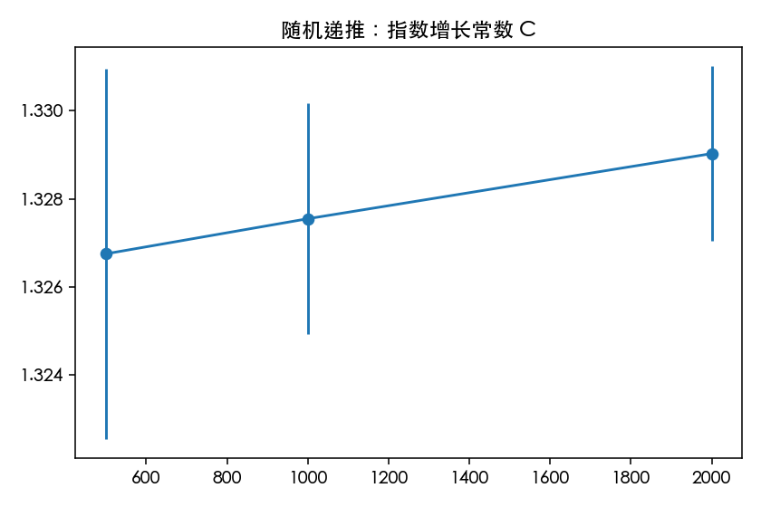

   **难度：4/5；出处：** TB：Lloyd N. Trefethen、David Bau III《数值线性代数》，陆金甫、关治译，2006（英文原版1997），第17讲习题17.3，书页110—111（PDF第122—123页），原题号17.3；**解答来源：** 自拟简解。

### 行消去与列消去的对偶分解

**图谱路径：** 数值分析 / 第1章 线性方程组直接解法 / 行消去与列消去的对偶分解

**知识内容：** [定义、定理与方法](知识点.md#kp-tb-ch20-elimination-column-dual)

<!-- source-exercise:TB-ch20-20.4 -->
1. 把Gauss消去重写为只有一个指标k的显式for循环，每步U用一个秩一外积更新；解释它作为优化计算起点的意义。

   **答案：** $U=A$、$L=I$。$\operatorname{for} k=1,\ldots ,m-1$，$v=U(k+1:m,k)/U(k,k)$，存$L(k+1:m,k)=v$；更新U(k+1:m,k+1:m)←$U_{\mathrm{tail}}-v U(k,k+1:m)$，并把$U(k+1:m,k)=0$。外积隐含行列双循环，与逐行公式等价；可由BLAS rank-1实现，进一步分块为矩阵乘提高数据复用。所有主元须非零，题面引用“算法10.1”应为20.1（Householder不属本题）。

   **难度：3/5；出处：** TB：Lloyd N. Trefethen、David Bau III《数值线性代数》，陆金甫、关治译，2006（英文原版1997），第20讲习题20.4，书页136（PDF第148页），原题号20.4；**解答来源：** 自拟简解。

   **勘误：** 原题算法10.1误引，按本讲Gauss算法20.1处理。

<!-- source-exercise:TB-ch20-20.5 -->
2. 从$A=LU$的Gauss消去出发，概念描述：(a)左至右按列消元而非上至下按行，使A下三角；(b)先以对角D缩放A列再消元，$Ax=b$及未知量如何变化；A先上三角化后加列运算，使其对角化。

   **答案：** (a)得到$A=L_{0}U_{0}$，$L_{0}$下三角，$U_{0}$单位上三角，行/列角色及哪个因子单位对角互换。(b)解$AD z=b$，$x=Dz$，右端仍b；$AD=L \widetilde{U}$时原$A=L \widetilde{U}D^{-1}$。(c)对上因子U继续右乘单位上三角T使$UT=D_{0}=\operatorname{diagU}$，于是$A=L D_{0} T^{-1}$，即LDU分解，L、$T^{-1}$均单位三角，中间对角为主元。由此也解释为何分别规定单位对角后分解唯一；A非奇异并须之前无主元消去可完成。

   **难度：3/5；出处：** TB：Lloyd N. Trefethen、David Bau III《数值线性代数》，陆金甫、关治译，2006（英文原版1997），第20讲习题20.5，书页136（PDF第148页），原题号20.5；**解答来源：** 自拟简解。

<!-- source-exercise:TB-ch21-21.3 -->
3. 考虑用列主元置换而非行置换导出$AQ=LU$。(a)证明非奇异A总有此分解；(b)证明奇异A不总有此分解。

   **答案：** (a)第k消元Schur补非奇异，第一行至少有非零条目，把它所在列换至主元列；前k−1列已完成，后列交换不破坏旧零模式，归纳得到单位下L和上U。(b)取$A=[[0,0],[1,1]]$，任意列置换首列下方仍1，而LU首列由$u_{11}=0$只能为0，矛盾。

   **难度：3/5；出处：** TB：Lloyd N. Trefethen、David Bau III《数值线性代数》，陆金甫、关治译，2006（英文原版1997），第21讲习题21.3，书页143（PDF第155页），原题号21.3；**解答来源：** 自拟简解。

   **整理说明：** 采用两列均非零的奇异反例，避免可用列置换把唯一非零列移至末列的假反例。

### 列缩放的变量变换和 LU 复用

**图谱路径：** 数值分析 / 第1章 线性方程组直接解法 / 列缩放的变量变换和 LU 复用

**知识内容：** [定义、定理与方法](知识点.md#kp-tb-ch20-diagonal-column-scaling)

<!-- source-exercise:TB-ch20-20.5 -->
1. 从$A=LU$的Gauss消去出发，概念描述：(a)左至右按列消元而非上至下按行，使A下三角；(b)先以对角D缩放A列再消元，$Ax=b$及未知量如何变化；A先上三角化后加列运算，使其对角化。

   **答案：** (a)得到$A=L_{0}U_{0}$，$L_{0}$下三角，$U_{0}$单位上三角，行/列角色及哪个因子单位对角互换。(b)解$AD z=b$，$x=Dz$，右端仍b；$AD=L \widetilde{U}$时原$A=L \widetilde{U}D^{-1}$。(c)对上因子U继续右乘单位上三角T使$UT=D_{0}=\operatorname{diagU}$，于是$A=L D_{0} T^{-1}$，即LDU分解，L、$T^{-1}$均单位三角，中间对角为主元。由此也解释为何分别规定单位对角后分解唯一；A非奇异并须之前无主元消去可完成。

   **难度：3/5；出处：** TB：Lloyd N. Trefethen、David Bau III《数值线性代数》，陆金甫、关治译，2006（英文原版1997），第20讲习题20.5，书页136（PDF第148页），原题号20.5；**解答来源：** 自拟简解。

### 带状矩阵选主元后的填充与 L 置换

**图谱路径：** 数值分析 / 第1章 线性方程组直接解法 / 带状矩阵选主元后的填充与 L 置换

**知识内容：** [定义、定理与方法](知识点.md#kp-tb-ch21-pivoted-band-fill)

<!-- source-exercise:TB-ch21-21.2 -->
1. A全带宽2p+1，部分主元$PA=LU$。描述L与U的稀疏方式。

   **答案：** U上半带宽$\le 2p$；每步主元只在k,…,k+p中搜索，把较下原行提上最多增加p个上带。第k列乘子只有至多p个非零，后续旧列行置换不增加其数量，但可把它们搬远，故规范L未必下半带宽p。逐步乘子/交换向量的紧凑实现仍每列只储p个局部乘子。这与20.2无置换双因子保带不能混用。

   **难度：3/5；出处：** TB：Lloyd N. Trefethen、David Bau III《数值线性代数》，陆金甫、关治译，2006（英文原版1997），第21讲习题21.2，书页143（PDF第155页），原题号21.2；**解答来源：** 自拟简解。

### 对称不定消去需要块主元

**图谱路径：** 数值分析 / 第1章 线性方程组直接解法 / 对称不定消去需要块主元

**知识内容：** [定义、定理与方法](知识点.md#kp-tb-ch21-symmetric-indefinite-pivot)

<!-- source-exercise:TB-ch21-21.5 -->
1. A Hermitian或实对称，但不必正定。(a)描述保持Hermitian结构、仍产生单位下三角L且$|l_{ij}|\le 1$的对称主元策略；(b)对应因子形式；(c)渐近工作量。

   **答案：** 原题若沿本讲标量Gauss/LDU意义，条件不足。$A=[[0,1],[1,0]]$非奇异对称，任意对称置换对角仍全0，第一标量主元总为0，因此不存在“只换对称主元的标量消去”答案。可修为允许$1\times 1/2\times 2$块主元，得$\operatorname{PAP}^{*}=L D L^{*}$、D块对角、主要工作$m^{3}/3$级；但常用不定块算法的乘子界并非本讲部分主元自然给出的$\le 1$，需要另选并证明策略。所附本讲未规定块主元规则，故保留题面和反例，不伪给通用$\le 1$结论。

   **难度：4/5；出处：** TB：Lloyd N. Trefethen、David Bau III《数值线性代数》，陆金甫、关治译，2006（英文原版1997），第21讲习题21.5，书页143（PDF第155页），原题号21.5；**解答来源：** 自拟简解。

   **整理说明：** [待核]需要确认原作者是否意指额外块主元算法及其界；当前不计入已解可用原题。

### 行置换与 Gauss 变换的共轭规则

**图谱路径：** 数值分析 / 第1章 线性方程组直接解法 / 行置换与 Gauss 变换的共轭规则

**知识内容：** [定义、定理与方法](知识点.md#kp-tb-ch21-permutation-conjugate-gauss)

<!-- source-exercise:TB-ch21-21.7 -->
1. 第20讲用$e_{k}$和$\ell _{k}$说明两个“幸运之处”；用这些向量解释本讲将所有置换移至左边而仍保持Gauss变换的第三个“幸运之处”。

   **答案：** 后续$P_{j}$（$j>k$）固定前j−1坐标，所以$P_{j} e_{k}=e_{k}$；共轭$P_{j}(I-\ell _{k} e_{k}^{T})P_{j}^{T}=I-(P_{j}\ell _{k})e_{k}^{T}$，只重排$\ell _{k}$第k位以下分量，前k位仍0。因此调整次序后的各变换仍属同一列类型，逆的乘积把相应乘子填入下三角，导出$PA=LU$。这同时解释实现换行时为何必须同步交换L已存的前k−1列。

   **难度：3/5；出处：** TB：Lloyd N. Trefethen、David Bau III《数值线性代数》，陆金甫、关治译，2006（英文原版1997），第21讲习题21.7，书页143（PDF第155页），原题号21.7；**解答来源：** 自拟简解。

### Cholesky 的无增长尺度与中断条件

**图谱路径：** 数值分析 / 第1章 线性方程组直接解法 / Cholesky 的无增长尺度与中断条件

**知识内容：** [定义、定理与方法](知识点.md#kp-tb-ch23-chol-no-growth)

已整理范围内未另选可直接对应此节点的独立未解题；相关已解例子见知识内容。

### 两个三角求解与 Cholesky 后向组合

**图谱路径：** 数值分析 / 第1章 线性方程组直接解法 / 两个三角求解与 Cholesky 后向组合

**知识内容：** [定义、定理与方法](知识点.md#kp-tb-ch23-chol-system-compose)

<!-- source-exercise:TB-ch23-23.2 -->
1. 仿定理16.2，由定理23.1及17.1推导Cholesky解系统的定理23.3。

   **答案：** 需用23.2的分解后向界，23.1只给精确存在唯一，原引用应修正。写$\widehat{R}^{*}\widehat{R}=A+E_{1}$，两次三角解的分量/范数后向界给$(\widehat{R}^{*}+E_{2})y=b$、$(\widehat{R}+E_{3})\widehat{x}=y$，$\|E_{2}\|,\|E_{3}\|=O(u)\|\widehat{R}\|$。乘开$E=E_{1}+E_{2}\widehat{R}+\widehat{R}^{*}E_{3}+E_{2}E_{3}$；由$\|\widehat{R}\|_{2}^{2}=\|A+E_{1}\|_{2}=O(\|A\|_{2})$得$\|E\|_{2}=O(u)\|A\|_{2}$，故$(A+E)\widehat{x}=b$。更换有限维范数只改常数。

   **难度：3/5；出处：** TB：Lloyd N. Trefethen、David Bau III《数值线性代数》，陆金甫、关治译，2006（英文原版1997），第23讲习题23.2，书页156（PDF第168页），原题号23.2；**解答来源：** 自拟简解。

   **勘误：** 原题23.1为精确Cholesky定理，后向证明须引用23.2。

### 从历史运行时间识别结构化求解

**图谱路径：** 数值分析 / 第1章 线性方程组直接解法 / 从历史运行时间识别结构化求解

**知识内容：** [定义、定理与方法](知识点.md#kp-tb-ch23-solver-structure-detection)

<!-- source-exercise:TB-ch23-23.3 -->
1. 解释书中1991工作站MATLAB反斜杠计时，逐(a)—(g)说实验目的/机制，允许参考flop：(a)$m=200,Z=\operatorname{randn}(m),A=Z^{*}\cdot Z,b$随机，A\b为1.0368s；(b)再次同解1.0303；(c)仅$A2(m,1)=A(m,1)/2$，2.0361；(d)$\operatorname{emin}=\operatorname{min}(\operatorname{eig}(A)),A3=A-.9\operatorname{emin} I$，1.0362；(e)$A4=A-1.1\operatorname{emin} I$，2.9624；(f)$A5=\operatorname{triu}(A)$，0.1261；(g)$A6=A5,A6(m,1)=A5(1,m)$，2.0012。

   **答案：** A几乎必然SPD，Cholesky成本$m^{3}/3$；(b)再次约同时间，说明该次历史反斜杠没有跨调用缓存因子，重复重分解。(c)一边元素改动破坏对称，需一般$LU2m^{3}/3$，约两倍。(d)最小特征值仍.$1\operatorname{emin}>0$，保留SPD，同Cholesky时间。(e)最小变−.1emin，非正定，记录约三倍符合先做部分/大部分Cholesky尝试失败再做一般LU；这是由历史时间推断，不保证某具体现代实现路由。(f)上三角只回代$O(m^{2})$，明显更快。(g)一个下远角非零破坏三角，回到$O(m^{3})LU$，约一般系统时间。所有秒数是原书历史观测，不是本机计时，不将差异归因于矩阵条件数改变。

   **难度：3/5；出处：** TB：Lloyd N. Trefethen、David Bau III《数值线性代数》，陆金甫、关治译，2006（英文原版1997），第23讲习题23.3，书页156（PDF第168页），原题号23.3；**解答来源：** 自拟简解。

### 三对角系统的追赶法

**图谱路径：** 数值分析 / 第1章 线性方程组直接解法 / 三对角系统的追赶法

**知识内容：** [定义、定理与方法](知识点.md#kp-xh-ch02-thomas)

<!-- source-exercise:XH-ch02-5 -->
1. 追赶法解4阶三对角A，主对角(2,3,1,1)、上对角(1,1,1)、下对角(1,1,2)，$b=(2,6,5,3)^{T}$。

   **答案：** 追赶主元(2,5/2,3/5,−7/3)，乘子(1/2,2/5,10/3)；更新右端$y=(2,5,3,-7)^{T}$。回代得到$x=(0,2,0,3)^{T}$。全部主元非零，所以顺序追赶有效，末负主元说明此阵不是正定，但不阻止求解。

   **难度：2/5；出处：** XH：向华、杨志坚《数值线性代数》，2024年所附版，第2章习题5，书页37（PDF第44页），原题号5；**解答来源：** 自拟简解。

<!-- source-exercise:XH-ch02-6 -->
2. 四弹簧串联，$k_{2}(x_{2}-x_{1})=k_{1}x_{1}$、$k_{3}(x_{3}-x_{2})=k_{2}(x_{2}-x_{1})$、$k_{4}(x_{4}-x_{3})=k_{3}(x_{3}-x_{2})$、$F=k_{4}(x_{4}-x_{3})$，$k=(50,50,75,225) N/m$。求各位移。

   **答案：** 各弹簧受同一力F，伸长依次F/50、F/50、F/75、F/225。于是$x_{1}=F/50$、$x_{2}=F/25$、$x_{3}=4F/75$、$x_{4}=13F/225$，单位米（F以牛顿计）。原题未给F具体数值，所以答案应是F的函数，不能自造载荷。

   **难度：2/5；出处：** XH：向华、杨志坚《数值线性代数》，2024年所附版，第2章习题6，书页37（PDF第44页），原题号6；**解答来源：** 自拟简解。

   **整理说明：** 总载荷F保持原题未指定，不换数字补题。

### 追赶法的主元条件

**图谱路径：** 数值分析 / 第1章 线性方程组直接解法 / 追赶法的主元条件

**知识内容：** [定义、定理与方法](知识点.md#kp-xh-ch02-thomas-pivots)

已整理范围内未另选可直接对应此节点的独立未解题；相关已解例子见知识内容。

### 竞选主元的局部候选

**图谱路径：** 数值分析 / 第1章 线性方程组直接解法 / 竞选主元的局部候选

**知识内容：** [定义、定理与方法](知识点.md#kp-xh-ch02-tournament-pivot)

已整理范围内未另选可直接对应此节点的独立未解题；相关已解例子见知识内容。

### 竞选主元的树形合并

**图谱路径：** 数值分析 / 第1章 线性方程组直接解法 / 竞选主元的树形合并

**知识内容：** [定义、定理与方法](知识点.md#kp-xh-ch02-tournament-tree)

已整理范围内未另选可直接对应此节点的独立未解题；相关已解例子见知识内容。

### 稀疏消去中的填充

**图谱路径：** 数值分析 / 第1章 线性方程组直接解法 / 稀疏消去中的填充

**知识内容：** [定义、定理与方法](知识点.md#kp-xh-ch02-sparse-fill)

已整理范围内未另选可直接对应此节点的独立未解题；相关已解例子见知识内容。

### 稀疏分解的符号与数值阶段

**图谱路径：** 数值分析 / 第1章 线性方程组直接解法 / 稀疏分解的符号与数值阶段

**知识内容：** [定义、定理与方法](知识点.md#kp-xh-ch02-symbolic-numeric)

已整理范围内未另选可直接对应此节点的独立未解题；相关已解例子见知识内容。

### 超节点与多波前思路

**图谱路径：** 数值分析 / 第1章 线性方程组直接解法 / 超节点与多波前思路

**知识内容：** [定义、定理与方法](知识点.md#kp-xh-ch02-supernodes)

已整理范围内未另选可直接对应此节点的独立未解题；相关已解例子见知识内容。

### 三角求解的分量后向稳定性

**图谱路径：** 数值分析 / 第1章 线性方程组直接解法 / 三角求解的分量后向稳定性

**知识内容：** [定义、定理与方法](知识点.md#kp-xh-ch02-triangular-backward)

<!-- source-exercise:XH-ch02-23 -->
1. U为非奇异上三角，$nu\le 0.01$。证明回代计算解满足$(U+\delta U)\widehat{x}=y$，并在U为A消去上因子、$\rho =\operatorname{max}_{i,j,k}|a_{ij}^{(k)}|/\|A\|_{\infty}$的上下文，估计$\|\delta U\|_{\infty} \le 1.01u n(n+1)\rho \|A\|_{\infty} /2$。

   **答案：** 逐行展开回代内积、相减、除法舍入，把各项误差吸收到该行U系数，右端保为精确y，得到邻近上三角系统。第i行长度$r=n-i+1$，按项舍入因子数求和至多r(r+1)/2；最近舍入的相对与逆向模型用教材规范，因$nu\le 0.01$每因子乘积偏差$\le 1.01$倍因子数u。每个$|u_{ij}|\le \rho \|A\|_{\infty}$，最大行取$r=n$，得所写上界。更通用不依赖原A的安全写法为$|\delta U|\le \gamma _{n}|U|$，没有给原A时只能用U本身尺度。

   **难度：4/5；出处：** XH：向华、杨志坚《数值线性代数》，2024年所附版，第2章习题23，书页38（PDF第45页），原题号23；**解答来源：** 自拟简解。

   **整理说明：** 原题引用未在本题单独定义的A与增长因子；已明确U为前述消去因子的上下文。

### 下三角系统的前代

**图谱路径：** 数值分析 / 第1章 线性方程组直接解法 / 下三角系统的前代

**知识内容：** [定义、定理与方法](知识点.md#kp-xu-ch01-forward-substitution)

<!-- source-exercise:XU-ch01-1 -->
1. 给出求非奇异下三角矩阵的逆矩阵的详细算法。

   **答案：** 对 $j=1,\ldots,n$ 解 $Lx^{(j)}=e_j$：当 $i<j$，$x_i^{(j)}=0$；$x_j^{(j)}=1/l_{jj}$；当 $i>j$，$x_i^{(j)}=-\sum_{k=j}^{i-1}l_{ik}x_k^{(j)}/l_{ii}$。各列合并即为下三角的 $L^{-1}$。

   **难度：2/5；出处：** XU：徐树方、高立、张平文《数值线性代数》第二版，2013，第1章习题1，书页36（PDF第48页），原题号1；**解答来源：** 自拟简解。

### 上三角系统的回代

**图谱路径：** 数值分析 / 第1章 线性方程组直接解法 / 上三角系统的回代

**知识内容：** [定义、定理与方法](知识点.md#kp-xu-ch01-back-substitution)

已整理范围内未另选可直接对应此节点的独立未解题；相关已解例子见知识内容。

### Gauss 变换

**图谱路径：** 数值分析 / 第1章 线性方程组直接解法 / Gauss 变换

**知识内容：** [定义、定理与方法](知识点.md#kp-xu-ch01-gauss-transform)

<!-- source-exercise:XH-ch02-7 -->
1. Gauss变换$L_{k}=I-l_k e_k^{T}$，证明逆为$I+l_k e_k^{T}$且也为Gauss变换。

   **答案：** $e_{k}^{T}l_{k}=0$，秩一项平方0，相乘为I；逆对应乘子$-l_{k}$。

   **难度：1/5；出处：** XH：向华、杨志坚《数值线性代数》，2024年所附版，第2章习题7，书页37（PDF第44页），原题号7；**解答来源：** 自拟简解。

<!-- source-exercise:XU-ch01-3 -->
2. 证明：若 $L_k=I-l_ke_k^T$ 是 Gauss 变换，则 $L_k^{-1}=I+l_ke_k^T$ 也是 Gauss 变换。

   **答案：** $e_k^Tl_k=0$，故 $(l_ke_k^T)^2=0$，两式相乘为 $I$。逆矩阵等于把乘子向量换成 $-l_k$ 的同型变换，其前 $k$ 个分量仍为0。

   **难度：1/5；出处：** XU：徐树方、高立、张平文《数值线性代数》第二版，2013，第1章习题3，书页36（PDF第48页），原题号3；**解答来源：** 自拟简解。

<!-- source-exercise:XU-ch01-4 -->
3. 确定 $3\times3$ Gauss 变换 $L$ 使 $L(2,3,4)^T=(2,7,8)^T$。

   **答案：** 取第一列消去型 $L=I-le_1^T$，令 $l=(0,-2,-2)^T$，得到 $L=\begin{pmatrix}1&0&0\\2&1&0\\2&0&1\end{pmatrix}$，直接相乘即得所需向量。

   **难度：1/5；出处：** XU：徐树方、高立、张平文《数值线性代数》第二版，2013，第1章习题4，书页36（PDF第48页），原题号4；**解答来源：** 自拟简解。

### 消去步骤与递推更新

**图谱路径：** 数值分析 / 第1章 线性方程组直接解法 / 消去步骤与递推更新

**知识内容：** [定义、定理与方法](知识点.md#kp-xu-ch01-elimination-update)

已整理范围内未另选可直接对应此节点的独立未解题；相关已解例子见知识内容。

### 无选主元 LU 分解的存在条件

**图谱路径：** 数值分析 / 第1章 线性方程组直接解法 / 无选主元 LU 分解的存在条件

**知识内容：** [定义、定理与方法](知识点.md#kp-xu-ch01-lu-existence)

<!-- source-exercise:TB-ch20-20.1 -->
1. 非奇异$A\in C^{m\times m}$，证明A有单位下三角L的LU分解当且仅当每个左上$k\times k$主块非奇异，并证明唯一。提示消去保持这些块行列式。

   **答案：** 若$A=LU$，则各主块$A_{k}=L_{k}U_{k}$，$\operatorname{det}A_{k}=\prod _{i\le k}u_{ii}$；非奇异A与三角性迫每个$u_{ii}$非零，所以必要。反之$\operatorname{det}A_{k}\ne 0$，归纳第k主元为$\operatorname{det}A_{k}/\operatorname{det}A_{k-1}$，皆非零，Gauss消去成功给LU。若$L_{1}U_{1}=L_{2}U_{2}$，则$L_{2}^{-1}L_{1}=U_{2}U_{1}^{-1}$同时为单位下三角和上三角，故I，两因子唯一。单位对角约定不可略。

   **难度：3/5；出处：** TB：Lloyd N. Trefethen、David Bau III《数值线性代数》，陆金甫、关治译，2006（英文原版1997），第20讲习题20.1，书页135（PDF第147页），原题号20.1；**解答来源：** 自拟简解。

### 规范 LU 分解的唯一性

**图谱路径：** 数值分析 / 第1章 线性方程组直接解法 / 规范 LU 分解的唯一性

**知识内容：** [定义、定理与方法](知识点.md#kp-xu-ch01-lu-uniqueness)

<!-- source-exercise:XU-ch01-5 -->
1. 证明：若非奇异 $A\in\mathbb R^{n\times n}$ 有定理1.1.2形式的 $A=LU$，其中 $L$ 单位下三角、$U$ 上三角，则 $L,U$ 唯一。

   **答案：** 由两组分解得 $L_2^{-1}L_1=U_2U_1^{-1}$。左边单位下三角，右边上三角，只能为 $I$，故两个因子分别相同。

   **难度：2/5；出处：** XU：徐树方、高立、张平文《数值线性代数》第二版，2013，第1章习题5，书页36（PDF第48页），原题号5；**解答来源：** 自拟简解。

### Doolittle 逐行递推

**图谱路径：** 数值分析 / 第1章 线性方程组直接解法 / Doolittle 逐行递推

**知识内容：** [定义、定理与方法](知识点.md#kp-xu-ch01-doolittle)

<!-- source-exercise:XH-ch02-2 -->
1. 求 $A=\begin{pmatrix}2&-1&-1\\1&2&0\\1&0&3\end{pmatrix}$ 的LU与LDU。

   **答案：** $L=[[1,0,0],[1/2,1,0],[1/2,1/5,1]]$，$U=[[2,-1,-1],[0,5/2,1/2],[0,0,17/5]]$。令$D=\operatorname{diag}(2,5/2,17/5)$、$U_{1}=D^{-1}U=[[1,-1/2,-1/2],[0,1,1/5],[0,0,1]]$，即$A=\operatorname{LDU}_{1}$，注意这里上因子单位对角。

   **难度：2/5；出处：** XH：向华、杨志坚《数值线性代数》，2024年所附版，第2章习题2，书页37（PDF第44页），原题号2；**解答来源：** 自拟简解。

### LU 分解的紧凑存储

**图谱路径：** 数值分析 / 第1章 线性方程组直接解法 / LU 分解的紧凑存储

**知识内容：** [定义、定理与方法](知识点.md#kp-xu-ch01-compact-lu)

<!-- source-exercise:TB-ch20-20.2 -->
1. A满足20.1且$|i-j|>p$时$a_{ij}=0$，全带宽2p+1；L、U是什么稀疏形式？

   **答案：** 无换行消去不会生成下距$>p$或上距$>p$的非零：第k乘子只在$i\le k+p$，而尾行有效列只到k+p。归纳得L下半带宽p、U上半带宽p，即$l_{ij}=0$若$i-j>p$，$u_{ij}=0$若$j-i>p$。非对称带状一般用分别下p、上q，同样分别保留。此结论不能无条件沿用到带行主元置换。

   **难度：2/5；出处：** TB：Lloyd N. Trefethen、David Bau III《数值线性代数》，陆金甫、关治译，2006（英文原版1997），第20讲习题20.2，书页135（PDF第147页），原题号20.2；**解答来源：** 自拟简解。

<!-- source-exercise:XH-ch02-1 -->
2. 用顺序消去与列主元消去解 $A=\begin{pmatrix}2&3&5\\3&4&7\\1&3&3\end{pmatrix}$、$b=(5,6,5)^{T}$。

   **答案：** 顺序分解$L=[[1,0,0],[3/2,1,0],[1/2,-3,1]]$、$U=[[2,3,5],[0,-1/2,-1/2],[0,0,-1]]$，前代回代给$x=(-4,1,2)^{T}$。列主元首步取3、下一列取5/3，行序(2,3,1)，得到$L=[[1,0,0],[1/3,1,0],[2/3,1/5,1]]$、$U=[[3,4,7],[0,5/3,2/3],[0,0,1/5]]$，解仍相同；精确算术中两法不同因子解同系统。

   **难度：2/5；出处：** XH：向华、杨志坚《数值线性代数》，2024年所附版，第2章习题1，书页36（PDF第43页），原题号1；**解答来源：** 自拟简解。

### 增广矩阵消去

**图谱路径：** 数值分析 / 第1章 线性方程组直接解法 / 增广矩阵消去

**知识内容：** [定义、定理与方法](知识点.md#kp-xu-ch01-augmented-elimination)

<!-- source-exercise:XU-ch01-9 -->
1. 设 $A$ 有三角分解。把 Gauss 消去应用于增广矩阵 $[A,b]$ 时，如何不存储 $L$ 解出 $Ax=b$？需要多少次乘法？

   **答案：** 每步算乘子后立即更新右下块和右端，随后丢弃乘子；消去结束回代即可。消去系数块用 $\sum_{r=1}^{n-1}r^2$ 次乘法，更新右端与回代各用 $n(n-1)/2$ 次，总计 $n(n-1)(2n+5)/6$ 次乘法；除法另计。

   **难度：2/5；出处：** XU：徐树方、高立、张平文《数值线性代数》第二版，2013，第1章习题9，书页37（PDF第49页），原题号9；**解答来源：** 自拟简解。

### LU 的运算量

**图谱路径：** 数值分析 / 第1章 线性方程组直接解法 / LU 的运算量

**知识内容：** [定义、定理与方法](知识点.md#kp-xu-ch01-operation-count-lu)

<!-- source-exercise:XU-ch01-9 -->
1. 设 $A$ 有三角分解。把 Gauss 消去应用于增广矩阵 $[A,b]$ 时，如何不存储 $L$ 解出 $Ax=b$？需要多少次乘法？

   **答案：** 每步算乘子后立即更新右下块和右端，随后丢弃乘子；消去结束回代即可。消去系数块用 $\sum_{r=1}^{n-1}r^2$ 次乘法，更新右端与回代各用 $n(n-1)/2$ 次，总计 $n(n-1)(2n+5)/6$ 次乘法；除法另计。

   **难度：2/5；出处：** XU：徐树方、高立、张平文《数值线性代数》第二版，2013，第1章习题9，书页37（PDF第49页），原题号9；**解答来源：** 自拟简解。

### 列主元 Gauss 消去

**图谱路径：** 数值分析 / 第1章 线性方程组直接解法 / 列主元 Gauss 消去

**知识内容：** [定义、定理与方法](知识点.md#kp-xu-ch01-partial-pivoting)

<!-- source-exercise:TB-ch21-21.1 -->
1. $A=[[2,1,1,0],[4,3,3,1],[8,7,9,5],[6,7,9,8]]$为(20.3)矩阵。(a)由无主元(20.5)LU求detA；(b)由主元(21.3)求detA；(c)描述一般方阵用部分主元Gauss求行列式。

   **答案：** (a)无主元U对角2,1,2,2，L单位三角，乘积8。(b)3次行交换$\operatorname{det}P=-1$，U对角8,7/4,−6/7,2/3，积−8，所以$\operatorname{det}A=\operatorname{det}P\cdot \operatorname{det}U=8$。(c)记每次交换奇偶s，$\operatorname{det}A=(-1)^{s}\prod _{i} u_{ii}$；零主元说明奇异、行列式0。大维数用符号/相位和$\Sigma  \operatorname{log}|u_{ii}|$可避免直接乘上溢下溢，复数需保存复相位。

   **难度：2/5；出处：** TB：Lloyd N. Trefethen、David Bau III《数值线性代数》，陆金甫、关治译，2006（英文原版1997），第21讲习题21.1，书页143（PDF第155页），原题号21.1；**解答来源：** 自拟简解。

<!-- source-exercise:TB-ch21-21.6 -->
2. A严格列对角占优：$|a_{kk}|>\sum_{j\ne k}|a_{jk}|$。证明部分主元Gauss不发生行交换。

   **答案：** 首列严格占优使$|a_{11}|$最大，第一步不换行。Schur补$s_{ij}=a_{ij}-a_{i1} a_{1}j/a_{11}$；对每$j>1$，$|s_{jj}|-\sum _{i>1,i\ne j}|s_{ij}|\ge |a_{jj}|-\sum _{i>1,i\ne j}|a_{ij}|-|a_{1}j|\sum _{i>1}|a_{i1}|/|a_{11}|>0$，因首列比值$<1$且原j列严格占优。归纳各Schur补严格列占优，所有对角主元最大，不交换。

   **难度：3/5；出处：** TB：Lloyd N. Trefethen、David Bau III《数值线性代数》，陆金甫、关治译，2006（英文原版1997），第21讲习题21.6，书页143（PDF第155页），原题号21.6；**解答来源：** 自拟简解。

<!-- source-exercise:XH-ch02-1 -->
3. 用顺序消去与列主元消去解 $A=\begin{pmatrix}2&3&5\\3&4&7\\1&3&3\end{pmatrix}$、$b=(5,6,5)^{T}$。

   **答案：** 顺序分解$L=[[1,0,0],[3/2,1,0],[1/2,-3,1]]$、$U=[[2,3,5],[0,-1/2,-1/2],[0,0,-1]]$，前代回代给$x=(-4,1,2)^{T}$。列主元首步取3、下一列取5/3，行序(2,3,1)，得到$L=[[1,0,0],[1/3,1,0],[2/3,1/5,1]]$、$U=[[3,4,7],[0,5/3,2/3],[0,0,1/5]]$，解仍相同；精确算术中两法不同因子解同系统。

   **难度：2/5；出处：** XH：向华、杨志坚《数值线性代数》，2024年所附版，第2章习题1，书页36（PDF第43页），原题号1；**解答来源：** 自拟简解。

<!-- source-exercise:XH-ch02-3 -->
4. 列主元消去解 $A=\begin{pmatrix}3&2&1\\1&0&1\\12&-3&3\end{pmatrix}$、$b=(4,2,15)^{T}$。

   **答案：** 置换行序(3,1,2)，$L=[[1,0,0],[1/4,1,0],[1/12,1/11,1]]$、$U=[[12,-3,3],[0,11/4,1/4],[0,0,8/11]]$。前代对$Pb=(15,4,2)^{T}$得$y=(15,1/4,8/11)^{T}$，回代$x=(1,0,1)^{T}$。

   **难度：2/5；出处：** XH：向华、杨志坚《数值线性代数》，2024年所附版，第2章习题3，书页37（PDF第44页），原题号3；**解答来源：** 自拟简解。

<!-- source-exercise:XU-ch01-13 -->
5. 利用列主元 Gauss 消去给出求非奇异矩阵逆的实用算法。

   **答案：** 一次分解 $PA=LU$；对每个 $j$ 解 $Ly_j=Pe_j$，再解 $Ux_j=y_j$，把 $x_j$ 作逆矩阵第 $j$ 列。可批量三角求解多个右端；换行索引必须作用于各 $e_j$。

   **难度：2/5；出处：** XU：徐树方、高立、张平文《数值线性代数》第二版，2013，第1章习题13，书页38（PDF第50页），原题号13；**解答来源：** 自拟简解。

<!-- source-exercise:XU-ch01-上机1 -->
6. 编写顺序 Gauss 消去和列主元消去子程序，求84阶三对角方程组：主对角全为6，下对角全为8，上对角全为1，右端为 $(7,15,\ldots,15,14)^T$。与精确解比较，并讨论 Gauss 消去法。

   **答案：** 精确解为全1向量，因为每行系数和等于右端。分别实施两种消去，记录 $\|\widehat x-\mathbf1\|_\infty$ 与相对残差，不能只看残差。顺序消去的三对角主元递推 $d_1=6$、$d_i=6-8/d_{i-1}$，虽不为零，误差可经增长过程放大；列主元控制乘子。实际双精度实验及算法代码见处理记录/徐书第一章计算核验.json，所记录的具体数值取决于实现与精度。

   **难度：3/5；出处：** XU：徐树方、高立、张平文《数值线性代数》第二版，2013，第1章习题上机1，书页39（PDF第51页），原题号上机1；**解答来源：** 自拟简解。

<!-- source-exercise:XU-ch01-上机3 -->
7. 用上机题1中的两种 Gauss 消去程序求上机题2的两个系统，比较所有计算结果并评论方法优劣：一个100阶对角为10、相邻对角为1且右端随机的三对角系统；另一个40阶 Hilbert 系统，右端为各行元素之和。

   **答案：** 对第一个系统四种算法通常均能给出小残差，Cholesky 和$\operatorname{LDL}^{T}$利用正定对称及带宽省时省存储。第二个系统不能由选主元保证精度：病态放大输入与舍入扰动，应用精确解全1向量同时衡量前向误差和残差。记录实际失败情形和误差，不能以小残差断言解可靠。具体同参数实验记录见处理记录/徐书第一章计算核验.json。

   **难度：3/5；出处：** XU：徐树方、高立、张平文《数值线性代数》第二版，2013，第1章习题上机3，书页40（PDF第52页），原题号上机3；**解答来源：** 自拟简解。

### 置换与右端的同步

**图谱路径：** 数值分析 / 第1章 线性方程组直接解法 / 置换与右端的同步

**知识内容：** [定义、定理与方法](知识点.md#kp-xu-ch01-permutation-bookkeeping)

已整理范围内未另选可直接对应此节点的独立未解题；相关已解例子见知识内容。

### 全主元消去

**图谱路径：** 数值分析 / 第1章 线性方程组直接解法 / 全主元消去

**知识内容：** [定义、定理与方法](知识点.md#kp-xu-ch01-complete-pivoting)

<!-- source-exercise:XU-ch01-12 -->
1. 证明：若全主元消去给 $PAQ=LU$，则 $|u_{ii}|\ge|u_{ij}|$，$j>i$。

   **答案：** 第 $i$ 步主元为剩余块绝对值最大者，故当步主元行其余元素不超过它。以后的消去不再改变此行，后续列交换只在后部置换这些元素，结论保持。

   **难度：2/5；出处：** XU：徐树方、高立、张平文《数值线性代数》第二版，2013，第1章习题12，书页38（PDF第50页），原题号12；**解答来源：** 自拟简解。

### 消去中元素增长的反例

**图谱路径：** 数值分析 / 第1章 线性方程组直接解法 / 消去中元素增长的反例

**知识内容：** [定义、定理与方法](知识点.md#kp-xu-ch01-growth-example)

<!-- source-exercise:XH-ch02-9 -->
1. $a_{ij}=1$若$i=j$或$j=n$，$a_{ij}=-1$若$i>j$，其余0。证明存在$|l_{ij}|\le 1$且$u_{nn}=2^{n-1}$的LU。

   **答案：** 取单位下三角L严格下部全−1；U前n−1列为单位阵对应列，末列$u_{in}=2^{i-1}$，相乘末列$2^{i-1}-\sum _{k<i}2^{k-1}=1$，其他列与原阵相同。

   **难度：2/5；出处：** XH：向华、杨志坚《数值线性代数》，2024年所附版，第2章习题9，书页37（PDF第44页），原题号9；**解答来源：** 自拟简解。

<!-- source-exercise:XU-ch01-6 -->
2. 设 $a_{ij}=1$ 若 $i=j$ 或 $j=n$，$a_{ij}=-1$ 若 $i>j$，其余为0。证明 $A$ 有满足 $|l_{ij}|\le1$ 且 $u_{nn}=2^{n-1}$ 的三角分解。

   **答案：** 取 $L$ 单位下三角且所有严格下三角元为 $-1$；取 $U$ 前 $n-1$ 列为单位阵相应列，最后一列 $u_{in}=2^{i-1}$。对最后一列，$(LU)_{in}=2^{i-1}-\sum_{k<i}2^{k-1}=1$；其他各列也与 $A$ 一致。

   **难度：2/5；出处：** XU：徐树方、高立、张平文《数值线性代数》第二版，2013，第1章习题6，书页36—37（PDF第48—49页），原题号6；**解答来源：** 自拟简解。

<!-- source-exercise:XU-ch01-上机1 -->
3. 编写顺序 Gauss 消去和列主元消去子程序，求84阶三对角方程组：主对角全为6，下对角全为8，上对角全为1，右端为 $(7,15,\ldots,15,14)^T$。与精确解比较，并讨论 Gauss 消去法。

   **答案：** 精确解为全1向量，因为每行系数和等于右端。分别实施两种消去，记录 $\|\widehat x-\mathbf1\|_\infty$ 与相对残差，不能只看残差。顺序消去的三对角主元递推 $d_1=6$、$d_i=6-8/d_{i-1}$，虽不为零，误差可经增长过程放大；列主元控制乘子。实际双精度实验及算法代码见处理记录/徐书第一章计算核验.json，所记录的具体数值取决于实现与精度。

   **难度：3/5；出处：** XU：徐树方、高立、张平文《数值线性代数》第二版，2013，第1章习题上机1，书页39（PDF第51页），原题号上机1；**解答来源：** 自拟简解。

### 对角占优在消去中的保持

**图谱路径：** 数值分析 / 第1章 线性方程组直接解法 / 对角占优在消去中的保持

**知识内容：** [定义、定理与方法](知识点.md#kp-xu-ch01-diagonal-dominance-elimination)

<!-- source-exercise:XH-ch02-8 -->
1. 一步消去后右下块S，证明：(1) 原阵对称则S对称；(2) 严格行对角占优则S仍占优；(3) 正定则S正定；(4) 对称严格占优时顺序和列主元消去结果相同。

   **答案：** $S=B-ca^{T}/a_{11}$。(1) 对称时$c=a$、B对称。(2) 行裕量估计至少原裕量加$|a_{i1}|\delta _{1}/|a_{11}|$，严格正。(3) 对$z\ne 0$取$v=(-a^{T}z/a_{11},z)^{T}$，则$z^{T}Sz=v^{T}Av>0$。(4) 对称行占优也是列占优，各步保持，使对角主元严格大于同列其他元素，不换行。

   **难度：3/5；出处：** XH：向华、杨志坚《数值线性代数》，2024年所附版，第2章习题8，书页37（PDF第44页），原题号8；**解答来源：** 自拟简解。

   **整理说明：** 原书将四个相关小问作一整题；其部分与徐书三题重叠，保留原题完整组合，不拆计。

<!-- source-exercise:XU-ch01-8 -->
2. 设 $A=[a_{ij}]$ 严格行对角占优。证明一步消去后的右下块 $A_2$ 仍严格行对角占优；由此推断对称严格对角占优矩阵用顺序消去和列主元消去得到相同结果。

   **答案：** 对 $i>1$，$b_{ij}=a_{ij}-a_{i1}a_{1j}/a_{11}$。三角不等式给 $|b_{ii}|-\sum_{j>1,j\ne i}|b_{ij}|\ge |a_{ii}|-\sum_{j>1,j\ne i}|a_{ij}|-|a_{i1}|\sum_{j>1}|a_{1j}|/|a_{11}|> |a_{ii}|-\sum_{j\ne i}|a_{ij}|>0$。对称性使各步也列占优，当前对角元严格大于本列所有其余元素，所以不换行。

   **难度：3/5；出处：** XU：徐树方、高立、张平文《数值线性代数》第二版，2013，第1章习题8，书页37（PDF第49页），原题号8；**解答来源：** 自拟简解。

<!-- source-exercise:XU-ch01-15 -->
3. 证明：若 $A^T$ 严格行对角占优，则 $A=LU$ 存在且消去乘子满足 $|l_{ij}|<1$。

   **答案：** 对 $A$ 为严格列占优，一步后的 Schur 块仍列占优（将第8题的估计交换行列即可）。当前 $|a_{jj}|>\sum_{i\ne j}|a_{ij}|$，故每个 $|a_{ij}/a_{jj}|<1$ 且主元非零。逐步归纳完成分解。

   **难度：2/5；出处：** XU：徐树方、高立、张平文《数值线性代数》第二版，2013，第1章习题15，书页38（PDF第50页），原题号15；**解答来源：** 自拟简解。

### Schur 余阵

**图谱路径：** 数值分析 / 第1章 线性方程组直接解法 / Schur 余阵

**知识内容：** [定义、定理与方法](知识点.md#kp-xu-ch01-schur-complement)

<!-- source-exercise:TB-ch20-20.3 -->
1. $A=[[A_{11},A_{12}],[A_{21},A_{22}]]$，$A_{11} n\times n$，$A_{22}(m-n)\times (m-n)$，A满足20.1。(a)验证左乘$[[I,0],[-A_{21}A_{11}^{-1},I]]$使右下变为Schur补$A_{22}-A_{21}A_{11}^{-1}A_{12}$；(b)逐行n步Gauss消去$A_{21}$也得同右下块。

   **答案：** 直接块乘给左下0、右上$A_{12}$、右下所求S。逐步消去在前n列的累计变换是某下三角块矩阵$[[E_{11},0],[E_{21},I]]$；要求$E_{21}A_{11}+A_{21}=0$迫$E_{21}=-A_{21}A_{11}^{-1}$，因此右下仍S，与左上具体三角化无关。实际求$A_{11}X=A_{12}$而不显式形成逆。

   **难度：2/5；出处：** TB：Lloyd N. Trefethen、David Bau III《数值线性代数》，陆金甫、关治译，2006（英文原版1997），第20讲习题20.3，书页135—136（PDF第147—148页），原题号20.3；**解答来源：** 自拟简解。

<!-- source-exercise:XH-ch02-10 -->
2. 块A中$A_{11}$可逆且有顺序LU，证明k步消去右下块为$S=A_{22}-A_{21}A_{11}^{-1}A_{12}$。

   **答案：** 由$A_{11}=L_{11}U_{11}$得$L_{21}=A_{21}U_{11}^{-1}$、$U_{12}=L_{11}^{-1}A_{12}$，消去块$A_{22}-L_{21}U_{12}$即S。

   **难度：2/5；出处：** XH：向华、杨志坚《数值线性代数》，2024年所附版，第2章习题10，书页38（PDF第45页），原题号10；**解答来源：** 自拟简解。

<!-- source-exercise:XU-ch01-11 -->
3. 设 $A=\begin{pmatrix}A_{11}&A_{12}\\A_{21}&A_{22}\end{pmatrix}$，$A_{11}$ 为 $k$ 阶非奇异矩阵，且有三角分解。证明经过 $k$ 步消去所得右下块等于 $S=A_{22}-A_{21}A_{11}^{-1}A_{12}$。

   **答案：** 若 $A_{11}=L_{11}U_{11}$，块 LU 方程给 $L_{21}=A_{21}U_{11}^{-1}$、$U_{12}=L_{11}^{-1}A_{12}$。因此更新块为 $A_{22}-L_{21}U_{12}=A_{22}-A_{21}A_{11}^{-1}A_{12}$。

   **难度：2/5；出处：** XU：徐树方、高立、张平文《数值线性代数》第二版，2013，第1章习题11，书页37（PDF第49页），原题号11；**解答来源：** 自拟简解。

### 对称 Schur 余阵

**图谱路径：** 数值分析 / 第1章 线性方程组直接解法 / 对称 Schur 余阵

**知识内容：** [定义、定理与方法](知识点.md#kp-xu-ch01-symmetric-schur)

<!-- source-exercise:XH-ch02-8 -->
1. 一步消去后右下块S，证明：(1) 原阵对称则S对称；(2) 严格行对角占优则S仍占优；(3) 正定则S正定；(4) 对称严格占优时顺序和列主元消去结果相同。

   **答案：** $S=B-ca^{T}/a_{11}$。(1) 对称时$c=a$、B对称。(2) 行裕量估计至少原裕量加$|a_{i1}|\delta _{1}/|a_{11}|$，严格正。(3) 对$z\ne 0$取$v=(-a^{T}z/a_{11},z)^{T}$，则$z^{T}Sz=v^{T}Av>0$。(4) 对称行占优也是列占优，各步保持，使对角主元严格大于同列其他元素，不换行。

   **难度：3/5；出处：** XH：向华、杨志坚《数值线性代数》，2024年所附版，第2章习题8，书页37（PDF第44页），原题号8；**解答来源：** 自拟简解。

   **整理说明：** 原书将四个相关小问作一整题；其部分与徐书三题重叠，保留原题完整组合，不拆计。

<!-- source-exercise:XU-ch01-7 -->
2. 设 $A$ 对称且 $a_{11}\ne0$。一步消去给 $\begin{pmatrix}a_{11}&a_1^T\\0&A_2\end{pmatrix}$。证明 $A_2$ 对称。

   **答案：** 原阵写成 $\begin{pmatrix}a_{11}&a_1^T\\a_1&B\end{pmatrix}$，$B$ 对称，消去后 $A_2=B-a_1a_1^T/a_{11}$，显然对称。

   **难度：1/5；出处：** XU：徐树方、高立、张平文《数值线性代数》第二版，2013，第1章习题7，书页37（PDF第49页），原题号7；**解答来源：** 自拟简解。

### 正定性与 Schur 余阵

**图谱路径：** 数值分析 / 第1章 线性方程组直接解法 / 正定性与 Schur 余阵

**知识内容：** [定义、定理与方法](知识点.md#kp-xu-ch01-positive-schur)

<!-- source-exercise:XH-ch02-8 -->
1. 一步消去后右下块S，证明：(1) 原阵对称则S对称；(2) 严格行对角占优则S仍占优；(3) 正定则S正定；(4) 对称严格占优时顺序和列主元消去结果相同。

   **答案：** $S=B-ca^{T}/a_{11}$。(1) 对称时$c=a$、B对称。(2) 行裕量估计至少原裕量加$|a_{i1}|\delta _{1}/|a_{11}|$，严格正。(3) 对$z\ne 0$取$v=(-a^{T}z/a_{11},z)^{T}$，则$z^{T}Sz=v^{T}Av>0$。(4) 对称行占优也是列占优，各步保持，使对角主元严格大于同列其他元素，不换行。

   **难度：3/5；出处：** XH：向华、杨志坚《数值线性代数》，2024年所附版，第2章习题8，书页37（PDF第44页），原题号8；**解答来源：** 自拟简解。

   **整理说明：** 原书将四个相关小问作一整题；其部分与徐书三题重叠，保留原题完整组合，不拆计。

<!-- source-exercise:XU-ch01-10 -->
2. 设 $A$ 对称正定。一步 Gauss 消去得到右下块 $A_2$，证明 $A_2$ 仍正定。

   **答案：** 写 $A_2=B-aa^T/a_{11}$。对 $z\ne0$ 取 $v=(-a^Tz/a_{11},z)^T$，则 $z^TA_2z=v^TAv>0$。

   **难度：2/5；出处：** XU：徐树方、高立、张平文《数值线性代数》第二版，2013，第1章习题10，书页37（PDF第49页），原题号10；**解答来源：** 自拟简解。

### Cholesky 分解

**图谱路径：** 数值分析 / 第1章 线性方程组直接解法 / Cholesky 分解

**知识内容：** [定义、定理与方法](知识点.md#kp-xu-ch01-cholesky)

<!-- source-exercise:XH-ch02-4 -->
1. 用Cholesky解 $A=\begin{pmatrix}4&-2&-4\\-2&17&10\\-4&10&9\end{pmatrix}$、$b=(10,3,-5)^{T}$。

   **答案：** $L=[[2,0,0],[-1,4,0],[-2,2,1]]$，$A=LL^{T}$且L可逆。$Ly=b$给$y=(5,2,1)^{T}$，$L^{T}x=y$给$x=(7/2,0,1)^{T}$。

   **难度：2/5；出处：** XH：向华、杨志坚《数值线性代数》，2024年所附版，第2章习题4，书页37（PDF第44页），原题号4；**解答来源：** 自拟简解。

<!-- source-exercise:XU-ch01-17 -->
2. 证明 Cholesky 定理1.3.1中对角正的下三角因子 $L$ 唯一。

   **答案：** 若 $L_1L_1^T=L_2L_2^T$，令 $M=L_2^{-1}L_1$，则 $MM^T=I$。下三角正交阵必须对角且各对角为 $\pm1$；正对角强制 $M=I$。

   **难度：2/5；出处：** XU：徐树方、高立、张平文《数值线性代数》第二版，2013，第1章习题17，书页38（PDF第50页），原题号17；**解答来源：** 自拟简解。

<!-- source-exercise:XU-ch01-21 -->
3. 设 $A=\begin{pmatrix}16&4&8&4\\4&10&8&4\\8&8&12&10\\4&4&10&12\end{pmatrix}$，$b=(32,26,38,30)^T$。用平方根法证明 $A$ 正定并解 $Ax=b$。

   **答案：** 逐步计算得 $L=\begin{pmatrix}4&0&0&0\\1&3&0&0\\2&2&2&0\\1&1&3&1\end{pmatrix}$，$A=LL^T$，对角均正且可逆，故正定。前代得 $y=(8,6,5,1)^T$，回代得 $x=(1,1,1,1)^T$。

   **难度：2/5；出处：** XU：徐树方、高立、张平文《数值线性代数》第二版，2013，第1章习题21，书页38（PDF第50页），原题号21；**解答来源：** 自拟简解。

<!-- source-exercise:XU-ch01-上机2 -->
4. 编写平方根法与改进平方根法，解：(1) 100阶三对角系统，主对角10、上下对角1，$b$ 随机选取；(2) 40阶 Hilbert 系统 $a_{ij}=1/(i+j-1)$，$b_i=\sum_{j=1}^{40}1/(i+j-1)$。

   **答案：** (1) 此矩阵严格对角占优且对称正定，按 Cholesky 与$\operatorname{LDL}^{T}$公式求解，可检查两解差及残差。(2) 精确解为全1向量，精确正定性来自多项式 Gram 积分表示；普通双精度中40阶 Hilbert 阵已极病态，Cholesky 可能检测非正主元。应报告算法失败或极大前向误差，并用高精度重算作为对照，不能给出伪造的双精度正确结果。处理记录/徐书第一章计算核验.json 保留实际实验。

   **难度：3/5；出处：** XU：徐树方、高立、张平文《数值线性代数》第二版，2013，第1章习题上机2，书页39—40（PDF第51—52页），原题号上机2；**解答来源：** 自拟简解。

<!-- source-exercise:XU-ch01-上机3 -->
5. 用上机题1中的两种 Gauss 消去程序求上机题2的两个系统，比较所有计算结果并评论方法优劣：一个100阶对角为10、相邻对角为1且右端随机的三对角系统；另一个40阶 Hilbert 系统，右端为各行元素之和。

   **答案：** 对第一个系统四种算法通常均能给出小残差，Cholesky 和$\operatorname{LDL}^{T}$利用正定对称及带宽省时省存储。第二个系统不能由选主元保证精度：病态放大输入与舍入扰动，应用精确解全1向量同时衡量前向误差和残差。记录实际失败情形和误差，不能以小残差断言解可靠。具体同参数实验记录见处理记录/徐书第一章计算核验.json。

   **难度：3/5；出处：** XU：徐树方、高立、张平文《数值线性代数》第二版，2013，第1章习题上机3，书页40（PDF第52页），原题号上机3；**解答来源：** 自拟简解。

### Cholesky 逐列公式

**图谱路径：** 数值分析 / 第1章 线性方程组直接解法 / Cholesky 逐列公式

**知识内容：** [定义、定理与方法](知识点.md#kp-xu-ch01-cholesky-column)

已整理范围内未另选可直接对应此节点的独立未解题；相关已解例子见知识内容。

### Cholesky 逐行公式

**图谱路径：** 数值分析 / 第1章 线性方程组直接解法 / Cholesky 逐行公式

**知识内容：** [定义、定理与方法](知识点.md#kp-xu-ch01-cholesky-row)

<!-- source-exercise:XU-ch01-22 -->
1. 给出按行计算 Cholesky 因子 $L$ 的详细算法。

   **答案：** 外层 $i=1,\ldots,n$；内层 $j=1,\ldots,i-1$ 计算 $l_{ij}=(a_{ij}-\sum_{k=1}^{j-1}l_{ik}l_{jk})/l_{jj}$；再令 $l_{ii}=\sqrt{a_{ii}-\sum_{k=1}^{i-1}l_{ik}^2}$，其余上三角置0。正定保证每步平方根为正。

   **难度：1/5；出处：** XU：徐树方、高立、张平文《数值线性代数》第二版，2013，第1章习题22，书页38（PDF第50页），原题号22；**解答来源：** 自拟简解。

### 改进平方根法与 LDLᵀ

**图谱路径：** 数值分析 / 第1章 线性方程组直接解法 / 改进平方根法与 LDLᵀ

**知识内容：** [定义、定理与方法](知识点.md#kp-xu-ch01-ldlt)

<!-- source-exercise:XH-ch02-11 -->
1. 实对称A前n−1个顺序主子阵非奇异，证明唯一$A=\operatorname{LDL}^{T}$，L单位下三角、D对角。

   **答案：** 递推$d_{j}=a_{jj}-\sum _{k<j}d_{k} l_{jk}^{2}$；$j<n$时$l_{ij}=(a_{ij}-\sum _{k<j}d_k l_{ik} l_{jk})/d_{j}$，分母非零。最后$d_{n}$可为0，故不额外假设A可逆。全部公式逐步唯一。

   **难度：3/5；出处：** XH：向华、杨志坚《数值线性代数》，2024年所附版，第2章习题11，书页38（PDF第45页），原题号11；**解答来源：** 自拟简解。

<!-- source-exercise:XU-ch01-20 -->
2. 若 $A$ 对称且前 $n-1$ 个顺序主子阵均非奇异，证明唯一存在 $A=LDL^T$，$L$ 单位下三角、$D$ 对角。

   **答案：** 先由主子式条件作 $A=LU$。前 $n-1$ 主元非零，比较对称性可逐步写 $u_{ij}=d_i l_{ji}$，其中 $d_i=u_{ii}$，最后 $d_n$ 无需非零。等价地按 $d_j=a_{jj}-\sum_{k<j}d_kl_{jk}^2$、$l_{ij}=(a_{ij}-\sum_{k<j}d_kl_{ik}l_{jk})/d_j$ 递推（只在 $j<n$ 除法）。全部量唯一。

   **难度：3/5；出处：** XU：徐树方、高立、张平文《数值线性代数》第二版，2013，第1章习题20，书页38（PDF第50页），原题号20；**解答来源：** 自拟简解。

<!-- source-exercise:XU-ch01-23 -->
3. 利用改进平方根法设计求对称正定矩阵逆的算法。

   **答案：** 分解 $A=LDL^T$，各 $d_i>0$。求 $L^{-1}=M$ 后得 $A^{-1}=M^TD^{-1}M$；或者逐列解 $Ly=e_j$、$Dz=y$、$L^Tx=z$。后者无需显式求 $L$ 的逆，且可仅计算一个三角部分再对称填充。

   **难度：2/5；出处：** XU：徐树方、高立、张平文《数值线性代数》第二版，2013，第1章习题23，书页38（PDF第50页），原题号23；**解答来源：** 自拟简解。

<!-- source-exercise:XU-ch01-上机2 -->
4. 编写平方根法与改进平方根法，解：(1) 100阶三对角系统，主对角10、上下对角1，$b$ 随机选取；(2) 40阶 Hilbert 系统 $a_{ij}=1/(i+j-1)$，$b_i=\sum_{j=1}^{40}1/(i+j-1)$。

   **答案：** (1) 此矩阵严格对角占优且对称正定，按 Cholesky 与$\operatorname{LDL}^{T}$公式求解，可检查两解差及残差。(2) 精确解为全1向量，精确正定性来自多项式 Gram 积分表示；普通双精度中40阶 Hilbert 阵已极病态，Cholesky 可能检测非正主元。应报告算法失败或极大前向误差，并用高精度重算作为对照，不能给出伪造的双精度正确结果。处理记录/徐书第一章计算核验.json 保留实际实验。

   **难度：3/5；出处：** XU：徐树方、高立、张平文《数值线性代数》第二版，2013，第1章习题上机2，书页39—40（PDF第51—52页），原题号上机2；**解答来源：** 自拟简解。

### 带状 Cholesky 保持结构

**图谱路径：** 数值分析 / 第1章 线性方程组直接解法 / 带状 Cholesky 保持结构

**知识内容：** [定义、定理与方法](知识点.md#kp-xu-ch01-band-cholesky)

<!-- source-exercise:XH-ch02-13 -->
1. 证明对称正定带状A的Cholesky因子也带状。

   **答案：** 令下半带宽p。按列归纳，当$i-j>p$，$a_{ij}=0$且每个$k<j$有$l_{ik}=0$，分解递推便给$l_{ij}=0$。因子半带宽仍p，含主对角p+1条非零带。

   **难度：2/5；出处：** XH：向华、杨志坚《数值线性代数》，2024年所附版，第2章习题13，书页38（PDF第45页），原题号13；**解答来源：** 自拟简解。

   **整理说明：** 此题与徐书题18同一带宽保持命题；徐题额外问因子带宽，简解统一覆盖，按同原命题保守去重。

<!-- source-exercise:XU-ch01-18 -->
2. 若对称正定带状矩阵 $A$ 的全带宽为 $2p+1$，证明 Cholesky 因子 $L$ 仍带状，并给出其带宽。

   **答案：** 按列公式归纳。当 $i-j>p$，有 $a_{ij}=0$，且每个 $k<j$ 均有 $i-k>p$，归纳得 $l_{ik}=0$，故 $l_{ij}=0$。$L$ 的下半带宽为 $p$，计入主对角共有 $p+1$ 条非零带。

   **难度：2/5；出处：** XU：徐树方、高立、张平文《数值线性代数》第二版，2013，第1章习题18，书页38（PDF第50页），原题号18；**解答来源：** 自拟简解。

   **整理说明：** 原题把半带宽也记作 n；此处改记 p，避免与矩阵阶数混淆，数学条件相同。

### 顺序主块与 Cholesky 因子

**图谱路径：** 数值分析 / 第1章 线性方程组直接解法 / 顺序主块与 Cholesky 因子

**知识内容：** [定义、定理与方法](知识点.md#kp-xu-ch01-leading-cholesky)

<!-- source-exercise:XH-ch02-12 -->
1. $A=LL^{T}$的顺序主块$A_{i}$，其对应$L_{i}$是$A_{i}$的Cholesky因子，证明之。

   **答案：** 下三角块乘法给$A_{i}=L_{i}L_{i}^{T}$，$L_{i}$对角正；由唯一性为该块Cholesky。

   **难度：1/5；出处：** XH：向华、杨志坚《数值线性代数》，2024年所附版，第2章习题12，书页38（PDF第45页），原题号12；**解答来源：** 自拟简解。

<!-- source-exercise:XU-ch01-19 -->
2. 若 $A=LL^T$ 为 Cholesky 分解，证明 $L$ 的第 $i$ 阶顺序主子阵正好是 $A$ 的第 $i$ 阶顺序主子阵的 Cholesky 因子。

   **答案：** 把 $L=\begin{pmatrix}L_i&0\\M&N\end{pmatrix}$ 相乘，左上块等于 $L_iL_i^T$，且 $L_i$ 正对角。由 Cholesky 唯一性得到结论。

   **难度：1/5；出处：** XU：徐树方、高立、张平文《数值线性代数》第二版，2013，第1章习题19，书页38（PDF第50页），原题号19；**解答来源：** 自拟简解。

### 利用分解求逆及单个逆元素

**图谱路径：** 数值分析 / 第1章 线性方程组直接解法 / 利用分解求逆及单个逆元素

**知识内容：** [定义、定理与方法](知识点.md#kp-xu-ch01-inverse-by-solves)

<!-- source-exercise:TB-ch21-21.4 -->
1. (a)用解m个系统求非奇异$m\times m A^{-1}$，说明渐近$8m^{3}/3 \operatorname{flop}$；(b)利用稀疏性改至$2m^{3}$；(c)求$AX=B$、$B\in C^{m\times n}$，分别直接LU、预先算$A^{-1}$的渐近工作量。

   **答案：** (a)一次LU耗$2m^{3}/3$，逐m个置换单位右端前代/回代每次约$2m^{2}$，合$8m^{3}/3$。(b)前代$L y=P e_{j}$，置换后右端只有一非零，前面零分量无需运算；全部前代工作约$m^{3}/3$，全部回代$m^{3}$，加LU共$2m^{3}$。(c)直接因子解约$2m^{3}/3+2m^{2}n$；若用(b)先求逆再矩阵乘，约$2m^{3}+2m^{2}n$。若逆已给，仅乘的新增成本$2m^{2}n$，但制作逆的成本不能隐去。显式求逆通常还需$m^{2}$存储，解系统不必求逆。

   **难度：3/5；出处：** TB：Lloyd N. Trefethen、David Bau III《数值线性代数》，陆金甫、关治译，2006（英文原版1997），第21讲习题21.4，书页143（PDF第155页），原题号21.4；**解答来源：** 自拟简解。

<!-- source-exercise:XU-ch01-1 -->
2. 给出求非奇异下三角矩阵的逆矩阵的详细算法。

   **答案：** 对 $j=1,\ldots,n$ 解 $Lx^{(j)}=e_j$：当 $i<j$，$x_i^{(j)}=0$；$x_j^{(j)}=1/l_{jj}$；当 $i>j$，$x_i^{(j)}=-\sum_{k=j}^{i-1}l_{ik}x_k^{(j)}/l_{ii}$。各列合并即为下三角的 $L^{-1}$。

   **难度：2/5；出处：** XU：徐树方、高立、张平文《数值线性代数》第二版，2013，第1章习题1，书页36（PDF第48页），原题号1；**解答来源：** 自拟简解。

<!-- source-exercise:XU-ch01-13 -->
3. 利用列主元 Gauss 消去给出求非奇异矩阵逆的实用算法。

   **答案：** 一次分解 $PA=LU$；对每个 $j$ 解 $Ly_j=Pe_j$，再解 $Ux_j=y_j$，把 $x_j$ 作逆矩阵第 $j$ 列。可批量三角求解多个右端；换行索引必须作用于各 $e_j$。

   **难度：2/5；出处：** XU：徐树方、高立、张平文《数值线性代数》第二版，2013，第1章习题13，书页38（PDF第50页），原题号13；**解答来源：** 自拟简解。

<!-- source-exercise:XU-ch01-14 -->
4. 已知非奇异 $A$ 的三角分解 $A=LU$，设计算法计算 $(A^{-1})_{ij}$。

   **答案：** 解 $Ly=e_j$、$Uz=y$，结果为 $z_i$。若只关心单一元素，可利用下三角结构从第 $j$ 行起前代，回代到第 $i$ 行止；这些分量足够求出 $z_i$，无需形成全逆。

   **难度：2/5；出处：** XU：徐树方、高立、张平文《数值线性代数》第二版，2013，第1章习题14，书页38（PDF第50页），原题号14；**解答来源：** 自拟简解。

<!-- source-exercise:XU-ch01-23 -->
5. 利用改进平方根法设计求对称正定矩阵逆的算法。

   **答案：** 分解 $A=LDL^T$，各 $d_i>0$。求 $L^{-1}=M$ 后得 $A^{-1}=M^TD^{-1}M$；或者逐列解 $Ly=e_j$、$Dz=y$、$L^Tx=z$。后者无需显式求 $L$ 的逆，且可仅计算一个三角部分再对称填充。

   **难度：2/5；出处：** XU：徐树方、高立、张平文《数值线性代数》第二版，2013，第1章习题23，书页38（PDF第50页），原题号23；**解答来源：** 自拟简解。

### 上三角乘积加移位系统

**图谱路径：** 数值分析 / 第1章 线性方程组直接解法 / 上三角乘积加移位系统

**知识内容：** [定义、定理与方法](知识点.md#kp-xu-ch01-triangular-product-solve)

<!-- source-exercise:XU-ch01-2 -->
1. 设 $S,T\in\mathbb R^{n\times n}$ 为上三角矩阵且 $ST-\lambda I$ 非奇异。给出 $O(n^2)$ 算法求解 $(ST-\lambda I)x=b$。

   **答案：** 从 $i=n$ 递减，已知 $x_j,y_j$（$j>i$）时，令 $v_i=\sum_{j>i}t_{ij}x_j$、$w_i=\sum_{j>i}s_{ij}y_j$。由 $y_i=t_{ii}x_i+v_i$ 和 $s_{ii}y_i+w_i-\lambda x_i=b_i$ 得 $x_i=(b_i-w_i-s_{ii}v_i)/(s_{ii}t_{ii}-\lambda)$，再求 $y_i$。两次尾内积总成本 $O(n^2)$。

   **难度：2/5；出处：** XU：徐树方、高立、张平文《数值线性代数》第二版，2013，第1章习题2，书页36（PDF第48页），原题号2；**解答来源：** 自拟简解。

### Gauss–Jordan 变换

**图谱路径：** 数值分析 / 第1章 线性方程组直接解法 / Gauss–Jordan 变换

**知识内容：** [定义、定理与方法](知识点.md#kp-xu-ch01-gauss-jordan)

<!-- source-exercise:XU-ch01-16 -->
1. $N(y,k)=I-ye_k^T$ 称 Gauss–Jordan 变换。(1) 非奇异时给出其逆；(2) $x$ 满足什么条件才能存在 $y$ 使 $N(y,k)x=e_k$？(3) 利用这些变换设计求 $A^{-1}$ 的算法，说明保证可完成的条件。

   **答案：** (1) $y_k\ne1$ 时 $N^{-1}=I+ye_k^T/(1-y_k)$。(2) 方程为 $x-yx_k=e_k$。若 $x_k\ne0$，唯一取 $y=(x-e_k)/x_k$；若 $x_k=0$，则不可能，因为第 $k$ 分量左边为0。(3) 每步把当前第 $k$ 列以非零主元变成 $e_k$，同时左乘增广阵 $[A,I]$。不换行时各顺序主子式非零可保证完成；非奇异 $A$ 若每步在尚未处理的行中选非零主元则也能完成。最后右半为 $A^{-1}$。

   **难度：3/5；出处：** XU：徐树方、高立、张平文《数值线性代数》第二版，2013，第1章习题16，书页38（PDF第50页），原题号16；**解答来源：** 自拟简解。

### Hermite 系统的实数化

**图谱路径：** 数值分析 / 第1章 线性方程组直接解法 / Hermite 系统的实数化

**知识内容：** [定义、定理与方法](知识点.md#kp-xu-ch01-realification)

<!-- source-exercise:XU-ch01-24 -->
1. 设 $H=A+iB$ Hermite 正定，$A,B$ 为实矩阵。(1) 证明 $C=\begin{pmatrix}A&-B\\B&A\end{pmatrix}$ 实对称正定；(2) 给出只用实运算求解 $(A+iB)(x+iy)=b+ic$ 的算法。

   **答案：** (1) Hermite 性给 $A^T=A$、$B^T=-B$，所以 $C^T=C$。对实 $(x,y)\ne0$，$(x,y)^TC(x,y)=(x+iy)^*H(x+iy)>0$。(2) 实虚部拆开为 $C(x,y)^T=(b,c)^T$，作实 Cholesky 分解并前代、回代，恢复复解。

   **难度：2/5；出处：** XU：徐树方、高立、张平文《数值线性代数》第二版，2013，第1章习题24，书页38—39（PDF第50—51页），原题号24；**解答来源：** 自拟简解。

### 分块 LU 与矩阵乘法

**图谱路径：** 数值分析 / 第1章 线性方程组直接解法 / 分块 LU 与矩阵乘法

**知识内容：** [定义、定理与方法](知识点.md#kp-xu-ch01-blocked-lu)

<!-- source-exercise:XU-ch01-11 -->
1. 设 $A=\begin{pmatrix}A_{11}&A_{12}\\A_{21}&A_{22}\end{pmatrix}$，$A_{11}$ 为 $k$ 阶非奇异矩阵，且有三角分解。证明经过 $k$ 步消去所得右下块等于 $S=A_{22}-A_{21}A_{11}^{-1}A_{12}$。

   **答案：** 若 $A_{11}=L_{11}U_{11}$，块 LU 方程给 $L_{21}=A_{21}U_{11}^{-1}$、$U_{12}=L_{11}^{-1}A_{12}$。因此更新块为 $A_{22}-L_{21}U_{12}=A_{22}-A_{21}A_{11}^{-1}A_{12}$。

   **难度：2/5；出处：** XU：徐树方、高立、张平文《数值线性代数》第二版，2013，第1章习题11，书页37（PDF第49页），原题号11；**解答来源：** 自拟简解。

### BLAS 层次与计算性能

**图谱路径：** 数值分析 / 第1章 线性方程组直接解法 / BLAS 层次与计算性能

**知识内容：** [定义、定理与方法](知识点.md#kp-xu-ch01-blas-levels)

已整理范围内未另选可直接对应此节点的独立未解题；相关已解例子见知识内容。

### Hilbert 系统与数值正定性

**图谱路径：** 数值分析 / 第1章 线性方程组直接解法 / Hilbert 系统与数值正定性

**知识内容：** [定义、定理与方法](知识点.md#kp-xu-ch01-hilbert-conditioning)

<!-- source-exercise:XU-ch01-上机2 -->
1. 编写平方根法与改进平方根法，解：(1) 100阶三对角系统，主对角10、上下对角1，$b$ 随机选取；(2) 40阶 Hilbert 系统 $a_{ij}=1/(i+j-1)$，$b_i=\sum_{j=1}^{40}1/(i+j-1)$。

   **答案：** (1) 此矩阵严格对角占优且对称正定，按 Cholesky 与$\operatorname{LDL}^{T}$公式求解，可检查两解差及残差。(2) 精确解为全1向量，精确正定性来自多项式 Gram 积分表示；普通双精度中40阶 Hilbert 阵已极病态，Cholesky 可能检测非正主元。应报告算法失败或极大前向误差，并用高精度重算作为对照，不能给出伪造的双精度正确结果。处理记录/徐书第一章计算核验.json 保留实际实验。

   **难度：3/5；出处：** XU：徐树方、高立、张平文《数值线性代数》第二版，2013，第1章习题上机2，书页39—40（PDF第51—52页），原题号上机2；**解答来源：** 自拟简解。

<!-- source-exercise:XU-ch01-上机3 -->
2. 用上机题1中的两种 Gauss 消去程序求上机题2的两个系统，比较所有计算结果并评论方法优劣：一个100阶对角为10、相邻对角为1且右端随机的三对角系统；另一个40阶 Hilbert 系统，右端为各行元素之和。

   **答案：** 对第一个系统四种算法通常均能给出小残差，Cholesky 和$\operatorname{LDL}^{T}$利用正定对称及带宽省时省存储。第二个系统不能由选主元保证精度：病态放大输入与舍入扰动，应用精确解全1向量同时衡量前向误差和残差。记录实际失败情形和误差，不能以小残差断言解可靠。具体同参数实验记录见处理记录/徐书第一章计算核验.json。

   **难度：3/5；出处：** XU：徐树方、高立、张平文《数值线性代数》第二版，2013，第1章习题上机3，书页40（PDF第52页），原题号上机3；**解答来源：** 自拟简解。

## 第2章 敏度与舍入误差分析

[秩一初等矩阵的Jordan结构](#kp-cz-ch01-10)；[酉矩阵互补主块的逆范数](#kp-cz-ch01-22)；[矩形矩阵的2与∞范数维数因子](#kp-tb-ch03-dimension-norm-bounds)；[选取子矩阵不增诱导 p 范数](#kp-tb-ch03-submatrix-contraction)；[有限维对偶范数](#kp-tb-ch03-dual-norm)；[秩一算子的诱导范数](#kp-tb-ch03-rankone-induced)；[矩形等距嵌入的范数保持](#kp-tb-ch03-isometric-rectangular)；[从问题映射定义绝对和相对条件数](#kp-tb-ch12-abstract-condition)；[减法与输入消去的相对条件](#kp-tb-ch12-subtract-condition)；[多项式简单根对系数的条件数](#kp-tb-ch12-polynomial-root-condition)；[解 Ax=b 对 A 扰动的精确条件](#kp-tb-ch12-matrix-input-condition)；[插值矩阵与离散 Lebesgue 放大常数](#kp-tb-ch12-interpolation-lebesgue)；[随机矩阵的谱、奇异值与尾部实验](#kp-tb-ch12-random-matrix-experiment)；[复标量运算的舍入模型常数](#kp-tb-ch13-complex-flops-error)；[多项式展开与因式形式的数值差异](#kp-tb-ch13-evaluation-cancellation)；[算法准确性与数据一致 O(u)](#kp-tb-ch14-uniform-accuracy)；[稳定与向后稳定的映射定义](#kp-tb-ch14-stable-versus-backward)；[有限维稳定性对范数选择不敏感](#kp-tb-ch14-norm-equivalent-stability)；[浮点减法的向后稳定性](#kp-tb-ch15-subtraction-backward)；[外积舍入与解空间的结构限制](#kp-tb-ch15-outer-product-not-backward)；[先求特征多项式再求根的不稳定性](#kp-tb-ch15-charpoly-instability)；[后向误差与条件数给前向误差](#kp-tb-ch15-condition-times-backward)；[部分主元的形式稳定与实际增长灾难](#kp-tb-ch22-fixed-dimension-growth)；[消去 L 的符号相关与列空间几何](#kp-tb-ch22-growth-l-column-geometry)；[向量范数的三个公理](#kp-xu-ch02-norm-axioms)；[向量的 p 范数](#kp-xu-ch02-pnorm)；[有限维范数等价](#kp-xu-ch02-norm-equivalence)；[正权二次范数](#kp-xu-ch02-weighted-norm)；[Euclidean 三角等号条件](#kp-xu-ch02-norm-equality)；[矩阵范数与次乘性](#kp-xu-ch02-matrix-norm)；[诱导矩阵范数](#kp-xu-ch02-subordinate-norm)；[矩阵1范数](#kp-xu-ch02-one-norm)；[矩阵无穷范数](#kp-xu-ch02-infinity-norm)；[谱范数与最大奇异值](#kp-xu-ch02-spectral-norm)；[Frobenius 范数](#kp-xu-ch02-frobenius-norm)；[混合矩阵乘积范数界](#kp-xu-ch02-mixed-product-norm)；[由满列秩映射拉回范数](#kp-xu-ch02-norm-from-injection)；[Neumann 级数与逆界](#kp-xu-ch02-neumann-series)；[逆范数与最小增益](#kp-xu-ch02-inverse-min-gain)；[线性系统条件数](#kp-xu-ch02-condition-number)；[右端扰动的前向误差](#kp-xu-ch02-rhs-perturbation)；[系数与右端共同扰动](#kp-xu-ch02-matrix-perturbation)；[残差与解的误差](#kp-xu-ch02-residual-bound)；[逆矩阵扰动恒等式](#kp-xu-ch02-inverse-perturbation)；[浮点系统的表示参数](#kp-xu-ch02-floating-system)；[单位舍入误差](#kp-xu-ch02-unit-roundoff)；[基本运算的误差模型](#kp-xu-ch02-operation-rounding)；[连乘舍入因子的 γ 界](#kp-xu-ch02-gamma-bound)；[顺序求和的误差分配](#kp-xu-ch02-summation-error)；[内积的分量后向误差](#kp-xu-ch02-dot-product-error)；[矩阵向量积的后向误差](#kp-xu-ch02-matvec-backward)；[列主元 LU 的后向误差](#kp-xu-ch02-lu-backward)；[列主元消去的增长因子](#kp-xu-ch02-growth-factor)；[带状主元消去的填充](#kp-xu-ch02-band-pivot-fill)；[逆范数与精度估计](#kp-xu-ch02-condition-estimation)；[迭代改进](#kp-xu-ch02-iterative-refinement)；[Cholesky 的分量误差结构](#kp-xu-ch02-cholesky-roundoff)

### 秩一初等矩阵的Jordan结构

**图谱路径：** 数值分析 / 第2章 敏度与舍入误差分析 / 秩一初等矩阵的Jordan结构

**知识内容：** [定义、定理与方法](知识点.md#kp-cz-ch01-10)

<!-- source-exercise:CZ-ch01-10 -->
1. 讨论初等矩阵 $I-\sigma uw^{H}$ 的Jordan典型形，其中 $u,w\in\mathbb C^n$，$\sigma$ 为标量。

   **答案：** 令 $N=-\sigma uw^{H}$。若 $N=0$，矩阵为 $I$。若 $w^{H}u\ne0$，$u$ 是特征值 $1-\sigma w^{H}u$ 的方向，$\ker w^{H}$ 上恒等；两空间直和，故可对角化，后者维数 $n-1$。若 $w^{H}u=0$ 且 $N\ne0$，$N^2=\sigma^2u(w^{H}u)w^{H}=0$ 且秩为1，所以Jordan形恰有一个 $J_2(1)$ 和 $n-2$ 个 $J_1(1)$。

   **难度：3/5；出处：** CZ：曹志浩《数值线性代数》，复旦大学出版社1996年第一版，第1章习题10，书页47（PDF第56页），原题号10；**解答来源：** 自拟简解。

### 酉矩阵互补主块的逆范数

**图谱路径：** 数值分析 / 第2章 敏度与舍入误差分析 / 酉矩阵互补主块的逆范数

**知识内容：** [定义、定理与方法](知识点.md#kp-cz-ch01-22)

<!-- source-exercise:CZ-ch01-22 -->
1. 酉矩阵 $Q=\begin{pmatrix}Q_{11}&Q_{12}\\Q_{21}&Q_{22}\end{pmatrix}\in\mathbb C^{n\times n}$，$Q_{11}\in\mathbb C^{r\times r}$、$r\le n/2$。若 $Q_{11}$ 非奇异，证明 $Q_{22}$ 非奇异，且 $\|Q_{11}^{-1}\|_2=\|Q_{22}^{-1}\|_2$。

   **答案：** 由 $Q^HQ=QQ^H=I$ 得 $Q_{11}^HQ_{11}=I_r-Q_{21}^HQ_{21}$、$Q_{22}Q_{22}^H=I_{n-r}-Q_{21}Q_{21}^H$。两种Gram积的非零特征值相同；因 $r\le n-r$，第二式只比第一式多 $n-2r$ 个特征值1。两个主块的最小奇异值因此相同，且在 $Q_{11}$ 非奇异时均正。取其倒数即逆的谱范数等式。

   **难度：4/5；出处：** CZ：曹志浩《数值线性代数》，复旦大学出版社1996年第一版，第1章习题22，书页48（PDF第57页），原题号22；**解答来源：** 自拟简解。

### 矩形矩阵的2与∞范数维数因子

**图谱路径：** 数值分析 / 第2章 敏度与舍入误差分析 / 矩形矩阵的2与∞范数维数因子

**知识内容：** [定义、定理与方法](知识点.md#kp-tb-ch03-dimension-norm-bounds)

<!-- source-exercise:TB-ch03-3.3 -->
1. $x\in C^{m}$、$A\in C^{m\times n}$。证明并为任意维数给非零等号例：$(a)\|x\|_{\infty} \le \|x\|_{2}$；$(b)\|x\|_{2}\le \sqrt{m}\|x\|_{\infty}$；$(c)\|A\|_{\infty} \le \sqrt{n}\|A\|_{2}$；$(d)\|A\|_{2}\le \sqrt{m}\|A\|_{\infty}$。

   **答案：** (a) 最大项平方不超总和，$x=e_{1}$取等号。(b) 总平方$\le m$最大平方，x全1取等号。(c) 每行$l_{1}\le \sqrt{n} l_{2}$且行2范数$\le \|A\|_{2}$，取$A=e_{1}1_{n}^{T}$，∞范数n、2范数$\sqrt{n}$。$(d) \|Ax\|_{2}\le \sqrt{m}\|Ax\|_{\infty} \le \sqrt{m}\|A\|_{\infty} \|x\|_{\infty} \le \sqrt{m}\|A\|_{\infty} \|x\|_{2}$，取$A=1_{m} e_{1}^{T}$，$\infty 1$、$2\sqrt{m}$。四问保持一题。

   **难度：3/5；出处：** TB：Lloyd N. Trefethen、David Bau III《数值线性代数》，陆金甫、关治译，2006（英文原版1997），第3讲习题3.3，书页21（PDF第33页），原题号3.3；**解答来源：** 自拟简解。

### 选取子矩阵不增诱导 p 范数

**图谱路径：** 数值分析 / 第2章 敏度与舍入误差分析 / 选取子矩阵不增诱导 p 范数

**知识内容：** [定义、定理与方法](知识点.md#kp-tb-ch03-submatrix-contraction)

<!-- source-exercise:TB-ch03-3.4 -->
1. B是由$m\times n$矩阵A选行列得到的$\mu \times \nu$子矩阵。(a)用删节矩阵表示B；(b)证明$\|B\|_{p}\le \|A\|_{p}$，$1\le p\le \infty$。

   **答案：** (a) E各行为所选行对应$e_{i}^{T}$，F各列为所选列对应$e_{j}$，故$B=\operatorname{EAF}$。(b) E删除坐标、F嵌入补零，p范数均不增且非空时范数1。诱导次乘性给$\|\operatorname{EAF}\|\le \|E\|\|A\|\|F\|\le \|A\|$。

   **难度：2/5；出处：** TB：Lloyd N. Trefethen、David Bau III《数值线性代数》，陆金甫、关治译，2006（英文原版1997），第3讲习题3.4，书页21（PDF第33页），原题号3.4；**解答来源：** 自拟简解。

### 有限维对偶范数

**图谱路径：** 数值分析 / 第2章 敏度与舍入误差分析 / 有限维对偶范数

**知识内容：** [定义、定理与方法](知识点.md#kp-tb-ch03-dual-norm)

<!-- source-exercise:TB-ch03-3.6 -->
1. 定义$\|z\|^{*}=\operatorname{sup}_{\|y\|=1}|y\cdot z|$。(a)证明为范数；(b)给单位x,y，构造$B=yz^{*}$使$Bx=y$且$\|B\|=1$。可使用引理：存在非零z达到$|z\cdot x|=\|z\|^{*}\|x\|$。

   **答案：** (a) 有限性由单位球紧，齐次与三角由上确界；$z\ne 0$取$y=z/\|z\|$得到正值。(b) 用引理取支持z，再缩放及调相位使$\|z\|^{*}=1$、$z^{*}x=1$。$B=yz^{*}$于是$Bx=y$；对任意w，$\|Bw\|=\|y\||z^{*}w|\le \|w\|$，故$\|B\|\le 1$，而单位x被映到单位y使$\|B\|\ge 1$。

   **难度：3/5；出处：** TB：Lloyd N. Trefethen、David Bau III《数值线性代数》，陆金甫、关治译，2006（英文原版1997），第3讲习题3.6，书页21（PDF第33页），原题号3.6；**解答来源：** 自拟简解。

### 秩一算子的诱导范数

**图谱路径：** 数值分析 / 第2章 敏度与舍入误差分析 / 秩一算子的诱导范数

**知识内容：** [定义、定理与方法](知识点.md#kp-tb-ch03-rankone-induced)

<!-- source-exercise:TB-ch03-3.6 -->
1. 定义$\|z\|^{*}=\operatorname{sup}_{\|y\|=1}|y\cdot z|$。(a)证明为范数；(b)给单位x,y，构造$B=yz^{*}$使$Bx=y$且$\|B\|=1$。可使用引理：存在非零z达到$|z\cdot x|=\|z\|^{*}\|x\|$。

   **答案：** (a) 有限性由单位球紧，齐次与三角由上确界；$z\ne 0$取$y=z/\|z\|$得到正值。(b) 用引理取支持z，再缩放及调相位使$\|z\|^{*}=1$、$z^{*}x=1$。$B=yz^{*}$于是$Bx=y$；对任意w，$\|Bw\|=\|y\||z^{*}w|\le \|w\|$，故$\|B\|\le 1$，而单位x被映到单位y使$\|B\|\ge 1$。

   **难度：3/5；出处：** TB：Lloyd N. Trefethen、David Bau III《数值线性代数》，陆金甫、关治译，2006（英文原版1997），第3讲习题3.6，书页21（PDF第33页），原题号3.6；**解答来源：** 自拟简解。

### 矩形等距嵌入的范数保持

**图谱路径：** 数值分析 / 第2章 敏度与舍入误差分析 / 矩形等距嵌入的范数保持

**知识内容：** [定义、定理与方法](知识点.md#kp-tb-ch03-isometric-rectangular)

已整理范围内未另选可直接对应此节点的独立未解题；相关已解例子见知识内容。

### 从问题映射定义绝对和相对条件数

**图谱路径：** 数值分析 / 第2章 敏度与舍入误差分析 / 从问题映射定义绝对和相对条件数

**知识内容：** [定义、定理与方法](知识点.md#kp-tb-ch12-abstract-condition)

已整理范围内未另选可直接对应此节点的独立未解题；相关已解例子见知识内容。

### 减法与输入消去的相对条件

**图谱路径：** 数值分析 / 第2章 敏度与舍入误差分析 / 减法与输入消去的相对条件

**知识内容：** [定义、定理与方法](知识点.md#kp-tb-ch12-subtract-condition)

已整理范围内未另选可直接对应此节点的独立未解题；相关已解例子见知识内容。

### 多项式简单根对系数的条件数

**图谱路径：** 数值分析 / 第2章 敏度与舍入误差分析 / 多项式简单根对系数的条件数

**知识内容：** [定义、定理与方法](知识点.md#kp-tb-ch12-polynomial-root-condition)

已整理范围内未另选可直接对应此节点的独立未解题；相关已解例子见知识内容。

### 解 Ax=b 对 A 扰动的精确条件

**图谱路径：** 数值分析 / 第2章 敏度与舍入误差分析 / 解 Ax=b 对 A 扰动的精确条件

**知识内容：** [定义、定理与方法](知识点.md#kp-tb-ch12-matrix-input-condition)

<!-- source-exercise:TB-ch12-12.1 -->
1. A为$202\times 202$，$\|A\|_{2}=100$、$\|A\|_F=101$。给2范数条件数$\kappa (A)$可能的最尖锐下界。

   **答案：** $\sigma _{1}=100$且$\sum _{i=2}^{202}\sigma _{i}^{2}=101^{2}-100^{2}=201$。故$201\sigma _{202}^{2}\le 201$，$\sigma _{202}\le 1$，$\kappa _{2}\ge 100$（奇异时无穷）。diag(100,1,…,1)满足两范数并达到100，所以该界尖锐。

   **难度：2/5；出处：** TB：Lloyd N. Trefethen、David Bau III《数值线性代数》，陆金甫、关治译，2006（英文原版1997），第12讲习题12.1，书页83（PDF第95页），原题号12.1；**解答来源：** 自拟简解。

### 插值矩阵与离散 Lebesgue 放大常数

**图谱路径：** 数值分析 / 第2章 敏度与舍入误差分析 / 插值矩阵与离散 Lebesgue 放大常数

**知识内容：** [定义、定理与方法](知识点.md#kp-tb-ch12-interpolation-lebesgue)

<!-- source-exercise:TB-ch12-12.2 -->
1. $x_{1},\ldots ,x_{n}$与$y_{1},\ldots ,y_{m}$分别为[−1,1]的n与m个等距点。(a)导出把数据$[p(x_{j})]$映成$[p(y_{i})]$的$m\times n$矩阵。(b)程序计算$n=1,\ldots ,30$、$m=2n-1$时$\|A\|_{\infty}$并作半对数图；连续$m\to \infty$常数称等距插值Lebesgue常数，其$n\to \infty$渐近$2^{n}/[e(n-1)\operatorname{log} n]$。(c)求这些n的常数函数1插值问题∞范数条件数，使用(12.6)。(d)$n=11$与图11-1隐含的界有多接近？

   **答案：** $A_{ij}=\prod _{k\ne j}(y_{i}-x_{k})/(x_{j}-x_{k})$，也可用重心公式；$n=1$作常数插值。程序用有理数精确形成所有半格点系数，避免高次Vandermonde逆的额外误差。$A1=1$，输入输出∞范数均1，所以$\kappa (1)=\|A\|_{\infty}$。$n=11$、$m=21$为$3232365/131072=24.660987854$；$n=30$离散常数及全30组数据见核验JSON。图11-1没有标轴刻度，不能从那一示意图读一个精确误差；其||数据||∞尺度的最坏放大至多24.66（本题采样点），只在选择极值行符号模式的扰动时达到，不能断言原方波正好达到。连续Lebesgue常数还可能更大。

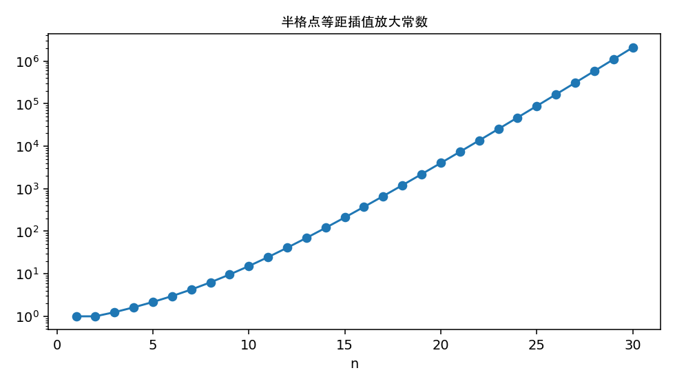

   **难度：3/5；出处：** TB：Lloyd N. Trefethen、David Bau III《数值线性代数》，陆金甫、关治译，2006（英文原版1997），第12讲习题12.2，书页83（PDF第95页），原题号12.2；**解答来源：** 自拟简解。

### 随机矩阵的谱、奇异值与尾部实验

**图谱路径：** 数值分析 / 第2章 敏度与舍入误差分析 / 随机矩阵的谱、奇异值与尾部实验

**知识内容：** [定义、定理与方法](知识点.md#kp-tb-ch12-random-matrix-experiment)

<!-- source-exercise:TB-ch12-12.3 -->
1. 以独立$N(0,m^{-1})$元素定义$m\times m$实随机矩阵。作为实验科学家做充分实验并提出猜想，不证明，作精心设计有1000个数的图。(a)特征值形状、100矩阵重叠谱、$m=8,16,32,64,\ldots$及$m\to \infty$谱半径；(b)2范数，$\rho \le \|A\|_{2}$是否趋近等号；(c)条件数$/\sigma _{\min}$、固定m的$\sigma _{\min}\le 2^{-1},4^{-1},8^{-1},\ldots$比例及随m变化；(d)改成同分布上三角矩阵，重复(a)—(c)。

   **答案：** 固定种子20261010，每个$m=8,16,32,64,128$各100样本，满/三角都运行；$m=16$另各1000样本测尾概率。满矩阵谱覆盖近单位圆盘；各m平均谱半径约1.038、1.073、1.073、1.048、1.050，平均2范数1.713、1.839、1.915、1.943、1.967，支持$\rho$趋1、范数趋2的数值猜想，故$\rho /$范数趋1/2、不是等号。最小奇异值中位数总体随尺寸减少、条件数长尾明显；全部24个阈值概率已保存。上三角谱实轴并缩向0，平均谱半径0.622、0.532、0.414、0.311、0.246，而范数1.395、1.509、1.572、1.600、1.619，二者差距扩大。其$\sigma _{\min}$中位数从约$1.21\times 10^{-3}$降至接近机器精度；$m\ge 64$的极小值受浮点SVD绝对误差影响，只视作数值秩接近亏损，不以这些数推断准确极限律或尾指数。$m=16$尾部1000样本图能显示两类分布差异；极少事件的0经验频率不表示概率为0。本题全部结论为数值观测/猜想。

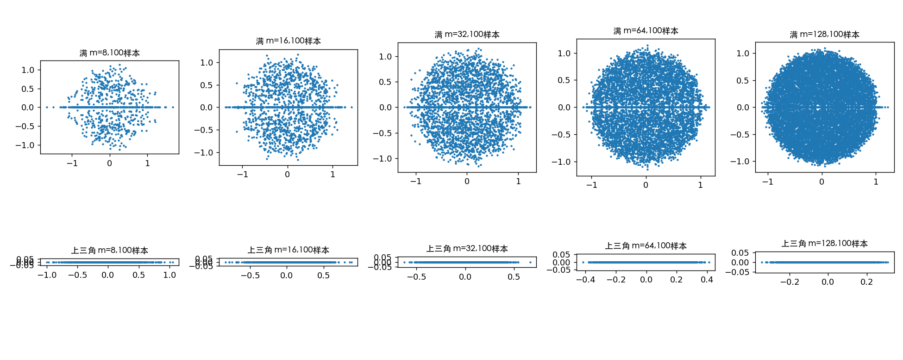

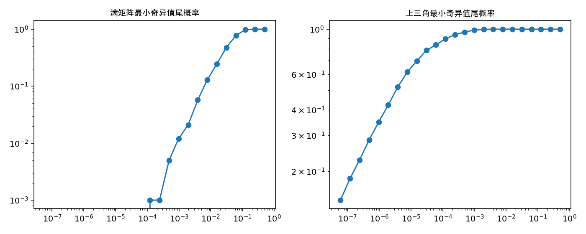

   **难度：4/5；出处：** TB：Lloyd N. Trefethen、David Bau III《数值线性代数》，陆金甫、关治译，2006（英文原版1997），第12讲习题12.3，书页83（PDF第95页），原题号12.3；**解答来源：** 自拟简解。

### 复标量运算的舍入模型常数

**图谱路径：** 数值分析 / 第2章 敏度与舍入误差分析 / 复标量运算的舍入模型常数

**知识内容：** [定义、定理与方法](知识点.md#kp-tb-ch13-complex-flops-error)

已整理范围内未另选可直接对应此节点的独立未解题；相关已解例子见知识内容。

### 多项式展开与因式形式的数值差异

**图谱路径：** 数值分析 / 第2章 敏度与舍入误差分析 / 多项式展开与因式形式的数值差异

**知识内容：** [定义、定理与方法](知识点.md#kp-tb-ch13-evaluation-cancellation)

<!-- source-exercise:TB-ch13-13.3 -->
1. $p(x)=(x-2)^{9}=x^{9}-18x^{8}+144x^{7}-672x^{6}+2016x^{5}-4032x^{4}+5376x^{3}-4608x^{2}+2304x-512$。(a)在$x=1.920,1.921,\ldots ,2.080$上用展开系数求值作图；(b)改用$(x-2)^{9}$作同样图。

   **答案：** 工具/verify_tb_13.py用Horner和因式式在同一161个float64点实算。展开曲线在根附近被约$10^{-12}$至$10^{-11}$舍入扰动淹没，因式曲线保留平滑九次过零形状；两曲线最大绝对差约$1.099\times 10^{-11}$。真实值在离根0.01处仅$10^{-18}$，绝对误差看似小也能完全破坏相对信息。

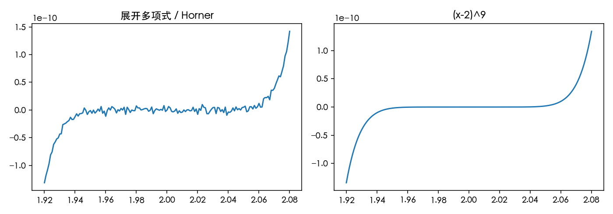

   **难度：3/5；出处：** TB：Lloyd N. Trefethen、David Bau III《数值线性代数》，陆金甫、关治译，2006（英文原版1997），第13讲习题13.3，书页87（PDF第99页），原题号13.3；**解答来源：** 自拟简解。

### 算法准确性与数据一致 O(u)

**图谱路径：** 数值分析 / 第2章 敏度与舍入误差分析 / 算法准确性与数据一致 O(u)

**知识内容：** [定义、定理与方法](知识点.md#kp-tb-ch14-uniform-accuracy)

<!-- source-exercise:TB-ch14-14.1 -->
1. 判真伪：(a)$x\to \infty$时$\operatorname{sin} x=O(1)$；(b)$x\to 0$时$\operatorname{sin} x=O(1)$；(c)$x\to \infty$时$\operatorname{log} x=O(x^{1/100})$；(d)$n\to \infty$时n!$=O((n/e)^{n})$；(e)$V\to \infty$时球面积$A=O(V^{2/3})$，面积平方微米、体积立方英里；(f)$fl(\pi )-\pi =O(u)$；(g)$fl(n\pi )-n\pi =O(u)$对所有整数n一致，其中$n\pi$是准确数学值。

   **答案：** (a)(b)真，$|\operatorname{sin} x|\le 1$；(c)真，$\operatorname{log} x/x^{.01}\to 0$；(d)假，Stirling之比约$\sqrt{2\pi n}$无界；(e)真，球几何$A=C V^{2/3}$，固定单位换算仅改C；(f)真，|舍入误差$|\le u\pi$；(g)假，浮点相对模型给|误差$|\le u|n\pi |$，不能把增长的n吸收进一个对全部n一致的常数。以自相似理想二进制浮点系统和$n=2^{k}$看，舍入$\pi$的非零误差按$2^{k}$放大。

   **难度：2/5；出处：** TB：Lloyd N. Trefethen、David Bau III《数值线性代数》，陆金甫、关治译，2006（英文原版1997），第14讲习题14.1，书页92（PDF第104页），原题号14.1；**解答来源：** 自拟简解。

<!-- source-exercise:TB-ch14-14.2 -->
2. (a)证明$(1+O(u))(1+O(u))=1+O(u)$，并按原文用函数界的意义解释；(b)证明$(1+O(u))^{-1}=1+O(u)$。

   **答案：** (a)若$|a(u)|\le C_{1}u$、$|b(u)|\le C_{2}u$，则$|(1+a)(1+b)-1|\le (C_{1}+C_{2})u+C_{1}C_{2}u^{2}$，充分小u时$\le Cu$。(b)小到$|a|\le 1/2$，$|(1+a)^{-1}-1|=|a|/|1+a|\le 2C_{1}u$。若原O(u)对数据一致，新常数也一致；(b)须小u确保分母非零。

   **难度：2/5；出处：** TB：Lloyd N. Trefethen、David Bau III《数值线性代数》，陆金甫、关治译，2006（英文原版1997），第14讲习题14.2，书页92（PDF第104页），原题号14.2；**解答来源：** 自拟简解。

### 稳定与向后稳定的映射定义

**图谱路径：** 数值分析 / 第2章 敏度与舍入误差分析 / 稳定与向后稳定的映射定义

**知识内容：** [定义、定理与方法](知识点.md#kp-tb-ch14-stable-versus-backward)

<!-- source-exercise:TB-ch15-15.1 -->
1. 按只满足(13.5)、(13.7)的机器，逐算法判向后稳定、稳定但不向后稳定、或不稳定并证明/给可信理由：(a)$x\in C\to 2x$，用$x\oplus x$；(b)$x\to x^{2}$，用$x\otimes x$；(c)$x\ne 0\to 1$，用$x\oslash x$；(d)$x\to 0$，用$x\ominus x$；(e)无数据$\to e$，左至右求$\sum _{k=0}\infty 1/k$!，加数$<u$停；(f)同级数右至左；(g)无数据$\to \pi$，在[3,4]穷举满足$s(x)\otimes s(x^{*})\le 0$的最小浮点x，s稳定算sin，x'后继。

   **答案：** (a)向后稳定，输出$2x(1+O(u))=2\widetilde{x}$。(b)向后稳定，取$\widetilde{x}=x(1+O(u))\sqrt{1+\delta }$，0输入准确0。(c)稳定但不向后：弱公理允许输出$1+\delta$，而扰动x仍有$\widetilde{x}/\widetilde{x}=1$；正确舍入硬件可能恰好1不改变弱模型结论。(d)向后稳定，准确0乘$(1+\delta )$仍0。(e)按本书严格数据一致$/u\to 0$定义不稳定：截断长度$N(u)\to \infty$，允许每次左向加法取同号相对误差；从若干项后部分和已O(1)，累计可为$\Omega (Nu)$，不是O(u)。单项1/k!的乘除误差按$k^{2}u/k$!加权总和有限，不能消除此加法反例。(f)稳定但不向后：右向部分和随末端项阶乘衰减，各步舍入贡献之和O(u)，截断尾也O(u)；无输入可扰，有限浮点一般不等于无理e。(g)稳定但不向后：在$\pi$附近sin导数−1，稳定的函数值误差和后继间距均O(u)，首个符号变化的位置距$\pi$为O(u)。无输入可扰，输出浮点不等于$\pi$。必须区分有限实际机器“误差很小”和随u的严格渐近稳定定义。

   **难度：4/5；出处：** TB：Lloyd N. Trefethen、David Bau III《数值线性代数》，陆金甫、关治译，2006（英文原版1997），第15讲习题15.1，书页96—97（PDF第108—109页），原题号15.1；**解答来源：** 自拟简解。

<!-- source-exercise:TB-ch15-15.2 -->
2. 完全SVD算法输入A，输出显式U、$\Sigma$、V满足$A=U\Sigma V^{*}$，U,V酉、$\Sigma$对角。(a)解释向后稳定所要求的条件；(b)为何它因简单理由不能向后稳定；(c)标准SVD算法稳定，解释准确意义。

   **答案：** (a)需存在$\|E\|\le Cu\|A\|$使计算的显式Û,$\widetilde{\Sigma },\widetilde{V}$就是A+E的准确SVD，特别Û、Ṽ必须严格酉。(b)普通浮点存储的向量即使规范至机器精度，一般也不可能使所有内积严格为0和1，故输出不在准确SVD解的结构空间；输入A的扰动无法修复输出不酉。(c)稳定允许一个邻近A+E的准确$\operatorname{SVD} U,\Sigma ,V$，并要求计算输出距这组三矩阵O(u)（按各自尺度）。也常等价表述重构残差$O(u)\|A\|$和正交残差O(u)。重复奇异值时向量非唯一，比较须允许合适的奇异子空间基，不能固定任意单列再强求小误差。隐式反射乘积的另一解空间定义可支持更强后向说法，原题明确只问显式输出。

   **难度：4/5；出处：** TB：Lloyd N. Trefethen、David Bau III《数值线性代数》，陆金甫、关治译，2006（英文原版1997），第15讲习题15.2，书页97（PDF第109页），原题号15.2；**解答来源：** 自拟简解。

### 有限维稳定性对范数选择不敏感

**图谱路径：** 数值分析 / 第2章 敏度与舍入误差分析 / 有限维稳定性对范数选择不敏感

**知识内容：** [定义、定理与方法](知识点.md#kp-tb-ch14-norm-equivalent-stability)

已整理范围内未另选可直接对应此节点的独立未解题；相关已解例子见知识内容。

### 浮点减法的向后稳定性

**图谱路径：** 数值分析 / 第2章 敏度与舍入误差分析 / 浮点减法的向后稳定性

**知识内容：** [定义、定理与方法](知识点.md#kp-tb-ch15-subtraction-backward)

已整理范围内未另选可直接对应此节点的独立未解题；相关已解例子见知识内容。

### 外积舍入与解空间的结构限制

**图谱路径：** 数值分析 / 第2章 敏度与舍入误差分析 / 外积舍入与解空间的结构限制

**知识内容：** [定义、定理与方法](知识点.md#kp-tb-ch15-outer-product-not-backward)

已整理范围内未另选可直接对应此节点的独立未解题；相关已解例子见知识内容。

### 先求特征多项式再求根的不稳定性

**图谱路径：** 数值分析 / 第2章 敏度与舍入误差分析 / 先求特征多项式再求根的不稳定性

**知识内容：** [定义、定理与方法](知识点.md#kp-tb-ch15-charpoly-instability)

已整理范围内未另选可直接对应此节点的独立未解题；相关已解例子见知识内容。

### 后向误差与条件数给前向误差

**图谱路径：** 数值分析 / 第2章 敏度与舍入误差分析 / 后向误差与条件数给前向误差

**知识内容：** [定义、定理与方法](知识点.md#kp-tb-ch15-condition-times-backward)

已整理范围内未另选可直接对应此节点的独立未解题；相关已解例子见知识内容。

### 部分主元的形式稳定与实际增长灾难

**图谱路径：** 数值分析 / 第2章 敏度与舍入误差分析 / 部分主元的形式稳定与实际增长灾难

**知识内容：** [定义、定理与方法](知识点.md#kp-tb-ch22-fixed-dimension-growth)

<!-- source-exercise:TB-ch22-22.2 -->
1. A为(22.4)的$60\times 60 \operatorname{Wilkinson}$增长矩阵：对角及最后列1、严格下三角−1、其余0。用部分主元解$Ax=b$，观察$2^{60}$阶增长是否令结果无用；若整数防止舍入，稍改问题使增长同/相近且灾难误差出现。

   **答案：** 按同最大主元取最先行的自写GEPP，$\rho =2^{59}$≈$5.7646\times 10^{17}$，$\kappa _{2}(A)$仅26.80。用整数$x=1$生成整数右端的例子，LU因子在80位精确乘积下残差为0，但前后代中的大相消仍使解相对QR参考误差约2.263、相对残差0.202；所以本实现即使整数因素准确，解阶段也会出错。随机右端例相对QR误差0.309。再将最后列加$10^{-10}$随机小扰动，主元搜索前59列不变，增长仍$5.7646\times 10^{17}$，解误差0.257、残差0.115。所有原输入和种子在程序/核验JSON。特别用80位乘积检查因子，普通float64的L@U残差会因自身消去而虚假显示0.056，不能拿这一评估误差断言准确LU不成立。

   **难度：4/5；出处：** TB：Lloyd N. Trefethen、David Bau III《数值线性代数》，陆金甫、关治译，2006（英文原版1997），第22讲习题22.2，书页150（PDF第162页），原题号22.2；**解答来源：** 自拟简解。

### 消去 L 的符号相关与列空间几何

**图谱路径：** 数值分析 / 第2章 敏度与舍入误差分析 / 消去 L 的符号相关与列空间几何

**知识内容：** [定义、定理与方法](知识点.md#kp-tb-ch22-growth-l-column-geometry)

<!-- source-exercise:TB-ch22-22.3 -->
1. 用[−1,1]均匀随机元素代替正文正态随机，尽量复现本讲增长散点、密度、L逆和Q portrait图；评论是否本质不同。

   **答案：** 维数8、16、32、64、128各200均匀样本实际GEPP；增长均值约1.98、3.19、5.26、8.92、13.93，最大4.99、6.70、12.07、16.18、25.45，远小于最坏指数界。小尺寸密度整体尾部下降，有限200样本不足重现正文每尺寸百万样本平滑尾，不据此拟合精确概率定律。另对128阶真实L保留绝对值、随机化严格下三角符号，$\operatorname{max}|L^{-1}_{ij}|$由3.477变6382.17，Q portrait出现明显结构；现象与正态正文同类，数值常数不同。结果只是这批实算样本观察。

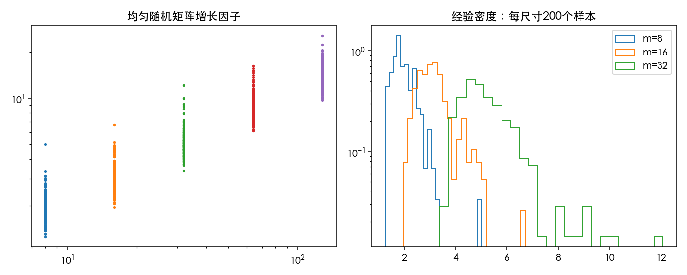

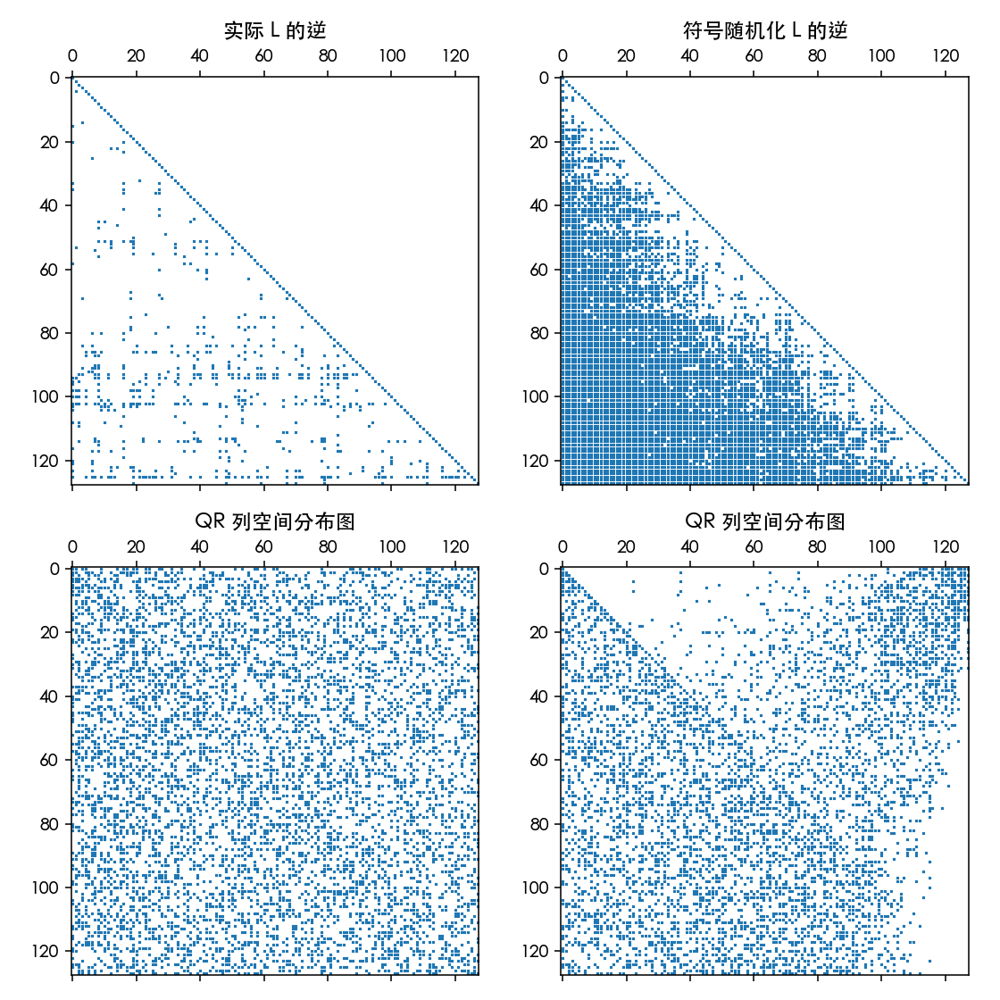

   **难度：4/5；出处：** TB：Lloyd N. Trefethen、David Bau III《数值线性代数》，陆金甫、关治译，2006（英文原版1997），第22讲习题22.3，书页150（PDF第162页），原题号22.3；**解答来源：** 自拟简解。

<!-- source-exercise:TB-ch22-22.4 -->
2. (a)$PA=LU$且$A=QR$，描述$L^{-1}$最后一行与Q最后一列关系；A元素独立正态时证明其列空间随机，特别Q最后列是随机单位向量；(c)结合前两项给随机A消去时$L^{-1}$“最后一列”的陈述（按原题字面）。

   **答案：** (a)设$q=Q(:,m)$、$w^{*}=e_{m}^{*}L^{-1}$，由$w^{*}PA=u_{mm} e_{m}^{*}$、$q^{*}A=r_{mm} e_{m}^{*}$得$w^{*}=(u_{mm}/r_{mm})q^{*}P^{*}$。因$w_{m}=1$，等价$w^{*}=q^{*}P^{*}/(q^{*}P^{*}e_{m})$。Gaussian矩阵左乘任意固定正交矩阵分布不变，前m−1列空间/其法线为旋转不变随机空间；若给法线独立随机±号，q是球面均匀单位向量，否则确定QR符号规则可能只选随机直线的一侧。(c)字面最后一列总是$e_{m}$，这是所有单位下三角逆的代数事实，与随机性无关。结合(a)(b)的有效意图应为“最后一行”：它由随机法线经主元置换后再按末分量归一，乘子符号不独立。P依赖A，故不能把归一分母当独立高斯分量；结论支持研究真实L的相关性，不能直接推出独立三角模型的指数病态。

   **难度：3/5；出处：** TB：Lloyd N. Trefethen、David Bau III《数值线性代数》，陆金甫、关治译，2006（英文原版1997），第22讲习题22.4，书页150（PDF第162页），原题号22.4；**解答来源：** 自拟简解。

   **勘误：** 原题(c)“最后一列”与(a)不一致；字面列恒为$e_{m}$，若改行才有随机几何内容。

### 向量范数的三个公理

**图谱路径：** 数值分析 / 第2章 敏度与舍入误差分析 / 向量范数的三个公理

**知识内容：** [定义、定理与方法](知识点.md#kp-xu-ch02-norm-axioms)

已整理范围内未另选可直接对应此节点的独立未解题；相关已解例子见知识内容。

### 向量的 p 范数

**图谱路径：** 数值分析 / 第2章 敏度与舍入误差分析 / 向量的 p 范数

**知识内容：** [定义、定理与方法](知识点.md#kp-xu-ch02-pnorm)

<!-- source-exercise:XH-ch01-6 -->
1. $x=(1,-2,3)^{T}$、$y=(1,2,3)^{T}$，计算三种基本范数。

   **答案：** 两向量的1、2、∞范数分别都是6、$\sqrt{14}$、3，因为范数使用绝对值或平方，符号变化不影响这些值。

   **难度：1/5；出处：** XH：向华、杨志坚《数值线性代数》，2024年所附版，第1章习题6，书页18（PDF第26页），原题号6；**解答来源：** 自拟简解。

<!-- source-exercise:XH-ch01-7 -->
2. $A=\begin{pmatrix}2&-4\\1&-3\end{pmatrix}$、$x=(1,-2)^{T}$。求$\|x\|_{p}$与$\|A\|_{p}$，$p=1,2,\infty$。

   **答案：** 向量依次3、$\sqrt{5}$、2。矩阵1范数7、∞范数6；$A^{T}A=[[5,-11],[-11,25]]$，最大特征值$15+\sqrt{221}$，故2范数$\sqrt{15+\sqrt{221}}$。

   **难度：2/5；出处：** XH：向华、杨志坚《数值线性代数》，2024年所附版，第1章习题7，书页18（PDF第26页），原题号7；**解答来源：** 自拟简解。

### 有限维范数等价

**图谱路径：** 数值分析 / 第2章 敏度与舍入误差分析 / 有限维范数等价

**知识内容：** [定义、定理与方法](知识点.md#kp-xu-ch02-norm-equivalence)

<!-- source-exercise:XU-ch00-正文-43 -->
1. 证明有限维向量列$x_{k}$的任意范数趋0当且仅当每个分量趋0。

   **答案：** 任意范数与∞范数等价，$c\|x\|_{\infty} \le \|x\|\le C\|x\|_{\infty}$。若原范数趋0，各分量$\le \|x\|_{\infty} \le \|x\|/c$趋0；若各分量趋0，有限最大趋0，再用上界。

   **难度：2/5；出处：** XU：徐树方、高立、张平文《数值线性代数》第二版，2013，§2.1.1定理2.1.2（证明留作练习），书页43（PDF第55页），原题号正文-43；**解答来源：** 自拟简解。

### 正权二次范数

**图谱路径：** 数值分析 / 第2章 敏度与舍入误差分析 / 正权二次范数

**知识内容：** [定义、定理与方法](知识点.md#kp-xu-ch02-weighted-norm)

<!-- source-exercise:XH-ch01-9 -->
1. $\alpha _{i}>0$，证明$\nu (x)=\sqrt{\sum_i\alpha_i x_i^2}$为范数。

   **答案：** 令$D=\operatorname{diag}(\sqrt{\alpha }_{i})$，$\nu (x)=\|Dx\|_{2}$；D可逆，范数三公理从2范数拉回。

   **难度：1/5；出处：** XH：向华、杨志坚《数值线性代数》，2024年所附版，第1章习题9，书页18（PDF第26页），原题号9；**解答来源：** 自拟简解。

<!-- source-exercise:XH-ch01-10 -->
2. A实对称正定，证明$\|x\|_A=\sqrt{Ax,x}$为向量范数。

   **答案：** 谱分解$A=Q\Lambda Q^{T}$给$\|x\|_A=\|\Lambda ^{1/2}Q^{T}x\|_{2}$，线性映射可逆，三公理成立。

   **难度：1/5；出处：** XH：向华、杨志坚《数值线性代数》，2024年所附版，第1章习题10，书页18（PDF第26页），原题号10；**解答来源：** 自拟简解。

<!-- source-exercise:XU-ch02-1 -->
3. 设 $\alpha_1,\ldots,\alpha_n>0$。证明 $\nu(x)=(\sum_i\alpha_ix_i^2)^{1/2}$ 是 $\mathbb R^n$ 上范数。

   **答案：** 令 $D=\mathrm{diag}(\sqrt{\alpha_i})$，则 $\nu(x)=\|Dx\|_2$，$D$ 可逆。正定性、齐次性分别直接成立，三角不等式从2范数三角不等式拉回。

   **难度：1/5；出处：** XU：徐树方、高立、张平文《数值线性代数》第二版，2013，第2章习题1，书页72（PDF第84页），原题号1；**解答来源：** 自拟简解。

<!-- source-exercise:XU-ch02-6 -->
4. 在教材的实对称矩阵约定下，证明 $f(x)=(x^TAx)^{1/2}$ 是范数当且仅当 $A$ 正定。

   **答案：** 正定时谱分解 $A=Q\Lambda Q^T$ 给 $f(x)=\|\Lambda^{1/2}Q^Tx\|_2$，可逆线性映射拉回范数。若 $f$ 为范数，则对非零 $x$ 必有 $x^TAx>0$，正是正定条件。若允许非对称 $A$，正确条件是 $(A+A^T)/2$ 正定，因为二次型不见反对称部分。

   **难度：2/5；出处：** XU：徐树方、高立、张平文《数值线性代数》第二版，2013，第2章习题6，书页73（PDF第85页），原题号6；**解答来源：** 自拟简解。

   **整理说明：** 原题写“正定阵”；按教材实对称正定含义解释。非对称推广在简解中说明。

### Euclidean 三角等号条件

**图谱路径：** 数值分析 / 第2章 敏度与舍入误差分析 / Euclidean 三角等号条件

**知识内容：** [定义、定理与方法](知识点.md#kp-xu-ch02-norm-equality)

<!-- source-exercise:XH-ch01-8 -->
1. 证明2范数三角等号当且仅当x,y线性相关且$x^{T}y\ge 0$。

   **答案：** 平方后等价于$x^{T}y=\|x\|\|y\|$；Cauchy–Schwarz等号与非负内积给同向，零向量情形包含，反向代入也成立。

   **难度：2/5；出处：** XH：向华、杨志坚《数值线性代数》，2024年所附版，第1章习题8，书页18（PDF第26页），原题号8；**解答来源：** 自拟简解。

<!-- source-exercise:XU-ch02-2 -->
2. 证明 $\|x+y\|_2=\|x\|_2+\|y\|_2$ 当且仅当 $x,y$ 线性相关且 $x^Ty\ge0$。

   **答案：** 平方两边得到 $x^Ty=\|x\|_2\|y\|_2$。非零时 Cauchy–Schwarz 等号给相关，且内积非负使比例同号；含零向量时等式显然成立。反向代入同向向量即可。

   **难度：2/5；出处：** XU：徐树方、高立、张平文《数值线性代数》第二版，2013，第2章习题2，书页73（PDF第85页），原题号2；**解答来源：** 自拟简解。

### 矩阵范数与次乘性

**图谱路径：** 数值分析 / 第2章 敏度与舍入误差分析 / 矩阵范数与次乘性

**知识内容：** [定义、定理与方法](知识点.md#kp-xu-ch02-matrix-norm)

<!-- source-exercise:XH-ch01-11 -->
1. $\nu (A)=\operatorname{max}|a_{ij}|$。证明$n\nu$为矩阵范数，并反例说明$\nu$不次乘。

   **答案：** $\nu (AB)\le n\nu (A)\nu (B)$，乘n即次乘。$n>1$时全1矩阵J满足$\nu (J^{2})=n>\nu (J)^{2}=1$；$n=1$是例外。

   **难度：2/5；出处：** XH：向华、杨志坚《数值线性代数》，2024年所附版，第1章习题11，书页18（PDF第26页），原题号11；**解答来源：** 自拟简解。

<!-- source-exercise:XU-ch02-5 -->
2. 令 $\nu(A)=\max_{i,j}|a_{ij}|$。证明 $\nu_1=n\nu$ 是矩阵范数，并举例说明 $\nu$ 不满足次乘相容性。

   **答案：** 范数三个公理直接成立，且 $\nu(AB)\le n\nu(A)\nu(B)$，所以 $n\nu(AB)\le[n\nu(A)][n\nu(B)]$。当 $n>1$，取全1矩阵 $J$，$\nu(J)=1$ 而 $\nu(J^2)=n>1$。$n=1$ 为例外，原 $\nu$ 已次乘。

   **难度：2/5；出处：** XU：徐树方、高立、张平文《数值线性代数》第二版，2013，第2章习题5，书页73（PDF第85页），原题号5；**解答来源：** 自拟简解。

   **整理说明：** 此处相容性按本章指矩阵乘积的次乘性，$n=1$时不存在所要求的反例。

<!-- source-exercise:XU-ch02-12 -->
3. 证明任意矩阵范数有 $\|I\|\ge1$，并推出 $\kappa(A)\ge1$。

   **答案：** $\|I\|=\|I^2\|\le\|I\|^2$，而 $\|I\|>0$，除去它得 $\|I\|\ge1$。非奇异 $A$ 有 $\|I\|\le\|A\|\|A^{-1}\|$。

   **难度：1/5；出处：** XU：徐树方、高立、张平文《数值线性代数》第二版，2013，第2章习题12，书页74（PDF第86页），原题号12；**解答来源：** 自拟简解。

### 诱导矩阵范数

**图谱路径：** 数值分析 / 第2章 敏度与舍入误差分析 / 诱导矩阵范数

**知识内容：** [定义、定理与方法](知识点.md#kp-xu-ch02-subordinate-norm)

<!-- source-exercise:TB-ch03-3.2 -->
1. 任意向量范数及其诱导矩阵范数，证明$\rho (A)\le \|A\|$。

   **答案：** 对任何特征值$\lambda$取非零特征向量x，$|\lambda \||x\|=\|Ax\|\le \|A\|\|x\|$，除后得$|\lambda |\le \|A\|$，再取最大模。

   **难度：1/5；出处：** TB：Lloyd N. Trefethen、David Bau III《数值线性代数》，陆金甫、关治译，2006（英文原版1997），第3讲习题3.2，书页21（PDF第33页），原题号3.2；**解答来源：** 自拟简解。

### 矩阵1范数

**图谱路径：** 数值分析 / 第2章 敏度与舍入误差分析 / 矩阵1范数

**知识内容：** [定义、定理与方法](知识点.md#kp-xu-ch02-one-norm)

已整理范围内未另选可直接对应此节点的独立未解题；相关已解例子见知识内容。

### 矩阵无穷范数

**图谱路径：** 数值分析 / 第2章 敏度与舍入误差分析 / 矩阵无穷范数

**知识内容：** [定义、定理与方法](知识点.md#kp-xu-ch02-infinity-norm)

已整理范围内未另选可直接对应此节点的独立未解题；相关已解例子见知识内容。

### 谱范数与最大奇异值

**图谱路径：** 数值分析 / 第2章 敏度与舍入误差分析 / 谱范数与最大奇异值

**知识内容：** [定义、定理与方法](知识点.md#kp-xu-ch02-spectral-norm)

<!-- source-exercise:XH-ch01-7 -->
1. $A=\begin{pmatrix}2&-4\\1&-3\end{pmatrix}$、$x=(1,-2)^{T}$。求$\|x\|_{p}$与$\|A\|_{p}$，$p=1,2,\infty$。

   **答案：** 向量依次3、$\sqrt{5}$、2。矩阵1范数7、∞范数6；$A^{T}A=[[5,-11],[-11,25]]$，最大特征值$15+\sqrt{221}$，故2范数$\sqrt{15+\sqrt{221}}$。

   **难度：2/5；出处：** XH：向华、杨志坚《数值线性代数》，2024年所附版，第1章习题7，书页18（PDF第26页），原题号7；**解答来源：** 自拟简解。

<!-- source-exercise:XU-ch00-正文-48 -->
2. 证明谱范数性质：$(1)\|A\|_{2}=\operatorname{max}_{\|x\|=\|y\|=1}|y^{*}Ax|$；$(2)\|A^{*}\|_{2}=\|A\|_{2}=\sqrt{}\|A^{*}A\|_{2}$；(3)U,V酉时$\|UA\|_{2}=\|AV\|_{2}=\|A\|_{2}$。

   **答案：** (1) 固定x，用Cauchy–Schwarz，最大y沿Ax方向得到$\|Ax\|$，再最大x。(2) SVD的最大奇异值$\sigma _{1}$给两边等式及平方Gram的最大值$\sigma _{1}^{2}$。(3) 左乘保输出长度、右乘置换单位球，所以最大值不变。实矩阵取转置和实正交为本题原形式，复推广同理。

   **难度：3/5；出处：** XU：徐树方、高立、张平文《数值线性代数》第二版，2013，§2.1.2定理2.1.5（证明留作练习），书页48（PDF第60页），原题号正文-48；**解答来源：** 自拟简解。

### Frobenius 范数

**图谱路径：** 数值分析 / 第2章 敏度与舍入误差分析 / Frobenius 范数

**知识内容：** [定义、定理与方法](知识点.md#kp-xu-ch02-frobenius-norm)

<!-- source-exercise:TB-ch03-3.5 -->
1. 外积$E=uv^{*}$有$\|E\|_{2}=\|u\|_{2}\|v\|_{2}$。Frobenius范数是否同样等于该乘积？证明或反例。

   **答案：** 成立：$\|uv^{*}\|_F^{2}=\sum_{i,j}|u_{i}|^{2}|v_{j}|^{2}=(\sum_{i}|u_{i}|^{2})(\sum_{j}|v_{j}|^{2})$，开方即可，含零向量情况。秩一时唯一正奇异值同为该乘积，所以两种矩阵范数恰相同。

   **难度：1/5；出处：** TB：Lloyd N. Trefethen、David Bau III《数值线性代数》，陆金甫、关治译，2006（英文原版1997），第3讲习题3.5，书页21（PDF第33页），原题号3.5；**解答来源：** 自拟简解。

<!-- source-exercise:XH-ch01-14 -->
2. 按列分块$A=[a_{1},\ldots ,a_{n}]$，证明$\|A\|_F^{2}=\Sigma \|a_{j}\|_{2}^{2}$。

   **答案：** 两边逐元素展开都是$\sum_{i,j}|a_{ij}|^{2}$。

   **难度：1/5；出处：** XH：向华、杨志坚《数值线性代数》，2024年所附版，第1章习题14，书页19（PDF第27页），原题号14；**解答来源：** 自拟简解。

<!-- source-exercise:XU-ch02-3 -->
3. 设 $A=[a_1,\ldots,a_n]$ 按列分块，证明 $\|A\|_F^2=\sum_j\|a_j\|_2^2$。

   **答案：** 两边展开均为 $\sum_{i,j}|a_{ij}|^2$。

   **难度：1/5；出处：** XU：徐树方、高立、张平文《数值线性代数》第二版，2013，第2章习题3，书页73（PDF第85页），原题号3；**解答来源：** 自拟简解。

### 混合矩阵乘积范数界

**图谱路径：** 数值分析 / 第2章 敏度与舍入误差分析 / 混合矩阵乘积范数界

**知识内容：** [定义、定理与方法](知识点.md#kp-xu-ch02-mixed-product-norm)

<!-- source-exercise:XH-ch01-16 -->
1. 证明$\|AB\|_F\le \|A\|_{2}\|B\|_F$及$\|AB\|_F\le \|A\|_F\|B\|_{2}$。

   **答案：** 第一式逐列对$Ab_{j}$用相容界后平方求和；第二式把$(AB)^{T}=B^{T}A^{T}$代入第一式，利用2、F范数转置不变。

   **难度：2/5；出处：** XH：向华、杨志坚《数值线性代数》，2024年所附版，第1章习题16，书页19（PDF第27页），原题号16；**解答来源：** 自拟简解。

<!-- source-exercise:XU-ch02-4 -->
2. 证明 $\|AB\|_F\le\|A\|_2\|B\|_F$ 及 $\|AB\|_F\le\|A\|_F\|B\|_2$。

   **答案：** 逐列写 $B=[b_j]$，得 $\|AB\|_F^2=\sum_j\|Ab_j\|_2^2\le\|A\|_2^2\sum_j\|b_j\|_2^2$。第二式对 $B^TA^T$ 用第一式，并用转置保留2与F范数。

   **难度：2/5；出处：** XU：徐树方、高立、张平文《数值线性代数》第二版，2013，第2章习题4，书页73（PDF第85页），原题号4；**解答来源：** 自拟简解。

### 由满列秩映射拉回范数

**图谱路径：** 数值分析 / 第2章 敏度与舍入误差分析 / 由满列秩映射拉回范数

**知识内容：** [定义、定理与方法](知识点.md#kp-xu-ch02-norm-from-injection)

<!-- source-exercise:TB-ch03-3.1 -->
1. 给任意向量范数||·||和非奇异W，证明$\|x\|_W=\|Wx\|$为向量范数。

   **答案：** W可逆使$Wx=0$当且仅当$x=0$，齐次性从原范数，三角不等式$\|W(x+y)\|\le \|Wx\|+\|Wy\|$。这里W不需Hermite正定，原范数也不限制为2范数。

   **难度：2/5；出处：** TB：Lloyd N. Trefethen、David Bau III《数值线性代数》，陆金甫、关治译，2006（英文原版1997），第3讲习题3.1，书页21（PDF第33页），原题号3.1；**解答来源：** 自拟简解。

   **整理说明：** 同“满列秩映射拉回范数”的主教材命题，按其方形非奇异特例保守去重。

<!-- source-exercise:XH-ch01-12 -->
2. $A\in R^{m\times n}$满列秩，原空间给范数||·||。证明$\|x\|_A=\|Ax\|$是$R^{n}$范数。

   **答案：** 满列秩使零值当且仅当$x=0$；齐次性、三角不等式由A线性和原范数推出。

   **难度：1/5；出处：** XH：向华、杨志坚《数值线性代数》，2024年所附版，第1章习题12，书页18（PDF第26页），原题号12；**解答来源：** 自拟简解。

<!-- source-exercise:XU-ch02-7 -->
3. 设 $\|\cdot\|$ 是 $\mathbb R^m$ 上范数，$A\in\mathbb R^{m\times n}$ 满列秩。证明 $\|x\|_A=\|Ax\|$ 是 $\mathbb R^n$ 上范数。

   **答案：** 满列秩给 $Ax=0\Rightarrow x=0$；齐次性和三角不等式由线性性及原范数公理逐项推出。

   **难度：1/5；出处：** XU：徐树方、高立、张平文《数值线性代数》第二版，2013，第2章习题7，书页73（PDF第85页），原题号7；**解答来源：** 自拟简解。

### Neumann 级数与逆界

**图谱路径：** 数值分析 / 第2章 敏度与舍入误差分析 / Neumann 级数与逆界

**知识内容：** [定义、定理与方法](知识点.md#kp-xu-ch02-neumann-series)

<!-- source-exercise:XU-ch02-8 -->
1. 若 $\|A\|<1$ 且 $\|I\|=1$，证明 $\|(I-A)^{-1}\|\le1/(1-\|A\|)$。

   **答案：** 级数 $\sum A^k$ 绝对收敛，乘 $I-A$ 后有限和余项 $A^{N+1}\to0$，故给出逆矩阵。范数界为几何级数 $\sum_{k=0}^\infty\|A\|^k$。

   **难度：2/5；出处：** XU：徐树方、高立、张平文《数值线性代数》第二版，2013，第2章习题8，书页73（PDF第85页），原题号8；**解答来源：** 自拟简解。

### 逆范数与最小增益

**图谱路径：** 数值分析 / 第2章 敏度与舍入误差分析 / 逆范数与最小增益

**知识内容：** [定义、定理与方法](知识点.md#kp-xu-ch02-inverse-min-gain)

<!-- source-exercise:XH-ch01-13 -->
1. 诱导矩阵范数与非奇异A满足$\|A^{-1}\|^{-1}=\operatorname{min}_{\|x\|=1}\|Ax\|$，证明之。

   **答案：** $1=\|x\|\le \|A^{-1}\|\|Ax\|$给下界；取单位y达到$\|A^{-1}y\|=\|A^{-1}\|$，令$x=A^{-1}y/\|A^{-1}y\|$达到等号。

   **难度：2/5；出处：** XH：向华、杨志坚《数值线性代数》，2024年所附版，第1章习题13，书页18（PDF第26页），原题号13；**解答来源：** 自拟简解。

<!-- source-exercise:XU-ch02-9 -->
2. 设矩阵范数由向量范数诱导，$A$ 非奇异。证明 $\|A^{-1}\|^{-1}=\min_{\|x\|=1}\|Ax\|$。

   **答案：** 对单位 $x$ 有 $1\le\|A^{-1}\|\|Ax\|$。选单位 $y$ 使 $\|A^{-1}y\|=\|A^{-1}\|$，令 $x=A^{-1}y/\|A^{-1}y\|$，即达到该下界。

   **难度：2/5；出处：** XU：徐树方、高立、张平文《数值线性代数》第二版，2013，第2章习题9，书页73（PDF第85页），原题号9；**解答来源：** 自拟简解。

### 线性系统条件数

**图谱路径：** 数值分析 / 第2章 敏度与舍入误差分析 / 线性系统条件数

**知识内容：** [定义、定理与方法](知识点.md#kp-xu-ch02-condition-number)

<!-- source-exercise:XH-ch01-18 -->
1. $A=\begin{pmatrix}3&1.011\\6&1.995\end{pmatrix}$，计算$\kappa _{1}(A)$、$\kappa \infty (A)$。

   **答案：** $\operatorname{det}A=-0.081$，$A^{-1}=[[-665,337],[2000,-1000]]/27$。$\|A\|_{1}=9$、$\|A^{-1}\|_{1}=2665/27$，所以$\kappa _{1}=2665/3$≈888.3333；$\|A\|_{\infty} =7.995$、$\|A^{-1}\|_{\infty} =3000/27$，乘积也为2665/3。

   **难度：2/5；出处：** XH：向华、杨志坚《数值线性代数》，2024年所附版，第1章习题18，书页19（PDF第27页），原题号18；**解答来源：** 自拟简解。

<!-- source-exercise:XH-ch01-19 -->
2. 非奇异实A：$(1) \kappa (A)\ge 1$；(2) A正交则$\kappa _{2}(A)=1$；(3) U正交则$\kappa _{2}(A)=\kappa _{2}(AU)=\kappa _{2}(UA)$；$(4) B=A^{T}A$则$\kappa _{2}(B)=\kappa _{2}(A)^{2}$。

   **答案：** $(1) 1\le \|I\|\le \|A\|\|A^{-1}\|$。(2) 正交阵与逆的2范数均1。(3) 乘U及$U^{T}$保2范数和逆范数。(4) B的特征值为A各奇异值平方，条件数比例平方。

   **难度：2/5；出处：** XH：向华、杨志坚《数值线性代数》，2024年所附版，第1章习题19，书页19（PDF第27页），原题号19；**解答来源：** 自拟简解。

<!-- source-exercise:XU-ch02-11 -->
3. $A=\begin{pmatrix}375&374\\752&750\end{pmatrix}$。(1) 算 $A^{-1}$、$\kappa_\infty(A)$；(2) 选 $Ax=b$、$A(x+\delta x)=b+\delta b$，使右端相对扰动很小而解相对扰动很大；(3) 反过来使解相对扰动很小而右端相对扰动很大。

   **答案：** (1) $\det A=2$，$A^{-1}=\begin{pmatrix}375&-187\\-376&187.5\end{pmatrix}$；$\|A\|_\infty=1502$、$\|A^{-1}\|_\infty=563.5$，乘积 $846377$。(2) 取 $x=(1,1)^T$、$b=(749,1502)^T$，$\delta b=(0,1)^T$，$\delta x=(-187,187.5)^T$；两相对量为 $1/1502$ 与 $187.5$。(3) 取 $x=(-187,187.5)^T$、$b=(0,1)^T$，$\delta x=10^{-3}(1,1)^T$，$\delta b=(0.749,1.502)^T$；两相对量为 $10^{-3}/187.5$ 与 $1.502$。

   **难度：3/5；出处：** XU：徐树方、高立、张平文《数值线性代数》第二版，2013，第2章习题11，书页73—74（PDF第85—86页），原题号11；**解答来源：** 自拟简解。

<!-- source-exercise:XU-ch02-12 -->
4. 证明任意矩阵范数有 $\|I\|\ge1$，并推出 $\kappa(A)\ge1$。

   **答案：** $\|I\|=\|I^2\|\le\|I\|^2$，而 $\|I\|>0$，除去它得 $\|I\|\ge1$。非奇异 $A$ 有 $\|I\|\le\|A\|\|A^{-1}\|$。

   **难度：1/5；出处：** XU：徐树方、高立、张平文《数值线性代数》第二版，2013，第2章习题12，书页74（PDF第86页），原题号12；**解答来源：** 自拟简解。

### 右端扰动的前向误差

**图谱路径：** 数值分析 / 第2章 敏度与舍入误差分析 / 右端扰动的前向误差

**知识内容：** [定义、定理与方法](知识点.md#kp-xu-ch02-rhs-perturbation)

<!-- source-exercise:XH-ch01-20 -->
1. 分析系统$7x_{1}+6.99x_{2}=34.97$、$4x_{1}+4x_{2}=20$的数值性态。

   **答案：** 精确解$(2,3)^{T}$，$\operatorname{det}A=0.04$、$\kappa \infty (A)=3847.25$，较病态。将首右端增加0.01，第二不变，解改为$(3,2)^{T}$：右端相对∞扰动约2.86e-4而解相对扰动1/3。两行近成比例导致这种敏感；它取决于问题数据而不是仅某种算法。

   **难度：3/5；出处：** XH：向华、杨志坚《数值线性代数》，2024年所附版，第1章习题20，书页19（PDF第27页），原题号20；**解答来源：** 自拟简解。

<!-- source-exercise:XU-ch02-11 -->
2. $A=\begin{pmatrix}375&374\\752&750\end{pmatrix}$。(1) 算 $A^{-1}$、$\kappa_\infty(A)$；(2) 选 $Ax=b$、$A(x+\delta x)=b+\delta b$，使右端相对扰动很小而解相对扰动很大；(3) 反过来使解相对扰动很小而右端相对扰动很大。

   **答案：** (1) $\det A=2$，$A^{-1}=\begin{pmatrix}375&-187\\-376&187.5\end{pmatrix}$；$\|A\|_\infty=1502$、$\|A^{-1}\|_\infty=563.5$，乘积 $846377$。(2) 取 $x=(1,1)^T$、$b=(749,1502)^T$，$\delta b=(0,1)^T$，$\delta x=(-187,187.5)^T$；两相对量为 $1/1502$ 与 $187.5$。(3) 取 $x=(-187,187.5)^T$、$b=(0,1)^T$，$\delta x=10^{-3}(1,1)^T$，$\delta b=(0.749,1.502)^T$；两相对量为 $10^{-3}/187.5$ 与 $1.502$。

   **难度：3/5；出处：** XU：徐树方、高立、张平文《数值线性代数》第二版，2013，第2章习题11，书页73—74（PDF第85—86页），原题号11；**解答来源：** 自拟简解。

### 系数与右端共同扰动

**图谱路径：** 数值分析 / 第2章 敏度与舍入误差分析 / 系数与右端共同扰动

**知识内容：** [定义、定理与方法](知识点.md#kp-xu-ch02-matrix-perturbation)

已整理范围内未另选可直接对应此节点的独立未解题；相关已解例子见知识内容。

### 残差与解的误差

**图谱路径：** 数值分析 / 第2章 敏度与舍入误差分析 / 残差与解的误差

**知识内容：** [定义、定理与方法](知识点.md#kp-xu-ch02-residual-bound)

<!-- source-exercise:XU-ch02-上机1 -->
1. 实现算法2.5.1：(1) 估计5至20阶 Hilbert 矩阵的∞范数条件数；(2) 对 $A_n$ 为主对角及最后一列1、严格下三角 $-1$、其余0的矩阵，随机选 $x$，算 $b=A_nx$，用列主元消去求 $\widehat x$，对 $n=5,\ldots,30$ 估计解精度并与真实相对误差比较。

   **答案：** 按算法2.5.1通过 $A^T$ 与 $A$ 的三角解选择符号向量并估计逆范数，乘以 $\|A\|_\infty$。Hilbert 条件数对照必须用高精度：随阶数剧增，双精度逆范数本身不可靠。第二组以已选 $x$ 为真值，同时记录相对误差 $\|\widehat x-x\|_\infty/\|x\|_\infty$、残差以及教材精度估计；Wilkinson 型阵可在乘子为1时仍有指数增长，估计可能低于真误差，不能当成保证。实验实现和每个阶数记录应随处理记录/徐书第二章计算核验.json 检查。

   **难度：4/5；出处：** XU：徐树方、高立、张平文《数值线性代数》第二版，2013，第2章习题上机1，书页75（PDF第87页），原题号上机1；**解答来源：** 自拟简解。

### 逆矩阵扰动恒等式

**图谱路径：** 数值分析 / 第2章 敏度与舍入误差分析 / 逆矩阵扰动恒等式

**知识内容：** [定义、定理与方法](知识点.md#kp-xu-ch02-inverse-perturbation)

<!-- source-exercise:XH-ch01-17 -->
1. A,A+E非奇异，证明$\|(A+E)^{-1}-A^{-1}\|\le \|E\|\|A^{-1}\|\|(A+E)^{-1}\|$。

   **答案：** 差为$-(A+E)^{-1}EA^{-1}$，次乘性给界。

   **难度：1/5；出处：** XH：向华、杨志坚《数值线性代数》，2024年所附版，第1章习题17，书页19（PDF第27页），原题号17；**解答来源：** 自拟简解。

<!-- source-exercise:XU-ch02-13 -->
2. 若 $A,A+E$ 非奇异，证明 $\|(A+E)^{-1}-A^{-1}\|\le\|E\|\|A^{-1}\|\|(A+E)^{-1}\|$。

   **答案：** 用恒等式 $(A+E)^{-1}-A^{-1}=-(A+E)^{-1}EA^{-1}$ 并两次应用次乘性。

   **难度：1/5；出处：** XU：徐树方、高立、张平文《数值线性代数》第二版，2013，第2章习题13，书页74（PDF第86页），原题号13；**解答来源：** 自拟简解。

### 浮点系统的表示参数

**图谱路径：** 数值分析 / 第2章 敏度与舍入误差分析 / 浮点系统的表示参数

**知识内容：** [定义、定理与方法](知识点.md#kp-xu-ch02-floating-system)

<!-- source-exercise:TB-ch13-13.1 -->
1. 一对相邻非零IEEE单精度实数之间有多少个IEEE双精度数？

   **答案：** 在通常正规数区，单/双精度尾数为24/53位，单精度一个间距含$2^{53-24}=2^{29}$个双精度间距，因此严格在两端之间有$2^{29}-1$个双精度数（含两端则$2^{29}+1$）。若题面允许IEEE单精度subnormal，相邻间距固定$2^{-149}$，数量不再统一：正区间$[k2^{-149},(k+1)2^{-149}]$有$2^{52-\lfloor \operatorname{log}_{2}k\rfloor }-1$个内部双精度数，例如$k=1$给$2^{52}-1$。负区间对称。答案须说明是否采用正文忽略下溢的正规模型。

   **难度：3/5；出处：** TB：Lloyd N. Trefethen、David Bau III《数值线性代数》，陆金甫、关治译，2006（英文原版1997），第13讲习题13.1，书页87（PDF第99页），原题号13.1；**解答来源：** 自拟简解。

   **整理说明：** 原题仅写非零，没有排除subnormal；按字面补充边界情形。

<!-- source-exercise:TB-ch13-13.2 -->
2. 对(13.2)的浮点系统F：(a)准确给最小不属于F的正整数n；IEEE单精度/双精度的n；(c)设计并运行程序证明n−3,n−2,n−1属于F而n不属于，考察n+1,n+2,n+3。

   **答案：** t位$\beta$进制可准确写到$\beta ^{t}$，包括$\beta ^{t}$本身；之后间距$\beta$，故首个遗漏$n=\beta ^{t}+1$。$\operatorname{IEEE} \operatorname{single} n=16777217$，$\operatorname{double} n=9007199254740993$。实际float32/float64测试保留n−3,n−2,n−1，最近偶数舍入把n写成n−1；n+1为可表示偶数，n+2不可表示、舍为n+3，n+3可表示。须用Python整数先构造n，不能用已经失真浮点表达$2^{53}+1$。全打印结果见Tref第13讲计算核验.json。

   **难度：3/5；出处：** TB：Lloyd N. Trefethen、David Bau III《数值线性代数》，陆金甫、关治译，2006（英文原版1997），第13讲习题13.2，书页87（PDF第99页），原题号13.2；**解答来源：** 自拟简解。

### 单位舍入误差

**图谱路径：** 数值分析 / 第2章 敏度与舍入误差分析 / 单位舍入误差

**知识内容：** [定义、定理与方法](知识点.md#kp-xu-ch02-unit-roundoff)

<!-- source-exercise:TB-ch13-13.4 -->
1. $p(x)=x^{5}-2x^{4}-3x^{3}+3x^{2}-2x-1$有3个实零点，Newton从$x_{0}=0$快速收敛至约−0.315。(a)在u≈$10^{-16}$下算$x_{1},\ldots ,x_{6}$，估计各数正确位数；(b)用符号代数准确算这些有理数，并列每个分子、分母十进制位数。

   **答案：** 按$x_{j+1}=x_{j}-p(x_{j})/p^{\prime}(x_{j})$实际float64和Fraction整数有理两路运行，结果如下。$x_{1}=-1/2$准确；$x_{2}$至$x_{6}$相对准确迭代值误差约$10^{-17}$至$10^{-16}$，通常16位有效数字。这里的“正确位数”相对于该次准确Newton迭代；它与距离最终根的迭代误差不同，早期$x_{1}$、$x_{2}$当然还不是根的16位近似。精确分子分母增长至第6步1332/1333位，说明符号迭代成本远大于浮点迭代。原有理值的70位显示和整数位数在核验JSON，精确Fraction程序可重建所有分子分母。
|迭代步 j|float64计算值|$准确有理分子位数|分母位数|相对于准确迭代值的相对舍入误差|
|---|---|---|---|---|
|1|-0.5|1|1|0|
|2|-0.3368421052631579|2|2|2.26e-17|
|3|-0.31572844839628944|11|11|4.2e-17|
|4|-0.31530116270327685|53|54|1.32e-16|
|5|-0.31530098645936266|266|267|2.25e-18|
|6|-0.3153009864593327|1332|1333|4.09e-17|

   **难度：3/5；出处：** TB：Lloyd N. Trefethen、David Bau III《数值线性代数》，陆金甫、关治译，2006（英文原版1997），第13讲习题13.4，书页87（PDF第99页），原题号13.4；**解答来源：** 自拟简解。

### 基本运算的误差模型

**图谱路径：** 数值分析 / 第2章 敏度与舍入误差分析 / 基本运算的误差模型

**知识内容：** [定义、定理与方法](知识点.md#kp-xu-ch02-operation-rounding)

已整理范围内未另选可直接对应此节点的独立未解题；相关已解例子见知识内容。

### 连乘舍入因子的 γ 界

**图谱路径：** 数值分析 / 第2章 敏度与舍入误差分析 / 连乘舍入因子的 γ 界

**知识内容：** [定义、定理与方法](知识点.md#kp-xu-ch02-gamma-bound)

<!-- source-exercise:XH-ch02-15 -->
1. 估计顺序连乘$fl(x_{1}\cdots x_{n})=x_{1}\cdots x_{n}(1+\varepsilon )$中$\varepsilon$上界。

   **答案：** 无溢出时n−1次乘法给乘积舍入因子，$|\varepsilon |\le (1+u)^{n-1}-1$；若$(n-1)u<1$，也可给$\gamma _{n-1}$。

   **难度：2/5；出处：** XH：向华、杨志坚《数值线性代数》，2024年所附版，第2章习题15，书页38（PDF第45页），原题号15；**解答来源：** 自拟简解。

<!-- source-exercise:XU-ch02-14 -->
2. 估计顺序連乘 $\mathrm{fl}(x_1\cdots x_n)=x_1\cdots x_n(1+\varepsilon)$ 中 $\varepsilon$ 的上界。

   **答案：** 假定输入可表示且无溢出，用 $n-1$ 次乘法得到 $1+\varepsilon=\prod_{k=1}^{n-1}(1+\delta_k)$。所以 $|\varepsilon|\le(1+u)^{n-1}-1$；若 $(n-1)u<1$，也可取 $\gamma_{n-1}$。任一因子为0时计算乘积仍为0，可选 $\varepsilon=0$。

   **难度：2/5；出处：** XU：徐树方、高立、张平文《数值线性代数》第二版，2013，第2章习题14，书页74（PDF第86页），原题号14；**解答来源：** 自拟简解。

### 顺序求和的误差分配

**图谱路径：** 数值分析 / 第2章 敏度与舍入误差分析 / 顺序求和的误差分配

**知识内容：** [定义、定理与方法](知识点.md#kp-xu-ch02-summation-error)

<!-- source-exercise:XH-ch02-16 -->
1. $nu\le 0.01$，证明顺序和$fl(\Sigma x_{i})=\Sigma x_{i}(1+\eta _{i})$，$|\eta _{1}|\le 1.01(n-1)u$，$|\eta _{i}|\le 1.01(n-i+1)u$，$i\ge 2$。

   **答案：** 按顺序求和，第1、2项经历n−1个舍入因子，第i项经历n−i+1个。展开递推后各系数为这些$(1+\delta )$的乘积；$mu\le 0.01$时偏差界$(1+u)^{m}-1\le 1.01mu$给所需估计。

   **难度：2/5；出处：** XH：向华、杨志坚《数值线性代数》，2024年所附版，第2章习题16，书页38（PDF第45页），原题号16；**解答来源：** 自拟简解。

<!-- source-exercise:XU-ch02-15 -->
2. 若 $nu\le0.01$，证明顺序求和可写 $\mathrm{fl}(\sum_{i=1}^nx_i)=\sum_i x_i(1+\eta_i)$，其中 $|\eta_1|\le1.01(n-1)u$，$|\eta_i|\le1.01(n-i+1)u$，$i\ge2$。

   **答案：** 第1、2项经历自第二项开始的 $n-1$ 个舍入，第 $i$ 项经历 $n-i+1$ 个。展开递推和后各系数为这些 $(1+\delta)$ 的乘积。对 $m u\le0.01$，$(1+u)^m-1\le e^{mu}-1\le1.01mu$；负偏差也被同一界覆盖。

   **难度：2/5；出处：** XU：徐树方、高立、张平文《数值线性代数》第二版，2013，第2章习题15，书页74（PDF第86页），原题号15；**解答来源：** 自拟简解。

### 内积的分量后向误差

**图谱路径：** 数值分析 / 第2章 敏度与舍入误差分析 / 内积的分量后向误差

**知识内容：** [定义、定理与方法](知识点.md#kp-xu-ch02-dot-product-error)

<!-- source-exercise:XH-ch02-17 -->
1. 证明$fl(x^{T}x)=x^{T}x(1+\delta )$，$|\delta |\le nu+O(u^{2})$。

   **答案：** 内积绝对界$\gamma _{n}\Sigma x_{i}^{2}$可除以正平方和，得$|\delta |\le \gamma _{n}=nu+O(u^{2})$；$x=0$取$\delta =0$。

   **难度：2/5；出处：** XH：向华、杨志坚《数值线性代数》，2024年所附版，第2章习题17，书页38（PDF第45页），原题号17；**解答来源：** 自拟简解。

<!-- source-exercise:XU-ch02-17 -->
2. 证明 $n$ 维向量满足 $\mathrm{fl}(x^Tx)=x^Tx(1+\alpha)$，其中 $|\alpha|\le nu+O(u^2)$。

   **答案：** 由内积误差界 $|\mathrm{fl}(x^Tx)-x^Tx|\le\gamma_n\sum x_i^2$。非零 $x$ 除以该正平方和得到 $|\alpha|\le\gamma_n=nu+O(u^2)$（$n$ 固定）；零向量取 $\alpha=0$。

   **难度：2/5；出处：** XU：徐树方、高立、张平文《数值线性代数》第二版，2013，第2章习题17，书页74（PDF第86页），原题号17；**解答来源：** 自拟简解。

### 矩阵向量积的后向误差

**图谱路径：** 数值分析 / 第2章 敏度与舍入误差分析 / 矩阵向量积的后向误差

**知识内容：** [定义、定理与方法](知识点.md#kp-xu-ch02-matvec-backward)

<!-- source-exercise:XH-ch02-22 -->
1. $nu\le 0.01$，证明$fl(Ax)=(A+E)x$，其中$|e_{i1}|\le 1.01n|a_{i1}|u$，$j\ge 2$时$|e_{ij}|\le 1.01(n-j+2)|a_{ij}|u$。

   **答案：** 各项乘法加一次因子，顺序求和第1项经历n−1次、第j项经历n−j+1次相加因子。吸收系数乘积偏差到A，对$mu\le 0.01$用$(1+u)^{m}-1\le 1.01mu$即得。

   **难度：2/5；出处：** XH：向华、杨志坚《数值线性代数》，2024年所附版，第2章习题22，书页38（PDF第45页），原题号22；**解答来源：** 自拟简解。

<!-- source-exercise:XU-ch02-16 -->
2. 设 $A$ 为 $n\times n$ 矩阵、$x\in\mathbb R^n$，$nu\le0.01$。证明 $\mathrm{fl}(Ax)=(A+E)x$，其中 $|e_{i1}|\le1.01n|a_{i1}|u$，$|e_{ij}|\le1.01(n-j+2)|a_{ij}|u$，$j\ge2$。

   **答案：** 各行先算 $a_{ij}x_j$，增加一次乘法舍入；再按第15题求和。第1项共 $n$ 因子，第 $j\ge2$ 项共 $n-j+2$ 因子。将这些乘积的偏差吸收到 $a_{ij}$，得到 $E$ 及所需界；不需除以 $x_j$，因此零分量也成立。

   **难度：2/5；出处：** XU：徐树方、高立、张平文《数值线性代数》第二版，2013，第2章习题16，书页74（PDF第86页），原题号16；**解答来源：** 自拟简解。

### 列主元 LU 的后向误差

**图谱路径：** 数值分析 / 第2章 敏度与舍入误差分析 / 列主元 LU 的后向误差

**知识内容：** [定义、定理与方法](知识点.md#kp-xu-ch02-lu-backward)

<!-- source-exercise:XH-ch02-20 -->
1. 上下半带宽为3的A，计算列主元LU满足$\widehat{L}\widehat{U}=P(A+E)$，估$\|E\|_{\infty}$。

   **答案：** 在 $nu<1$ 下，$\gamma_n=nu/(1-nu)$，安全分量界为 $|PE|\le\gamma_n|\widehat L|\,|\widehat U|$（绝对值逐元素、右端为普通非负矩阵乘积）。$\widehat U$ 上半带宽至多6，每行至多7项；浮点乘子不超过 $1+u$，故 $\|E\|_\infty\le7\gamma_n[1+(n-1)(1+u)]M_U$，其中 $M_U=\max_{i,j}|\widehat u_{ij}|$。可用实际增长因子 $M_U/\max_{i,j}|a_{ij}|$ 改写；该界保守，不宣称最优。

   **难度：3/5；出处：** XH：向华、杨志坚《数值线性代数》，2024年所附版，第2章习题20，书页38（PDF第45页），原题号20；**解答来源：** 自拟简解。

<!-- source-exercise:XU-ch02-20 -->
2. 设 $A$ 下、上半带宽均为3。列主元消去的计算因子满足 $\widehat L\widehat U=P(A+E)$。估计 $\|E\|_\infty$ 上界。

   **答案：** 可给一个保守而明确的带宽界。分量误差定理给 $|PE|\le\gamma_n|\widehat L||\widehat U|$（$nu<1$）。列主元使浮点乘子 $\le1+u$，故 $\||\widehat L|\|_\infty\le1+(n-1)(1+u)$；$U$ 上半带宽至多6，每行至多7项，故 $\||\widehat U|\|_\infty\le7M_U$。因此 $\|E\|_\infty\le7\gamma_n[1+(n-1)(1+u)]M_U$。若以计算增长因子 $\widehat\rho=M_U/\max|a_{ij}|$ 表示，再代入即可。这个界未声称最优，保留实测增长更实用。

   **难度：3/5；出处：** XU：徐树方、高立、张平文《数值线性代数》第二版，2013，第2章习题20，书页75（PDF第87页），原题号20；**解答来源：** 自拟简解。

### 列主元消去的增长因子

**图谱路径：** 数值分析 / 第2章 敏度与舍入误差分析 / 列主元消去的增长因子

**知识内容：** [定义、定理与方法](知识点.md#kp-xu-ch02-growth-factor)

<!-- source-exercise:TB-ch22-22.1 -->
1. 证明对任意$m\times m$矩阵的部分主元消去，增长因子$\rho =\operatorname{max}|u_{ij}|/\operatorname{max}|a_{ij}|\le 2^{m-1}$。

   **答案：** 每一步乘子绝对值$\le 1$，尾块新条目$a_{ij}-l_{ik} a_{kj}$，绝对值≤两旧最大值之和。因此每次最多翻倍，第k步最大$\le 2^{k} M_{0}$，至m−1步$\le 2^{m-1}M_{0}$；每个已固定U行也遵守相应时刻界。奇异全零尾列无需除0，跳过乘子更新；$A=0$可约定$\rho =1$或不定义，不能直接0/0。

   **难度：2/5；出处：** TB：Lloyd N. Trefethen、David Bau III《数值线性代数》，陆金甫、关治译，2006（英文原版1997），第22讲习题22.1，书页150（PDF第162页），原题号22.1；**解答来源：** 自拟简解。

<!-- source-exercise:XH-ch02-14 -->
2. $A=LU$、$|l_{ij}|\le 1$，验证U第i行$u_{i}^{T}=a_{i}^{T}-\sum _{j<i}l_{ij} u_{j}^{T}$，并证明$\|U\|_{\infty} \le 2^{n-1}\|A\|_{\infty}$。

   **答案：** 第一式由LU逐行展开；归纳$\|u_{i}\|_{1}\le M+\sum _{j<i}2^{j-1}M=2^{i-1}M$，$M=\|A\|_{\infty}$。

   **难度：2/5；出处：** XH：向华、杨志坚《数值线性代数》，2024年所附版，第2章习题14，书页38（PDF第45页），原题号14；**解答来源：** 自拟简解。

<!-- source-exercise:XH-ch02-18 -->
3. 证明三对角阵列主元消去增长因子$\rho \le 2$。

   **答案：** 仅相邻两行选主元，乘子$\le 1$。归纳保持第一、第二上邻元绝对值≤原最大M，新对角是原对角减乘子乘上邻元，最多2M，其余不超过M。

   **难度：3/5；出处：** XH：向华、杨志坚《数值线性代数》，2024年所附版，第2章习题18，书页38（PDF第45页），原题号18；**解答来源：** 自拟简解。

<!-- source-exercise:XH-ch02-19 -->
4. 若$A^{T}$对角占优，证明列主元消去增长因子$\rho \le 2$。

   **答案：** 严格列占优时无需换行，消去乘子绝对和$<1$，去掉主元行后剩余列绝对和不增加。初始列和$\le 2M$，每阶段单项$\le 2M$；弱占优取严格扰动极限，零主元列可停止。

   **难度：3/5；出处：** XH：向华、杨志坚《数值线性代数》，2024年所附版，第2章习题19，书页38（PDF第45页），原题号19；**解答来源：** 自拟简解。

<!-- source-exercise:XU-ch02-10 -->
5. 设 $A=LU$ 且 $L$ 单位下三角、$|l_{ij}|\le1$，令 $a_i^T,u_i^T$ 是 $A,U$ 第 $i$ 行。验证 $u_i^T=a_i^T-\sum_{j<i}l_{ij}u_j^T$，并证明 $\|U\|_\infty\le2^{n-1}\|A\|_\infty$。

   **答案：** 由 $LU=A$ 的第 $i$ 行直接得恒等式。若 $M=\|A\|_\infty$，归纳有 $\|u_i\|_1\le M+\sum_{j<i}2^{j-1}M=2^{i-1}M$。取最大行和给结论。

   **难度：2/5；出处：** XU：徐树方、高立、张平文《数值线性代数》第二版，2013，第2章习题10，书页73（PDF第85页），原题号10；**解答来源：** 自拟简解。

<!-- source-exercise:XU-ch02-18 -->
6. 证明三对角矩阵用列主元消去的增长因子 $\rho\le2$。

   **答案：** 每步仅在当前行与下一行中选主元，乘子不超过1。归纳保持：当前待消去行的第一上对角绝对值不超过原阵最大元素 $M$；换行可能增加一条第二上对角，其元素为原上对角，仍不超过 $M$。更新下一对角只发生一次“原对角减乘子乘有界上对角”，故绝对值不超过 $2M$；其余元素不超过 $M$。所有阶段最大值因此至多 $2M$。

   **难度：3/5；出处：** XU：徐树方、高立、张平文《数值线性代数》第二版，2013，第2章习题18，书页75（PDF第87页），原题号18；**解答来源：** 自拟简解。

<!-- source-exercise:XU-ch02-19 -->
7. 证明若 $A^T$ 对角占优，则列主元 Gauss 消去的增长因子 $\rho\le2$。

   **答案：** 先看严格列占优情形：无需换行，且每步乘子绝对和 $\sum_{i>k}|l_{ik}|<1$。对任意尚未消去列，删去主元行并更新其余行后，该列绝对和至多原绝对和，因为增加量不超过被删项绝对值。初始每列绝对和 $\le2|a_{jj}|\le2M$，各阶段单个元素因而 $\le2M$。弱占优可由严格占优扰动取极限；若出现零主元，零列停止消去也不增长。

   **难度：3/5；出处：** XU：徐树方、高立、张平文《数值线性代数》第二版，2013，第2章习题19，书页75（PDF第87页），原题号19；**解答来源：** 自拟简解。

<!-- source-exercise:XU-ch02-上机1 -->
8. 实现算法2.5.1：(1) 估计5至20阶 Hilbert 矩阵的∞范数条件数；(2) 对 $A_n$ 为主对角及最后一列1、严格下三角 $-1$、其余0的矩阵，随机选 $x$，算 $b=A_nx$，用列主元消去求 $\widehat x$，对 $n=5,\ldots,30$ 估计解精度并与真实相对误差比较。

   **答案：** 按算法2.5.1通过 $A^T$ 与 $A$ 的三角解选择符号向量并估计逆范数，乘以 $\|A\|_\infty$。Hilbert 条件数对照必须用高精度：随阶数剧增，双精度逆范数本身不可靠。第二组以已选 $x$ 为真值，同时记录相对误差 $\|\widehat x-x\|_\infty/\|x\|_\infty$、残差以及教材精度估计；Wilkinson 型阵可在乘子为1时仍有指数增长，估计可能低于真误差，不能当成保证。实验实现和每个阶数记录应随处理记录/徐书第二章计算核验.json 检查。

   **难度：4/5；出处：** XU：徐树方、高立、张平文《数值线性代数》第二版，2013，第2章习题上机1，书页75（PDF第87页），原题号上机1；**解答来源：** 自拟简解。

### 带状主元消去的填充

**图谱路径：** 数值分析 / 第2章 敏度与舍入误差分析 / 带状主元消去的填充

**知识内容：** [定义、定理与方法](知识点.md#kp-xu-ch02-band-pivot-fill)

<!-- source-exercise:XH-ch02-20 -->
1. 上下半带宽为3的A，计算列主元LU满足$\widehat{L}\widehat{U}=P(A+E)$，估$\|E\|_{\infty}$。

   **答案：** 在 $nu<1$ 下，$\gamma_n=nu/(1-nu)$，安全分量界为 $|PE|\le\gamma_n|\widehat L|\,|\widehat U|$（绝对值逐元素、右端为普通非负矩阵乘积）。$\widehat U$ 上半带宽至多6，每行至多7项；浮点乘子不超过 $1+u$，故 $\|E\|_\infty\le7\gamma_n[1+(n-1)(1+u)]M_U$，其中 $M_U=\max_{i,j}|\widehat u_{ij}|$。可用实际增长因子 $M_U/\max_{i,j}|a_{ij}|$ 改写；该界保守，不宣称最优。

   **难度：3/5；出处：** XH：向华、杨志坚《数值线性代数》，2024年所附版，第2章习题20，书页38（PDF第45页），原题号20；**解答来源：** 自拟简解。

<!-- source-exercise:XU-ch02-20 -->
2. 设 $A$ 下、上半带宽均为3。列主元消去的计算因子满足 $\widehat L\widehat U=P(A+E)$。估计 $\|E\|_\infty$ 上界。

   **答案：** 可给一个保守而明确的带宽界。分量误差定理给 $|PE|\le\gamma_n|\widehat L||\widehat U|$（$nu<1$）。列主元使浮点乘子 $\le1+u$，故 $\||\widehat L|\|_\infty\le1+(n-1)(1+u)$；$U$ 上半带宽至多6，每行至多7项，故 $\||\widehat U|\|_\infty\le7M_U$。因此 $\|E\|_\infty\le7\gamma_n[1+(n-1)(1+u)]M_U$。若以计算增长因子 $\widehat\rho=M_U/\max|a_{ij}|$ 表示，再代入即可。这个界未声称最优，保留实测增长更实用。

   **难度：3/5；出处：** XU：徐树方、高立、张平文《数值线性代数》第二版，2013，第2章习题20，书页75（PDF第87页），原题号20；**解答来源：** 自拟简解。

### 逆范数与精度估计

**图谱路径：** 数值分析 / 第2章 敏度与舍入误差分析 / 逆范数与精度估计

**知识内容：** [定义、定理与方法](知识点.md#kp-xu-ch02-condition-estimation)

<!-- source-exercise:XU-ch02-上机1 -->
1. 实现算法2.5.1：(1) 估计5至20阶 Hilbert 矩阵的∞范数条件数；(2) 对 $A_n$ 为主对角及最后一列1、严格下三角 $-1$、其余0的矩阵，随机选 $x$，算 $b=A_nx$，用列主元消去求 $\widehat x$，对 $n=5,\ldots,30$ 估计解精度并与真实相对误差比较。

   **答案：** 按算法2.5.1通过 $A^T$ 与 $A$ 的三角解选择符号向量并估计逆范数，乘以 $\|A\|_\infty$。Hilbert 条件数对照必须用高精度：随阶数剧增，双精度逆范数本身不可靠。第二组以已选 $x$ 为真值，同时记录相对误差 $\|\widehat x-x\|_\infty/\|x\|_\infty$、残差以及教材精度估计；Wilkinson 型阵可在乘子为1时仍有指数增长，估计可能低于真误差，不能当成保证。实验实现和每个阶数记录应随处理记录/徐书第二章计算核验.json 检查。

   **难度：4/5；出处：** XU：徐树方、高立、张平文《数值线性代数》第二版，2013，第2章习题上机1，书页75（PDF第87页），原题号上机1；**解答来源：** 自拟简解。

### 迭代改进

**图谱路径：** 数值分析 / 第2章 敏度与舍入误差分析 / 迭代改进

**知识内容：** [定义、定理与方法](知识点.md#kp-xu-ch02-iterative-refinement)

已整理范围内未另选可直接对应此节点的独立未解题；相关已解例子见知识内容。

### Cholesky 的分量误差结构

**图谱路径：** 数值分析 / 第2章 敏度与舍入误差分析 / Cholesky 的分量误差结构

**知识内容：** [定义、定理与方法](知识点.md#kp-xu-ch02-cholesky-roundoff)

<!-- source-exercise:XH-ch02-21 -->
1. $nu\le 0.01$，平方根$fl(\sqrt{x})=\sqrt{x}(1+\delta )$、$|\delta |\le u$。成功Cholesky因子L̂满足$\widehat{L}\widehat{L}^{T}=A+E$，估计E元素。

   **答案：** 逐递推展开舍入，额外平方根两因子覆盖对角平方，可给安全界$|e_{ij}|\le \gamma _{n+2}\sum _{k\le \operatorname{min}(i,j)}|\widehat{l}_{ik} \widehat{l}_{jk}|$，需$(n+2)u<1$及无溢出；不成功的非正浮点主元另报告。

   **难度：3/5；出处：** XH：向华、杨志坚《数值线性代数》，2024年所附版，第2章习题21，书页38（PDF第45页），原题号21；**解答来源：** 自拟简解。

<!-- source-exercise:XU-ch02-21 -->
2. 设 $nu\le0.01$，且 $\mathrm{fl}(\sqrt{x})=\sqrt{x}(1+\delta)$、$|\delta|\le u$。证明成功的平方根法计算因子 $\widehat L$ 满足 $\widehat L\widehat L^T=A+E$，估计各 $e_{ij}$。

   **答案：** 对每个递推式展开内积、减法、除法舍入。非对角式可重写 $a_{ij}=\sum_{k\le j}\widehat l_{ik}\widehat l_{jk}(1+\theta_k)$，因子数至多 $n+1$；对角平方根再平方引入两个相对舍入因子，统一由 $\gamma_{n+2}$ 控制。于是安全界为 $|e_{ij}|\le\gamma_{n+2}\sum_{k\le\min(i,j)}|\widehat l_{ik}\widehat l_{jk}|$。定义 $E=\widehat L\widehat L^T-A$ 即得恒等式。这里还需无溢出、实际全部正主元；$\gamma_{n+2}$ 要求 $(n+2)u<1$，若不用此条件可用直接乘积指数界。

   **难度：3/5；出处：** XU：徐树方、高立、张平文《数值线性代数》第二版，2013，第2章习题21，书页75（PDF第87页），原题号21；**解答来源：** 自拟简解。

   **整理说明：** 采用统一保守分量界，未把成功分解的误差界当作保证任何浮点输入都成功的结论。

## 第3章 最小二乘问题解法

[满秩分解计算Moore–Penrose逆](#kp-cz-ch04-4)；[单位上三角阵的指数级病态](#kp-cz-ch04-6)；[投影的幂等性与直和分解](#kp-tb-ch06-projector-idempotent)；[斜投影与正交投影](#kp-tb-ch06-oblique-projection)；[一般子空间反射 I−2P](#kp-tb-ch06-projection-reflection)；[反序对称的偶部分投影](#kp-tb-ch06-even-part)；[一般列基的正交投影公式](#kp-tb-ch06-projection-fullrank-formula)；[非零投影的谱范数判别](#kp-tb-ch06-projection-norm-characterization)；[QR 保持前缀列空间](#kp-tb-ch07-qr-flags)；[奇偶列互正交的 QR 零模式](#kp-tb-ch07-qr-parity)；[Hadamard 行列式不等式](#kp-tb-ch07-hadamard-determinant)；[R 非零对角数不是一般秩](#kp-tb-ch07-qr-rank-diagonal)；[连续函数中的 QR 与 Legendre 基](#kp-tb-ch07-qr-functions)；[经典 Gram–Schmidt 正交化](#kp-tb-ch08-classical-gs)；[修正 Gram–Schmidt 的顺序投影](#kp-tb-ch08-modified-gs)；[Gram–Schmidt 的投影乘积结构](#kp-tb-ch08-gs-projector-product)；[MGS 的准确标量运算计数](#kp-tb-ch08-mgs-flops)；[右侧三角运算实现正交化](#kp-tb-ch08-triangular-orthogonalization)；[均匀格点 QR 与离散正交多项式](#kp-tb-ch09-discrete-legendre)；[QR 对角量用于秩估计的局限](#kp-tb-ch09-r-diagonal-rank)；[用正交残差审查浮点 QR](#kp-tb-ch09-qr-orthogonality-test)；[矩阵图像的截断 SVD 重构](#kp-tb-ch09-svd-image-compression)；[三角正交化与正交三角化](#kp-tb-ch10-left-right-qr)；[复 Householder 的稳定相位选取](#kp-tb-ch10-householder-phase)；[用反射向量隐式存储和应用 Q](#kp-tb-ch10-implicit-householder)；[Householder 与 Givens QR 的工作量比较](#kp-tb-ch10-householder-givens-cost)；[多项式插值与降低次数的最小二乘拟合](#kp-tb-ch11-interpolation-versus-fit)；[三种最小二乘解法的首项工作量](#kp-tb-ch11-ls-method-cost)；[含共同极点函数的 L² 拟合](#kp-tb-ch11-singular-function-fitting)；[QR 因子误差的相关抵消](#kp-tb-ch16-correlated-qr-errors)；[Householder 后向定理中的准确酉因子](#kp-tb-ch16-implicit-unitary-backward)；[QR 分解、应用反射、回代的后向误差组合](#kp-tb-ch16-compose-qr-solve)；[最小二乘的四个条件量与 η 参数](#kp-tb-ch18-four-ls-conditions)；[子空间倾斜时投影点的球面轨迹](#kp-tb-ch18-projection-sphere)；[矩阵扰动导致列空间倾斜的最有效方向](#kp-tb-ch18-range-tilting)；[增广 MGS 保持右端与列投影的误差关联](#kp-tb-ch19-augmented-mgs-stability)；[法方程为何在近精确拟合中尤其危险](#kp-tb-ch19-normal-equations-stability-regions)；[按奇异值阈值计算数值伪逆](#kp-tb-ch19-numerical-pinv-threshold)；[乘法算子与正交多项式 Jacobi 矩阵](#kp-tb-ch37-orthogonal-jacobi-matrix)；[Gauss–Legendre 的 2n−1 次多项式精确性](#kp-tb-ch37-gauss-degree)；[Jacobi 谱给 Gauss 节点和正权](#kp-tb-ch37-golub-welsch)；[解析与带尖点函数的 Gauss 求积收敛](#kp-tb-ch37-quadrature-smoothness)；[最小二乘增广鞍点系统](#kp-xh-ch05-augmented-ls)；[数据与列空间的夹角](#kp-xh-ch05-ls-angle)；[最小二乘右端扰动界](#kp-xh-ch05-ls-rhs-sensitivity)；[最小二乘解的一阶微分](#kp-xh-ch05-ls-differential)；[系数与右端共同扰动的条件界](#kp-xh-ch05-ls-total-sensitivity)；[最小二乘条件数的残差作用](#kp-xh-ch05-ls-residual-conditioning)；[反射乘积的 WY 块表示](#kp-xh-ch05-wy-compact)；[紧凑 WY 上三角更新](#kp-xh-ch05-compact-wy)；[Tikhonov 正则化的基本模型](#kp-xh-ch05-tikhonov)；[截断 SVD 正则化](#kp-xh-ch05-truncated-svd)；[线性最小二乘问题](#kp-xu-ch03-least-squares)；[正规方程的充要性](#kp-xu-ch03-normal-equations)；[残差的正交投影解释](#kp-xu-ch03-ls-projection)；[最小二乘解唯一性](#kp-xu-ch03-ls-uniqueness)；[正规方程的条件数平方](#kp-xu-ch03-normal-conditioning)；[Moore–Penrose 广义逆](#kp-xu-ch03-pseudoinverse)；[最小范数最小二乘解](#kp-xu-ch03-minimum-norm-ls)；[广义逆给出的两个投影](#kp-xu-ch03-projector-penrose)；[正交变换保范](#kp-xu-ch03-orthogonal-transform)；[Householder 反射](#kp-xu-ch03-householder)；[反射消去向量尾部](#kp-xu-ch03-householder-vector)；[隐式应用 Householder](#kp-xu-ch03-householder-apply)；[反射映射等长向量](#kp-xu-ch03-householder-mapping)；[Givens 平面旋转](#kp-xu-ch03-givens)；[旋转参数的安全计算](#kp-xu-ch03-safe-givens)；[复 Givens 变换](#kp-xu-ch03-complex-givens)；[QR 分解的完整与经济形式](#kp-xu-ch03-qr-factorization)；[Householder QR 算法](#kp-xu-ch03-householder-qr)；[Givens QR 算法](#kp-xu-ch03-givens-qr)；[用 QR 求满列秩最小二乘](#kp-xu-ch03-qr-ls-solve)；[QR 与正规方程的关系](#kp-xu-ch03-qr-normal-relation)；[矩形下三角阵的正交压缩](#kp-xu-ch03-orthogonal-lower)；[从已有矩形 LU 解最小二乘](#kp-xu-ch03-lu-ls)；[线性最小二乘算子的必要恒等式](#kp-xu-ch03-linear-ls-operators)；[对角加边矩阵的 QR](#kp-xu-ch03-arrowhead-qr)；[多项式拟合的设计矩阵](#kp-xu-ch03-polynomial-fitting)；[带截距线性回归](#kp-xu-ch03-linear-regression)；[秩亏拟合与最小范数约定](#kp-xu-ch03-rank-deficient-fitting)

### 满秩分解计算Moore–Penrose逆

**图谱路径：** 数值分析 / 第3章 最小二乘问题解法 / 满秩分解计算Moore–Penrose逆

**知识内容：** [定义、定理与方法](知识点.md#kp-cz-ch04-4)

<!-- source-exercise:CZ-ch04-4 -->
1. $A=GS\in\mathbb C^{m\times n}$，$G\in\mathbb C^{m\times r}$ 列满秩、$S\in\mathbb C^{r\times n}$ 行满秩。证明 $X=S^H(SS^H)^{-1}(G^HG)^{-1}G^H$ 满足四个Moore–Penrose方程 $AXA=A$、$XAX=X$、$(AX)^H=AX$、$(XA)^H=XA$。

   **答案：** 令 $S^+=S^H(SS^H)^{-1}$、$G^+=(G^HG)^{-1}G^H$，则 $SS^+=I_r$、$G^+G=I_r$。$AX=GG^+$、$XA=S^+S$ 分别是正交投影，故均 Hermitian。于是 $AXA=GG^+GS=GS=A$；$XAX=S^+G^+GS S^+G^+=S^+G^+=X$。四式齐备，故 $X=A^+$。

   **难度：3/5；出处：** CZ：曹志浩《数值线性代数》，复旦大学出版社1996年第一版，第4章习题4，书页143（PDF第152页），原题号4；**解答来源：** 自拟简解。

### 单位上三角阵的指数级病态

**图谱路径：** 数值分析 / 第3章 最小二乘问题解法 / 单位上三角阵的指数级病态

**知识内容：** [定义、定理与方法](知识点.md#kp-cz-ch04-6)

<!-- source-exercise:CZ-ch04-6 -->
1. 令 $R\in\mathbb R^{n\times n}$ 为上三角阵，$R_{ii}=1$、$R_{ij}=-1$（$i<j$），$n\ge2$。(1) 对 $y=(1,2^{-1},\ldots,2^{-(n-1)})^T$ 求 $z=Ry$；(2) 证明最小奇异值 $\sigma_n(R)\le2^{-(n-2)}$；(3) 证明 $\operatorname{cond}_2(R)\ge2^{n-2}$。

   **答案：** (1) 每行用几何级数相减，$z_i=2^{-(n-1)}$，故 $z=2^{-(n-1)}\mathbf1$。(2) 回代 $Rv=e_n$ 给 $v_n=1$、$v_{n-1}=1$、$v_{n-2}=2$、一般 $v_i=2^{n-i-1}$（$i<n$）。因此 $\|R^{-1}\|_2\ge\|R^{-1}e_n\|_2\ge2^{n-2}$，由 $\sigma_n(R)=1/\|R^{-1}\|_2$ 得界。(3) $\|R\|_2\ge\|Re_1\|_2=1$，所以 $\operatorname{cond}_2(R)=\|R\|_2\|R^{-1}\|_2\ge2^{n-2}$。

   **难度：4/5；出处：** CZ：曹志浩《数值线性代数》，复旦大学出版社1996年第一版，第4章习题6，书页144（PDF第153页），原题号6；**解答来源：** 自拟简解。

### 投影的幂等性与直和分解

**图谱路径：** 数值分析 / 第3章 最小二乘问题解法 / 投影的幂等性与直和分解

**知识内容：** [定义、定理与方法](知识点.md#kp-tb-ch06-projector-idempotent)

已整理范围内未另选可直接对应此节点的独立未解题；相关已解例子见知识内容。

### 斜投影与正交投影

**图谱路径：** 数值分析 / 第3章 最小二乘问题解法 / 斜投影与正交投影

**知识内容：** [定义、定理与方法](知识点.md#kp-tb-ch06-oblique-projection)

已整理范围内未另选可直接对应此节点的独立未解题；相关已解例子见知识内容。

### 一般子空间反射 I−2P

**图谱路径：** 数值分析 / 第3章 最小二乘问题解法 / 一般子空间反射 I−2P

**知识内容：** [定义、定理与方法](知识点.md#kp-tb-ch06-projection-reflection)

<!-- source-exercise:TB-ch06-6.1 -->
1. P为正交投影，代数证明I−2P酉并作几何解释。

   **答案：** $H^{*}=H$，$H^{2}=I-4P+4P^{2}=I$，所以$H^{*}H=I$。$x=u+v$、u在rangeP、v在kerP时$Hx=-u+v$，翻转投影子空间的方向并保其正交补。

   **难度：2/5；出处：** TB：Lloyd N. Trefethen、David Bau III《数值线性代数》，陆金甫、关治译，2006（英文原版1997），第6讲习题6.1，书页40（PDF第52页），原题号6.1；**解答来源：** 自拟简解。

### 反序对称的偶部分投影

**图谱路径：** 数值分析 / 第3章 最小二乘问题解法 / 反序对称的偶部分投影

**知识内容：** [定义、定理与方法](知识点.md#kp-tb-ch06-even-part)

<!-- source-exercise:TB-ch06-6.2 -->
1. F把$(x_{1},\ldots ,x_{m})^{T}$反序，$E x=(x+Fx)/2$。E是哪种投影？写其元素。

   **答案：** $F^{2}=I$、$F^{*}=F$，所以$E^{2}=E$、$E^{*}=E$，是正交投影。$e_{ij}=(\delta _{ij}+\delta _{i,m+1-j})/2$；奇数中间对角为1。像为$Fx=x$的对称列，核为$Fx=-x$的反对称列。

   **难度：2/5；出处：** TB：Lloyd N. Trefethen、David Bau III《数值线性代数》，陆金甫、关治译，2006（英文原版1997），第6讲习题6.2，书页40（PDF第52页），原题号6.2；**解答来源：** 自拟简解。

### 一般列基的正交投影公式

**图谱路径：** 数值分析 / 第3章 最小二乘问题解法 / 一般列基的正交投影公式

**知识内容：** [定义、定理与方法](知识点.md#kp-tb-ch06-projection-fullrank-formula)

<!-- source-exercise:TB-ch06-6.4 -->
1. $A=[[1,0],[0,1],[1,0]]$、$B=[[1,2],[0,1],[1,0]]$。(a)手算到rangeA的正交投影P及$P(1,2,3)^{T}$；(b)对B同样计算。

   **答案：** (a) rangeA由(1,0,1)、$e_{2}$张成，$P_A=[[1/2,0,1/2],[0,1,0],[1/2,0,1/2]]$，像$(2,2,2)^{T}$。(b) rangeB的单位法向为$(1,-2,-1)/\sqrt{6}$，故$P_B=I-nn^{T}/6=[[5/6,1/3,1/6],[1/3,1/3,-1/3],[1/6,-1/3,5/6]]$（这里n未归一取整数向量），像$(2,0,2)^{T}$。两空间不同，不能只看首列相同。

   **难度：3/5；出处：** TB：Lloyd N. Trefethen、David Bau III《数值线性代数》，陆金甫、关治译，2006（英文原版1997），第6讲习题6.4，书页40（PDF第52页），原题号6.4；**解答来源：** 自拟简解。

### 非零投影的谱范数判别

**图谱路径：** 数值分析 / 第3章 最小二乘问题解法 / 非零投影的谱范数判别

**知识内容：** [定义、定理与方法](知识点.md#kp-tb-ch06-projection-norm-characterization)

<!-- source-exercise:TB-ch06-6.5 -->
1. $P\ne 0$且$P^{2}=P$，证明$\|P\|_{2}\ge 1$，等号恰在P正交时成立。

   **答案：** 取单位$u\in \operatorname{rangeP}$，则$Pu=u$，给$\ge 1$。正交投影保分解能量，范数$\le 1$，故等号。反之若范数1，任意$u\in \operatorname{rangeP}$、$v\in \operatorname{kerP}$都有$\|u\|=\|P(u+tv)\|\le \|u+tv\|$；选择复t极小化右端，若$u^{*}v$非零会降到比$\|u\|$更小，矛盾。因此$\operatorname{range}\perp \operatorname{ker}$，P为正交投影。

   **难度：3/5；出处：** TB：Lloyd N. Trefethen、David Bau III《数值线性代数》，陆金甫、关治译，2006（英文原版1997），第6讲习题6.5，书页40（PDF第52页），原题号6.5；**解答来源：** 自拟简解。

### QR 保持前缀列空间

**图谱路径：** 数值分析 / 第3章 最小二乘问题解法 / QR 保持前缀列空间

**知识内容：** [定义、定理与方法](知识点.md#kp-tb-ch07-qr-flags)

<!-- source-exercise:TB-ch07-7.4 -->
1. $R^{3}$中$x^{1},y^{1}$独立、$x^{2},y^{2}$也独立，给两个过原点平面$\operatorname{span}(x^{1},y^{1})$、$\operatorname{span}(x^{2},y^{2})$。通过三个$3\times 2$矩阵的QR，求交中一个非零v。

   **答案：** 分别对$X_{1}=[x^{1},y^{1}]$、$X_{2}=[x^{2},y^{2}]$做完整QR，第三列$n_{1},n_{2}$为各平面法向。再对$N=[n_{1},n_{2}]$做完整QR，取其第三列v。若$n_{1},n_{2}$独立，v垂直二者，正是交线方向；若相关，则平面相同，完整QR的第三列仍垂直共同法向，给交平面内一个非零向量。第三次QR在秩亏时需完整正交补，不能因Gram–Schmidt零余向量而未处理。

   **难度：3/5；出处：** TB：Lloyd N. Trefethen、David Bau III《数值线性代数》，陆金甫、关治译，2006（英文原版1997），第7讲习题7.4，书页47（PDF第59页），原题号7.4；**解答来源：** 自拟简解。

### 奇偶列互正交的 QR 零模式

**图谱路径：** 数值分析 / 第3章 最小二乘问题解法 / 奇偶列互正交的 QR 零模式

**知识内容：** [定义、定理与方法](知识点.md#kp-tb-ch07-qr-parity)

<!-- source-exercise:TB-ch07-7.2 -->
1. 满列秩A的奇数列与偶数列相互正交。约化QR的R有什么结构？

   **答案：** $r_{ij}=0$当i,j奇偶不同，且本来$i>j$也0。逐列Gram–Schmidt中异类投影0，所以$q_{i}$属于同性前缀列空间，再对异类$a_{j}$内积0。按奇偶分组重排可见两个三角块。

   **难度：2/5；出处：** TB：Lloyd N. Trefethen、David Bau III《数值线性代数》，陆金甫、关治译，2006（英文原版1997），第7讲习题7.2，书页47（PDF第59页），原题号7.2；**解答来源：** 自拟简解。

### Hadamard 行列式不等式

**图谱路径：** 数值分析 / 第3章 最小二乘问题解法 / Hadamard 行列式不等式

**知识内容：** [定义、定理与方法](知识点.md#kp-tb-ch07-hadamard-determinant)

<!-- source-exercise:TB-ch07-7.3 -->
1. 方阵A列$a_{j}$，代数证明$|\operatorname{det}A|\le \prod \|a_{j}\|_{2}$，并用平行多面体体积作几何解释。

   **答案：** 方阵QR下 $|\det Q|=1$、$\det R$ 为对角积。对满秩情形，每个 $|r_{jj}|=\|(I-\sum_{i<j}q_iq_i^*)a_j\|_2\le\|a_j\|_2$，相乘得 $|\det A|\le\prod_j\|a_j\|_2$。几何上每一步高度是边向量垂直此前底面的分量，体积为底乘高度，逐高度不超过边长。列相关时体积和行列式均0，结论直接成立。

   **难度：2/5；出处：** TB：Lloyd N. Trefethen、David Bau III《数值线性代数》，陆金甫、关治译，2006（英文原版1997），第7讲习题7.3，书页47（PDF第59页），原题号7.3；**解答来源：** 自拟简解。

### R 非零对角数不是一般秩

**图谱路径：** 数值分析 / 第3章 最小二乘问题解法 / R 非零对角数不是一般秩

**知识内容：** [定义、定理与方法](知识点.md#kp-tb-ch07-qr-rank-diagonal)

<!-- source-exercise:TB-ch07-7.5 -->
1. $m\ge n$，$A=Q_{1}R$为约化QR。(a)证明$\operatorname{rank}A=n$当且仅当R全部对角非零；R恰$k<n$个非零对角，对rankA能准确推出什么？

   **答案：** $Q_{1}$列正交，$\operatorname{rank}A=\operatorname{rank}R$。(a) 上三角行列式对角积非零等价可逆。(b) 选这些k索引的主子阵为非奇异三角阵，$\operatorname{rank}\ge k$；存在零对角使$\operatorname{det}R=0$，$\operatorname{rank}\le n-1$，不能定为k。下界由$\operatorname{diag}(I_{k},0)$达到，上界由上邻对角全1、前k对角1其余0的上双对角阵达到，$\operatorname{rank}=n-1$。

   **难度：3/5；出处：** TB：Lloyd N. Trefethen、David Bau III《数值线性代数》，陆金甫、关治译，2006（英文原版1997），第7讲习题7.5，书页47（PDF第59页），原题号7.5；**解答来源：** 自拟简解。

### 连续函数中的 QR 与 Legendre 基

**图谱路径：** 数值分析 / 第3章 最小二乘问题解法 / 连续函数中的 QR 与 Legendre 基

**知识内容：** [定义、定理与方法](知识点.md#kp-tb-ch07-qr-functions)

已整理范围内未另选可直接对应此节点的独立未解题；相关已解例子见知识内容。

### 经典 Gram–Schmidt 正交化

**图谱路径：** 数值分析 / 第3章 最小二乘问题解法 / 经典 Gram–Schmidt 正交化

**知识内容：** [定义、定理与方法](知识点.md#kp-tb-ch08-classical-gs)

已整理范围内未另选可直接对应此节点的独立未解题；相关已解例子见知识内容。

### 修正 Gram–Schmidt 的顺序投影

**图谱路径：** 数值分析 / 第3章 最小二乘问题解法 / 修正 Gram–Schmidt 的顺序投影

**知识内容：** [定义、定理与方法](知识点.md#kp-tb-ch08-modified-gs)

<!-- source-exercise:TB-ch08-8.2 -->
1. 写MATLAB函数$[Q,R]=\operatorname{mgs}(A)$，在本讲满列秩设定下计算$m\ge n$的约化QR，A可复。

   **答案：** 函数见工具/mgs.m：复制$V=A$，逐i计算$r_{ii}=\operatorname{norm}(V(:,i))$、$Q(:,i)=V(:,i)/r_{ii}$；逐$j>i$用$Q(:,i)^{*}\cdot V(:,j)$（共轭转置）求$r_{ij}$并原位更新。检测零或数值小主元给明确秩问题，不能除0后返回伪正交Q。Python对应算法以复矩阵核验A−QR与$Q^{*}Q-I$，结果见处理记录/Tref第8讲MGS核验.json；未声称本机调用MATLAB运行时。

   **难度：3/5；出处：** TB：Lloyd N. Trefethen、David Bau III《数值线性代数》，陆金甫、关治译，2006（英文原版1997），第8讲习题8.2，书页52（PDF第64页），原题号8.2；**解答来源：** 自拟简解。

   **整理说明：** 本讲§8.1明确A满列秩，函数沿用此条件；一般秩亏输入可用带秩检测的Householder/列主元QR。

<!-- source-exercise:TB-ch10-10.3 -->
2. $Z=[[1,2,3],[4,5,6],[7,8,7],[4,2,3],[4,2,2]]$。在MATLAB上用习题8.2的mgs、10.2的house及内置$[Q,R]=qr(Z,0)$计算三种约化QR，比较并评论差异。

   **答案：** 同一列的$q_{j}$和R第j行可同时反号，所以先把R对角规范为正再比较。原矩阵条件数约12.45084，三种算法在此良态尺度下都准确：本机Python对应MGS、自写Householder和LAPACK QR的数值及残差见处理记录/Tref第10讲QR核验.json。MGS产生的正R为约[[9.899495,9.495434,9.697464],[0,3.291920,3.012943],[0,0,1.970116]]（最终精确打印以核验记录为准）。未对齐符号时较大的Q、R差异不表示算法错误；对齐后只余舍入差。

   **难度：3/5；出处：** TB：Lloyd N. Trefethen、David Bau III《数值线性代数》，陆金甫、关治译，2006（英文原版1997），第10讲习题10.3，书页64（PDF第76页），原题号10.3；**解答来源：** 自拟简解。

<!-- source-exercise:TB-ch11-11.3 -->
3. $m=50$、$n=12$；t是0到1的等距格点，A为在这些点拟合11次多项式的升幂Vandermonde，$b=\operatorname{cos}(4t)$。(a)法方程及MATLAB反斜杠，mgs，house，(d)内置qr，A\b，svd，分别以16位精度输出12个系数。(g)在六表标出舍入影响的错误数字、比较并判断法方程是否不稳定；无需解释观察。

   **答案：** 完整六表如下，另保存CSV。使用Python对应的自写MGS/Householder及库QR/SVD运行，MATLAB源码tref11.m保留原题六法；表的QR最小二乘列是SciPy gelsy，包含列主元，故未冒称实际MATLAB反斜杠输出。为区分输入舍入与算法误差，将同一float64矩阵、右端提升到70位求参考解。$\kappa _{2}(A)$约为1.171777e+08；各算法系数相对误差依次约0.02730、0.002985、$1.99\times 10^{-10}$、$8.73\times 10^{-10}$、$2.03\times 10^{-9}$、$7.60\times 10^{-10}$。法方程与MGS已损失明显数字，Householder/库QR/SVD差异主要出现在后几位。逐项绝对误差也落盘，不能只凭拟合残差小判系数准确。
|幂次|70位参考四舍五入|法方程|MGS|自写Householder|库QR|QR最小二乘|SVD|
|---|---|---|---|---|---|---|---|
|0|1.000000000996606|0.9999999940545437|1.000000001867843|1.000000000996606|1.000000000996607|1.000000000996609|1.000000000996606|
|1|-4.227430982703315e-07|1.657510400736983e-06|-6.699799841610907e-07|-4.227430208654397e-07|-4.227430607282103e-07|-4.227427995941912e-07|-4.227430714060399e-07|
|2|-7.999981235683262|-8.000059792007361|-7.999972102783945|-7.999981235684245|-7.999981235685389|-7.999981235693317|-7.999981235684956|
|3|-0.0003187632634112409|0.0008426052626748938|-0.0004516154367426968|-0.0003187632613207773|-0.0003187632276049166|-0.0003187631340113397|-0.0003187632335648132|
|4|10.66943079610657|10.66051988737523|10.67043706985688|10.66943079613394|10.66943079582033|10.66943079522308|10.66943079586311|
|5|-0.01382028880162876|0.02645606768298307|-0.01832033683647936|-0.0138202890199448|-0.01382028749408352|-0.01382028517613318|-0.01382028767751227|
|6|-5.647075625348141|-5.761398231847883|-5.634416758304772|-5.647075624595597|-5.647075629055242|-5.647075634838941|-5.647075628555791|
|7|-0.07531602754693988|0.134222077531505|-0.09833991366849473|-0.07531602904509525|-0.07531602079425219|-0.07531601131039187|-0.07531602167986942|
|8|1.693606966883371|1.445874377142158|1.720646116444386|1.6936069687183|1.69360695896785|1.693606948799925|1.693606959987169|
|9|0.006032106491846971|0.188475191924423|-0.01376439853875867|0.006032105123336332|0.006032112264354579|0.006032119128115082|0.006032111530249084|
|10|-0.3742417025783631|-0.4503574858141456|-0.3660253214571267|-0.3742417020065679|-0.3742417049614169|-0.3742417076091214|-0.3742417046609315|
|11|0.08804057592469262|0.1017800364251082|0.08656430881051011|0.08804057582184664|0.08804057635014419|0.08804057679521812|0.08804057629680015|

   **难度：4/5；出处：** TB：Lloyd N. Trefethen、David Bau III《数值线性代数》，陆金甫、关治译，2006（英文原版1997），第11讲习题11.3，书页73（PDF第85页），原题号11.3；**解答来源：** 自拟简解。

### Gram–Schmidt 的投影乘积结构

**图谱路径：** 数值分析 / 第3章 最小二乘问题解法 / Gram–Schmidt 的投影乘积结构

**知识内容：** [定义、定理与方法](知识点.md#kp-tb-ch08-gs-projector-product)

已整理范围内未另选可直接对应此节点的独立未解题；相关已解例子见知识内容。

### MGS 的准确标量运算计数

**图谱路径：** 数值分析 / 第3章 最小二乘问题解法 / MGS 的准确标量运算计数

**知识内容：** [定义、定理与方法](知识点.md#kp-tb-ch08-mgs-flops)

<!-- source-exercise:TB-ch08-8.1 -->
1. 确定算法8.1的MGS计算$m\times n QR$所需浮点加、减、乘、除的准确次数。

   **答案：** n次列norm各m乘、m−1加、1开方，n次规范各m除。共有n(n−1)/2个(i,j)对，每对内积m乘、m−1加，余列更新m乘、m减。因此乘$mn^{2}$，加(m−1)n(n+1)/2，减mn(n−1)/2，除mn；另平方根n。按本讲规定复标量操作仍算1flop，若改成实际实硬件运算须重新展开复杂乘法。

   **难度：3/5；出处：** TB：Lloyd N. Trefethen、David Bau III《数值线性代数》，陆金甫、关治译，2006（英文原版1997），第8讲习题8.1，书页52（PDF第64页），原题号8.1；**解答来源：** 自拟简解。

### 右侧三角运算实现正交化

**图谱路径：** 数值分析 / 第3章 最小二乘问题解法 / 右侧三角运算实现正交化

**知识内容：** [定义、定理与方法](知识点.md#kp-tb-ch08-triangular-orthogonalization)

<!-- source-exercise:TB-ch08-8.3 -->
1. 本页每个右乘三角$R_{i}$可写为对角矩阵与单位上三角矩阵的乘积。解释因子，并对应算法8.1的哪一行。

   **答案：** 取$D_{i}=I$但$(d_{i})_{ii}=1/r_{ii}$，$T_{i}=I-\sum _{j>i}r_{ij} e_{i} e_{j}^{T}$，则$R_{i}=D_{i}T_{i}$；第i行非对角为$-r_{ij}/r_{ii}$，符合原式。右乘$D_{i}$规范当前列对应$q_{i}=v_{i}/r_{ii}$；右乘$T_{i}$从后列减$r_{ij}$倍已规范$q_{i}$，对应$v_{j}$更新。若反过来$T^{\prime}_{i}D_{i}$，单位上因子第i行需改系数$-r_{ij}/r_{ii}$，不能只交换次序不改因子。

   **难度：3/5；出处：** TB：Lloyd N. Trefethen、David Bau III《数值线性代数》，陆金甫、关治译，2006（英文原版1997），第8讲习题8.3，书页52（PDF第64页），原题号8.3；**解答来源：** 自拟简解。

### 均匀格点 QR 与离散正交多项式

**图谱路径：** 数值分析 / 第3章 最小二乘问题解法 / 均匀格点 QR 与离散正交多项式

**知识内容：** [定义、定理与方法](知识点.md#kp-tb-ch09-discrete-legendre)

<!-- source-exercise:TB-ch09-9.1 -->
1. (a)运行实验1六行MATLAB，画近似Legendre多项式：$x=(-128:128)^{*}/128$;$A=[x.^{0} x.^{1} x.^{2} x.^{3}]$;$[Q,R]=qr(A,0)$;$\operatorname{scale}=Q(257,:)$;$Q=Q^{*}\operatorname{diag}(1./\operatorname{scale})$; plot(Q)。(b)对$k=0,1,2,3$画这些多项式与准确$P_{0}=1$、$P_{1}=x$、$P_{2}=(3x^{2}-1)/2$、$P_{3}=(5x^{3}-3x)/2$在257点之差，讨论误差大小和分布。(c)对$\Delta x=2^-\nu$的其他$\nu$重复，判别控制收敛的幂。

   **答案：** 按六行算法实算的曲线及误差见下图。令$h=1/m$，离散均值$\mu _{2}=(1+h)/3$、$\mu _{4}/\mu _{2}=(3+3h-h^{2})/5$；于是归一离散二、三次多项式分别$[3x^{2}-1-h]/(2-h)$、$[5x^{3}-(3+3h-h^{2})x]/(2-3h+h^{2})$。前两个准确到舍入；后二者与$P_{2}$、$P_{3}$之差是一阶O(h)，偶误差在中心绝对值最大，奇误差在对称内点异号、端点为0。$h=1/128$时最大误差分别约$6.7\times 10^{-16}$、$7.8\times 10^{-16}$、0.00588235、0.01137999。$\nu =4,\ldots ,10$逐次减半，后二者最大误差比趋向2；核验JSON保存全序列。这里用Python对应QR完成实验，工具/tref09.m可在MATLAB复现。

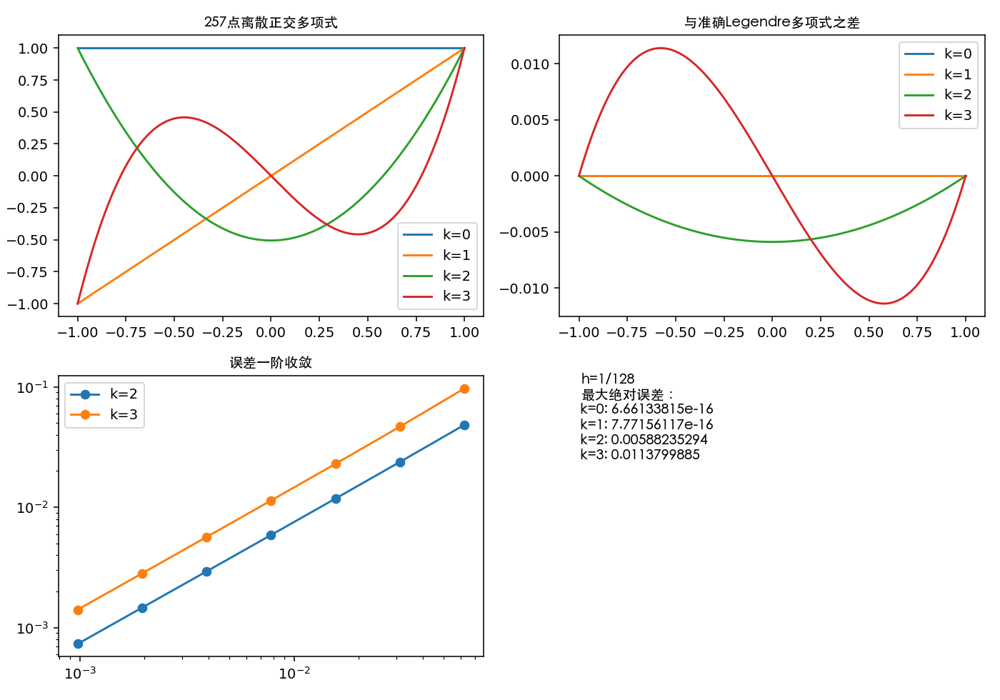

   **难度：3/5；出处：** TB：Lloyd N. Trefethen、David Bau III《数值线性代数》，陆金甫、关治译，2006（英文原版1997），第9讲习题9.1，书页57（PDF第69页），原题号9.1；**解答来源：** 自拟简解。

### QR 对角量用于秩估计的局限

**图谱路径：** 数值分析 / 第3章 最小二乘问题解法 / QR 对角量用于秩估计的局限

**知识内容：** [定义、定理与方法](知识点.md#kp-tb-ch09-r-diagonal-rank)

<!-- source-exercise:TB-ch09-9.2 -->
1. 与实验2对照，设$Q=I$、$A=R$为$m\times m \operatorname{Toeplitz}$矩阵，主对角1、第1条次对角2、其他0。(a)求特征值、行列式、秩。(b)求$A^{-1}$。(c)给最小奇异值$\sigma _{m}$非平凡上界，允许MATLAB辅助但须分析证明。

   **答案：** 由题设$A=R$为上三角，题中“次对角”应取第一条上次对角，写$A=I+2S$、$S_{i,i+1}=1$。特征值全1，$\operatorname{det}A=1$，$\operatorname{rank}A=m$。$S^{m}=0$，逆$\sum _{k=0}^{m-1}(-2S)^{k}$，即上三角条目$(A^{-1})_{ij}=(-2)^{j-i}$。其末列范数$\sqrt{\sum _{k=0}^{m-1}4^{k}}=\sqrt{(4^{m}-1)/3}$，故$\|A^{-1}\|_{2}$至少为此，$\sigma _{m}=1/\|A^{-1}\|_{2}\le \sqrt{3/(4^{m}-1)}$。此指数小上界与R对角全1并存，说明未置换QR对角并非通用秩/条件量。若把题中次对角读成下次对角，结论经转置同样成立，但它不再是所称上三角R。

   **难度：3/5；出处：** TB：Lloyd N. Trefethen、David Bau III《数值线性代数》，陆金甫、关治译，2006（英文原版1997），第9讲习题9.2，书页57（PDF第69页），原题号9.2；**解答来源：** 自拟简解。

### 用正交残差审查浮点 QR

**图谱路径：** 数值分析 / 第3章 最小二乘问题解法 / 用正交残差审查浮点 QR

**知识内容：** [定义、定理与方法](知识点.md#kp-tb-ch09-qr-orthogonality-test)

已整理范围内未另选可直接对应此节点的独立未解题；相关已解例子见知识内容。

### 矩阵图像的截断 SVD 重构

**图谱路径：** 数值分析 / 第3章 最小二乘问题解法 / 矩阵图像的截断 SVD 重构

**知识内容：** [定义、定理与方法](知识点.md#kp-tb-ch09-svd-image-compression)

<!-- source-exercise:TB-ch09-9.3 -->
1. (a)写MATLAB程序建立$15\times 40$的0/1矩阵A，1按书中SPY图构成HELLO：左上第一个1在(2,2)、右下最后1在(13,39)，其余位置见附矩阵CSV及复现图。(b)用svd打印全部奇异值，以plot和semilogy作图；判定数学准确秩及计算结果如何表示它。(c)对每个$i=1,\ldots ,\operatorname{rank}(A)$，构造2范数最佳秩i近似B，用pcolor(B)、colormap(gray)形成像。

   **答案：** 将原页图164个连通圆点的中心按题给两锚点解码，再与人工逐字母矩形笔画比对完全相同；CSV为处理记录/Tref第9讲HELLO原图矩阵.csv，MATLAB程序工具/tref09.m。精确有理消元得秩10。全部奇异值约为10.38326913、5.13177886、3.18775603、2.93826395、2.06251517、1.83760006、1.22698575、0.98791787、0.73798537、0.63288500，以及$2.98\times 10^{-16}$、$2.02\times 10^{-16}$、0、0、0，后二者舍入量应作为准确零理解。逐i用$B_{i}=U(:,1:i)S(1:i,1:i)V(:,1:i)^{*}$，理论误差$\sigma _{i+1}$；实算前9个误差与下一奇异值相符，秩10重构残差$1.99\times 10^{-14}$。全部10种图像保持同一灰度范围。

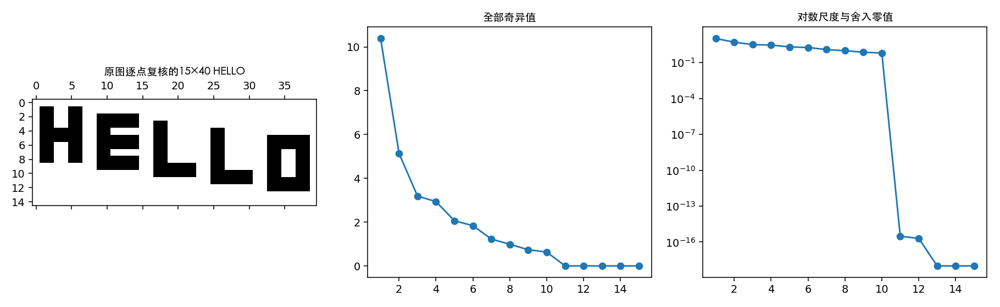

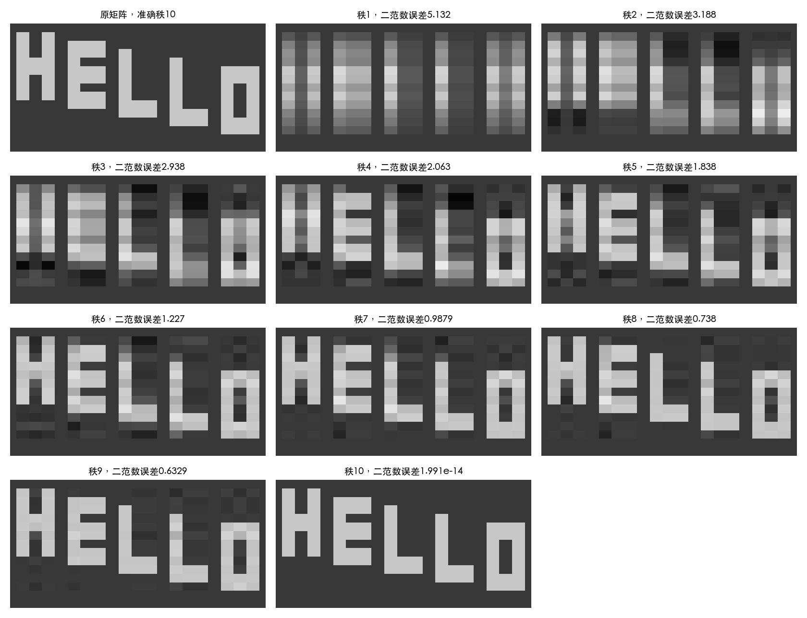

   **难度：3/5；出处：** TB：Lloyd N. Trefethen、David Bau III《数值线性代数》，陆金甫、关治译，2006（英文原版1997），第9讲习题9.3，书页57（PDF第69页），原题号9.3；**解答来源：** 自拟简解。

   **整理说明：** 原图完整坐标已逐点核对；9.3的10个秩实例是同一原题的小问，不另计数。

### 三角正交化与正交三角化

**图谱路径：** 数值分析 / 第3章 最小二乘问题解法 / 三角正交化与正交三角化

**知识内容：** [定义、定理与方法](知识点.md#kp-tb-ch10-left-right-qr)

已整理范围内未另选可直接对应此节点的独立未解题；相关已解例子见知识内容。

### 复 Householder 的稳定相位选取

**图谱路径：** 数值分析 / 第3章 最小二乘问题解法 / 复 Householder 的稳定相位选取

**知识内容：** [定义、定理与方法](知识点.md#kp-tb-ch10-householder-phase)

<!-- source-exercise:TB-ch10-10.1 -->
1. 求Householder镜射算子的(a)特征值，(b)行列式，(c)奇异值；特征值除代数证明外还须给几何论证。

   **答案：** $H=I-2vv^{*}/(v^{*}v)$，$v\ne 0$。$Hv=-v$，任意$w\perp v$满足$Hw=w$，所以m维谱为−1一次、+1共m−1次，$\operatorname{det}H=-1$。$H^{*}H=I$，全部奇异值1。几何上超平面$v\perp$逐点不动、法向反号，正是镜射；复空间的表述是相对于Hermitian内积的正交分解。$m=1$只有−1特征值。

   **难度：2/5；出处：** TB：Lloyd N. Trefethen、David Bau III《数值线性代数》，陆金甫、关治译，2006（英文原版1997），第10讲习题10.1，书页64（PDF第76页），原题号10.1；**解答来源：** 自拟简解。

### 用反射向量隐式存储和应用 Q

**图谱路径：** 数值分析 / 第3章 最小二乘问题解法 / 用反射向量隐式存储和应用 Q

**知识内容：** [定义、定理与方法](知识点.md#kp-tb-ch10-implicit-householder)

<!-- source-exercise:TB-ch10-10.2 -->
1. (a)写MATLAB函数$[W,R]=\operatorname{house}(A)$，用Householder计算$m\times n$矩阵（$m\ge n$）的完全QR的隐式表示；$W\in C^{m\times n}$下三角，其列保存镜射向量，$R\in C^{n\times n}$上三角。(b)写$Q=\operatorname{formQ}(W)$，返回对应$m\times m$正交（复情形为酉）矩阵。

   **答案：** 工具/house.m按尾列稳定相位选v并规范，$W(k:m,k)=v$；尾块A(k:m,k:n)←$A-2v(v^{*}A)$，最后返回$R=A(1:n,1:n)$。若尾列为0，W列置0表示恒等映射，故秩亏亦能运行。formQ.m从I出发，$k=n,\ldots ,1$按同样秩一公式左乘，得到$H_{1}\cdots H_{n}$。不要正序左乘，否则返回$Q^{*}$。工具/verify_tb_10.py核验自写Python对应算法对$5\times 3$原题及复$18\times 6$的分解/正交残差均在机器精度量级；MATLAB源码随附，未声称调用MATLAB运行时。

   **难度：3/5；出处：** TB：Lloyd N. Trefethen、David Bau III《数值线性代数》，陆金甫、关治译，2006（英文原版1997），第10讲习题10.2，书页64（PDF第76页），原题号10.2；**解答来源：** 自拟简解。

<!-- source-exercise:TB-ch10-10.3 -->
2. $Z=[[1,2,3],[4,5,6],[7,8,7],[4,2,3],[4,2,2]]$。在MATLAB上用习题8.2的mgs、10.2的house及内置$[Q,R]=qr(Z,0)$计算三种约化QR，比较并评论差异。

   **答案：** 同一列的$q_{j}$和R第j行可同时反号，所以先把R对角规范为正再比较。原矩阵条件数约12.45084，三种算法在此良态尺度下都准确：本机Python对应MGS、自写Householder和LAPACK QR的数值及残差见处理记录/Tref第10讲QR核验.json。MGS产生的正R为约[[9.899495,9.495434,9.697464],[0,3.291920,3.012943],[0,0,1.970116]]（最终精确打印以核验记录为准）。未对齐符号时较大的Q、R差异不表示算法错误；对齐后只余舍入差。

   **难度：3/5；出处：** TB：Lloyd N. Trefethen、David Bau III《数值线性代数》，陆金甫、关治译，2006（英文原版1997），第10讲习题10.3，书页64（PDF第76页），原题号10.3；**解答来源：** 自拟简解。

### Householder 与 Givens QR 的工作量比较

**图谱路径：** 数值分析 / 第3章 最小二乘问题解法 / Householder 与 Givens QR 的工作量比较

**知识内容：** [定义、定理与方法](知识点.md#kp-tb-ch10-householder-givens-cost)

<!-- source-exercise:TB-ch10-10.4 -->
1. $F=[[-c,s],[s,c]]$、$J=[[c,s],[-s,c]]$，$c=\operatorname{cos}\theta$、$s=\operatorname{sin}\theta$；F为det−1镜射，J为det1的Givens旋转。(a)准确描述左乘F和J在实平面的几何效果。(b)给出类似算法10.1而用Givens的QR。(c)证明每个元素对用6flop而非4，渐近工作量比(10.9)多50%。

   **答案：** J将极角$\varphi$映到$\varphi -\theta$，故$\theta >0$时顺时针旋转。F的固定轴角为$\alpha =(\pi -\theta )/2$（模$\pi$），它把$\varphi$映为$\pi -\theta -\varphi$；法向反号。逐列k从下往上用行(k,i)旋转消$a_{ik}$，参数$c=a_{kk}/\operatorname{hypot}(a_{kk},a_{ik})$、$s=a_{ik}/\operatorname{hypot}(...)$（二者全0取恒等）；应用J保持先前列的零，再累积Q的逆旋转。每个尾列一对元素变成cx+sy、−sx+cy，用4乘2加。求和$6\sum _{k=1}^{n}(m-k)(n-k+1)$首项$3mn^{2}-n^{3}$，是$2mn^{2}-2n^{3}/3$的1.5倍。所有范数参数用稳定hypot，参数计算是较低阶。

   **难度：3/5；出处：** TB：Lloyd N. Trefethen、David Bau III《数值线性代数》，陆金甫、关治译，2006（英文原版1997），第10讲习题10.4，书页64—65（PDF第76—77页），原题号10.4；**解答来源：** 自拟简解。

### 多项式插值与降低次数的最小二乘拟合

**图谱路径：** 数值分析 / 第3章 最小二乘问题解法 / 多项式插值与降低次数的最小二乘拟合

**知识内容：** [定义、定理与方法](知识点.md#kp-tb-ch11-interpolation-versus-fit)

已整理范围内未另选可直接对应此节点的独立未解题；相关已解例子见知识内容。

### 三种最小二乘解法的首项工作量

**图谱路径：** 数值分析 / 第3章 最小二乘问题解法 / 三种最小二乘解法的首项工作量

**知识内容：** [定义、定理与方法](知识点.md#kp-tb-ch11-ls-method-cost)

<!-- source-exercise:TB-ch11-11.3 -->
1. $m=50$、$n=12$；t是0到1的等距格点，A为在这些点拟合11次多项式的升幂Vandermonde，$b=\operatorname{cos}(4t)$。(a)法方程及MATLAB反斜杠，mgs，house，(d)内置qr，A\b，svd，分别以16位精度输出12个系数。(g)在六表标出舍入影响的错误数字、比较并判断法方程是否不稳定；无需解释观察。

   **答案：** 完整六表如下，另保存CSV。使用Python对应的自写MGS/Householder及库QR/SVD运行，MATLAB源码tref11.m保留原题六法；表的QR最小二乘列是SciPy gelsy，包含列主元，故未冒称实际MATLAB反斜杠输出。为区分输入舍入与算法误差，将同一float64矩阵、右端提升到70位求参考解。$\kappa _{2}(A)$约为1.171777e+08；各算法系数相对误差依次约0.02730、0.002985、$1.99\times 10^{-10}$、$8.73\times 10^{-10}$、$2.03\times 10^{-9}$、$7.60\times 10^{-10}$。法方程与MGS已损失明显数字，Householder/库QR/SVD差异主要出现在后几位。逐项绝对误差也落盘，不能只凭拟合残差小判系数准确。
|幂次|70位参考四舍五入|法方程|MGS|自写Householder|库QR|QR最小二乘|SVD|
|---|---|---|---|---|---|---|---|
|0|1.000000000996606|0.9999999940545437|1.000000001867843|1.000000000996606|1.000000000996607|1.000000000996609|1.000000000996606|
|1|-4.227430982703315e-07|1.657510400736983e-06|-6.699799841610907e-07|-4.227430208654397e-07|-4.227430607282103e-07|-4.227427995941912e-07|-4.227430714060399e-07|
|2|-7.999981235683262|-8.000059792007361|-7.999972102783945|-7.999981235684245|-7.999981235685389|-7.999981235693317|-7.999981235684956|
|3|-0.0003187632634112409|0.0008426052626748938|-0.0004516154367426968|-0.0003187632613207773|-0.0003187632276049166|-0.0003187631340113397|-0.0003187632335648132|
|4|10.66943079610657|10.66051988737523|10.67043706985688|10.66943079613394|10.66943079582033|10.66943079522308|10.66943079586311|
|5|-0.01382028880162876|0.02645606768298307|-0.01832033683647936|-0.0138202890199448|-0.01382028749408352|-0.01382028517613318|-0.01382028767751227|
|6|-5.647075625348141|-5.761398231847883|-5.634416758304772|-5.647075624595597|-5.647075629055242|-5.647075634838941|-5.647075628555791|
|7|-0.07531602754693988|0.134222077531505|-0.09833991366849473|-0.07531602904509525|-0.07531602079425219|-0.07531601131039187|-0.07531602167986942|
|8|1.693606966883371|1.445874377142158|1.720646116444386|1.6936069687183|1.69360695896785|1.693606948799925|1.693606959987169|
|9|0.006032106491846971|0.188475191924423|-0.01376439853875867|0.006032105123336332|0.006032112264354579|0.006032119128115082|0.006032111530249084|
|10|-0.3742417025783631|-0.4503574858141456|-0.3660253214571267|-0.3742417020065679|-0.3742417049614169|-0.3742417076091214|-0.3742417046609315|
|11|0.08804057592469262|0.1017800364251082|0.08656430881051011|0.08804057582184664|0.08804057635014419|0.08804057679521812|0.08804057629680015|

   **难度：4/5；出处：** TB：Lloyd N. Trefethen、David Bau III《数值线性代数》，陆金甫、关治译，2006（英文原版1997），第11讲习题11.3，书页73（PDF第85页），原题号11.3；**解答来源：** 自拟简解。

### 含共同极点函数的 L² 拟合

**图谱路径：** 数值分析 / 第3章 最小二乘问题解法 / 含共同极点函数的 L² 拟合

**知识内容：** [定义、定理与方法](知识点.md#kp-tb-ch11-singular-function-fitting)

<!-- source-exercise:TB-ch11-11.2 -->
1. (a)在[1,2]的$L^{2}$范数下，用$e^{x}$、sin x、$\Gamma (x)$线性组合拟合$f(x)=x^{-1}$；用离散化及离散最小二乘写至少两位相对准确数字的程序，给误差估计、最佳系数并作图。(b)将区间改为[0,1]重复。提示$g(x)=1/\Gamma (x)$满足$g^{\prime}(0)=1$。

   **答案：** (a)中点网格构造三列并做QR/SVD，512、1024、2048、4096点结果经连续70位积分对照；最佳系数约(−0.107776083891,0.00920928894020,1.28717523670)，$L^{2}$最小残差0.00053643733408，已超过两位相对准确数字。(b)极点比较先强制$\Gamma$系数为1；否则残差含(1−c)/x，$L^{2}$范数无穷。余下平滑目标$1/x-\Gamma (x)$在0处取$\gamma$，双列拟合得系数约(0.625946306355,−1.81730879239,1)，最小$L^{2}$残差0.0574368972968。两种网格细化和连续积分在处理记录/Tref第11讲计算核验.json，Python对应程序工具/verify_tb_11_12.py，MATLAB源码工具/tref11.m。

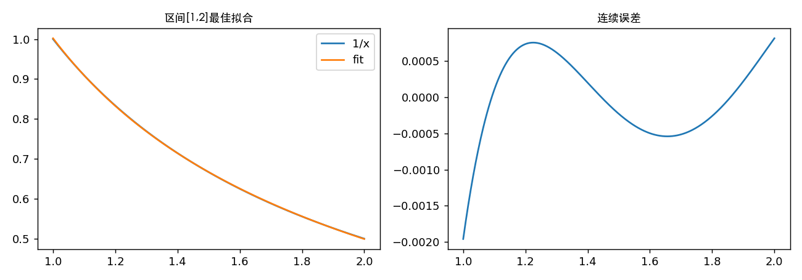

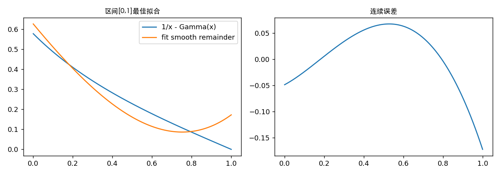

   **难度：4/5；出处：** TB：Lloyd N. Trefethen、David Bau III《数值线性代数》，陆金甫、关治译，2006（英文原版1997），第11讲习题11.2，书页73（PDF第85页），原题号11.2；**解答来源：** 自拟简解。

### QR 因子误差的相关抵消

**图谱路径：** 数值分析 / 第3章 最小二乘问题解法 / QR 因子误差的相关抵消

**知识内容：** [定义、定理与方法](知识点.md#kp-tb-ch16-correlated-qr-errors)

<!-- source-exercise:TB-ch16-16.2 -->
1. MATLAB构造$50\times 50 A=U\cdot S\cdot V^{*}$，U,V随机正交，S对角为[0,1]独立均匀值降序；用svd得U2,S2,V2，比较四个范数$\|U-U2\|$、$\|V-V2\|$、$\|S-S2\|$、$\|A-U2\cdot S2\cdot V2^{*}\|$，做5次。提示画$\operatorname{diag}(U2^{*}\cdot U)$、$\operatorname{diag}(V2^{*}\cdot V)$。(b)修正符号，5次用各种范数重算，讨论与condA关联。S对角改六次幂并重复(b)，与QR实验是否本质不同？

   **答案：** 实算两组各5个50阶矩阵，对U2每列按$u_{j}^{T}u2_{j}$的符号，同时翻转对应V2列；否则二范数差可能2，只有符号不同。全部1、2、∞、Frobenius范数在核验JSON。均匀谱组$\kappa$约21.6—858.7、对齐后U二范数误差约$1.04\times 10^{-13}$—$8.41\times 10^{-12}$；六次幂组$\kappa$约$2.34\times 10^{9}$—$3.87\times 10^{14}$，U误差约$1.81\times 10^{-10}$—$3.00\times 10^{-8}$，重构和奇异值相对误差仍机器精度量级。向量精度主要受奇异值间隙（特别小奇异值簇）控制，不能只由$\kappa$作一一预测。与QR一样可有不准确因子而准确乘积；SVD列非唯一还须先对齐符号，重复/接近奇异值需比较子空间。Python对应svd实际运行，MATLAB复现源码tref16.m。

   **难度：3/5；出处：** TB：Lloyd N. Trefethen、David Bau III《数值线性代数》，陆金甫、关治译，2006（英文原版1997），第16讲习题16.2，书页103（PDF第115页），原题号16.2；**解答来源：** 自拟简解。

### Householder 后向定理中的准确酉因子

**图谱路径：** 数值分析 / 第3章 最小二乘问题解法 / Householder 后向定理中的准确酉因子

**知识内容：** [定义、定理与方法](知识点.md#kp-tb-ch16-implicit-unitary-backward)

<!-- source-exercise:TB-ch16-16.1 -->
1. (a)$Q_{1},\ldots ,Q_{k}$固定酉，$A\in C^{m\times n}$为可扰数据，直接从右至左浮点计算$B=Q_{k}\cdots Q_{1}A$；证明向后稳定，$Q_{j}$固定不扰。(b)以任意$X_{j}$替代时给不成立例。

   **答案：** 每步误差$F_{j}$满足$\|F_{j}\|_F\le C_{m} u\|B_{j-1}\|_F+O(u^{2})$，酉保持范数。展开累计，$\widehat{B}=(Q_{k}\cdots Q_{1})A+F$，$\|F\|_F\le C_{m,k}u\|A\|_F$；取$E=(Q_{k}\cdots Q_{1})^{*}F$即$\widehat{B}=(Q_{k}\cdots Q_{1})(A+E)$，E同范数，有限维范数等价给所求。(b)取奇异秩一X，例如[[1,1],[3,3]]。准确XA总在span(1,3)，但弱舍入模型允许两行内积发生不同相对舍入，使计算列离开这个空间，无法写成X(A+E)，无论E多小。非奇异固定X可把误差拉回但常数依赖$\kappa (X)$，不能用酉证明的统一范数保持步骤。

   **难度：3/5；出处：** TB：Lloyd N. Trefethen、David Bau III《数值线性代数》，陆金甫、关治译，2006（英文原版1997），第16讲习题16.1，书页103（PDF第115页），原题号16.1；**解答来源：** 自拟简解。

### QR 分解、应用反射、回代的后向误差组合

**图谱路径：** 数值分析 / 第3章 最小二乘问题解法 / QR 分解、应用反射、回代的后向误差组合

**知识内容：** [定义、定理与方法](知识点.md#kp-tb-ch16-compose-qr-solve)

已整理范围内未另选可直接对应此节点的独立未解题；相关已解例子见知识内容。

### 最小二乘的四个条件量与 η 参数

**图谱路径：** 数值分析 / 第3章 最小二乘问题解法 / 最小二乘的四个条件量与 η 参数

**知识内容：** [定义、定理与方法](知识点.md#kp-tb-ch18-four-ls-conditions)

<!-- source-exercise:TB-ch18-18.1 -->
1. $A=[[1,1],[1,1.0001],[1,1.0001]]$，$b=(2,0.0001,4.0001)^{T}$。(a)准确求A⁺、P；(b)准确求最小二乘x、$y=Ax$；(c)数值求$\kappa (A)$、$\theta$、$\eta$；(d)定理18.1的4个条件数；(e)给近似达到这4个条件数的$\delta b$、$\delta A$例。

   **答案：** (a)$A^{+}=[[10001,-5000,-5000],[-10000,5000,5000]]$，$P=[[1,0,0],[0,1/2,1/2],[0,1/2,1/2]]$。(b)$x=(1,1)$，$y=(2,2.0001,2.0001)$，$r=(0,-2,2)$。$(c)\kappa$≈42429.23542，$\theta$≈0.6847028733弧度，$\eta$≈1.00000000056。(d)对b的y、x条件精确1.290977236、54775.17704；对A的y、x的书中上界54775.17707、$1.469883253\times 10^{9}$。$(e)\delta b=\varepsilon y/\|y\|$达到y对b精确条件，$\delta b=\varepsilon u_{\min}$达到x对b条件。$\delta A=\varepsilon (r/\|r\|)v_{\min}^{T}$产生x对A相对放大量$1.469840824\times 10^{9}$，已逼近其上界。y对A的真实条件只有34642.17090；其极值$\delta A=\varepsilon (r/\|r\|)w^{T}$，其中w约(0.70713035,−0.70708321)，见核验JSON精确方向。此处原题“近似达到四条件”把A两项上界也当精确值过强：本例y不能达到54775。证明：令$A=U\Sigma V^{T}$，$\widetilde{x}=V^{T}x$，y导数只依赖E在残差方向的一行$w^{T}$，$\|\delta y\|^{2}=\|r\|^{2}\sum_{i}(w_{i}/\sigma _{i})^{2}+(w^{T}\widetilde{x})^{2}$；在$\|w\|\le 1$上取最大特征值得上述34642，故该差异是数学上的，不是程序误差。

   **难度：4/5；出处：** TB：Lloyd N. Trefethen、David Bau III《数值线性代数》，陆金甫、关治译，2006（英文原版1997），第18讲习题18.1，书页118（PDF第130页），原题号18.1；**解答来源：** 自拟简解。

   **整理说明：** 定理正文明确第二行是上界；题(e)逐字要求全达到需修正为比较上界和实际极值。

<!-- source-exercise:TB-ch18-18.2 -->
2. 回归以观测向量在IQ、教育年限、父母教育和收入等列的张成空间中拟合。为何加入更多变量未必得到更多信息？用条件观点特别参照定理18.1解释。

   **答案：** 新列若与已有列近相关，$\sigma _{\min}$下降而$\kappa$增大，拟合残差可能变小，但系数对观测/列数据的微小扰动更敏感。预测值y与系数x的条件不同，拟合看似好仍可有难以稳定解释的回归系数；$\eta$、$\theta$也参与条件量，不能只看变量数或残差。增加独立、有信息的变量可能有益，加入近重复列不能自动提供可辨识信息，可用SVD/秩检测/正则化评估。

   **难度：2/5；出处：** TB：Lloyd N. Trefethen、David Bau III《数值线性代数》，陆金甫、关治译，2006（英文原版1997），第18讲习题18.2，书页118（PDF第130页），原题号18.2；**解答来源：** 自拟简解。

<!-- source-exercise:TB-ch18-18.4 -->
3. 解释$m=n$时y对A扰动的条件数为何成为0，这是定理18.1注记。

   **答案：** 满秩方阵的rangeA为整个空间，$P=I$；固定b且A保持可逆，$y=AA^{-1}b=b$严格不变，导数对A为0。x仍可敏感，因此不能从系数条件推断拟合向量条件。表格$\kappa /\operatorname{cos}\theta$是一般上界，此情形用准确0取代。

   **难度：1/5；出处：** TB：Lloyd N. Trefethen、David Bau III《数值线性代数》，陆金甫、关治译，2006（英文原版1997），第18讲习题18.4，书页118（PDF第130页），原题号18.4；**解答来源：** 自拟简解。

### 子空间倾斜时投影点的球面轨迹

**图谱路径：** 数值分析 / 第3章 最小二乘问题解法 / 子空间倾斜时投影点的球面轨迹

**知识内容：** [定义、定理与方法](知识点.md#kp-tb-ch18-projection-sphere)

<!-- source-exercise:TB-ch18-18.3 -->
1. 湖面微浪使对岸房子的反射光在视觉中成垂直条纹；雨路尾灯/蜡地板类似。(a)你与光源都高湖面50m，相距1000m，导出条纹长度/宽度的数量理论。(b)联系本讲几何讨论。

   **答案：** 平水镜面点在中点，各水平距500m，仰角$\alpha =\operatorname{arctan}(50/500)=\operatorname{arctan}0.1$。令入射单位向量$d=(\operatorname{cos}\alpha ,0,-\operatorname{sin}\alpha )$，法向$n=e_{3}$，微坡$\delta n=(p,q,0)$；反射方向$d-2(d\cdot n)n$的微分为$(2\operatorname{sin}\alpha  p,2\operatorname{sin}\alpha  q,-2\operatorname{cos}\alpha  p)$。平行视线竖直平面的坡p造成角偏移2|p|，横向坡q只造成$2\operatorname{sin}\alpha |q|$。在微坡各方向统计尺度相同的模型下，视觉条纹长宽比$1/\operatorname{sin}\alpha =\sqrt{101}$≈10.0499。缺少微坡各向同性条件时不能仅由几何给实际照片精确宽度。本讲投影点在大圆/小圆上的微分速度同样相差一个sin因子，浅入射使两个方向响应强烈不同。

   **难度：3/5；出处：** TB：Lloyd N. Trefethen、David Bau III《数值线性代数》，陆金甫、关治译，2006（英文原版1997），第18讲习题18.3，书页118（PDF第130页），原题号18.3；**解答来源：** 自拟简解。

### 矩阵扰动导致列空间倾斜的最有效方向

**图谱路径：** 数值分析 / 第3章 最小二乘问题解法 / 矩阵扰动导致列空间倾斜的最有效方向

**知识内容：** [定义、定理与方法](知识点.md#kp-tb-ch18-range-tilting)

已整理范围内未另选可直接对应此节点的独立未解题；相关已解例子见知识内容。

### 增广 MGS 保持右端与列投影的误差关联

**图谱路径：** 数值分析 / 第3章 最小二乘问题解法 / 增广 MGS 保持右端与列投影的误差关联

**知识内容：** [定义、定理与方法](知识点.md#kp-tb-ch19-augmented-mgs-stability)

已整理范围内未另选可直接对应此节点的独立未解题；相关已解例子见知识内容。

### 法方程为何在近精确拟合中尤其危险

**图谱路径：** 数值分析 / 第3章 最小二乘问题解法 / 法方程为何在近精确拟合中尤其危险

**知识内容：** [定义、定理与方法](知识点.md#kp-tb-ch19-normal-equations-stability-regions)

已整理范围内未另选可直接对应此节点的独立未解题；相关已解例子见知识内容。

### 按奇异值阈值计算数值伪逆

**图谱路径：** 数值分析 / 第3章 最小二乘问题解法 / 按奇异值阈值计算数值伪逆

**知识内容：** [定义、定理与方法](知识点.md#kp-tb-ch19-numerical-pinv-threshold)

<!-- source-exercise:TB-ch19-19.2 -->
1. 解释MATLAB片段：$[U,S,V]=\operatorname{svd}(A)$;$S=\operatorname{diag}(S)$;$\operatorname{tol}=\operatorname{max}(\operatorname{size}(A))^{*}S(1)^{*}\operatorname{eps}$;$r=\operatorname{sum}(S>\operatorname{tol})$;$S=\operatorname{diag}(\operatorname{ones}(r,1)./S(1:r))$;$X=V(:,1:r)\cdot S\cdot U(:,1:r)^{*}$。它计算什么？

   **答案：** 计算按$\tau =\operatorname{max}(m,n)\sigma _{1}\operatorname{eps}$截断的数值Moore–Penrose伪逆X。若真实秩r且所有非零$\sigma$高于$\tau$，等同原A⁺的数值计算；若有非零$\sigma \le \tau$，实际上把这些小方向置0，给近邻秩r矩阵的伪逆。r为数值秩，不是数学严格秩；这正是pinv式常用容差。对非空零矩阵$r=0$、空乘积返回零$n\times m$；空A的S(1)会越界，应加边界处理。

   **难度：2/5；出处：** TB：Lloyd N. Trefethen、David Bau III《数值线性代数》，陆金甫、关治译，2006（英文原版1997），第19讲习题19.2，书页125（PDF第137页），原题号19.2；**解答来源：** 自拟简解。

### 乘法算子与正交多项式 Jacobi 矩阵

**图谱路径：** 数值分析 / 第3章 最小二乘问题解法 / 乘法算子与正交多项式 Jacobi 矩阵

**知识内容：** [定义、定理与方法](知识点.md#kp-tb-ch37-orthogonal-jacobi-matrix)

<!-- source-exercise:TB-ch37-37.1 -->
1. Legendre标准$P_{0}=1,P_{1}=x$，$P_{n}=((2n-1)/n)xP_{n-1}-((n-1)/n)P_{n-2}$。(a)验$P_{2},P_{3}$；(b)写标准与正交规范q递推对应两三对角矩阵及关系；(c)得$q_{n+1}$或$\|P_{n}\|$公式。

   **答案：** (a)$P_{2}=(3x^{2}-1)/2$，$P_{3}=(5x^{3}-3x)/2$。(b)$xP_{j-1}=[j/(2j-1)]P_{j}+[(j-1)/(2j-1)]P_{j-2}$，标准基J的下邻$J_{j+1,j}=j/(2j-1)$、上邻$J_{j,j+1}=j/(2j+1)$。令$D_{jj}=\sqrt{(2j-1)/2}$，规范基$q_{j}=D_{jj} P_{j-1}$，其$T=D^{-1}JD$对称、上下$\beta _{j}=j/\sqrt{4j^{2}-1}$。(c)由对称化比例$D_{j+1}/D_{j}=\sqrt{(2j+1)/(2j-1)}$和$q_{1}=1/\sqrt{2}$，$q_{n+1}=\sqrt{(2n+1)/2}P_{n}$，因此$\|P_{n}\|_{2}=\sqrt{2/(2n+1)}$。注意本书q索引比P大1，OCR的$q_{n-1}$是误识。

   **难度：3/5；出处：** TB：Lloyd N. Trefethen、David Bau III《数值线性代数》，陆金甫、关治译，2006（英文原版1997），第37讲习题37.1，书页252—253（PDF第264—265页），原题号37.1；**解答来源：** 自拟简解。

<!-- source-exercise:TB-ch37-37.2 -->
2. 仅由正交性直接证明次数n的$q_{n+1}$有n个相异零点，全在(−1,1)，不要用25.1谱简单性证明。

   **答案：** 取其在开区间内改变符号的相异实零点$x_{1},\ldots ,x_{k}$，构$r=\prod (x-x_{i})$。若$k<n$，$q_{n+1}r$在整个区间内不改变符号且非零于一段（其余实重根偶数、区间外因子固定符号、共轭复根积正）；所以$\int q_{n+1}r\ne 0$。又$\operatorname{degr}=k<n$与正交矛盾。故$k\ge n$，次数n迫恰n，全部是开区间内简单实根，端点/复/多重根均无余次数容纳。

   **难度：3/5；出处：** TB：Lloyd N. Trefethen、David Bau III《数值线性代数》，陆金甫、关治译，2006（英文原版1997），第37讲习题37.2，书页253（PDF第265页），原题号37.2；**解答来源：** 自拟简解。

<!-- source-exercise:TB-ch37-37.5 -->
3. Legendre与Chebyshev零点的极限密度同$\mu (x)=1/[\pi \sqrt{1-x^{2}}]$。做系列数值和曲线精细比较：各n两组对应点靠多近？

   **答案：** 按升序对应零点，$n=4,8,16,32,64,128,256$全部实算。最大差分别约0.06274、0.03480、0.01761、0.008769、0.004389、0.002193、0.001096；n乘最大差趋约0.2806，支持总体O(1/n)。端点差在n32,64,128,256为0.001532、0.0003938、0.00009981、0.00002513，近$O(1/n^{2})$。图画n乘位置差看内点非均匀系数；两点族同arcsine极限并不表示每个有限n点重合。极限密度可由角参数近均匀、$x=\operatorname{cos}\theta$换变量解释。

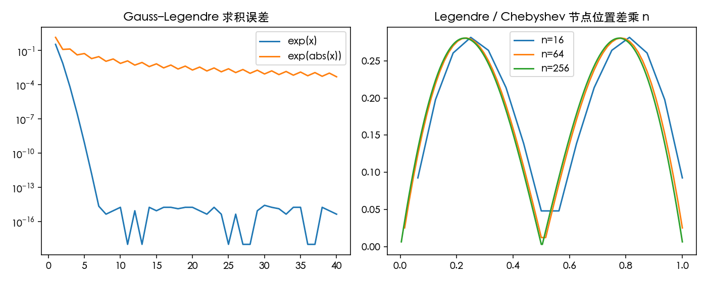

   **难度：3/5；出处：** TB：Lloyd N. Trefethen、David Bau III《数值线性代数》，陆金甫、关治译，2006（英文原版1997），第37讲习题37.5，书页253（PDF第265页），原题号37.5；**解答来源：** 自拟简解。

### Gauss–Legendre 的 2n−1 次多项式精确性

**图谱路径：** 数值分析 / 第3章 最小二乘问题解法 / Gauss–Legendre 的 2n−1 次多项式精确性

**知识内容：** [定义、定理与方法](知识点.md#kp-tb-ch37-gauss-degree)

<!-- source-exercise:TB-ch37-37.3 -->
1. n个相异点的$\le n-1$次插值形成Vandermonde。(a)用解若存在则唯一证明V非奇异；(b)写定理37.2权重线性系统并证明唯一精确至n−1。

   **答案：** (a)两个插值解之差多项式$\operatorname{deg}\le n-1$却n个相异零，故0；即齐次$V c=0$只有0，方阵V可逆，也保证存在。(b)权满足$\sum_{j} w_{j} x_{j}^{k}=\int _{-1}^{1}x^{k} dx$，$k=0,\ldots ,n-1$，右端奇k0、偶k2/(k+1)，系数$V^{T}$非奇异给唯一w。单项式基上线性精确推出所有$\le n-1$多项式精确。

   **难度：2/5；出处：** TB：Lloyd N. Trefethen、David Bau III《数值线性代数》，陆金甫、关治译，2006（英文原版1997），第37讲习题37.3，书页253（PDF第265页），原题号37.3；**解答来源：** 自拟简解。

### Jacobi 谱给 Gauss 节点和正权

**图谱路径：** 数值分析 / 第3章 最小二乘问题解法 / Jacobi 谱给 Gauss 节点和正权

**知识内容：** [定义、定理与方法](知识点.md#kp-tb-ch37-golub-welsch)

<!-- source-exercise:TB-ch37-37.4 -->
1. (a)写6行MATLAB求n点Gauss–Legendre节点权并对f积分；(b)$f=e^{x},n4$验证原例，并$n=1,\ldots ,40$画绝对误差对数图；(c)$f=e^{|x|}$同图评论。

   **答案：** 工具/tref37.m的6行由$\beta _{j}=j/\sqrt{4j^{2}-1}$组T、eig、权2V首行平方、求加权和。实际Python对应三对角谱运行全部40组。n4节点$\pm 0.861136311594$、$\pm 0.339981043585$，权0.347854845137、0.652145154863，$e^{x}$积分约2.350402092156、准确$e-e^{-1}$≈2.350402387288，误差$2.9513\times 10^{-7}$，符合书例。$e^{x}$随n快速降至约$10^{-15}$机器平台；$e^{|x|}$准确积分2(e−1)，0处尖点导致慢得多的代数衰减/奇偶分支，n4误差0.04180417。不能用光滑解析函数的图推测带尖点同速。

   **难度：3/5；出处：** TB：Lloyd N. Trefethen、David Bau III《数值线性代数》，陆金甫、关治译，2006（英文原版1997），第37讲习题37.4，书页253（PDF第265页），原题号37.4；**解答来源：** 自拟简解。

### 解析与带尖点函数的 Gauss 求积收敛

**图谱路径：** 数值分析 / 第3章 最小二乘问题解法 / 解析与带尖点函数的 Gauss 求积收敛

**知识内容：** [定义、定理与方法](知识点.md#kp-tb-ch37-quadrature-smoothness)

<!-- source-exercise:TB-ch37-37.4 -->
1. (a)写6行MATLAB求n点Gauss–Legendre节点权并对f积分；(b)$f=e^{x},n4$验证原例，并$n=1,\ldots ,40$画绝对误差对数图；(c)$f=e^{|x|}$同图评论。

   **答案：** 工具/tref37.m的6行由$\beta _{j}=j/\sqrt{4j^{2}-1}$组T、eig、权2V首行平方、求加权和。实际Python对应三对角谱运行全部40组。n4节点$\pm 0.861136311594$、$\pm 0.339981043585$，权0.347854845137、0.652145154863，$e^{x}$积分约2.350402092156、准确$e-e^{-1}$≈2.350402387288，误差$2.9513\times 10^{-7}$，符合书例。$e^{x}$随n快速降至约$10^{-15}$机器平台；$e^{|x|}$准确积分2(e−1)，0处尖点导致慢得多的代数衰减/奇偶分支，n4误差0.04180417。不能用光滑解析函数的图推测带尖点同速。

   **难度：3/5；出处：** TB：Lloyd N. Trefethen、David Bau III《数值线性代数》，陆金甫、关治译，2006（英文原版1997），第37讲习题37.4，书页253（PDF第265页），原题号37.4；**解答来源：** 自拟简解。

### 最小二乘增广鞍点系统

**图谱路径：** 数值分析 / 第3章 最小二乘问题解法 / 最小二乘增广鞍点系统

**知识内容：** [定义、定理与方法](知识点.md#kp-xh-ch05-augmented-ls)

<!-- source-exercise:TB-ch19-19.1 -->
1. $A\in C^{m\times n}$满列秩n，$b\in C^{m}$；证明块系统$[[I,A],[A^{*},0]](r,x)^{T}=(b,0)^{T}$有唯一解，并且r、x就是最小二乘残差和解。

   **答案：** 方程等价$r=b-Ax$和$A^{*}r=0$，故正规方程$A^{*}Ax=A^{*}b$唯一解$x=(A^{*}A)^{-1}A^{*}b$，r随后唯一。也可由齐次系统得$r=-Ax$、$0=A^{*}r=-A^{*}Ax$，满秩迫$x=r=0$，块系数可逆。残差正交列空间即LS最优条件。

   **难度：2/5；出处：** TB：Lloyd N. Trefethen、David Bau III《数值线性代数》，陆金甫、关治译，2006（英文原版1997），第19讲习题19.1，书页125（PDF第137页），原题号19.1；**解答来源：** 自拟简解。

### 数据与列空间的夹角

**图谱路径：** 数值分析 / 第3章 最小二乘问题解法 / 数据与列空间的夹角

**知识内容：** [定义、定理与方法](知识点.md#kp-xh-ch05-ls-angle)

已整理范围内未另选可直接对应此节点的独立未解题；相关已解例子见知识内容。

### 最小二乘右端扰动界

**图谱路径：** 数值分析 / 第3章 最小二乘问题解法 / 最小二乘右端扰动界

**知识内容：** [定义、定理与方法](知识点.md#kp-xh-ch05-ls-rhs-sensitivity)

已整理范围内未另选可直接对应此节点的独立未解题；相关已解例子见知识内容。

### 最小二乘解的一阶微分

**图谱路径：** 数值分析 / 第3章 最小二乘问题解法 / 最小二乘解的一阶微分

**知识内容：** [定义、定理与方法](知识点.md#kp-xh-ch05-ls-differential)

已整理范围内未另选可直接对应此节点的独立未解题；相关已解例子见知识内容。

### 系数与右端共同扰动的条件界

**图谱路径：** 数值分析 / 第3章 最小二乘问题解法 / 系数与右端共同扰动的条件界

**知识内容：** [定义、定理与方法](知识点.md#kp-xh-ch05-ls-total-sensitivity)

已整理范围内未另选可直接对应此节点的独立未解题；相关已解例子见知识内容。

### 最小二乘条件数的残差作用

**图谱路径：** 数值分析 / 第3章 最小二乘问题解法 / 最小二乘条件数的残差作用

**知识内容：** [定义、定理与方法](知识点.md#kp-xh-ch05-ls-residual-conditioning)

已整理范围内未另选可直接对应此节点的独立未解题；相关已解例子见知识内容。

### 反射乘积的 WY 块表示

**图谱路径：** 数值分析 / 第3章 最小二乘问题解法 / 反射乘积的 WY 块表示

**知识内容：** [定义、定理与方法](知识点.md#kp-xh-ch05-wy-compact)

已整理范围内未另选可直接对应此节点的独立未解题；相关已解例子见知识内容。

### 紧凑 WY 上三角更新

**图谱路径：** 数值分析 / 第3章 最小二乘问题解法 / 紧凑 WY 上三角更新

**知识内容：** [定义、定理与方法](知识点.md#kp-xh-ch05-compact-wy)

已整理范围内未另选可直接对应此节点的独立未解题；相关已解例子见知识内容。

### Tikhonov 正则化的基本模型

**图谱路径：** 数值分析 / 第3章 最小二乘问题解法 / Tikhonov 正则化的基本模型

**知识内容：** [定义、定理与方法](知识点.md#kp-xh-ch05-tikhonov)

已整理范围内未另选可直接对应此节点的独立未解题；相关已解例子见知识内容。

### 截断 SVD 正则化

**图谱路径：** 数值分析 / 第3章 最小二乘问题解法 / 截断 SVD 正则化

**知识内容：** [定义、定理与方法](知识点.md#kp-xh-ch05-truncated-svd)

已整理范围内未另选可直接对应此节点的独立未解题；相关已解例子见知识内容。

### 线性最小二乘问题

**图谱路径：** 数值分析 / 第3章 最小二乘问题解法 / 线性最小二乘问题

**知识内容：** [定义、定理与方法](知识点.md#kp-xu-ch03-least-squares)

<!-- source-exercise:TB-ch11-11.1 -->
1. $A=[A_{1}$;$A_{2}]$为$m\times n$矩阵，$A_{1}$是$n\times n$非奇异矩阵，$A_{2}$任意。证明$\|A^{+}\|_{2}\le \|A_{1}^{-1}\|_{2}$。

   **答案：** 任意单位x有$\|Ax\|^{2}=\|A_{1}x\|^{2}+\|A_{2}x\|^{2}\ge \sigma _{\min}(A_{1})^{2}$，故A满列秩、$\sigma _{\min}(A)\ge \sigma _{\min}(A_{1})$。取倒数得$\|A^{+}\|_{2}=1/\sigma _{\min}(A)\le 1/\sigma _{\min}(A_{1})=\|A_{1}^{-1}\|_{2}$。无需形成法矩阵或显式伪逆。

   **难度：2/5；出处：** TB：Lloyd N. Trefethen、David Bau III《数值线性代数》，陆金甫、关治译，2006（英文原版1997），第11讲习题11.1，书页72—73（PDF第84—85页），原题号11.1；**解答来源：** 自拟简解。

### 正规方程的充要性

**图谱路径：** 数值分析 / 第3章 最小二乘问题解法 / 正规方程的充要性

**知识内容：** [定义、定理与方法](知识点.md#kp-xu-ch03-normal-equations)

<!-- source-exercise:XH-ch05-6 -->
1. 利用二次展开证明最小二乘解满足$A^{T}Ax=A^{T}b$。

   **答案：** 沿任意w移动$x+\alpha w$，平方目标线性项$2\alpha  w^{T}A^{T}(Ax-b)$。若该项非零，选小异号$\alpha$可降低目标，矛盾，故梯度0。

   **难度：2/5；出处：** XH：向华、杨志坚《数值线性代数》，2024年所附版，第5章习题6，书页85（PDF第90页），原题号6；**解答来源：** 自拟简解。

<!-- source-exercise:XU-ch03-1 -->
2. $A=\begin{pmatrix}1&2\\3&4\\5&6\end{pmatrix}$，$b=(1,1,1)^T$。用正规方程法求最小二乘解。

   **答案：** $A^TA=\begin{pmatrix}35&44\\44&56\end{pmatrix}$，$A^Tb=(9,12)^T$，解得 $x=(-1,1)^T$，且 $Ax=b$，残差实际上为0。

   **难度：2/5；出处：** XU：徐树方、高立、张平文《数值线性代数》第二版，2013，第3章习题1，书页97（PDF第109页），原题号1；**解答来源：** 自拟简解。

<!-- source-exercise:XU-ch03-12 -->
3. 利用 $\|A(x+\alpha w)-b\|_2^2=\|Ax-b\|_2^2+2\alpha w^TA^T(Ax-b)+\alpha^2\|Aw\|_2^2$，证明最小二乘解 $x$ 满足 $A^TAx=A^Tb$。

   **答案：** 若某方向 $w$ 的一次项系数非零，取足够小且异号的 $\alpha$ 会降低目标，矛盾。因此所有 $w$ 满足 $w^TA^T(Ax-b)=0$，取 $w=A^T(Ax-b)$ 即该向量为0。

   **难度：2/5；出处：** XU：徐树方、高立、张平文《数值线性代数》第二版，2013，第3章习题12，书页99（PDF第111页），原题号12；**解答来源：** 自拟简解。

### 残差的正交投影解释

**图谱路径：** 数值分析 / 第3章 最小二乘问题解法 / 残差的正交投影解释

**知识内容：** [定义、定理与方法](知识点.md#kp-xu-ch03-ls-projection)

已整理范围内未另选可直接对应此节点的独立未解题；相关已解例子见知识内容。

### 最小二乘解唯一性

**图谱路径：** 数值分析 / 第3章 最小二乘问题解法 / 最小二乘解唯一性

**知识内容：** [定义、定理与方法](知识点.md#kp-xu-ch03-ls-uniqueness)

<!-- source-exercise:XU-ch03-2 -->
1. $A=\begin{pmatrix}1&3&1&1\\2&0&0&0\\1&0&0&0\end{pmatrix}$，$b=(1,1,1)^T$。求最小二乘问题的全部解。

   **答案：** 第一行可通过其他参数任意匹配。其余两行最小化 $(2x_1-1)^2+(x_1-1)^2$，得 $x_1=3/5$。第一行需 $3x_2+x_3+x_4=2/5$，故全部解为 $(3/5,u,v,2/5-3u-v)^T$，$u,v\in\mathbb R$；最小残差平方为 $1/5$。

   **难度：2/5；出处：** XU：徐树方、高立、张平文《数值线性代数》第二版，2013，第3章习题2，书页97（PDF第109页），原题号2；**解答来源：** 自拟简解。

### 正规方程的条件数平方

**图谱路径：** 数值分析 / 第3章 最小二乘问题解法 / 正规方程的条件数平方

**知识内容：** [定义、定理与方法](知识点.md#kp-xu-ch03-normal-conditioning)

<!-- source-exercise:TB-ch06-6.3 -->
1. $m\ge n$，$A\in C^{m\times n}$。证明$A^{*}A$非奇异当且仅当A满列秩。

   **答案：** $x^{*}A^{*}Ax=\|Ax\|_{2}^{2}$，所以$\operatorname{ker}(A^{*}A)=\operatorname{kerA}$；前者方形非奇异等价核0，即A单射、满列秩。

   **难度：1/5；出处：** TB：Lloyd N. Trefethen、David Bau III《数值线性代数》，陆金甫、关治译，2006（英文原版1997），第6讲习题6.3，书页40（PDF第52页），原题号6.3；**解答来源：** 自拟简解。

<!-- source-exercise:XH-ch01-19 -->
2. 非奇异实A：$(1) \kappa (A)\ge 1$；(2) A正交则$\kappa _{2}(A)=1$；(3) U正交则$\kappa _{2}(A)=\kappa _{2}(AU)=\kappa _{2}(UA)$；$(4) B=A^{T}A$则$\kappa _{2}(B)=\kappa _{2}(A)^{2}$。

   **答案：** $(1) 1\le \|I\|\le \|A\|\|A^{-1}\|$。(2) 正交阵与逆的2范数均1。(3) 乘U及$U^{T}$保2范数和逆范数。(4) B的特征值为A各奇异值平方，条件数比例平方。

   **难度：2/5；出处：** XH：向华、杨志坚《数值线性代数》，2024年所附版，第1章习题19，书页19（PDF第27页），原题号19；**解答来源：** 自拟简解。

### Moore–Penrose 广义逆

**图谱路径：** 数值分析 / 第3章 最小二乘问题解法 / Moore–Penrose 广义逆

**知识内容：** [定义、定理与方法](知识点.md#kp-xu-ch03-pseudoinverse)

已整理范围内未另选可直接对应此节点的独立未解题；相关已解例子见知识内容。

### 最小范数最小二乘解

**图谱路径：** 数值分析 / 第3章 最小二乘问题解法 / 最小范数最小二乘解

**知识内容：** [定义、定理与方法](知识点.md#kp-xu-ch03-minimum-norm-ls)

<!-- source-exercise:XU-ch03-2 -->
1. $A=\begin{pmatrix}1&3&1&1\\2&0&0&0\\1&0&0&0\end{pmatrix}$，$b=(1,1,1)^T$。求最小二乘问题的全部解。

   **答案：** 第一行可通过其他参数任意匹配。其余两行最小化 $(2x_1-1)^2+(x_1-1)^2$，得 $x_1=3/5$。第一行需 $3x_2+x_3+x_4=2/5$，故全部解为 $(3/5,u,v,2/5-3u-v)^T$，$u,v\in\mathbb R$；最小残差平方为 $1/5$。

   **难度：2/5；出处：** XU：徐树方、高立、张平文《数值线性代数》第二版，2013，第3章习题2，书页97（PDF第109页），原题号2；**解答来源：** 自拟简解。

### 广义逆给出的两个投影

**图谱路径：** 数值分析 / 第3章 最小二乘问题解法 / 广义逆给出的两个投影

**知识内容：** [定义、定理与方法](知识点.md#kp-xu-ch03-projector-penrose)

已整理范围内未另选可直接对应此节点的独立未解题；相关已解例子见知识内容。

### 正交变换保范

**图谱路径：** 数值分析 / 第3章 最小二乘问题解法 / 正交变换保范

**知识内容：** [定义、定理与方法](知识点.md#kp-xu-ch03-orthogonal-transform)

<!-- source-exercise:TB-ch02-2.1 -->
1. 证明矩阵A同时三角且酉时必对角。

   **答案：** 取上三角情形，其逆上三角；酉性使$A^{-1}=A^{*}$为下三角，故$A^{*}$同时上下三角而对角，A也对角。下三角同理。对角元模1。

   **难度：2/5；出处：** TB：Lloyd N. Trefethen、David Bau III《数值线性代数》，陆金甫、关治译，2006（英文原版1997），第2讲习题2.1，书页13（PDF第25页），原题号2.1；**解答来源：** 自拟简解。

<!-- source-exercise:TB-ch02-2.4 -->
2. 酉矩阵的特征值有什么性质？

   **答案：** 若$Qx=\lambda x$、x非零，酉性保范，$|\lambda \||x\|=\|Qx\|=\|x\|$，所以$|\lambda |=1$。实正交阵的非实值成共轭对，实值只可能$\pm 1$。

   **难度：1/5；出处：** TB：Lloyd N. Trefethen、David Bau III《数值线性代数》，陆金甫、关治译，2006（英文原版1997），第2讲习题2.4，书页14（PDF第26页），原题号2.4；**解答来源：** 自拟简解。

### Householder 反射

**图谱路径：** 数值分析 / 第3章 最小二乘问题解法 / Householder 反射

**知识内容：** [定义、定理与方法](知识点.md#kp-xu-ch03-householder)

已整理范围内未另选可直接对应此节点的独立未解题；相关已解例子见知识内容。

### 反射消去向量尾部

**图谱路径：** 数值分析 / 第3章 最小二乘问题解法 / 反射消去向量尾部

**知识内容：** [定义、定理与方法](知识点.md#kp-xu-ch03-householder-vector)

已整理范围内未另选可直接对应此节点的独立未解题；相关已解例子见知识内容。

### 隐式应用 Householder

**图谱路径：** 数值分析 / 第3章 最小二乘问题解法 / 隐式应用 Householder

**知识内容：** [定义、定理与方法](知识点.md#kp-xu-ch03-householder-apply)

已整理范围内未另选可直接对应此节点的独立未解题；相关已解例子见知识内容。

### 反射映射等长向量

**图谱路径：** 数值分析 / 第3章 最小二乘问题解法 / 反射映射等长向量

**知识内容：** [定义、定理与方法](知识点.md#kp-xu-ch03-householder-mapping)

<!-- source-exercise:XH-ch05-2 -->
1. 非零实x,y，构造Householder H使$Hx=\alpha y$。

   **答案：** 选$\alpha =\pm \|x\|/\|y\|$使$v=x-\alpha y\ne 0$，$H=I-2vv^{T}/(v^{T}v)$。等长性给$2v^{T}x=v^{T}v$，故$Hx=\alpha y$。

   **难度：2/5；出处：** XH：向华、杨志坚《数值线性代数》，2024年所附版，第5章习题2，书页85（PDF第90页），原题号2；**解答来源：** 自拟简解。

<!-- source-exercise:XU-ch03-3 -->
2. $x=(1,0,4,6,3,4)^T$。求 Householder 变换 $H$ 和正数 $\alpha$ 使 $Hx=(1,\alpha,4,6,0,0)^T$。

   **答案：** 保范给 $\alpha=5$。取 $v=(0,-5,0,0,3,4)^T$，$v^Tv=50$，$H=I-vv^T/25$。由 $v^Tx=25$ 得 $Hx=x-v=(1,5,4,6,0,0)^T$。

   **难度：2/5；出处：** XU：徐树方、高立、张平文《数值线性代数》第二版，2013，第3章习题3，书页97（PDF第109页），原题号3；**解答来源：** 自拟简解。

<!-- source-exercise:XU-ch03-7 -->
3. 给非零 $x,y\in\mathbb R^n$，构造 Householder 变换 $H$ 使 $Hx=\alpha y$，$\alpha\in\mathbb R$。

   **答案：** 选 $\alpha=\pm\|x\|_2/\|y\|_2$ 使 $v=x-\alpha y\ne0$，这是两符号中至少一个可行。设 $H=I-2vv^T/(v^Tv)$；因 $\|x\|=\|\alpha y\|$，$2v^Tx=v^Tv$，故 $Hx=x-v=\alpha y$。

   **难度：2/5；出处：** XU：徐树方、高立、张平文《数值线性代数》第二版，2013，第3章习题7，书页98（PDF第110页），原题号7；**解答来源：** 自拟简解。

### Givens 平面旋转

**图谱路径：** 数值分析 / 第3章 最小二乘问题解法 / Givens 平面旋转

**知识内容：** [定义、定理与方法](知识点.md#kp-xu-ch03-givens)

<!-- source-exercise:XH-ch05-1 -->
1. $n\ge 2$，两个实单位向量x,y，用Givens构造正交Q使$Qx=y$。

   **答案：** 分别旋转到$e_{1}$得$G_{x} x=e_{1}$、$G_{y} y=e_{1}$，取$Q=G_{y}^{T}G_{x}$。$n=1$同向恒等、反向需一维反射，不能仅用不存在的平面旋转。

   **难度：2/5；出处：** XH：向华、杨志坚《数值线性代数》，2024年所附版，第5章习题1，书页85（PDF第90页），原题号1；**解答来源：** 自拟简解。

   **勘误：** 原题维数未限制；仅Givens构造的反向一维情形不可行，明确$n\ge 2$并说明一维例外。

<!-- source-exercise:XU-ch03-4 -->
2. 确定 $c=\cos\theta,s=\sin\theta$ 使 $\begin{pmatrix}c&s\\-s&c\end{pmatrix}(5,12)^T=\alpha(1,1)^T$，$\alpha\in\mathbb R$。

   **答案：** 保范给 $\alpha=\pm13/\sqrt2$。取 $\alpha>0$ 得 $c=17/(13\sqrt2)$、$s=7/(13\sqrt2)$；两者同时反号给另一解。核对 $c^2+s^2=1$ 及两输出相等即可。

   **难度：2/5；出处：** XU：徐树方、高立、张平文《数值线性代数》第二版，2013，第3章习题4，书页97（PDF第109页），原题号4；**解答来源：** 自拟简解。

<!-- source-exercise:XU-ch03-6 -->
3. 设 $x,y$ 为 $\mathbb R^n$ 两个单位向量，$n\ge2$。用 Givens 变换构造正交阵 $Q$ 使 $Qx=y$。

   **答案：** 分别用平面旋转将 $x,y$ 化为 $e_1$：从末分量起与第一分量配对消去，并选择最终首分量为1，得 $G_xx=e_1$、$G_yy=e_1$。取 $Q=G_y^TG_x$。$n=1$ 若 $x=y$ 恒等即可；若 $x=-y$，无平面可旋转，需另用一维反射 $Q=-1$。

   **难度：2/5；出处：** XU：徐树方、高立、张平文《数值线性代数》第二版，2013，第3章习题6，书页98（PDF第110页），原题号6；**解答来源：** 自拟简解。

   **勘误：** 原题未注明维数；仅靠 Givens 平面旋转在$n=1$且$x=-y$时无法完成，已补$n\ge 2$并单列一维情形。

<!-- source-exercise:XU-ch00-正文-90 -->
4. 写出Givens左乘与右乘矩阵的详细算法，说明只改两行或两列。

   **答案：** G在(i,k)块为[[c,s],[−s,c]]。左乘先临时保存旧行$r_{i},r_{k}$，再赋$r_{i}^{*}=c r_{i}+s r_{k}$、$r_{k}^{*}=-s r_{i}+c r_{k}$，其余行不动。右乘保存旧列$a_{i},a_{k}$，赋$a_{i}^{*}=c a_{i}-s a_{k}$、$a_{k}^{*}=s a_{i}+c a_{k}$。临时保存防止读到已覆盖数据，成本与两行/列长度线性。

   **难度：2/5；出处：** XU：徐树方、高立、张平文《数值线性代数》第二版，2013，§3.2.2 Givens作用算法（请读者补写），书页90（PDF第102页），原题号正文-90；**解答来源：** 自拟简解。

### 旋转参数的安全计算

**图谱路径：** 数值分析 / 第3章 最小二乘问题解法 / 旋转参数的安全计算

**知识内容：** [定义、定理与方法](知识点.md#kp-xu-ch03-safe-givens)

已整理范围内未另选可直接对应此节点的独立未解题；相关已解例子见知识内容。

### 复 Givens 变换

**图谱路径：** 数值分析 / 第3章 最小二乘问题解法 / 复 Givens 变换

**知识内容：** [定义、定理与方法](知识点.md#kp-xu-ch03-complex-givens)

<!-- source-exercise:XU-ch03-5 -->
1. 给复向量 $x=(x_1,x_2)^T$，构造酉矩阵 $Q=\begin{pmatrix}c&\bar s\\-s&c\end{pmatrix}$，$c$ 实且 $c^2+|s|^2=1$，使 $Qx$ 的第二分量为0。

   **答案：** 若 $x_2=0$ 取 $c=1,s=0$。若 $x_1=0,x_2\ne0$ 取 $c=0,s=1$。其余令 $r=\sqrt{|x_1|^2+|x_2|^2}$、$c=|x_1|/r$、$s=\bar x_1x_2/(|x_1|r)$。直接代入有 $-sx_1+cx_2=0$，且行列范数与正交条件成立。

   **难度：2/5；出处：** XU：徐树方、高立、张平文《数值线性代数》第二版，2013，第3章习题5，书页98（PDF第110页），原题号5；**解答来源：** 自拟简解。

### QR 分解的完整与经济形式

**图谱路径：** 数值分析 / 第3章 最小二乘问题解法 / QR 分解的完整与经济形式

**知识内容：** [定义、定理与方法](知识点.md#kp-xu-ch03-qr-factorization)

<!-- source-exercise:TB-ch07-7.1 -->
1. $A=[[1,0],[0,1],[1,0]]$、$B=[[1,2],[0,1],[1,0]]$。(a)手算A约化和完整QR；(b)对B同样做。

   **答案：** A的$Q_{1}$列为$(1,0,1)/\sqrt{2}$与$e_{2}$，$R_{1}=\operatorname{diag}(\sqrt{2},1)$；补$q_{3}=(1,0,-1)/\sqrt{2}$成完整Q，R在下部添零行。B的$Q_{1}$列为$(1,0,1)/\sqrt{2}$、$(1,1,-1)/\sqrt{3}$，$R_{1}=[[\sqrt{2},\sqrt{2}],[0,\sqrt{3}]]$；补$q_{3}=(1,-2,-1)/\sqrt{6}$，完整R同样添零行。各列正交且$Q_{1}R_{1}$相乘为原矩阵。

   **难度：3/5；出处：** TB：Lloyd N. Trefethen、David Bau III《数值线性代数》，陆金甫、关治译，2006（英文原版1997），第7讲习题7.1，书页46—47（PDF第58—59页），原题号7.1；**解答来源：** 自拟简解。

### Householder QR 算法

**图谱路径：** 数值分析 / 第3章 最小二乘问题解法 / Householder QR 算法

**知识内容：** [定义、定理与方法](知识点.md#kp-xu-ch03-householder-qr)

已整理范围内未另选可直接对应此节点的独立未解题；相关已解例子见知识内容。

### Givens QR 算法

**图谱路径：** 数值分析 / 第3章 最小二乘问题解法 / Givens QR 算法

**知识内容：** [定义、定理与方法](知识点.md#kp-xu-ch03-givens-qr)

已整理范围内未另选可直接对应此节点的独立未解题；相关已解例子见知识内容。

### 用 QR 求满列秩最小二乘

**图谱路径：** 数值分析 / 第3章 最小二乘问题解法 / 用 QR 求满列秩最小二乘

**知识内容：** [定义、定理与方法](知识点.md#kp-xu-ch03-qr-ls-solve)

<!-- source-exercise:XU-ch03-上机1 -->
1. 编写 QR 解线性系统和最小二乘程序，并完成：(1) 重算第1章三个系统，即84阶三对角(6,8,1)、100阶对称三对角(10,1,1)随机右端及40阶 Hilbert 行和右端，并与消去、平方根法比较；(2) 拟合二次多项式 $at^2+bt+c$，数据 $t=(-1,-0.75,-0.5,0,0.25,0.5,0.75)$、$y=(1,0.8125,0.75,1,1.3125,1.75,2.3125)$；(3) 用表3.3—3.4的28个房价样本拟合带截距和11特征线性模型。完整数据原页如下：

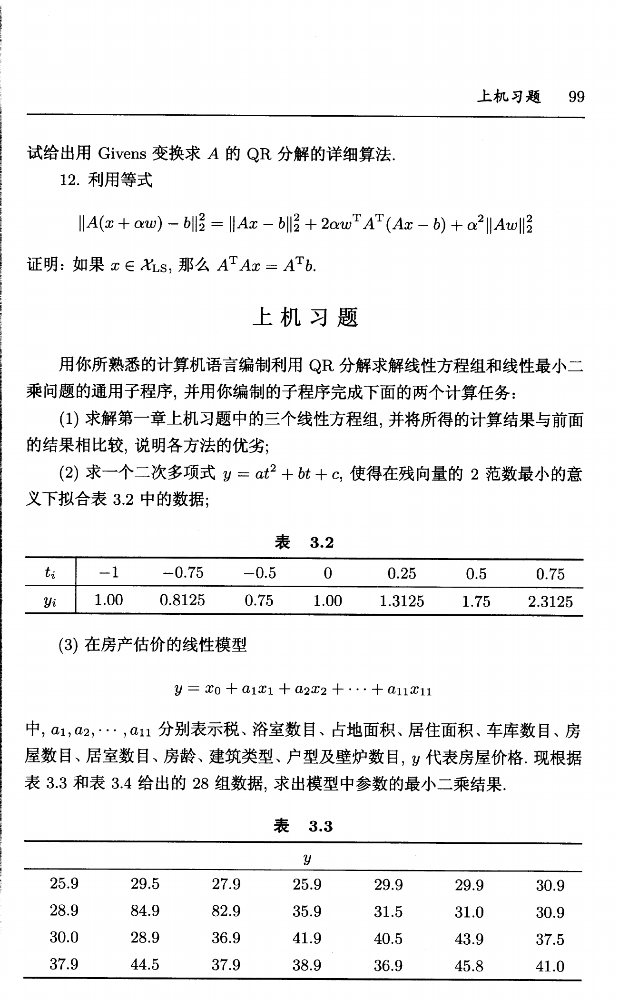

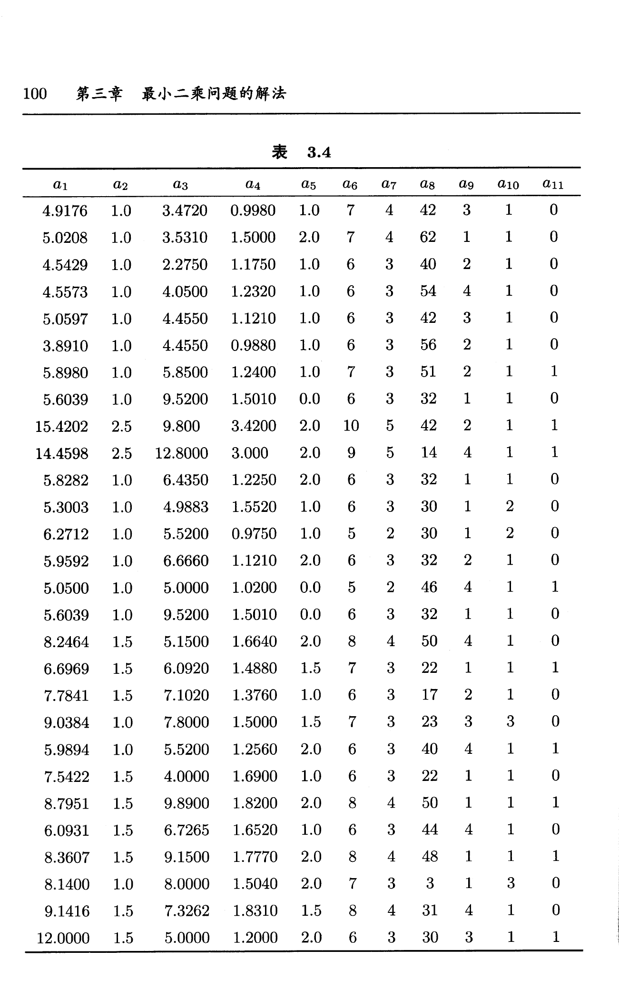

   **答案：** 以反射得到 $Q^TA=(R,0)^T$，同步作用右端再回代；秩亏时检测并用 SVD 最小范数对照。(1) 本机float64实验：100阶正定三对角的相对前向误差约 $2.86\times10^{-16}$；40阶Hilbert约178.69，虽相对残差约 $2.70\times10^{-15}$；84阶非对称三对角在本机QR回代中检测到数值奇异，真实精确解仍为全1，不能将数值失败解释为精确不可逆。(2) 所有数据满足 $y=t^2+t+1$，故 $(a,b,c)=(1,1,1)$、残差0。(3) 原表含84.9与82.9，逐行保持这些原值。$D$ 满列秩12，系数按截距和11特征顺序约为 $(7.321339,-3.140473,48.542599,4.065244,-19.247827,-1.829727,-15.662012,21.647486,0.270541,1.819487,13.271000,2.164277)$，残差2范数约54.972347，$D^Tr$ 最大绝对值约 $2.36\times10^{-12}$。完整精度记录见处理记录/徐书第三章计算核验.json。

   **难度：4/5；出处：** XU：徐树方、高立、张平文《数值线性代数》第二版，2013，第3章习题上机1，书页99—100（PDF第111—112页），原题号上机1；**解答来源：** 自拟简解。

   **勘误：** 原页开头称“两个计算任务”，实际列出(1)—(3)三个任务；三小问全部保留，仍计一道上机原题。模型里的特征符号按上下文统一为$x_{j}$，参数记$\beta _{j}$，避免原排印$x_{0}/a_{j}$混用。

### QR 与正规方程的关系

**图谱路径：** 数值分析 / 第3章 最小二乘问题解法 / QR 与正规方程的关系

**知识内容：** [定义、定理与方法](知识点.md#kp-xu-ch03-qr-normal-relation)

<!-- source-exercise:TB-ch23-23.1 -->
1. A非奇异方阵，$A=QR$、$A^{*}A=U^{*}U$分别QR与Cholesky，按通常约定$r_{ii},u_{ii}>0$；是否$R=U$？

   **答案：** 正确。$A^{*}A=R^{*}Q^{*}QR=R^{*}R$，R上三角正对角，所以由正对角Cholesky唯一性$R=U$。复QR时可调每列相位使对角正实；不规定正对角，两者可差一对角酉相位。

   **难度：2/5；出处：** TB：Lloyd N. Trefethen、David Bau III《数值线性代数》，陆金甫、关治译，2006（英文原版1997），第23讲习题23.1，书页155—156（PDF第167—168页），原题号23.1；**解答来源：** 自拟简解。

### 矩形下三角阵的正交压缩

**图谱路径：** 数值分析 / 第3章 最小二乘问题解法 / 矩形下三角阵的正交压缩

**知识内容：** [定义、定理与方法](知识点.md#kp-xu-ch03-orthogonal-lower)

<!-- source-exercise:XH-ch05-3 -->
1. 满列秩A已分解$PA=LU$。(1)构造反射使$W L=(L_{1},0)^{T}$、$L_{1}$下三角；(2)若y极小化$\|Ly-Pb\|$，证明$Ux=y$的解极小化$\|Ax-b\|$。

   **答案：** (1) 从末列$j=n$向前，在行集合{j,n+1,…,m}反射清掉额外行，已清后列在这些坐标为0不受影响；最后得到下三角$L_{1}$。(2) 同步$\operatorname{WPb}=(c,d)^{T}$，前代$L_{1}y=c$给极小值。$\|Ax-b\|=\|L(Ux)-Pb\|$且U可逆，$z=Ux$遍历所有参数，所以该y回代所得x就是最小二乘解。

   **难度：3/5；出处：** XH：向华、杨志坚《数值线性代数》，2024年所附版，第5章习题3，书页85（PDF第90页），原题号3；**解答来源：** 自拟简解。

   **整理说明：** 主题把徐书相邻题8—9的压缩与求解合成两小问；内容已包含于徐题9使用题8的完整算法，保守不增加独立题数。

<!-- source-exercise:XU-ch03-8 -->
2. 设 $L\in\mathbb R^{m\times n}$ 下三角，$m\ge n$。说明如何构造 Householder 变换使 $H_n\cdots H_1L=\begin{pmatrix}L_1\\0\end{pmatrix}$，$L_1$ 为 $n$ 阶下三角。

   **答案：** 从列 $j=n$ 向前，选择作用于坐标 $\{j,n+1,\ldots,m\}$ 的反射，把当前列这些位置化成只在第 $j$ 位非零。此前已处理的更后列在这些坐标上为0，不受影响；列 $j$ 上方也为0且不改变。按实际操作顺序编号 $H_1,\ldots,H_n$，最后额外行全零，前 $n$ 行仍下三角。零尾向量可用恒等变换。

   **难度：3/5；出处：** XU：徐树方、高立、张平文《数值线性代数》第二版，2013，第3章习题8，书页98（PDF第110页），原题号8；**解答来源：** 自拟简解。

### 从已有矩形 LU 解最小二乘

**图谱路径：** 数值分析 / 第3章 最小二乘问题解法 / 从已有矩形 LU 解最小二乘

**知识内容：** [定义、定理与方法](知识点.md#kp-xu-ch03-lu-ls)

<!-- source-exercise:XH-ch05-3 -->
1. 满列秩A已分解$PA=LU$。(1)构造反射使$W L=(L_{1},0)^{T}$、$L_{1}$下三角；(2)若y极小化$\|Ly-Pb\|$，证明$Ux=y$的解极小化$\|Ax-b\|$。

   **答案：** (1) 从末列$j=n$向前，在行集合{j,n+1,…,m}反射清掉额外行，已清后列在这些坐标为0不受影响；最后得到下三角$L_{1}$。(2) 同步$\operatorname{WPb}=(c,d)^{T}$，前代$L_{1}y=c$给极小值。$\|Ax-b\|=\|L(Ux)-Pb\|$且U可逆，$z=Ux$遍历所有参数，所以该y回代所得x就是最小二乘解。

   **难度：3/5；出处：** XH：向华、杨志坚《数值线性代数》，2024年所附版，第5章习题3，书页85（PDF第90页），原题号3；**解答来源：** 自拟简解。

   **整理说明：** 主题把徐书相邻题8—9的压缩与求解合成两小问；内容已包含于徐题9使用题8的完整算法，保守不增加独立题数。

<!-- source-exercise:XU-ch03-9 -->
2. 满列秩 $A\in\mathbb R^{m\times n}$ 已分解 $PA=LU$，$L$ 为 $m\times n$ 单位下三角、$U$ 为 $n$ 阶上三角。利用第8题求极小化 $\|Lz-Pb\|_2$ 的 $z$，并证明 $Ux=z$ 的解极小化 $\|Ax-b\|_2$。

   **答案：** 作正交 $W$ 使 $WL=\begin{pmatrix}L_1\\0\end{pmatrix}$，同时 $WPb=(c,d)^T$。$L$ 满列秩，所以 $L_1$ 非奇异；前代解 $L_1z=c$。由于 $P,W$ 保范，且可逆 $U$ 使 $z=Ux$ 一一对应所有参数，$\|Ax-b\|=\|L(Ux)-Pb\|$，故再回代 $Ux=z$ 即得所需解。

   **难度：3/5；出处：** XU：徐树方、高立、张平文《数值线性代数》第二版，2013，第3章习题9，书页98（PDF第110页），原题号9；**解答来源：** 自拟简解。

### 线性最小二乘算子的必要恒等式

**图谱路径：** 数值分析 / 第3章 最小二乘问题解法 / 线性最小二乘算子的必要恒等式

**知识内容：** [定义、定理与方法](知识点.md#kp-xu-ch03-linear-ls-operators)

<!-- source-exercise:XH-ch05-5 -->
1. X对每个b都使Xb最小化$\|Ax-b\|$，证明$\operatorname{AXA}=A$及$(AX)^{T}=AX$。

   **答案：** AX为到列空间的唯一正交投影，投影对列空间自身恒等给$\operatorname{AXA}=A$，投影对称给第二式。

   **难度：2/5；出处：** XH：向华、杨志坚《数值线性代数》，2024年所附版，第5章习题5，书页85（PDF第90页），原题号5；**解答来源：** 自拟简解。

<!-- source-exercise:XU-ch03-10 -->
2. 若 $X\in\mathbb R^{n\times m}$ 对每个 $b$ 都使 $x=Xb$ 极小化 $\|Ax-b\|_2$，证明 $AXA=A$、$(AX)^T=AX$。

   **答案：** $AXb$ 必为 $b$ 到 $\mathcal R(A)$ 的唯一正交投影。对 $b=Az$ 投影为自身，给 $AXA=A$。投影算子对称：任意 $u,v$ 的分解为列空间分量与垂直分量后，$u^TAXv=(AXu)^Tv$，故 $(AX)^T=AX$。

   **难度：2/5；出处：** XU：徐树方、高立、张平文《数值线性代数》第二版，2013，第3章习题10，书页98（PDF第110页），原题号10；**解答来源：** 自拟简解。

### 对角加边矩阵的 QR

**图谱路径：** 数值分析 / 第3章 最小二乘问题解法 / 对角加边矩阵的 QR

**知识内容：** [定义、定理与方法](知识点.md#kp-xu-ch03-arrowhead-qr)

<!-- source-exercise:XH-ch05-4 -->
1. 对角加边A，首行$(\alpha _{1},\rho _{2},\ldots ,\rho _{n})$、首列$(\alpha _{1},\beta _{2},\ldots ,\beta _{n})^{T}$，其余仅主对角$\alpha _{i}$。给Givens QR算法。

   **答案：** 先在行对(1,i)逐一消去第一列；再对后续列的填充从下向上用行对(k,i)消去。全部同步左乘累计旋转W，末得到$WA=R$，$Q=W^{T}$。不能因首列已清就忽略新填充。

   **难度：3/5；出处：** XH：向华、杨志坚《数值线性代数》，2024年所附版，第5章习题4，书页85（PDF第90页），原题号4；**解答来源：** 自拟简解。

<!-- source-exercise:XU-ch03-11 -->
2. 对角加边矩阵满足 $a_{11}=\alpha_1$、$a_{ii}=\alpha_i$，$a_{1j}=\rho_j$、$a_{j1}=\beta_j$（$j\ge2$），其他非对角元为0。给出用 Givens 求 QR 的详细算法。

   **答案：** 令 $B=A,W=I$。先依次对 $i=2,\ldots,n$ 在行对 $(1,i)$ 构造旋转消去 $b_{i1}$，对 $B$ 和 $W$ 同时左乘。再对列 $k=2,\ldots,n-1$，从底行到 $k+1$，在行对 $(k,i)$ 消去 $b_{ik}$；每步只需更新该列之后的尾段。结束时 $B=R$ 上三角，$W$ 正交且 $WA=R$，故 $Q=W^T$。首列阶段产生的填充在后续阶段明确清除，避免误认为一步即得 QR。

   **难度：3/5；出处：** XU：徐树方、高立、张平文《数值线性代数》第二版，2013，第3章习题11，书页98—99（PDF第110—111页），原题号11；**解答来源：** 自拟简解。

### 多项式拟合的设计矩阵

**图谱路径：** 数值分析 / 第3章 最小二乘问题解法 / 多项式拟合的设计矩阵

**知识内容：** [定义、定理与方法](知识点.md#kp-xu-ch03-polynomial-fitting)

<!-- source-exercise:XU-ch03-上机1 -->
1. 编写 QR 解线性系统和最小二乘程序，并完成：(1) 重算第1章三个系统，即84阶三对角(6,8,1)、100阶对称三对角(10,1,1)随机右端及40阶 Hilbert 行和右端，并与消去、平方根法比较；(2) 拟合二次多项式 $at^2+bt+c$，数据 $t=(-1,-0.75,-0.5,0,0.25,0.5,0.75)$、$y=(1,0.8125,0.75,1,1.3125,1.75,2.3125)$；(3) 用表3.3—3.4的28个房价样本拟合带截距和11特征线性模型。完整数据原页如下：

   **答案：** 以反射得到 $Q^TA=(R,0)^T$，同步作用右端再回代；秩亏时检测并用 SVD 最小范数对照。(1) 本机float64实验：100阶正定三对角的相对前向误差约 $2.86\times10^{-16}$；40阶Hilbert约178.69，虽相对残差约 $2.70\times10^{-15}$；84阶非对称三对角在本机QR回代中检测到数值奇异，真实精确解仍为全1，不能将数值失败解释为精确不可逆。(2) 所有数据满足 $y=t^2+t+1$，故 $(a,b,c)=(1,1,1)$、残差0。(3) 原表含84.9与82.9，逐行保持这些原值。$D$ 满列秩12，系数按截距和11特征顺序约为 $(7.321339,-3.140473,48.542599,4.065244,-19.247827,-1.829727,-15.662012,21.647486,0.270541,1.819487,13.271000,2.164277)$，残差2范数约54.972347，$D^Tr$ 最大绝对值约 $2.36\times10^{-12}$。完整精度记录见处理记录/徐书第三章计算核验.json。

   **难度：4/5；出处：** XU：徐树方、高立、张平文《数值线性代数》第二版，2013，第3章习题上机1，书页99—100（PDF第111—112页），原题号上机1；**解答来源：** 自拟简解。

   **勘误：** 原页开头称“两个计算任务”，实际列出(1)—(3)三个任务；三小问全部保留，仍计一道上机原题。模型里的特征符号按上下文统一为$x_{j}$，参数记$\beta _{j}$，避免原排印$x_{0}/a_{j}$混用。

### 带截距线性回归

**图谱路径：** 数值分析 / 第3章 最小二乘问题解法 / 带截距线性回归

**知识内容：** [定义、定理与方法](知识点.md#kp-xu-ch03-linear-regression)

<!-- source-exercise:XU-ch03-上机1 -->
1. 编写 QR 解线性系统和最小二乘程序，并完成：(1) 重算第1章三个系统，即84阶三对角(6,8,1)、100阶对称三对角(10,1,1)随机右端及40阶 Hilbert 行和右端，并与消去、平方根法比较；(2) 拟合二次多项式 $at^2+bt+c$，数据 $t=(-1,-0.75,-0.5,0,0.25,0.5,0.75)$、$y=(1,0.8125,0.75,1,1.3125,1.75,2.3125)$；(3) 用表3.3—3.4的28个房价样本拟合带截距和11特征线性模型。完整数据原页如下：

   **答案：** 以反射得到 $Q^TA=(R,0)^T$，同步作用右端再回代；秩亏时检测并用 SVD 最小范数对照。(1) 本机float64实验：100阶正定三对角的相对前向误差约 $2.86\times10^{-16}$；40阶Hilbert约178.69，虽相对残差约 $2.70\times10^{-15}$；84阶非对称三对角在本机QR回代中检测到数值奇异，真实精确解仍为全1，不能将数值失败解释为精确不可逆。(2) 所有数据满足 $y=t^2+t+1$，故 $(a,b,c)=(1,1,1)$、残差0。(3) 原表含84.9与82.9，逐行保持这些原值。$D$ 满列秩12，系数按截距和11特征顺序约为 $(7.321339,-3.140473,48.542599,4.065244,-19.247827,-1.829727,-15.662012,21.647486,0.270541,1.819487,13.271000,2.164277)$，残差2范数约54.972347，$D^Tr$ 最大绝对值约 $2.36\times10^{-12}$。完整精度记录见处理记录/徐书第三章计算核验.json。

   **难度：4/5；出处：** XU：徐树方、高立、张平文《数值线性代数》第二版，2013，第3章习题上机1，书页99—100（PDF第111—112页），原题号上机1；**解答来源：** 自拟简解。

   **勘误：** 原页开头称“两个计算任务”，实际列出(1)—(3)三个任务；三小问全部保留，仍计一道上机原题。模型里的特征符号按上下文统一为$x_{j}$，参数记$\beta _{j}$，避免原排印$x_{0}/a_{j}$混用。

### 秩亏拟合与最小范数约定

**图谱路径：** 数值分析 / 第3章 最小二乘问题解法 / 秩亏拟合与最小范数约定

**知识内容：** [定义、定理与方法](知识点.md#kp-xu-ch03-rank-deficient-fitting)

已整理范围内未另选可直接对应此节点的独立未解题；相关已解例子见知识内容。

## 第4章 古典迭代解法

[迭代谱圆盘的Cayley半平面判据](#kp-cz-ch03-2)；[Krylov 子空间与多项式表示](#kp-tb-ch33-krylov-space)；[Arnoldi 正交化与 Hessenberg 关系](#kp-tb-ch33-arnoldi-relation)；[Arnoldi 良性中断](#kp-tb-ch33-arnoldi-breakdown)；[GMRES 最小剩余与小最小二乘](#kp-tb-ch35-gmres-projection)；[GMRES 残量多项式与非正规性](#kp-tb-ch35-gmres-polynomial)；[GMRES 重启的成本与风险](#kp-tb-ch35-gmres-restart)；[经典迭代的残量校正形式](#kp-xh-ch03-residual-correction)；[Richardson 定常残差迭代](#kp-xh-ch03-richardson)；[Kaczmarz 行投影](#kp-xh-ch03-kaczmarz)；[最小二乘的坐标更新](#kp-xh-ch03-ls-coordinate)；[Kronecker 积的块定义](#kp-xh-ch03-kronecker-product)；[Kronecker 混合积规则](#kp-xh-ch03-kronecker-mixed)；[张量特征向量与积谱](#kp-xh-ch03-kronecker-spectrum)；[二维对流扩散差分与网格 Péclet 数](#kp-xh-ch03-grid-convection)；[单步线性定常迭代](#kp-xu-ch04-stationary-iteration)；[矩阵分裂与固定点](#kp-xu-ch04-splitting)；[Jacobi 迭代](#kp-xu-ch04-jacobi)；[Gauss–Seidel 迭代](#kp-xu-ch04-gauss-seidel)；[收敛的谱半径充要条件](#kp-xu-ch04-spectral-convergence)；[范数充分条件与误差界](#kp-xu-ch04-norm-convergence)；[幂零迭代的有限终止](#kp-xu-ch04-nilpotent-iteration)；[严格对角占优收敛](#kp-xu-ch04-row-dominance)；[不可约与弱对角占优](#kp-xu-ch04-irreducibility)；[Sassenfeld 型逐行估计](#kp-xu-ch04-sassenfeld)；[对称正定系统的 G–S 收敛](#kp-xu-ch04-spd-gs)；[正对角对称阵的逆结论](#kp-xu-ch04-gs-spd-converse)；[离散 Lyapunov 收敛判据](#kp-xu-ch04-lyapunov-test)；[对角占优的行列式下界](#kp-xu-ch04-determinant-dominance)；[非奇异阵的非零对角置换](#kp-xu-ch04-diagonal-permutation)；[平均与渐近收敛速度](#kp-xu-ch04-rate-definition)；[Poisson 五点差分模型](#kp-xu-ch04-poisson-five-point)；[标准三对角阵的谱](#kp-xu-ch04-tridiagonal-spectrum)；[二维模型的 Kronecker 和](#kp-xu-ch04-kronecker-sum)；[矩阵方程的谱对角化解法](#kp-xu-ch04-sylvester-diagonalization)；[模型 Jacobi 和 G–S 的速度](#kp-xu-ch04-model-rates)；[Jacobi 松弛迭代](#kp-xu-ch04-jor)；[对称 JOR 的精确参数条件](#kp-xu-ch04-jor-spd)；[SOR 的逐行格式](#kp-xu-ch04-sor)；[SOR 的必要参数区间](#kp-xu-ch04-sor-necessary)；[正定系统 SOR 收敛](#kp-xu-ch04-sor-spd)；[对角占优与欠松弛 SOR](#kp-xu-ch04-sor-underrelax)；[相容次序](#kp-xu-ch04-consistent-order)；[块三对角阵的相容缩放](#kp-xu-ch04-block-tridiagonal-order)；[Young 特征值关系](#kp-xu-ch04-young-relation)；[实谱相容系统的最佳 SOR 参数](#kp-xu-ch04-optimal-sor)；[最优 SOR 与 G–S 的速度比较](#kp-xu-ch04-rate-sor)；[超松弛理论的推广](#kp-xu-ch04-multisplitting)；[对流扩散边值问题的离散](#kp-xu-ch04-convection-diffusion)；[迭代停止与离散误差](#kp-xu-ch04-iteration-stopping)；[反应扩散五点系统](#kp-xu-ch04-reaction-diffusion)

### 迭代谱圆盘的Cayley半平面判据

**图谱路径：** 数值分析 / 第4章 古典迭代解法 / 迭代谱圆盘的Cayley半平面判据

**知识内容：** [定义、定理与方法](知识点.md#kp-cz-ch03-2)

<!-- source-exercise:CZ-ch03-2 -->
1. 对实方阵 $A$，证明 $\rho(A)<1$ 当且仅当 $I-A$ 非奇异，且 $(I-A)^{-1}(I+A)$ 的所有特征值都具有正实部。

   **答案：** 若 $I-A$ 可逆，则有理谱映射把每个 $\lambda\in\sigma(A)$ 变成 $\mu=(1+\lambda)/(1-\lambda)$。直接算得 $\operatorname{Re}\mu=(1-|\lambda|^2)/|1-\lambda|^2$。故全部 $|\lambda|<1$ 恰与全部 $\operatorname{Re}\mu>0$ 等价；显式要求 $I-A$ 可逆排除 $\lambda=1$ 的分母。

   **难度：3/5；出处：** CZ：曹志浩《数值线性代数》，复旦大学出版社1996年第一版，第3章习题2，书页115（PDF第124页），原题号2；**解答来源：** 自拟简解。

### Krylov 子空间与多项式表示

**图谱路径：** 数值分析 / 第4章 古典迭代解法 / Krylov 子空间与多项式表示

**知识内容：** [定义、定理与方法](知识点.md#kp-tb-ch33-krylov-space)

<!-- source-exercise:TB-ch33-33.1 -->
1. 设 $A\in\mathbb C^{m\times m}$、$b\in\mathbb C^m$。证明任意 $x\in K_n(A,b)$ 都可写为 $p(A)b$，其中 $\deg p\le n-1$。

   **答案：** 按定义 $x=\sum_{j=0}^{n-1}c_jA^jb$；取 $p(z)=\sum_{j=0}^{n-1}c_jz^j$ 即得。反向包含同样由展开式成立。

   **难度：1/5；出处：** TB：Lloyd N. Trefethen、David Bau III《数值线性代数》，陆金甫、关治译，2006（英文原版1997），第33讲习题33.1，书页223（PDF第235页），原题号33.1；**解答来源：** 自拟简解。

### Arnoldi 正交化与 Hessenberg 关系

**图谱路径：** 数值分析 / 第4章 古典迭代解法 / Arnoldi 正交化与 Hessenberg 关系

**知识内容：** [定义、定理与方法](知识点.md#kp-tb-ch33-arnoldi-relation)

已整理范围内未另选可直接对应此节点的独立未解题；相关已解例子见知识内容。

### Arnoldi 良性中断

**图谱路径：** 数值分析 / 第4章 古典迭代解法 / Arnoldi 良性中断

**知识内容：** [定义、定理与方法](知识点.md#kp-tb-ch33-arnoldi-breakdown)

<!-- source-exercise:TB-ch33-33.2 -->
1. 算法33.1在第 $n$ 步得到 $h_{n+1,n}=0$：(a)化简 Arnoldi 关系并说明完全 Hessenberg 约化的块结构；(b)证明 $K_n$ 为 $A$ 不变子空间；(c)证明后续 Krylov 子空间不再增长；(d)证明 $H_n$ 的每个特征值属于 $A$ 的谱；(e)若 $A$ 非奇异，证明 $Ax=b$ 的解在 $K_n$ 内。

   **答案：** (a) $AQ_n=Q_nH_n$；把 $Q_n$ 补成酉基 $Q=[Q_n,Q_\perp]$，则 $Q^*AQ=\begin{bmatrix}H_n&*\\0&*\end{bmatrix}$。(b) 对任意 $Q_ny$，其像为 $Q_nH_ny$。(c) 由不变性递推 $A^kb\in K_n$，故 $K_{n+j}=K_n$。(d) 若 $H_ny=\lambda y$，则 $A(Q_ny)=\lambda Q_ny$ 且 $Q_ny\ne0$。(e) $A|_{K_n}$ 是有限维空间上的单射，故满射；$b\in K_n$ 的原像即全空间唯一解。

   **难度：3/5；出处：** TB：Lloyd N. Trefethen、David Bau III《数值线性代数》，陆金甫、关治译，2006（英文原版1997），第33讲习题33.2，书页223（PDF第235页），原题号33.2；**解答来源：** 自拟简解。

<!-- source-exercise:TB-ch33-33.3 -->
2. (a) 若 Arnoldi 对特定 $A,b$ 到第 $m$ 步才完成、先前不发生中断，证明 $A$ 的最小多项式次数为 $m$；(b) 即使 $A$ 的最小多项式次数为 $m$，说明某些 $b$ 可提前中断；(c) 解释此结论与 Hermitian 三对角矩阵单重谱的结论不矛盾。

   **答案：** (a) $b,Ab,\ldots,A^{m-1}b$ 线性无关，故若次数小于 $m$ 的多项式湮灭 $A$，作用于 $b$ 即矛盾；Cayley–Hamilton 给上界 $m$。(b) 例如 $A=\operatorname{diag}(1,2,\ldots,m)$ 而 $b=e_1$，第1步即中断，但 $A$ 的最小多项式有 $m$ 个不同根。(c) 单重谱仅保证矩阵自身的最小多项式次数为 $m$，并不保证任意起始向量在每个特征向量方向都有非零分量。

   **难度：3/5；出处：** TB：Lloyd N. Trefethen、David Bau III《数值线性代数》，陆金甫、关治译，2006（英文原版1997），第33讲习题33.3，书页223（PDF第235页），原题号33.3；**解答来源：** 自拟简解。

### GMRES 最小剩余与小最小二乘

**图谱路径：** 数值分析 / 第4章 古典迭代解法 / GMRES 最小剩余与小最小二乘

**知识内容：** [定义、定理与方法](知识点.md#kp-tb-ch35-gmres-projection)

<!-- source-exercise:TB-ch35-35.5 -->
1. 算法35.1默认 $x_0=0,r_0=b$。说明给定任意初始估计 $x_0$ 时如何修改右端，从而仍用同一 GMRES 算法。

   **答案：** 令 $r_0=b-Ax_0$，对修正量 $y$ 解 $Ay=r_0$，GMRES 从 $y_0=0$ 出发；各步令 $x_n=x_0+y_n$。于是原问题剩余 $b-Ax_n=r_0-Ay_n$，恰是修正问题的剩余。

   **难度：1/5；出处：** TB：Lloyd N. Trefethen、David Bau III《数值线性代数》，陆金甫、关治译，2006（英文原版1997），第35讲习题35.5，书页239（PDF第251页），原题号35.5；**解答来源：** 自拟简解。

### GMRES 残量多项式与非正规性

**图谱路径：** 数值分析 / 第4章 古典迭代解法 / GMRES 残量多项式与非正规性

**知识内容：** [定义、定理与方法](知识点.md#kp-tb-ch35-gmres-polynomial)

<!-- source-exercise:TB-ch35-35.2 -->
1. 设复平面集合 $S$ 的凸包含 $0$ 且 $S$ 不在任何与原点不相交的半平面内：(a)证明不存在 $p(z)=1-cz$ 使 $\sup_{z\in S}|p(z)|<1$；(b)若 $\sigma(A)$ 有此性质，证明不存在一次残量多项式使 $\|p(A)\|_2<1$；(c)解释 GMRES 一步可能仍令特定 $r_0$ 的残量下降。

   **答案：** (a) 若所有 $|1-cz|<1$，则 $2\operatorname{Re}(cz)>|cz|^2\ge0$；$\operatorname{Re}(cz)>0$ 对 $S$ 全部成立，将 $S$ 放入不含原点的开半平面，与凸包条件矛盾。(b) 谱映射给 $\rho(p(A))=\max_{\lambda\in\sigma(A)}|p(\lambda)|\ge1$，而 $\|p(A)\|_2\ge\rho(p(A))$。(c) 算子范数控制最坏方向；GMRES 只极小化给定 $r_0$ 的 $\|p(A)r_0\|_2$，它仍可下降。

   **难度：3/5；出处：** TB：Lloyd N. Trefethen、David Bau III《数值线性代数》，陆金甫、关治译，2006（英文原版1997），第35讲习题35.2，书页239（PDF第251页），原题号35.2；**解答来源：** 自拟简解。

### GMRES 重启的成本与风险

**图谱路径：** 数值分析 / 第4章 古典迭代解法 / GMRES 重启的成本与风险

**知识内容：** [定义、定理与方法](知识点.md#kp-tb-ch35-gmres-restart)

已整理范围内未另选可直接对应此节点的独立未解题；相关已解例子见知识内容。

### 经典迭代的残量校正形式

**图谱路径：** 数值分析 / 第4章 古典迭代解法 / 经典迭代的残量校正形式

**知识内容：** [定义、定理与方法](知识点.md#kp-xh-ch03-residual-correction)

已整理范围内未另选可直接对应此节点的独立未解题；相关已解例子见知识内容。

### Richardson 定常残差迭代

**图谱路径：** 数值分析 / 第4章 古典迭代解法 / Richardson 定常残差迭代

**知识内容：** [定义、定理与方法](知识点.md#kp-xh-ch03-richardson)

<!-- source-exercise:XH-ch03-17 -->
1. $A=[[3,2],[1,2]]$、$b=(-2,5)^{T}$，迭代$x^{*}=x+\alpha (Ax-b)$，求收敛$\alpha$范围。

   **答案：** A特征值1、4，迭代矩阵$I+\alpha A$谱$1+\alpha$、$1+4\alpha$。两者模$<1$交集为$-1/2<\alpha <0$；残差在题目中是Ax−b，参数必须为负。

   **难度：2/5；出处：** XH：向华、杨志坚《数值线性代数》，2024年所附版，第3章习题17，书页58（PDF第65页），原题号17；**解答来源：** 自拟简解。

<!-- source-exercise:XH-ch03-18 -->
2. 正定A谱$0<\alpha \le \lambda _{i}\le \beta$。证明$x^{*}=x+\omega (b-Ax)$在$0<\omega <2/\beta$收敛。

   **答案：** 迭代谱$1-\omega \lambda _{i}$在(−1,1)，故$\rho <1$。区间最佳常数参数$2/(\alpha +\beta )$可由两端模平衡得到。

   **难度：2/5；出处：** XH：向华、杨志坚《数值线性代数》，2024年所附版，第3章习题18，书页58—59（PDF第65—66页），原题号18；**解答来源：** 自拟简解。

### Kaczmarz 行投影

**图谱路径：** 数值分析 / 第4章 古典迭代解法 / Kaczmarz 行投影

**知识内容：** [定义、定理与方法](知识点.md#kp-xh-ch03-kaczmarz)

已整理范围内未另选可直接对应此节点的独立未解题；相关已解例子见知识内容。

### 最小二乘的坐标更新

**图谱路径：** 数值分析 / 第4章 古典迭代解法 / 最小二乘的坐标更新

**知识内容：** [定义、定理与方法](知识点.md#kp-xh-ch03-ls-coordinate)

已整理范围内未另选可直接对应此节点的独立未解题；相关已解例子见知识内容。

### Kronecker 积的块定义

**图谱路径：** 数值分析 / 第4章 古典迭代解法 / Kronecker 积的块定义

**知识内容：** [定义、定理与方法](知识点.md#kp-xh-ch03-kronecker-product)

已整理范围内未另选可直接对应此节点的独立未解题；相关已解例子见知识内容。

### Kronecker 混合积规则

**图谱路径：** 数值分析 / 第4章 古典迭代解法 / Kronecker 混合积规则

**知识内容：** [定义、定理与方法](知识点.md#kp-xh-ch03-kronecker-mixed)

已整理范围内未另选可直接对应此节点的独立未解题；相关已解例子见知识内容。

### 张量特征向量与积谱

**图谱路径：** 数值分析 / 第4章 古典迭代解法 / 张量特征向量与积谱

**知识内容：** [定义、定理与方法](知识点.md#kp-xh-ch03-kronecker-spectrum)

<!-- source-exercise:XH-ch03-21 -->
1. 单位正方形内$-\Delta u+cu=\operatorname{sin}(\pi x)\operatorname{sin}(\pi y)$，边界0，每边N+1等分。选择具体N,c，差分离散并求线性系统，图示结果。

   **答案：** 选择$N=20$、$c=1$、$h=1/21$，五点系数对角$4/h^{2}+c$、四邻$-1/h^{2}$。离散右端为正弦乘积，它本身是离散特征向量，因此精确离散解 $u_{ij}=\sin(\pi ih)\sin(\pi jh)/[8h^{-2}\sin^2(\pi h/2)+c]$；连续解分母$2\pi ^{2}+c$。矩阵正定，可用CG、G–S或SOR；实际求解残差、离散误差和热图见处理记录/向书第三章计算核验.json及下图。

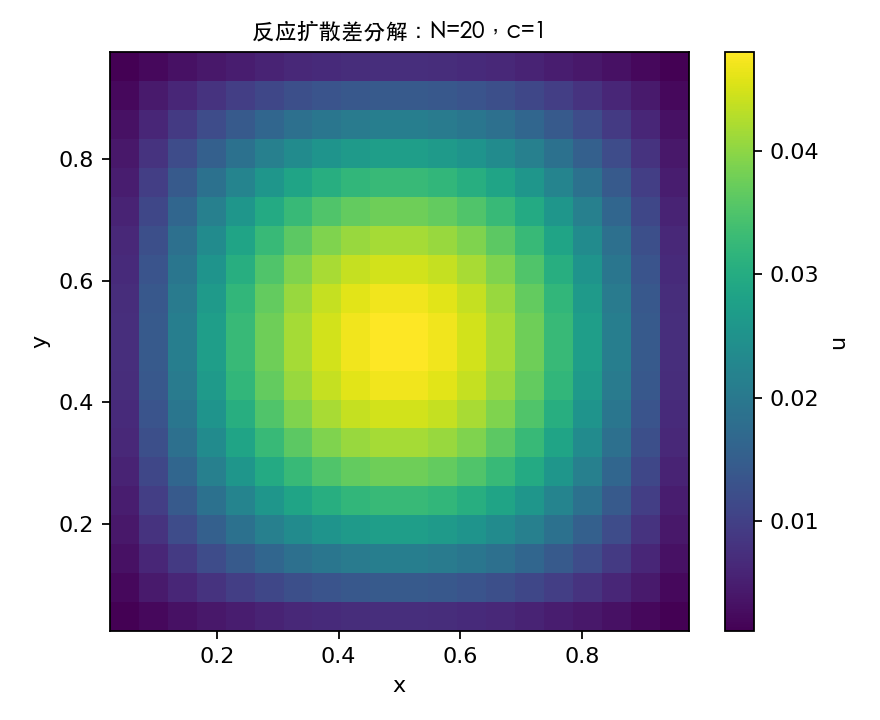

   **难度：4/5；出处：** XH：向华、杨志坚《数值线性代数》，2024年所附版，第3章习题21，书页59（PDF第66页），原题号21；**解答来源：** 自拟简解。

   **整理说明：** 具体N,c由原题允许自选，用于同一原题计算，不增题数。

### 二维对流扩散差分与网格 Péclet 数

**图谱路径：** 数值分析 / 第4章 古典迭代解法 / 二维对流扩散差分与网格 Péclet 数

**知识内容：** [定义、定理与方法](知识点.md#kp-xh-ch03-grid-convection)

<!-- source-exercise:XH-ch03-22 -->
1. 单位正方形内$-\varepsilon \Delta u+u_{x}=f$，边界0，$f=\pi [2\pi \varepsilon \operatorname{sin}(\pi x)+\operatorname{cos}(\pi x)]\operatorname{sin}(\pi y)$。每边N+1等分，选择$N,\varepsilon$，离散、求解并图示。

   **答案：** 选择$N=20$、$\varepsilon =0.1$、$h=1/21$，连续精确解$u=\operatorname{sin}(\pi x)\operatorname{sin}(\pi y)$。用中心差分给主对角$4\varepsilon /h^{2}$、东西$-\varepsilon /h^{2}\pm 1/(2h)$、南北$-\varepsilon /h^{2}$；此网格$h<2\varepsilon$满足非正邻系数，比较所求离散解与连续真解。若更小$\varepsilon$导致粗网格对流占优，要考虑单调迎风格式而非混淆迭代不收敛与格式振荡。具体残差、误差和热图见处理记录/向书第三章计算核验.json及下图。

   **难度：4/5；出处：** XH：向华、杨志坚《数值线性代数》，2024年所附版，第3章习题22，书页59（PDF第66页），原题号22；**解答来源：** 自拟简解。

   **整理说明：** 原题允许自选参数，保留一个已实测设置，不拆成多参数新题。

### 单步线性定常迭代

**图谱路径：** 数值分析 / 第4章 古典迭代解法 / 单步线性定常迭代

**知识内容：** [定义、定理与方法](知识点.md#kp-xu-ch04-stationary-iteration)

已整理范围内未另选可直接对应此节点的独立未解题；相关已解例子见知识内容。

### 矩阵分裂与固定点

**图谱路径：** 数值分析 / 第4章 古典迭代解法 / 矩阵分裂与固定点

**知识内容：** [定义、定理与方法](知识点.md#kp-xu-ch04-splitting)

已整理范围内未另选可直接对应此节点的独立未解题；相关已解例子见知识内容。

### Jacobi 迭代

**图谱路径：** 数值分析 / 第4章 古典迭代解法 / Jacobi 迭代

**知识内容：** [定义、定理与方法](知识点.md#kp-xu-ch04-jacobi)

<!-- source-exercise:XH-ch03-1 -->
1. 从全零初值分别用Jacobi与G–S解：$(1)A=[[2,1],[1,-4]],b=(1,5)^{T}$；$(2)A=[[5,-2,1],[1,5,-3],[2,1,-5]],b=(4,2,-11)^{T}$。停止$\|x^{k+1}-x^{k}\|_{\infty} \le 0.5\times 10^{-3}$。

   **答案：** 用逐行标准公式，Jacobi全用旧值，G–S前分量用新值。精确解分别$(1,-1)^{T}$及$(1,2,3)^{T}$，两阵严格行占优，均收敛。必须按每个系统自身维数取零初值；逐算法停止步数及近似向量实跑存处理记录/向书第三章计算核验.json，误差与停止量分别报告。

   **难度：3/5；出处：** XH：向华、杨志坚《数值线性代数》，2024年所附版，第3章习题1，书页56（PDF第63页），原题号1；**解答来源：** 自拟简解。

   **整理说明：** 原页统一写三维零向量，第一系统实际二维，按系统维数取全零，数学初值含义不变。

<!-- source-exercise:XH-ch03-4 -->
2. 写收敛的Jacobi、G–S格式：$(1)A=[[7,1,2],[2,8,2],[2,2,9]],b=(10,8,6)^{T}$；$(2)x=Cx+d$，$C=[[.1,.02,-.04],[-.2,.06,.1],[.05,.1,.03]],d=(1,0,0)^{T}$。

   **答案：** (1) Jacobi为$((10-x_{2}-2x_{3})/7,(8-2x_{1}-2x_{3})/8,(6-2x_{1}-2x_{2})/9)$，G–S在后两分量代入前面新值。严格行占优给收敛。(2) 先整理$A=I-C$，主对角(.9,.94,.97)，Jacobi为$((1+.02x_{2}-.04x_{3})/.9,(-.2x_{1}+.1x_{3})/.94,(.05x_{1}+.1x_{2})/.97)$，G–S按同式逐项使用前面的新值。A严格占优，均收敛。

   **难度：3/5；出处：** XH：向华、杨志坚《数值线性代数》，2024年所附版，第3章习题4，书页57（PDF第64页），原题号4；**解答来源：** 自拟简解。

<!-- source-exercise:XH-ch03-9 -->
3. Jacobi矩阵分别$B_{1}=[[0,-2,2],[-1,0,-1],[-2,-2,0]]$、$B_{2}=1/2[[0,1,-1],[-2,0,-2],[1,1,0]]$。证明$B_{1}$的Jacobi收敛、G–S不收敛，$B_{2}$相反。

   **答案：** 从$B=D^{-1}(C_L+C_U)$拆严格三角得到G–S矩阵$(I-B_L)^{-1}B_U$。第一Jacobi多项式$\lambda ^{3}$、G–S为$\lambda (\lambda -2)^{2}$；第二$\operatorname{Jacobi}\lambda (\lambda ^{2}+5/4)$、G–S为$\lambda (\lambda +1/2)^{2}$。对应谱半径0/2与$\sqrt{5}/2/1/2$。

   **难度：3/5；出处：** XH：向华、杨志坚《数值线性代数》，2024年所附版，第3章习题9，书页58（PDF第65页），原题号9；**解答来源：** 自拟简解。

   **整理说明：** 与徐书第4章题1相同两个误差传播矩阵，主书此题直接给Jacobi矩阵，按等价命题保守去重。

<!-- source-exercise:XH-ch03-11 -->
4. 二阶系统$a_{11}a_{22}\ne 0$，写Jacobi及G–S格式并证明同时具全初值收敛性或同时不具。

   **答案：** Jacobi：$x_{1}^{*}=(b_{1}-a_{12}x_{2})/a_{11}$，$x_{2}^{*}=(b_{2}-a_{21}x_{1})/a_{22}$；G–S第二式用$x_{1}^{*}$。令$r=a_{12}a_{21}/(a_{11}a_{22})$，Jacobi谱半径$\sqrt{}|r|$、G–S谱半径|r|，故两法条件同为$|r|<1$。若不满足，特殊初值仍可能不发散，原题“同时发散”按方法的全初值收敛性解释。

   **难度：3/5；出处：** XH：向华、杨志坚《数值线性代数》，2024年所附版，第3章习题11，书页58（PDF第65页），原题号11；**解答来源：** 自拟简解。

<!-- source-exercise:XU-ch04-1 -->
5. $A_1=\begin{pmatrix}2&-1&1\\1&1&1\\1&1&-2\end{pmatrix}$、$A_2=\begin{pmatrix}1&2&-2\\1&1&1\\2&2&1\end{pmatrix}$。证明 $A_1$ 的 Jacobi 不收敛而 G–S 收敛，$A_2$ 的 Jacobi 收敛而 G–S 不收敛。

   **答案：** 直接构造 $B=D^{-1}(C_L+C_U)$、$H=(D-C_L)^{-1}C_U$。对 $A_1$，Jacobi 特征多项式为 $\lambda(\lambda^2+5/4)$，谱半径 $\sqrt5/2>1$；G–S 为 $\lambda(\lambda+1/2)^2$，谱半径1/2。对 $A_2$，Jacobi 多项式 $\lambda^3$，谱半径0；G–S 为 $\lambda(\lambda-2)^2$，谱半径2。应用全初值谱判据。

   **难度：2/5；出处：** XU：徐树方、高立、张平文《数值线性代数》第二版，2013，第4章习题1，书页134（PDF第146页），原题号1；**解答来源：** 自拟简解。

### Gauss–Seidel 迭代

**图谱路径：** 数值分析 / 第4章 古典迭代解法 / Gauss–Seidel 迭代

**知识内容：** [定义、定理与方法](知识点.md#kp-xu-ch04-gauss-seidel)

<!-- source-exercise:XH-ch03-1 -->
1. 从全零初值分别用Jacobi与G–S解：$(1)A=[[2,1],[1,-4]],b=(1,5)^{T}$；$(2)A=[[5,-2,1],[1,5,-3],[2,1,-5]],b=(4,2,-11)^{T}$。停止$\|x^{k+1}-x^{k}\|_{\infty} \le 0.5\times 10^{-3}$。

   **答案：** 用逐行标准公式，Jacobi全用旧值，G–S前分量用新值。精确解分别$(1,-1)^{T}$及$(1,2,3)^{T}$，两阵严格行占优，均收敛。必须按每个系统自身维数取零初值；逐算法停止步数及近似向量实跑存处理记录/向书第三章计算核验.json，误差与停止量分别报告。

   **难度：3/5；出处：** XH：向华、杨志坚《数值线性代数》，2024年所附版，第3章习题1，书页56（PDF第63页），原题号1；**解答来源：** 自拟简解。

   **整理说明：** 原页统一写三维零向量，第一系统实际二维，按系统维数取全零，数学初值含义不变。

<!-- source-exercise:XH-ch03-4 -->
2. 写收敛的Jacobi、G–S格式：$(1)A=[[7,1,2],[2,8,2],[2,2,9]],b=(10,8,6)^{T}$；$(2)x=Cx+d$，$C=[[.1,.02,-.04],[-.2,.06,.1],[.05,.1,.03]],d=(1,0,0)^{T}$。

   **答案：** (1) Jacobi为$((10-x_{2}-2x_{3})/7,(8-2x_{1}-2x_{3})/8,(6-2x_{1}-2x_{2})/9)$，G–S在后两分量代入前面新值。严格行占优给收敛。(2) 先整理$A=I-C$，主对角(.9,.94,.97)，Jacobi为$((1+.02x_{2}-.04x_{3})/.9,(-.2x_{1}+.1x_{3})/.94,(.05x_{1}+.1x_{2})/.97)$，G–S按同式逐项使用前面的新值。A严格占优，均收敛。

   **难度：3/5；出处：** XH：向华、杨志坚《数值线性代数》，2024年所附版，第3章习题4，书页57（PDF第64页），原题号4；**解答来源：** 自拟简解。

<!-- source-exercise:XH-ch03-9 -->
3. Jacobi矩阵分别$B_{1}=[[0,-2,2],[-1,0,-1],[-2,-2,0]]$、$B_{2}=1/2[[0,1,-1],[-2,0,-2],[1,1,0]]$。证明$B_{1}$的Jacobi收敛、G–S不收敛，$B_{2}$相反。

   **答案：** 从$B=D^{-1}(C_L+C_U)$拆严格三角得到G–S矩阵$(I-B_L)^{-1}B_U$。第一Jacobi多项式$\lambda ^{3}$、G–S为$\lambda (\lambda -2)^{2}$；第二$\operatorname{Jacobi}\lambda (\lambda ^{2}+5/4)$、G–S为$\lambda (\lambda +1/2)^{2}$。对应谱半径0/2与$\sqrt{5}/2/1/2$。

   **难度：3/5；出处：** XH：向华、杨志坚《数值线性代数》，2024年所附版，第3章习题9，书页58（PDF第65页），原题号9；**解答来源：** 自拟简解。

   **整理说明：** 与徐书第4章题1相同两个误差传播矩阵，主书此题直接给Jacobi矩阵，按等价命题保守去重。

<!-- source-exercise:XH-ch03-11 -->
4. 二阶系统$a_{11}a_{22}\ne 0$，写Jacobi及G–S格式并证明同时具全初值收敛性或同时不具。

   **答案：** Jacobi：$x_{1}^{*}=(b_{1}-a_{12}x_{2})/a_{11}$，$x_{2}^{*}=(b_{2}-a_{21}x_{1})/a_{22}$；G–S第二式用$x_{1}^{*}$。令$r=a_{12}a_{21}/(a_{11}a_{22})$，Jacobi谱半径$\sqrt{}|r|$、G–S谱半径|r|，故两法条件同为$|r|<1$。若不满足，特殊初值仍可能不发散，原题“同时发散”按方法的全初值收敛性解释。

   **难度：3/5；出处：** XH：向华、杨志坚《数值线性代数》，2024年所附版，第3章习题11，书页58（PDF第65页），原题号11；**解答来源：** 自拟简解。

<!-- source-exercise:XU-ch04-1 -->
5. $A_1=\begin{pmatrix}2&-1&1\\1&1&1\\1&1&-2\end{pmatrix}$、$A_2=\begin{pmatrix}1&2&-2\\1&1&1\\2&2&1\end{pmatrix}$。证明 $A_1$ 的 Jacobi 不收敛而 G–S 收敛，$A_2$ 的 Jacobi 收敛而 G–S 不收敛。

   **答案：** 直接构造 $B=D^{-1}(C_L+C_U)$、$H=(D-C_L)^{-1}C_U$。对 $A_1$，Jacobi 特征多项式为 $\lambda(\lambda^2+5/4)$，谱半径 $\sqrt5/2>1$；G–S 为 $\lambda(\lambda+1/2)^2$，谱半径1/2。对 $A_2$，Jacobi 多项式 $\lambda^3$，谱半径0；G–S 为 $\lambda(\lambda-2)^2$，谱半径2。应用全初值谱判据。

   **难度：2/5；出处：** XU：徐树方、高立、张平文《数值线性代数》第二版，2013，第4章习题1，书页134（PDF第146页），原题号1；**解答来源：** 自拟简解。

<!-- source-exercise:XU-ch04-上机2 -->
6. $-\Delta u+e^{xy}u=x+y$ 在 $[0,1]^2$，边界 $u=1$。沿两方向各剖分 $N$ 等份，中心差分得到 $(4+h^2e^{ih\,jh})u_{ij}-u_{i-1,j}-u_{i+1,j}-u_{i,j-1}-u_{i,j+1}=h^2(ih+jh)$，$h=1/N$。用 G–S 求 $N=20,40,80$ 的解，列表比较迭代次数与CPU时间，停止条件 $\|x^{k+1}-x^k\|_2<10^{-7}$。

   **答案：** 以内点按自然顺序编号，边界固定1。每步更新 $u_{ij}=[u_{i-1,j}^{新}+u_{i,j-1}^{新}+u_{i+1,j}^{旧}+u_{i,j+1}^{旧}+h^2(ih+jh)]/[4+h^2e^{ih\,jh}]$，每完整扫描统计内点更新2范数。矩阵对称正定且对角占优，故G–S收敛；网格加细会使谱半径趋1，所需步数增加。使用同一初值和程序实测CPU时间与步数；本机自然次序C++17实现、全零内点初值所得$N=20/40/80$分别580/2214/8437步；最后更新2范数均小于1e-7，墙钟耗时约0.000458/0.008996/0.141831秒。时间是本次实际测量，随机器与实现改变。完整结果与程序见处理记录/徐书第四章计算核验.json。

   **难度：4/5；出处：** XU：徐树方、高立、张平文《数值线性代数》第二版，2013，第4章习题上机2，书页137（PDF第149页），原题号上机2；**解答来源：** 自拟简解。

   **勘误：** 原页137差分式把邻项u(i,j−1)前印为正号；$-\Delta$的五点离散四邻项都应为−1，已改正，更新式与PDE保持一致。

### 收敛的谱半径充要条件

**图谱路径：** 数值分析 / 第4章 古典迭代解法 / 收敛的谱半径充要条件

**知识内容：** [定义、定理与方法](知识点.md#kp-xu-ch04-spectral-convergence)

<!-- source-exercise:XH-ch03-3 -->
1. 讨论Jacobi与G–S收敛：$(1)A=[[10,-1,0],[-1,10,-2],[0,-2,5]],b=(9,-5,12)^{T}$；$(2)A=[[1,2,-2],[1,1,1],[2,2,1]],b=(1,-5,0)^{T}$。

   **答案：** (1) 严格行占优，两法收敛。(2) Jacobi特征多项式$\lambda ^{3}$，谱半径0，精确算术最多3步；G–S多项式$\lambda (\lambda -2)^{2}$，谱半径2，不具全初值收敛性。右端改变固定点而不改变误差传播谱。

   **难度：3/5；出处：** XH：向华、杨志坚《数值线性代数》，2024年所附版，第3章习题3，书页57（PDF第64页），原题号3；**解答来源：** 自拟简解。

<!-- source-exercise:XH-ch03-6 -->
2. $A=[[a,1,3],[1,a,2],[-3,2,a]]$，求Jacobi收敛参数a。

   **答案：** $a\ne 0$才可定义。令$K=A-aI$，其特征多项式$\lambda (\lambda ^{2}+4)$，故$\operatorname{JacobiB}=-K/a$的谱为0、$\pm 2i/a$。$\rho =2/|a|<1$当且仅当$|a|>2$。

   **难度：3/5；出处：** XH：向华、杨志坚《数值线性代数》，2024年所附版，第3章习题6，书页57（PDF第64页），原题号6；**解答来源：** 自拟简解。

<!-- source-exercise:XH-ch03-7 -->
3. $A=[[1,0,a],[0,1,0],[a,0,1]]$。(1)何时正定；(2)Jacobi何时收敛；(3)G–S何时收敛？

   **答案：** A谱$1,1\pm a$；Jacobi谱$0,\pm a$；G–S谱$0,0,a^{2}$。三项条件均$|a|<1$。

   **难度：2/5；出处：** XH：向华、杨志坚《数值线性代数》，2024年所附版，第3章习题7，书页57（PDF第64页），原题号7；**解答来源：** 自拟简解。

<!-- source-exercise:XH-ch03-8 -->
4. A主对角1、全部非对角a。(1)Jacobi何时收敛？(2)G–S何时收敛？

   **答案：** A谱1+2a、1−a（重2）；Jacobi谱−2a、a（重2），所以$|a|<1/2$。G–S对称正对角情形收敛当且仅当A正定（边界奇异也不满足全初值唯一极限），得$-1/2<a<1$。二者范围不同。

   **难度：3/5；出处：** XH：向华、杨志坚《数值线性代数》，2024年所附版，第3章习题8，书页57—58（PDF第64—65页），原题号8；**解答来源：** 自拟简解。

<!-- source-exercise:XH-ch03-10 -->
5. $A_{1}=[[2,-1,1],[1,1,1],[1,1,-2]]$、$A_{2}=[[1,2,-2],[1,1,1],[2,2,1]]$。证明$A_{1} \operatorname{Jacobi}$不收敛而G–S收敛，$A_{2}$相反。

   **答案：** 两组Jacobi/G–S谱半径分别$\sqrt{5}/2$与1/2、0与2，按谱半径$<1$判定。详算特征多项式为$\lambda (\lambda ^{2}+5/4)$、$\lambda (\lambda +1/2)^{2}$；$\lambda ^{3}$、$\lambda (\lambda -2)^{2}$。

   **难度：2/5；出处：** XH：向华、杨志坚《数值线性代数》，2024年所附版，第3章习题10，书页58（PDF第65页），原题号10；**解答来源：** 自拟简解。

<!-- source-exercise:XH-ch03-11 -->
6. 二阶系统$a_{11}a_{22}\ne 0$，写Jacobi及G–S格式并证明同时具全初值收敛性或同时不具。

   **答案：** Jacobi：$x_{1}^{*}=(b_{1}-a_{12}x_{2})/a_{11}$，$x_{2}^{*}=(b_{2}-a_{21}x_{1})/a_{22}$；G–S第二式用$x_{1}^{*}$。令$r=a_{12}a_{21}/(a_{11}a_{22})$，Jacobi谱半径$\sqrt{}|r|$、G–S谱半径|r|，故两法条件同为$|r|<1$。若不满足，特殊初值仍可能不发散，原题“同时发散”按方法的全初值收敛性解释。

   **难度：3/5；出处：** XH：向华、杨志坚《数值线性代数》，2024年所附版，第3章习题11，书页58（PDF第65页），原题号11；**解答来源：** 自拟简解。

<!-- source-exercise:XU-ch04-1 -->
7. $A_1=\begin{pmatrix}2&-1&1\\1&1&1\\1&1&-2\end{pmatrix}$、$A_2=\begin{pmatrix}1&2&-2\\1&1&1\\2&2&1\end{pmatrix}$。证明 $A_1$ 的 Jacobi 不收敛而 G–S 收敛，$A_2$ 的 Jacobi 收敛而 G–S 不收敛。

   **答案：** 直接构造 $B=D^{-1}(C_L+C_U)$、$H=(D-C_L)^{-1}C_U$。对 $A_1$，Jacobi 特征多项式为 $\lambda(\lambda^2+5/4)$，谱半径 $\sqrt5/2>1$；G–S 为 $\lambda(\lambda+1/2)^2$，谱半径1/2。对 $A_2$，Jacobi 多项式 $\lambda^3$，谱半径0；G–S 为 $\lambda(\lambda-2)^2$，谱半径2。应用全初值谱判据。

   **难度：2/5；出处：** XU：徐树方、高立、张平文《数值线性代数》第二版，2013，第4章习题1，书页134（PDF第146页），原题号1；**解答来源：** 自拟简解。

<!-- source-exercise:XU-ch04-3 -->
8. $A=\begin{pmatrix}1&0&a\\0&1&0\\a&0&1\end{pmatrix}$。(1) 何时正定？(2) 何时 Jacobi 收敛？(3) 何时 G–S 收敛？

   **答案：** (1) $A$ 特征值 $1,1\pm a$，正定当且仅当 $|a|<1$。(2) Jacobi 特征值 $0,\pm a$，同一条件。(3) G–S 特征值 $0,0,a^2$，仍当且仅当 $|a|<1$。边界 $|a|=1$ 不满足全初值收敛。

   **难度：2/5；出处：** XU：徐树方、高立、张平文《数值线性代数》第二版，2013，第4章习题3，书页134（PDF第146页），原题号3；**解答来源：** 自拟简解。

### 范数充分条件与误差界

**图谱路径：** 数值分析 / 第4章 古典迭代解法 / 范数充分条件与误差界

**知识内容：** [定义、定理与方法](知识点.md#kp-xu-ch04-norm-convergence)

已整理范围内未另选可直接对应此节点的独立未解题；相关已解例子见知识内容。

### 幂零迭代的有限终止

**图谱路径：** 数值分析 / 第4章 古典迭代解法 / 幂零迭代的有限终止

**知识内容：** [定义、定理与方法](知识点.md#kp-xu-ch04-nilpotent-iteration)

<!-- source-exercise:XH-ch03-3 -->
1. 讨论Jacobi与G–S收敛：$(1)A=[[10,-1,0],[-1,10,-2],[0,-2,5]],b=(9,-5,12)^{T}$；$(2)A=[[1,2,-2],[1,1,1],[2,2,1]],b=(1,-5,0)^{T}$。

   **答案：** (1) 严格行占优，两法收敛。(2) Jacobi特征多项式$\lambda ^{3}$，谱半径0，精确算术最多3步；G–S多项式$\lambda (\lambda -2)^{2}$，谱半径2，不具全初值收敛性。右端改变固定点而不改变误差传播谱。

   **难度：3/5；出处：** XH：向华、杨志坚《数值线性代数》，2024年所附版，第3章习题3，书页57（PDF第64页），原题号3；**解答来源：** 自拟简解。

<!-- source-exercise:XH-ch03-12 -->
2. $\rho (B)=0$，证明$x_{k+1}=Bx_{k}+g$最多n步得固定点精确解。

   **答案：** Cayley–Hamilton给$B^{n}=0$，$x_{n}=\sum _{j=0}^{n-1}B^{j}g$，与初值无关且为固定点。

   **难度：2/5；出处：** XH：向华、杨志坚《数值线性代数》，2024年所附版，第3章习题12，书页58（PDF第65页），原题号12；**解答来源：** 自拟简解。

<!-- source-exercise:XU-ch04-2 -->
3. 若 $B\in\mathbb R^{n\times n}$ 满足 $\rho(B)=0$，证明任意 $g,x_0$ 的 $x_{k+1}=Bx_k+g$ 最多 $n$ 次即得 $x=Bx+g$ 的精确解。

   **答案：** Cayley–Hamilton 给 $B^n=0$，$I-B$ 可逆且 $x_*=\sum_{j=0}^{n-1}B^jg$。展开迭代 $x_n=B^nx_0+\sum_{j=0}^{n-1}B^jg=x_*$。

   **难度：2/5；出处：** XU：徐树方、高立、张平文《数值线性代数》第二版，2013，第4章习题2，书页134（PDF第146页），原题号2；**解答来源：** 自拟简解。

### 严格对角占优收敛

**图谱路径：** 数值分析 / 第4章 古典迭代解法 / 严格对角占优收敛

**知识内容：** [定义、定理与方法](知识点.md#kp-xu-ch04-row-dominance)

<!-- source-exercise:XH-ch03-3 -->
1. 讨论Jacobi与G–S收敛：$(1)A=[[10,-1,0],[-1,10,-2],[0,-2,5]],b=(9,-5,12)^{T}$；$(2)A=[[1,2,-2],[1,1,1],[2,2,1]],b=(1,-5,0)^{T}$。

   **答案：** (1) 严格行占优，两法收敛。(2) Jacobi特征多项式$\lambda ^{3}$，谱半径0，精确算术最多3步；G–S多项式$\lambda (\lambda -2)^{2}$，谱半径2，不具全初值收敛性。右端改变固定点而不改变误差传播谱。

   **难度：3/5；出处：** XH：向华、杨志坚《数值线性代数》，2024年所附版，第3章习题3，书页57（PDF第64页），原题号3；**解答来源：** 自拟简解。

<!-- source-exercise:XH-ch03-5 -->
2. $A=[[10,-2,0],[-2,10,-3],[0,-3,4]],b=(9,-6,8)^{T}$，哪些经典方法收敛？给迭代格式。

   **答案：** 严格行占优且对称，因此Jacobi、G–S均收敛；还可用$0<\omega <2$的SOR（正定性由对称正对角严格占优）。Jacobi为$((9+2x_{2})/10,(-6+2x_{1}+3x_{3})/10,(8+3x_{2})/4)$，G–S逐项改用前面新值；SOR将各G–S候选与旧值按$\omega$混合。

   **难度：2/5；出处：** XH：向华、杨志坚《数值线性代数》，2024年所附版，第3章习题5，书页57（PDF第64页），原题号5；**解答来源：** 自拟简解。

<!-- source-exercise:XU-ch04-5 -->
3. 证明严格对角占优或不可约对角占优的矩阵，Gauss–Seidel 迭代收敛。

   **答案：** 若迭代矩阵有 $|\lambda|\ge1$ 的特征向量 $v$，取最大绝对值分量。由 $\lambda Dv=\lambda C_Lv+C_Uv$ 得当前行绝对对角不超过非对角和，严格占优直接矛盾。弱占优时所有三角估计须等号，邻接非零分量也达到最大；不可约将其传播到有严格占优的一行，再矛盾。

   **难度：3/5；出处：** XU：徐树方、高立、张平文《数值线性代数》第二版，2013，第4章习题5，书页134（PDF第146页），原题号5；**解答来源：** 自拟简解。

   **整理说明：** 教材不可约对角占优按本章包含至少一行严格占优；仅弱占优而无严格行不够。

### 不可约与弱对角占优

**图谱路径：** 数值分析 / 第4章 古典迭代解法 / 不可约与弱对角占优

**知识内容：** [定义、定理与方法](知识点.md#kp-xu-ch04-irreducibility)

<!-- source-exercise:XU-ch04-5 -->
1. 证明严格对角占优或不可约对角占优的矩阵，Gauss–Seidel 迭代收敛。

   **答案：** 若迭代矩阵有 $|\lambda|\ge1$ 的特征向量 $v$，取最大绝对值分量。由 $\lambda Dv=\lambda C_Lv+C_Uv$ 得当前行绝对对角不超过非对角和，严格占优直接矛盾。弱占优时所有三角估计须等号，邻接非零分量也达到最大；不可约将其传播到有严格占优的一行，再矛盾。

   **难度：3/5；出处：** XU：徐树方、高立、张平文《数值线性代数》第二版，2013，第4章习题5，书页134（PDF第146页），原题号5；**解答来源：** 自拟简解。

   **整理说明：** 教材不可约对角占优按本章包含至少一行严格占优；仅弱占优而无严格行不够。

### Sassenfeld 型逐行估计

**图谱路径：** 数值分析 / 第4章 古典迭代解法 / Sassenfeld 型逐行估计

**知识内容：** [定义、定理与方法](知识点.md#kp-xu-ch04-sassenfeld)

已整理范围内未另选可直接对应此节点的独立未解题；相关已解例子见知识内容。

### 对称正定系统的 G–S 收敛

**图谱路径：** 数值分析 / 第4章 古典迭代解法 / 对称正定系统的 G–S 收敛

**知识内容：** [定义、定理与方法](知识点.md#kp-xu-ch04-spd-gs)

<!-- source-exercise:XU-ch04-3 -->
1. $A=\begin{pmatrix}1&0&a\\0&1&0\\a&0&1\end{pmatrix}$。(1) 何时正定？(2) 何时 Jacobi 收敛？(3) 何时 G–S 收敛？

   **答案：** (1) $A$ 特征值 $1,1\pm a$，正定当且仅当 $|a|<1$。(2) Jacobi 特征值 $0,\pm a$，同一条件。(3) G–S 特征值 $0,0,a^2$，仍当且仅当 $|a|<1$。边界 $|a|=1$ 不满足全初值收敛。

   **难度：2/5；出处：** XU：徐树方、高立、张平文《数值线性代数》第二版，2013，第4章习题3，书页134（PDF第146页），原题号3；**解答来源：** 自拟简解。

### 正对角对称阵的逆结论

**图谱路径：** 数值分析 / 第4章 古典迭代解法 / 正对角对称阵的逆结论

**知识内容：** [定义、定理与方法](知识点.md#kp-xu-ch04-gs-spd-converse)

<!-- source-exercise:XH-ch03-8 -->
1. A主对角1、全部非对角a。(1)Jacobi何时收敛？(2)G–S何时收敛？

   **答案：** A谱1+2a、1−a（重2）；Jacobi谱−2a、a（重2），所以$|a|<1/2$。G–S对称正对角情形收敛当且仅当A正定（边界奇异也不满足全初值唯一极限），得$-1/2<a<1$。二者范围不同。

   **难度：3/5；出处：** XH：向华、杨志坚《数值线性代数》，2024年所附版，第3章习题8，书页57—58（PDF第64—65页），原题号8；**解答来源：** 自拟简解。

<!-- source-exercise:XH-ch03-15 -->
2. 正对角、非奇异实对称A，若G–S对所有初值收敛，证明A正定。

   **答案：** 对齐次系统每坐标更新的能量减少为$a_{ii}$乘更新平方，累加至极限0。非零初值因A非奇异至少一个更新非零，故初始二次型严格正。

   **难度：3/5；出处：** XH：向华、杨志坚《数值线性代数》，2024年所附版，第3章习题15，书页58（PDF第65页），原题号15；**解答来源：** 自拟简解。

<!-- source-exercise:XU-ch04-7 -->
3. 设 $A$ 非奇异、对称且对角正。若 G–S 对任意初值收敛，证明 $A$ 正定。

   **答案：** 对齐次系统按坐标更新。一次更新前后误差向量 $e,e'$ 的二次型差为 $a_{ii}(e_i'-e_i)^2\ge0$。逐次更新至误差趋0，将差累加得任意初始 $e^TAe\ge0$。若 $e\ne0$，$Ae\ne0$，至少一次坐标更新非零，所以累加严格正。故 $A$ 正定。

   **难度：3/5；出处：** XU：徐树方、高立、张平文《数值线性代数》第二版，2013，第4章习题7，书页134（PDF第146页），原题号7；**解答来源：** 自拟简解。

### 离散 Lyapunov 收敛判据

**图谱路径：** 数值分析 / 第4章 古典迭代解法 / 离散 Lyapunov 收敛判据

**知识内容：** [定义、定理与方法](知识点.md#kp-xu-ch04-lyapunov-test)

<!-- source-exercise:XH-ch03-16 -->
1. P正定、$P-H^{T}PH$正定，证明$x_{k+1}=Hx_{k}+b$收敛。

   **答案：** P范数下H的平方伸缩小于1，等价$I-P^{-1/2}H^{T}\operatorname{PHP}^{-1/2}$正定。于是$\rho (H)<1$。

   **难度：2/5；出处：** XH：向华、杨志坚《数值线性代数》，2024年所附版，第3章习题16，书页58（PDF第65页），原题号16；**解答来源：** 自拟简解。

<!-- source-exercise:XU-ch04-8 -->
2. 若存在对称正定 $P$，使 $P-H^TPH$ 也对称正定，证明 $x_{k+1}=Hx_k+b$ 收敛。

   **答案：** 令 $S=P^{-1/2}H^TPHP^{-1/2}$，由 $I-S$ 正定知 $\lambda_{\max}(S)<1$。所以 $\|Hz\|_P^2\le q^2\|z\|_P^2$，$q<1$；从而 $\rho(H)<1$，固定点唯一且迭代收敛。

   **难度：2/5；出处：** XU：徐树方、高立、张平文《数值线性代数》第二版，2013，第4章习题8，书页134—135（PDF第146—147页），原题号8；**解答来源：** 自拟简解。

### 对角占优的行列式下界

**图谱路径：** 数值分析 / 第4章 古典迭代解法 / 对角占优的行列式下界

**知识内容：** [定义、定理与方法](知识点.md#kp-xu-ch04-determinant-dominance)

<!-- source-exercise:XH-ch03-14 -->
1. 严格对角占优A证明$|\operatorname{det}A|\ge \prod _{i}(|a_{ii}|-\sum_{j\ne i}|a_{ij}|)$。

   **答案：** 消去后的Schur块行裕量不低于原来余下各行裕量，逐阶归纳行列式绝对值的主元乘积，得到所需下界。

   **难度：3/5；出处：** XH：向华、杨志坚《数值线性代数》，2024年所附版，第3章习题14，书页58（PDF第65页），原题号14；**解答来源：** 自拟简解。

<!-- source-exercise:XU-ch04-6 -->
2. 严格行对角占优 $A$ 满足 $|\det A|\ge\prod_i(|a_{ii}|-\sum_{j\ne i}|a_{ij}|)$，请证明。

   **答案：** 记行裕量 $\delta_i>0$。消去首列后 Schur 块第 $i$ 行裕量至少 $\delta_i+|a_{i1}|\delta_1/|a_{11}|\ge\delta_i$，由三角不等式逐项得到。归纳其行列式绝对值至少 $\prod_{i>1}\delta_i$，再乘 $|a_{11}|\ge\delta_1$；一阶起点显然。

   **难度：3/5；出处：** XU：徐树方、高立、张平文《数值线性代数》第二版，2013，第4章习题6，书页134（PDF第146页），原题号6；**解答来源：** 自拟简解。

### 非奇异阵的非零对角置换

**图谱路径：** 数值分析 / 第4章 古典迭代解法 / 非奇异阵的非零对角置换

**知识内容：** [定义、定理与方法](知识点.md#kp-xu-ch04-diagonal-permutation)

<!-- source-exercise:XH-ch03-13 -->
1. 非奇异A总有行置换P使PA对角全非零，证明之。

   **答案：** 行列式展开至少一项非零乘积，选该组各行列互异的非零元素作对角。

   **难度：1/5；出处：** XH：向华、杨志坚《数值线性代数》，2024年所附版，第3章习题13，书页58（PDF第65页），原题号13；**解答来源：** 自拟简解。

<!-- source-exercise:XU-ch04-4 -->
2. 证明非奇异实方阵 $A$ 总能找到行置换 $P$，使 $PA$ 的全部对角元非零。

   **答案：** 行列式展开 $\sum_\sigma\mathrm{sign}(\sigma)\prod_i a_{i,\sigma(i)}\ne0$，至少一个乘积非零。把对应每列的那一行调到同号位置，就获得非零对角。

   **难度：2/5；出处：** XU：徐树方、高立、张平文《数值线性代数》第二版，2013，第4章习题4，书页134（PDF第146页），原题号4；**解答来源：** 自拟简解。

### 平均与渐近收敛速度

**图谱路径：** 数值分析 / 第4章 古典迭代解法 / 平均与渐近收敛速度

**知识内容：** [定义、定理与方法](知识点.md#kp-xu-ch04-rate-definition)

已整理范围内未另选可直接对应此节点的独立未解题；相关已解例子见知识内容。

### Poisson 五点差分模型

**图谱路径：** 数值分析 / 第4章 古典迭代解法 / Poisson 五点差分模型

**知识内容：** [定义、定理与方法](知识点.md#kp-xu-ch04-poisson-five-point)

<!-- source-exercise:XH-ch03-21 -->
1. 单位正方形内$-\Delta u+cu=\operatorname{sin}(\pi x)\operatorname{sin}(\pi y)$，边界0，每边N+1等分。选择具体N,c，差分离散并求线性系统，图示结果。

   **答案：** 选择$N=20$、$c=1$、$h=1/21$，五点系数对角$4/h^{2}+c$、四邻$-1/h^{2}$。离散右端为正弦乘积，它本身是离散特征向量，因此精确离散解 $u_{ij}=\sin(\pi ih)\sin(\pi jh)/[8h^{-2}\sin^2(\pi h/2)+c]$；连续解分母$2\pi ^{2}+c$。矩阵正定，可用CG、G–S或SOR；实际求解残差、离散误差和热图见处理记录/向书第三章计算核验.json及下图。

   **难度：4/5；出处：** XH：向华、杨志坚《数值线性代数》，2024年所附版，第3章习题21，书页59（PDF第66页），原题号21；**解答来源：** 自拟简解。

   **整理说明：** 具体N,c由原题允许自选，用于同一原题计算，不增题数。

### 标准三对角阵的谱

**图谱路径：** 数值分析 / 第4章 古典迭代解法 / 标准三对角阵的谱

**知识内容：** [定义、定理与方法](知识点.md#kp-xu-ch04-tridiagonal-spectrum)

<!-- source-exercise:XU-ch04-13 -->
1. 对 $T_n=\mathrm{tridiag}(-1,2,-1)$：(1) 给 Cholesky 分解；(2) 给列主元三角分解；(3) 用特征分解设计求 $T_nU+UT_n=h^2F$ 的算法并计运算量。

   **答案：** (1) Cholesky 下双对角因子对角为 $\sqrt{(i+1)/i}$，次对角为 $-\sqrt{(i-1)/i}$，直接相乘主对角2、次对角−1。(2) 不需换行，$L$ 单位下双对角、$l_{i,i-1}=-(i-1)/i$；$U$ 对角 $(i+1)/i$、上对角−1。(3) 正交正弦矩阵 $Q$ 给 $T=Q\Lambda Q^T$，求 $G=Q^T(h^2F)Q$，令 $V_{pq}=G_{pq}/(\lambda_p+\lambda_q)$，恢复 $U=QVQ^T$。四次一般 $n$ 阶矩阵乘法，共约 $8n^3$ flops，另 $n^2$ 次除法；用快速正弦变换可改为 $O(n^2\log n)$。

   **难度：3/5；出处：** XU：徐树方、高立、张平文《数值线性代数》第二版，2013，第4章习题13，书页135（PDF第147页），原题号13；**解答来源：** 自拟简解。

### 二维模型的 Kronecker 和

**图谱路径：** 数值分析 / 第4章 古典迭代解法 / 二维模型的 Kronecker 和

**知识内容：** [定义、定理与方法](知识点.md#kp-xu-ch04-kronecker-sum)

已整理范围内未另选可直接对应此节点的独立未解题；相关已解例子见知识内容。

### 矩阵方程的谱对角化解法

**图谱路径：** 数值分析 / 第4章 古典迭代解法 / 矩阵方程的谱对角化解法

**知识内容：** [定义、定理与方法](知识点.md#kp-xu-ch04-sylvester-diagonalization)

<!-- source-exercise:XU-ch04-13 -->
1. 对 $T_n=\mathrm{tridiag}(-1,2,-1)$：(1) 给 Cholesky 分解；(2) 给列主元三角分解；(3) 用特征分解设计求 $T_nU+UT_n=h^2F$ 的算法并计运算量。

   **答案：** (1) Cholesky 下双对角因子对角为 $\sqrt{(i+1)/i}$，次对角为 $-\sqrt{(i-1)/i}$，直接相乘主对角2、次对角−1。(2) 不需换行，$L$ 单位下双对角、$l_{i,i-1}=-(i-1)/i$；$U$ 对角 $(i+1)/i$、上对角−1。(3) 正交正弦矩阵 $Q$ 给 $T=Q\Lambda Q^T$，求 $G=Q^T(h^2F)Q$，令 $V_{pq}=G_{pq}/(\lambda_p+\lambda_q)$，恢复 $U=QVQ^T$。四次一般 $n$ 阶矩阵乘法，共约 $8n^3$ flops，另 $n^2$ 次除法；用快速正弦变换可改为 $O(n^2\log n)$。

   **难度：3/5；出处：** XU：徐树方、高立、张平文《数值线性代数》第二版，2013，第4章习题13，书页135（PDF第147页），原题号13；**解答来源：** 自拟简解。

### 模型 Jacobi 和 G–S 的速度

**图谱路径：** 数值分析 / 第4章 古典迭代解法 / 模型 Jacobi 和 G–S 的速度

**知识内容：** [定义、定理与方法](知识点.md#kp-xu-ch04-model-rates)

已整理范围内未另选可直接对应此节点的独立未解题；相关已解例子见知识内容。

### Jacobi 松弛迭代

**图谱路径：** 数值分析 / 第4章 古典迭代解法 / Jacobi 松弛迭代

**知识内容：** [定义、定理与方法](知识点.md#kp-xu-ch04-jor)

<!-- source-exercise:XH-ch03-19 -->
1. Jacobi收敛，证明JOR在$0<\omega \le 1$收敛。

   **答案：** JOR谱$1-\omega +\omega \mu$，$|\mu |<1$，模$\le 1-\omega +\omega |\mu |<1$。

   **难度：1/5；出处：** XH：向华、杨志坚《数值线性代数》，2024年所附版，第3章习题19，书页59（PDF第66页），原题号19；**解答来源：** 自拟简解。

<!-- source-exercise:XU-ch04-9 -->
2. Jacobi 收敛时，证明 $x_{k+1}=(I-\omega D^{-1}A)x_k+\omega D^{-1}b$ 对 $0<\omega\le1$ 收敛。

   **答案：** JOR 矩阵为 $(1-\omega)I+\omega B$；任一特征值为 $1-\omega+\omega\mu$，$|\mu|<1$。其模 $\le1-\omega+\omega|\mu|<1$。

   **难度：2/5；出处：** XU：徐树方、高立、张平文《数值线性代数》第二版，2013，第4章习题9，书页135（PDF第147页），原题号9；**解答来源：** 自拟简解。

### 对称 JOR 的精确参数条件

**图谱路径：** 数值分析 / 第4章 古典迭代解法 / 对称 JOR 的精确参数条件

**知识内容：** [定义、定理与方法](知识点.md#kp-xu-ch04-jor-spd)

<!-- source-exercise:XH-ch03-20 -->
1. 正对角实对称A，JOR收敛当且仅当A与$2D/\omega -A$正定，证明之。

   **答案：** $D^{-1}A$相似于对称$D^{-1/2}AD^{-1/2}$，谱条件$|1-\omega \lambda |<1$等价$0<\lambda <2/\omega$，分别对应两个合同矩阵正定。

   **难度：2/5；出处：** XH：向华、杨志坚《数值线性代数》，2024年所附版，第3章习题20，书页59（PDF第66页），原题号20；**解答来源：** 自拟简解。

<!-- source-exercise:XU-ch04-10 -->
2. 设 $A$ 实对称、$D$ 为其正对角部分、$\omega>0$。证明 JOR 收敛当且仅当 $A$ 与 $2D/\omega-A$ 都正定。

   **答案：** $D^{-1}A$ 相似于对称 $S=D^{-1/2}AD^{-1/2}$。迭代谱在单位圆等价于全部 $|1-\omega\lambda_i(S)|<1$，即 $0<\lambda_i(S)<2/\omega$；分别通过合同变换对应两矩阵正定。

   **难度：2/5；出处：** XU：徐树方、高立、张平文《数值线性代数》第二版，2013，第4章习题10，书页135（PDF第147页），原题号10；**解答来源：** 自拟简解。

### SOR 的逐行格式

**图谱路径：** 数值分析 / 第4章 古典迭代解法 / SOR 的逐行格式

**知识内容：** [定义、定理与方法](知识点.md#kp-xu-ch04-sor)

<!-- source-exercise:XH-ch03-2 -->
1. SOR解$A=[[4,3,0],[3,4,-1],[0,-1,4]],b=(16,20,-12)^{T}$，$\omega =1.5$，停止更新∞范数$\le 0.5\times 10^{-4}$。

   **答案：** 正定顺序主式为4,7,24，$0<\omega <2$所以收敛。用 $x_i^{k+1}=(1-\omega)x_i^k+\omega[b_i-\sum_{j<i}a_{ij}x_j^{k+1}-\sum_{j>i}a_{ij}x_j^k]/a_{ii}$。精确解$(3/2,10/3,-13/6)^{T}$，实跑停止输出见处理记录/向书第三章计算核验.json。原题未给初值，核验使用全零并明确记录。

   **难度：3/5；出处：** XH：向华、杨志坚《数值线性代数》，2024年所附版，第3章习题2，书页57（PDF第64页），原题号2；**解答来源：** 自拟简解。

<!-- source-exercise:XH-ch04-5 -->
2. 对正定二次目标，依次沿$p_{k}^{(i)}$校正。(1)取$p=e_{i}$，证明最佳校正$r^{T}p/(p^{T}Ap)$给G–S；(2)用$\omega$倍校正给SOR。

   **答案：** 沿$e_{i}$极小化时导数为$2(Ay-b)_{i}$，校正$t=(b_{i}-\sum_{j} a_{ij} y_{j})/a_{ii}$，新第i分量完全满足当前行；已有前分量为新值，即G–S。乘$\omega$时新值为旧值加$\omega$倍G–S校正，即$(1-\omega )$旧值$+\omega$候选，正是SOR逐行格式。

   **难度：3/5；出处：** XH：向华、杨志坚《数值线性代数》，2024年所附版，第4章习题5，书页73（PDF第79页），原题号5；**解答来源：** 自拟简解。

### SOR 的必要参数区间

**图谱路径：** 数值分析 / 第4章 古典迭代解法 / SOR 的必要参数区间

**知识内容：** [定义、定理与方法](知识点.md#kp-xu-ch04-sor-necessary)

已整理范围内未另选可直接对应此节点的独立未解题；相关已解例子见知识内容。

### 正定系统 SOR 收敛

**图谱路径：** 数值分析 / 第4章 古典迭代解法 / 正定系统 SOR 收敛

**知识内容：** [定义、定理与方法](知识点.md#kp-xu-ch04-sor-spd)

<!-- source-exercise:XH-ch03-5 -->
1. $A=[[10,-2,0],[-2,10,-3],[0,-3,4]],b=(9,-6,8)^{T}$，哪些经典方法收敛？给迭代格式。

   **答案：** 严格行占优且对称，因此Jacobi、G–S均收敛；还可用$0<\omega <2$的SOR（正定性由对称正对角严格占优）。Jacobi为$((9+2x_{2})/10,(-6+2x_{1}+3x_{3})/10,(8+3x_{2})/4)$，G–S逐项改用前面新值；SOR将各G–S候选与旧值按$\omega$混合。

   **难度：2/5；出处：** XH：向华、杨志坚《数值线性代数》，2024年所附版，第3章习题5，书页57（PDF第64页），原题号5；**解答来源：** 自拟简解。

### 对角占优与欠松弛 SOR

**图谱路径：** 数值分析 / 第4章 古典迭代解法 / 对角占优与欠松弛 SOR

**知识内容：** [定义、定理与方法](知识点.md#kp-xu-ch04-sor-underrelax)

<!-- source-exercise:XU-ch04-11 -->
1. 证明严格或不可约对角占优矩阵的 SOR 在 $0<\omega<1$ 收敛。

   **答案：** 若 $L_\omega v=\lambda v$ 且 $|\lambda|\ge1$，最大分量所在行满足 $(|\lambda|-1+\omega)|a_{ii}||v_i|\le\omega|\lambda|\sum_{j<i}|a_{ij}||v_j|+\omega\sum_{j>i}|a_{ij}||v_j|$。左系数至少 $\omega|\lambda|$，右边不超过 $\omega|\lambda|$ 乘非对角和及最大分量；严格占优矛盾。弱不可约时等号沿图传播到严格行产生矛盾。

   **难度：3/5；出处：** XU：徐树方、高立、张平文《数值线性代数》第二版，2013，第4章习题11，书页135（PDF第147页），原题号11；**解答来源：** 自拟简解。

### 相容次序

**图谱路径：** 数值分析 / 第4章 古典迭代解法 / 相容次序

**知识内容：** [定义、定理与方法](知识点.md#kp-xu-ch04-consistent-order)

<!-- source-exercise:XU-ch04-12 -->
1. 证明 $A=\begin{pmatrix}4&-1&-1&0\\-1&4&0&-1\\-1&0&4&-1\\0&-1&-1&4\end{pmatrix}$ 具有相容次序。

   **答案：** 给顶点层级 $(0,1,1,2)$。所有下三角非零连接层级增加1，上三角减少1。取 $S_\mu=\mathrm{diag}(1,\mu,\mu,\mu^2)$，则 $S_\mu B S_\mu^{-1}=D^{-1}(\mu C_L+\mu^{-1}C_U)$，故谱与非零 $\mu$ 无关。

   **难度：2/5；出处：** XU：徐树方、高立、张平文《数值线性代数》第二版，2013，第4章习题12，书页135（PDF第147页），原题号12；**解答来源：** 自拟简解。

### 块三对角阵的相容缩放

**图谱路径：** 数值分析 / 第4章 古典迭代解法 / 块三对角阵的相容缩放

**知识内容：** [定义、定理与方法](知识点.md#kp-xu-ch04-block-tridiagonal-order)

<!-- source-exercise:XU-ch04-14 -->
1. 块三对角阵 $A$ 的对角块 $D_i$ 非奇异，维数 $n_i$，总维数 $n$；令 $D=\mathrm{diag}(D_i)$、$C_L,C_U$ 分别为严格下、上块的负原元素。证明 $\det(D-\mu C_L-\mu^{-1}C_U)=\det(D-C_L-C_U)$，$\mu\in\mathbb C\setminus\{0\}$。

   **答案：** 令 $S=\mathrm{diag}(I_{n_1},\mu I_{n_2},\ldots,\mu^{s-1}I_{n_s})$。$SDS^{-1}=D$、$SC_LS^{-1}=\mu C_L$、$SC_US^{-1}=\mu^{-1}C_U$，所以两阵相似，行列式相同。

   **难度：2/5；出处：** XU：徐树方、高立、张平文《数值线性代数》第二版，2013，第4章习题14，书页135—136（PDF第147—148页），原题号14；**解答来源：** 自拟简解。

### Young 特征值关系

**图谱路径：** 数值分析 / 第4章 古典迭代解法 / Young 特征值关系

**知识内容：** [定义、定理与方法](知识点.md#kp-xu-ch04-young-relation)

<!-- source-exercise:XU-ch04-15 -->
1. 对第14题的块三对角阵，令 $B=D^{-1}(C_L+C_U)$、$L_\omega=(D-\omega C_L)^{-1}[(1-\omega)D+\omega C_U]$，$\omega\ne1$。证明 $\lambda\in\sigma(L_\omega)$ 当且仅当存在 $\mu\in\sigma(B)$ 使 $\lambda=\frac14[\omega\mu+\sqrt{\omega^2\mu^2-4\omega+4}]^2$，平方根按相应分支选择。

   **答案：** $\omega\ne1$ 使 $L_\omega$ 可逆，故 $\lambda\ne0$。其特征行列式为 $\det[(\lambda+\omega-1)D-\omega\lambda C_L-\omega C_U]$。选 $z^2=\lambda$，用第14题缩放把下、上块系数同时变成 $\omega z$，于是该行列式为 $\det D\prod_j(\lambda+\omega-1-\omega z\mu_j)$。为零等价于 $z^2-\omega\mu_j z+\omega-1=0$。解二次方程得 $z=(\omega\mu_j\pm\sqrt{\omega^2\mu_j^2-4\omega+4})/2$，平方即原式；使用两平方根分支。

   **难度：4/5；出处：** XU：徐树方、高立、张平文《数值线性代数》第二版，2013，第4章习题15，书页136（PDF第148页），原题号15；**解答来源：** 自拟简解。

   **整理说明：** 原式复平方根具有两分支，题干明确其选择以保留全部特征值；若$\omega =0$则$L\omega =I$可直接核对。

### 实谱相容系统的最佳 SOR 参数

**图谱路径：** 数值分析 / 第4章 古典迭代解法 / 实谱相容系统的最佳 SOR 参数

**知识内容：** [定义、定理与方法](知识点.md#kp-xu-ch04-optimal-sor)

<!-- source-exercise:XU-ch04-16 -->
1. 对第14题类型的矩阵，Jacobi 矩阵 $B$ 谱全实且 $r=\rho(B)<1$。证明：(1) $R_\infty(L_1)=2R_\infty(B)$；(2) $\min_{0<\omega<2}\rho(L_\omega)=\rho(L_{\omega_*})=\omega_*-1$，$\omega_*=2/(1+\sqrt{1-r^2})$；(3) 当 $0<r<1$，$2r\sqrt{R_\infty(L_1)}\le R_\infty(L_{\omega_*})\le R_\infty(L_1)+2\sqrt{R_\infty(L_1)}$。

   **答案：** (1) Young关系在 $\omega=1$ 给非零谱为 $\mu^2$，因此 $\rho(L_1)=r^2$。(2) 二次方程判别式临界于 $\omega^2r^2=4(\omega-1)$。其 $(1,2)$ 内根为 $\omega_*$；此前最大实根模单调降低，此后根成共轭对且其模平方为 $\omega-1$，所以临界处最小。取极值特征值 $|\mu|=r$ 使界达到。(3) 写 $s=\sqrt{1-r^2}$、$R=-\log r^2$，最优速度 $R_*=\log[(1+s)/(1-s)]=R+2\log(1+s)$。由 $r^2R\le1-r^2=s^2$、$R_*=2\mathrm{atanh}(s)\ge2s$ 得下界；由 $\log(1+s)\le s\le\sqrt R$ 得上界。若 $r=0$，第(1)按无限速度解释，第(2)最佳为 $\omega=1$、谱半径0；第(3)含 $0\cdot\infty$ 不作普通实数表达式。

   **难度：4/5；出处：** XU：徐树方、高立、张平文《数值线性代数》第二版，2013，第4章习题16，书页136（PDF第148页），原题号16；**解答来源：** 自拟简解。

   **整理说明：** 第(3)原式需$0<r<1$才为有限实数不等式；$r=0$的幂零情况单列。

<!-- source-exercise:XU-ch04-上机1 -->
2. 考虑 $\varepsilon y''+y'=a$、$0<x<1$，$y(0)=0,y(1)=1$，精确解 $y=\frac{1-a}{1-e^{-1/\varepsilon}}(1-e^{-x/\varepsilon})+ax$。用 $h=1/n$、$n=100$ 的离散式 $(\varepsilon+h)y_{i+1}-(2\varepsilon+h)y_i+\varepsilon y_{i-1}=ah^2$，分别用 Jacobi、G–S、SOR 求 $a=1/2$，$\varepsilon=1,0.1,0.01,0.0001$ 的解，要求4位有效数字并比较连续精确解误差。

   **答案：** 取99个内点未知量，主对角 $-(2\varepsilon+h)$、上下对角分别 $\varepsilon+h$ 和 $\varepsilon$；末行右端需减已知 $(\varepsilon+h)y_{100}=\varepsilon+h$。迭代所得先与三对角直接解比较，确保代数求解相对误差小于 $5\times10^{-5}$，再与连续真解比较离散误差。小 $\varepsilon$ 的边界层与一阶差分使固定网格离散误差不消失，不能通过增加迭代步数消除。SOR可用该一致三对角系统实Jacobi谱的最佳参数。本机Jacobi/G–S/最佳SOR步数依次为：$\varepsilon =1$时21209/10656/263，$\varepsilon =0.1$时7579/3841/179，$\varepsilon =0.01$时555/327/107，$\varepsilon =0.0001$时113/106/100。对应精确离散解的连续误差∞范数约0.0003001、0.0088240、0.0660603、0.0049505。逐参数记录见处理记录/徐书第四章计算核验.json。

   **难度：4/5；出处：** XU：徐树方、高立、张平文《数值线性代数》第二版，2013，第4章习题上机1，书页136—137（PDF第148—149页），原题号上机1；**解答来源：** 自拟简解。

   **勘误：** 书页136方程旁区间误印为$0
### 最优 SOR 与 G–S 的速度比较

**图谱路径：** 数值分析 / 第4章 古典迭代解法 / 最优 SOR 与 G–S 的速度比较

**知识内容：** [定义、定理与方法](知识点.md#kp-xu-ch04-rate-sor)

<!-- source-exercise:XU-ch04-16 -->
1. 对第14题类型的矩阵，Jacobi 矩阵 $B$ 谱全实且 $r=\rho(B)<1$。证明：(1) $R_\infty(L_1)=2R_\infty(B)$；(2) $\min_{0<\omega<2}\rho(L_\omega)=\rho(L_{\omega_*})=\omega_*-1$，$\omega_*=2/(1+\sqrt{1-r^2})$；(3) 当 $0<r<1$，$2r\sqrt{R_\infty(L_1)}\le R_\infty(L_{\omega_*})\le R_\infty(L_1)+2\sqrt{R_\infty(L_1)}$。

   **答案：** (1) Young关系在 $\omega=1$ 给非零谱为 $\mu^2$，因此 $\rho(L_1)=r^2$。(2) 二次方程判别式临界于 $\omega^2r^2=4(\omega-1)$。其 $(1,2)$ 内根为 $\omega_*$；此前最大实根模单调降低，此后根成共轭对且其模平方为 $\omega-1$，所以临界处最小。取极值特征值 $|\mu|=r$ 使界达到。(3) 写 $s=\sqrt{1-r^2}$、$R=-\log r^2$，最优速度 $R_*=\log[(1+s)/(1-s)]=R+2\log(1+s)$。由 $r^2R\le1-r^2=s^2$、$R_*=2\mathrm{atanh}(s)\ge2s$ 得下界；由 $\log(1+s)\le s\le\sqrt R$ 得上界。若 $r=0$，第(1)按无限速度解释，第(2)最佳为 $\omega=1$、谱半径0；第(3)含 $0\cdot\infty$ 不作普通实数表达式。

   **难度：4/5；出处：** XU：徐树方、高立、张平文《数值线性代数》第二版，2013，第4章习题16，书页136（PDF第148页），原题号16；**解答来源：** 自拟简解。

   **整理说明：** 第(3)原式需$0<r<1$才为有限实数不等式；$r=0$的幂零情况单列。

### 超松弛理论的推广

**图谱路径：** 数值分析 / 第4章 古典迭代解法 / 超松弛理论的推广

**知识内容：** [定义、定理与方法](知识点.md#kp-xu-ch04-multisplitting)

已整理范围内未另选可直接对应此节点的独立未解题；相关已解例子见知识内容。

### 对流扩散边值问题的离散

**图谱路径：** 数值分析 / 第4章 古典迭代解法 / 对流扩散边值问题的离散

**知识内容：** [定义、定理与方法](知识点.md#kp-xu-ch04-convection-diffusion)

<!-- source-exercise:XU-ch04-上机1 -->
1. 考虑 $\varepsilon y''+y'=a$、$0<x<1$，$y(0)=0,y(1)=1$，精确解 $y=\frac{1-a}{1-e^{-1/\varepsilon}}(1-e^{-x/\varepsilon})+ax$。用 $h=1/n$、$n=100$ 的离散式 $(\varepsilon+h)y_{i+1}-(2\varepsilon+h)y_i+\varepsilon y_{i-1}=ah^2$，分别用 Jacobi、G–S、SOR 求 $a=1/2$，$\varepsilon=1,0.1,0.01,0.0001$ 的解，要求4位有效数字并比较连续精确解误差。

   **答案：** 取99个内点未知量，主对角 $-(2\varepsilon+h)$、上下对角分别 $\varepsilon+h$ 和 $\varepsilon$；末行右端需减已知 $(\varepsilon+h)y_{100}=\varepsilon+h$。迭代所得先与三对角直接解比较，确保代数求解相对误差小于 $5\times10^{-5}$，再与连续真解比较离散误差。小 $\varepsilon$ 的边界层与一阶差分使固定网格离散误差不消失，不能通过增加迭代步数消除。SOR可用该一致三对角系统实Jacobi谱的最佳参数。本机Jacobi/G–S/最佳SOR步数依次为：$\varepsilon =1$时21209/10656/263，$\varepsilon =0.1$时7579/3841/179，$\varepsilon =0.01$时555/327/107，$\varepsilon =0.0001$时113/106/100。对应精确离散解的连续误差∞范数约0.0003001、0.0088240、0.0660603、0.0049505。逐参数记录见处理记录/徐书第四章计算核验.json。

   **难度：4/5；出处：** XU：徐树方、高立、张平文《数值线性代数》第二版，2013，第4章习题上机1，书页136—137（PDF第148—149页），原题号上机1；**解答来源：** 自拟简解。

   **勘误：** 书页136方程旁区间误印为$0
### 迭代停止与离散误差

**图谱路径：** 数值分析 / 第4章 古典迭代解法 / 迭代停止与离散误差

**知识内容：** [定义、定理与方法](知识点.md#kp-xu-ch04-iteration-stopping)

<!-- source-exercise:XH-ch03-1 -->
1. 从全零初值分别用Jacobi与G–S解：$(1)A=[[2,1],[1,-4]],b=(1,5)^{T}$；$(2)A=[[5,-2,1],[1,5,-3],[2,1,-5]],b=(4,2,-11)^{T}$。停止$\|x^{k+1}-x^{k}\|_{\infty} \le 0.5\times 10^{-3}$。

   **答案：** 用逐行标准公式，Jacobi全用旧值，G–S前分量用新值。精确解分别$(1,-1)^{T}$及$(1,2,3)^{T}$，两阵严格行占优，均收敛。必须按每个系统自身维数取零初值；逐算法停止步数及近似向量实跑存处理记录/向书第三章计算核验.json，误差与停止量分别报告。

   **难度：3/5；出处：** XH：向华、杨志坚《数值线性代数》，2024年所附版，第3章习题1，书页56（PDF第63页），原题号1；**解答来源：** 自拟简解。

   **整理说明：** 原页统一写三维零向量，第一系统实际二维，按系统维数取全零，数学初值含义不变。

<!-- source-exercise:XU-ch04-上机1 -->
2. 考虑 $\varepsilon y''+y'=a$、$0<x<1$，$y(0)=0,y(1)=1$，精确解 $y=\frac{1-a}{1-e^{-1/\varepsilon}}(1-e^{-x/\varepsilon})+ax$。用 $h=1/n$、$n=100$ 的离散式 $(\varepsilon+h)y_{i+1}-(2\varepsilon+h)y_i+\varepsilon y_{i-1}=ah^2$，分别用 Jacobi、G–S、SOR 求 $a=1/2$，$\varepsilon=1,0.1,0.01,0.0001$ 的解，要求4位有效数字并比较连续精确解误差。

   **答案：** 取99个内点未知量，主对角 $-(2\varepsilon+h)$、上下对角分别 $\varepsilon+h$ 和 $\varepsilon$；末行右端需减已知 $(\varepsilon+h)y_{100}=\varepsilon+h$。迭代所得先与三对角直接解比较，确保代数求解相对误差小于 $5\times10^{-5}$，再与连续真解比较离散误差。小 $\varepsilon$ 的边界层与一阶差分使固定网格离散误差不消失，不能通过增加迭代步数消除。SOR可用该一致三对角系统实Jacobi谱的最佳参数。本机Jacobi/G–S/最佳SOR步数依次为：$\varepsilon =1$时21209/10656/263，$\varepsilon =0.1$时7579/3841/179，$\varepsilon =0.01$时555/327/107，$\varepsilon =0.0001$时113/106/100。对应精确离散解的连续误差∞范数约0.0003001、0.0088240、0.0660603、0.0049505。逐参数记录见处理记录/徐书第四章计算核验.json。

   **难度：4/5；出处：** XU：徐树方、高立、张平文《数值线性代数》第二版，2013，第4章习题上机1，书页136—137（PDF第148—149页），原题号上机1；**解答来源：** 自拟简解。

   **勘误：** 书页136方程旁区间误印为$0<a<1$，原式独立变量为x且后续网格剖分[0,1]，已改为$0<x<1$。

<!-- source-exercise:XU-ch04-上机2 -->
3. $-\Delta u+e^{xy}u=x+y$ 在 $[0,1]^2$，边界 $u=1$。沿两方向各剖分 $N$ 等份，中心差分得到 $(4+h^2e^{ih\,jh})u_{ij}-u_{i-1,j}-u_{i+1,j}-u_{i,j-1}-u_{i,j+1}=h^2(ih+jh)$，$h=1/N$。用 G–S 求 $N=20,40,80$ 的解，列表比较迭代次数与CPU时间，停止条件 $\|x^{k+1}-x^k\|_2<10^{-7}$。

   **答案：** 以内点按自然顺序编号，边界固定1。每步更新 $u_{ij}=[u_{i-1,j}^{新}+u_{i,j-1}^{新}+u_{i+1,j}^{旧}+u_{i,j+1}^{旧}+h^2(ih+jh)]/[4+h^2e^{ih\,jh}]$，每完整扫描统计内点更新2范数。矩阵对称正定且对角占优，故G–S收敛；网格加细会使谱半径趋1，所需步数增加。使用同一初值和程序实测CPU时间与步数；本机自然次序C++17实现、全零内点初值所得$N=20/40/80$分别580/2214/8437步；最后更新2范数均小于1e-7，墙钟耗时约0.000458/0.008996/0.141831秒。时间是本次实际测量，随机器与实现改变。完整结果与程序见处理记录/徐书第四章计算核验.json。

   **难度：4/5；出处：** XU：徐树方、高立、张平文《数值线性代数》第二版，2013，第4章习题上机2，书页137（PDF第149页），原题号上机2；**解答来源：** 自拟简解。

   **勘误：** 原页137差分式把邻项u(i,j−1)前印为正号；$-\Delta$的五点离散四邻项都应为−1，已改正，更新式与PDE保持一致。

### 反应扩散五点系统

**图谱路径：** 数值分析 / 第4章 古典迭代解法 / 反应扩散五点系统

**知识内容：** [定义、定理与方法](知识点.md#kp-xu-ch04-reaction-diffusion)

<!-- source-exercise:XH-ch03-21 -->
1. 单位正方形内$-\Delta u+cu=\operatorname{sin}(\pi x)\operatorname{sin}(\pi y)$，边界0，每边N+1等分。选择具体N,c，差分离散并求线性系统，图示结果。

   **答案：** 选择$N=20$、$c=1$、$h=1/21$，五点系数对角$4/h^{2}+c$、四邻$-1/h^{2}$。离散右端为正弦乘积，它本身是离散特征向量，因此精确离散解 $u_{ij}=\sin(\pi ih)\sin(\pi jh)/[8h^{-2}\sin^2(\pi h/2)+c]$；连续解分母$2\pi ^{2}+c$。矩阵正定，可用CG、G–S或SOR；实际求解残差、离散误差和热图见处理记录/向书第三章计算核验.json及下图。

   **难度：4/5；出处：** XH：向华、杨志坚《数值线性代数》，2024年所附版，第3章习题21，书页59（PDF第66页），原题号21；**解答来源：** 自拟简解。

   **整理说明：** 具体N,c由原题允许自选，用于同一原题计算，不增题数。

<!-- source-exercise:XU-ch04-上机2 -->
2. $-\Delta u+e^{xy}u=x+y$ 在 $[0,1]^2$，边界 $u=1$。沿两方向各剖分 $N$ 等份，中心差分得到 $(4+h^2e^{ih\,jh})u_{ij}-u_{i-1,j}-u_{i+1,j}-u_{i,j-1}-u_{i,j+1}=h^2(ih+jh)$，$h=1/N$。用 G–S 求 $N=20,40,80$ 的解，列表比较迭代次数与CPU时间，停止条件 $\|x^{k+1}-x^k\|_2<10^{-7}$。

   **答案：** 以内点按自然顺序编号，边界固定1。每步更新 $u_{ij}=[u_{i-1,j}^{新}+u_{i,j-1}^{新}+u_{i+1,j}^{旧}+u_{i,j+1}^{旧}+h^2(ih+jh)]/[4+h^2e^{ih\,jh}]$，每完整扫描统计内点更新2范数。矩阵对称正定且对角占优，故G–S收敛；网格加细会使谱半径趋1，所需步数增加。使用同一初值和程序实测CPU时间与步数；本机自然次序C++17实现、全零内点初值所得$N=20/40/80$分别580/2214/8437步；最后更新2范数均小于1e-7，墙钟耗时约0.000458/0.008996/0.141831秒。时间是本次实际测量，随机器与实现改变。完整结果与程序见处理记录/徐书第四章计算核验.json。

   **难度：4/5；出处：** XU：徐树方、高立、张平文《数值线性代数》第二版，2013，第4章习题上机2，书页137（PDF第149页），原题号上机2；**解答来源：** 自拟简解。

   **勘误：** 原页137差分式把邻项u(i,j−1)前印为正号；$-\Delta$的五点离散四邻项都应为−1，已改正，更新式与PDE保持一致。

## 第5章 共轭梯度法

[曲面网格精度需求对稠密求解成本的放大](#kp-tb-ch32-surface-refinement-cost)；[Strassen 七乘法递归和实际误差](#kp-tb-ch32-strassen-recursion)；[CG 多项式消去离群谱点](#kp-tb-ch38-cg-outlier-filter)；[CG 递推残差与真实残差的有限精度差](#kp-tb-ch38-cg-residual-gap)；[双 Lanczos 的三对角投影与双正交](#kp-tb-ch39-bi-lanczos)；[BiCG 的实际/影子残差耦合](#kp-tb-ch39-bicg-recurrence)；[短递推的平滑、无转置与 look-ahead 取舍](#kp-tb-ch39-short-recurrence-variants)；[左右预处理的残差和变量度量](#kp-tb-ch40-left-right-preconditioning)；[粗网格校正与完整预处理器的秩](#kp-tb-ch40-coarse-grid-correction)；[局部、块与区域分解预处理](#kp-tb-ch40-local-block-preconditioner)；[低阶、常系数与 ADI 物理近似](#kp-tb-ch40-physics-split-preconditioner)；[循环近似与 FFT 预处理](#kp-tb-ch40-circulant-preconditioner)；[多项式近似逆与有理谱映射](#kp-tb-ch40-polynomial-rational-preconditioner)；[共轭基给出的逆矩阵](#kp-xh-ch04-conjugate-inverse)；[CG 方向的残差展开](#kp-xh-ch04-cg-direction-expansion)；[Chebyshev 多项式的定义与递推](#kp-xh-ch04-chebyshev-definition)；[谱区间上的规范 Chebyshev 界](#kp-xh-ch04-chebyshev-normalized)；[Chebyshev 的方程与生成函数](#kp-xh-ch04-chebyshev-ode-gen)；[LSQR 与正规方程的联系](#kp-xh-ch04-lsqr-navigation)；[正定线性系统与二次极小化](#kp-xu-ch05-quadratic-system)；[二次目标差与能量范数](#kp-xu-ch05-energy-error)；[精确一维线搜索](#kp-xu-ch05-line-search)；[线搜索的目标下降量](#kp-xu-ch05-objective-decrease)；[最速下降法](#kp-xu-ch05-steepest-descent)；[最速下降相邻残差正交](#kp-xu-ch05-sd-orthogonality)；[最速下降的条件数速度界](#kp-xu-ch05-sd-rate)；[多项式作用的谱范数估计](#kp-xu-ch05-polynomial-norm)；[A 共轭方向](#kp-xu-ch05-conjugate-directions)；[CG 的二维极小化推导](#kp-xu-ch05-cg-plane)；[使新方向共轭的系数](#kp-xu-ch05-cg-conjugacy-beta)；[实用共轭梯度递推](#kp-xu-ch05-cg-algorithm)；[CG 残差的两两正交](#kp-xu-ch05-cg-residual-orthogonality)；[CG 方向的两两共轭](#kp-xu-ch05-cg-direction-conjugacy)；[残差、方向与 Krylov 空间](#kp-xu-ch05-cg-span)；[CG 的 Galerkin 条件](#kp-xu-ch05-cg-galerkin)；[CG 的能量最优性](#kp-xu-ch05-cg-minimum)；[CG 的有限终止](#kp-xu-ch05-cg-finite)；[不同特征值数与 Krylov 维数](#kp-xu-ch05-distinct-eigenvalues)；[CG 误差的多项式表述](#kp-xu-ch05-cg-polynomial)；[Chebyshev 条件数收敛界](#kp-xu-ch05-chebyshev-cg)；[CG 的 Euclidean 误差界](#kp-xu-ch05-cg-euclidean-error)；[对称正定预处理](#kp-xu-ch05-preconditioning)；[预处理 CG 递推](#kp-xu-ch05-pcg)；[预处理残差的正内积](#kp-xu-ch05-pcg-positive)；[对角与不完全分解预处理](#kp-xu-ch05-preconditioner-examples)；[Krylov 投影方法的共同结构](#kp-xu-ch05-krylov-projection)；[Krylov 能量极小化](#kp-xu-ch05-energy-regularization)；[Krylov 残差极小化](#kp-xu-ch05-residual-minimization)；[残差正交化的投影条件](#kp-xu-ch05-residual-orthogonalization)；[不形成正规矩阵的 CGLS](#kp-xu-ch05-cgls)；[坐标下降与 G–S 等价](#kp-xu-ch05-coordinate-descent)；[最速下降有限终止的最后方向](#kp-xu-ch05-sd-finite-direction)；[CG 的有限精度停止](#kp-xu-ch05-cg-roundoff)

### 曲面网格精度需求对稠密求解成本的放大

**图谱路径：** 数值分析 / 第5章 共轭梯度法 / 曲面网格精度需求对稠密求解成本的放大

**知识内容：** [定义、定理与方法](知识点.md#kp-tb-ch32-surface-refinement-cost)

<!-- source-exercise:TB-ch32-32.1 -->
1. 边界元离散三维椭圆方程，每未知对应大球上的三角曲面元素，误差与最大三角直径h线性。选h后Gauss在1分钟给2位准确；要3位，存储无限同机约多久？

   **答案：** 误差少10倍需h少10倍；球面是二维，三角个数m约增100倍。稠密$\operatorname{Gauss} m^{3}$使时间乘$100^{3}=10^{6}$，约$10^{6}$分钟$=694.44$天≈1.90年。假设网格形状均匀、线性误差区间、同flop速度；题已忽略储存，实际存储会乘$10^{4}$。

   **难度：2/5；出处：** TB：Lloyd N. Trefethen、David Bau III《数值线性代数》，陆金甫、关治译，2006（英文原版1997），第32讲习题32.1，书页217（PDF第229页），原题号32.1；**解答来源：** 自拟简解。

### Strassen 七乘法递归和实际误差

**图谱路径：** 数值分析 / 第5章 共轭梯度法 / Strassen 七乘法递归和实际误差

**知识内容：** [定义、定理与方法](知识点.md#kp-tb-ch32-strassen-recursion)

<!-- source-exercise:TB-ch32-32.2 -->
1. $[[A,B],[C,D]][[E,F],[G,H]]=[[W,X],[Y,Z]]$，块同阶。(a)常规多少块加/乘；(b)$P_{1}=(A+D)(E+H),P_{2}=(A+B)H,P_{3}=(C+D)E,P_{4}=(C-A)(E+F),P_{5}=A(F-H),P_{6}=(B-D)(G+H),P_{7}=D(G-E)$；$W=P_{1}+P_{7}-P_{2}+P_{6}$，$Y=P_{3}+P_{7}$，$X=P_{2}+P_{5}$，$Z=P_{1}+P_{5}-P_{3}+P_{4}$，共多少；(c)证递归复杂度$O(m^{\operatorname{log}_{2}7})$；(d)写递归程序实际运行数值证据。

   **答案：** (a)4次块加、8次块乘。(b)计算7个P的输入合计10次加减，组装4块再8次，合18次、7乘；逐展开取消交叉项可核公式。(c)$T(m)=7T(m/2)+18(m/2)^{2}$，展开几何和给$Θ(m^{\operatorname{log}_{2}7})$，因$\operatorname{log}_{2}7>2$。(d)自写strassen在工具/verify_tb_29_32.py，$m=2,8,32,64$相对常规乘残差约$1.95\times 10^{-16}$、$8.30\times 10^{-16}$、$3.04\times 10^{-15}$、$6.71\times 10^{-15}$，递归层加深舍入累积。程序可复现，未以正确性残差证明速度优势。

   **难度：3/5；出处：** TB：Lloyd N. Trefethen、David Bau III《数值线性代数》，陆金甫、关治译，2006（英文原版1997），第32讲习题32.2，书页217—218（PDF第229—230页），原题号32.2；**解答来源：** 自拟简解。

### CG 多项式消去离群谱点

**图谱路径：** 数值分析 / 第5章 共轭梯度法 / CG 多项式消去离群谱点

**知识内容：** [定义、定理与方法](知识点.md#kp-tb-ch38-cg-outlier-filter)

<!-- source-exercise:TB-ch38-38.2 -->
1. 805阶实对称谱为1.00,1.01,…,8.99,9.00及10,12,16,24。CG至少取多少步可保证初始A误差缩小$10^{6}$因子？

   **答案：** 在主体[1,9]选degreeℓ的规范Chebyshev，界$2[(3-1)/(3+1)]^\ell =2\cdot 2^-\ell$；再乘4个(1−z/10)(1−z/12)(1−z/16)(1−z/24)，在主体各因子0至1，离群处为0。所以总$\operatorname{degree} n=\ell +4$时相对A误差$\le 2\cdot 2^{-(n-4)}$。令$\le 10^{-6}$得$n\ge 4+\operatorname{ceil}(\operatorname{log}_{2}(2\times 10^{6}))=25$，这是可证明的充分步数（未宣称给定每个右端都必须25步）。只用全谱$\kappa 24$的通用界较悲观。

   **难度：3/5；出处：** TB：Lloyd N. Trefethen、David Bau III《数值线性代数》，陆金甫、关治译，2006（英文原版1997），第38讲习题38.2，书页261（PDF第273页），原题号38.2；**解答来源：** 自拟简解。

### CG 递推残差与真实残差的有限精度差

**图谱路径：** 数值分析 / 第5章 共轭梯度法 / CG 递推残差与真实残差的有限精度差

**知识内容：** [定义、定理与方法](知识点.md#kp-tb-ch38-cg-residual-gap)

<!-- source-exercise:TB-ch38-38.6 -->
1. $A100\times 100$三对角，主1,…,100、上下邻1，b全1。写CG和最速下降程序各100步，画CG递推残差、CG真实残差、SD残差及$2[(\sqrt{\kappa }-1)/(\sqrt{\kappa }+1)]^{n}$四曲线并评论。

   **答案：** 自写两种递推从0实算全部100步，$\kappa _{2}$≈396.9420。第100步CG递推残差约$6.66\times 10^{-21}$，真实约$4.39\times 10^{-15}$，SD约0.32527，显示快速CG与慢SD及递推残差失真。图将三个残差都除$\|b\|=10$，第四条明确标A误差相对界（与残差范数不是同量，比较衰减趋势用）；如需真残差通用相对界可再乘$\sqrt{\kappa }$。全部101个时刻值保留JSON，未将小递推数当20位准确解。

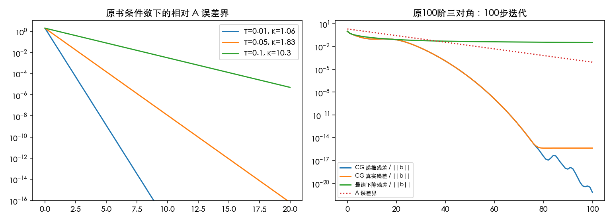

   **难度：3/5；出处：** TB：Lloyd N. Trefethen、David Bau III《数值线性代数》，陆金甫、关治译，2006（英文原版1997），第38讲习题38.6，书页262（PDF第274页），原题号38.6；**解答来源：** 自拟简解。

### 双 Lanczos 的三对角投影与双正交

**图谱路径：** 数值分析 / 第5章 共轭梯度法 / 双 Lanczos 的三对角投影与双正交

**知识内容：** [定义、定理与方法](知识点.md#kp-tb-ch39-bi-lanczos)

<!-- source-exercise:TB-ch39-39.1 -->
1. A是循环移位$m\times m$矩阵：$Ae_{j}=e_{j+1}$、$Ae_{m}=e_{1}$。(a)全部奇异值1且CGN一步；(b)谱单位m次根，普通b时GMRES要m步；(c)$b=e_{1}$用初等结构证明m步，无需谱/SVD。

   **答案：** (a)$A^{*} A=I$，正规方程就是$x=A^{*}b$，CGN从0一次得到。(b)$A^{m}=I$且循环$e_{1}$使极小多项式$z^{m}-1$，复谱为全部不同m次根。一般b各谱分量非零，要$p(\lambda _{j})=0$且$p(0)=1$的多项式至少degree m，故GMRES m步，特殊b可少。(c)$n<m$时$K_{n}=\operatorname{span}(e_{1},\ldots ,e_{n})$，$A K_{n}=\operatorname{span}(e_{2},\ldots ,e_{n+1})$与$b=e_{1}$正交，最小残差仍1，完全停滞；$n=m$含$x=A^{-1}b=e_{m}$所以精确终止。

   **难度：3/5；出处：** TB：Lloyd N. Trefethen、David Bau III《数值线性代数》，陆金甫、关治译，2006（英文原版1997），第39讲习题39.1，书页270—271（PDF第282—283页），原题号39.1；**解答来源：** 自拟简解。

<!-- source-exercise:TB-ch39-39.2 -->
2. 为任意m设计几乎相反39.1的例：$\operatorname{GMRES}\le 2$步、CGN需要m步。

   **答案：** 用直和$2\times 2$块$B_{j}=[[1,a_{j}],[0,-1]]$、$a_{j}=j>0$；m奇时另加$1\times 1[1]$。每块$B_{j}^{2}=I$，所以$A^{2}=I$、$A^{-1}=A$，$p(z)=1-z^{2}$可精确消去谱，$\operatorname{GMRES}\le 2$。各块$B_{j}^{*}B_{j}$特征值为$[(a_{j}^{2}+2)\pm a_{j}\sqrt{a_{j}^{2}+4}]/2$，互为倒数，一支严格增$>1$、另一严格减$<1$；各j不同、奇数附加1，故共有m个不同正特征值。选择一般b使$A^{*}b$在这些Gram特征方向均非零，CGN精确算术必须m步（任何消去多项式须m个根）。$m=1$退化为两法1步。

   **难度：3/5；出处：** TB：Lloyd N. Trefethen、David Bau III《数值线性代数》，陆金甫、关治译，2006（英文原版1997），第39讲习题39.2，书页271（PDF第283页），原题号39.2；**解答来源：** 自拟简解。

### BiCG 的实际/影子残差耦合

**图谱路径：** 数值分析 / 第5章 共轭梯度法 / BiCG 的实际/影子残差耦合

**知识内容：** [定义、定理与方法](知识点.md#kp-tb-ch39-bicg-recurrence)

<!-- source-exercise:TB-ch39-39.3 -->
1. A Hermitian时适当影子$s_{0}$使BiCG约为CG，证明并给$s_{0}$；A复对称但非Hermitian时换$s_{0}$使只需一套三项递推。

   **答案：** (a)取$s_{0}=r_{0}$、$q_{0}=p_{0}$，归纳$A^{*}=A$使影子和实际相同，$\alpha$、$\beta$实，BiCG即CG公式。SPD保证标准CG非零分母；仅Hermitian不定时这种形式可发生$p^{*}Ap=0$，不能由归约推出标准正定收敛结论。(b)$A^{T}=A$、$A^{*}=\bar A$，取$s_{0}=\bar r_{0}$、$q_{0}=\bar p_{0}$，影子递推始终为实际共轭，可省第二matvec；系数用双线性$r^{T}r$、$p^{T}Ap$而非共轭范数。非零复向量可$r^{T}r=0$，故要检测双内积中断，不能认为等同Hermitian安全CG。

   **难度：3/5；出处：** TB：Lloyd N. Trefethen、David Bau III《数值线性代数》，陆金甫、关治译，2006（英文原版1997），第39讲习题39.3，书页270—271（PDF第282—283页），原题号39.3；**解答来源：** 自拟简解。

### 短递推的平滑、无转置与 look-ahead 取舍

**图谱路径：** 数值分析 / 第5章 共轭梯度法 / 短递推的平滑、无转置与 look-ahead 取舍

**知识内容：** [定义、定理与方法](知识点.md#kp-tb-ch39-short-recurrence-variants)

<!-- source-exercise:TB-ch39-39.4 -->
1. 说明BiCG残差曲线的峰如何影响浮点可达精度，非严格解释与Gauss增长因子类似之处。

   **答案：** 大的递推残差/搜索方向使后续相消要从大量恢复小答案，每步O(u)相对误差按峰的绝对尺度注入；峰消失并不把误差一起消除，最终真实残差平台可能高于$u\|b\|$。这与GEPP中U相对A的增长放大后向界$\rho u$类似。类比描述风险机制，不给BiCG一个普遍“峰高$\times u$”严格定理；重算真实残差、平滑法和预处理可改善，但峰高本身不等同问题条件数。

   **难度：2/5；出处：** TB：Lloyd N. Trefethen、David Bau III《数值线性代数》，陆金甫、关治译，2006（英文原版1997），第39讲习题39.4，书页271（PDF第283页），原题号39.4；**解答来源：** 自拟简解。

<!-- source-exercise:TB-ch39-39.5 -->
2. 从CG,GMRES,CGN,BiCG选择并说明：(a)稠密非$\operatorname{Hermitian} m10^{4}$，除3离群均近−1；(b)同阶谱主体$-10\le Re\lambda \le 10$、$-1\le Im\lambda \le 1$；(c)稀疏非$\operatorname{Hermitian} m10^{6}$、$10^{7}$非零，谱如(a)；(d)稀疏$\operatorname{Hermitian} m10^{5}$谱[1,100]；(e)另正离群.01,10000；(f)另负离群−1,−10,−100；(g)稀疏正规$m10^{5}$，谱圆环$1\le |\lambda |\le 2$。

   **答案：** (a)若非正规性适度，GMRES可低次消3离群并压−1簇，稠密matvec占主成本，少次优先。(b)谱绕0，GMRES可能慢且内存增长；BiCG固定内存可试但峰/中断风险，若奇异值良态CGN可能胜，给定特征值不足唯一确定$\sigma$或非正规性，所以不能无条件选一法。(c)同(a)常少步GMRES、稀疏$\operatorname{matvec} O(10^{7})$，内存按迭代数评估，需时重启/预处理。CG，SPD短递推且$q=9/11$。(e)仍SPD，CG可利用主体簇与消正离群；单$\kappa 10^{6}$界过悲观，可需预处理。(f)不定，标准SPD CG保障失效；GMRES配低次消负离群较稳健，若存储吃紧可考虑BiCG/适合不定的短递推但须监测。MINRES常适合此结构，却不在原题四选项内。CGN最有据：正规A奇异值为$|\lambda |\in [1,2]$，$\kappa \le 2$、$\operatorname{Gram}\kappa \le 4$，速率$\le 1/3$；GMRES可因谱围0而很慢。谱信息对非正规矩阵不足以保证这些条件性预测。

   **难度：3/5；出处：** TB：Lloyd N. Trefethen、David Bau III《数值线性代数》，陆金甫、关治译，2006（英文原版1997），第39讲习题39.5，书页271（PDF第283页），原题号39.5；**解答来源：** 自拟简解。

### 左右预处理的残差和变量度量

**图谱路径：** 数值分析 / 第5章 共轭梯度法 / 左右预处理的残差和变量度量

**知识内容：** [定义、定理与方法](知识点.md#kp-tb-ch40-left-right-preconditioning)

<!-- source-exercise:TB-ch40-40.1 -->
1. 原题$A=M-N$、M非奇异，假设$\|I-M^{-1}N\|_{2}\le 1/2$，M作(40.2)左预处理。(a)证GMRES20步残差缩小至少6数量级；(b)同保障CGN几步？

   **答案：** 按题面不能证明：$M^{-1}A=I-M^{-1}N$被假设为范数$\le 1/2$，而非接近I。取$m>20$循环移位P、$M=I$、$A=P/2$、$N=I-P/2$，全部非奇异条件及范数1/2成立，但$b=e_{1}$时GMRES前m−1步残差完全不减，反例否定(a)。正文意图应为$\|M^{-1}N\|_{2}\le 1/2$，即$\|I-M^{-1}A\|\le 1/2$。修正后(a)取$p(z)=(1-z)^{20}$，残差比$\le 2^{-20}$≈$9.5367\times 10^{-7}$；(b)$B=M^{-1}A$奇异值[1/2,3/2]、$\kappa \le 3$，CGN的残差等于Gram能量误差，界$2[(\kappa -1)/(\kappa +1)]^{n}\le 2\cdot 2^-n$，n21足够。原假设未改前没有这些保证，保留为来源冲突，不计已解可用题。

   **难度：4/5；出处：** TB：Lloyd N. Trefethen、David Bau III《数值线性代数》，陆金甫、关治译，2006（英文原版1997），第40讲习题40.1，书页277（PDF第289页），原题号40.1；**解答来源：** 自拟简解。

   **整理说明：** [待核]原题N/A位置疑误；完整字面反例及拟修正版本解分别说明。

<!-- source-exercise:TB-ch40-40.2 -->
2. A与M Hermitian SPD，证明M用左右预处理得到同CG收敛速度；为何非Hermitian及GMRES,CGN,BiCG不一般成立？

   **答案：** 令$H=M^{-1/2} A M^{-1/2} \operatorname{SPD}$。左$L=M^{-1}A$在M内积自伴，右$R=A M^{-1}$在$M^{-1}$内积自伴，均等价H；取右变量$y=Mx$、对应初值$y_{0}=Mx_{0}$时，Krylov空间与CG能量极小化一一对应。左能量$<x,Lx>_M=x^{*}Ax$，右$<y,Ry>_{M^{-1}}=y^{*}M^{-1}A M^{-1}y=x^{*}Ax$，所以原x迭代及A误差同，谱$/\kappa (H)$界也同。必须使用相应度量或对称分裂实现PCG，不能对非对称L、R盲用普通Euclidean CG。一般左右相似仅保谱，GMRES最小残差度量不同、CGN依赖奇异值而非相似谱、BiCG两基/影子初值也受变换，故速度不自动一样。

   **难度：3/5；出处：** TB：Lloyd N. Trefethen、David Bau III《数值线性代数》，陆金甫、关治译，2006（英文原版1997），第40讲习题40.2，书页277（PDF第289页），原题号40.2；**解答来源：** 自拟简解。

### 粗网格校正与完整预处理器的秩

**图谱路径：** 数值分析 / 第5章 共轭梯度法 / 粗网格校正与完整预处理器的秩

**知识内容：** [定义、定理与方法](知识点.md#kp-tb-ch40-coarse-grid-correction)

已整理范围内未另选可直接对应此节点的独立未解题；相关已解例子见知识内容。

### 局部、块与区域分解预处理

**图谱路径：** 数值分析 / 第5章 共轭梯度法 / 局部、块与区域分解预处理

**知识内容：** [定义、定理与方法](知识点.md#kp-tb-ch40-local-block-preconditioner)

已整理范围内未另选可直接对应此节点的独立未解题；相关已解例子见知识内容。

### 低阶、常系数与 ADI 物理近似

**图谱路径：** 数值分析 / 第5章 共轭梯度法 / 低阶、常系数与 ADI 物理近似

**知识内容：** [定义、定理与方法](知识点.md#kp-tb-ch40-physics-split-preconditioner)

已整理范围内未另选可直接对应此节点的独立未解题；相关已解例子见知识内容。

### 循环近似与 FFT 预处理

**图谱路径：** 数值分析 / 第5章 共轭梯度法 / 循环近似与 FFT 预处理

**知识内容：** [定义、定理与方法](知识点.md#kp-tb-ch40-circulant-preconditioner)

已整理范围内未另选可直接对应此节点的独立未解题；相关已解例子见知识内容。

### 多项式近似逆与有理谱映射

**图谱路径：** 数值分析 / 第5章 共轭梯度法 / 多项式近似逆与有理谱映射

**知识内容：** [定义、定理与方法](知识点.md#kp-tb-ch40-polynomial-rational-preconditioner)

已整理范围内未另选可直接对应此节点的独立未解题；相关已解例子见知识内容。

### 共轭基给出的逆矩阵

**图谱路径：** 数值分析 / 第5章 共轭梯度法 / 共轭基给出的逆矩阵

**知识内容：** [定义、定理与方法](知识点.md#kp-xh-ch04-conjugate-inverse)

<!-- source-exercise:XH-ch04-2 -->
1. A正定，n个非零$p_{j}$互相A共轭。(1)证明它们线性无关；(2)证明$A^{-1}=\Sigma p_j p_j^{T}/(p_{j}^{T}Ap_{j})$。

   **答案：** (1)对线性关系$\Sigma c_j p_j=0$左乘$p_{i}^{T}A$得$c_{i} p_{i}^{T}Ap_{i}=0$，故$c_{i}=0$。(2)P可逆，$P^{T}AP=D$正对角，逆式$A^{-1}=PD^{-1}P^{T}$逐列展开即所需和式。

   **难度：3/5；出处：** XH：向华、杨志坚《数值线性代数》，2024年所附版，第4章习题2，书页73（PDF第79页），原题号2；**解答来源：** 自拟简解。

   **整理说明：** 共轭方向按正文定义非零，否则第二小问分母本身无定义。

### CG 方向的残差展开

**图谱路径：** 数值分析 / 第5章 共轭梯度法 / CG 方向的残差展开

**知识内容：** [定义、定理与方法](知识点.md#kp-xh-ch04-cg-direction-expansion)

<!-- source-exercise:XH-ch04-6 -->
1. 用归纳证明CG中$p_{k}^{T}r_{0}=\cdots =p_{k}^{T}r_{k}=r_{k}^{T}r_{k}$。

   **答案：** $k=0$显然。$p_{k}=r_{k}+\beta _{k-1}p_{k-1}$，残差彼此正交且$r_{k}$与旧方向正交。$j<k$时$p_{k}^{T}r_{j}=\beta _{k-1}\|r_{k-1}\|^{2}=\|r_{k}\|^{2}$；$j=k$时旧方向内积0，亦为$\|r_{k}\|^{2}$。

   **难度：3/5；出处：** XH：向华、杨志坚《数值线性代数》，2024年所附版，第4章习题6，书页73（PDF第79页），原题号6；**解答来源：** 自拟简解。

### Chebyshev 多项式的定义与递推

**图谱路径：** 数值分析 / 第5章 共轭梯度法 / Chebyshev 多项式的定义与递推

**知识内容：** [定义、定理与方法](知识点.md#kp-xh-ch04-chebyshev-definition)

已整理范围内未另选可直接对应此节点的独立未解题；相关已解例子见知识内容。

### 谱区间上的规范 Chebyshev 界

**图谱路径：** 数值分析 / 第5章 共轭梯度法 / 谱区间上的规范 Chebyshev 界

**知识内容：** [定义、定理与方法](知识点.md#kp-xh-ch04-chebyshev-normalized)

已整理范围内未另选可直接对应此节点的独立未解题；相关已解例子见知识内容。

### Chebyshev 的方程与生成函数

**图谱路径：** 数值分析 / 第5章 共轭梯度法 / Chebyshev 的方程与生成函数

**知识内容：** [定义、定理与方法](知识点.md#kp-xh-ch04-chebyshev-ode-gen)

已整理范围内未另选可直接对应此节点的独立未解题；相关已解例子见知识内容。

### LSQR 与正规方程的联系

**图谱路径：** 数值分析 / 第5章 共轭梯度法 / LSQR 与正规方程的联系

**知识内容：** [定义、定理与方法](知识点.md#kp-xh-ch04-lsqr-navigation)

已整理范围内未另选可直接对应此节点的独立未解题；相关已解例子见知识内容。

### 正定线性系统与二次极小化

**图谱路径：** 数值分析 / 第5章 共轭梯度法 / 正定线性系统与二次极小化

**知识内容：** [定义、定理与方法](知识点.md#kp-xu-ch05-quadratic-system)

已整理范围内未另选可直接对应此节点的独立未解题；相关已解例子见知识内容。

### 二次目标差与能量范数

**图谱路径：** 数值分析 / 第5章 共轭梯度法 / 二次目标差与能量范数

**知识内容：** [定义、定理与方法](知识点.md#kp-xu-ch05-energy-error)

<!-- source-exercise:XU-ch05-1 -->
1. 证明等式(5.1.4)：若 $x_*=A^{-1}b$，则 $\varphi(x)=\varphi(x_*)+(x-x_*)^TA(x-x_*)$，$\varphi(x)=x^TAx-2b^Tx$。

   **答案：** 写 $x=x_*+e$，展开二次式，交叉项 $2e^TAx_*-2b^Te=0$，剩余为 $\varphi(x_*)+e^TAe$。

   **难度：1/5；出处：** XU：徐树方、高立、张平文《数值线性代数》第二版，2013，第5章习题1，书页158（PDF第170页），原题号1；**解答来源：** 自拟简解。

### 精确一维线搜索

**图谱路径：** 数值分析 / 第5章 共轭梯度法 / 精确一维线搜索

**知识内容：** [定义、定理与方法](知识点.md#kp-xu-ch05-line-search)

已整理范围内未另选可直接对应此节点的独立未解题；相关已解例子见知识内容。

### 线搜索的目标下降量

**图谱路径：** 数值分析 / 第5章 共轭梯度法 / 线搜索的目标下降量

**知识内容：** [定义、定理与方法](知识点.md#kp-xu-ch05-objective-decrease)

已整理范围内未另选可直接对应此节点的独立未解题；相关已解例子见知识内容。

### 最速下降法

**图谱路径：** 数值分析 / 第5章 共轭梯度法 / 最速下降法

**知识内容：** [定义、定理与方法](知识点.md#kp-xu-ch05-steepest-descent)

<!-- source-exercise:TB-ch38-38.5 -->
1. 最速下降极小化$\varphi (x)=1/2 x^{T}Ax-b^{T}x$。(a)求梯度，说明选择$p_{n}=r_{n}$替CG方向；(b)求最优$\alpha _{n}$；(c)写完整迭代主循环的三项操作。

   **答案：** (a)∇$\varphi =Ax-b=-r$，故负梯度是r；取$p=r$为最速下降。(b)沿r求导：$\varphi (x+\alpha r)$导数$-r^{T}r+\alpha r^{T}Ar$，SPD且$r\ne 0$给$\alpha =r^{T}r/(r^{T}Ar)$。(c)初$x_{0}$、$r_{0}=b-Ax_{0}$；每步计算$\alpha _{n}$（含一次Ar），更新$x_{n+1}=x_{n}+\alpha r_{n}$，更新$r_{n+1}=r_{n}-\alpha Ar_{n}$。三项为系数和两向量更新，重复使用已算Ar；$r=0$停止。梯度不是r本身，原OCR漏负号须按定义校正。

   **难度：2/5；出处：** TB：Lloyd N. Trefethen、David Bau III《数值线性代数》，陆金甫、关治译，2006（英文原版1997），第38讲习题38.5，书页262（PDF第274页），原题号38.5；**解答来源：** 自拟简解。

<!-- source-exercise:XH-ch04-1 -->
2. $A=[[6,3],[3,2]]$、$b=(0,-1)^{T}$，$x_{0}=0$。(1)最速下降2步；(2)CG2步；(3)与精确解比较。

   **答案：** 最速下降第1步$\alpha _{0}=1/2$、$x_{1}=(0,-1/2)^{T}$，$r_{1}=(3/2,0)^{T}$；第2步$\alpha _{1}=1/6$、$x_{2}=(1/4,-1/2)^{T}$。CG第1步相同，$\beta _{0}=9/4$、$p_{1}=(3/2,-9/4)^{T}$，第2步$\alpha _{1}=2/3$，$x_{2}=(1,-2)^{T}$，残差0。精确$A^{-1}b=(1,-2)^{T}$，因此CG已精确，最速下降仍有误差$(-3/4,3/2)^{T}$。

   **难度：3/5；出处：** XH：向华、杨志坚《数值线性代数》，2024年所附版，第4章习题1，书页72—73（PDF第78—79页），原题号1；**解答来源：** 自拟简解。

### 最速下降相邻残差正交

**图谱路径：** 数值分析 / 第5章 共轭梯度法 / 最速下降相邻残差正交

**知识内容：** [定义、定理与方法](知识点.md#kp-xu-ch05-sd-orthogonality)

已整理范围内未另选可直接对应此节点的独立未解题；相关已解例子见知识内容。

### 最速下降的条件数速度界

**图谱路径：** 数值分析 / 第5章 共轭梯度法 / 最速下降的条件数速度界

**知识内容：** [定义、定理与方法](知识点.md#kp-xu-ch05-sd-rate)

<!-- source-exercise:XH-ch04-3 -->
1. 最速下降产生$x_{k}$，$\kappa =\|A\|_{2}\|A^{-1}\|_{2}$，证明$\varphi (x_{k})\le (1-1/\kappa )\varphi (x_{k-1})$。

   **答案：** 目标差$E_{k}\le (1-1/\kappa )E_{k-1}$：下降量$(r^{T}r)^{2}/(r^{T}Ar)\ge E/\kappa$。$\varphi (x^{*})\le 0$，加回极小值即得原式。

   **难度：3/5；出处：** XH：向华、杨志坚《数值线性代数》，2024年所附版，第4章习题3，书页73（PDF第79页），原题号3；**解答来源：** 自拟简解。

<!-- source-exercise:XU-ch05-2 -->
2. 最速下降产生 $x_k$。证明 $\varphi(x_k)\le[1-1/\kappa_2(A)]\varphi(x_{k-1})$。

   **答案：** 记 $E=e^TAe$、$r=-Ae$，线搜索下降量为 $(r^Tr)^2/(r^TAr)\ge(r^Tr)/\lambda_{\max}\ge E/\kappa$。故 $E_k\le(1-1/\kappa)E_{k-1}$。又 $\varphi(x_*)=-b^TA^{-1}b\le0$，将它加回有 $\varphi(x_k)\le(1-1/\kappa)\varphi(x_{k-1})+\varphi(x_*)/\kappa\le(1-1/\kappa)\varphi(x_{k-1})$。

   **难度：3/5；出处：** XU：徐树方、高立、张平文《数值线性代数》第二版，2013，第5章习题2，书页158（PDF第170页），原题号2；**解答来源：** 自拟简解。

   **整理说明：** 原式使用可为负的$\varphi$而非目标差；简解保留原式并说明目标差的更有意义界。

<!-- source-exercise:XU-ch05-上机3 -->
3. 分别用Jacobi、G–S、CG解 $A=\begin{pmatrix}10&1&2&3&4\\1&9&-1&2&-3\\2&-1&7&3&-5\\3&2&3&12&-1\\4&-3&-5&-1&15\end{pmatrix}$、$b=(12,-27,14,-17,12)^T$，并解释观察结果。

   **答案：** 精确解为 $(1,-2,3,-2,1)^T$，直接代入检查。顺序主子式为 $10,89,573,5559,32872$，故 $A$ 对称正定，G–S与CG收敛。Jacobi 仍需单独算谱半径，不能因正定直接断言收敛；本机Jacobi谱半径约0.8267862、G–S约0.6845584，均收敛；以∞前向误差1e-10为标准，零初值分别121步、63步，CG5步给约2.22e-16分量相对误差。完整记录见处理记录/徐书第五章计算核验.json。精确CG最多5步，浮点残差正交损失时停止规则应依据实际精度。

   **难度：3/5；出处：** XU：徐树方、高立、张平文《数值线性代数》第二版，2013，第5章习题上机3，书页160（PDF第172页），原题号上机3；**解答来源：** 自拟简解。

### 多项式作用的谱范数估计

**图谱路径：** 数值分析 / 第5章 共轭梯度法 / 多项式作用的谱范数估计

**知识内容：** [定义、定理与方法](知识点.md#kp-xu-ch05-polynomial-norm)

已整理范围内未另选可直接对应此节点的独立未解题；相关已解例子见知识内容。

### A 共轭方向

**图谱路径：** 数值分析 / 第5章 共轭梯度法 / A 共轭方向

**知识内容：** [定义、定理与方法](知识点.md#kp-xu-ch05-conjugate-directions)

<!-- source-exercise:XH-ch04-2 -->
1. A正定，n个非零$p_{j}$互相A共轭。(1)证明它们线性无关；(2)证明$A^{-1}=\Sigma p_j p_j^{T}/(p_{j}^{T}Ap_{j})$。

   **答案：** (1)对线性关系$\Sigma c_j p_j=0$左乘$p_{i}^{T}A$得$c_{i} p_{i}^{T}Ap_{i}=0$，故$c_{i}=0$。(2)P可逆，$P^{T}AP=D$正对角，逆式$A^{-1}=PD^{-1}P^{T}$逐列展开即所需和式。

   **难度：3/5；出处：** XH：向华、杨志坚《数值线性代数》，2024年所附版，第4章习题2，书页73（PDF第79页），原题号2；**解答来源：** 自拟简解。

   **整理说明：** 共轭方向按正文定义非零，否则第二小问分母本身无定义。

<!-- source-exercise:XU-ch05-5 -->
2. 设 $A$ 对称正定，非零 $p_1,\ldots,p_k$ 互相 $A$-共轭。证明这些方向线性无关。

   **答案：** 若 $\sum c_ip_i=0$，左乘 $p_j^TA$ 得 $c_jp_j^TAp_j=0$；正定及 $p_j\ne0$ 使 $c_j=0$，对每个 $j$ 成立。

   **难度：1/5；出处：** XU：徐树方、高立、张平文《数值线性代数》第二版，2013，第5章习题5，书页158（PDF第170页），原题号5；**解答来源：** 自拟简解。

   **勘误：** 原题未显式写各方向非零；若允许零向量，则取$p1=0$即反例。已补必要条件，符合正文搜索方向约定。

### CG 的二维极小化推导

**图谱路径：** 数值分析 / 第5章 共轭梯度法 / CG 的二维极小化推导

**知识内容：** [定义、定理与方法](知识点.md#kp-xu-ch05-cg-plane)

<!-- source-exercise:XU-ch05-4 -->
1. 证明式(5.2.1)的二维线搜索系数系统解存在且唯一：
$\begin{pmatrix}r_k^TAr_k&r_k^TAp_{k-1}\\p_{k-1}^TAr_k&p_{k-1}^TAp_{k-1}\end{pmatrix}(\xi,\eta)^T=(r_k^Tr_k,0)^T$。

   **答案：** 未终止时 $r_k\ne0$，此前 $p_{k-1}\ne0$ 且 $r_k^Tp_{k-1}=0$，因此两向量独立。系数阵是它们在正定 $A$ 内积下的 Gram矩阵，任意非零 $(\xi,\eta)$ 的二次型为 $(\xi r_k+\eta p_{k-1})^TA(\xi r_k+\eta p_{k-1})>0$，故非奇异。

   **难度：2/5；出处：** XU：徐树方、高立、张平文《数值线性代数》第二版，2013，第5章习题4，书页158（PDF第170页），原题号4；**解答来源：** 自拟简解。

   **整理说明：** 系统定义位于未达到零残差的迭代步骤；残差为0时应先终止。

### 使新方向共轭的系数

**图谱路径：** 数值分析 / 第5章 共轭梯度法 / 使新方向共轭的系数

**知识内容：** [定义、定理与方法](知识点.md#kp-xu-ch05-cg-conjugacy-beta)

已整理范围内未另选可直接对应此节点的独立未解题；相关已解例子见知识内容。

### 实用共轭梯度递推

**图谱路径：** 数值分析 / 第5章 共轭梯度法 / 实用共轭梯度递推

**知识内容：** [定义、定理与方法](知识点.md#kp-xu-ch05-cg-algorithm)

<!-- source-exercise:XH-ch04-1 -->
1. $A=[[6,3],[3,2]]$、$b=(0,-1)^{T}$，$x_{0}=0$。(1)最速下降2步；(2)CG2步；(3)与精确解比较。

   **答案：** 最速下降第1步$\alpha _{0}=1/2$、$x_{1}=(0,-1/2)^{T}$，$r_{1}=(3/2,0)^{T}$；第2步$\alpha _{1}=1/6$、$x_{2}=(1/4,-1/2)^{T}$。CG第1步相同，$\beta _{0}=9/4$、$p_{1}=(3/2,-9/4)^{T}$，第2步$\alpha _{1}=2/3$，$x_{2}=(1,-2)^{T}$，残差0。精确$A^{-1}b=(1,-2)^{T}$，因此CG已精确，最速下降仍有误差$(-3/4,3/2)^{T}$。

   **难度：3/5；出处：** XH：向华、杨志坚《数值线性代数》，2024年所附版，第4章习题1，书页72—73（PDF第78—79页），原题号1；**解答来源：** 自拟简解。

<!-- source-exercise:XU-ch05-上机1 -->
2. 解 $-\Delta u+u=\sin(xy)$、$0<x,y<1$，边界 $u=x^2+y^2$，每边 $n=20$ 等分。差分为 $(1+h^2/4)u_{ij}-\frac14(u_{i+1,j}+u_{i-1,j}+u_{i,j+1}+u_{i,j-1})=\frac{h^2}{4}\sin(ih\,jh)$，$h=1/20$。用CG求4位有效数字；并求最佳SOR松弛因子，比较两法。

   **答案：** 组361阶对称正定五点阵，边界已知项移至右端；以零内点初值实现CG，可靠残差和与直接离散解的误差同时检查。Jacobi 谱半径 $r=4\cos(\pi/20)/(4+h^2)$，所以相容排列下最佳 $\omega_*=2/(1+\sqrt{1-r^2})$。用同一4位有效数字标准比较CG与SOR，CG每步只需稀疏矩阵向量积且无全局松弛参数，SOR每步是有次序的扫描。本机零初值实验：CG44步达到最大分量相对误差4.04e-5，最佳SOR参数约1.723720324，54步达到4.78e-5；稀疏模型的中心离散值约0.755698925。完整记录见处理记录/徐书第五章计算核验.json。

   **难度：4/5；出处：** XU：徐树方、高立、张平文《数值线性代数》第二版，2013，第5章习题上机1，书页159—160（PDF第171—172页），原题号上机1；**解答来源：** 自拟简解。

<!-- source-exercise:XU-ch05-上机3 -->
3. 分别用Jacobi、G–S、CG解 $A=\begin{pmatrix}10&1&2&3&4\\1&9&-1&2&-3\\2&-1&7&3&-5\\3&2&3&12&-1\\4&-3&-5&-1&15\end{pmatrix}$、$b=(12,-27,14,-17,12)^T$，并解释观察结果。

   **答案：** 精确解为 $(1,-2,3,-2,1)^T$，直接代入检查。顺序主子式为 $10,89,573,5559,32872$，故 $A$ 对称正定，G–S与CG收敛。Jacobi 仍需单独算谱半径，不能因正定直接断言收敛；本机Jacobi谱半径约0.8267862、G–S约0.6845584，均收敛；以∞前向误差1e-10为标准，零初值分别121步、63步，CG5步给约2.22e-16分量相对误差。完整记录见处理记录/徐书第五章计算核验.json。精确CG最多5步，浮点残差正交损失时停止规则应依据实际精度。

   **难度：3/5；出处：** XU：徐树方、高立、张平文《数值线性代数》第二版，2013，第5章习题上机3，书页160（PDF第172页），原题号上机3；**解答来源：** 自拟简解。

### CG 残差的两两正交

**图谱路径：** 数值分析 / 第5章 共轭梯度法 / CG 残差的两两正交

**知识内容：** [定义、定理与方法](知识点.md#kp-xu-ch05-cg-residual-orthogonality)

已整理范围内未另选可直接对应此节点的独立未解题；相关已解例子见知识内容。

### CG 方向的两两共轭

**图谱路径：** 数值分析 / 第5章 共轭梯度法 / CG 方向的两两共轭

**知识内容：** [定义、定理与方法](知识点.md#kp-xu-ch05-cg-direction-conjugacy)

已整理范围内未另选可直接对应此节点的独立未解题；相关已解例子见知识内容。

### 残差、方向与 Krylov 空间

**图谱路径：** 数值分析 / 第5章 共轭梯度法 / 残差、方向与 Krylov 空间

**知识内容：** [定义、定理与方法](知识点.md#kp-xu-ch05-cg-span)

已整理范围内未另选可直接对应此节点的独立未解题；相关已解例子见知识内容。

### CG 的 Galerkin 条件

**图谱路径：** 数值分析 / 第5章 共轭梯度法 / CG 的 Galerkin 条件

**知识内容：** [定义、定理与方法](知识点.md#kp-xu-ch05-cg-galerkin)

<!-- source-exercise:XH-ch04-9 -->
1. 正定A，$x_{k}\in$线性子空间X使$\|x_{k}-A^{-1}b\|_A$最小，当且仅当$r_{k}=b-Ax_{k}$垂直X。

   **答案：** 沿X任意w展开平方能量误差，线性项$-2w^{T}r_{k}$须0；反之该项0后只增加$w^{T}Aw\ge 0$。

   **难度：2/5；出处：** XH：向华、杨志坚《数值线性代数》，2024年所附版，第4章习题9，书页73（PDF第79页），原题号9；**解答来源：** 自拟简解。

<!-- source-exercise:XU-ch05-11 -->
2. 正定 $A$ 与线性子空间 $\mathcal X$ 给定。证明 $x_k\in\mathcal X$ 极小化 $\|x-A^{-1}b\|_A$ 当且仅当 $r_k=b-Ax_k\perp\mathcal X$。

   **答案：** 沿任意 $w\in\mathcal X$ 展开能量误差平方，其一次项为 $-2w^Tr_k$，极小化迫使它为0。反之该项为0，每次移动增加 $w^TAw\ge0$，故为极小点。正定保证唯一。

   **难度：2/5；出处：** XU：徐树方、高立、张平文《数值线性代数》第二版，2013，第5章习题11，书页159（PDF第171页），原题号11；**解答来源：** 自拟简解。

### CG 的能量最优性

**图谱路径：** 数值分析 / 第5章 共轭梯度法 / CG 的能量最优性

**知识内容：** [定义、定理与方法](知识点.md#kp-xu-ch05-cg-minimum)

已整理范围内未另选可直接对应此节点的独立未解题；相关已解例子见知识内容。

### CG 的有限终止

**图谱路径：** 数值分析 / 第5章 共轭梯度法 / CG 的有限终止

**知识内容：** [定义、定理与方法](知识点.md#kp-xu-ch05-cg-finite)

<!-- source-exercise:XH-ch04-8 -->
1. 正定A至多k个不同特征值，证明CG精确算术至多k步。

   **答案：** $P(t)=\prod _{j}(1-t/\lambda _{j})$满足$P(0)=1$、$P(A)=0$，CG在k次误差多项式类中最优，故误差为0。

   **难度：3/5；出处：** XH：向华、杨志坚《数值线性代数》，2024年所附版，第4章习题8，书页73（PDF第79页），原题号8；**解答来源：** 自拟简解。

<!-- source-exercise:XU-ch05-8 -->
2. 正定系统系数 $A$ 至多有 $l$ 个不同特征值。证明CG在精确算术至多 $l$ 步得精确解。

   **答案：** 取 $P(t)=\prod_{j=1}^l(1-t/\lambda_j)$，$P(0)=1$、$P(A)=0$。CG多项式最优性在第 $l$ 步给能量误差不超过 $\|P(A)e_0\|_A=0$。若此前残差已0，则更早结束。

   **难度：3/5；出处：** XU：徐树方、高立、张平文《数值线性代数》第二版，2013，第5章习题8，书页159（PDF第171页），原题号8；**解答来源：** 自拟简解。

<!-- source-exercise:XU-ch05-上机2 -->
3. 用 Hilbert 型阵 $a_{ij}=1/(i+j+1)$，$1\le i,j\le n$，$b_i=\frac13\sum_ja_{ij}$，测试所写CG程序。

   **答案：** 此处原题是移位Hilbert，分母为 $i+j+1$ 而非标准 $i+j-1$；精确解为全 $1/3$。正定性可用 $\int_0^1 t^2(\sum_i v_it^{i-1})^2dt>0$。逐阶记录相对残差及对全1/3的前向误差；病态会使小残差与大误差并存，浮点CG不一定$n$步结束。本机测试$n=5/10/20$，CG分别7/14/16步达到所设停止条件，前向∞误差约2.33e-11/7.08e-6/2.01e-5，真实相对残差均不到4e-14；$n=10/20$虽残差极小仍未达到1e-10前向目标。完整记录见处理记录/徐书第五章计算核验.json。

   **难度：3/5；出处：** XU：徐树方、高立、张平文《数值线性代数》第二版，2013，第5章习题上机2，书页160（PDF第172页），原题号上机2；**解答来源：** 自拟简解。

<!-- source-exercise:XU-ch05-上机3 -->
4. 分别用Jacobi、G–S、CG解 $A=\begin{pmatrix}10&1&2&3&4\\1&9&-1&2&-3\\2&-1&7&3&-5\\3&2&3&12&-1\\4&-3&-5&-1&15\end{pmatrix}$、$b=(12,-27,14,-17,12)^T$，并解释观察结果。

   **答案：** 精确解为 $(1,-2,3,-2,1)^T$，直接代入检查。顺序主子式为 $10,89,573,5559,32872$，故 $A$ 对称正定，G–S与CG收敛。Jacobi 仍需单独算谱半径，不能因正定直接断言收敛；本机Jacobi谱半径约0.8267862、G–S约0.6845584，均收敛；以∞前向误差1e-10为标准，零初值分别121步、63步，CG5步给约2.22e-16分量相对误差。完整记录见处理记录/徐书第五章计算核验.json。精确CG最多5步，浮点残差正交损失时停止规则应依据实际精度。

   **难度：3/5；出处：** XU：徐树方、高立、张平文《数值线性代数》第二版，2013，第5章习题上机3，书页160（PDF第172页），原题号上机3；**解答来源：** 自拟简解。

### 不同特征值数与 Krylov 维数

**图谱路径：** 数值分析 / 第5章 共轭梯度法 / 不同特征值数与 Krylov 维数

**知识内容：** [定义、定理与方法](知识点.md#kp-xu-ch05-distinct-eigenvalues)

<!-- source-exercise:XH-ch04-7 -->
1. 实对称A仅k个不同特征值，证明$\operatorname{span}(r,Ar,\ldots ,A^{n-1}r)$维数$\le k$。

   **答案：** 其最小多项式为不同线性因子之积，次数k；$p(A)=0$使第k以上幂作用r可由此前k个表示。

   **难度：2/5；出处：** XH：向华、杨志坚《数值线性代数》，2024年所附版，第4章习题7，书页73（PDF第79页），原题号7；**解答来源：** 自拟简解。

<!-- source-exercise:XU-ch05-7 -->
2. 实对称 $A$ 只有 $k$ 个不同特征值。证明任意 $r$ 的 $\mathrm{span}(r,Ar,\ldots,A^{n-1}r)$ 维数至多 $k$。

   **答案：** $p(t)=\prod_{j=1}^k(t-\lambda_j)$ 满足 $p(A)=0$（对称矩阵可正交对角化）。故 $A^kr$ 是此前 $k$ 向量的线性组合，进一步所有高次向量也如此。

   **难度：2/5；出处：** XU：徐树方、高立、张平文《数值线性代数》第二版，2013，第5章习题7，书页158—159（PDF第170—171页），原题号7；**解答来源：** 自拟简解。

### CG 误差的多项式表述

**图谱路径：** 数值分析 / 第5章 共轭梯度法 / CG 误差的多项式表述

**知识内容：** [定义、定理与方法](知识点.md#kp-xu-ch05-cg-polynomial)

<!-- source-exercise:XU-ch05-8 -->
1. 正定系统系数 $A$ 至多有 $l$ 个不同特征值。证明CG在精确算术至多 $l$ 步得精确解。

   **答案：** 取 $P(t)=\prod_{j=1}^l(1-t/\lambda_j)$，$P(0)=1$、$P(A)=0$。CG多项式最优性在第 $l$ 步给能量误差不超过 $\|P(A)e_0\|_A=0$。若此前残差已0，则更早结束。

   **难度：3/5；出处：** XU：徐树方、高立、张平文《数值线性代数》第二版，2013，第5章习题8，书页159（PDF第171页），原题号8；**解答来源：** 自拟简解。

### Chebyshev 条件数收敛界

**图谱路径：** 数值分析 / 第5章 共轭梯度法 / Chebyshev 条件数收敛界

**知识内容：** [定义、定理与方法](知识点.md#kp-xu-ch05-chebyshev-cg)

<!-- source-exercise:TB-ch38-38.1 -->
1. 原图38-1中$\tau =.01,.05,.1$的矩阵条件数$\kappa$分别1.06,1.83,10.3。按定理38.5预测收敛速率，复制原图并画理论线与实际比较。

   **答案：** 界是$\|e_{n}\|_A/\|e_{0}\|_A\le 2q^{n}$，$q=(\sqrt{\kappa }-1)/(\sqrt{\kappa }+1)$。三q约0.0145662、0.149940、0.524869，semilogy斜率$\operatorname{log}_{10}q$约−1.8367、−0.8241、−0.2800。原图是残差范数而非A误差，理论线只在转换/选择纵向尺度后可比较衰减斜率；$\kappa$数值为原书特定随机矩阵，原随机数据未附，不能伪作精确重跑它。保持原图原页如下，另给同横轴的理论直线图，快速$\tau =.01$约9步机器平台、.05约19步、.1在20步仍慢，与斜率量级相符。

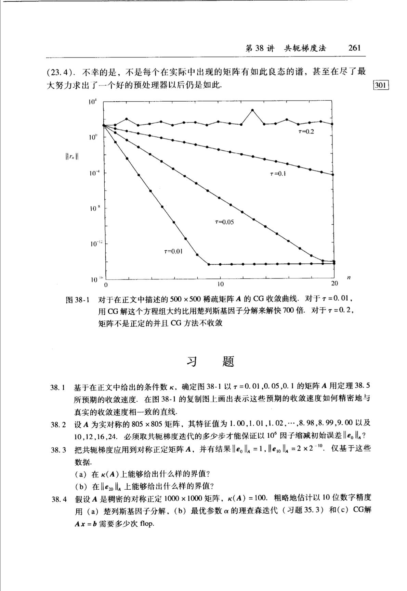

   **难度：3/5；出处：** TB：Lloyd N. Trefethen、David Bau III《数值线性代数》，陆金甫、关治译，2006（英文原版1997），第38讲习题38.1，书页261（PDF第273页），原题号38.1；**解答来源：** 自拟简解。

<!-- source-exercise:TB-ch38-38.3 -->
2. SPD CG，$\|e_{0}\|_A=1$、$\|e_{10}\|_A=2\times 2^{-10}$。仅据这些：(a)给$\kappa (A)$什么界；(b)给$\|e_{20}\|_A$什么界？

   **答案：** CG界要求$2q^{10}\ge 2\cdot 2^{-10}$，$q\ge 1/2$，故$\sqrt{\kappa }\ge 3$、$\kappa \ge 9$；没有上界，较大$\kappa$也可能实际快速。(b)能量最优/空间嵌套给$0\le \|e_{20}\|_A\le \|e_{10}\|_A=2^{-9}$。不能把$\kappa$下界9代入上界得到更强衰减；CG曲线可能后续很快或继续停滞，现有数据不决定它。有限终止可能使下界0达到。

   **难度：3/5；出处：** TB：Lloyd N. Trefethen、David Bau III《数值线性代数》，陆金甫、关治译，2006（英文原版1997），第38讲习题38.3，书页261（PDF第273页），原题号38.3；**解答来源：** 自拟简解。

<!-- source-exercise:TB-ch38-38.4 -->
3. 稠密$\operatorname{SPD}1000\times 1000$、$\kappa 100$，粗估10位准确用Cholesky，(b)最优固定$\alpha  \operatorname{Richardson}$，CG所需flop。

   **答案：** (a)分解$m^{3}/3$及两三角解$2m^{2}$，约$3.35\times 10^{8}$。(b)最优$\operatorname{Richardson}\alpha =2/(\lambda \operatorname{max}+\lambda \operatorname{min})$，因子$q_R=(\kappa -1)/(\kappa +1)=99/101$；使$q_R^{n}\le 10^{-10}$需$\operatorname{ceil}(\operatorname{log}10^{-10}/\operatorname{log}(99/101))=1152$步，每步约$2\times 10^{6} \operatorname{matvec}$，约$2.30\times 10^{9}$。CG A误差界$2(9/11)^{n}\le 10^{-10}$需119步，每步约$2\times 10^{6}$加O(m)向量操作，约$2.38\times 10^{8}$。这里10位按相对A误差定义；若要求任意Euclidean误差或真实残差同目标，要加入范数转换因子，粗数量级不变。

   **难度：3/5；出处：** TB：Lloyd N. Trefethen、David Bau III《数值线性代数》，陆金甫、关治译，2006（英文原版1997），第38讲习题38.4，书页261（PDF第273页），原题号38.4；**解答来源：** 自拟简解。

<!-- source-exercise:XU-ch05-上机1 -->
4. 解 $-\Delta u+u=\sin(xy)$、$0<x,y<1$，边界 $u=x^2+y^2$，每边 $n=20$ 等分。差分为 $(1+h^2/4)u_{ij}-\frac14(u_{i+1,j}+u_{i-1,j}+u_{i,j+1}+u_{i,j-1})=\frac{h^2}{4}\sin(ih\,jh)$，$h=1/20$。用CG求4位有效数字；并求最佳SOR松弛因子，比较两法。

   **答案：** 组361阶对称正定五点阵，边界已知项移至右端；以零内点初值实现CG，可靠残差和与直接离散解的误差同时检查。Jacobi 谱半径 $r=4\cos(\pi/20)/(4+h^2)$，所以相容排列下最佳 $\omega_*=2/(1+\sqrt{1-r^2})$。用同一4位有效数字标准比较CG与SOR，CG每步只需稀疏矩阵向量积且无全局松弛参数，SOR每步是有次序的扫描。本机零初值实验：CG44步达到最大分量相对误差4.04e-5，最佳SOR参数约1.723720324，54步达到4.78e-5；稀疏模型的中心离散值约0.755698925。完整记录见处理记录/徐书第五章计算核验.json。

   **难度：4/5；出处：** XU：徐树方、高立、张平文《数值线性代数》第二版，2013，第5章习题上机1，书页159—160（PDF第171—172页），原题号上机1；**解答来源：** 自拟简解。

### CG 的 Euclidean 误差界

**图谱路径：** 数值分析 / 第5章 共轭梯度法 / CG 的 Euclidean 误差界

**知识内容：** [定义、定理与方法](知识点.md#kp-xu-ch05-cg-euclidean-error)

<!-- source-exercise:XH-ch04-10 -->
1. 证明CG的2范数误差$\le 2\sqrt{\kappa }[(\sqrt{\kappa }-1)/(\sqrt{\kappa }+1)]^{k}$倍初始2误差。

   **答案：** 用Chebyshev能量界，再以$\sqrt{\lambda }_{\min}\|e\|_{2}\le \|e\|_A\le \sqrt{\lambda }_{\max}\|e\|_{2}$换范数，得到额外$\sqrt{\kappa }$。

   **难度：2/5；出处：** XH：向华、杨志坚《数值线性代数》，2024年所附版，第4章习题10，书页73（PDF第79页），原题号10；**解答来源：** 自拟简解。

<!-- source-exercise:XU-ch05-9 -->
2. 证明CG满足 $\|x_k-x_*\|_2\le2\sqrt\kappa[(\sqrt\kappa-1)/(\sqrt\kappa+1)]^k\|x_0-x_*\|_2$，$\kappa=\|A\|_2\|A^{-1}\|_2$。

   **答案：** 先用教材Chebyshev能量界，再以 $\sqrt{\lambda_{\min}}\|e_k\|_2\le\|e_k\|_A$ 和 $\|e_0\|_A\le\sqrt{\lambda_{\max}}\|e_0\|_2$ 换范数，得到额外因子 $\sqrt\kappa$。

   **难度：2/5；出处：** XU：徐树方、高立、张平文《数值线性代数》第二版，2013，第5章习题9，书页159（PDF第171页），原题号9；**解答来源：** 自拟简解。

### 对称正定预处理

**图谱路径：** 数值分析 / 第5章 共轭梯度法 / 对称正定预处理

**知识内容：** [定义、定理与方法](知识点.md#kp-xu-ch05-preconditioning)

<!-- source-exercise:XU-ch05-上机1 -->
1. 解 $-\Delta u+u=\sin(xy)$、$0<x,y<1$，边界 $u=x^2+y^2$，每边 $n=20$ 等分。差分为 $(1+h^2/4)u_{ij}-\frac14(u_{i+1,j}+u_{i-1,j}+u_{i,j+1}+u_{i,j-1})=\frac{h^2}{4}\sin(ih\,jh)$，$h=1/20$。用CG求4位有效数字；并求最佳SOR松弛因子，比较两法。

   **答案：** 组361阶对称正定五点阵，边界已知项移至右端；以零内点初值实现CG，可靠残差和与直接离散解的误差同时检查。Jacobi 谱半径 $r=4\cos(\pi/20)/(4+h^2)$，所以相容排列下最佳 $\omega_*=2/(1+\sqrt{1-r^2})$。用同一4位有效数字标准比较CG与SOR，CG每步只需稀疏矩阵向量积且无全局松弛参数，SOR每步是有次序的扫描。本机零初值实验：CG44步达到最大分量相对误差4.04e-5，最佳SOR参数约1.723720324，54步达到4.78e-5；稀疏模型的中心离散值约0.755698925。完整记录见处理记录/徐书第五章计算核验.json。

   **难度：4/5；出处：** XU：徐树方、高立、张平文《数值线性代数》第二版，2013，第5章习题上机1，书页159—160（PDF第171—172页），原题号上机1；**解答来源：** 自拟简解。

### 预处理 CG 递推

**图谱路径：** 数值分析 / 第5章 共轭梯度法 / 预处理 CG 递推

**知识内容：** [定义、定理与方法](知识点.md#kp-xu-ch05-pcg)

已整理范围内未另选可直接对应此节点的独立未解题；相关已解例子见知识内容。

### 预处理残差的正内积

**图谱路径：** 数值分析 / 第5章 共轭梯度法 / 预处理残差的正内积

**知识内容：** [定义、定理与方法](知识点.md#kp-xu-ch05-pcg-positive)

<!-- source-exercise:XH-ch04-11 -->
1. $\operatorname{PCG} z_{k}=M^{-1}r_{k}$，$r_{k}\ne 0$时证明$z_{k}^{T}r_{k}>0$。

   **答案：** M正定使$M^{-1}$正定，$r_{k}^{T}M^{-1}r_{k}>0$。

   **难度：1/5；出处：** XH：向华、杨志坚《数值线性代数》，2024年所附版，第4章习题11，书页73（PDF第79页），原题号11；**解答来源：** 自拟简解。

<!-- source-exercise:XU-ch05-10 -->
2. PCG 产生 $z_k,r_k$，若 $r_k\ne0$，证明 $z_k^Tr_k>0$。

   **答案：** $z_k=M^{-1}r_k$，正定 $M$ 的逆也正定，故 $z_k^Tr_k=r_k^TM^{-1}r_k>0$。

   **难度：1/5；出处：** XU：徐树方、高立、张平文《数值线性代数》第二版，2013，第5章习题10，书页159（PDF第171页），原题号10；**解答来源：** 自拟简解。

### 对角与不完全分解预处理

**图谱路径：** 数值分析 / 第5章 共轭梯度法 / 对角与不完全分解预处理

**知识内容：** [定义、定理与方法](知识点.md#kp-xu-ch05-preconditioner-examples)

已整理范围内未另选可直接对应此节点的独立未解题；相关已解例子见知识内容。

### Krylov 投影方法的共同结构

**图谱路径：** 数值分析 / 第5章 共轭梯度法 / Krylov 投影方法的共同结构

**知识内容：** [定义、定理与方法](知识点.md#kp-xu-ch05-krylov-projection)

已整理范围内未另选可直接对应此节点的独立未解题；相关已解例子见知识内容。

### Krylov 能量极小化

**图谱路径：** 数值分析 / 第5章 共轭梯度法 / Krylov 能量极小化

**知识内容：** [定义、定理与方法](知识点.md#kp-xu-ch05-energy-regularization)

已整理范围内未另选可直接对应此节点的独立未解题；相关已解例子见知识内容。

### Krylov 残差极小化

**图谱路径：** 数值分析 / 第5章 共轭梯度法 / Krylov 残差极小化

**知识内容：** [定义、定理与方法](知识点.md#kp-xu-ch05-residual-minimization)

已整理范围内未另选可直接对应此节点的独立未解题；相关已解例子见知识内容。

### 残差正交化的投影条件

**图谱路径：** 数值分析 / 第5章 共轭梯度法 / 残差正交化的投影条件

**知识内容：** [定义、定理与方法](知识点.md#kp-xu-ch05-residual-orthogonalization)

已整理范围内未另选可直接对应此节点的独立未解题；相关已解例子见知识内容。

### 不形成正规矩阵的 CGLS

**图谱路径：** 数值分析 / 第5章 共轭梯度法 / 不形成正规矩阵的 CGLS

**知识内容：** [定义、定理与方法](知识点.md#kp-xu-ch05-cgls)

<!-- source-exercise:XU-ch05-12 -->
1. 非奇异 $A$，写CG解正规方程 $A^TAx=A^Tb$ 的详细算法，算法中不得形成 $A^TA$。

   **答案：** 取 $s_0=b-Ax_0$、$r_0=A^Ts_0$、$p_0=r_0$。每步 $q_k=Ap_k$、$\alpha_k=(r_k^Tr_k)/(q_k^Tq_k)$，$x_{k+1}=x_k+\alpha_kp_k$、$s_{k+1}=s_k-\alpha_kq_k$、$r_{k+1}=A^Ts_{k+1}$；$\beta_k=\|r_{k+1}\|^2/\|r_k\|^2$，$p_{k+1}=r_{k+1}+\beta_kp_k$。零 $r$ 时停止，每步仅作用 $A,A^T$。

   **难度：3/5；出处：** XU：徐树方、高立、张平文《数值线性代数》第二版，2013，第5章习题12，书页159（PDF第171页），原题号12；**解答来源：** 自拟简解。

### 坐标下降与 G–S 等价

**图谱路径：** 数值分析 / 第5章 共轭梯度法 / 坐标下降与 G–S 等价

**知识内容：** [定义、定理与方法](知识点.md#kp-xu-ch05-coordinate-descent)

<!-- source-exercise:XH-ch04-5 -->
1. 对正定二次目标，依次沿$p_{k}^{(i)}$校正。(1)取$p=e_{i}$，证明最佳校正$r^{T}p/(p^{T}Ap)$给G–S；(2)用$\omega$倍校正给SOR。

   **答案：** 沿$e_{i}$极小化时导数为$2(Ay-b)_{i}$，校正$t=(b_{i}-\sum_{j} a_{ij} y_{j})/a_{ii}$，新第i分量完全满足当前行；已有前分量为新值，即G–S。乘$\omega$时新值为旧值加$\omega$倍G–S校正，即$(1-\omega )$旧值$+\omega$候选，正是SOR逐行格式。

   **难度：3/5；出处：** XH：向华、杨志坚《数值线性代数》，2024年所附版，第4章习题5，书页73（PDF第79页），原题号5；**解答来源：** 自拟简解。

<!-- source-exercise:XU-ch05-6 -->
2. 对正定 $A$ 从 $y_0=x_k$ 起依次选 $y_i$，使 $\varphi(y_i)=\min_t\varphi(y_{i-1}+te_i)$，再取 $x_{k+1}=y_n$。验证这就是 G–S。

   **答案：** 沿 $e_i$ 的导数为 $2(Ay-b)_i$，设其为0即令第 $i$ 坐标为本行方程的解：前面的坐标已更新，后面的仍旧。所得公式与逐行Gauss–Seidel完全相同。

   **难度：2/5；出处：** XU：徐树方、高立、张平文《数值线性代数》第二版，2013，第5章习题6，书页158（PDF第170页），原题号6；**解答来源：** 自拟简解。

### 最速下降有限终止的最后方向

**图谱路径：** 数值分析 / 第5章 共轭梯度法 / 最速下降有限终止的最后方向

**知识内容：** [定义、定理与方法](知识点.md#kp-xu-ch05-sd-finite-direction)

<!-- source-exercise:XH-ch04-4 -->
1. 最速下降有限步到极小值，证明最后非零方向为A特征向量。

   **答案：** 末残差$r^{*}=r-\alpha Ar=0$且$r\ne 0$，所以$Ar=r/\alpha$。

   **难度：1/5；出处：** XH：向华、杨志坚《数值线性代数》，2024年所附版，第4章习题4，书页73（PDF第79页），原题号4；**解答来源：** 自拟简解。

<!-- source-exercise:XU-ch05-3 -->
2. 证明最速下降法若有限步求得极小值，则最后一次非零下降方向必为 $A$ 的特征向量。

   **答案：** 最后方向为非零 $r_k$，且 $0=r_{k+1}=r_k-\alpha_kAr_k$，所以 $Ar_k=(1/\alpha_k)r_k$。

   **难度：2/5；出处：** XU：徐树方、高立、张平文《数值线性代数》第二版，2013，第5章习题3，书页158（PDF第170页），原题号3；**解答来源：** 自拟简解。

### CG 的有限精度停止

**图谱路径：** 数值分析 / 第5章 共轭梯度法 / CG 的有限精度停止

**知识内容：** [定义、定理与方法](知识点.md#kp-xu-ch05-cg-roundoff)

<!-- source-exercise:XU-ch05-上机2 -->
1. 用 Hilbert 型阵 $a_{ij}=1/(i+j+1)$，$1\le i,j\le n$，$b_i=\frac13\sum_ja_{ij}$，测试所写CG程序。

   **答案：** 此处原题是移位Hilbert，分母为 $i+j+1$ 而非标准 $i+j-1$；精确解为全 $1/3$。正定性可用 $\int_0^1 t^2(\sum_i v_it^{i-1})^2dt>0$。逐阶记录相对残差及对全1/3的前向误差；病态会使小残差与大误差并存，浮点CG不一定$n$步结束。本机测试$n=5/10/20$，CG分别7/14/16步达到所设停止条件，前向∞误差约2.33e-11/7.08e-6/2.01e-5，真实相对残差均不到4e-14；$n=10/20$虽残差极小仍未达到1e-10前向目标。完整记录见处理记录/徐书第五章计算核验.json。

   **难度：3/5；出处：** XU：徐树方、高立、张平文《数值线性代数》第二版，2013，第5章习题上机2，书页160（PDF第172页），原题号上机2；**解答来源：** 自拟简解。

## 第6章 非对称特征值问题

[简单特征值对矩阵元的一阶敏感度](#kp-cz-ch05-3)；[矩阵指数、谱横坐标与暂态](#kp-tb-ch24-matrix-exponential-asymptotics)；[对角相似缩放改进 Gershgorin 盘](#kp-tb-ch24-scaled-gershgorin)；[线性和超线性迭代达到精度的次数](#kp-tb-ch25-iteration-accuracy-work)；[酉消零的 Gram 不变量和秩限制](#kp-tb-ch25-unitary-zero-pattern)；[预解式、伪谱与暂态增长的联系](#kp-tb-ch26-resolvent-transient)；[数值值域及其凸性](#kp-tb-ch27-field-of-values)；[非 Hermitian Rayleigh 估计与 RQI 局部阶](#kp-tb-ch27-nonnormal-rqi-order)；[病态反幂求解的幅值与方向](#kp-tb-ch27-inverse-iteration-direction)；[Arnoldi 特征多项式的向量最优解释](#kp-tb-ch34-arnoldi-optimal-polynomial)；[Arnoldi 多项式双纽线与谱近似](#kp-tb-ch34-arnoldi-lemniscate)；[理想 Arnoldi 多项式的存在与非零唯一性](#kp-tb-ch34-ideal-arnoldi)；[不变子空间的矩阵表示](#kp-xh-ch06-invariant-subspace)；[共轭特征值的实二维空间](#kp-xh-ch06-complex-real-pair)；[Bauer–Fike 整体谱扰动界](#kp-xh-ch06-bauer-fike)；[秩一特征值收缩](#kp-xh-ch06-rankone-deflation)；[Sylvester 算子的分离度](#kp-xh-ch06-sylvester-separation)；[分离度的 Kronecker 表达](#kp-xh-ch06-separation-kronecker)；[不变子空间的一阶扰动](#kp-xh-ch06-invariant-perturbation)；[伪谱的预解式定义](#kp-xh-ch06-pseudospectrum-resolvent)；[伪谱的邻近矩阵解释](#kp-xh-ch06-pseudospectrum-perturbation)；[交换子与等谱流](#kp-xh-ch06-isospectral-flow)；[PageRank 的特征向量观点](#kp-xh-ch06-pagerank-eigenproblem)；[质量弹簧的广义特征模式](#kp-xh-ch06-spring-modes)；[特征值与左右特征向量](#kp-xu-ch06-eigenpair)；[代数重数与几何重数](#kp-xu-ch06-multiplicity)；[非亏损矩阵与可对角化](#kp-xu-ch06-diagonalizability)；[Jordan 标准形](#kp-xu-ch06-jordan-form)；[相似变换保谱](#kp-xu-ch06-similarity)；[复 Schur 分解](#kp-xu-ch06-schur)；[Gershgorin 圆盘定位](#kp-xu-ch06-gershgorin)；[简单特征值的条件数](#kp-xu-ch06-eigenvalue-conditioning)；[特征向量的谱分离条件](#kp-xu-ch06-eigenvector-conditioning)；[Rayleigh 商与最小剩余](#kp-xu-ch06-rayleigh)；[幂法的基本递推](#kp-xu-ch06-power-method)；[幂法的谱比速度](#kp-xu-ch06-power-rate)；[幂法中的特征值估计](#kp-xu-ch06-power-estimators)；[平移幂法](#kp-xu-ch06-shifted-power)；[多项式的伴随矩阵](#kp-xu-ch06-companion)；[移位反幂法](#kp-xu-ch06-inverse-iteration)；[反幂法的分离与速度](#kp-xu-ch06-inverse-rate)；[剩余对应的秩一后向扰动](#kp-xu-ch06-rank-one-residual)；[基本 QR 特征值迭代](#kp-xu-ch06-qr-iteration)；[QR 与同时幂法的联系](#kp-xu-ch06-qr-simultaneous)；[无位移 QR 收敛定理的假设](#kp-xu-ch06-qr-convergence)；[实 Schur 拟上三角形](#kp-xu-ch06-real-schur)；[上 Hessenberg 结构](#kp-xu-ch06-hessenberg)；[正交 Hessenberg 约化](#kp-xu-ch06-hessenberg-reduction)；[非正交 Hessenberg 约化](#kp-xu-ch06-hessenberg-elimination)；[循环向量与不可约 Hessenberg](#kp-xu-ch06-cyclic-hessenberg)；[将次对角规范为1](#kp-xu-ch06-hessenberg-scaling)；[单步移位 QR](#kp-xu-ch06-shifted-qr)；[QR 中的分离与收缩](#kp-xu-ch06-qr-deflation)；[移位 QR 的多项式乘积关系](#kp-xu-ch06-qr-polynomial)；[Francis 双重步移位](#kp-xu-ch06-francis-double)；[隐式双步 QR 的鼓包追赶](#kp-xu-ch06-bulge-chasing)；[隐式 Q 定理的作用](#kp-xu-ch06-implicit-q)；[三角阵的特征向量回代](#kp-xu-ch06-eigenvectors-triangular)；[实 Schur 块回代特征向量](#kp-xu-ch06-schur-block-vectors)；[相邻实 Schur 块重排](#kp-xu-ch06-schur-reordering)；[QL 特征值迭代](#kp-xu-ch06-ql-method)；[带主元 LR 迭代](#kp-xu-ch06-lr-method)；[利用幂法计算奇异值](#kp-xu-ch06-singular-power)；[Rayleigh 商的误差阶](#kp-xu-ch06-rayleigh-accuracy)；[Rayleigh 商迭代与局部假设](#kp-xu-ch06-rayleigh-iteration)

### 简单特征值对矩阵元的一阶敏感度

**图谱路径：** 数值分析 / 第6章 非对称特征值问题 / 简单特征值对矩阵元的一阶敏感度

**知识内容：** [定义、定理与方法](知识点.md#kp-cz-ch05-3)

<!-- source-exercise:CZ-ch05-3 -->
1. $A\in\mathbb R^{n\times n}$，$\lambda$ 为单重特征值，$y=(y_i)$、$x=(x_j)$ 分别为对应左、右特征向量。证明对矩阵元素 $a_{ij}$，有 $\partial\lambda/\partial a_{ij}=y_i x_j/(y^Tx)$。

   **答案：** 将 $A$ 沿 $E_{ij}=e_i e_j^T$ 扰动并对 $A(t)x(t)=\lambda(t)x(t)$ 在 $t=0$ 求导，左乘 $y^T$。由于 $y^TA=\lambda y^T$，含 $x'(0)$ 的两项抵消，得 $\lambda'(0)y^Tx=y^TE_{ij}x=y_i x_j$。单重特征值保证 $y^Tx\ne0$，除之即得。

   **难度：3/5；出处：** CZ：曹志浩《数值线性代数》，复旦大学出版社1996年第一版，第5章习题3，书页197（PDF第206页），原题号3；**解答来源：** 自拟简解。

### 矩阵指数、谱横坐标与暂态

**图谱路径：** 数值分析 / 第6章 非对称特征值问题 / 矩阵指数、谱横坐标与暂态

**知识内容：** [定义、定理与方法](知识点.md#kp-tb-ch24-matrix-exponential-asymptotics)

<!-- source-exercise:TB-ch24-24.3 -->
1. $10\times 10 A$元素独立标准正态再减2I。编程对$0\le t\le 20$画$\|e^{tA}\|_{2}$半对数曲线并比较$e^{t\alpha (A)}$，$\alpha =\operatorname{maxRe}\lambda$；做10个A并评论。何种性质使$t\to \infty$曲线仍振荡？

   **答案：** 固定种子实际计算10个矩阵、每个201时刻的SciPy expm及二范数，全部A和数据在核验JSON。$\alpha$有正有负（本批约−0.404至1.756），所以减2I不保证稳定。所有曲线不低于谱指数$e^{t\alpha }$，非正规阵可有暂态和较大比例常数。若优势实部由非实共轭对达到且相应特征向量非正交，$e^{tA}$优势项包含旋转与非酉基变换，范数除$e^{t\alpha }$后可持续周期振荡；若唯一优势实根，简单根情形比值趋常数，Jordan块另有t幂。图展示有限区间现象，不从它代替严格长时分析。

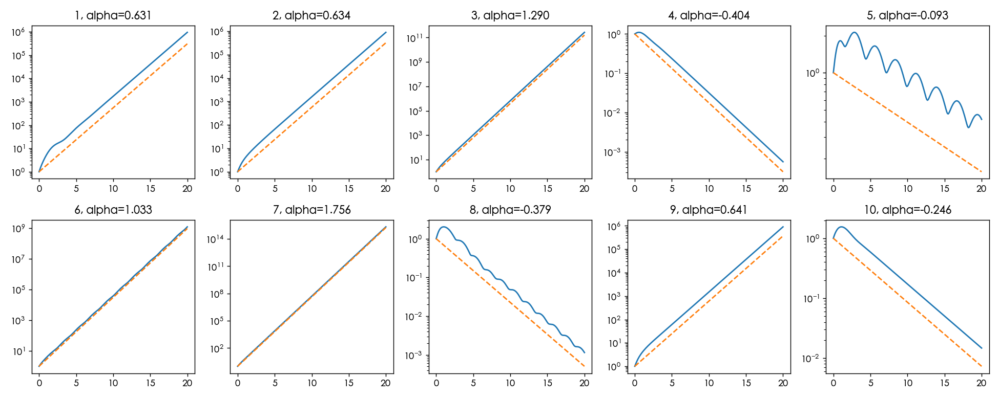

   **难度：3/5；出处：** TB：Lloyd N. Trefethen、David Bau III《数值线性代数》，陆金甫、关治译，2006（英文原版1997），第24讲习题24.3，书页166（PDF第178页），原题号24.3；**解答来源：** 自拟简解。

<!-- source-exercise:TB-ch24-24.4 -->
2. 用定理24.9证明任意有限维范数下：$(a)\|A^{n}\|\to 0$当且仅当$\rho (A)<1$；$(b)\|e^{tA}\|\to 0$当且仅当$\alpha (A)<0$。

   **答案：** Jordan块$(\lambda I+N)^{n}$是有限和$\operatorname{binom}(n,j)\lambda ^{n-j}N^{j}$；$|\lambda |<1$使多项式乘几何因子趋0，$\lambda =0$块有限步零。反之若有$|\lambda |\ge 1$，单位特征向量上$\|A^{n} x\|=|\lambda |^{n}\|x\|$不趋0。Jordan指数为$e^{t\lambda }$有限t多项式，$Re\lambda <0$全部衰减；反之$Re\lambda \ge 0$特征向量上$e^{tA}x=e^{t\lambda }x$不衰减。相似基仅给固定常数，有限维范数等价完成任意范数。

   **难度：3/5；出处：** TB：Lloyd N. Trefethen、David Bau III《数值线性代数》，陆金甫、关治译，2006（英文原版1997），第24讲习题24.4，书页166（PDF第178页），原题号24.4；**解答来源：** 自拟简解。

### 对角相似缩放改进 Gershgorin 盘

**图谱路径：** 数值分析 / 第6章 非对称特征值问题 / 对角相似缩放改进 Gershgorin 盘

**知识内容：** [定义、定理与方法](知识点.md#kp-tb-ch24-scaled-gershgorin)

<!-- source-exercise:TB-ch24-24.2 -->
1. Gershgorin：每个特征值在行盘$D(a_{ii},\sum_{j\ne i}|a_{ij}|)$；若n个盘成与其他盘分离的连通区域，该区域恰有n个特征值。(a)证明第一部分；(b)证明计数部分，提示连续变至对角；(c)$A=[[8,1,0],[1,4,\varepsilon ],[0,\varepsilon ,1]]$、$|\varepsilon |<1$，估谱；(d)对最小$\lambda _{3}$改进为$|\lambda _{3}-1|\le \varepsilon ^{2}$，提示对角相似。

   **答案：** (a)规范特征向量使$\operatorname{max}|x_{i}|=|x_{k}|=1$，由$(\lambda -a_{kk})x_{k}=\sum_{j\ne k}a_{kj} x_{j}$得目标行盘。(b)$A(t)=\operatorname{diagA}+t(A-\operatorname{diagA})$，t从0到1；各盘缩在原盘内，原分离区域之间没有谱穿越，特征值按重数连续，总数由$t=0$的n个中心继承。(c)实$\varepsilon$时盘区间[7,9]、$[3-|\varepsilon |,5+|\varepsilon |]$、$[1-|\varepsilon |,1+|\varepsilon |]$各分离，恰各1根；所以最大在[7,9]、中在第二区间、最小在第三。$(d)\varepsilon \ne 0$取$D=\operatorname{diag}(1,1,1/|\varepsilon |)$，缩放第三盘半径$\varepsilon ^{2}$，第二半径2，第一半径1，第三在$[1-\varepsilon ^{2},1+\varepsilon ^{2}]$严格离[2,6]，故最小根在此；$\varepsilon =0$直接$\lambda _{3}=1$。原题未明示$\varepsilon$实，涉及最小值和$\varepsilon ^{2}\le$时按实参数；复$\varepsilon$只能写$|\varepsilon |^{2}$半径和唯一近1根，不能排序复谱。

   **难度：3/5；出处：** TB：Lloyd N. Trefethen、David Bau III《数值线性代数》，陆金甫、关治译，2006（英文原版1997），第24讲习题24.2，书页165—166（PDF第177—178页），原题号24.2；**解答来源：** 自拟简解。

### 线性和超线性迭代达到精度的次数

**图谱路径：** 数值分析 / 第6章 非对称特征值问题 / 线性和超线性迭代达到精度的次数

**知识内容：** [定义、定理与方法](知识点.md#kp-tb-ch25-iteration-accuracy-work)

<!-- source-exercise:TB-ch25-25.2 -->
1. $e_{k}$非负趋0，充分大k时$e_{k+1}\le C e_{k}^\alpha$，单步O(1)。(a)线性$\alpha =1,C<1$达O(u)的总工作量O(|logu|)，把C放进界；$(b)\alpha >1$为O(log|logu|)，提示$f_{k}=C^{1/(\alpha -1)}e_{k}$，把$\alpha$放进界。

   **答案：** 进入假设区后的初值$e_{0}$，线性$e_{k}\le C^{k}e_{0}$，取$k\ge \operatorname{log}(e_{0}/u)/|\operatorname{logC}|$即可。超线性取$f_{0}<1$，$f_{k}\le f_{0}^{\alpha ^{k}}$；目标$f_{k}\le C^{1/(\alpha -1)}u$等价$\alpha ^{k}\ge \operatorname{log}[1/(C^{1/(\alpha -1)}u)]/\operatorname{log}(1/f_{0})$，故k为此比值的log再除$\operatorname{log}\alpha$，上取整。原$e_{k}$可能更快收敛，上述是足够工作上界，不能由≤单独证明所有迭代均需要同样下界。

   **难度：3/5；出处：** TB：Lloyd N. Trefethen、David Bau III《数值线性代数》，陆金甫、关治译，2006（英文原版1997），第25讲习题25.2，书页170—171（PDF第182—183页），原题号25.2；**解答来源：** 自拟简解。

### 酉消零的 Gram 不变量和秩限制

**图谱路径：** 数值分析 / 第6章 非对称特征值问题 / 酉消零的 Gram 不变量和秩限制

**知识内容：** [定义、定理与方法](知识点.md#kp-tb-ch25-unitary-zero-pattern)

<!-- source-exercise:TB-ch25-25.3 -->
1. $3\times 3$矩阵欲酉左右乘引零，×表示允许任意条目。目标$(a)[[\times ,\times ,0],[0,\times ,\times ],[0,0,\times ]]$；$(b)[[\times ,\times ,0],[\times ,0,\times ],[0,\times ,\times ]]$；$(c)[[\times ,\times ,0],[0,0,\times ],[0,0,\times ]]$。分别判断对一般输入：(i)只左乘可达，(ii)需左右，(iii)左右也不可，证明。

   **答案：** (a)(ii)：左酉若达此模式，第一和第三列必正交，原列Gram未必如此；双侧SVD可达对角，属于所给零模式，也可用Golub–Kahan成上双对角。(b)(ii)：秩一且三列相同非零的输入，左酉后三列仍相同，三处分属各行的零迫三列全零，矛盾；甚至近该矩阵的某些满秩输入也由酉群紧性不能达到。双侧SVD后换第2/3列得$[[\sigma _{1},0,0],[0,0,\sigma _{2}],[0,\sigma _{3},0]]$符合目标。(c)(iii)：该模式前两列同在$e_{1}$方向，秩$\le 2$；任意满秩输入经左右酉仍秩3，故不可能。分类指对任意一般输入，不排除某些特殊低秩矩阵偶然符合。

   **难度：3/5；出处：** TB：Lloyd N. Trefethen、David Bau III《数值线性代数》，陆金甫、关治译，2006（英文原版1997），第25讲习题25.3，书页171（PDF第183页），原题号25.3；**解答来源：** 自拟简解。

### 预解式、伪谱与暂态增长的联系

**图谱路径：** 数值分析 / 第6章 非对称特征值问题 / 预解式、伪谱与暂态增长的联系

**知识内容：** [定义、定理与方法](知识点.md#kp-tb-ch26-resolvent-transient)

<!-- source-exercise:TB-ch26-26.1 -->
1. 证明$\varepsilon >0$下四条件等价：z为A+E的特征值、$\|E\|_{2}\le \varepsilon$；(ii)有单位u使$\|(A-zI)u\|\le \varepsilon$；$(\operatorname{iii})\sigma _{\min}(zI-A)\le \varepsilon$；$(iv)\|(zI-A)^{-1}\|_{2}\ge \varepsilon ^{-1}$，谱点约定预解式范数∞。

   **答案：** (i)取单位特征向量 $u$，$(A-zI)u=-Eu$ 得(ii)。反由(ii)取 $E=-[(A-zI)u]u^*$，$\|E\|_2=\|(A-zI)u\|_2\le\varepsilon$ 且 $(A+E)u=zu$。(ii)与(iii)等价是最小奇异值变分式；非奇异时 $\|(zI-A)^{-1}\|_2=1/\sigma_{\min}(zI-A)$ 给(iv)等价，奇异时两边约定同时成立。矩阵扰动范数是绝对 $\varepsilon$，不能误写为 $\varepsilon\|A\|_2$。

   **难度：2/5；出处：** TB：Lloyd N. Trefethen、David Bau III《数值线性代数》，陆金甫、关治译，2006（英文原版1997），第26讲习题26.1，书页176（PDF第188页），原题号26.1；**解答来源：** 自拟简解。

<!-- source-exercise:TB-ch26-26.2 -->
2. $A 32\times 32$，主对角−1、第一/第二上邻1、其余0。(a)编SVD画$\varepsilon =10^{-1},\ldots ,10^{-8}$的2范数伪谱边界；$(b)0\le t\le 50$画$\|e^{tA}\|_{2}$半对数图，给最终衰减前初始增长速率并联系伪谱。

   **答案：** 在$181\times 181$复网格计算$\sigma _{\min}(zI-A)$，作全部8条等值线；这些是网格近似边界，未声称解析精确曲线。A谱全−1，但伪谱明显向右伸；实算$\|e^{tA}\|$在t≈21.5达约278675.64，随后衰减。初始右导数$d(\operatorname{log}\|e^{tA}\|)/dt|_{0}^{+}=\lambda _{\max}((A+A^{T})/2)$≈0.97813901，所以开始像$e^{.978t}$增长；该值不是特征谱横坐标−1。用Laplace预解式下界$\operatorname{sup}_{t}\|e^{tA}\|\ge (Re z)/\varepsilon$（z在右半面的$\varepsilon$边界）联系图中暂态，谱只说明最终衰减。

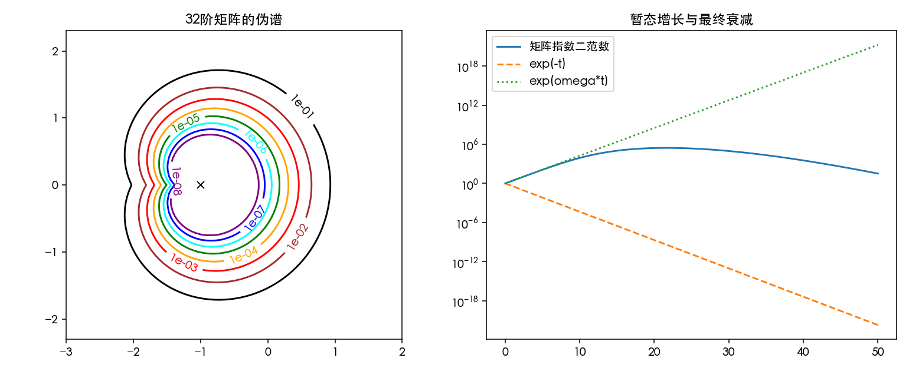

   **难度：4/5；出处：** TB：Lloyd N. Trefethen、David Bau III《数值线性代数》，陆金甫、关治译，2006（英文原版1997），第26讲习题26.2，书页176（PDF第188页），原题号26.2；**解答来源：** 自拟简解。

<!-- source-exercise:TB-ch26-26.3 -->
3. $A=V\Lambda V^{-1}$可对角化，任意E。(a)用26.1(i)(iv)证明A+E每个特征值距A某特征值$\le \kappa _{2}(V)\|E\|_{2}$（Bauer–Fike）；A正规时证明半径可取$\|E\|_{2}$。

   **答案：** 若$\mu$已经为A谱点结论成立，否则由伪谱有$\|(\mu I-A)^{-1}\|\ge 1/\|E\|$；而逆$=V(\mu I-\Lambda )^{-1}V^{-1}$，其范数$\le \kappa (V)/\operatorname{min}_{j}|\mu -\lambda _{j}|$。合并得到距离$\le \kappa (V)\|E\|$。$E=0$直接同谱，不需除0。正规时可取酉V，$\kappa _{2}=1$；结论是每个扰动特征值存在某原谱点，未自动给任意一一编号的误差界。

   **难度：2/5；出处：** TB：Lloyd N. Trefethen、David Bau III《数值线性代数》，陆金甫、关治译，2006（英文原版1997），第26讲习题26.3，书页176（PDF第188页），原题号26.3；**解答来源：** 自拟简解。

### 数值值域及其凸性

**图谱路径：** 数值分析 / 第6章 非对称特征值问题 / 数值值域及其凸性

**知识内容：** [定义、定理与方法](知识点.md#kp-tb-ch27-field-of-values)

<!-- source-exercise:TB-ch27-27.1 -->
1. 任意复方阵A，证明z是某向量Rayleigh商当且仅当z为某酉Q的$Q^{*}AQ$的一个对角元素。

   **答案：** Rayleigh商规范x为单位，补成酉Q的第j列，则$(Q^{*}AQ)_{jj}=x^{*}Ax=z$。反之取该单位列$x=Qe_{j}$，立即得到$z=r(x)$。实正交版本只覆盖实向量值，复W(A)须用酉Q。

   **难度：1/5；出处：** TB：Lloyd N. Trefethen、David Bau III《数值线性代数》，陆金甫、关治译，2006（英文原版1997），第27讲习题27.1，书页183（PDF第195页），原题号27.1；**解答来源：** 自拟简解。

<!-- source-exercise:TB-ch27-27.2 -->
2. W(A)为全部非零复向量的Rayleigh商。(a)证明W(A)是包含A特征值的凸包（按译文），(b)正规A时W(A)等于谱凸包。

   **答案：** (a)准确内容是“W(A)凸且包含谱的凸包”。每个特征向量给$\lambda \in W$；凸性可这样证明：任意两单位向量压缩到其$\le 2$维张成空间。$2\times 2$矩阵写$a_{0}I+\sum _{j=1}^{3}a_{j}\sigma _{j}$（Pauli基），单位复向量的三个实期望坐标遍历实单位球面$S^{2}$；其到复平面C≈$R^{2}$的线性像是实椭圆盘（核至少1维，球面投影填满盘），故两点间线段属于压缩W、也属于原W。凸且含谱就含其凸包。一般不等于凸包，例如[[0,2],[0,0]]谱{0}，W为单位圆盘。(b)正规酉对角化后$r=\Sigma |x_{j}|^{2}\lambda _{j}$；权非负和1且任意此权都可由$|x_{j}|$取得，所以恰等于谱凸包。

   **难度：3/5；出处：** TB：Lloyd N. Trefethen、David Bau III《数值线性代数》，陆金甫、关治译，2006（英文原版1997），第27讲习题27.2，书页183（PDF第195页），原题号27.2；**解答来源：** 自拟简解。

   **勘误：** 译文(a)易读作总等于谱凸包，应为凸性与包含；(b)才给正规等式。

<!-- source-exercise:TB-ch27-27.6 -->
3. A的两个实对称特征值相等时，图27-1的Rayleigh商平稳点怎样改变？

   **答案：** 其二维特征子空间的任意非零向量都有相同Rayleigh值；单位球上的平稳点从两个对径轴点扩展为该空间的整条大圆$S^{1}$。一般重数r给$S^{r-1}$平稳流形。若三维全部特征值相等，整球均平稳，不能再将固定特征向量当孤立极值。

   **难度：2/5；出处：** TB：Lloyd N. Trefethen、David Bau III《数值线性代数》，陆金甫、关治译，2006（英文原版1997），第27讲习题27.6，书页183（PDF第195页），原题号27.6；**解答来源：** 自拟简解。

### 非 Hermitian Rayleigh 估计与 RQI 局部阶

**图谱路径：** 数值分析 / 第6章 非对称特征值问题 / 非 Hermitian Rayleigh 估计与 RQI 局部阶

**知识内容：** [定义、定理与方法](知识点.md#kp-tb-ch27-nonnormal-rqi-order)

<!-- source-exercise:TB-ch27-27.3 -->
1. 证明非Hermitian A的Rayleigh特征值估计一般仅线性准确，不是二次，并说明这提示非Hermitian RQI收敛速度怎样。

   **答案：** 单位右q满足$Aq=\lambda q$，展开商得$r(q+e)=\lambda +q^{*}(A-\lambda I)e+O(\|e\|^{2})$。Hermitian还使$q^{*}A=\lambda q^{*}$，消去线性项；一般则无。例$A=[[\lambda ,a],[0,\nu ]]$、$q=e_{1}$，$r((1,t))-\lambda =a t+O(t^{2})$。孤立简单$\lambda$附近，位移误差O(e)，逆解规范后的非目标分量再乘O(位移误差)，故一轮$O(e^{2})$，一般局部二次；Hermitian位移$O(e^{2})$则三次。重根/缺谱隙不在此结论内。

   **难度：3/5；出处：** TB：Lloyd N. Trefethen、David Bau III《数值线性代数》，陆金甫、关治译，2006（英文原版1997），第27讲习题27.3，书页183（PDF第195页），原题号27.3；**解答来源：** 自拟简解。

<!-- source-exercise:TB-ch27-27.4 -->
2. 利用实对称矩阵正交对角化，仅设$A=\operatorname{diag}(\lambda _{1},\ldots ,\lambda _{m})$，$|\lambda _{1}|>\ldots >$；重写(27.4)幂法、(27.5)反幂法收敛及算法27.3 RQI。

   **答案：** 幂法$x_{j}^(k)$正比$\lambda _{j}^{k} x_{j}^(0)$，首分量非零时非优势/优势比$(x_{j}^{0}/x_{1}^{0})(\lambda _{j}/\lambda _{1})^{k}$，向量符号由$\lambda _{1}$调整，误差率$|\lambda _{2}/\lambda _{1}|$，Rayleigh值误差平方该率。固定$\mu$反幂把各$\lambda _{j}$换$1/(\lambda _{j}-\mu )$，若$\lambda _J$距$\mu$最近且严格小于次近，角误差率$\operatorname{max}_{j\ne J}|(\lambda _J-\mu )/(\lambda _{j}-\mu )|$，Rayleigh误差平方。RQI：$\rho _{k}=\Sigma \lambda _{j}(x_{j}^{k})^{2}/\Sigma (x_{j}^{k})^{2}$；$w_{j}=x_{j}^{k}/(\lambda _{j}-\rho _{k})$，$x^{k+1}=w/\|w\|$。若位移恰等某$\lambda$且残差已0则停止；不能盲除0。简单根附近此$\rho$误差O(角²)、下一角O(角³)。

   **难度：3/5；出处：** TB：Lloyd N. Trefethen、David Bau III《数值线性代数》，陆金甫、关治译，2006（英文原版1997），第27讲习题27.4，书页183（PDF第195页），原题号27.4；**解答来源：** 自拟简解。

### 病态反幂求解的幅值与方向

**图谱路径：** 数值分析 / 第6章 非对称特征值问题 / 病态反幂求解的幅值与方向

**知识内容：** [定义、定理与方法](知识点.md#kp-tb-ch27-inverse-iteration-direction)

<!-- source-exercise:TB-ch27-27.5 -->
1. 实对称A有一极小绝对特征值（置$\mu =0$），v在各特征方向有分量。$Aw=v$后向稳定得到ŵ，即使ŵ与w差大，说明规范方向仍很接近，为何病态不致命。

   **答案：** 设极小$\lambda _{1}$与其他$|\lambda _{j}|\ge \operatorname{gap}$分离、$v_{1}=q_{1}^{T}v$非零且相对不太小。准确$w=(v_{1}/\lambda _{1})q_{1}+\sum _{j>1}(v_{j}/\lambda _{j})q_{j}$，规范角误差$O((|\lambda _{1}|/\operatorname{gap})\|v_\perp \|/|v_{1}|)$。后向求解把A改$E=O(u)\|A\|$；小扰动使孤立目标方向只变$O(\|E\|/\operatorname{gap})$，并可把$\lambda _{1}$幅值大改甚至改变符号。因此规范后主要保留目标方向，幅值差被除掉，预期角误差上述两项之和。若$v_{1}$过小、谱簇或扰动大到gap尺度，此论证失效；原“各有分量”不能给统一精度常数，需补投影条件。

   **难度：3/5；出处：** TB：Lloyd N. Trefethen、David Bau III《数值线性代数》，陆金甫、关治译，2006（英文原版1997），第27讲习题27.5，书页183（PDF第195页），原题号27.5；**解答来源：** 自拟简解。

### Arnoldi 特征多项式的向量最优解释

**图谱路径：** 数值分析 / 第6章 非对称特征值问题 / Arnoldi 特征多项式的向量最优解释

**知识内容：** [定义、定理与方法](知识点.md#kp-tb-ch34-arnoldi-optimal-polynomial)

<!-- source-exercise:TB-ch34-34.1 -->
1. $p(z)=\sum _{j=0}^{n} c_{j} z^{j}$，A稠密$m\times m$。(a)纸上Horner循环先算p(A)再乘b，给首项flop；(b)一开始带入b，给更好循环及首项；(c)为何矩阵/向量多项式中Horner比逐幂法没有标量情形那样大优势？

   **答案：** (a)$P=c_{n} I$，$\operatorname{for} j=n-1,\ldots ,0$：$P=A P+c_{j}I$，最后$v=P b$。约n次稠密矩阵乘首项$2nm^{3}$，加尾$\operatorname{matvec}2m^{2}$及较低阶加法。(b)$v=c_{n} b$，$\operatorname{for} j=n-1,\ldots ,0$：$v=A v+c_{j} b$，首项$2nm^{2}$，明显避免形成稠密p(A)。(c)逐次生成$A^{j}$或$A^{j} b$也分别只有n−1/ n个矩阵乘或matvec，系数缩放/相加仅低阶$m^{2}$或m；Horner省不了占优势的这些乘法数，因此二者首项同阶。不要把每幂都独立从头相乘造成$O(n^{2})$的人为浪费当“明显逐幂法”。

   **难度：3/5；出处：** TB：Lloyd N. Trefethen、David Bau III《数值线性代数》，陆金甫、关治译，2006（英文原版1997），第34讲习题34.1，书页230—231（PDF第242—243页），原题号34.1；**解答来源：** 自拟简解。

<!-- source-exercise:TB-ch34-34.3 -->
2. $N=64$上双对角A，$a_{kk}=a_{k,k+1}=k^{-1/2}$。(a)画准确谱及$\varepsilon =10^{-1},10^{-2},10^{-3},10^{-4}$伪谱边界；(b)随机b做$\operatorname{Arnoldi} n=1,\ldots ,30$，Ritz及收敛速度图；(c)用矩形$\overline{H}_{n}$的$\varepsilon$伪谱，$n=5,10,15,20$，与A比较（zI的矩形等价，逆可理解最小奇异值/广义逆）。

   **答案：** 准确谱为$1/\sqrt{k}$，不能把指数OCR误读成1/k。工具/verify_tb_34.py用两遍MGS构造Arnoldi，正交残差$1.76\times 10^{-15}$；$151\times 151$网格对A及四个$(n+1)\times n \overline{H}$逐点SVD。$n=30$时距$\lambda _{1}$、$\lambda _{2}$、$\lambda _{3}$、$\lambda _{5}$最近Ritz误差约$2.22\times 10^{-16}$、$1.04\times 10^{-8}$、$4.27\times 10^{-5}$、0.01617，分离较大根优先、内部根较慢。矩形H̄用$\sigma _{\min}(zI_{n+1,n}-\overline{H})$等值线；n5网格最小$\sigma$≈0.0737，只有$\varepsilon 0.1$线，n10可画.01/.1，n15可画.001/.01/.1，n20全4条。缺失较小$\varepsilon$等值线是当前Krylov残差尚达不到阈值，不是漏作。各图灰线为A真伪谱、彩线为压缩近似，增加n逐步改善；有限网格分辨率不提供准确边界定理。

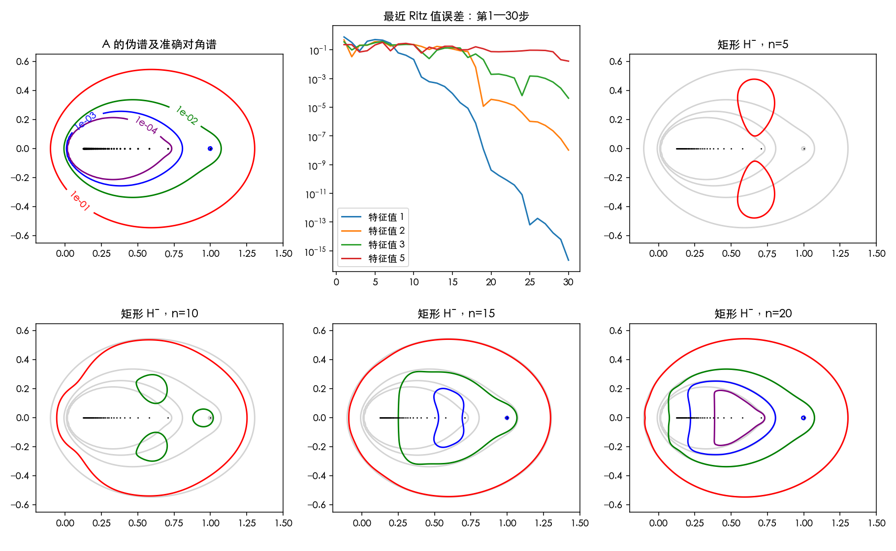

   **难度：4/5；出处：** TB：Lloyd N. Trefethen、David Bau III《数值线性代数》，陆金甫、关治译，2006（英文原版1997），第34讲习题34.3，书页231（PDF第243页），原题号34.3；**解答来源：** 自拟简解。

### Arnoldi 多项式双纽线与谱近似

**图谱路径：** 数值分析 / 第6章 非对称特征值问题 / Arnoldi 多项式双纽线与谱近似

**知识内容：** [定义、定理与方法](知识点.md#kp-tb-ch34-arnoldi-lemniscate)

<!-- source-exercise:TB-ch34-34.3 -->
1. $N=64$上双对角A，$a_{kk}=a_{k,k+1}=k^{-1/2}$。(a)画准确谱及$\varepsilon =10^{-1},10^{-2},10^{-3},10^{-4}$伪谱边界；(b)随机b做$\operatorname{Arnoldi} n=1,\ldots ,30$，Ritz及收敛速度图；(c)用矩形$\overline{H}_{n}$的$\varepsilon$伪谱，$n=5,10,15,20$，与A比较（zI的矩形等价，逆可理解最小奇异值/广义逆）。

   **答案：** 准确谱为$1/\sqrt{k}$，不能把指数OCR误读成1/k。工具/verify_tb_34.py用两遍MGS构造Arnoldi，正交残差$1.76\times 10^{-15}$；$151\times 151$网格对A及四个$(n+1)\times n \overline{H}$逐点SVD。$n=30$时距$\lambda _{1}$、$\lambda _{2}$、$\lambda _{3}$、$\lambda _{5}$最近Ritz误差约$2.22\times 10^{-16}$、$1.04\times 10^{-8}$、$4.27\times 10^{-5}$、0.01617，分离较大根优先、内部根较慢。矩形H̄用$\sigma _{\min}(zI_{n+1,n}-\overline{H})$等值线；n5网格最小$\sigma$≈0.0737，只有$\varepsilon 0.1$线，n10可画.01/.1，n15可画.001/.01/.1，n20全4条。缺失较小$\varepsilon$等值线是当前Krylov残差尚达不到阈值，不是漏作。各图灰线为A真伪谱、彩线为压缩近似，增加n逐步改善；有限网格分辨率不提供准确边界定理。

   **难度：4/5；出处：** TB：Lloyd N. Trefethen、David Bau III《数值线性代数》，陆金甫、关治译，2006（英文原版1997），第34讲习题34.3，书页231（PDF第243页），原题号34.3；**解答来源：** 自拟简解。

<!-- source-exercise:TB-ch36-36.4 -->
2. 改36.3程序画Lanczos双纽线，可不要求效率/稳健。对图36-2原矩阵diag(0,.01,…,2,2.5,3)及自选例，$n=1,\ldots ,12$每步画图。

   **答案：** 用$T_{n}$特征根$\theta _{j}$算$p_{n}(z)=\prod (z-\theta _{j})$，画$|p_{n}(z)|=\prod _{j\le n}\beta _{j}$，后者由Lanczos递推等于$\|p_{n}(A)q_{1}\|$。原203阶对角例及自选36.3五带1000阶例各12幅实际完成，随机种子固定；各Ritz与等值水平保存。原例2.5、3离群分支先收缩；1000阶自选图按实际谱尺度显示，初n小分支可宽并混连。图是有限复网格等值线，未称稳定最优实现。

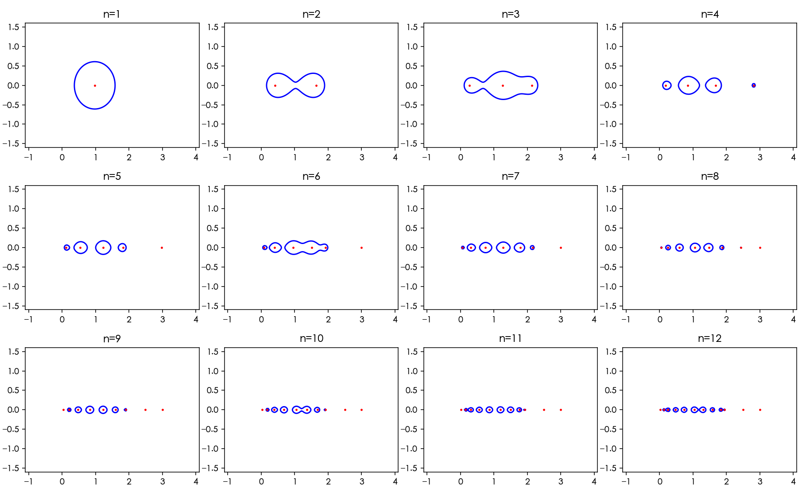

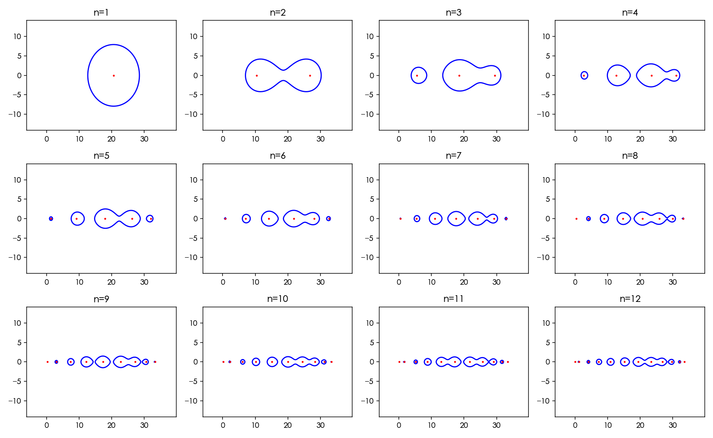

   **难度：4/5；出处：** TB：Lloyd N. Trefethen、David Bau III《数值线性代数》，陆金甫、关治译，2006（英文原版1997），第36讲习题36.4，书页246（PDF第258页），原题号36.4；**解答来源：** 自拟简解。

### 理想 Arnoldi 多项式的存在与非零唯一性

**图谱路径：** 数值分析 / 第6章 非对称特征值问题 / 理想 Arnoldi 多项式的存在与非零唯一性

**知识内容：** [定义、定理与方法](知识点.md#kp-tb-ch34-ideal-arnoldi)

<!-- source-exercise:TB-ch34-34.2 -->
1. 理想Arnoldi多项式$p^{*}$为monic n次中最小化$\|p(A)\|_{2}$者。(a)证明存在；(b)若$p^{*}(A)\ne 0$证明唯一。提示取两极小者平均，考虑最大奇异向量。

   **答案：** (a)在有限维矩阵空间，低次$\operatorname{span}(I,A,\ldots ,A^{n-1})$闭；取有界极小矩阵序列，在闭仿射集$A^{n}+\operatorname{span}$上有收敛子列达到最小，再选其多项式系数。(b)设两不同极小$p_{1},p_{2}$同范数$\gamma >0$，$p=(p_{1}+p_{2})/2$也极小。对任何p(A)最大右奇异向量v，$\|p(A)v\|=\gamma$且$\|p_{i}(A)v\|\le \gamma$，Hilbert球严格凸性迫$p_{1}(A)v=p_{2}(A)v=p(A)v$，因此$r(A)v=0$，$r=p_{1}-p_{2}\ne 0$、$\operatorname{degr}<n$。以$p=s r+t$作多项式除法，$\operatorname{degt}<\operatorname{degr}<n$，则$t(A)v=p(A)v$对所有最大右奇异向量。于是单调小扰动$p_\varepsilon =p-\varepsilon t$仍monic n次，在最大右奇异子空间上$(p_\varepsilon (A))^{*}p_\varepsilon (A)$的导数为$-2\gamma ^{2}I$。其余奇异子空间与$\gamma ^{2}$有正间隙；分块估计交叉项$O(\varepsilon )\|v\|\|w\|$，用间隙吸收为$O(\varepsilon ^{2})\|v\|^{2}$，故充分小$\varepsilon >0$全体最大奇异值平方$\le \gamma ^{2}-\gamma ^{2}\varepsilon$，严格减小范数，矛盾。若r为非零常数，则$r(A)v=0$已直接矛盾。$\gamma =0$时该下降论证不适用，也确可不唯一。

   **难度：4/5；出处：** TB：Lloyd N. Trefethen、David Bau III《数值线性代数》，陆金甫、关治译，2006（英文原版1997），第34讲习题34.2，书页231（PDF第243页），原题号34.2；**解答来源：** 自拟简解。

### 不变子空间的矩阵表示

**图谱路径：** 数值分析 / 第6章 非对称特征值问题 / 不变子空间的矩阵表示

**知识内容：** [定义、定理与方法](知识点.md#kp-xh-ch06-invariant-subspace)

已整理范围内未另选可直接对应此节点的独立未解题；相关已解例子见知识内容。

### 共轭特征值的实二维空间

**图谱路径：** 数值分析 / 第6章 非对称特征值问题 / 共轭特征值的实二维空间

**知识内容：** [定义、定理与方法](知识点.md#kp-xh-ch06-complex-real-pair)

已整理范围内未另选可直接对应此节点的独立未解题；相关已解例子见知识内容。

### Bauer–Fike 整体谱扰动界

**图谱路径：** 数值分析 / 第6章 非对称特征值问题 / Bauer–Fike 整体谱扰动界

**知识内容：** [定义、定理与方法](知识点.md#kp-xh-ch06-bauer-fike)

已整理范围内未另选可直接对应此节点的独立未解题；相关已解例子见知识内容。

### 秩一特征值收缩

**图谱路径：** 数值分析 / 第6章 非对称特征值问题 / 秩一特征值收缩

**知识内容：** [定义、定理与方法](知识点.md#kp-xh-ch06-rankone-deflation)

<!-- source-exercise:XH-ch06-2 -->
1. $Ax_{i}=\lambda _{i} x_{i}$，$v_{1}^{T}x_{1}=1$，且所用xi（$i\ge 2$）与$x_{1}$独立。证明$B=(I-x_{1}v_{1}^{T})A$的谱为$0,\lambda _{2},\ldots ,\lambda _{n}$，对应向量$x_{1}$与$xi-(v_{1}^{T}xi)x_{1}$。

   **答案：** $Bx_{1}=0$；记$c=v_{1}^{T}xi$，则$B(xi-cx_{1})=\lambda _{i} xi-c\lambda _{1}x_{1}-x_{1}(c\lambda _{i}-c\lambda _{1})=\lambda _{i}(xi-cx_{1})$。独立性保证新向量非零。谱声明也可在以$x_{1}$开头的任意基中见到A块上三角，B将首对角$\lambda _{1}$置0；不需假定整体可对角化。

   **难度：3/5；出处：** XH：向华、杨志坚《数值线性代数》，2024年所附版，第6章习题2，书页107（PDF第111页），原题号2；**解答来源：** 自拟简解。

   **勘误：** 原题未明确xi不得与$x_{1}$相关；若$xi=x_{1}$则公式给零向量，不能称特征向量。已明确非零新向量所需条件，谱声明仍一般成立。

### Sylvester 算子的分离度

**图谱路径：** 数值分析 / 第6章 非对称特征值问题 / Sylvester 算子的分离度

**知识内容：** [定义、定理与方法](知识点.md#kp-xh-ch06-sylvester-separation)

已整理范围内未另选可直接对应此节点的独立未解题；相关已解例子见知识内容。

### 分离度的 Kronecker 表达

**图谱路径：** 数值分析 / 第6章 非对称特征值问题 / 分离度的 Kronecker 表达

**知识内容：** [定义、定理与方法](知识点.md#kp-xh-ch06-separation-kronecker)

已整理范围内未另选可直接对应此节点的独立未解题；相关已解例子见知识内容。

### 不变子空间的一阶扰动

**图谱路径：** 数值分析 / 第6章 非对称特征值问题 / 不变子空间的一阶扰动

**知识内容：** [定义、定理与方法](知识点.md#kp-xh-ch06-invariant-perturbation)

已整理范围内未另选可直接对应此节点的独立未解题；相关已解例子见知识内容。

### 伪谱的预解式定义

**图谱路径：** 数值分析 / 第6章 非对称特征值问题 / 伪谱的预解式定义

**知识内容：** [定义、定理与方法](知识点.md#kp-xh-ch06-pseudospectrum-resolvent)

已整理范围内未另选可直接对应此节点的独立未解题；相关已解例子见知识内容。

### 伪谱的邻近矩阵解释

**图谱路径：** 数值分析 / 第6章 非对称特征值问题 / 伪谱的邻近矩阵解释

**知识内容：** [定义、定理与方法](知识点.md#kp-xh-ch06-pseudospectrum-perturbation)

已整理范围内未另选可直接对应此节点的独立未解题；相关已解例子见知识内容。

### 交换子与等谱流

**图谱路径：** 数值分析 / 第6章 非对称特征值问题 / 交换子与等谱流

**知识内容：** [定义、定理与方法](知识点.md#kp-xh-ch06-isospectral-flow)

已整理范围内未另选可直接对应此节点的独立未解题；相关已解例子见知识内容。

### PageRank 的特征向量观点

**图谱路径：** 数值分析 / 第6章 非对称特征值问题 / PageRank 的特征向量观点

**知识内容：** [定义、定理与方法](知识点.md#kp-xh-ch06-pagerank-eigenproblem)

已整理范围内未另选可直接对应此节点的独立未解题；相关已解例子见知识内容。

### 质量弹簧的广义特征模式

**图谱路径：** 数值分析 / 第6章 非对称特征值问题 / 质量弹簧的广义特征模式

**知识内容：** [定义、定理与方法](知识点.md#kp-xh-ch06-spring-modes)

<!-- source-exercise:XH-ch06-25 -->
1. 两质量三弹簧系统：$m_{1}\ddot{x}_1=-kx_{1}+k(x_{2}-x_{1})$、$m_{2}\ddot{x}_2=-k(x_{2}-x_{1})-kx_{2}$。$m_{1}=m_{2}=40kg$、$k=200N/m$，求两振动周期。

   **答案：** 取$x=a \operatorname{sin}\omega t$得$[[10,-5],[-5,10]]a=\omega ^{2}a$。谱值5、15分别对应同向(1,1)、反向(1,−1)，所以$\omega =\sqrt{5}$、$\sqrt{15}$，周期$2\pi /\sqrt{5}$≈2.8099秒、$2\pi /\sqrt{15}$≈1.6223秒。

   **难度：2/5；出处：** XH：向华、杨志坚《数值线性代数》，2024年所附版，第6章习题25，书页109（PDF第113页），原题号25；**解答来源：** 自拟简解。

### 特征值与左右特征向量

**图谱路径：** 数值分析 / 第6章 非对称特征值问题 / 特征值与左右特征向量

**知识内容：** [定义、定理与方法](知识点.md#kp-xu-ch06-eigenpair)

<!-- source-exercise:XU-ch06-1 -->
1. $A$ 为 $n\times m$、$B$ 为 $m\times n$，$m\ge n$。证明 $BA$ 的特征值多重集为 $AB$ 的全部特征值加 $m-n$ 个0。

   **答案：** 用分块行列式或 Sylvester 恒等式 $\det(I_m+tBA)=\det(I_n+tAB)$，得 $\det(\lambda I_m-BA)=\lambda^{m-n}\det(\lambda I_n-AB)$；起初对非零 $\lambda$ 推出，后由多项式恒等延至0。故代数重数也一致。

   **难度：3/5；出处：** XU：徐树方、高立、张平文《数值线性代数》第二版，2013，第6章习题1，书页196（PDF第208页），原题号1；**解答来源：** 自拟简解。

### 代数重数与几何重数

**图谱路径：** 数值分析 / 第6章 非对称特征值问题 / 代数重数与几何重数

**知识内容：** [定义、定理与方法](知识点.md#kp-xu-ch06-multiplicity)

已整理范围内未另选可直接对应此节点的独立未解题；相关已解例子见知识内容。

### 非亏损矩阵与可对角化

**图谱路径：** 数值分析 / 第6章 非对称特征值问题 / 非亏损矩阵与可对角化

**知识内容：** [定义、定理与方法](知识点.md#kp-xu-ch06-diagonalizability)

已整理范围内未另选可直接对应此节点的独立未解题；相关已解例子见知识内容。

### Jordan 标准形

**图谱路径：** 数值分析 / 第6章 非对称特征值问题 / Jordan 标准形

**知识内容：** [定义、定理与方法](知识点.md#kp-xu-ch06-jordan-form)

<!-- source-exercise:XH-ch06-9 -->
1. 幂法$A=[[1,1,0],[0,1,1],[0,0,1]],q_{0}=e_{3}$，5位向量需多少步？

   **答案：** $A^{k}e_{3}=(k(k-1)/2,k,1)^{T}$，尾比2/(k−1)。按单位向量∞误差5e-6口径，约400001步；按1e-5则约200001步，原题未指定口径须说明。

   **难度：3/5；出处：** XH：向华、杨志坚《数值线性代数》，2024年所附版，第6章习题9，书页108（PDF第112页），原题号9；**解答来源：** 自拟简解。

<!-- source-exercise:XU-ch06-7 -->
2. 对 $\lambda\ne0$，分别将幂法用于 $A=\begin{pmatrix}\lambda&1\\0&\lambda\end{pmatrix}$、$B=\begin{pmatrix}\lambda&1\\0&-\lambda\end{pmatrix}$，考察向量序列特性。

   **答案：** $A^k=\lambda^k\begin{pmatrix}1&k/\lambda\\0&1\end{pmatrix}$，初始第二分量非零时方向仅按 $O(1/k)$ 趋 $e_1$，并非谱比几何收敛；第二分量0时已是特征向量。$B^2=\lambda^2I$，故偶、奇幂在去除共同尺度后形成两条固定方向，一般两周期；若初值为某特征向量则单一方向。单位归一化还可能保留全局符号或复相位。

   **难度：3/5；出处：** XU：徐树方、高立、张平文《数值线性代数》第二版，2013，第6章习题7，书页196（PDF第208页），原题号7；**解答来源：** 自拟简解。

<!-- source-exercise:XU-ch06-8 -->
3. 幂法取 $A=\begin{pmatrix}1&1&0\\0&1&1\\0&0&1\end{pmatrix}$、$u_0=(0,0,1)^T$。取得精确到5位数字的特征向量需要多少次迭代？

   **答案：** $A^ku_0=(k(k-1)/2,k,1)^T$，目标方向 $e_1$，尾部与第一分量之比为 $2/(k-1)$、$2/[k(k-1)]$。若“5位”按单位向量∞误差不超过 $5\times10^{-6}$，$k=400001$ 已满足（归一化后第二分量略小于5e-6）；若采用误差 $10^{-5}$ 标准则约200001次。误差为 $O(1/k)$，说明此Jordan例收敛极慢；原题未指定数位误差口径，答案明确所用标准。

   **难度：3/5；出处：** XU：徐树方、高立、张平文《数值线性代数》第二版，2013，第6章习题8，书页197（PDF第209页），原题号8；**解答来源：** 自拟简解。

### 相似变换保谱

**图谱路径：** 数值分析 / 第6章 非对称特征值问题 / 相似变换保谱

**知识内容：** [定义、定理与方法](知识点.md#kp-xu-ch06-similarity)

已整理范围内未另选可直接对应此节点的独立未解题；相关已解例子见知识内容。

### 复 Schur 分解

**图谱路径：** 数值分析 / 第6章 非对称特征值问题 / 复 Schur 分解

**知识内容：** [定义、定理与方法](知识点.md#kp-xu-ch06-schur)

<!-- source-exercise:TB-ch24-24.1 -->
1. 逐判断证明或反例，$A\in C^{m\times m}$：$(a)\lambda$特征值则$\lambda -\mu$是$A-\mu I$特征值；A实则$-\lambda$也是特征值；A实则$\overline{\lambda }$也是特征值；A非奇异则$\lambda ^{-1}$是$A^{-1}$特征值；(e)全部特征值0则$A=0$；A Hermitian则$|\lambda |$是奇异值；A可对角化且全特征值相等则A对角。

   **答案：** (a)真，$(A-\mu I)x=(\lambda -\mu )x$。(b)假，$A=[1]$无−1。(c)真，共轭$Ax=\lambda x$。(d)真，$A^{-1}x=\lambda ^{-1}x$。(e)假，非零幂零[[0,1],[0,0]]谱全0。(f)真，酉对角化后$A^{*}A$谱$\lambda ^{2}$，奇异值$|\lambda |$。(g)真且更强：$A=X(\lambda I)X^{-1}=\lambda I$。共7项是同一原题，不拆计。

   **难度：2/5；出处：** TB：Lloyd N. Trefethen、David Bau III《数值线性代数》，陆金甫、关治译，2006（英文原版1997），第24讲习题24.1，书页165（PDF第177页），原题号24.1；**解答来源：** 自拟简解。

<!-- source-exercise:XH-ch06-6 -->
2. A无重特征值、$AB=BA$，$A=\operatorname{QTQ}^{*}$为Schur分解。证明$Q^{*}BQ$上三角。

   **答案：** T与$S=Q^{*}BQ$交换且T对角互异，从左下位置递推交换式可令全部$s_{ij}$（$i>j$）为0；等价于B保持各Schur前缀不变空间。

   **难度：3/5；出处：** XH：向华、杨志坚《数值线性代数》，2024年所附版，第6章习题6，书页107（PDF第111页），原题号6；**解答来源：** 自拟简解。

<!-- source-exercise:XU-ch06-2 -->
3. $A_k\to A$、$A_k=Q_kT_kQ_k^*$ 为Schur分解。证明 $Q_k$ 有收敛子列，其极限 $Q$ 满足 $Q^*AQ$ 上三角。

   **答案：** 酉群为有限维矩阵空间中的有界闭集，故紧。选 $Q_{k_i}\to Q$，极限仍酉；$T_{k_i}=Q_{k_i}^*A_{k_i}Q_{k_i}\to Q^*AQ$，上三角阵集合闭，结论成立。

   **难度：2/5；出处：** XU：徐树方、高立、张平文《数值线性代数》第二版，2013，第6章习题2，书页196（PDF第208页），原题号2；**解答来源：** 自拟简解。

<!-- source-exercise:XU-ch06-3 -->
4. $A$ 无重特征值，$AB=BA$。若 $A=QTQ^*$ 为Schur分解，证明 $Q^*BQ$ 上三角。

   **答案：** 设 $S=Q^*BQ$，则 $TS=ST$，$T$ 的对角互异。对 $i>j$，从左下向右上按下三角对角线递推，该等式给 $(t_{ii}-t_{jj})s_{ij}$ 等于更靠左下、已为0的项，因此 $s_{ij}=0$。等价地，$B$ 保持由前 $j$ 个不同特征向量张成的不变子空间，而Schur前 $j$ 列给同一空间。

   **难度：3/5；出处：** XU：徐树方、高立、张平文《数值线性代数》第二版，2013，第6章习题3，书页196（PDF第208页），原题号3；**解答来源：** 自拟简解。

### Gershgorin 圆盘定位

**图谱路径：** 数值分析 / 第6章 非对称特征值问题 / Gershgorin 圆盘定位

**知识内容：** [定义、定理与方法](知识点.md#kp-xu-ch06-gershgorin)

已整理范围内未另选可直接对应此节点的独立未解题；相关已解例子见知识内容。

### 简单特征值的条件数

**图谱路径：** 数值分析 / 第6章 非对称特征值问题 / 简单特征值的条件数

**知识内容：** [定义、定理与方法](知识点.md#kp-xu-ch06-eigenvalue-conditioning)

<!-- source-exercise:XH-ch06-5 -->
1. $A=[[\alpha ,\gamma ],[0,\beta ]]$，$\alpha \ne \beta$，求$\alpha$、$\beta$的条件数。

   **答案：** 两者相同，为$\sqrt{1+|\gamma /(\alpha -\beta )|^{2}}$，由归一化左右向量夹角$1/|y^{*}x|$直接算出。

   **难度：3/5；出处：** XH：向华、杨志坚《数值线性代数》，2024年所附版，第6章习题5，书页107（PDF第111页），原题号5；**解答来源：** 自拟简解。

<!-- source-exercise:XU-ch06-5 -->
2. $A=\begin{pmatrix}\alpha&\gamma\\0&\beta\end{pmatrix}$、$\alpha\ne\beta$。求简单特征值 $\alpha,\beta$ 的2范数绝对条件数。

   **答案：** 对于 $\alpha$，右向量为 $e_1$；左向量可取 $(1,\bar\gamma/(\bar\alpha-\bar\beta))^T$ 并归一化，所得 $1/|y^*x|=\sqrt{1+|\gamma/(\alpha-\beta)|^2}$。对于 $\beta$ 交换左右对应，得到相同条件数。

   **难度：3/5；出处：** XU：徐树方、高立、张平文《数值线性代数》第二版，2013，第6章习题5，书页196（PDF第208页），原题号5；**解答来源：** 自拟简解。

<!-- source-exercise:XU-ch06-6 -->
3. 证明特征值与特征向量的2范数条件数在酉相似下不变。

   **答案：** $A\mapsto Q^*AQ$ 时归一化左右向量同时变为 $Q^*x,Q^*y$，范数和内积 $y^*x$ 不变。特征向量扰动的Schur补块也仅经酉基变换，$(\lambda I-C)^{-1}$ 的2范数不变；等价地扰动 $E\mapsto Q^*EQ$ 的大小与方向误差同时保留。

   **难度：2/5；出处：** XU：徐树方、高立、张平文《数值线性代数》第二版，2013，第6章习题6，书页196（PDF第208页），原题号6；**解答来源：** 自拟简解。

<!-- source-exercise:XU-ch06-上机2 -->
4. (1) 编写实矩阵隐式QR求全部特征值和特征向量程序；(2) 求 $x^{41}+x^3+1=0$ 全部根；(3) 求 $A(x)=\begin{pmatrix}9.1&3&2.6&4\\4.2&5.3&4.7&1.6\\3.2&1.7&9.4&x\\6.1&4.9&3.5&6.2\end{pmatrix}$ 在 $x=0.9,1,1.1$ 的全部特征值，并观察变化。

   **答案：** 先反射化Hessenberg，再用末端$1\times 1/2\times 2$移位和鼓包追赶，检测小次对角分离；积累正交变换后由实Schur块回代求向量，复杂对保留复数输出。(2) 构造41阶伴随矩阵，对全部根检查 $|z^{41}+z^3+1|$，不把41根拆为41道题。(3) 分别作Schur/特征值计算，并通过近邻匹配跟踪谱：非正规矩阵可对小元素变化很敏感，必要时结合左右向量条件数。本机实Schur程序封装调用SciPy/LAPACK隐式QR并用Schur块回代取向量；41个根全部记录，最大多项式残差约1.00e-13。参数0.9时谱约17.4396782、6.8195183、$2.8704017\pm 0.6428911i$；1时约17.4764849、6.7875166、$2.8679992\pm 0.6887474i$；1.1时约17.5130281、6.7560562、$2.8654579\pm 0.7321697i$。共轭对虚部随参数增大而增大，全部特征对残差不到3e-14。完整根和程序接口记录见处理记录/徐书第六章计算核验.json。

   **难度：5/5；出处：** XU：徐树方、高立、张平文《数值线性代数》第二版，2013，第6章习题上机2，书页202（PDF第214页），原题号上机2；**解答来源：** 自拟简解。

### 特征向量的谱分离条件

**图谱路径：** 数值分析 / 第6章 非对称特征值问题 / 特征向量的谱分离条件

**知识内容：** [定义、定理与方法](知识点.md#kp-xu-ch06-eigenvector-conditioning)

<!-- source-exercise:XU-ch06-6 -->
1. 证明特征值与特征向量的2范数条件数在酉相似下不变。

   **答案：** $A\mapsto Q^*AQ$ 时归一化左右向量同时变为 $Q^*x,Q^*y$，范数和内积 $y^*x$ 不变。特征向量扰动的Schur补块也仅经酉基变换，$(\lambda I-C)^{-1}$ 的2范数不变；等价地扰动 $E\mapsto Q^*EQ$ 的大小与方向误差同时保留。

   **难度：2/5；出处：** XU：徐树方、高立、张平文《数值线性代数》第二版，2013，第6章习题6，书页196（PDF第208页），原题号6；**解答来源：** 自拟简解。

### Rayleigh 商与最小剩余

**图谱路径：** 数值分析 / 第6章 非对称特征值问题 / Rayleigh 商与最小剩余

**知识内容：** [定义、定理与方法](知识点.md#kp-xu-ch06-rayleigh)

<!-- source-exercise:XH-ch06-4 -->
1. 实非零x，证明$R(x)=x^{T}Ax/(x^{T}x)$极小化$\|Ax-\mu x\|_{2}$。

   **答案：** Ax−Rx与x正交，平方范数分解为$\|Ax-Rx\|^{2}+(\mu -R)^{2}\|x\|^{2}$，最小在$\mu =R$。

   **难度：2/5；出处：** XH：向华、杨志坚《数值线性代数》，2024年所附版，第6章习题4，书页107（PDF第111页），原题号4；**解答来源：** 自拟简解。

<!-- source-exercise:XU-ch06-4 -->
2. $x\ne0$，$R(x)=x^*Ax/(x^*x)$。证明 $\|Ax-R(x)x\|_2=\inf_{\mu\in\mathbb C}\|Ax-\mu x\|_2$。

   **答案：** $x^*(Ax-Rx)=0$，所以 $\|Ax-\mu x\|^2=\|Ax-Rx\|^2+|R-\mu|^2\|x\|^2$。最后项非负且仅在 $\mu=R$ 时为0。

   **难度：2/5；出处：** XU：徐树方、高立、张平文《数值线性代数》第二版，2013，第6章习题4，书页196（PDF第208页），原题号4；**解答来源：** 自拟简解。

### 幂法的基本递推

**图谱路径：** 数值分析 / 第6章 非对称特征值问题 / 幂法的基本递推

**知识内容：** [定义、定理与方法](知识点.md#kp-xu-ch06-power-method)

<!-- source-exercise:TB-ch27-27.4 -->
1. 利用实对称矩阵正交对角化，仅设$A=\operatorname{diag}(\lambda _{1},\ldots ,\lambda _{m})$，$|\lambda _{1}|>\ldots >$；重写(27.4)幂法、(27.5)反幂法收敛及算法27.3 RQI。

   **答案：** 幂法$x_{j}^(k)$正比$\lambda _{j}^{k} x_{j}^(0)$，首分量非零时非优势/优势比$(x_{j}^{0}/x_{1}^{0})(\lambda _{j}/\lambda _{1})^{k}$，向量符号由$\lambda _{1}$调整，误差率$|\lambda _{2}/\lambda _{1}|$，Rayleigh值误差平方该率。固定$\mu$反幂把各$\lambda _{j}$换$1/(\lambda _{j}-\mu )$，若$\lambda _J$距$\mu$最近且严格小于次近，角误差率$\operatorname{max}_{j\ne J}|(\lambda _J-\mu )/(\lambda _{j}-\mu )|$，Rayleigh误差平方。RQI：$\rho _{k}=\Sigma \lambda _{j}(x_{j}^{k})^{2}/\Sigma (x_{j}^{k})^{2}$；$w_{j}=x_{j}^{k}/(\lambda _{j}-\rho _{k})$，$x^{k+1}=w/\|w\|$。若位移恰等某$\lambda$且残差已0则停止；不能盲除0。简单根附近此$\rho$误差O(角²)、下一角O(角³)。

   **难度：3/5；出处：** TB：Lloyd N. Trefethen、David Bau III《数值线性代数》，陆金甫、关治译，2006（英文原版1997），第27讲习题27.4，书页183（PDF第195页），原题号27.4；**解答来源：** 自拟简解。

<!-- source-exercise:XH-ch06-7 -->
2. 幂法求$A=[[4,-1,1],[-1,3,-2],[1,-2,3]]$模最大特征值，初值$(1,0,0)^{T}$，精度$\varepsilon \le 1e-7$。

   **答案：** 此对称阵谱1,3,6，最大6，单位方向$(1,-1,1)^{T}/\sqrt{3}$。按$q^{*}=Aq/\|Aq\|$、$\mu =q^{T}Aq$递推，用剩余$\le 1e-7$停止（给特征值误差保证），实际步数与近似值见处理记录/向书第六章计算核验.json。

   **难度：3/5；出处：** XH：向华、杨志坚《数值线性代数》，2024年所附版，第6章习题7，书页107（PDF第111页），原题号7；**解答来源：** 自拟简解。

<!-- source-exercise:XU-ch06-7 -->
3. 对 $\lambda\ne0$，分别将幂法用于 $A=\begin{pmatrix}\lambda&1\\0&\lambda\end{pmatrix}$、$B=\begin{pmatrix}\lambda&1\\0&-\lambda\end{pmatrix}$，考察向量序列特性。

   **答案：** $A^k=\lambda^k\begin{pmatrix}1&k/\lambda\\0&1\end{pmatrix}$，初始第二分量非零时方向仅按 $O(1/k)$ 趋 $e_1$，并非谱比几何收敛；第二分量0时已是特征向量。$B^2=\lambda^2I$，故偶、奇幂在去除共同尺度后形成两条固定方向，一般两周期；若初值为某特征向量则单一方向。单位归一化还可能保留全局符号或复相位。

   **难度：3/5；出处：** XU：徐树方、高立、张平文《数值线性代数》第二版，2013，第6章习题7，书页196（PDF第208页），原题号7；**解答来源：** 自拟简解。

### 幂法的谱比速度

**图谱路径：** 数值分析 / 第6章 非对称特征值问题 / 幂法的谱比速度

**知识内容：** [定义、定理与方法](知识点.md#kp-xu-ch06-power-rate)

<!-- source-exercise:XH-ch06-10 -->
1. $\lambda \ne 0$，幂法用于$[[\lambda ,1],[0,\lambda ]]$与$[[\lambda ,1],[0,-\lambda ]]$，观察序列。

   **答案：** 前者$A^{k}=\lambda ^{k}[[1,k/\lambda ],[0,1]]$，一般方向以1/k趋$e_{1}$；后者$B^{2}=\lambda ^{2}I$，去共同尺度后一般两周期，特征初值例外。

   **难度：3/5；出处：** XH：向华、杨志坚《数值线性代数》，2024年所附版，第6章习题10，书页108（PDF第112页），原题号10；**解答来源：** 自拟简解。

<!-- source-exercise:XH-ch06-13 -->
2. $A=X\Lambda X^{-1}$，$\lambda _{1}=e^{i\theta }\lambda _{2}$，$|\lambda _{1}|=|\lambda _{2}|>|\lambda _{3}|\ge \cdots$，$\theta =2\pi b/a$、a,b互素正整数。按$\lambda _{2}$尺度缩放的幂序列有多少收敛子列？给极限。

   **答案：** 相位周期为分母a。k≡ℓ(mod a)时$\lambda _{2}^{-k}A^{k}x_{0}$趋$e^{2\pi i\ell b/a}(y_{1}^{*}x_{0})x_{1}+(y_{2}^{*}x_{0})x_{2}$，$\ell =1,\ldots ,a$，其余谱比项衰减。单位范数版本须再统一归一化/相位。

   **难度：3/5；出处：** XH：向华、杨志坚《数值线性代数》，2024年所附版，第6章习题13，书页108（PDF第112页），原题号13；**解答来源：** 自拟简解。

   **勘误：** 原页108正文写有b个子列，但$\theta =2\pi b/a$、互素时周期应为a；同页极限列表本来也写$k=1,\ldots ,a$，已统一修正。

<!-- source-exercise:XU-ch06-7 -->
3. 对 $\lambda\ne0$，分别将幂法用于 $A=\begin{pmatrix}\lambda&1\\0&\lambda\end{pmatrix}$、$B=\begin{pmatrix}\lambda&1\\0&-\lambda\end{pmatrix}$，考察向量序列特性。

   **答案：** $A^k=\lambda^k\begin{pmatrix}1&k/\lambda\\0&1\end{pmatrix}$，初始第二分量非零时方向仅按 $O(1/k)$ 趋 $e_1$，并非谱比几何收敛；第二分量0时已是特征向量。$B^2=\lambda^2I$，故偶、奇幂在去除共同尺度后形成两条固定方向，一般两周期；若初值为某特征向量则单一方向。单位归一化还可能保留全局符号或复相位。

   **难度：3/5；出处：** XU：徐树方、高立、张平文《数值线性代数》第二版，2013，第6章习题7，书页196（PDF第208页），原题号7；**解答来源：** 自拟简解。

<!-- source-exercise:XU-ch06-8 -->
4. 幂法取 $A=\begin{pmatrix}1&1&0\\0&1&1\\0&0&1\end{pmatrix}$、$u_0=(0,0,1)^T$。取得精确到5位数字的特征向量需要多少次迭代？

   **答案：** $A^ku_0=(k(k-1)/2,k,1)^T$，目标方向 $e_1$，尾部与第一分量之比为 $2/(k-1)$、$2/[k(k-1)]$。若“5位”按单位向量∞误差不超过 $5\times10^{-6}$，$k=400001$ 已满足（归一化后第二分量略小于5e-6）；若采用误差 $10^{-5}$ 标准则约200001次。误差为 $O(1/k)$，说明此Jordan例收敛极慢；原题未指定数位误差口径，答案明确所用标准。

   **难度：3/5；出处：** XU：徐树方、高立、张平文《数值线性代数》第二版，2013，第6章习题8，书页197（PDF第209页），原题号8；**解答来源：** 自拟简解。

<!-- source-exercise:XU-ch06-30 -->
5. $A=X\Lambda X^{-1}$，$\lambda_1=e^{i\theta}\lambda_2$，$|\lambda_1|=|\lambda_2|>|\lambda_3|\ge\cdots$，$\theta=2s\pi/t$，s,t互素正整数。证明按原式以 $\lambda_2^k$ 缩放的幂序列有t条收敛子列，其极限为 $e^{2i\ell s\pi/t}(y_1^*u_0)x_1+(y_2^*u_0)x_2$，$\ell=1,\ldots,t$，$y_j^*$ 为 $X^{-1}$ 第j行。

   **答案：** 展开 $\lambda_2^{-k}A^ku_0=e^{ik\theta}c_1x_1+c_2x_2+\sum_{j\ge3}(\lambda_j/\lambda_2)^kc_jx_j$。最后和趋0；对 $k\equiv\ell\pmod t$ 相位恒为 $e^{2i\ell s\pi/t}$，给所写极限。若 $c_1=0$ 多个子列极限可相同。若使用每步单位范数的标准幂法，极限需再归一化并可能去除共同复相位。

   **难度：3/5；出处：** XU：徐树方、高立、张平文《数值线性代数》第二版，2013，第6章习题30，书页199—200（PDF第211—212页），原题号30；**解答来源：** 自拟简解。

   **整理说明：** 原式的未归一化系数对应$\lambda 2$尺度缩放；标准单位归一化序列的极限需加相同规范，不能直接照抄幅度。

<!-- source-exercise:XU-ch00-正文-168 -->
6. 修改幂法，使其可用于$\lambda _{1}=-\lambda _{2}$、$|\lambda _{1}|>|\lambda _{3}|\ge \cdots$的情形。

   **答案：** 在本节非亏损设定且初值对主二特征空间投影非零时，对$A^{2}$迭代提取主空间方向w，估计其主值$\mu =\lambda _{1}^{2}$，选平方根$\lambda$。构造$w\pm Aw/\lambda$：分别属于$\lambda$和$-\lambda$方向，非零者归一化。若某项为0，初值只含其中一个方向，该项跳过。也可用二列子空间迭代后解小$2\times 2$投影谱问题。避免把等模±两方向当普通幂法唯一极限。

   **难度：4/5；出处：** XU：徐树方、高立、张平文《数值线性代数》第二版，2013，§6.2正文留给读者的等模正负特征值练习，书页168（PDF第180页），原题号正文-168；**解答来源：** 自拟简解。

### 幂法中的特征值估计

**图谱路径：** 数值分析 / 第6章 非对称特征值问题 / 幂法中的特征值估计

**知识内容：** [定义、定理与方法](知识点.md#kp-xu-ch06-power-estimators)

已整理范围内未另选可直接对应此节点的独立未解题；相关已解例子见知识内容。

### 平移幂法

**图谱路径：** 数值分析 / 第6章 非对称特征值问题 / 平移幂法

**知识内容：** [定义、定理与方法](知识点.md#kp-xu-ch06-shifted-power)

<!-- source-exercise:XH-ch06-11 -->
1. 全部谱实$\lambda _{1}>\lambda _{2}\ge \cdots \ge \lambda _{n-1}>\lambda _{n}$，证明$A-\mu I$幂法最佳谱比位移$\mu =(\lambda _{2}+\lambda _{n})/2$。

   **答案：** 最大非主模来自区间两端。比率$\operatorname{max}(|\lambda _{2}-\mu |,|\lambda _{n}-\mu |)/|\lambda _{1}-\mu |$在平衡点左侧下降、右侧上升，故所给$\mu$最优；仍需主谱投影非零。

   **难度：3/5；出处：** XH：向华、杨志坚《数值线性代数》，2024年所附版，第6章习题11，书页108（PDF第112页），原题号11；**解答来源：** 自拟简解。

<!-- source-exercise:XU-ch06-9 -->
2. $A$ 的全部特征值实，$\lambda_1>\lambda_2\ge\cdots\ge\lambda_{n-1}>\lambda_n$。证明平移幂法用 $\mu=(\lambda_2+\lambda_n)/2$ 时，趋于 $\lambda_1$ 特征方向的渐近谱比最佳。

   **答案：** 候选比率 $r(\mu)=\max(|\lambda_2-\mu|,|\lambda_n-\mu|)/|\lambda_1-\mu|$。在两端平衡点左侧为 $(\lambda_2-\mu)/(\lambda_1-\mu)$，随 $\mu$ 下降；在平衡点右侧、目标仍主导的区间，为 $(\mu-\lambda_n)/(\lambda_1-\mu)$，随 $\mu$ 上升。故平衡点最小，比率 $(\lambda_2-\lambda_n)/(2\lambda_1-\lambda_2-\lambda_n)<1$。方向收敛还需初值主谱系数非零；有非主Jordan块时仅多项式前因子不同。

   **难度：3/5；出处：** XU：徐树方、高立、张平文《数值线性代数》第二版，2013，第6章习题9，书页197（PDF第209页），原题号9；**解答来源：** 自拟简解。

### 多项式的伴随矩阵

**图谱路径：** 数值分析 / 第6章 非对称特征值问题 / 多项式的伴随矩阵

**知识内容：** [定义、定理与方法](知识点.md#kp-xu-ch06-companion)

<!-- source-exercise:XH-ch06-12 -->
1. 用幂法求首一多项式$p(x)=x^{n}+a_{1}x^{n-1}+\cdots +a_{n}$的模最大根。

   **答案：** 构造伴随矩阵首行$-a_{i}$、次对角1，用稀疏矩阵向量乘法与归一化提取主模方向和Rayleigh/分量比估值。唯一主模与初值投影条件必须检查，模相等时改子空间或QR。

   **难度：3/5；出处：** XH：向华、杨志坚《数值线性代数》，2024年所附版，第6章习题12，书页108（PDF第112页），原题号12；**解答来源：** 自拟简解。

<!-- source-exercise:XU-ch06-10 -->
2. 用幂法给出求 $p(z)=z^n+a_1z^{n-1}+\cdots+a_n$ 模最大根的算法。

   **答案：** 构造伴随阵首行为 $(-a_1,\ldots,-a_n)$、次对角1、其余0。其特征多项式为 $p$，用幂法作用于它，每步矩阵向量积可 $O(n)$ 实现；用Rayleigh商或稳定分量比估值。唯一模最大根、初值对应谱分量非零时收敛；模相等时应改用子空间或QR，不能强行输出幂法单一极限。

   **难度：3/5；出处：** XU：徐树方、高立、张平文《数值线性代数》第二版，2013，第6章习题10，书页197（PDF第209页），原题号10；**解答来源：** 自拟简解。

<!-- source-exercise:XU-ch06-上机1 -->
3. (1) 编制幂法求首一多项式模最大根；(2) 求：(i) $x^3+x^2-5x+3=0$；(ii) $x^3-3x-1=0$；(iii) $x^8+101x^7+208.01x^6+10891.01x^5+9802.08x^4+79108.9x^3-99902x^2+790x-1000=0$ 的模最大根。

   **答案：** 用伴随矩阵迭代，检查唯一主模与初值投影。(i) 因式分解 $(x-1)^2(x+3)$，主模根−3；(ii) 三根 $2\cos(2\pi j/3+\pi/9)$，最大模为 $2\cos(\pi/9)\approx1.87938524$；(iii) 精确因式分解为$(x-1)(x+100)(x^{2}+100)(100x^{2}+1)(x^{2}+2x+10)/100$，所以主模根精确为−100；本机伴随幂法10步给−99.999999989。完整记录见处理记录/徐书第六章计算核验.json。全部小问保持一题，重复根虽可能影响其它分量，不破坏唯一模最大根的方向提取。

   **难度：4/5；出处：** XU：徐树方、高立、张平文《数值线性代数》第二版，2013，第6章习题上机1，书页201—202（PDF第213—214页），原题号上机1；**解答来源：** 自拟简解。

### 移位反幂法

**图谱路径：** 数值分析 / 第6章 非对称特征值问题 / 移位反幂法

**知识内容：** [定义、定理与方法](知识点.md#kp-xu-ch06-inverse-iteration)

<!-- source-exercise:XH-ch06-8 -->
1. 用反幂法求第7题矩阵的模最小特征值，精度$\varepsilon \le 1e-7$。

   **答案：** 最小值1，向量$(0,1,1)^{T}/\sqrt{2}$。取初值$(1,1,1)^{T}$，解$A z=q$再归一化、以真实剩余停止。不能直接沿用第7题$e_{1}$初值，因为它与最小特征空间正交，精确反幂只会取到值3。实际迭代记录见处理记录/向书第六章计算核验.json。

   **难度：3/5；出处：** XH：向华、杨志坚《数值线性代数》，2024年所附版，第6章习题8，书页107（PDF第111页），原题号8；**解答来源：** 自拟简解。

<!-- source-exercise:XU-ch06-11 -->
2. 用反幂法求 $A=\begin{pmatrix}2&1&0\\1&3&1\\0&1&4\end{pmatrix}$ 对近似值1.2679（精确 $3-\sqrt3$）的近似特征向量。

   **答案：** 固定移位1.2679作一次LU，每步求解 $(A-1.2679I)z=q$ 并归一化。精确方向为 $(1,1-\sqrt3,2-\sqrt3)^T$，将其归一化即数值对照，约 $(0.788675,-0.577350,0.211325)^T$。移位距目标很小，初值投影非零时几步即能给小残差。

   **难度：2/5；出处：** XU：徐树方、高立、张平文《数值线性代数》第二版，2013，第6章习题11，书页197（PDF第209页），原题号11；**解答来源：** 自拟简解。

### 反幂法的分离与速度

**图谱路径：** 数值分析 / 第6章 非对称特征值问题 / 反幂法的分离与速度

**知识内容：** [定义、定理与方法](知识点.md#kp-xu-ch06-inverse-rate)

已整理范围内未另选可直接对应此节点的独立未解题；相关已解例子见知识内容。

### 剩余对应的秩一后向扰动

**图谱路径：** 数值分析 / 第6章 非对称特征值问题 / 剩余对应的秩一后向扰动

**知识内容：** [定义、定理与方法](知识点.md#kp-xu-ch06-rank-one-residual)

<!-- source-exercise:XH-ch06-3 -->
1. 实A的候选$\mu$、单位x，$r=Ax-\mu x$。证明存在$\|E\|_F=\|r\|_{2}$使$(A+E)x=\mu x$。

   **答案：** 取$E=-rx^{T}$，$Ex=-r$，因x单位，秩一F范数$\|r\|\|x\|=\|r\|$。$r=0$取$E=0$同样成立。

   **难度：2/5；出处：** XH：向华、杨志坚《数值线性代数》，2024年所附版，第6章习题3，书页107（PDF第111页），原题号3；**解答来源：** 自拟简解。

<!-- source-exercise:XU-ch06-12 -->
2. $\lambda$ 非 $A$ 特征值，$u\ne0$，$v=(\lambda I-A)^{-1}u$。证明存在 $E$，$\|E\|_F=\|u\|_2/\|v\|_2$，使 $v$ 是 $A+E$ 特征向量。

   **答案：** 取 $E=uv^*/(v^*v)$，$Ev=u$，所以 $(A+E)v=Av+u=\lambda v$。秩一矩阵F范数等于两向量范数乘积，故得所需比值。

   **难度：2/5；出处：** XU：徐树方、高立、张平文《数值线性代数》第二版，2013，第6章习题12，书页197（PDF第209页），原题号12；**解答来源：** 自拟简解。

<!-- source-exercise:XU-ch06-13 -->
3. 若 $\lambda$ 是 $A+E$ 特征值而不是 $A$ 特征值，证明存在 $u,v$，$v=(\lambda I-A)^{-1}u$，且 $\|u\|_2/\|v\|_2\le\|E\|_2$。

   **答案：** 取 $(A+E)v=\lambda v$ 的非零向量，令 $u=Ev=(\lambda I-A)v$。$A-\lambda I$ 可逆使 $u\ne0$，所需逆式成立；范数界由 $\|Ev\|\le\|E\|\|v\|$。

   **难度：2/5；出处：** XU：徐树方、高立、张平文《数值线性代数》第二版，2013，第6章习题13，书页197（PDF第209页），原题号13；**解答来源：** 自拟简解。

### 基本 QR 特征值迭代

**图谱路径：** 数值分析 / 第6章 非对称特征值问题 / 基本 QR 特征值迭代

**知识内容：** [定义、定理与方法](知识点.md#kp-xu-ch06-qr-iteration)

<!-- source-exercise:XH-ch06-16 -->
1. QR求$A=[[-1,-4,1],[-1,-2,-5],[5,4,3]]$全部特征值，4位小数。

   **答案：** 先Hessenberg化再实移位QR取Schur块。特征多项式$\lambda ^{3}+4\lambda -80=(\lambda -4)(\lambda ^{2}+4\lambda +20)$，谱为4.0000与$-2.0000\pm 4.0000i$。QR实跑谱值记录见处理记录/向书第六章计算核验.json；每个复值保留实虚部并核对迹、行列式与特征残差，不把共轭对强写成实对角。

   **难度：3/5；出处：** XH：向华、杨志坚《数值线性代数》，2024年所附版，第6章习题16，书页108（PDF第112页），原题号16；**解答来源：** 自拟简解。

<!-- source-exercise:XU-ch06-14 -->
2. 基本QR迭代用于 $A=\begin{pmatrix}1&0\\1&-1\end{pmatrix}$，所得序列是否收敛？

   **答案：** 按 $R$ 对角正的规范，第一步为 $A_1=\begin{pmatrix}1/2&3/2\\1/2&-1/2\end{pmatrix}$。因 $A^2=I$ 且正对角QR唯一，累计两步正交因子为 $I$，得到 $A_2=A$；所以两周期而不收敛到三角形。相等模特征值 $\pm1$ 不满足教材严格模分离定理。

   **难度：3/5；出处：** XU：徐树方、高立、张平文《数值线性代数》第二版，2013，第6章习题14，书页197（PDF第209页），原题号14；**解答来源：** 自拟简解。

### QR 与同时幂法的联系

**图谱路径：** 数值分析 / 第6章 非对称特征值问题 / QR 与同时幂法的联系

**知识内容：** [定义、定理与方法](知识点.md#kp-xu-ch06-qr-simultaneous)

<!-- source-exercise:TB-ch28-28.1 -->
1. 无位移QR应用正交A会怎样？算出并与定理28.4比较。

   **答案：** 取正R对角约定，正交A自身QR为$Q=A$、$R=I$，下一步$RQ=A$，所以完全不变。其他列符号约定仅给D A D相似翻号，不产生模间隔排序。正交矩阵全特征值模1，不满足定理严格$|\lambda _{1}|>\ldots$，故不矛盾。

   **难度：2/5；出处：** TB：Lloyd N. Trefethen、David Bau III《数值线性代数》，陆金甫、关治译，2006（英文原版1997），第28讲习题28.1，书页190（PDF第202页），原题号28.1；**解答来源：** 自拟简解。

<!-- source-exercise:TB-ch28-28.3 -->
2. 实对称A优势特征值1重数8、其余$|\lambda |\le 0.1$，给对应8维特征空间的标准正交基算法。

   **答案：** 随机满秩$m\times 8$初块$X_{0}$，循环$X_{k+1}=qr(A X_{k})$约化Q，最后取8列。若初块到优势空间投影秩8（连续随机选择几乎必然），子空间角误差$O(0.1^{k})$，无需8个单向量分别争同一特征值。检查$\|AX-X\|$和正交残差，必要时增块/重随机以避免初投影坏条件。$\lambda =1$重根使单向量极限不唯一，但空间和其任意正交基足够。

   **难度：2/5；出处：** TB：Lloyd N. Trefethen、David Bau III《数值线性代数》，陆金甫、关治译，2006（英文原版1997），第28讲习题28.3，书页190（PDF第202页），原题号28.3；**解答来源：** 自拟简解。

### 无位移 QR 收敛定理的假设

**图谱路径：** 数值分析 / 第6章 非对称特征值问题 / 无位移 QR 收敛定理的假设

**知识内容：** [定义、定理与方法](知识点.md#kp-xu-ch06-qr-convergence)

<!-- source-exercise:XH-ch06-17 -->
1. 基本QR用于[[1,0],[1,−1]]，序列是否收敛？

   **答案：** R对角正规范下两步循环：$A_{1}=[[1/2,3/2],[1/2,-1/2]]$，$A_{2}=A_{0}$。$A_{0}^{2}=I$给累计正交因子两步复原，不收敛。

   **难度：3/5；出处：** XH：向华、杨志坚《数值线性代数》，2024年所附版，第6章习题17，书页109（PDF第113页），原题号17；**解答来源：** 自拟简解。

<!-- source-exercise:XU-ch06-14 -->
2. 基本QR迭代用于 $A=\begin{pmatrix}1&0\\1&-1\end{pmatrix}$，所得序列是否收敛？

   **答案：** 按 $R$ 对角正的规范，第一步为 $A_1=\begin{pmatrix}1/2&3/2\\1/2&-1/2\end{pmatrix}$。因 $A^2=I$ 且正对角QR唯一，累计两步正交因子为 $I$，得到 $A_2=A$；所以两周期而不收敛到三角形。相等模特征值 $\pm1$ 不满足教材严格模分离定理。

   **难度：3/5；出处：** XU：徐树方、高立、张平文《数值线性代数》第二版，2013，第6章习题14，书页197（PDF第209页），原题号14；**解答来源：** 自拟简解。

### 实 Schur 拟上三角形

**图谱路径：** 数值分析 / 第6章 非对称特征值问题 / 实 Schur 拟上三角形

**知识内容：** [定义、定理与方法](知识点.md#kp-xu-ch06-real-schur)

已整理范围内未另选可直接对应此节点的独立未解题；相关已解例子见知识内容。

### 上 Hessenberg 结构

**图谱路径：** 数值分析 / 第6章 非对称特征值问题 / 上 Hessenberg 结构

**知识内容：** [定义、定理与方法](知识点.md#kp-xu-ch06-hessenberg)

<!-- source-exercise:XH-ch06-22 -->
1. 非奇异上Hessenberg A做一QR步得到Â$=Q^{T}AQ$，证明Â仍上Hessenberg。

   **答案：** $A=QR$且R非奇异，Â$=RQ=\operatorname{RAR}^{-1}$。上三角左乘、右乘均保持Hessenberg零结构：$i>j+1$时所需求和索引区间为空。故Â$_{i},j=0$。

   **难度：2/5；出处：** XH：向华、杨志坚《数值线性代数》，2024年所附版，第6章习题22，书页109（PDF第113页），原题号22；**解答来源：** 自拟简解。

### 正交 Hessenberg 约化

**图谱路径：** 数值分析 / 第6章 非对称特征值问题 / 正交 Hessenberg 约化

**知识内容：** [定义、定理与方法](知识点.md#kp-xu-ch06-hessenberg-reduction)

<!-- source-exercise:XH-ch06-15 -->
1. 用Householder把$A=[[1,2,3,4],[4,5,6,7],[2,1,5,0],[4,2,1,0]]$化上Hessenberg，保留4位小数。

   **答案：** 对第1、2列在次对角以下作反射，左右同步。取常规稳定符号得到一组H为[[1.0000,−5.0000,−1.5395,−1.2767],[−6.0000,8.5556,0.1085,3.6986],[0,−5.9182,−2.1689,−1.1428],[0,0,−0.1428,3.6133]]；H取决于反射符号规范，须同时给Q及验证$Q^{T}AQ$。实际精确浮点H、Q与残差见处理记录/向书第六章计算核验.json。

   **难度：3/5；出处：** XH：向华、杨志坚《数值线性代数》，2024年所附版，第6章习题15，书页108（PDF第112页），原题号15；**解答来源：** 自拟简解。

<!-- source-exercise:XH-ch06-21 -->
2. 实Hessenberg H有实特征对$(\lambda ,x)$，求正交Q使$Q^{T}HQ=[\lambda ,r^{T}$;$0,H_{1}]$且$H_{1}$上Hessenberg。

   **答案：** 先把归一化x作$Q_{0}$首列，使第一列为$(\lambda ,0)$；再在其余子块正交Hessenberg约化V，$Q=Q_{0}\operatorname{diag}(1,V)$，首列固定而右下达到结构。

   **难度：3/5；出处：** XH：向华、杨志坚《数值线性代数》，2024年所附版，第6章习题21，书页109（PDF第113页），原题号21；**解答来源：** 自拟简解。

<!-- source-exercise:XU-ch06-20 -->
3. $H$ 实上Hessenberg，$x$ 为实特征值 $\lambda$ 的特征向量。构造正交 $Q$ 使 $Q^THQ=\begin{pmatrix}\lambda&w^T\\0&H_1\end{pmatrix}$ 且 $H_1$ 上Hessenberg。

   **答案：** 先用Householder构造 $Q_0$ 第一列为归一化 $x$，所以 $Q_0^THQ_0$ 第一列为 $(\lambda,0,\ldots,0)^T$。再对右下块作正交Hessenberg约化 $V$，取 $Q=Q_0\mathrm{diag}(1,V)$；第一列不受影响，右下块化为所需结构。

   **难度：3/5；出处：** XU：徐树方、高立、张平文《数值线性代数》第二版，2013，第6章习题20，书页198（PDF第210页），原题号20；**解答来源：** 自拟简解。

### 非正交 Hessenberg 约化

**图谱路径：** 数值分析 / 第6章 非对称特征值问题 / 非正交 Hessenberg 约化

**知识内容：** [定义、定理与方法](知识点.md#kp-xu-ch06-hessenberg-elimination)

<!-- source-exercise:XU-ch06-15 -->
1. 证明任意实方阵可找初等置换 $P$ 与初等下三角变换 $M$，使 $(MP)A(MP)^{-1}$ 首列除前两项以外为0。

   **答案：** 若首列第2行以后全零，无需变换。否则把其绝对值最大非零元交换到第2行，同时逆向交换对应列；再用第2行消去首列第3行以下，消去矩阵 $M$ 只在第2列严格下方有乘子。右乘 $M^{-1}$ 只改第2列，不改变已清零的首列。

   **难度：2/5；出处：** XU：徐树方、高立、张平文《数值线性代数》第二版，2013，第6章习题15，书页198（PDF第210页），原题号15；**解答来源：** 自拟简解。

<!-- source-exercise:XU-ch06-16 -->
2. 利用第15题设计非正交上Hessenberg化算法。

   **答案：** 对 $k=1,\ldots,n-2$，在第 $k$ 列第 $k+1$ 行以下选主元，作相应行/列置换，再以第 $k+1$ 行消去第 $k+2,\ldots,n$ 行；同时右乘逆消去变换。此前列在作用行区内已经全零，保持。记录全部相似变换后即可得到Hessenberg阵；变换可能病态，宜与正交算法比较。

   **难度：3/5；出处：** XU：徐树方、高立、张平文《数值线性代数》第二版，2013，第6章习题16，书页198（PDF第210页），原题号16；**解答来源：** 自拟简解。

### 循环向量与不可约 Hessenberg

**图谱路径：** 数值分析 / 第6章 非对称特征值问题 / 循环向量与不可约 Hessenberg

**知识内容：** [定义、定理与方法](知识点.md#kp-xu-ch06-cyclic-hessenberg)

<!-- source-exercise:XH-ch06-1 -->
1. $K=[x,Ax,\ldots ,A^{n-1}x]$可逆。(1)证明$K^{-1}AK$前n−1列为$e_{2},\ldots ,e_{n}$，末列$(c_{1}n,\ldots ,c_{nn})^{T}$且特征多项式$\lambda ^{n}-c_{nn} \lambda ^{n-1}-\cdots -c_{2}n\lambda -c_{1}n$；(2)每个特征值几何重数1。

   **答案：** (1)AK前列正好移到K的下一列，末列由可逆基展开唯一；伴随行列式展开给多项式。(2)该伴随阵左特征向量方程逐行递推，从一个首分量决定全部，首分量0会全零，所以左特征空间维数$\le 1$；有特征值时至少1，左右核维数相同，故几何重数1，A相似保重数。

   **难度：3/5；出处：** XH：向华、杨志坚《数值线性代数》，2024年所附版，第6章习题1，书页107（PDF第111页），原题号1；**解答来源：** 自拟简解。

<!-- source-exercise:XH-ch06-18 -->
2. $X=[x,Ax,\ldots ,A^{n-1}x]$可逆，证明$X^{-1}AX$上Hessenberg。

   **答案：** 前n−1列为$e_{2},\ldots ,e_{n}$，末列任意，是伴随型Hessenberg。

   **难度：2/5；出处：** XH：向华、杨志坚《数值线性代数》，2024年所附版，第6章习题18，书页109（PDF第113页），原题号18；**解答来源：** 自拟简解。

<!-- source-exercise:XH-ch06-19 -->
3. 非亏损不可约Hessenberg没有重特征值，证明之。

   **答案：** $e_{1}$是循环向量，最小多项式次数n；非亏损使最小多项式每个不同值只出现一次，因此不同值数n。

   **难度：3/5；出处：** XH：向华、杨志坚《数值线性代数》，2024年所附版，第6章习题19，书页109（PDF第113页），原题号19；**解答来源：** 自拟简解。

<!-- source-exercise:XU-ch06-17 -->
4. 若 $X=[x,Ax,\ldots,A^{n-1}x]$ 非奇异，证明 $X^{-1}AX$ 上Hessenberg。

   **答案：** $AX$ 前 $n-1$ 列正好为 $X$ 第2至$n$列，故 $X^{-1}AX$ 前 $n-1$ 列为 $e_2,\ldots,e_n$；最后一列任意，整体为伴随型Hessenberg。

   **难度：2/5；出处：** XU：徐树方、高立、张平文《数值线性代数》第二版，2013，第6章习题17，书页198（PDF第210页），原题号17；**解答来源：** 自拟简解。

<!-- source-exercise:XU-ch06-18 -->
5. 证明非亏损的不可约上Hessenberg矩阵没有重特征值。

   **答案：** 不可约次对角非零使 $e_1,He_1,\ldots,H^{n-1}e_1$ 线性无关（其第 $j+1$ 分量是前 $j$ 个次对角的非零乘积），故最小多项式次数$n$。非亏损矩阵的最小多项式每个不同特征值只出现一次，次数为不同值数，必须等于$n$。

   **难度：3/5；出处：** XU：徐树方、高立、张平文《数值线性代数》第二版，2013，第6章习题18，书页198（PDF第210页），原题号18；**解答来源：** 自拟简解。

### 将次对角规范为1

**图谱路径：** 数值分析 / 第6章 非对称特征值问题 / 将次对角规范为1

**知识内容：** [定义、定理与方法](知识点.md#kp-xu-ch06-hessenberg-scaling)

<!-- source-exercise:XH-ch06-20 -->
1. 构造对角D使不可约H的$D^{-1}HD$次对角全1，求$\kappa _{2}(D)$。

   **答案：** $d_{1}=1$、$d_{i}=\prod _{j<i}h_{j+1,j}$，比值消去次对角；$\kappa _{2}(D)=\operatorname{max}|d_{i}|/\operatorname{min}|d_{i}|$。

   **难度：2/5；出处：** XH：向华、杨志坚《数值线性代数》，2024年所附版，第6章习题20，书页109（PDF第113页），原题号20；**解答来源：** 自拟简解。

<!-- source-exercise:XU-ch06-19 -->
2. 不可约上Hessenberg阵 $H$，构造对角 $D$ 使 $D^{-1}HD$ 次对角全1，并求 $\kappa_2(D)$。

   **答案：** 取 $d_1=1$、$d_i=\prod_{j=1}^{i-1}h_{j+1,j}$，全部非零。则缩放次对角为 $h_{i+1,i}d_i/d_{i+1}=1$，$\kappa_2(D)=\max_i|d_i|/\min_i|d_i|$。

   **难度：2/5；出处：** XU：徐树方、高立、张平文《数值线性代数》第二版，2013，第6章习题19，书页198（PDF第210页），原题号19；**解答来源：** 自拟简解。

### 单步移位 QR

**图谱路径：** 数值分析 / 第6章 非对称特征值问题 / 单步移位 QR

**知识内容：** [定义、定理与方法](知识点.md#kp-xu-ch06-shifted-qr)

已整理范围内未另选可直接对应此节点的独立未解题；相关已解例子见知识内容。

### QR 中的分离与收缩

**图谱路径：** 数值分析 / 第6章 非对称特征值问题 / QR 中的分离与收缩

**知识内容：** [定义、定理与方法](知识点.md#kp-xu-ch06-qr-deflation)

<!-- source-exercise:XH-ch06-23 -->
1. 奇异不可约Hessenberg H做一次QR，其零特征值显现，证明之。

   **答案：** 前n−1列独立使前R主元非零，奇异使$r_{nn}=0$，R末行0，RQ末行0，末对角显现零特征值。

   **难度：3/5；出处：** XH：向华、杨志坚《数值线性代数》，2024年所附版，第6章习题23，书页109（PDF第113页），原题号23；**解答来源：** 自拟简解。

<!-- source-exercise:XU-ch06-20 -->
2. $H$ 实上Hessenberg，$x$ 为实特征值 $\lambda$ 的特征向量。构造正交 $Q$ 使 $Q^THQ=\begin{pmatrix}\lambda&w^T\\0&H_1\end{pmatrix}$ 且 $H_1$ 上Hessenberg。

   **答案：** 先用Householder构造 $Q_0$ 第一列为归一化 $x$，所以 $Q_0^THQ_0$ 第一列为 $(\lambda,0,\ldots,0)^T$。再对右下块作正交Hessenberg约化 $V$，取 $Q=Q_0\mathrm{diag}(1,V)$；第一列不受影响，右下块化为所需结构。

   **难度：3/5；出处：** XU：徐树方、高立、张平文《数值线性代数》第二版，2013，第6章习题20，书页198（PDF第210页），原题号20；**解答来源：** 自拟简解。

<!-- source-exercise:XU-ch06-21 -->
3. 奇异不可约上Hessenberg阵作一次基本QR迭代后，其零特征值将显现，证明之。

   **答案：** 不可约保证前 $n-1$ 列独立，所以QR的前 $n-1$ 个对角主元非零。奇异性使 $r_{nn}=0$，而 $R$ 最后一行全0，$RQ$ 最后一行也全0。因此末对角为0，已分离出一个零特征值。

   **难度：3/5；出处：** XU：徐树方、高立、张平文《数值线性代数》第二版，2013，第6章习题21，书页198（PDF第210页），原题号21；**解答来源：** 自拟简解。

### 移位 QR 的多项式乘积关系

**图谱路径：** 数值分析 / 第6章 非对称特征值问题 / 移位 QR 的多项式乘积关系

**知识内容：** [定义、定理与方法](知识点.md#kp-xu-ch06-qr-polynomial)

<!-- source-exercise:XU-ch06-22 -->
1. $H_0=H$，$H_k-\mu_kI=U_kR_k$、$H_{k+1}=R_kU_k+\mu_kI$。证明 $(U_0\cdots U_j)(R_j\cdots R_0)=\prod_{i=0}^j(H-\mu_iI)$。

   **答案：** 第一步就是分解式。若累计 $W=U_0\cdots U_{j-1}$，则 $HW=WH_j$。于是 $W U_jR_j=(H-\mu_jI)W$，右乘此前R乘积并用归纳假设；所有移位因子为同一H的多项式，故次序可交换。

   **难度：3/5；出处：** XU：徐树方、高立、张平文《数值线性代数》第二版，2013，第6章习题22，书页198（PDF第210页），原题号22；**解答来源：** 自拟简解。

### Francis 双重步移位

**图谱路径：** 数值分析 / 第6章 非对称特征值问题 / Francis 双重步移位

**知识内容：** [定义、定理与方法](知识点.md#kp-xu-ch06-francis-double)

<!-- source-exercise:XU-ch06-上机2 -->
1. (1) 编写实矩阵隐式QR求全部特征值和特征向量程序；(2) 求 $x^{41}+x^3+1=0$ 全部根；(3) 求 $A(x)=\begin{pmatrix}9.1&3&2.6&4\\4.2&5.3&4.7&1.6\\3.2&1.7&9.4&x\\6.1&4.9&3.5&6.2\end{pmatrix}$ 在 $x=0.9,1,1.1$ 的全部特征值，并观察变化。

   **答案：** 先反射化Hessenberg，再用末端$1\times 1/2\times 2$移位和鼓包追赶，检测小次对角分离；积累正交变换后由实Schur块回代求向量，复杂对保留复数输出。(2) 构造41阶伴随矩阵，对全部根检查 $|z^{41}+z^3+1|$，不把41根拆为41道题。(3) 分别作Schur/特征值计算，并通过近邻匹配跟踪谱：非正规矩阵可对小元素变化很敏感，必要时结合左右向量条件数。本机实Schur程序封装调用SciPy/LAPACK隐式QR并用Schur块回代取向量；41个根全部记录，最大多项式残差约1.00e-13。参数0.9时谱约17.4396782、6.8195183、$2.8704017\pm 0.6428911i$；1时约17.4764849、6.7875166、$2.8679992\pm 0.6887474i$；1.1时约17.5130281、6.7560562、$2.8654579\pm 0.7321697i$。共轭对虚部随参数增大而增大，全部特征对残差不到3e-14。完整根和程序接口记录见处理记录/徐书第六章计算核验.json。

   **难度：5/5；出处：** XU：徐树方、高立、张平文《数值线性代数》第二版，2013，第6章习题上机2，书页202（PDF第214页），原题号上机2；**解答来源：** 自拟简解。

### 隐式双步 QR 的鼓包追赶

**图谱路径：** 数值分析 / 第6章 非对称特征值问题 / 隐式双步 QR 的鼓包追赶

**知识内容：** [定义、定理与方法](知识点.md#kp-xu-ch06-bulge-chasing)

<!-- source-exercise:XU-ch06-上机2 -->
1. (1) 编写实矩阵隐式QR求全部特征值和特征向量程序；(2) 求 $x^{41}+x^3+1=0$ 全部根；(3) 求 $A(x)=\begin{pmatrix}9.1&3&2.6&4\\4.2&5.3&4.7&1.6\\3.2&1.7&9.4&x\\6.1&4.9&3.5&6.2\end{pmatrix}$ 在 $x=0.9,1,1.1$ 的全部特征值，并观察变化。

   **答案：** 先反射化Hessenberg，再用末端$1\times 1/2\times 2$移位和鼓包追赶，检测小次对角分离；积累正交变换后由实Schur块回代求向量，复杂对保留复数输出。(2) 构造41阶伴随矩阵，对全部根检查 $|z^{41}+z^3+1|$，不把41根拆为41道题。(3) 分别作Schur/特征值计算，并通过近邻匹配跟踪谱：非正规矩阵可对小元素变化很敏感，必要时结合左右向量条件数。本机实Schur程序封装调用SciPy/LAPACK隐式QR并用Schur块回代取向量；41个根全部记录，最大多项式残差约1.00e-13。参数0.9时谱约17.4396782、6.8195183、$2.8704017\pm 0.6428911i$；1时约17.4764849、6.7875166、$2.8679992\pm 0.6887474i$；1.1时约17.5130281、6.7560562、$2.8654579\pm 0.7321697i$。共轭对虚部随参数增大而增大，全部特征对残差不到3e-14。完整根和程序接口记录见处理记录/徐书第六章计算核验.json。

   **难度：5/5；出处：** XU：徐树方、高立、张平文《数值线性代数》第二版，2013，第6章习题上机2，书页202（PDF第214页），原题号上机2；**解答来源：** 自拟简解。

### 隐式 Q 定理的作用

**图谱路径：** 数值分析 / 第6章 非对称特征值问题 / 隐式 Q 定理的作用

**知识内容：** [定义、定理与方法](知识点.md#kp-xu-ch06-implicit-q)

已整理范围内未另选可直接对应此节点的独立未解题；相关已解例子见知识内容。

### 三角阵的特征向量回代

**图谱路径：** 数值分析 / 第6章 非对称特征值问题 / 三角阵的特征向量回代

**知识内容：** [定义、定理与方法](知识点.md#kp-xu-ch06-eigenvectors-triangular)

<!-- source-exercise:XU-ch06-23 -->
1. 给对角元素互异的实上三角矩阵全部特征向量的算法。

   **答案：** 对 $\lambda=a_{kk}$，置 $x_j=0$（$j>k$）、$x_k=1$，从 $i=k-1$ 至1回代 $x_i=-\sum_{j=i+1}^ka_{ij}x_j/(a_{ii}-a_{kk})$。全部分母非零，归一化后给每个简单特征值的基向量；其所有非零倍数就是该特征空间全部向量。

   **难度：2/5；出处：** XU：徐树方、高立、张平文《数值线性代数》第二版，2013，第6章习题23，书页198（PDF第210页），原题号23；**解答来源：** 自拟简解。

### 实 Schur 块回代特征向量

**图谱路径：** 数值分析 / 第6章 非对称特征值问题 / 实 Schur 块回代特征向量

**知识内容：** [定义、定理与方法](知识点.md#kp-xu-ch06-schur-block-vectors)

<!-- source-exercise:XU-ch06-27 -->
1. 实拟上三角矩阵的对角块为$1\times 1$实块或$2\times 2$非实共轭块。设计计算它全部特征向量的方法。

   **答案：** 先解各对角块的特征值；对每个不同$\lambda$求整个块上三角系统 $(A-\lambda I)x=0$ 的核。从底部向上：非奇异块直接解，奇异目标块用秩揭示消去或SVD保留自由变量并检查相容性，最后得该$\lambda$核的一组基。若$\lambda$简单可直接令目标块特征向量并逐块回代；有重复$\lambda$不能逐块除以零或保证代数重数那么多独立特征向量。归一化基后全部非零线性组合给全部向量。

   **难度：4/5；出处：** XU：徐树方、高立、张平文《数值线性代数》第二版，2013，第6章习题27，书页199（PDF第211页），原题号27；**解答来源：** 自拟简解。

<!-- source-exercise:XU-ch06-上机2 -->
2. (1) 编写实矩阵隐式QR求全部特征值和特征向量程序；(2) 求 $x^{41}+x^3+1=0$ 全部根；(3) 求 $A(x)=\begin{pmatrix}9.1&3&2.6&4\\4.2&5.3&4.7&1.6\\3.2&1.7&9.4&x\\6.1&4.9&3.5&6.2\end{pmatrix}$ 在 $x=0.9,1,1.1$ 的全部特征值，并观察变化。

   **答案：** 先反射化Hessenberg，再用末端$1\times 1/2\times 2$移位和鼓包追赶，检测小次对角分离；积累正交变换后由实Schur块回代求向量，复杂对保留复数输出。(2) 构造41阶伴随矩阵，对全部根检查 $|z^{41}+z^3+1|$，不把41根拆为41道题。(3) 分别作Schur/特征值计算，并通过近邻匹配跟踪谱：非正规矩阵可对小元素变化很敏感，必要时结合左右向量条件数。本机实Schur程序封装调用SciPy/LAPACK隐式QR并用Schur块回代取向量；41个根全部记录，最大多项式残差约1.00e-13。参数0.9时谱约17.4396782、6.8195183、$2.8704017\pm 0.6428911i$；1时约17.4764849、6.7875166、$2.8679992\pm 0.6887474i$；1.1时约17.5130281、6.7560562、$2.8654579\pm 0.7321697i$。共轭对虚部随参数增大而增大，全部特征对残差不到3e-14。完整根和程序接口记录见处理记录/徐书第六章计算核验.json。

   **难度：5/5；出处：** XU：徐树方、高立、张平文《数值线性代数》第二版，2013，第6章习题上机2，书页202（PDF第214页），原题号上机2；**解答来源：** 自拟简解。

### 相邻实 Schur 块重排

**图谱路径：** 数值分析 / 第6章 非对称特征值问题 / 相邻实 Schur 块重排

**知识内容：** [定义、定理与方法](知识点.md#kp-xu-ch06-schur-reordering)

<!-- source-exercise:XU-ch06-26 -->
1. $A=\begin{pmatrix}\alpha&v^T\\0&T\end{pmatrix}$ 实3阶，$T$ 的两个特征值非实共轭。构造正交Q使 $Q^TAQ=\begin{pmatrix}\widetilde T&u\\0&\alpha\end{pmatrix}$，$\widetilde T$ 与T同谱。

   **答案：** 解行Sylvester方程 $w^T(T-\alpha I)=v^T$；$T-\alpha I$ 非奇异。$Z=\begin{pmatrix}w^T\\I_2\end{pmatrix}$ 满足 $AZ=ZT$，给目标二维不变空间。经济QR得正交基 $Q_1$，再补单位向量 $q_3$，令 $Q=[Q_1,q_3]$。不变性使左下块0；二维块同谱于T，剩余值必为$\alpha$。

   **难度：4/5；出处：** XU：徐树方、高立、张平文《数值线性代数》第二版，2013，第6章习题26，书页199（PDF第211页），原题号26；**解答来源：** 自拟简解。

### QL 特征值迭代

**图谱路径：** 数值分析 / 第6章 非对称特征值问题 / QL 特征值迭代

**知识内容：** [定义、定理与方法](知识点.md#kp-xu-ch06-ql-method)

<!-- source-exercise:XU-ch06-24 -->
1. 证明复方阵有 $A=QL$，$Q$ 酉、$L$ 下三角；提出QL特征值算法及类似定理6.4.1的收敛定理。

   **答案：** 取反序置换J，对 $JAJ=\widetilde Q\widetilde R$ 作QR，则 $Q=J\widetilde QJ$、$L=J\widetilde RJ$。迭代 $A_k=Q_kL_k$、$A_{k+1}=L_kQ_k$，等价于 $JA_kJ$ 的QR。若特征值按 $0<|\lambda_1|<\cdots<|\lambda_n|$ 排列，左特征向量矩阵Y满足 $JYJ$ 有无主元LU，则反序后符合QR定理，原QL的上三角元趋0、对角趋 $\lambda_i$。

   **难度：3/5；出处：** XU：徐树方、高立、张平文《数值线性代数》第二版，2013，第6章习题24，书页199（PDF第211页），原题号24；**解答来源：** 自拟简解。

### 带主元 LR 迭代

**图谱路径：** 数值分析 / 第6章 非对称特征值问题 / 带主元 LR 迭代

**知识内容：** [定义、定理与方法](知识点.md#kp-xu-ch06-lr-method)

<!-- source-exercise:XH-ch06-24 -->
1. $PH=LU$为Hessenberg列主元分解，证明$U(P^{T}L)$保Hessenberg且相似H。

   **答案：** $M=P^{T}L$可逆，$H=MU$，$UM=M^{-1}HM$；相邻行消去的逆按序作用相邻列，每步只允许到第一下邻带，保持Hessenberg。

   **难度：3/5；出处：** XH：向华、杨志坚《数值线性代数》，2024年所附版，第6章习题24，书页109（PDF第113页），原题号24；**解答来源：** 自拟简解。

<!-- source-exercise:XU-ch06-25 -->
2. 上Hessenberg阵 $H$ 的列主元分解 $PH=LU$。证明 $\widetilde H=U(P^TL)$ 仍上Hessenberg且相似于H。

   **答案：** 令 $M=P^TL$，它非奇异，$H=MU$，所以 $M^{-1}HM=UM$，即使H奇异也成立。消去H每列只需作用当前行与下一行，可写 $U=E_{n-1}\cdots E_1H$，故 $M=E_1^{-1}\cdots E_{n-1}^{-1}$，各E只作用相邻行。于是 $UM$ 从左到右逐个作用相邻列对，初始U上三角，每一步最多在次对角造一个元素，最终仍Hessenberg。

   **难度：3/5；出处：** XU：徐树方、高立、张平文《数值线性代数》第二版，2013，第6章习题25，书页199（PDF第211页），原题号25；**解答来源：** 自拟简解。

### 利用幂法计算奇异值

**图谱路径：** 数值分析 / 第6章 非对称特征值问题 / 利用幂法计算奇异值

**知识内容：** [定义、定理与方法](知识点.md#kp-xu-ch06-singular-power)

<!-- source-exercise:XU-ch06-28 -->
1. 借助幂法求给定矩阵最大奇异值，并讨论收敛。

   **答案：** 对 $A^*A$ 做 $w=Aq$、$z=A^*w$、$q=z/\|z\|$，不要形成Gram阵。取 $\sigma\approx\|Aq\|$。若 $\sigma_1>\sigma_2$ 且初值含最大右奇异分量，方向速度 $(\sigma_2/\sigma_1)^{2k}$；最大值重时趋向该右奇异子空间内初始投影的方向，估值仍收敛。零矩阵直接返回0。

   **难度：3/5；出处：** XU：徐树方、高立、张平文《数值线性代数》第二版，2013，第6章习题28，书页199（PDF第211页），原题号28；**解答来源：** 自拟简解。

<!-- source-exercise:XU-ch06-29 -->
2. 用反幂法设计计算给定矩阵左右奇异向量的方法。

   **答案：** 对目标 $\sigma^2>0$ 选非谱移位$\mu$，反幂作用 $A^*A-\mu I$ 求单位右方向v；条件是目标最近且初值投影非零。得到 $\sigma=\|Av\|$、左方向 $u=Av/\sigma$，再检查 $A^*u\approx\sigma v$。可改对 $AA^*$ 求左方向；零奇异值应分别求 $\ker A$、$\ker A^*$，不可除以$\sigma$。计算正规系统可能平方条件数，要注意数值精度。

   **难度：3/5；出处：** XU：徐树方、高立、张平文《数值线性代数》第二版，2013，第6章习题29，书页199（PDF第211页），原题号29；**解答来源：** 自拟简解。

### Rayleigh 商的误差阶

**图谱路径：** 数值分析 / 第6章 非对称特征值问题 / Rayleigh 商的误差阶

**知识内容：** [定义、定理与方法](知识点.md#kp-xu-ch06-rayleigh-accuracy)

<!-- source-exercise:XH-ch06-7 -->
1. 幂法求$A=[[4,-1,1],[-1,3,-2],[1,-2,3]]$模最大特征值，初值$(1,0,0)^{T}$，精度$\varepsilon \le 1e-7$。

   **答案：** 此对称阵谱1,3,6，最大6，单位方向$(1,-1,1)^{T}/\sqrt{3}$。按$q^{*}=Aq/\|Aq\|$、$\mu =q^{T}Aq$递推，用剩余$\le 1e-7$停止（给特征值误差保证），实际步数与近似值见处理记录/向书第六章计算核验.json。

   **难度：3/5；出处：** XH：向华、杨志坚《数值线性代数》，2024年所附版，第6章习题7，书页107（PDF第111页），原题号7；**解答来源：** 自拟简解。

<!-- source-exercise:XH-ch06-14 -->
2. 可对角化A唯一主模$\lambda _{1}$，初值主投影非零。证明幂法Rayleigh商误差$O(|\lambda _{2}/\lambda _{1}|^{k})$，Hermite时$O(|\lambda _{2}/\lambda _{1}|^{2k})$。

   **答案：** 方向误差$O(r^{k})$，一般商展开线性项不消失；Hermite在正交特征基中商差只含非主系数平方，所以提高到二阶。

   **难度：3/5；出处：** XH：向华、杨志坚《数值线性代数》，2024年所附版，第6章习题14，书页108（PDF第112页），原题号14；**解答来源：** 自拟简解。

<!-- source-exercise:XH-ch07-2 -->
3. 实对称A唯一最大模$\lambda _{1}$，初始主谱投影非零，$x_{k+1}=Ax_{k}$。证明Rayleigh商$\lambda _{1}+O(|\lambda _{2}/\lambda _{1}|^{2k})$。

   **答案：** 在正交特征基写$x_{k}=\Sigma c_{i} \lambda _{i}^{k} v_{i}$，$c_{1}\ne 0$。商差分子为$\sum _{i>1}(\lambda _{i}-\lambda _{1})|c_{i}|^{2}|\lambda _{i}|^{2k}$，分母至少$|c_{1}|^{2}|\lambda _{1}|^{2k}$，得到平方谱比。

   **难度：3/5；出处：** XH：向华、杨志坚《数值线性代数》，2024年所附版，第7章习题2，书页121（PDF第124页），原题号2；**解答来源：** 自拟简解。

   **勘误：** 原题未写初始主特征投影非零；若初值为次特征向量，商恒为$\lambda _{2}$而非$\lambda _{1}$。已补必要条件。

<!-- source-exercise:XU-ch06-31 -->
4. 非亏损A满足 $|\lambda_1|>|\lambda_2|\ge\cdots$，初值主谱投影非零，$q_k=Aq_{k-1}/\|Aq_{k-1}\|$。证明 $|q_k^*Aq_k-\lambda_1|=O(|\lambda_2/\lambda_1|^k)$；若A Hermite则为 $O(|\lambda_2/\lambda_1|^{2k})$。

   **答案：** 去除共同相位后 $q_k=x_1+\delta_k$，$\|\delta_k\|=O(r^k)$。展开Rayleigh商一般线性项可非零，故为 $O(r^k)$。Hermite时取规范特征基，商为 $\sum_i\lambda_i|c_i|^2/\sum_i|c_i|^2$；非主系数为 $O(r^k)$，商差只含其平方，故 $O(r^{2k})$。

   **难度：3/5；出处：** XU：徐树方、高立、张平文《数值线性代数》第二版，2013，第6章习题31，书页200（PDF第212页），原题号31；**解答来源：** 自拟简解。

### Rayleigh 商迭代与局部假设

**图谱路径：** 数值分析 / 第6章 非对称特征值问题 / Rayleigh 商迭代与局部假设

**知识内容：** [定义、定理与方法](知识点.md#kp-xu-ch06-rayleigh-iteration)

<!-- source-exercise:XU-ch06-32 -->
1. 原题讨论 RQI：$q_0=u_0/\|u_0\|$、$\mu_0=q_0^*Aq_0$，解 $(A-\mu_{k-1}I)z_k=q_{k-1}$，$q_k=z_k/\|z_k\|$、$\mu_k=q_k^*Aq_k$。设 $\rho_k=\|Aq_k-\mu_kq_k\|\to0$，要求证明七项：
(1) 取酉 $Q_k=[q_k,U_k]$，则 $Q_k^*AQ_k=\begin{pmatrix}\mu_k&h_k^*\\g_k&C_k\end{pmatrix}$，$g_k=U_k^*Aq_k$、$h_k^*=q_k^*AU_k$、$C_k=U_k^*AU_k$；
(2) $\rho_k=\|g_k\|$；
(3) $y_k=(\mu_{k-1}I-C_{k-1})^{-1}g_{k-1}$、$\delta_k=\sqrt{1+\|y_k\|^2}$，经相位选取 $q_k=\delta_k^{-1}Q_{k-1}(1,y_k)^T$；
(4) 存在 $D$ 使 $D^*(I+y_ky_k^*)D=I$，且 $D=I+O(\|g_{k-1}\|^2)$；
(5) 可取 $Q_k=Q_{k-1}\begin{pmatrix}1&-y_k^*\\y_k&I\end{pmatrix}\mathrm{diag}(\delta_k^{-1},D)$；
(6) $g_k=-(h_{k-1}^*y_k)y_k/\delta_k+O(\|g_{k-1}\|^3)$；
(7) 一般 $\rho_k=O(\rho_{k-1}^2)$，Hermite时 $\rho_k=O(\rho_{k-1}^3)$。核查这些结论的条件。

   **答案：** (1)—(2) 由正交分解直接成立。(3) 解坐标块系统可得，但需要该补块逆存在，并允许重新选相位。(4)—(5) 可取 $D=(I+yy^*)^{-1/2}$，正交基公式成立；要把 $D-I=O(\|y\|^2)$ 换成 $O(\|g\|^2)$，还必须有 $\|(\mu I-C)^{-1}\|$ 的一致界。(6) 直接块乘得到精确 $g_k=-D^*y_k(h_{k-1}^*y_k)/\delta_k$，若 $y=O(g)$ 才得所写展开。(7) 原题仅有残差$\to 0$不够：取Jordan阵 $A=\begin{pmatrix}0&1\\0&0\end{pmatrix}$、$q=(1,t)^T/\sqrt{1+t^2}$，则 $\mu=t/(1+t^2)$，下一方向比 $t'=t/(2+t^2)$，残差 $\rho(t)=t^2/(1+t^2)$，所以 $\rho(t')/\rho(t)\to1/4$，仅线性，不能证明原二次断言。若另补简单目标特征值与局部谱分离，使 $y=O(g)$，一般 $h$ 有界给二次，Hermite $h=g$ 给三次。修复需要明确目标谱假设，原题作为待核来源冲突保留。

   **难度：4/5；出处：** XU：徐树方、高立、张平文《数值线性代数》第二版，2013，第6章习题32，书页200—201（PDF第212—213页），原题号32；**解答来源：** 自拟简解。

   **勘误：** 原页200的求解式印为$(A-\mu _{k} I)z_{k}=q_{k-1}$，但$\mu _{k}$在得到$q_{k}$后才定义；已改$\mu _{k-1}$。此外第(4)、(6)、(7)遗漏谱分离条件，Jordan反例否定仅靠残差趋0的一般二次结论；未伪造证明或擅自选定最终修复版本。

## 第7章 对称特征值问题

[三阶对称三对角阵的Sturm二分定位](#kp-cz-ch06-9)；[特征值实虚部的Hermitian包围](#kp-cz-ch06-21)；[完整、约化与紧凑 SVD 的维数](#kp-tb-ch04-reduced-svd)；[奇异值唯一与奇异方向自由度](#kp-tb-ch04-svd-uniqueness)；[转置与行列反序的奇异值保持](#kp-tb-ch04-svd-rotation-paper)；[双边酉变换与酉相似的区别](#kp-tb-ch04-unitary-two-sided)；[最佳低秩 Frobenius 逼近](#kp-tb-ch05-best-lowrank-frobenius)；[精确秩与容差数值秩](#kp-tb-ch05-numerical-rank)；[满秩矩阵在固定形状空间稠密](#kp-tb-ch05-fullrank-dense)；[行列式体积与奇异值乘积](#kp-tb-ch05-det-area-svd)；[非正规例中的谱值与伸缩不同](#kp-tb-ch05-normal-spectrum-vs-singular)；[三对角 QR 只求谱与累积向量的不同成本](#kp-tb-ch28-tridiag-qr-cost)；[逐根压缩 QR 的锯齿曲线与迭代阶](#kp-tb-ch29-qr-sawtooth)；[不相交 Jacobi 旋转的并行执行](#kp-tb-ch30-parallel-jacobi)；[随机三对角特征向量的局部化实验](#kp-tb-ch30-eigenvector-localization)；[高矩形矩阵的 LHC 双对角化](#kp-tb-ch31-lhc-bidiag)；[Gaussian 矩阵的独立 χ 双对角模型](#kp-tb-ch31-gaussian-chi-bidiag)；[稳定 SVD 的绝对准确与极小奇异值相对准确](#kp-tb-ch31-small-singular-relative)；[Lanczos 的失正交与重像 Ritz 值](#kp-tb-ch36-lanczos-ghosts)；[零点对数势解释分离 Ritz 收敛](#kp-tb-ch36-log-potential-polynomial)；[Hermite 的 Courant–Fischer 原理](#kp-xh-ch07-courant-fischer)；[Hermite 扰动的极端谱夹界](#kp-xh-ch07-hermite-extreme-perturbation)；[正规矩阵的 Hoffman–Wielandt 定理](#kp-xh-ch07-hoffman-wielandt)；[Hermite 主子阵的交错谱](#kp-xh-ch07-cauchy-interlacing)；[对称矩阵各元素的谱范数界](#kp-xh-ch07-symmetric-entry-bound)；[相对稳健表示的三对角谱方法](#kp-xh-ch07-rrr-navigation)；[SVD 的圆球到椭球解释](#kp-xh-ch08-svd-geometry)；[奇异值的 Hermite 扩张](#kp-xh-ch08-hermitian-dilation)；[由 SVD 描述核与值域](#kp-xh-ch08-svd-null-range)；[Eckart–Young 最佳谱范数低秩逼近](#kp-xh-ch08-best-lowrank)；[单个奇异值的扰动界](#kp-xh-ch08-singular-weyl)；[奇异值平方和的 Frobenius 扰动界](#kp-xh-ch08-singular-mirsky)；[增加一列的奇异值交错](#kp-xh-ch08-singular-interlacing)；[SVD 中的 Tikhonov 滤波因子](#kp-xh-ch08-tikhonov-svd-filter)；[高瘦矩阵先 QR 再 SVD](#kp-xh-ch08-tall-svd-qr)；[SVD 输出需求与算法路径](#kp-xh-ch08-svd-computation-options)；[Hermite 谱定理](#kp-xu-ch07-hermite-spectrum)；[对称谱的扰动与条件数](#kp-xu-ch07-weyl-bound)；[对称矩阵的剩余包含区间](#kp-xu-ch07-residual-inclusion)；[奇异值分解](#kp-xu-ch07-svd)；[左右奇异向量方程](#kp-xu-ch07-singular-pair)；[奇异值的极小极大原理](#kp-xu-ch07-singular-minmax)；[2条件数与极端奇异值](#kp-xu-ch07-svd-condition)；[保持正定的扰动条件](#kp-xu-ch07-positive-perturbation)；[对称矩阵三对角化](#kp-xu-ch07-symmetric-tridiagonalization)；[Lanczos 三项递推](#kp-xu-ch07-lanczos-recurrence)；[三对角对称 QR](#kp-xu-ch07-symmetric-qr)；[Wilkinson 位移](#kp-xu-ch07-wilkinson-shift)；[末对角位移的局部三次阶](#kp-xu-ch07-rayleigh-shift-local)；[Jacobi 对称特征值方法](#kp-xu-ch07-jacobi-eigen)；[稳定的 Jacobi 角参数](#kp-xu-ch07-jacobi-angle)；[Jacobi 旋转的对角更新](#kp-xu-ch07-jacobi-diagonal-update)；[非对角 Frobenius 能量](#kp-xu-ch07-offdiagonal-energy)；[经典 Jacobi 的最大元策略](#kp-xu-ch07-classical-jacobi)；[循环 Jacobi 扫描](#kp-xu-ch07-cyclic-jacobi)；[过关 Jacobi 与阈值降低](#kp-xu-ch07-threshold-jacobi)；[Jacobi 的并行平面配对](#kp-xu-ch07-parallel-jacobi)；[三对角特征多项式递推](#kp-xu-ch07-sturm-polynomials)；[Sturm 变号计数](#kp-xu-ch07-sturm-count)；[指定特征值的二分法](#kp-xu-ch07-eigenvalue-bisection)；[三对角反幂求向量](#kp-xu-ch07-inverse-tridiagonal)；[不可约三对角向量的端点非零](#kp-xu-ch07-tridiagonal-endpoints)；[零次对角与谱重数](#kp-xu-ch07-tridiagonal-multiplicity)；[可对称化的实三对角](#kp-xu-ch07-diagonal-symmetrization)；[分而治之的秩一分割](#kp-xu-ch07-divide-conquer-split)；[分块谱的胶合](#kp-xu-ch07-divide-conquer-merge)；[秩一更新的久期方程](#kp-xu-ch07-secular-equation)；[秩一更新的特征向量](#kp-xu-ch07-rankone-eigenvectors)；[重复对角与零分量收缩](#kp-xu-ch07-rankone-deflation)；[矩形矩阵的二对角化](#kp-xu-ch07-bidiagonalization)；[二对角 SVD 的隐式迭代](#kp-xu-ch07-bidiagonal-svd)；[SVD 中零对角与分离](#kp-xu-ch07-bidiagonal-zero)；[二分法求指定奇异值](#kp-xu-ch07-svd-bisection)；[两侧 Jacobi SVD](#kp-xu-ch07-two-sided-jacobi-svd)；[单边 Jacobi 正交列法](#kp-xu-ch07-one-sided-jacobi)；[Hermite 谱的实数块表示](#kp-xu-ch07-hermite-realification)

### 三阶对称三对角阵的Sturm二分定位

**图谱路径：** 数值分析 / 第7章 对称特征值问题 / 三阶对称三对角阵的Sturm二分定位

**知识内容：** [定义、定理与方法](知识点.md#kp-cz-ch06-9)

<!-- source-exercise:CZ-ch06-9 -->
1. 用二分法求 $C=\begin{pmatrix}1&1&0\\1&1&1\\0&1&1\end{pmatrix}$ 的最大特征值，要求两位准确数字。

   **答案：** 从 $p_0=1$、$p_1=1-t$、$p_k=(1-t)p_{k-1}-p_{k-2}$ 建Sturm序列，用主元变号数判定区间右侧特征值数，再二分 $[2,3]$ 至 $[2.41,2.42]$。三阶多项式 $p_3=(1-t)[(1-t)^2-2]$ 验算最大根 $1+\sqrt2\approx2.41421$；按两位有效数字报 $2.4$，若按小数后两位报 $2.41$。

   **难度：2/5；出处：** CZ：曹志浩《数值线性代数》，复旦大学出版社1996年第一版，第6章习题9，书页257（PDF第266页），原题号9；**解答来源：** 自拟简解。

### 特征值实虚部的Hermitian包围

**图谱路径：** 数值分析 / 第7章 对称特征值问题 / 特征值实虚部的Hermitian包围

**知识内容：** [定义、定理与方法](知识点.md#kp-cz-ch06-21)

<!-- source-exercise:CZ-ch06-21 -->
1. 写 $A=H_1+iH_2\in\mathbb C^{n\times n}$，$H_1=(A+A^H)/2$、$H_2=(A-A^H)/(2i)$。原书要求任意 $\lambda\in\sigma(A)$ 满足 $\lambda_{\min}(H_1)\le\operatorname{Re}\lambda<\lambda_{\max}(H_1)$、$\lambda_{\min}(H_2)\le\operatorname{Im}\lambda<\lambda_{\max}(H_2)$。核查严格上界是否成立并给出正确结论。

   **答案：** 原书的两个严格上界不成立：取 $A=[1]$，则 $H_1=[1]$、$H_2=[0]$，实部和虚部都可取上界。正确结论将 $<$ 改为 $\le$。取 $Ax=\lambda x$、$\|x\|_2=1$，则 $\lambda=x^HAx=x^HH_1x+i x^HH_2x$；两个Hermitian Rayleigh商分别位于各自最小、最大特征值的闭区间内。无需 $A$ 正规。

   **难度：2/5；出处：** CZ：曹志浩《数值线性代数》，复旦大学出版社1996年第一版，第6章习题21，书页258（PDF第267页），原题号21；**解答来源：** 自拟简解。

   **勘误：** 原书书页258（PDF第267页）两个上界均印为严格<；标量矩阵反例否定之。题干保留原符号，正确不等式均应为≤。

### 完整、约化与紧凑 SVD 的维数

**图谱路径：** 数值分析 / 第7章 对称特征值问题 / 完整、约化与紧凑 SVD 的维数

**知识内容：** [定义、定理与方法](知识点.md#kp-tb-ch04-reduced-svd)

<!-- source-exercise:TB-ch04-4.1 -->
1. 手算SVD：diag(3,−2)；diag(2,3)；(c)[[0,2],[0,0],[0,0]]；(d)[[1,1],[0,0]]；(e)[[1,1],[1,1]]。

   **答案：** 记$P=[[0,1],[1,0]]$、$W=1/\sqrt{2}[[1,1],[1,-1]]$。(a)$U=\operatorname{diag}(1,-1)$、$\Sigma =\operatorname{diag}(3,2)$、$V=I$。(b)$U=V=P$、$\Sigma =\operatorname{diag}(3,2)$。(c)$U=I_{3}$、$\Sigma =[[2,0],[0,0],[0,0]]$、$V=P$。(d)$U=I_{2}$、$\Sigma =\operatorname{diag}(\sqrt{2},0)$、$V=W$。(e)$U=V=W$、$\Sigma =\operatorname{diag}(2,0)$。均直接相乘为原矩阵，全部5问作一题。

   **难度：3/5；出处：** TB：Lloyd N. Trefethen、David Bau III《数值线性代数》，陆金甫、关治译，2006（英文原版1997），第4讲习题4.1，书页26（PDF第38页），原题号4.1；**解答来源：** 自拟简解。

### 奇异值唯一与奇异方向自由度

**图谱路径：** 数值分析 / 第7章 对称特征值问题 / 奇异值唯一与奇异方向自由度

**知识内容：** [定义、定理与方法](知识点.md#kp-tb-ch04-svd-uniqueness)

<!-- source-exercise:TB-ch04-4.3 -->
1. 写MATLAB程序，给实$2\times 2$矩阵，在单位圆上画右奇异向量$v_{1},v_{2}$，在对应椭圆上画左奇异方向；用于例3.7的$A=[[1,2],[0,2]]$和习题4.1的全部$2\times 2$矩阵。

   **答案：** 程序见工具/plot_svd_2x2.m：先$[U,S,V]=\operatorname{svd}(A)$，输入圆$z(t)=(\operatorname{cos} t,\operatorname{sin} t)^{T}$，输出曲线Az(t)，圆上标$v_{i}$，椭圆上标半轴$\sigma _{i} u_{i}$，同时虚线标单位$u_{i}$。对3.7及4.1(a,b,d,e)共5个矩阵生成10面板图；4.1(c)矩形不属于$2\times 2$调用。对应Python同算法实跑核验与图在处理记录/计算图/TB-lecture04-4.3.png，退化零$\sigma$仍保留其奇异方向基，图像可退化为线段。

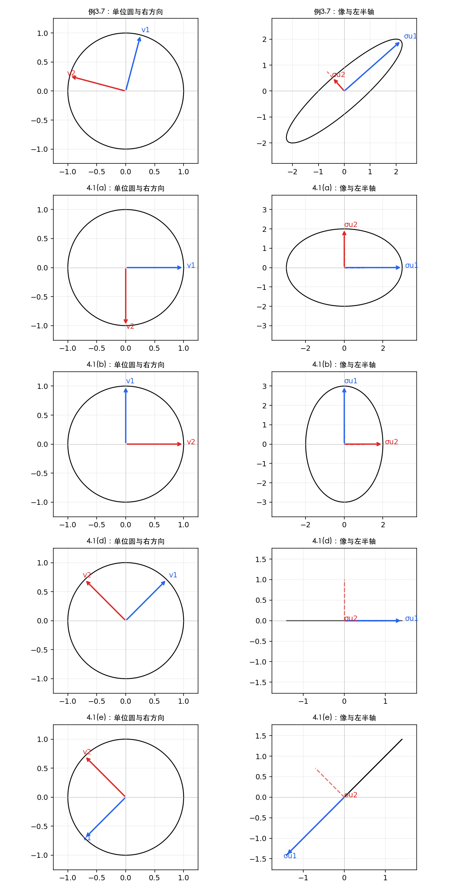

   **难度：4/5；出处：** TB：Lloyd N. Trefethen、David Bau III《数值线性代数》，陆金甫、关治译，2006（英文原版1997），第4讲习题4.3，书页27（PDF第39页），原题号4.3；**解答来源：** 自拟简解。

   **整理说明：** 提供MATLAB函数，图示由同一SVD公式的Python实跑生成；不声称本机调用了MATLAB运行时。

### 转置与行列反序的奇异值保持

**图谱路径：** 数值分析 / 第7章 对称特征值问题 / 转置与行列反序的奇异值保持

**知识内容：** [定义、定理与方法](知识点.md#kp-tb-ch04-svd-rotation-paper)

<!-- source-exercise:TB-ch04-4.2 -->
1. A为$m\times n$，纸面顺时针转90°得到$n\times m$矩阵B。奇异值是否相同？证明或反例。

   **答案：** 相同，$B=A^{T}J_{m}$，反序置换J正交。若$A=U\Sigma V^{*}$，则$A^{T}=\operatorname{bar}(V)\Sigma ^{T}U^{T}$，左右为酉因子，所以$A^{T}$同奇异值，再右乘J不改变。

   **难度：2/5；出处：** TB：Lloyd N. Trefethen、David Bau III《数值线性代数》，陆金甫、关治译，2006（英文原版1997），第4讲习题4.2，书页27（PDF第39页），原题号4.2；**解答来源：** 自拟简解。

### 双边酉变换与酉相似的区别

**图谱路径：** 数值分析 / 第7章 对称特征值问题 / 双边酉变换与酉相似的区别

**知识内容：** [定义、定理与方法](知识点.md#kp-tb-ch04-unitary-two-sided)

<!-- source-exercise:TB-ch04-4.4 -->
1. 若存在同一酉Q使$A=\operatorname{QBQ}^{*}$，称本题“酉等价”。“A,B酉等价当且仅当同奇异值”真还是假？

   **答案：** 假。相似关系必保奇异值，这是必要；但$A=I$、$B=-I$有同奇异值全1，任意Q有$\operatorname{QBQ}^{*}=-I\ne I$，故不充分。若允许两侧不同酉因子，则同奇异值恰能从两组SVD构造双边等价。

   **难度：2/5；出处：** TB：Lloyd N. Trefethen、David Bau III《数值线性代数》，陆金甫、关治译，2006（英文原版1997），第4讲习题4.4，书页27（PDF第39页），原题号4.4；**解答来源：** 自拟简解。

### 最佳低秩 Frobenius 逼近

**图谱路径：** 数值分析 / 第7章 对称特征值问题 / 最佳低秩 Frobenius 逼近

**知识内容：** [定义、定理与方法](知识点.md#kp-tb-ch05-best-lowrank-frobenius)

已整理范围内未另选可直接对应此节点的独立未解题；相关已解例子见知识内容。

### 精确秩与容差数值秩

**图谱路径：** 数值分析 / 第7章 对称特征值问题 / 精确秩与容差数值秩

**知识内容：** [定义、定理与方法](知识点.md#kp-tb-ch05-numerical-rank)

已整理范围内未另选可直接对应此节点的独立未解题；相关已解例子见知识内容。

### 满秩矩阵在固定形状空间稠密

**图谱路径：** 数值分析 / 第7章 对称特征值问题 / 满秩矩阵在固定形状空间稠密

**知识内容：** [定义、定理与方法](知识点.md#kp-tb-ch05-fullrank-dense)

<!-- source-exercise:TB-ch05-5.2 -->
1. 利用SVD，用2范数证明每个$m\times n$矩阵都是同形满秩矩阵列的极限。

   **答案：** $A=U\Sigma V^{*}$，将$p=\operatorname{min}(m,n)$个对角中为0者换为$\varepsilon$，正者保持，得到$\Sigma _\varepsilon$全p个正值且$A_\varepsilon$满秩。酉不变性给$\|A_\varepsilon -A\|_{2}\le \varepsilon \to 0$。若原阵满秩，可取恒定列。

   **难度：2/5；出处：** TB：Lloyd N. Trefethen、David Bau III《数值线性代数》，陆金甫、关治译，2006（英文原版1997），第5讲习题5.2，书页31—32（PDF第43—44页），原题号5.2；**解答来源：** 自拟简解。

### 行列式体积与奇异值乘积

**图谱路径：** 数值分析 / 第7章 对称特征值问题 / 行列式体积与奇异值乘积

**知识内容：** [定义、定理与方法](知识点.md#kp-tb-ch05-det-area-svd)

<!-- source-exercise:TB-ch05-5.3 -->
1. $A=[[-2,11],[-10,5]]$。(a)手算实SVD，选U,V负号最少者；(b)列奇异值和左右向量，精细画圆与像、标顶点；(c)1、2、∞、F范数；(d)借SVD求逆；(e)特征值；(f)验证$\operatorname{det}A=\lambda _{1}\lambda _{2}$、$|\operatorname{det}A|=\sigma _{1}\sigma _{2}$；(g)单位圆盘像面积。

   **答案：** (a)$U=1/\sqrt{2}[[1,1],[1,-1]]$、$\Sigma =\operatorname{diag}(10\sqrt{2},5\sqrt{2})$、$V=1/5[[-3,4],[4,3]]$，每个正交因子至少一个负元，这组总2个达到最少。(b)右顶点$\pm (-3/5,4/5)$、$\pm (4/5,3/5)$，左半轴端点$\pm (10,10)$、$\pm (5,-5)$；左右单位向量为所给U,V的列，图见下。(c)范数依次16、$10\sqrt{2}$、15、$5\sqrt{10}$。(d)$A^{-1}=V\Sigma ^{-1}U^{T}=[[5,-11],[10,-2]]/100$。$(e)\lambda =(3\pm i\sqrt{391})/2$。(f)$\operatorname{det}A=100$，谱积100、奇异积100。(g)面积$100\pi$。

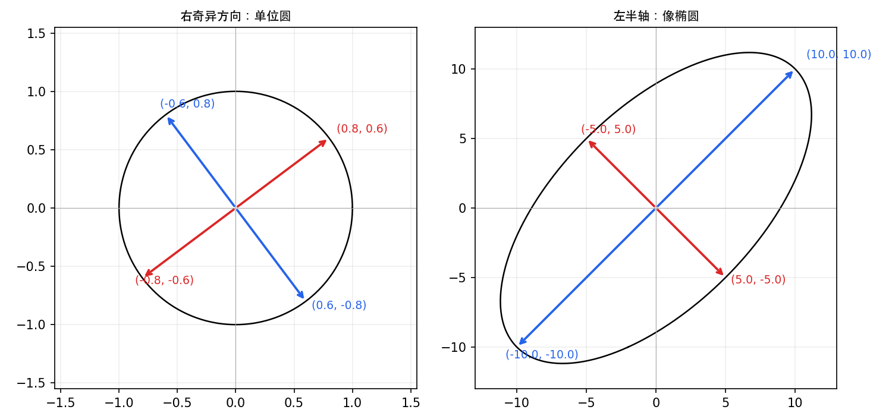

   **难度：4/5；出处：** TB：Lloyd N. Trefethen、David Bau III《数值线性代数》，陆金甫、关治译，2006（英文原版1997），第5讲习题5.3，书页32（PDF第44页），原题号5.3；**解答来源：** 自拟简解。

### 非正规例中的谱值与伸缩不同

**图谱路径：** 数值分析 / 第7章 对称特征值问题 / 非正规例中的谱值与伸缩不同

**知识内容：** [定义、定理与方法](知识点.md#kp-tb-ch05-normal-spectrum-vs-singular)

<!-- source-exercise:TB-ch05-5.3 -->
1. $A=[[-2,11],[-10,5]]$。(a)手算实SVD，选U,V负号最少者；(b)列奇异值和左右向量，精细画圆与像、标顶点；(c)1、2、∞、F范数；(d)借SVD求逆；(e)特征值；(f)验证$\operatorname{det}A=\lambda _{1}\lambda _{2}$、$|\operatorname{det}A|=\sigma _{1}\sigma _{2}$；(g)单位圆盘像面积。

   **答案：** (a)$U=1/\sqrt{2}[[1,1],[1,-1]]$、$\Sigma =\operatorname{diag}(10\sqrt{2},5\sqrt{2})$、$V=1/5[[-3,4],[4,3]]$，每个正交因子至少一个负元，这组总2个达到最少。(b)右顶点$\pm (-3/5,4/5)$、$\pm (4/5,3/5)$，左半轴端点$\pm (10,10)$、$\pm (5,-5)$；左右单位向量为所给U,V的列，图见下。(c)范数依次16、$10\sqrt{2}$、15、$5\sqrt{10}$。(d)$A^{-1}=V\Sigma ^{-1}U^{T}=[[5,-11],[10,-2]]/100$。$(e)\lambda =(3\pm i\sqrt{391})/2$。(f)$\operatorname{det}A=100$，谱积100、奇异积100。(g)面积$100\pi$。

   **难度：4/5；出处：** TB：Lloyd N. Trefethen、David Bau III《数值线性代数》，陆金甫、关治译，2006（英文原版1997），第5讲习题5.3，书页32（PDF第44页），原题号5.3；**解答来源：** 自拟简解。

### 三对角 QR 只求谱与累积向量的不同成本

**图谱路径：** 数值分析 / 第7章 对称特征值问题 / 三对角 QR 只求谱与累积向量的不同成本

**知识内容：** [定义、定理与方法](知识点.md#kp-tb-ch28-tridiag-qr-cost)

<!-- source-exercise:TB-ch28-28.2 -->
1. 对称三对角$A=QR$：R与Q通常哪些条目非零；(b)证明RQ恢复三对角；(c)说明$\operatorname{Givens}/2\times 2 \operatorname{Householder}$可远少于稠密运算计算QR。

   **答案：** (a)逐相邻行旋转消下邻，R至多第二上邻非零，通常该两条上邻非零；Q上Hessenberg，通常上三角及第一下邻非零，并非三对角。(b)$RQ=Q^{T}AQ$对称，同时R上三角、Q上Hessenberg使RQ上Hessenberg，因此对称迫下/上邻之外全0。(c)每个相邻旋转仅作用固定宽度尾带，m−1旋转，参数和局部更新O(m)，保留旋转序列即可，不做$m\times m$通用矩阵乘。

   **难度：3/5；出处：** TB：Lloyd N. Trefethen、David Bau III《数值线性代数》，陆金甫、关治译，2006（英文原版1997），第28讲习题28.2，书页190（PDF第202页），原题号28.2；**解答来源：** 自拟简解。

<!-- source-exercise:TB-ch28-28.4 -->
2. 三对角对称纯QR一轮：(a)只求特征值，从$A_{k-1}$至$A_{k}$所需flop；(b)还求所有向量、更新累积$Q_{k}$，所需flop。

   **答案：** m−1相邻旋转，每个仅更新固定数目的带条目和一次norm/参数计算，合$Θ(m)\operatorname{flop}$；首项常数依norm、安全旋转及是否利用对称而不同，不能把稠密QR的$4m^{3}/3$代入。可用固定宽bulge窗口实现，每旋转至多常数个2元向量更新，各6flop，所以给显式线性预算。(b)每旋转更新累积矩阵两列的m对元素，每对4乘2加$=6\operatorname{flop}$，m−1次准确为6m(m−1)，加(a)的$Θ(m)$，首项$6m^{2}$。只求谱与全谱向量在第二阶段相差一阶。

   **难度：3/5；出处：** TB：Lloyd N. Trefethen、David Bau III《数值线性代数》，陆金甫、关治译，2006（英文原版1997），第28讲习题28.4，书页190（PDF第202页），原题号28.4；**解答来源：** 自拟简解。

### 逐根压缩 QR 的锯齿曲线与迭代阶

**图谱路径：** 数值分析 / 第7章 对称特征值问题 / 逐根压缩 QR 的锯齿曲线与迭代阶

**知识内容：** [定义、定理与方法](知识点.md#kp-tb-ch29-qr-sawtooth)

<!-- source-exercise:TB-ch29-29.1 -->
1. 用初等构件写实对称全特征值MATLAB程序（不要求最优常数，约50行可完成）：tridiag(A)，不用hess，对hilb(4)；qralg(T)无位移QR，允许house/formQ、qr或Givens，$|t_{m,m-1}|<10^{-12}$停，对hilb(4)；(c)驱动依次压缩求全谱，记录底邻绝对值，画锯齿；(d)改Wilkinson位移并重复；(e)对diag(15:−1:1)+ones(15)两算法重跑，比较速度/阶及每特征值迭代数意义。

   **答案：** (a)用初等反射从第k列k+1行以下的尾向量构造H，并做H A H；禁止调用hess。最后提取对称三条带消舍入微小填充。(b)—(e)工具/tref29.m含tridiag、qralg和驱动；工具/verify_tb_29_32.py实际运行对应算法。每步可调用QR（原题允许），用绝对底邻$10^{-12}$停，按$m\to m-1$压缩，记录全锯齿。$\operatorname{Wilkinson} \mu =d_{m}-\operatorname{sign}(\delta )b^{2}/(|\delta |+\operatorname{sqrt}(\delta ^{2}+b^{2}))$，$\delta =(d_{m-1}-d_{m})/2$，$\delta =0$符号取+1。实算结果：
Hilbert4 无位移共13次，各压缩次数[5, 3, 5]，特征值最大误差4.44e-16。
Hilbert4 Wilkinson共5次，各压缩次数[3, 1, 1]，特征值最大误差4.44e-16。
diag(15,…,1)+ones 无位移共348次，各压缩次数[49, 31, 31, 30, 29, 29, 28, 28, 27, 25, 23, 18, 0, 0]，特征值最大误差4.62e-14。
diag(15,…,1)+ones Wilkinson共30次，各压缩次数[4, 3, 2, 2, 3, 2, 2, 2, 2, 2, 2, 2, 1, 1]，特征值最大误差1.07e-14。
Hilbert4特征值约0.0000967023、0.0067382736、0.1691412202、1.5002142801（完整值JSON）。图中无位移齿段近直线，位移快速向下弯折，体现局部超线性，通常三次；有限齿段点数很少和浮点误差平台时不宜仅凭图拟合阶。15阶矩阵相邻特征值模比更近1，纯QR更慢。所有原矩阵、三对角结果和轨迹已保存。

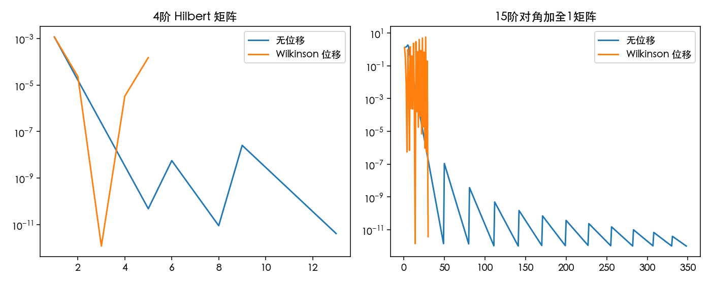

   **难度：4/5；出处：** TB：Lloyd N. Trefethen、David Bau III《数值线性代数》，陆金甫、关治译，2006（英文原版1997），第29讲习题29.1，书页195（PDF第207页），原题号29.1；**解答来源：** 自拟简解。

### 不相交 Jacobi 旋转的并行执行

**图谱路径：** 数值分析 / 第7章 对称特征值问题 / 不相交 Jacobi 旋转的并行执行

**知识内容：** [定义、定理与方法](知识点.md#kp-tb-ch30-parallel-jacobi)

<!-- source-exercise:TB-ch30-30.2 -->
1. Jacobi一步多少flop？m(m−1)/2步一整轮多少？比较对称三对角化和QR全特征值成本。

   **答案：** 利用对称只更新独立条目，除p,q外每个索引的一对$(a_{ip},a_{iq})$用4乘2加$=6\operatorname{flop}$，共6(m−2)；两主对角用共享t b后各加减，共3flop，置零不计，参数计算O(1)。一步6m+O(1)，一轮$3m^{3}+O(m^{2})$。若重复存储上下两侧并独立算则常数变大，应避免。稠密实对称三对角化约$4m^{3}/3$（只求谱），QR第二阶段$O(m^{2})$，故单Jacobi轮已同量级且常数更大；若全向量，累计反射/旋转另增$O(m^{3})$。Jacobi可能需多轮，但有并行与准确性优点，不能只比较一步成本。

   **难度：3/5；出处：** TB：Lloyd N. Trefethen、David Bau III《数值线性代数》，陆金甫、关治译，2006（英文原版1997），第30讲习题30.2，书页202（PDF第214页），原题号30.2；**解答来源：** 自拟简解。

<!-- source-exercise:TB-ch30-30.4 -->
2. m偶数，有m/2处理器，Jacobi变换分别在(1,2),(3,4),…,(m−1,m)不相交行/列对；说明如何并行执行。

   **答案：** 令$Q=\operatorname{diag}(Q_{1},\ldots ,Q_{m/2})$，各对角$2\times 2$块可独立选角；目标$Q^{T}AQ$。先各处理器计算其两行的左旋转，再同步，各计算其两列右旋转，再同步。或把所有$2\times 2$块$A_{ij}$分配给单一处理器，更新$Q_{i}^{T} A_{ij} Q_{j}$并对称复制，避免两处理器写同一交叉块。不相交旋转作为线性变换可交换，但数据读写须同步。

   **难度：3/5；出处：** TB：Lloyd N. Trefethen、David Bau III《数值线性代数》，陆金甫、关治译，2006（英文原版1997），第30讲习题30.4，书页202（PDF第214页），原题号30.4；**解答来源：** 自拟简解。

### 随机三对角特征向量的局部化实验

**图谱路径：** 数值分析 / 第7章 对称特征值问题 / 随机三对角特征向量的局部化实验

**知识内容：** [定义、定理与方法](知识点.md#kp-tb-ch30-eigenvector-localization)

<!-- source-exercise:TB-ch30-30.7 -->
1. 构造100阶随机实对称三对角T，求$T=Q D Q^{T}$，对几列|Q|作对数图看局部化，求10000个条目大于$10^{-10}$比例；改为邻1、主−2的离散Laplacian怎样？

   **答案：** 固定独立标准正态主/邻对角，用$\texttt{eigh\_tridiagonal}$求全谱；三列对数图显示不同位置的集中峰，远处有很小条目。这一个样本$|Q_{ij}|>10^{-10}$比例0.5321。常系数Laplacian的准确规范向量$q_{j}(k)=\operatorname{sqrt}(2/101)\operatorname{sin}(jk\pi /101)$，101为素数、$1\le j,k\le 100$，无整除零，全部10000条目超过此阈值，比例1，呈扩展正弦而非局部化。随机比例是题设未规定分布时本次明确选择的实算样本值。

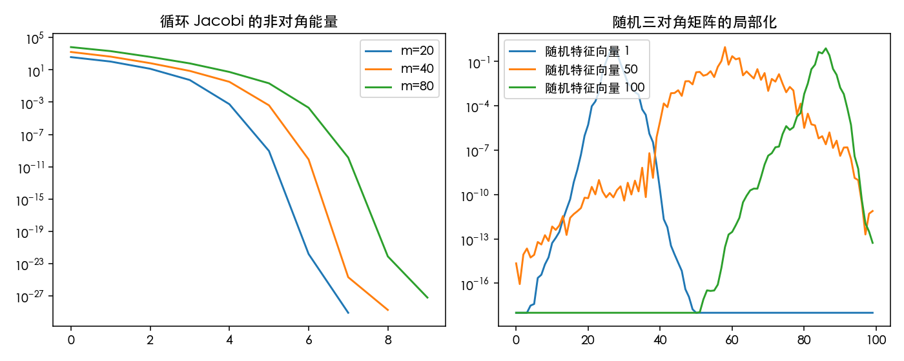

   **难度：3/5；出处：** TB：Lloyd N. Trefethen、David Bau III《数值线性代数》，陆金甫、关治译，2006（英文原版1997），第30讲习题30.7，书页203（PDF第215页），原题号30.7；**解答来源：** 自拟简解。

### 高矩形矩阵的 LHC 双对角化

**图谱路径：** 数值分析 / 第7章 对称特征值问题 / 高矩形矩阵的 LHC 双对角化

**知识内容：** [定义、定理与方法](知识点.md#kp-tb-ch31-lhc-bidiag)

<!-- source-exercise:TB-ch31-31.1 -->
1. (a)证明LHC与Golub–Kahan双对角化成本交点$m/n=5/3$；(b)该比例处三步法快多少比例？

   **答案：** 比较$4mn^{2}-4n^{3}/3$与$2mn^{2}+2n^{3}$，前者减后者$2mn^{2}-10n^{3}/3$，交点5/3。代入两者均$16n^{3}/3$；三步法少$2(m-n)^{3}/3=16n^{3}/81$，相对节省$(16/81)/(16/3)=1/27$≈3.7037%，新工作量为原26/27。这里比例按工作量少，不将墙钟速度等同flop比例。

   **难度：2/5；出处：** TB：Lloyd N. Trefethen、David Bau III《数值线性代数》，陆金甫、关治译，2006（英文原版1997），第31讲习题31.1，书页209（PDF第221页），原题号31.1；**解答来源：** 自拟简解。

<!-- source-exercise:TB-ch31-31.2 -->
2. 证明三步双对角化中，当剩余矩阵纵横比2时应用QR最优。

   **答案：** 先做k步GK首项为$8\int _{0}^{k}(m-t)(n-t)dt$，剩余$M=m-k,N=n-k$改LHC为$2MN^{2}+2N^{3}$。总$F^{\prime}(k)=4N(M-2N)=4(n-k)(m-2n+k)$。当$n<m<2n$，导数先负后正，最小$k=2n-m$，即$M=2N$。$m\ge 2n$起始已该比例以上、直接$\operatorname{LHC} k=0$；$m=n$交点在末端，相当直接GK。积分是首项连续成本模型，实际整数k取近邻比较。

   **难度：3/5；出处：** TB：Lloyd N. Trefethen、David Bau III《数值线性代数》，陆金甫、关治译，2006（英文原版1997），第31讲习题31.2，书页209（PDF第221页），原题号31.2；**解答来源：** 自拟简解。

### Gaussian 矩阵的独立 χ 双对角模型

**图谱路径：** 数值分析 / 第7章 对称特征值问题 / Gaussian 矩阵的独立 χ 双对角模型

**知识内容：** [定义、定理与方法](知识点.md#kp-tb-ch31-gaussian-chi-bidiag)

<!-- source-exercise:TB-ch31-31.3 -->
1. 双对角矩阵的两非零对角线条目全非零，证明奇异值相异，参照25.1。

   **答案：** 设上双对角B主$d_{i}$、上邻$e_{i}$全非零，$B^{*}B$是Hermitian三对角，其邻为$\overline{d_i}e_i$非零，因而25.1给不同正特征值。$\sigma _{i}$为它们正平方根，单调对应仍相异。矩形$m\ge n$底零行不影响列Gram；若$n=1$结论平凡。

   **难度：2/5；出处：** TB：Lloyd N. Trefethen、David Bau III《数值线性代数》，陆金甫、关治译，2006（英文原版1997），第31讲习题31.3，书页209（PDF第221页），原题号31.3；**解答来源：** 自拟简解。

<!-- source-exercise:TB-ch31-31.5 -->
2. $m\times n$（$m\ge n$）A元素独立N(0,1)。B上双对角，主为$x_{m},x_{m-1},\ldots ,x_{m-n+1}$，上邻$y_{n-1},\ldots ,y_{1}$，各x/y独立$\chi$自由度相应下标的正平方根。(a)证明A、B联合奇异值分布相同；(b)$m=100,n=50$实构A,B、作对应奇异值图。

   **答案：** (a)首列为m维独立Gaussian，$\operatorname{norm} \chi _{m}$，正交转至首轴；由于其他列独立且旋转不变，旋后剩余各列仍独立标准Gaussian并与首norm独立。首行余n−1个$\operatorname{Gaussian} \operatorname{norm} \chi _{n-1}$，右正交转到第二列；余下$(m-1)\times (n-1)$块仍独立Gaussian且与已取两norm独立。递归即题给$\chi$主/上邻，双侧正交保全部奇异值，所以联合分布一样。(b)固定种子生成$100\times 50 \operatorname{Gaussian}$及独立$50\times 50\chi$双对角，原50个奇异值全保存并作散点对角参照，整体分布接近。独立样本不会每个奇异值严格相等，图为数值佐证而不是概率证明，证明来自(a)不变性。

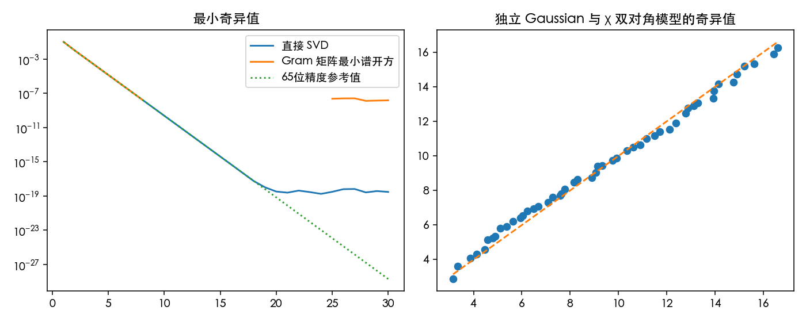

   **难度：4/5；出处：** TB：Lloyd N. Trefethen、David Bau III《数值线性代数》，陆金甫、关治译，2006（英文原版1997），第31讲习题31.5，书页209（PDF第221页），原题号31.5；**解答来源：** 自拟简解。

### 稳定 SVD 的绝对准确与极小奇异值相对准确

**图谱路径：** 数值分析 / 第7章 对称特征值问题 / 稳定 SVD 的绝对准确与极小奇异值相对准确

**知识内容：** [定义、定理与方法](知识点.md#kp-tb-ch31-small-singular-relative)

<!-- source-exercise:TB-ch31-31.4 -->
1. A为$m\times m$上三角，主对角0.1，其余对角以上条目1（原译重复“对角线上”）。程序以标准SVD与$\operatorname{sqrt}(\lambda _{\min}(A^{*}A))$两法算最小奇异值，对$m=1,\ldots ,30$画对数双曲线，评论与算法一般理论是否一致。

   **答案：** 原句第二次“对角线上每个元素为1”与前0.1矛盾，按上三角及原例意图取所有严格上三角1。全部30阶实算，另以65位SVD作核验基准。Gram法在小值被$u\|A\|^{2}$淹没后给约$10^{-8}$伪值或负特征值无法实开方。$m=30$：标准SVD约$2.86\times 10^{-19}$，Gram法约$1.46\times 10^{-8}$，65位准确值约$1.88718599\times 10^{-29}$。直接SVD明显较好但此极小值仍未获高相对精度；这符合绝对后向误差结论，不应把蓝曲线自动叫“真值”。

   **难度：4/5；出处：** TB：Lloyd N. Trefethen、David Bau III《数值线性代数》，陆金甫、关治译，2006（英文原版1997），第31讲习题31.4，书页209（PDF第221页），原题号31.4；**解答来源：** 自拟简解。

   **勘误：** 译文“主对角0.1、对角线每元素1”矛盾，第二处按严格上三角解释并公开标明。

### Lanczos 的失正交与重像 Ritz 值

**图谱路径：** 数值分析 / 第7章 对称特征值问题 / Lanczos 的失正交与重像 Ritz 值

**知识内容：** [定义、定理与方法](知识点.md#kp-tb-ch36-lanczos-ghosts)

已整理范围内未另选可直接对应此节点的独立未解题；相关已解例子见知识内容。

### 零点对数势解释分离 Ritz 收敛

**图谱路径：** 数值分析 / 第7章 对称特征值问题 / 零点对数势解释分离 Ritz 收敛

**知识内容：** [定义、定理与方法](知识点.md#kp-tb-ch36-log-potential-polynomial)

<!-- source-exercise:TB-ch36-36.2 -->
1. $\operatorname{monic} p\in P^{n}$、$p(z)=\prod _{k=1}^{n}(z-z_{k})$。log|p|写和；(b)以反比排斥解释负单位点电荷势；(c)每电荷−1/n、$n\to \infty$，密度$\mu$积分−1，写势积分及与|p|联系；(d)闭有界S无孤立点，非严格解释极小$\operatorname{max}_S\varphi$的平衡为何势常数/无净力；(e)谱稠密$[a,b]\cup {c}\cup [d,e]$、$a<b<c<d<e$，解释c附近Ritz快速收敛并用主体平衡势估计。

   **答案：** (a)$\operatorname{log}|p(z)|=\Sigma \operatorname{log}|z-z_{k}|$。(b)二维点电荷q的势−q log距离，$q=-1$给此log，梯度产生1/距离的力。$(c)\mu _{n}=-(1/n)\Sigma \delta _{z_{k}}$，$\varphi _{n}=-\int \operatorname{log}|z-s|d\mu _{n}(s)=(1/n)\operatorname{log}|p|$；若测度适当收敛且避支集奇点，$\varphi =-\int \operatorname{log}|z-s|d\mu (s)$，|p|≈$e^{n\varphi }$。(d)自由电荷若存在势差，可重新分配降低最大势；平衡在带电支集上势常数、沿导体切向无净力。这是理想导体/正容量集合的启发式：一般闭无孤立集也可能零容量，严格“整个S常数”需势论正则性，原题只要求非严格解释，不能当无条件定理。(e)对主体$S^{*}=[a,b]\cup [d,e]$（原末处[c,d]为区间误排）平衡势常数C，gap中的c有$g(c)=\varphi (c)-C>0$。多项式在c原会比主体多$e^{ng(c)}$，用一根$z_{k}$≈c压低该因子，典型$|z_{k}-c|$约$e^{-ng(c)}$；故孤立c比密集区容易。起始b权及有限迭代影响常数/具体率，属定性估计。

   **难度：4/5；出处：** TB：Lloyd N. Trefethen、David Bau III《数值线性代数》，陆金甫、关治译，2006（英文原版1997），第36讲习题36.2，书页246（PDF第258页），原题号36.2；**解答来源：** 自拟简解。

   **勘误：** 原(e)主体第二区间末写[c,d]与起始[d,e]矛盾，按谱主体[d,e]解释；(d)严格常势需正容量/正则性。

### Hermite 的 Courant–Fischer 原理

**图谱路径：** 数值分析 / 第7章 对称特征值问题 / Hermite 的 Courant–Fischer 原理

**知识内容：** [定义、定理与方法](知识点.md#kp-xh-ch07-courant-fischer)

已整理范围内未另选可直接对应此节点的独立未解题；相关已解例子见知识内容。

### Hermite 扰动的极端谱夹界

**图谱路径：** 数值分析 / 第7章 对称特征值问题 / Hermite 扰动的极端谱夹界

**知识内容：** [定义、定理与方法](知识点.md#kp-xh-ch07-hermite-extreme-perturbation)

已整理范围内未另选可直接对应此节点的独立未解题；相关已解例子见知识内容。

### 正规矩阵的 Hoffman–Wielandt 定理

**图谱路径：** 数值分析 / 第7章 对称特征值问题 / 正规矩阵的 Hoffman–Wielandt 定理

**知识内容：** [定义、定理与方法](知识点.md#kp-xh-ch07-hoffman-wielandt)

已整理范围内未另选可直接对应此节点的独立未解题；相关已解例子见知识内容。

### Hermite 主子阵的交错谱

**图谱路径：** 数值分析 / 第7章 对称特征值问题 / Hermite 主子阵的交错谱

**知识内容：** [定义、定理与方法](知识点.md#kp-xh-ch07-cauchy-interlacing)

已整理范围内未另选可直接对应此节点的独立未解题；相关已解例子见知识内容。

### 对称矩阵各元素的谱范数界

**图谱路径：** 数值分析 / 第7章 对称特征值问题 / 对称矩阵各元素的谱范数界

**知识内容：** [定义、定理与方法](知识点.md#kp-xh-ch07-symmetric-entry-bound)

<!-- source-exercise:XH-ch07-8 -->
1. 实对称三对角A的主对角$d_{k}$与次对角$c_{k}$，证明每项绝对值$\le \operatorname{max}_{i}|\lambda _{i}(A)|$。

   **答案：** 每元素$|a_{ij}|\le \|Ae_{j}\|_{2}\le \|A\|_{2}$，而对称A的2范数$=\operatorname{max}|\lambda _{i}|$，因此所列各项全满足。

   **难度：1/5；出处：** XH：向华、杨志坚《数值线性代数》，2024年所附版，第7章习题8，书页122（PDF第125页），原题号8；**解答来源：** 自拟简解。

### 相对稳健表示的三对角谱方法

**图谱路径：** 数值分析 / 第7章 对称特征值问题 / 相对稳健表示的三对角谱方法

**知识内容：** [定义、定理与方法](知识点.md#kp-xh-ch07-rrr-navigation)

已整理范围内未另选可直接对应此节点的独立未解题；相关已解例子见知识内容。

### SVD 的圆球到椭球解释

**图谱路径：** 数值分析 / 第7章 对称特征值问题 / SVD 的圆球到椭球解释

**知识内容：** [定义、定理与方法](知识点.md#kp-xh-ch08-svd-geometry)

已整理范围内未另选可直接对应此节点的独立未解题；相关已解例子见知识内容。

### 奇异值的 Hermite 扩张

**图谱路径：** 数值分析 / 第7章 对称特征值问题 / 奇异值的 Hermite 扩张

**知识内容：** [定义、定理与方法](知识点.md#kp-xh-ch08-hermitian-dilation)

已整理范围内未另选可直接对应此节点的独立未解题；相关已解例子见知识内容。

### 由 SVD 描述核与值域

**图谱路径：** 数值分析 / 第7章 对称特征值问题 / 由 SVD 描述核与值域

**知识内容：** [定义、定理与方法](知识点.md#kp-xh-ch08-svd-null-range)

已整理范围内未另选可直接对应此节点的独立未解题；相关已解例子见知识内容。

### Eckart–Young 最佳谱范数低秩逼近

**图谱路径：** 数值分析 / 第7章 对称特征值问题 / Eckart–Young 最佳谱范数低秩逼近

**知识内容：** [定义、定理与方法](知识点.md#kp-xh-ch08-best-lowrank)

已整理范围内未另选可直接对应此节点的独立未解题；相关已解例子见知识内容。

### 单个奇异值的扰动界

**图谱路径：** 数值分析 / 第7章 对称特征值问题 / 单个奇异值的扰动界

**知识内容：** [定义、定理与方法](知识点.md#kp-xh-ch08-singular-weyl)

已整理范围内未另选可直接对应此节点的独立未解题；相关已解例子见知识内容。

### 奇异值平方和的 Frobenius 扰动界

**图谱路径：** 数值分析 / 第7章 对称特征值问题 / 奇异值平方和的 Frobenius 扰动界

**知识内容：** [定义、定理与方法](知识点.md#kp-xh-ch08-singular-mirsky)

已整理范围内未另选可直接对应此节点的独立未解题；相关已解例子见知识内容。

### 增加一列的奇异值交错

**图谱路径：** 数值分析 / 第7章 对称特征值问题 / 增加一列的奇异值交错

**知识内容：** [定义、定理与方法](知识点.md#kp-xh-ch08-singular-interlacing)

已整理范围内未另选可直接对应此节点的独立未解题；相关已解例子见知识内容。

### SVD 中的 Tikhonov 滤波因子

**图谱路径：** 数值分析 / 第7章 对称特征值问题 / SVD 中的 Tikhonov 滤波因子

**知识内容：** [定义、定理与方法](知识点.md#kp-xh-ch08-tikhonov-svd-filter)

<!-- source-exercise:XH-ch08-5 -->
1. $A=U\Sigma V^T$ 为实 $n$ 阶SVD，$\mu\in\mathbb R$。证明堆叠最小二乘 $\min_x\|\begin{pmatrix}A\\\mu I_n\end{pmatrix}x-\begin{pmatrix}b\\0\end{pmatrix}\|_2$ 等价于 $\min_x(\|Ax-b\|_2^2+\mu^2\|x\|_2^2)$，并在 $\Sigma^2+\mu^2I_n$ 可逆时给解 $V(\Sigma^2+\mu^2I_n)^{-1}\Sigma U^Tb$；不可逆时说明正确解。

   **答案：** 堆叠范数平方展开即两项和；平方不改变极小点。令$y=V^{T}x,c=U^{T}b$，目标为$\sum_{i}[(\sigma _{i} y_{i}-c_{i})^{2}+\mu ^{2}y_{i}^{2}]$。若$\sigma _{i}^{2}+\mu ^{2}>0$，唯一$y_{i}=\sigma _{i} c_{i}/(\sigma _{i}^{2}+\mu ^{2})$，还原给公式。若$\mu =0$且$\sigma _{i}=0$，该坐标不影响目标，任意$y_{i}$；取0给最小范数广义逆解。

   **难度：3/5；出处：** XH：向华、杨志坚《数值线性代数》，2024年所附版，第8章习题5，书页131（PDF第133页），原题号5；**解答来源：** 自拟简解。

   **勘误：** 原题允许$\mu =0$却无条件写$(\Sigma ^{2}+\mu ^{2}I)$普通逆；A秩亏时不存在。已把公式限于可逆情形，并保留$\mu =0$秩亏的完整正确解集。

### 高瘦矩阵先 QR 再 SVD

**图谱路径：** 数值分析 / 第7章 对称特征值问题 / 高瘦矩阵先 QR 再 SVD

**知识内容：** [定义、定理与方法](知识点.md#kp-xh-ch08-tall-svd-qr)

已整理范围内未另选可直接对应此节点的独立未解题；相关已解例子见知识内容。

### SVD 输出需求与算法路径

**图谱路径：** 数值分析 / 第7章 对称特征值问题 / SVD 输出需求与算法路径

**知识内容：** [定义、定理与方法](知识点.md#kp-xh-ch08-svd-computation-options)

已整理范围内未另选可直接对应此节点的独立未解题；相关已解例子见知识内容。

### Hermite 谱定理

**图谱路径：** 数值分析 / 第7章 对称特征值问题 / Hermite 谱定理

**知识内容：** [定义、定理与方法](知识点.md#kp-xu-ch07-hermite-spectrum)

<!-- source-exercise:TB-ch02-2.3 -->
1. Hermite A。(a)证明全部特征值实；(b)不同特征值的特征向量正交。

   **答案：** $(a) Ax=\lambda x$，$x^{*}Ax$实，$\lambda =(x^{*}Ax)/(x^{*}x)$实。$(b) Ax=\lambda x$、$Ay=\mu y$，则$x^{*}Ay=\mu x^{*}y$，同时$(Ax)^{*}y=\lambda x^{*}y$，Hermite使两式相同，$\lambda \ne \mu$故$x^{*}y=0$。

   **难度：2/5；出处：** TB：Lloyd N. Trefethen、David Bau III《数值线性代数》，陆金甫、关治译，2006（英文原版1997），第2讲习题2.3，书页14（PDF第26页），原题号2.3；**解答来源：** 自拟简解。

<!-- source-exercise:TB-ch25-25.1 -->
2. Hermitian三对角A上下邻对角均非零，证明谱相异，提示$\operatorname{rank}(A-\lambda I)\ge m-1$；(b)上Hessenberg仅下邻非零时给重谱例。

   **答案：** (a)删第一行和最后列所得(m−1)方块为上三角（对应下邻条目），行列式是非零下邻乘积，所以$\operatorname{rank}\ge m-1$，任意特征空间至多1维；Hermitian可对角化，代数重数=几何重数，谱全简单。(b)下Jordan块$[[\lambda ,0],[1,\lambda ]]$是上Hessenberg且下邻非零，却特征值$\lambda$重2；更高阶下Jordan块同样。与徐书7.20的重数/零邻对角结论相关，但本题还要求非Hermitian反例，整题保留。

   **难度：2/5；出处：** TB：Lloyd N. Trefethen、David Bau III《数值线性代数》，陆金甫、关治译，2006（英文原版1997），第25讲习题25.1，书页170（PDF第182页），原题号25.1；**解答来源：** 自拟简解。

<!-- source-exercise:XU-ch07-上机1 -->
3. (1) 编写过关Jacobi程序求实对称三对角全部特征值和向量；(2) 对$n=50$至100的tridiag(1,4,1)求全部谱。

   **答案：** 关值逐级减小，只消去超过关值的项并累计Q，直到非对角范数达容差。精确对照为$\lambda _{j}=4+2\operatorname{cos}(j\pi /(n+1))$、$q_{ij}=\sqrt{2/(n+1)}\operatorname{sin}(ij\pi /(n+1))$，$j=1,\ldots ,n$；排序后检查全部值误差、$AQ-Q\Lambda$残差和$Q^{T}Q-I$，不把每个阶或每个值拆成新题。本机自行实现过关旋转与向量积累，50至100全部51个阶均实跑；最大特征值绝对误差约1.33e-14，每阶向量残差与正交误差逐项记录。见处理记录/徐书第七章计算核验.json。

   **难度：4/5；出处：** XU：徐树方、高立、张平文《数值线性代数》第二版，2013，第7章习题上机1，书页244（PDF第256页），原题号上机1；**解答来源：** 自拟简解。

### 对称谱的扰动与条件数

**图谱路径：** 数值分析 / 第7章 对称特征值问题 / 对称谱的扰动与条件数

**知识内容：** [定义、定理与方法](知识点.md#kp-xu-ch07-weyl-bound)

<!-- source-exercise:XH-ch07-6 -->
1. 对称A特征向量x的$O(\varepsilon )$近似ẋ，证明Rayleigh商$\lambda +O(\varepsilon ^{2})$。

   **答案：** $\delta =$ẋ−x，ẋ$^{T}(A-\lambda I)$ẋ$=\delta ^{T}(A-\lambda I)\delta$，线性项0；分母趋$\|x\|^{2}>0$，得二阶。

   **难度：2/5；出处：** XH：向华、杨志坚《数值线性代数》，2024年所附版，第7章习题6，书页122（PDF第125页），原题号6；**解答来源：** 自拟简解。

<!-- source-exercise:XU-ch07-1 -->
2. 证明实对称矩阵每个特征值的绝对条件数为1。

   **答案：** 简单值可取同一单位左右向量x，所以 $1/|x^Tx|=1$。重值不能任取不同左右向量套简单公式，应按有序特征值扰动定义：Weyl界 $|\delta\lambda_i|\le\|E\|_2$ 给上界1，而 $E=\varepsilon I$ 全部值同移$\varepsilon$，达到下界1。

   **难度：2/5；出处：** XU：徐树方、高立、张平文《数值线性代数》第二版，2013，第7章习题1，书页240（PDF第252页），原题号1；**解答来源：** 自拟简解。

<!-- source-exercise:XU-ch07-8 -->
3. 对称A的特征向量x对应$\lambda$，$\widetilde x=x+O(\varepsilon)$。证明其Rayleigh商为$\lambda +O(\varepsilon ^{2})$。

   **答案：** 记$\delta =$ẋ−x，展开 $\widetilde x^T(A-\lambda I)\widetilde x=\delta^T(A-\lambda I)\delta=O(\varepsilon^2)$，线性项因$(A-\lambda I)x=0$消失。分母趋$x^{T}x>0$，除后得结论。

   **难度：2/5；出处：** XU：徐树方、高立、张平文《数值线性代数》第二版，2013，第7章习题8，书页241（PDF第253页），原题号8；**解答来源：** 自拟简解。

### 对称矩阵的剩余包含区间

**图谱路径：** 数值分析 / 第7章 对称特征值问题 / 对称矩阵的剩余包含区间

**知识内容：** [定义、定理与方法](知识点.md#kp-xu-ch07-residual-inclusion)

<!-- source-exercise:XH-ch07-4 -->
1. Hermite块$B=[[\alpha ,b^{*}],[b,A]]$。证明区间$|\lambda -\alpha |\le \|b\|_{2}$至少含B的一个特征值。

   **答案：** 取单位$e_{1}$与候选$\alpha$，剩余$(B-\alpha I)e_{1}=(0,b)^{T}$，范数$\|b\|_{2}$；Hermite剩余包含定理给某谱值在此距离内。$\alpha$实由Hermite性自动成立。

   **难度：2/5；出处：** XH：向华、杨志坚《数值线性代数》，2024年所附版，第7章习题4，书页122（PDF第125页），原题号4；**解答来源：** 自拟简解。

<!-- source-exercise:XU-ch07-2 -->
2. A实对称。证明每个区间 $|z-a_{ii}|\le(\sum_{j\ne i}a_{ij}^2)^{1/2}$ 都至少含A的一个特征值。

   **答案：** 令$x=e_{i}$、$\mu =a_{ii}$，残差2范数即该平方和根。若所有谱距离都大于此范数，在正交特征基展开残差平方会严格大于它自身，矛盾。

   **难度：2/5；出处：** XU：徐树方、高立、张平文《数值线性代数》第二版，2013，第7章习题2，书页240（PDF第252页），原题号2；**解答来源：** 自拟简解。

### 奇异值分解

**图谱路径：** 数值分析 / 第7章 对称特征值问题 / 奇异值分解

**知识内容：** [定义、定理与方法](知识点.md#kp-xu-ch07-svd)

<!-- source-exercise:TB-ch04-4.1 -->
1. 手算SVD：diag(3,−2)；diag(2,3)；(c)[[0,2],[0,0],[0,0]]；(d)[[1,1],[0,0]]；(e)[[1,1],[1,1]]。

   **答案：** 记$P=[[0,1],[1,0]]$、$W=1/\sqrt{2}[[1,1],[1,-1]]$。(a)$U=\operatorname{diag}(1,-1)$、$\Sigma =\operatorname{diag}(3,2)$、$V=I$。(b)$U=V=P$、$\Sigma =\operatorname{diag}(3,2)$。(c)$U=I_{3}$、$\Sigma =[[2,0],[0,0],[0,0]]$、$V=P$。(d)$U=I_{2}$、$\Sigma =\operatorname{diag}(\sqrt{2},0)$、$V=W$。(e)$U=V=W$、$\Sigma =\operatorname{diag}(2,0)$。均直接相乘为原矩阵，全部5问作一题。

   **难度：3/5；出处：** TB：Lloyd N. Trefethen、David Bau III《数值线性代数》，陆金甫、关治译，2006（英文原版1997），第4讲习题4.1，书页26（PDF第38页），原题号4.1；**解答来源：** 自拟简解。

<!-- source-exercise:TB-ch04-4.3 -->
2. 写MATLAB程序，给实$2\times 2$矩阵，在单位圆上画右奇异向量$v_{1},v_{2}$，在对应椭圆上画左奇异方向；用于例3.7的$A=[[1,2],[0,2]]$和习题4.1的全部$2\times 2$矩阵。

   **答案：** 程序见工具/plot_svd_2x2.m：先$[U,S,V]=\operatorname{svd}(A)$，输入圆$z(t)=(\operatorname{cos} t,\operatorname{sin} t)^{T}$，输出曲线Az(t)，圆上标$v_{i}$，椭圆上标半轴$\sigma _{i} u_{i}$，同时虚线标单位$u_{i}$。对3.7及4.1(a,b,d,e)共5个矩阵生成10面板图；4.1(c)矩形不属于$2\times 2$调用。对应Python同算法实跑核验与图在处理记录/计算图/TB-lecture04-4.3.png，退化零$\sigma$仍保留其奇异方向基，图像可退化为线段。

   **难度：4/5；出处：** TB：Lloyd N. Trefethen、David Bau III《数值线性代数》，陆金甫、关治译，2006（英文原版1997），第4讲习题4.3，书页27（PDF第39页），原题号4.3；**解答来源：** 自拟简解。

   **整理说明：** 提供MATLAB函数，图示由同一SVD公式的Python实跑生成；不声称本机调用了MATLAB运行时。

<!-- source-exercise:TB-ch04-4.5 -->
3. 证明实矩阵A有实SVD，即U,V都可选实。

   **答案：** 实对称$A^{T}A$的正交实特征向量组成V，对正$\sigma _{i}$取$u_{i}=Av_{i}/\sigma _{i}$。这些$u_{i}$实且正交；在其正交补中选实基补U，零值列不贡献乘积，得到$A=U\Sigma V^{T}$。

   **难度：2/5；出处：** TB：Lloyd N. Trefethen、David Bau III《数值线性代数》，陆金甫、关治译，2006（英文原版1997），第4讲习题4.5，书页27（PDF第39页），原题号4.5；**解答来源：** 自拟简解。

<!-- source-exercise:TB-ch05-5.3 -->
4. $A=[[-2,11],[-10,5]]$。(a)手算实SVD，选U,V负号最少者；(b)列奇异值和左右向量，精细画圆与像、标顶点；(c)1、2、∞、F范数；(d)借SVD求逆；(e)特征值；(f)验证$\operatorname{det}A=\lambda _{1}\lambda _{2}$、$|\operatorname{det}A|=\sigma _{1}\sigma _{2}$；(g)单位圆盘像面积。

   **答案：** (a)$U=1/\sqrt{2}[[1,1],[1,-1]]$、$\Sigma =\operatorname{diag}(10\sqrt{2},5\sqrt{2})$、$V=1/5[[-3,4],[4,3]]$，每个正交因子至少一个负元，这组总2个达到最少。(b)右顶点$\pm (-3/5,4/5)$、$\pm (4/5,3/5)$，左半轴端点$\pm (10,10)$、$\pm (5,-5)$；左右单位向量为所给U,V的列，图见下。(c)范数依次16、$10\sqrt{2}$、15、$5\sqrt{10}$。(d)$A^{-1}=V\Sigma ^{-1}U^{T}=[[5,-11],[10,-2]]/100$。$(e)\lambda =(3\pm i\sqrt{391})/2$。(f)$\operatorname{det}A=100$，谱积100、奇异积100。(g)面积$100\pi$。

   **难度：4/5；出处：** TB：Lloyd N. Trefethen、David Bau III《数值线性代数》，陆金甫、关治译，2006（英文原版1997），第5讲习题5.3，书页32（PDF第44页），原题号5.3；**解答来源：** 自拟简解。

### 左右奇异向量方程

**图谱路径：** 数值分析 / 第7章 对称特征值问题 / 左右奇异向量方程

**知识内容：** [定义、定理与方法](知识点.md#kp-xu-ch07-singular-pair)

<!-- source-exercise:TB-ch05-5.1 -->
1. 例3.1矩阵$A=[[1,2],[0,2]]$的2范数约2.9208，手算其$\sigma _{\min}$、$\sigma _{\max}$精确值。

   **答案：** $A^{T}A=[[1,2],[2,8]]$，特征多项式$\lambda ^{2}-9\lambda +4$，根$(9\pm \sqrt{65})/2$。故$\sigma _{\max}=\sqrt{(9+\sqrt{65})/2}$、$\sigma _{\min}=\sqrt{(9-\sqrt{65})/2}$，前者约2.9208。

   **难度：2/5；出处：** TB：Lloyd N. Trefethen、David Bau III《数值线性代数》，陆金甫、关治译，2006（英文原版1997），第5讲习题5.1，书页31（PDF第43页），原题号5.1；**解答来源：** 自拟简解。

<!-- source-exercise:TB-ch05-5.4 -->
2. $A=U\Sigma V^{*}$为m阶SVD。求Hermite块$H=[[0,A^{*}],[A,0]]$的完整特征分解。

   **答案：** 取$Q=1/\sqrt{2}[[V,V],[U,-U]]$，$D=\operatorname{diag}(\Sigma ,-\Sigma )$。块乘给$HQ=QD$且$Q^{*}Q=I$，所以$H=\operatorname{QDQ}^{*}$。$\sigma$为0也包含，两个±组合仍给正交零空间基。

   **难度：3/5；出处：** TB：Lloyd N. Trefethen、David Bau III《数值线性代数》，陆金甫、关治译，2006（英文原版1997），第5讲习题5.4，书页32（PDF第44页），原题号5.4；**解答来源：** 自拟简解。

<!-- source-exercise:XH-ch08-1 -->
3. 证明A的正奇异值平方是$A^{T}A$、$AA^{T}$的非零特征值。

   **答案：** SVD代入后，两Gram阵对角化为$\Sigma ^{T}\Sigma$、$\Sigma \Sigma ^{T}$，非零对角均$\sigma _{i}^{2}$，保重数。

   **难度：1/5；出处：** XH：向华、杨志坚《数值线性代数》，2024年所附版，第8章习题1，书页131（PDF第133页），原题号1；**解答来源：** 自拟简解。

<!-- source-exercise:XU-ch07-4 -->
4. 证明实矩形矩阵的正奇异值平方，正好是$A^{T}A$与$AA^{T}$的正特征值，并保重数。

   **答案：** 由SVD，$A^TA=V(\Sigma^T\Sigma)V^T$，$AA^T=U(\Sigma\Sigma^T)U^T$，其非零对角均为$\sigma _{i}^{2}$，剩余零数因维数而异。

   **难度：2/5；出处：** XU：徐树方、高立、张平文《数值线性代数》第二版，2013，第7章习题4，书页240（PDF第252页），原题号4；**解答来源：** 自拟简解。

### 奇异值的极小极大原理

**图谱路径：** 数值分析 / 第7章 对称特征值问题 / 奇异值的极小极大原理

**知识内容：** [定义、定理与方法](知识点.md#kp-xu-ch07-singular-minmax)

<!-- source-exercise:XH-ch08-4 -->
1. A为$m\times n$、$m\ge n$，证明$\sigma _{i}$的两个子空间极小极大公式。

   **答案：** 在右奇异基展开$\|Au\|^{2}/\|u\|^{2}$为$\sigma _{j}^{2}$加权平均；i维空间与后n−i+1方向有交，给上界，取前i方向达到；另一式交换前后空间得到。

   **难度：3/5；出处：** XH：向华、杨志坚《数值线性代数》，2024年所附版，第8章习题4，书页131（PDF第133页），原题号4；**解答来源：** 自拟简解。

<!-- source-exercise:XU-ch07-7 -->
2. 递减奇异值$\sigma _{i}$满足 $\sigma_i=\max_{\dim X=i}\min_{0\ne u\in X}\|Au\|/\|u\|=\min_{\dim X=n-i+1}\max_{0\ne u\in X}\|Au\|/\|u\|$，证明之。

   **答案：** 在右奇异基中，$\|Au\|^2/\|u\|^2$ 是$\sigma _{j}^{2}$的加权平均。任意i维X与$\operatorname{span}(v_{i},\ldots ,v_{n})$有非零交，所以其最小值$\le \sigma _{i}$；取$X=\operatorname{span}(v_{1},\ldots ,v_{i})$达到等号。任意(n−i+1)维X与$\operatorname{span}(v_{1},\ldots ,v_{i})$有非零交，最大值$\ge \sigma _{i}$；取$X=\operatorname{span}(v_{i},\ldots ,v_{n})$达到等号。

   **难度：3/5；出处：** XU：徐树方、高立、张平文《数值线性代数》第二版，2013，第7章习题7，书页241（PDF第253页），原题号7；**解答来源：** 自拟简解。

### 2条件数与极端奇异值

**图谱路径：** 数值分析 / 第7章 对称特征值问题 / 2条件数与极端奇异值

**知识内容：** [定义、定理与方法](知识点.md#kp-xu-ch07-svd-condition)

<!-- source-exercise:XH-ch08-2 -->
1. 证明对称A奇异值等于其特征值绝对值。

   **答案：** $A=Q\Lambda Q^{T}$给$A^{T}A=Q\Lambda ^{2}Q^{T}$，非负平方根为$|\lambda _{i}|$。

   **难度：1/5；出处：** XH：向华、杨志坚《数值线性代数》，2024年所附版，第8章习题2，书页131（PDF第133页），原题号2；**解答来源：** 自拟简解。

<!-- source-exercise:XH-ch08-3 -->
2. 非奇异A证明$\kappa _{2}(A)=\sigma _{1}/\sigma _{n}$。

   **答案：** $\|A\|_{2}=\sigma _{1}$，逆最大奇异值$1/\sigma _{n}$，乘积即得。

   **难度：1/5；出处：** XH：向华、杨志坚《数值线性代数》，2024年所附版，第8章习题3，书页131（PDF第133页），原题号3；**解答来源：** 自拟简解。

<!-- source-exercise:XU-ch07-5 -->
3. 证明对称矩阵的奇异值恰为特征值绝对值。

   **答案：** $A=Q\Lambda Q^T$，所以$A^{T}A=Q\Lambda ^{2}Q^{T}$；平方特征值取非负根为$|\lambda _{i}|$。

   **难度：1/5；出处：** XU：徐树方、高立、张平文《数值线性代数》第二版，2013，第7章习题5，书页240（PDF第252页），原题号5；**解答来源：** 自拟简解。

<!-- source-exercise:XU-ch07-6 -->
4. 非奇异A最大和最小奇异值为$\sigma _{1}$、$\sigma _{n}$。证明 $\kappa_2(A)=\sigma_1/\sigma_n$。

   **答案：** SVD给 $\|A\|_2=\sigma_1$；逆的奇异值为$1/\sigma _{i}$，最大$1/\sigma _{n}$，乘积即所需。

   **难度：1/5；出处：** XU：徐树方、高立、张平文《数值线性代数》第二版，2013，第7章习题6，书页240—241（PDF第252—253页），原题号6；**解答来源：** 自拟简解。

### 保持正定的扰动条件

**图谱路径：** 数值分析 / 第7章 对称特征值问题 / 保持正定的扰动条件

**知识内容：** [定义、定理与方法](知识点.md#kp-xu-ch07-positive-perturbation)

<!-- source-exercise:XH-ch07-3 -->
1. A,E对称，A正定且$\|A^{-1}\|_{2}\|E\|_{2}<1$，证明A+E正定。

   **答案：** 其Rayleigh商$\ge \lambda _{\min}(A)-\|E\|_{2}>0$。

   **难度：1/5；出处：** XH：向华、杨志坚《数值线性代数》，2024年所附版，第7章习题3，书页122（PDF第125页），原题号3；**解答来源：** 自拟简解。

<!-- source-exercise:XU-ch07-3 -->
2. A,E实对称，A正定且 $\|A^{-1}\|_2\|E\|_2<1$。证明A+E正定。

   **答案：** 非零x有 $x^T(A+E)x\ge(\lambda_{\min}(A)-\|E\|_2)\|x\|^2>0$，因为 $\lambda_{\min}=1/\|A^{-1}\|_2$。

   **难度：2/5；出处：** XU：徐树方、高立、张平文《数值线性代数》第二版，2013，第7章习题3，书页240（PDF第252页），原题号3；**解答来源：** 自拟简解。

### 对称矩阵三对角化

**图谱路径：** 数值分析 / 第7章 对称特征值问题 / 对称矩阵三对角化

**知识内容：** [定义、定理与方法](知识点.md#kp-xu-ch07-symmetric-tridiagonalization)

已整理范围内未另选可直接对应此节点的独立未解题；相关已解例子见知识内容。

### Lanczos 三项递推

**图谱路径：** 数值分析 / 第7章 对称特征值问题 / Lanczos 三项递推

**知识内容：** [定义、定理与方法](知识点.md#kp-xu-ch07-lanczos-recurrence)

<!-- source-exercise:TB-ch36-36.1 -->
1. 证明Lanczos第n步将Rayleigh商$r(x)=x^{T}Ax/x^{T}x$限制$x\in K_{n}$时，其平稳值就是Ritz值。

   **答案：** $x=Q_{n} y$、$Q_{n}^{T}Q_{n}=I$，商成为$y^{T}T_{n} y/y^{T}y$。梯度$=2(T_{n} y-r y)/(y^{T}y)$，非零y平稳当且仅当$T_{n} y=r y$，故全部平稳值为$T_{n}$谱即Ritz。若$T_{n}$有重根，平稳点为其特征子空间单位球，不必孤立。

   **难度：2/5；出处：** TB：Lloyd N. Trefethen、David Bau III《数值线性代数》，陆金甫、关治译，2006（英文原版1997），第36讲习题36.1，书页246（PDF第258页），原题号36.1；**解答来源：** 自拟简解。

<!-- source-exercise:TB-ch36-36.3 -->
2. $1000\times 1000$实对称A：$a_{ii}=\sqrt{i}$，$|i-j|=1$或100时1，其余0。用Lanczos确定最小特征值到6位数字。

   **答案：** 稀疏五带matvec，自写Lanczos三项后两遍重正交，100步记录全Ritz；ARPACK eigsh高精度残差容差作独立参考。最小$\lambda$≈−0.300962645775966，37步首次相对误差$\le 10^{-6}$，100步稳定至更多有效位。它为负，不能误当SPD；后文40.3另加0.5I后才用于CG。源公式为$\sqrt{i}$，不是i。核验JSON给每步值/误差，程序可复现。

   **难度：3/5；出处：** TB：Lloyd N. Trefethen、David Bau III《数值线性代数》，陆金甫、关治译，2006（英文原版1997），第36讲习题36.3，书页246（PDF第258页），原题号36.3；**解答来源：** 自拟简解。

<!-- source-exercise:TB-ch36-36.4 -->
3. 改36.3程序画Lanczos双纽线，可不要求效率/稳健。对图36-2原矩阵diag(0,.01,…,2,2.5,3)及自选例，$n=1,\ldots ,12$每步画图。

   **答案：** 用$T_{n}$特征根$\theta _{j}$算$p_{n}(z)=\prod (z-\theta _{j})$，画$|p_{n}(z)|=\prod _{j\le n}\beta _{j}$，后者由Lanczos递推等于$\|p_{n}(A)q_{1}\|$。原203阶对角例及自选36.3五带1000阶例各12幅实际完成，随机种子固定；各Ritz与等值水平保存。原例2.5、3离群分支先收缩；1000阶自选图按实际谱尺度显示，初n小分支可宽并混连。图是有限复网格等值线，未称稳定最优实现。

   **难度：4/5；出处：** TB：Lloyd N. Trefethen、David Bau III《数值线性代数》，陆金甫、关治译，2006（英文原版1997），第36讲习题36.4，书页246（PDF第258页），原题号36.4；**解答来源：** 自拟简解。

<!-- source-exercise:XU-ch07-9 -->
4. 比较$AQ=QT$的列关系，设计直接构造对称A的正交Q与三对角T的算法。

   **答案：** 选单位$q_{1}$，$q_{0}=0$、$\beta _{1}=0$。逐步 $w=Aq_j-\beta_jq_{j-1}$，$\alpha _{j}=q_{j}^{T}w$，再 $w\leftarrow w-\alpha_jq_j$，$\beta _{j+1}=\|w\|$、$q_{j+1}=w/\beta _{j+1}$。精确对称性归纳给与更旧列正交，构成Lanczos三项递推；$\beta =0$时先终止该不变块，再从已生成基的正交补选择新的单位向量继续。浮点应检测失正交并重正交化。

   **难度：3/5；出处：** XU：徐树方、高立、张平文《数值线性代数》第二版，2013，第7章习题9，书页241（PDF第253页），原题号9；**解答来源：** 自拟简解。

### 三对角对称 QR

**图谱路径：** 数值分析 / 第7章 对称特征值问题 / 三对角对称 QR

**知识内容：** [定义、定理与方法](知识点.md#kp-xu-ch07-symmetric-qr)

已整理范围内未另选可直接对应此节点的独立未解题；相关已解例子见知识内容。

### Wilkinson 位移

**图谱路径：** 数值分析 / 第7章 对称特征值问题 / Wilkinson 位移

**知识内容：** [定义、定理与方法](知识点.md#kp-xu-ch07-wilkinson-shift)

已整理范围内未另选可直接对应此节点的独立未解题；相关已解例子见知识内容。

### 末对角位移的局部三次阶

**图谱路径：** 数值分析 / 第7章 对称特征值问题 / 末对角位移的局部三次阶

**知识内容：** [定义、定理与方法](知识点.md#kp-xu-ch07-rayleigh-shift-local)

<!-- source-exercise:XH-ch07-7 -->
1. $T=[[\alpha _{0},\varepsilon ],[\varepsilon ,\alpha _{1}]]$，$\alpha _{0}\ne \alpha _{1}$。用$\mu =\alpha _{1}$一对称QR步，证明次对角$O(\varepsilon ^{3})$；Wilkinson位移时如何？

   **答案：** 令$d=\alpha _{0}-\alpha _{1}$，新次对角模为$|\varepsilon |^{3}/(d^{2}+\varepsilon ^{2})$，所以三阶。Wilkinson取该$2\times 2$阵精确特征值作移位，精确算术一QR步将末次对角置0。

   **难度：3/5；出处：** XH：向华、杨志坚《数值线性代数》，2024年所附版，第7章习题7，书页122（PDF第125页），原题号7；**解答来源：** 自拟简解。

<!-- source-exercise:XU-ch07-11 -->
2. $T=\begin{pmatrix}\alpha_1&\varepsilon\\\varepsilon&\alpha_2\end{pmatrix}$，$\alpha _{1}\ne \alpha _{2}$。以$\mu =\alpha _{2}$作一次对称QR，证明新次对角$O(\varepsilon ^{3})$。改用Wilkinson位移时是多少？

   **答案：** 令$d=\alpha _{1}-\alpha _{2}$。$T-\mu I$的首列为$(d,\varepsilon )$，一次QR后次对角绝对值为 $|\varepsilon|^3/(d^2+\varepsilon^2)$，因d固定非零为$O(\varepsilon ^{3})$。Wilkinson位移就是此$2\times 2$块一个精确特征值，因此移位阵奇异且末QR主元0，新末行/次对角精确为0；浮点下则为舍入量级。

   **难度：3/5；出处：** XU：徐树方、高立、张平文《数值线性代数》第二版，2013，第7章习题11，书页241（PDF第253页），原题号11；**解答来源：** 自拟简解。

### Jacobi 对称特征值方法

**图谱路径：** 数值分析 / 第7章 对称特征值问题 / Jacobi 对称特征值方法

**知识内容：** [定义、定理与方法](知识点.md#kp-xu-ch07-jacobi-eigen)

<!-- source-exercise:XH-ch07-1 -->
1. 用Jacobi求$A=[[2,1,1],[1,2,1],[1,1,2]]$全部特征值和向量。

   **答案：** 先旋转(1,2)，$t=1$，得对角(1,3,2)、唯一剩余非对角$a_{23}=\sqrt{2}$；再旋转(2,3)，$t=-1/\sqrt{2}$，得对角(1,4,1)。对应正交单位向量为$(1,-1,0)/\sqrt{2}$、$(1,1,1)/\sqrt{3}$、$(-1,-1,2)/\sqrt{6}$；特征值1重2的任意正交基也可。两旋转直接给Jacobi计算结果。

   **难度：3/5；出处：** XH：向华、杨志坚《数值线性代数》，2024年所附版，第7章习题1，书页121（PDF第124页），原题号1；**解答来源：** 自拟简解。

### 稳定的 Jacobi 角参数

**图谱路径：** 数值分析 / 第7章 对称特征值问题 / 稳定的 Jacobi 角参数

**知识内容：** [定义、定理与方法](知识点.md#kp-xu-ch07-jacobi-angle)

<!-- source-exercise:TB-ch30-30.1 -->
1. 推导Jacobi角公式(30.4)，准确解释基于该$\theta$选择的变换(30.1)几何意义。

   **答案：** 在(p,q)平面对称块[[a,b],[b,d]]，旋转$Q=[[c,s],[-s,c]]$的$Q^{T}AQ$非对角为$b \operatorname{cos}2\theta +(a-d)\operatorname{sin}2\theta /2$。设其0得$\operatorname{tan}2\theta =2b/(d-a)$，选$|\theta |\le \pi /4$的根。稳定用$\tau =(d-a)/(2b)$、$t=\operatorname{sign}\tau /(|\tau |+\operatorname{sqrt}(1+\tau ^{2}))$、$c=1/\operatorname{sqrt}(1+t^{2})$、$s=tc$；$\tau =0$取sign+，$b=0$取$\theta 0$。几何是正交转动两个坐标轴、对角化这二维限制，选小角避免无谓交换两轴，其余坐标不动。

   **难度：2/5；出处：** TB：Lloyd N. Trefethen、David Bau III《数值线性代数》，陆金甫、关治译，2006（英文原版1997），第30讲习题30.1，书页202（PDF第214页），原题号30.1；**解答来源：** 自拟简解。

### Jacobi 旋转的对角更新

**图谱路径：** 数值分析 / 第7章 对称特征值问题 / Jacobi 旋转的对角更新

**知识内容：** [定义、定理与方法](知识点.md#kp-xu-ch07-jacobi-diagonal-update)

<!-- source-exercise:XU-ch07-12 -->
1. 证明Jacobi更新公式(7.3.16)：$a'_{pp}=a_{pp}-ta_{pq}$、$a'_{qq}=a_{qq}+ta_{pq}$，$t=s/c$。

   **答案：** 由$2\times 2$相似乘法有 $a'_{pp}=a_{pp}+c^2[-2ta_{pq}+t^2(a_{qq}-a_{pp})]$；消去方程给 $t(a_{qq}-a_{pp})=(1-t^2)a_{pq}$。代入且$c^{2}(1+t^{2})=1$，得第一式；迹保持给第二式。

   **难度：2/5；出处：** XU：徐树方、高立、张平文《数值线性代数》第二版，2013，第7章习题12，书页241（PDF第253页），原题号12；**解答来源：** 自拟简解。

### 非对角 Frobenius 能量

**图谱路径：** 数值分析 / 第7章 对称特征值问题 / 非对角 Frobenius 能量

**知识内容：** [定义、定理与方法](知识点.md#kp-xu-ch07-offdiagonal-energy)

<!-- source-exercise:TB-ch30-30.3 -->
1. 每步消最大的非对角元素，证明全部非对角平方和至少乘因子$1-2/(m^{2}-m)$减少。

   **答案：** $E=\sum_{i\ne j}a_{ij}^{2}$，最大$|a_{pq}|^{2}\ge E/[m(m-1)]$。正交相似保持Frobenius平方，旋转使该对非对角0、其他成对旋转保平方和，所以$E_{\mathrm{new}}=E-2a_{pq}^{2}\le (1-2/[m(m-1)])E$。若“上非对角”只指$i<j$，能量和减少$a_{pq}^{2}$、最大$\ge E_{\mathrm{upper}}/[m(m-1)/2]$，仍同因子。

   **难度：2/5；出处：** TB：Lloyd N. Trefethen、David Bau III《数值线性代数》，陆金甫、关治译，2006（英文原版1997），第30讲习题30.3，书页202（PDF第214页），原题号30.3；**解答来源：** 自拟简解。

### 经典 Jacobi 的最大元策略

**图谱路径：** 数值分析 / 第7章 对称特征值问题 / 经典 Jacobi 的最大元策略

**知识内容：** [定义、定理与方法](知识点.md#kp-xu-ch07-classical-jacobi)

已整理范围内未另选可直接对应此节点的独立未解题；相关已解例子见知识内容。

### 循环 Jacobi 扫描

**图谱路径：** 数值分析 / 第7章 对称特征值问题 / 循环 Jacobi 扫描

**知识内容：** [定义、定理与方法](知识点.md#kp-xu-ch07-cyclic-jacobi)

<!-- source-exercise:TB-ch30-30.5 -->
1. 写标准逐行顺序循环Jacobi求实对称$m\times m$特征值程序，在随机阶20、40、80矩阵上画非对角平方和与扫描轮数的对数图。

   **答案：** 工具/verify_tb_29_32.py逐$p=1,\ldots ,m-1$、$q=p+1,\ldots ,m$旋转，自写局部向量更新；随机对称$G+G^{T}/\sqrt{2}$、种子固定。原20、40、80三组分别7、8、9轮，最大谱误差约$8.88\times 10^{-15}$、$2.84\times 10^{-14}$、$2.84\times 10^{-14}$。能量初几轮近几何，接近对角后快速下降至舍入阈值；全部序列和程序JSON可复核，未把有限三组实验当普遍轮数定理。

   **难度：3/5；出处：** TB：Lloyd N. Trefethen、David Bau III《数值线性代数》，陆金甫、关治译，2006（英文原版1997），第30讲习题30.5，书页202（PDF第214页），原题号30.5；**解答来源：** 自拟简解。

### 过关 Jacobi 与阈值降低

**图谱路径：** 数值分析 / 第7章 对称特征值问题 / 过关 Jacobi 与阈值降低

**知识内容：** [定义、定理与方法](知识点.md#kp-xu-ch07-threshold-jacobi)

<!-- source-exercise:XU-ch07-上机1 -->
1. (1) 编写过关Jacobi程序求实对称三对角全部特征值和向量；(2) 对$n=50$至100的tridiag(1,4,1)求全部谱。

   **答案：** 关值逐级减小，只消去超过关值的项并累计Q，直到非对角范数达容差。精确对照为$\lambda _{j}=4+2\operatorname{cos}(j\pi /(n+1))$、$q_{ij}=\sqrt{2/(n+1)}\operatorname{sin}(ij\pi /(n+1))$，$j=1,\ldots ,n$；排序后检查全部值误差、$AQ-Q\Lambda$残差和$Q^{T}Q-I$，不把每个阶或每个值拆成新题。本机自行实现过关旋转与向量积累，50至100全部51个阶均实跑；最大特征值绝对误差约1.33e-14，每阶向量残差与正交误差逐项记录。见处理记录/徐书第七章计算核验.json。

   **难度：4/5；出处：** XU：徐树方、高立、张平文《数值线性代数》第二版，2013，第7章习题上机1，书页244（PDF第256页），原题号上机1；**解答来源：** 自拟简解。

<!-- source-exercise:XU-ch00-正文-217 -->
2. 证明过关Jacobi取$\delta _{0}=E(A)$、$\delta _{j}=\delta _{j-1}/\alpha$，$\alpha \ge n$，逐关扫描只消去$|a_{pq}|>\delta _{j}$的项，算法收敛。

   **答案：** 固定正$\delta$，每次消元使$E^{2}$减少$2a_{pq}^{2}>2\delta ^{2}$，$E^{2}$非负，故不可能无限消元，总能结束该关且全部非对角$\le \delta$。$\delta _{j}\to 0$，关结束时$E\le \sqrt{n(n-1)}\delta _{j}\to 0$，期间E只下降，所以全序列$E\to 0$。对角到有限谱集的距离随剩余趋0，且每步对角变化$\le |a_{pq}|\to 0$，充分晚后不能跨不同谱值间固定间距，故各对角收敛为某个特征值；重空间的向量基可另选正交规范。

   **难度：4/5；出处：** XU：徐树方、高立、张平文《数值线性代数》第二版，2013，§7.3.2正文明确要求证明过关Jacobi收敛，书页217（PDF第229页），原题号正文-217；**解答来源：** 自拟简解。

### Jacobi 的并行平面配对

**图谱路径：** 数值分析 / 第7章 对称特征值问题 / Jacobi 的并行平面配对

**知识内容：** [定义、定理与方法](知识点.md#kp-xu-ch07-parallel-jacobi)

已整理范围内未另选可直接对应此节点的独立未解题；相关已解例子见知识内容。

### 三对角特征多项式递推

**图谱路径：** 数值分析 / 第7章 对称特征值问题 / 三对角特征多项式递推

**知识内容：** [定义、定理与方法](知识点.md#kp-xu-ch07-sturm-polynomials)

已整理范围内未另选可直接对应此节点的独立未解题；相关已解例子见知识内容。

### Sturm 变号计数

**图谱路径：** 数值分析 / 第7章 对称特征值问题 / Sturm 变号计数

**知识内容：** [定义、定理与方法](知识点.md#kp-xu-ch07-sturm-count)

<!-- source-exercise:TB-ch30-30.6 -->
1. $A=[[1,1,0,0],[1,1,1,0],[0,1,2,1],[0,0,1,3]]$，用纸上Sturm递推(30.9)判区间[1,2]特征值数。

   **答案：** $p_{0}=1$，$p_{1}=1-z$，$p_{2}=(1-z)p_{1}-p_{0}$，$p_{3}=(2-z)p_{2}-p_{1}$，$p_{4}=(3-z)p_{3}-p_{2}$。$z=1$序列(1,0,−1,−1,−1)为1次符号变；$z=2$序列(1,−1,0,1,1)为2次。零项按原文规定/去除孤立中间零计数，$p_{4}$两端非零，端点不是谱，故[1,2]恰$2-1=1$根。

   **难度：2/5；出处：** TB：Lloyd N. Trefethen、David Bau III《数值线性代数》，陆金甫、关治译，2006（英文原版1997），第30讲习题30.6，书页203（PDF第215页），原题号30.6；**解答来源：** 自拟简解。

### 指定特征值的二分法

**图谱路径：** 数值分析 / 第7章 对称特征值问题 / 指定特征值的二分法

**知识内容：** [定义、定理与方法](知识点.md#kp-xu-ch07-eigenvalue-bisection)

<!-- source-exercise:XH-ch07-10 -->
1. $T=\operatorname{tridiag}(1,-2,1)$四阶，求[−2,0]内特征值个数。

   **答案：** $\lambda _{j}=-2+2\operatorname{cos}(j\pi /5)$，$j=1..4$，前两项在区间内，后两项小于−2，所以2个。

   **难度：2/5；出处：** XH：向华、杨志坚《数值线性代数》，2024年所附版，第7章习题10，书页122—123（PDF第125—126页），原题号10；**解答来源：** 自拟简解。

<!-- source-exercise:XU-ch07-21 -->
2. $T=\mathrm{tridiag}(1,-2,1)\in\mathbb R^{4\times4}$。(1) 是否负定？(2) [−2,0]含多少个特征值？

   **答案：** 特征值为$-2+2\operatorname{cos}(j\pi /5)$，$j=1,\ldots ,4$，均负故负定。$j=1,2$为约−0.381966、−1.381966，落在[−2,0]；$j=3,4$小于−2，所以有2个。

   **难度：2/5；出处：** XU：徐树方、高立、张平文《数值线性代数》第二版，2013，第7章习题21，书页243（PDF第255页），原题号21；**解答来源：** 自拟简解。

<!-- source-exercise:XU-ch07-上机2 -->
3. (1) 编写Sturm二分指定特征值、反幂求对应向量程序；(2) 对100阶tridiag(−1,2,−1)求最小与最大特征值和向量。

   **答案：** 二分计数在[0,4]定位第1及第100值，随后近移位反幂求向量。精确$\lambda _{\min}=2-2\operatorname{cos}(\pi /101)$≈0.0009674354，$\lambda _{\max}=2+2\operatorname{cos}(\pi /101)$≈3.9990325646；单位向量分别为$\sqrt{2/101}\operatorname{sin}(i\pi /101)$、$\sqrt{2/101}\operatorname{sin}(100i\pi /101)$。本机Sturm二分各46步定位，绝对值误差约8.44e-15；近移位反幂各3步，向量残差约8.5e-15，向量2误差约7.45e-16与1.45e-14。完整实跑输出见处理记录/徐书第七章计算核验.json。

   **难度：4/5；出处：** XU：徐树方、高立、张平文《数值线性代数》第二版，2013，第7章习题上机2，书页244（PDF第256页），原题号上机2；**解答来源：** 自拟简解。

### 三对角反幂求向量

**图谱路径：** 数值分析 / 第7章 对称特征值问题 / 三对角反幂求向量

**知识内容：** [定义、定理与方法](知识点.md#kp-xu-ch07-inverse-tridiagonal)

<!-- source-exercise:XU-ch07-22 -->
1. 写用反幂法由对称三对角T的近似特征值$\widetilde{\lambda }$求近似向量的详细过程。

   **答案：** 取移位$\widetilde{\lambda }$使$T-\widetilde{\lambda }I$非奇异，按三对角列主元分解存因子；选非零初始q，反复解$(T-\widetilde{\lambda }I)z=q$，再归一化。每步计算真实剩余$\|Tq-(q^{T}Tq)q\|$；移位精确等于谱值时改用邻近移位或直接核求解。若算相邻多个向量，对已有近重空间作正交化。每次带状解O(n)。

   **难度：3/5；出处：** XU：徐树方、高立、张平文《数值线性代数》第二版，2013，第7章习题22，书页243（PDF第255页），原题号22；**解答来源：** 自拟简解。

<!-- source-exercise:XU-ch07-上机2 -->
2. (1) 编写Sturm二分指定特征值、反幂求对应向量程序；(2) 对100阶tridiag(−1,2,−1)求最小与最大特征值和向量。

   **答案：** 二分计数在[0,4]定位第1及第100值，随后近移位反幂求向量。精确$\lambda _{\min}=2-2\operatorname{cos}(\pi /101)$≈0.0009674354，$\lambda _{\max}=2+2\operatorname{cos}(\pi /101)$≈3.9990325646；单位向量分别为$\sqrt{2/101}\operatorname{sin}(i\pi /101)$、$\sqrt{2/101}\operatorname{sin}(100i\pi /101)$。本机Sturm二分各46步定位，绝对值误差约8.44e-15；近移位反幂各3步，向量残差约8.5e-15，向量2误差约7.45e-16与1.45e-14。完整实跑输出见处理记录/徐书第七章计算核验.json。

   **难度：4/5；出处：** XU：徐树方、高立、张平文《数值线性代数》第二版，2013，第7章习题上机2，书页244（PDF第256页），原题号上机2；**解答来源：** 自拟简解。

### 不可约三对角向量的端点非零

**图谱路径：** 数值分析 / 第7章 对称特征值问题 / 不可约三对角向量的端点非零

**知识内容：** [定义、定理与方法](知识点.md#kp-xu-ch07-tridiagonal-endpoints)

<!-- source-exercise:XU-ch07-19 -->
1. 不可约实对称三对角T特征向量$\xi$对应$\lambda$。(1) 证明$\xi _{1}\xi _{n}\ne 0$；(2) 取$\xi _{1}=1$，证明$\beta _{2}\cdots \beta _{i} \xi _{i}=(-1)^{i-1}p_{i-1}(\lambda )$，$p_{i}$为顺序主块特征多项式。

   **答案：** (1) 任一端为0，从相应端行递推使全部$\xi$为0，矛盾。(2) 第1行给$\beta _{2}\xi _{2}=-p_{1}(\lambda )$。第i行结合特征多项式递推，按i归纳得到所写积式；不可约保证全部$\beta$非零。

   **难度：2/5；出处：** XU：徐树方、高立、张平文《数值线性代数》第二版，2013，第7章习题19，书页242—243（PDF第254—255页），原题号19；**解答来源：** 自拟简解。

### 零次对角与谱重数

**图谱路径：** 数值分析 / 第7章 对称特征值问题 / 零次对角与谱重数

**知识内容：** [定义、定理与方法](知识点.md#kp-xu-ch07-tridiagonal-multiplicity)

<!-- source-exercise:XH-ch07-11 -->
1. 对称三对角有k重$\lambda$，证明至少k−1个次对角为0。

   **答案：** 分裂为不可约块，各块谱简单；k个$\lambda$需至少k块，即至少k−1个分隔零。

   **难度：2/5；出处：** XH：向华、杨志坚《数值线性代数》，2024年所附版，第7章习题11，书页123（PDF第126页），原题号11；**解答来源：** 自拟简解。

<!-- source-exercise:XU-ch07-20 -->
2. $\lambda$为实对称三对角T的k重特征值。证明至少k−1个次对角为0。

   **答案：** 零次对角将阵分为不可约块，每块谱简单，所以每块至多贡献$\lambda$一次。k重值至少需要k块，分开k块至少有k−1个零次对角。

   **难度：2/5；出处：** XU：徐树方、高立、张平文《数值线性代数》第二版，2013，第7章习题20，书页243（PDF第255页），原题号20；**解答来源：** 自拟简解。

### 可对称化的实三对角

**图谱路径：** 数值分析 / 第7章 对称特征值问题 / 可对称化的实三对角

**知识内容：** [定义、定理与方法](知识点.md#kp-xu-ch07-diagonal-symmetrization)

<!-- source-exercise:XH-ch07-9 -->
1. 实三对角上邻$\nu _{i}$、下邻$\beta _{i}$满足$\nu _{i}\beta _{i}>0$，构造D使$D^{-1}AD$对称。

   **答案：** $d_{1}=1$，$d_{i+1}/d_{i}=\sqrt{\beta _{i}/\nu _{i}}$，上下缩放项相等，全部比值实非零。

   **难度：2/5；出处：** XH：向华、杨志坚《数值线性代数》，2024年所附版，第7章习题9，书页122（PDF第125页），原题号9；**解答来源：** 自拟简解。

<!-- source-exercise:XU-ch07-18 -->
2. 实三对角A的上邻$\beta _{i}$、下邻$\gamma _{i}$满足$\gamma _{i}\beta _{i}>0$。证明存在对角D使$D^{-1}AD$对称。

   **答案：** 令$d_{1}=1$，递推$d_{i+1}=d_{i}\sqrt{\gamma _{i}/\beta _{i}}$，根号内正且全部$d_{i}$非零。缩放上邻$\beta _{i} d_{i+1}/d_{i}$与下邻$\gamma _{i} d_{i}/d_{i+1}$相等，对角不变，故对称。

   **难度：2/5；出处：** XU：徐树方、高立、张平文《数值线性代数》第二版，2013，第7章习题18，书页242（PDF第254页），原题号18；**解答来源：** 自拟简解。

### 分而治之的秩一分割

**图谱路径：** 数值分析 / 第7章 对称特征值问题 / 分而治之的秩一分割

**知识内容：** [定义、定理与方法](知识点.md#kp-xu-ch07-divide-conquer-split)

<!-- source-exercise:XU-ch07-24 -->
1. 构造$\theta \in {1,-1}$与实$\rho$，$\rho  \theta =\beta$，使$\operatorname{min}(|\alpha _{m}-\rho |,|\alpha _{m+1}-\rho |)$最小。

   **答案：** 若$\beta \ne 0$，$\rho$只能$\beta$或$-\beta$，分别计算两个最小距离并选较小者，令$\theta =\beta /\rho$；相等时任选。若$\beta =0$，$\rho =0$，$\theta$任选，目标固定。四次距离比较就是完整算法。

   **难度：1/5；出处：** XU：徐树方、高立、张平文《数值线性代数》第二版，2013，第7章习题24，书页243（PDF第255页），原题号24；**解答来源：** 自拟简解。

<!-- source-exercise:XU-ch07-26 -->
2. 正定实对称三对角T按分而治之秩一形式分割后，$T_{1}$、$T_{2}$一定仍正定吗？

   **答案：** 不一定。取$T=[[0.1,0.9],[0.9,10]]$，对角正、行列式$0.19>0$，故正定；选$\rho =0.9$、$\theta =1$分割，$T_{1}=[-0.8]$、$T_{2}=[9.1]$，前者非正定。若特意选$\rho <0$，块对角$=T-\rho vv^{T}$为正定，但这是额外符号选择。

   **难度：3/5；出处：** XU：徐树方、高立、张平文《数值线性代数》第二版，2013，第7章习题26，书页243（PDF第255页），原题号26；**解答来源：** 自拟简解。

### 分块谱的胶合

**图谱路径：** 数值分析 / 第7章 对称特征值问题 / 分块谱的胶合

**知识内容：** [定义、定理与方法](知识点.md#kp-xu-ch07-divide-conquer-merge)

已整理范围内未另选可直接对应此节点的独立未解题；相关已解例子见知识内容。

### 秩一更新的久期方程

**图谱路径：** 数值分析 / 第7章 对称特征值问题 / 秩一更新的久期方程

**知识内容：** [定义、定理与方法](知识点.md#kp-xu-ch07-secular-equation)

已整理范围内未另选可直接对应此节点的独立未解题；相关已解例子见知识内容。

### 秩一更新的特征向量

**图谱路径：** 数值分析 / 第7章 对称特征值问题 / 秩一更新的特征向量

**知识内容：** [定义、定理与方法](知识点.md#kp-xu-ch07-rankone-eigenvectors)

已整理范围内未另选可直接对应此节点的独立未解题；相关已解例子见知识内容。

### 重复对角与零分量收缩

**图谱路径：** 数值分析 / 第7章 对称特征值问题 / 重复对角与零分量收缩

**知识内容：** [定义、定理与方法](知识点.md#kp-xu-ch07-rankone-deflation)

<!-- source-exercise:XH-ch07-12 -->
1. $A=D+\rho uu^{T}$，$\rho \ne 0$，$D=\operatorname{diag}(d_{i})$。若$d_{i}=d_{i+1}$或$u_{i}=0$，证明$d_{i}$是A特征值，并给向量。

   **答案：** 若$u_{i}=0$，$e_{i}$对应$d_{i}$。若$d_{i}=d_{i+1}$且$(u_{i},u_{i+1})$非全零，取$w=u_{i+1}e_{i}-u_{i} e_{i+1}$，非零且$u^{T}w=0$、$Dw=d_{iw}$，故$Aw=d_{iw}$；若两分量均0，取$e_{i}$即可。全部零值边界均覆盖。

   **难度：2/5；出处：** XH：向华、杨志坚《数值线性代数》，2024年所附版，第7章习题12，书页123（PDF第126页），原题号12；**解答来源：** 自拟简解。

<!-- source-exercise:XU-ch07-25 -->
2. $D=\operatorname{diag}(3,1,2,1,2)$、$z=(1,1,1,1,1)^{T}$。构造定理7.5.2中的正交V和排列$\pi$，把非零z分量集中到互異对角值对应的前部。

   **答案：** 取V的列依次为$e_{1}$、$(e_{3}+e_{5})/\sqrt{2}$、$(e_{2}+e_{4})/\sqrt{2}$、$(e_{3}-e_{5})/\sqrt{2}$、$(e_{2}-e_{4})/\sqrt{2}$。则$V^{T}z=(1,\sqrt{2},\sqrt{2},0,0)^{T}$，$V^{T}DV=\operatorname{diag}(3,2,1,2,1)$，前3个对角互异递减；可取$\pi =(1,3,2,5,4)$。列正交且所有公式直接验证。

   **难度：2/5；出处：** XU：徐树方、高立、张平文《数值线性代数》第二版，2013，第7章习题25，书页243（PDF第255页），原题号25；**解答来源：** 自拟简解。

### 矩形矩阵的二对角化

**图谱路径：** 数值分析 / 第7章 对称特征值问题 / 矩形矩阵的二对角化

**知识内容：** [定义、定理与方法](知识点.md#kp-xu-ch07-bidiagonalization)

<!-- source-exercise:XU-ch07-10 -->
1. 给实$m\times n$阵A，构造正交U、V使UAV上二对角，即仅$j=i$或$j=i+1$处可能非零。

   **答案：** 从$i=1$开始，左反射作用行i..m，消去第i列下方；右反射作用列i+1..n，消去第i行第二上对角之后。此前零因作用范围被保持，继续到min(m,n)，得到所需二对角。积累左反射为U、右反射为V；不要误把两侧积累当相似变换。

   **难度：3/5；出处：** XU：徐树方、高立、张平文《数值线性代数》第二版，2013，第7章习题10，书页241（PDF第253页），原题号10；**解答来源：** 自拟简解。

### 二对角 SVD 的隐式迭代

**图谱路径：** 数值分析 / 第7章 对称特征值问题 / 二对角 SVD 的隐式迭代

**知识内容：** [定义、定理与方法](知识点.md#kp-xu-ch07-bidiagonal-svd)

已整理范围内未另选可直接对应此节点的独立未解题；相关已解例子见知识内容。

### SVD 中零对角与分离

**图谱路径：** 数值分析 / 第7章 对称特征值问题 / SVD 中零对角与分离

**知识内容：** [定义、定理与方法](知识点.md#kp-xu-ch07-bidiagonal-zero)

已整理范围内未另选可直接对应此节点的独立未解题；相关已解例子见知识内容。

### 二分法求指定奇异值

**图谱路径：** 数值分析 / 第7章 对称特征值问题 / 二分法求指定奇异值

**知识内容：** [定义、定理与方法](知识点.md#kp-xu-ch07-svd-bisection)

<!-- source-exercise:XU-ch07-23 -->
1. 用二分法求实上二对角B任意指定奇异值。

   **答案：** $C=B^{T}B$三对角：$c_{ii}=d_{i}^{2}+e_{i-1}^{2}$，$c_{i,i+1}=d_{i} e_{i}$，$e_{0}=0$。用Sturm计数二分其指定非负$\lambda$，再$\sigma =\sqrt{\lambda }$。$\sigma$从大到小第k个对应$\lambda$从小到大第n−k+1个，索引需转换；若有零/重值，块分离及计数保重数。

   **难度：3/5；出处：** XU：徐树方、高立、张平文《数值线性代数》第二版，2013，第7章习题23，书页243（PDF第255页），原题号23；**解答来源：** 自拟简解。

### 两侧 Jacobi SVD

**图谱路径：** 数值分析 / 第7章 对称特征值问题 / 两侧 Jacobi SVD

**知识内容：** [定义、定理与方法](知识点.md#kp-xu-ch07-two-sided-jacobi-svd)

<!-- source-exercise:XU-ch07-13 -->
1. 实$2\times 2$阵$C=[a_{ij}]$。先构造旋转G使GC对称，再结合Jacobi给C的SVD算法。

   **答案：** 对称条件为 $c(a_{12}-a_{21})+s(a_{11}+a_{22})=0$。令$r=\operatorname{hypot}(a_{11}+a_{22},a_{12}-a_{21})$，$r\ne 0$时取$c=(a_{11}+a_{22})/r$、$s=-(a_{12}-a_{21})/r$；$r=0$取恒等。设$B=GC$，对称Jacobi给$B=Q\Lambda Q^{T}$，所以$C=G^{T}Q\Lambda Q^{T}$；将$\lambda _{i}$的符号吸收左向量、绝对值排序，得到非负$\Sigma$和正交U,V。

   **难度：3/5；出处：** XU：徐树方、高立、张平文《数值线性代数》第二版，2013，第7章习题13，书页241—242（PDF第253—254页），原题号13；**解答来源：** 自拟简解。

<!-- source-exercise:XU-ch07-14 -->
2. 原题给 $A\in\mathbb C^{n\times n}$，要求用第13题实旋转构造两个Jacobi变换，使$B=J(p,q,\theta _{1})AJ(p,q,\theta _{2})$的$b_{pq}=b_{qp}=0$，并证明$E(B)^{2}=E(A)^{2}-(a_{pq}^{2}+a_{qp}^{2})$。核查复数条件是否成立。

   **答案：** 按原字面不成立。取$2\times 2$阵$A=[[1,i],[0,0]]$，实左旋转只能把非零行在两个实倍数组合间移动，实右旋转不能消掉复行(1,i)中的一个元素，所以不能变实对角。复数能量也应使用绝对值平方。对实A，先将目标$2\times 2$块左旋转成对称，再作相似Jacobi对角化，合并左、右旋转即可；整体F范数保持且其它行列成对平方和保持，故非对角能量恰减少两个目标平方。复版本须改用两个酉旋转，并将能量改为$\Sigma |a_{ij}|^{2}$。

   **难度：4/5；出处：** XU：徐树方、高立、张平文《数值线性代数》第二版，2013，第7章习题14，书页242（PDF第254页），原题号14；**解答来源：** 自拟简解。

   **勘误：** 原页242写复矩阵却使用实角Jacobi和普通平方能量；反例已确认不成立。实矩阵修复或酉复数推广会改变原条件，保留源冲突待定稿。

<!-- source-exercise:XU-ch07-15 -->
3. 利用第14题在实矩阵下的两侧旋转，设计实方阵A的Jacobi型SVD算法。

   **答案：** 循环选择$p<q$，对目标$2\times 2$子块做两侧SVD，作用对应两行和两列，同时积累左、右正交阵。每步使目标非对角为0且$E^{2}$减少$a_{pq}^{2}+a_{qp}^{2}$；有限精度下至全非对角范数小于容差。对所得对角取绝对值、将符号吸收一侧向量并排序得SVD。选最大目标能量保证全局下降，或使用适当循环/阈值策略；算法应明确旋转、符号与停止规范。

   **难度：4/5；出处：** XU：徐树方、高立、张平文《数值线性代数》第二版，2013，第7章习题15，书页242（PDF第254页），原题号15；**解答来源：** 自拟简解。

### 单边 Jacobi 正交列法

**图谱路径：** 数值分析 / 第7章 对称特征值问题 / 单边 Jacobi 正交列法

**知识内容：** [定义、定理与方法](知识点.md#kp-xu-ch07-one-sided-jacobi)

<!-- source-exercise:XU-ch07-16 -->
1. 给实列向量x,y，构造$c=\operatorname{cos}\theta ,s=\operatorname{sin}\theta$使 $[x,y]\begin{pmatrix}c&s\\-s&c\end{pmatrix}$ 两列正交。

   **答案：** 记$a=\|x\|^{2}$、$d=\|y\|^{2}$、$b=x^{T}y$。新列内积为$cs(a-d)+(c^{2}-s^{2})b$。若$b=0$取恒等；否则取$2\theta =\operatorname{atan}2(2b,d-a)$，于是该式为0。用稳定小根Jacobi计算也可避免不必要的大角。

   **难度：2/5；出处：** XU：徐树方、高立、张平文《数值线性代数》第二版，2013，第7章习题16，书页242（PDF第254页），原题号16；**解答来源：** 自拟简解。

<!-- source-exercise:XU-ch07-17 -->
2. 原题给复矩形A，要求用第16题构造“正交矩阵”V使AV列两两正交，并据此求单边Jacobi SVD。核查实旋转是否足够。

   **答案：** 对复A应使用共轭内积和酉V。反例仍可取$A=[[1,i],[0,0]]$，其$\operatorname{Gram}=[[1,i],[-i,1]]$；任何实平面旋转不消去纯虚反对称的非对角部分，故不能得到正交列。正确复推广：每次取两列的$2\times 2\operatorname{HermiteGram}$阵，用酉特征分解将其对角化，右作用这两列并积累酉V；最终列范数为$\sigma$，正范数列归一化给U，零列另补酉基。实A时这些酉变换可选为实正交第16题旋转。

   **难度：4/5；出处：** XU：徐树方、高立、张平文《数值线性代数》第二版，2013，第7章习题17，书页242（PDF第254页），原题号17；**解答来源：** 自拟简解。

   **勘误：** 原页242写复矩阵而沿用实旋转和正交V；已给反例及酉推广，保留原题条件冲突，未默改复数域。

### Hermite 谱的实数块表示

**图谱路径：** 数值分析 / 第7章 对称特征值问题 / Hermite 谱的实数块表示

**知识内容：** [定义、定理与方法](知识点.md#kp-xu-ch07-hermite-realification)

<!-- source-exercise:XH-ch07-5 -->
1. 实A,B，$C=A+iB \operatorname{Hermite}$当且仅当$M=[[A,-B],[B,A]]$对称，讨论谱与向量关系。

   **答案：** 两条件同为$A^{T}=A$、$B^{T}=-B$。$C(x+iy)=\lambda (x+iy)$等价于$M(x,y)^{T}=\lambda (x,y)^{T}$，同时$(-y,x)^{T}$也对应$\lambda$，两实向量等长正交；复重数k在实M变2k。

   **难度：3/5；出处：** XH：向华、杨志坚《数值线性代数》，2024年所附版，第7章习题5，书页122（PDF第125页），原题号5；**解答来源：** 自拟简解。

<!-- source-exercise:XU-ch07-27 -->
2. 实A,B，证明$C=A+iB \operatorname{Hermite}$当且仅当$M=[[A,-B],[B,A]]$对称，并说明两者特征值、特征向量关系。

   **答案：** $C^{*}=C$等价于$A^{T}=A$、$B^{T}=-B$，正是$M^{T}=M$。$C(x+iy)=\lambda (x+iy)$且$\lambda$实，等价于$M(x,y)^{T}=\lambda (x,y)^{T}$；同时$M(-y,x)^{T}=\lambda (-y,x)^{T}$，两实向量等范数且正交。复特征空间k维对应实空间2k维，每个$\lambda$在M中的重数翻倍。

   **难度：3/5；出处：** XU：徐树方、高立、张平文《数值线性代数》第二版，2013，第7章习题27，书页244（PDF第256页），原题号27；**解答来源：** 自拟简解。

## 大纲补充专题

[连续函数的异号根区间](#kp-na-outline-root-bracket)；[二分法的不变量与误差界](#kp-na-outline-bisection)；[二分的函数误差与区间停止](#kp-na-outline-bisection-stopping)；[根问题改写为不动点](#kp-na-outline-fixedpoint-reformulation)；[压缩不动点的存在、唯一与估计](#kp-na-outline-contraction)；[不动点迭代的局部导数判据](#kp-na-outline-local-fixedpoint)；[收敛阶、误差常数与准确位数](#kp-na-outline-order)；[Newton 的切线线性化](#kp-na-outline-newton)；[单根 Newton 局部二次收敛](#kp-na-outline-newton-quadratic)；[重根的 Newton 线性退化与修正](#kp-na-outline-multiple-root)；[Newton 的局部结论和全局失败例](#kp-na-outline-newton-global)；[割线法的差商斜率](#kp-na-outline-secant)；[割线法的黄金比例局部阶](#kp-na-outline-secant-order)；[固定斜率的简化 Newton](#kp-na-outline-frozen-newton)；[非线性系统的 Jacobian 修正方程](#kp-na-outline-system-linearization)；[Jacobian 可逆与 Lipschitz 下系统 Newton 收敛](#kp-na-outline-system-quadratic)；[阻尼 Newton 与平方残差线搜索](#kp-na-outline-damped-system)；[Broyden 的矩阵割线条件与最小改动](#kp-na-outline-broyden)；[Broyden 逆更新的非零分母](#kp-na-outline-inverse-broyden)；[拟 Newton 的模型准确度与超线性条件](#kp-na-outline-quasinewton-order)

### 连续函数的异号根区间

**图谱路径：** 数值分析 / 大纲补充专题 / 连续函数的异号根区间

**知识内容：** [定义、定理与方法](知识点.md#kp-na-outline-root-bracket)

已整理范围内未另选可直接对应此节点的独立未解题；相关已解例子见知识内容。

### 二分法的不变量与误差界

**图谱路径：** 数值分析 / 大纲补充专题 / 二分法的不变量与误差界

**知识内容：** [定义、定理与方法](知识点.md#kp-na-outline-bisection)

已整理范围内未另选可直接对应此节点的独立未解题；相关已解例子见知识内容。

### 二分的函数误差与区间停止

**图谱路径：** 数值分析 / 大纲补充专题 / 二分的函数误差与区间停止

**知识内容：** [定义、定理与方法](知识点.md#kp-na-outline-bisection-stopping)

已整理范围内未另选可直接对应此节点的独立未解题；相关已解例子见知识内容。

### 根问题改写为不动点

**图谱路径：** 数值分析 / 大纲补充专题 / 根问题改写为不动点

**知识内容：** [定义、定理与方法](知识点.md#kp-na-outline-fixedpoint-reformulation)

已整理范围内未另选可直接对应此节点的独立未解题；相关已解例子见知识内容。

### 压缩不动点的存在、唯一与估计

**图谱路径：** 数值分析 / 大纲补充专题 / 压缩不动点的存在、唯一与估计

**知识内容：** [定义、定理与方法](知识点.md#kp-na-outline-contraction)

已整理范围内未另选可直接对应此节点的独立未解题；相关已解例子见知识内容。

### 不动点迭代的局部导数判据

**图谱路径：** 数值分析 / 大纲补充专题 / 不动点迭代的局部导数判据

**知识内容：** [定义、定理与方法](知识点.md#kp-na-outline-local-fixedpoint)

已整理范围内未另选可直接对应此节点的独立未解题；相关已解例子见知识内容。

### 收敛阶、误差常数与准确位数

**图谱路径：** 数值分析 / 大纲补充专题 / 收敛阶、误差常数与准确位数

**知识内容：** [定义、定理与方法](知识点.md#kp-na-outline-order)

<!-- source-exercise:TB-ch25-25.2 -->
1. $e_{k}$非负趋0，充分大k时$e_{k+1}\le C e_{k}^\alpha$，单步O(1)。(a)线性$\alpha =1,C<1$达O(u)的总工作量O(|logu|)，把C放进界；$(b)\alpha >1$为O(log|logu|)，提示$f_{k}=C^{1/(\alpha -1)}e_{k}$，把$\alpha$放进界。

   **答案：** 进入假设区后的初值$e_{0}$，线性$e_{k}\le C^{k}e_{0}$，取$k\ge \operatorname{log}(e_{0}/u)/|\operatorname{logC}|$即可。超线性取$f_{0}<1$，$f_{k}\le f_{0}^{\alpha ^{k}}$；目标$f_{k}\le C^{1/(\alpha -1)}u$等价$\alpha ^{k}\ge \operatorname{log}[1/(C^{1/(\alpha -1)}u)]/\operatorname{log}(1/f_{0})$，故k为此比值的log再除$\operatorname{log}\alpha$，上取整。原$e_{k}$可能更快收敛，上述是足够工作上界，不能由≤单独证明所有迭代均需要同样下界。

   **难度：3/5；出处：** TB：Lloyd N. Trefethen、David Bau III《数值线性代数》，陆金甫、关治译，2006（英文原版1997），第25讲习题25.2，书页170—171（PDF第182—183页），原题号25.2；**解答来源：** 自拟简解。

### Newton 的切线线性化

**图谱路径：** 数值分析 / 大纲补充专题 / Newton 的切线线性化

**知识内容：** [定义、定理与方法](知识点.md#kp-na-outline-newton)

<!-- source-exercise:TB-ch13-13.4 -->
1. $p(x)=x^{5}-2x^{4}-3x^{3}+3x^{2}-2x-1$有3个实零点，Newton从$x_{0}=0$快速收敛至约−0.315。(a)在u≈$10^{-16}$下算$x_{1},\ldots ,x_{6}$，估计各数正确位数；(b)用符号代数准确算这些有理数，并列每个分子、分母十进制位数。

   **答案：** 按$x_{j+1}=x_{j}-p(x_{j})/p^{\prime}(x_{j})$实际float64和Fraction整数有理两路运行，结果如下。$x_{1}=-1/2$准确；$x_{2}$至$x_{6}$相对准确迭代值误差约$10^{-17}$至$10^{-16}$，通常16位有效数字。这里的“正确位数”相对于该次准确Newton迭代；它与距离最终根的迭代误差不同，早期$x_{1}$、$x_{2}$当然还不是根的16位近似。精确分子分母增长至第6步1332/1333位，说明符号迭代成本远大于浮点迭代。原有理值的70位显示和整数位数在核验JSON，精确Fraction程序可重建所有分子分母。
|迭代步 j|float64计算值|$准确有理分子位数|分母位数|相对于准确迭代值的相对舍入误差|
|---|---|---|---|---|
|1|-0.5|1|1|0|
|2|-0.3368421052631579|2|2|2.26e-17|
|3|-0.31572844839628944|11|11|4.2e-17|
|4|-0.31530116270327685|53|54|1.32e-16|
|5|-0.31530098645936266|266|267|2.25e-18|
|6|-0.3153009864593327|1332|1333|4.09e-17|

   **难度：3/5；出处：** TB：Lloyd N. Trefethen、David Bau III《数值线性代数》，陆金甫、关治译，2006（英文原版1997），第13讲习题13.4，书页87（PDF第99页），原题号13.4；**解答来源：** 自拟简解。

### 单根 Newton 局部二次收敛

**图谱路径：** 数值分析 / 大纲补充专题 / 单根 Newton 局部二次收敛

**知识内容：** [定义、定理与方法](知识点.md#kp-na-outline-newton-quadratic)

已整理范围内未另选可直接对应此节点的独立未解题；相关已解例子见知识内容。

### 重根的 Newton 线性退化与修正

**图谱路径：** 数值分析 / 大纲补充专题 / 重根的 Newton 线性退化与修正

**知识内容：** [定义、定理与方法](知识点.md#kp-na-outline-multiple-root)

已整理范围内未另选可直接对应此节点的独立未解题；相关已解例子见知识内容。

### Newton 的局部结论和全局失败例

**图谱路径：** 数值分析 / 大纲补充专题 / Newton 的局部结论和全局失败例

**知识内容：** [定义、定理与方法](知识点.md#kp-na-outline-newton-global)

已整理范围内未另选可直接对应此节点的独立未解题；相关已解例子见知识内容。

### 割线法的差商斜率

**图谱路径：** 数值分析 / 大纲补充专题 / 割线法的差商斜率

**知识内容：** [定义、定理与方法](知识点.md#kp-na-outline-secant)

已整理范围内未另选可直接对应此节点的独立未解题；相关已解例子见知识内容。

### 割线法的黄金比例局部阶

**图谱路径：** 数值分析 / 大纲补充专题 / 割线法的黄金比例局部阶

**知识内容：** [定义、定理与方法](知识点.md#kp-na-outline-secant-order)

已整理范围内未另选可直接对应此节点的独立未解题；相关已解例子见知识内容。

### 固定斜率的简化 Newton

**图谱路径：** 数值分析 / 大纲补充专题 / 固定斜率的简化 Newton

**知识内容：** [定义、定理与方法](知识点.md#kp-na-outline-frozen-newton)

已整理范围内未另选可直接对应此节点的独立未解题；相关已解例子见知识内容。

### 非线性系统的 Jacobian 修正方程

**图谱路径：** 数值分析 / 大纲补充专题 / 非线性系统的 Jacobian 修正方程

**知识内容：** [定义、定理与方法](知识点.md#kp-na-outline-system-linearization)

已整理范围内未另选可直接对应此节点的独立未解题；相关已解例子见知识内容。

### Jacobian 可逆与 Lipschitz 下系统 Newton 收敛

**图谱路径：** 数值分析 / 大纲补充专题 / Jacobian 可逆与 Lipschitz 下系统 Newton 收敛

**知识内容：** [定义、定理与方法](知识点.md#kp-na-outline-system-quadratic)

已整理范围内未另选可直接对应此节点的独立未解题；相关已解例子见知识内容。

### 阻尼 Newton 与平方残差线搜索

**图谱路径：** 数值分析 / 大纲补充专题 / 阻尼 Newton 与平方残差线搜索

**知识内容：** [定义、定理与方法](知识点.md#kp-na-outline-damped-system)

已整理范围内未另选可直接对应此节点的独立未解题；相关已解例子见知识内容。

### Broyden 的矩阵割线条件与最小改动

**图谱路径：** 数值分析 / 大纲补充专题 / Broyden 的矩阵割线条件与最小改动

**知识内容：** [定义、定理与方法](知识点.md#kp-na-outline-broyden)

已整理范围内未另选可直接对应此节点的独立未解题；相关已解例子见知识内容。

### Broyden 逆更新的非零分母

**图谱路径：** 数值分析 / 大纲补充专题 / Broyden 逆更新的非零分母

**知识内容：** [定义、定理与方法](知识点.md#kp-na-outline-inverse-broyden)

已整理范围内未另选可直接对应此节点的独立未解题；相关已解例子见知识内容。

### 拟 Newton 的模型准确度与超线性条件

**图谱路径：** 数值分析 / 大纲补充专题 / 拟 Newton 的模型准确度与超线性条件

**知识内容：** [定义、定理与方法](知识点.md#kp-na-outline-quasinewton-order)

已整理范围内未另选可直接对应此节点的独立未解题；相关已解例子见知识内容。

