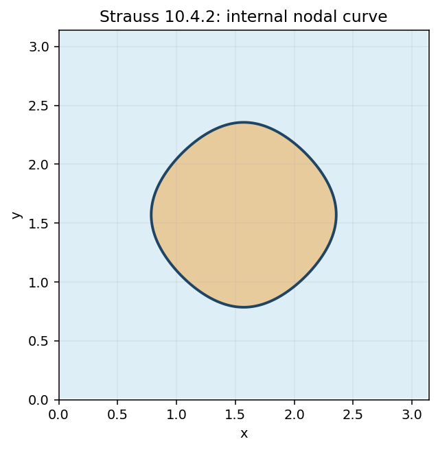
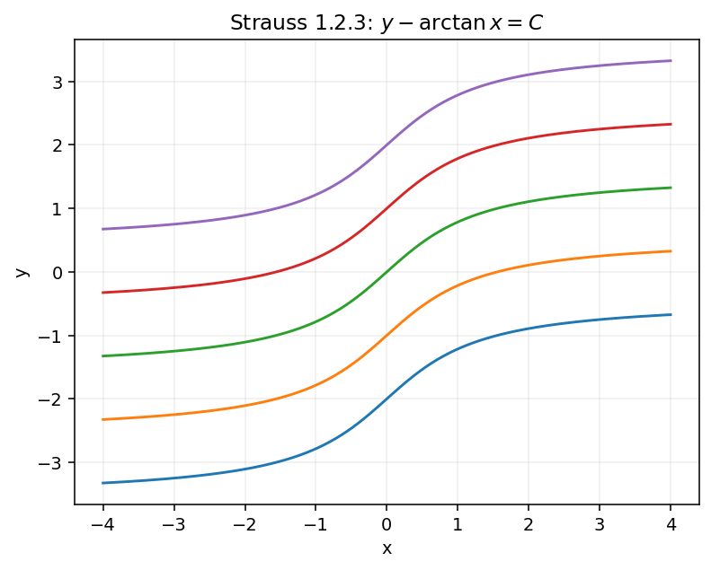
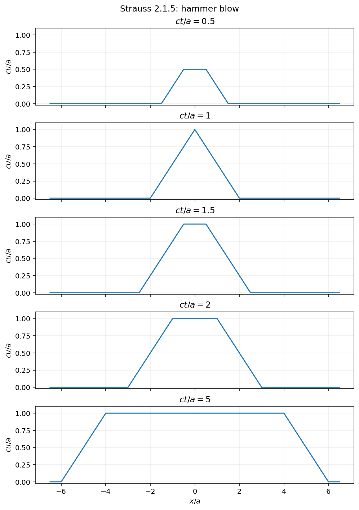
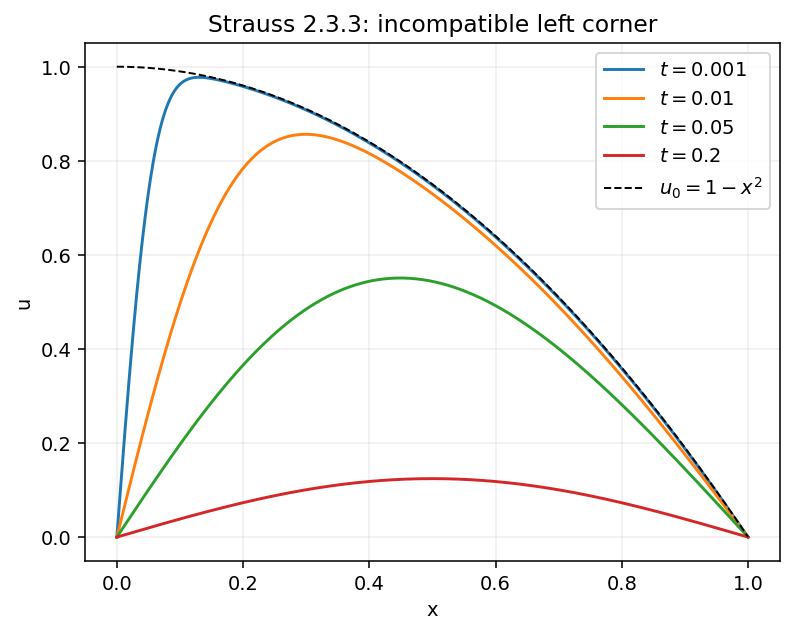
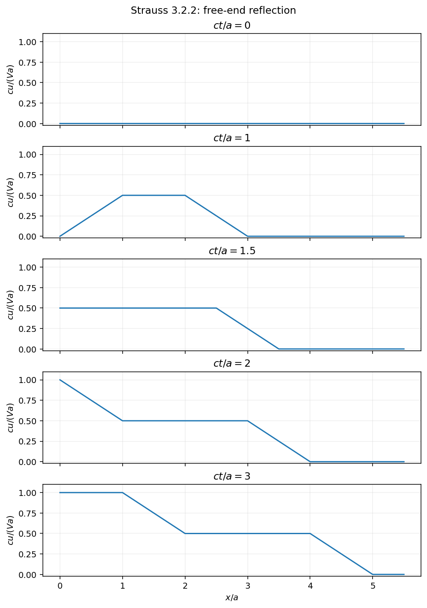
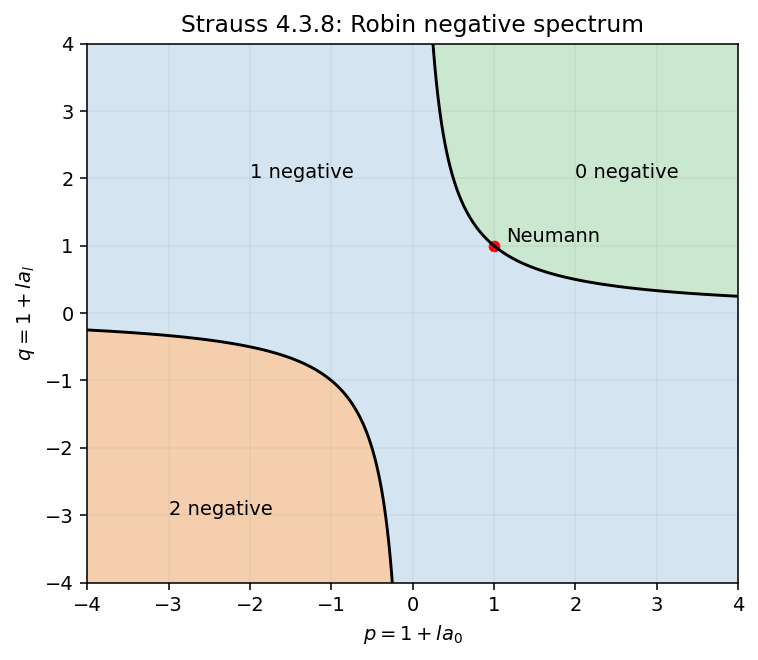
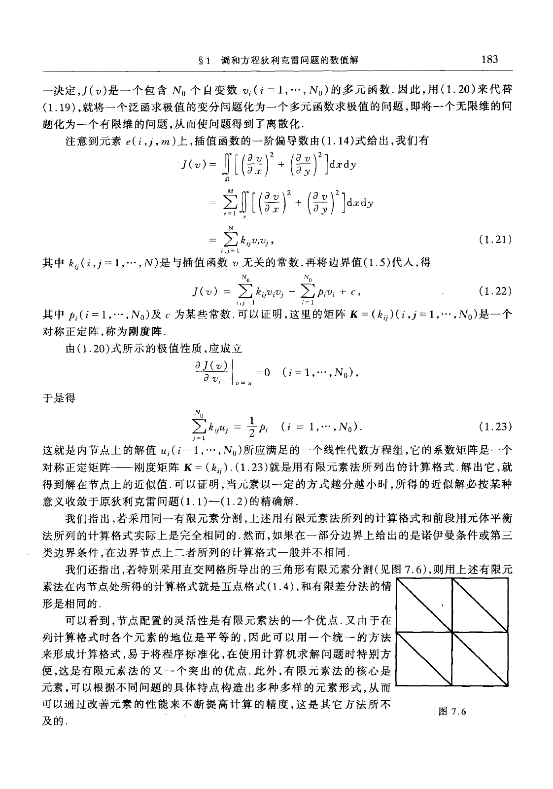
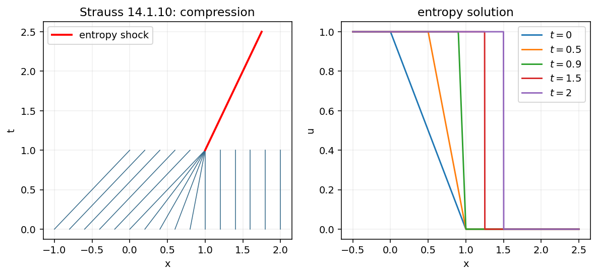

# 偏微分方程习题与简解

**版本日期：** 2026-10-10。

**状态：** 当前登记441道独立教材题，按直接关联知识点展示452条；435道有中文题干和简解，6道原题冲突、0道依赖缺失资料、0道证明待补，均不计入可直接采用的完整解答数。逐章处理状态另记覆盖表。扩展题库另置空目录。

## 来源、版本与范围

- **主源判定：** 谷超豪、李大潜、陈恕行、郑宋穆、谭永基《数学物理方程》第三版，高等教育出版社；书页 p = PDF 第 p+9 页。
- **主教材：** 《数学物理方程》原件（不随资源包附送）；SHA-256：`65593f255af1eff11a910d9be7e14d56bc7c449054751997857becda45405f7a`。
- **参考书：** 《广义函数与数学物理方程》原件（不随资源包附送）；SHA-256：`f928f65cb5004109e998746a265464ad4975d35aea932a3e9361329d45ad0eb3`。
- **参考书：** 《广义函数与函数空间导论》原件（不随资源包附送）；SHA-256：`b9fd6cc2485aa967e7e4e87981c988e1cfaf28be015384e1f16157bb4150a86c`。
- **参考书：** 《偏微分方程导论》原件（不随资源包附送）；SHA-256：`89c39420ef940097a7edba35a84878f380b47df608915d0681e1369aa19401af`。
- **课程大纲参考：** 《偏微分方程》原件（不随资源包附送）；SHA-256：`db0fe5deaf319fc1d760ab395689e59b20e0430a63f6e6e27fc1d1d98d9e094a`。
- 主教材全章、附录及大纲并集已按覆盖表整理；参考书以逐项注明的相关节和原题精选补充。主教材与参考书的印刷页/PDF页对应分别见每条来源。
- 编号题原页及歧义公式按各课覆盖记录处理。自拟简解与教材提示整理分别标示；明确的原题冲突在题末记录。覆盖、数量与校验记录见根目录处理记录中的课程覆盖报告。教师最终审核及平台试导入尚未执行。

## 目录

- [第1章 波动方程](#group-ch01)
- [第2章 热传导方程](#group-ch02)
- [第3章 调和方程](#group-ch03)
- [第4章 二阶线性偏微分方程的分类与总结](#group-ch04)
- [第5章 一阶偏微分方程组](#group-ch05)
- [第6章 广义解与广义函数解](#group-ch06)
- [第7章 偏微分方程的数值解](#group-ch07)
- [附录1 Fourier级数系数的估计](#group-app01)
- [附录2 张紧薄膜的张力](#group-app02)
- [附录3 特殊函数](#group-app03)
- [大纲补充专题](#group-outline)

## 课程总览

同题可在多个直接对应知识点下完整展示，重复展示不增加独立题数。原题的小问合并保留；难度按课程层次估为1—5，来源与自拟解答分别标示。

## 第1章 波动方程

[波动方程与定解问题](#kp-ch01-wave-equation)；[d'Alembert 公式与传播](#kp-ch01-domain-of-dependence)；[分离变量与高维波动](#kp-ch01-separation-of-variables)；[波能量估计](#kp-ch01-energy-estimate)；[弦横振动的力平衡](#kp-a-ch01-string)；[杆纵振动与Hooke定律](#kp-a-ch01-rod)；[悬垂弦的变张力](#kp-a-ch01-hanging)；[第一类边界条件](#kp-a-ch01-dirichlet)；[第二类边界条件](#kp-a-ch01-neumann)；[第三类弹性支承](#kp-a-ch01-robin)；[初位移与初速度](#kp-a-ch01-initial)；[定解问题适定性](#kp-a-ch01-wellposed)；[初边相容性与解的类型](#kp-a-ch01-compatibility)；[线性与非线性建模](#kp-a-ch01-linearity)；[叠加原理](#kp-a-ch01-superposition)；[一维特征坐标](#kp-a-ch01-characteristic)；[d’Alembert公式](#kp-a-ch01-dalembert)；[左右传播波](#kp-a-ch01-traveling)；[依赖、影响和决定区域](#kp-a-ch01-dependence)；[Duhamel齐次化原理](#kp-a-ch01-duhamel)；[Goursat特征数据](#kp-a-ch01-goursat)；[含速度的边界阻抗](#kp-a-ch01-impedance)；[移动边界的特征可逆性](#kp-a-ch01-moving-boundary)；[圆锥杆的变量替换](#kp-a-ch01-conical-rod)；[分离变量与谱展开](#kp-a-ch01-separation)；[双Dirichlet本征模式](#kp-a-ch01-dd-modes)；[混合Dirichlet–Neumann模式](#kp-a-ch01-dn-modes)；[双Neumann模式与零模](#kp-a-ch01-nn-modes)；[驻波与固有频率](#kp-a-ch01-standing)；[Fourier系数与正交性](#kp-a-ch01-fourier-coeff)；[源的模态ODE](#kp-a-ch01-forced-modes)；[非齐次边界齐次化](#kp-a-ch01-lifting)；[周期驱动与共振](#kp-a-ch01-resonance)；[阻尼模式的三种情形](#kp-a-ch01-damping)；[模式能量与Parseval](#kp-a-ch01-modal-energy)；[薄膜振动模型](#kp-a-ch01-membrane)；[高维波的定解条件](#kp-a-ch01-highdim-data)；[三维球平均法](#kp-a-ch01-sphere-average)；[三维Kirchhoff–Poisson公式](#kp-a-ch01-kirchhoff)；[降维法](#kp-a-ch01-descent)；[二维Poisson核公式](#kp-a-ch01-poisson2)；[高维源响应](#kp-a-ch01-highdim-duhamel)；[推迟势](#kp-a-ch01-retarded)；[二维轴对称波](#kp-a-ch01-radial)；[带c²u项的升维法](#kp-a-ch01-mass-lift)；[高维依赖球和特征锥](#kp-a-ch01-cones)；[强Huygens原理](#kp-a-ch01-huygens)；[一二维波的后效](#kp-a-ch01-tails)；[三维波的衰减](#kp-a-ch01-decay3)；[二维定点衰减](#kp-a-ch01-decay2)；[动能和位能](#kp-a-ch01-energy)；[波能量通量恒等式](#kp-a-ch01-flux)；[能量法唯一性](#kp-a-ch01-energy-uniqueness)；[能量范数稳定性](#kp-a-ch01-energy-stability)；[特征锥上的局部能量](#kp-a-ch01-cone-energy)；[Robin边界储能](#kp-a-ch01-robin-energy)；[阻尼的能量耗散](#kp-a-ch01-damping-energy)；[线性PDE的向量空间结构](#kp-b-ch01-linear-algebra)；[非特征初线与特征流](#kp-b-ch01-characteristic-flow)；[移动介质的守恒通量](#kp-b-ch01-diffusion-advection)；[复合导热杆界面条件](#kp-b-ch01-heterogeneous-rod)；[边值核与源项相容性](#kp-b-ch01-fredholm-compatibility)；[旋转不变常系数二阶算子](#kp-b-ch01-rotation-invariance)

### 波动方程与定解问题

**图谱路径：** 偏微分方程 / 第1章 波动方程 / 波动方程与定解问题

**知识内容：** [定义、定理与方法](知识点.md#kp-ch01-wave-equation)

<!-- source-exercise:A-ch01-s01-6 -->
1. 设 $F,G\in C^2(\mathbb R)$，验证 $u(x,t)=F(x-at)$ 与 $v(x,t)=G(x+at)$ 均满足一维弦振动方程 $w_{tt}=a^2w_{xx}$。

   **答案：** 对 $u$，$u_{tt}=a^2F''(x-at)$，$u_{xx}=F''(x-at)$；对 $v$ 同理得 $v_{tt}=a^2G''(x+at)$、$v_{xx}=G''(x+at)$。两者均满足方程。

   **难度：1/5；出处：** 主教材第1章§1习题6，书页8（PDF第17页），原题号第1章§1习题6；**解答来源：** 自拟简解。

### d'Alembert 公式与传播

**图谱路径：** 偏微分方程 / 第1章 波动方程 / d'Alembert 公式与传播

**知识内容：** [定义、定理与方法](知识点.md#kp-ch01-domain-of-dependence)

已整理范围内未另选可直接对应此节点的独立未解题；相关已解例子见知识内容。

### 分离变量与高维波动

**图谱路径：** 偏微分方程 / 第1章 波动方程 / 分离变量与高维波动

**知识内容：** [定义、定理与方法](知识点.md#kp-ch01-separation-of-variables)

已整理范围内未另选可直接对应此节点的独立未解题；相关已解例子见知识内容。

### 波能量估计

**图谱路径：** 偏微分方程 / 第1章 波动方程 / 波能量估计

**知识内容：** [定义、定理与方法](知识点.md#kp-ch01-energy-estimate)

已整理范围内未另选可直接对应此节点的独立未解题；相关已解例子见知识内容。

### 弦横振动的力平衡

**图谱路径：** 偏微分方程 / 第1章 波动方程 / 弦横振动的力平衡

**知识内容：** [定义、定理与方法](知识点.md#kp-a-ch01-string)

<!-- source-exercise:Q-ch01-1 -->
1. 设弦线密度$\rho=\rho(x)$不恒定、张力$T$为常量，推导弦横振动方程。

   **答案：** 小位移、小斜率下，长度$dx$质量$\rho(x)dx$、两端竖向张力差$T u_{xx}dx$，故$\rho(x)u_{tt}=Tu_{xx}$。若张力本身随位置变，则应保留$(Tu_x)_x$，不能写成$T u_{xx}$。

   **难度：2/5；出处：** Q：齐民友、吴方同《广义函数与数学物理方程》第二版，1998，第1章习题1，书页8（PDF第18页），原题号第1章习题1；**解答来源：** 自拟简解；原页逐图核对。

<!-- source-exercise:Q-ch01-3 -->
2. 弦在介质中振动，介质阻力与该处速度成正比，同时每点有与位移成正比的恢复力，求弦振动方程。

   **答案：** 设每单位长度阻尼$b(x)\ge0$、恢复系数$k(x)\ge0$，竖向力为$Tu_{xx}dx-bu_tdx-ku\,dx$，所以$\rho u_{tt}=Tu_{xx}-bu_t-ku$。阻尼项和恢复项符号都与运动/位移相反；边界阻尼是另一种模型。

   **难度：2/5；出处：** Q：齐民友、吴方同《广义函数与数学物理方程》第二版，1998，第1章习题3，书页8（PDF第18页），原题号第1章习题3；**解答来源：** 自拟简解；原页逐图核对。

### 杆纵振动与Hooke定律

**图谱路径：** 偏微分方程 / 第1章 波动方程 / 杆纵振动与Hooke定律

**知识内容：** [定义、定理与方法](知识点.md#kp-a-ch01-rod)

<!-- source-exercise:A-ch01-s01-1 -->
1. 杆受外因纵振，位移u(x,t)，张力服从Hooke定律，证明$\partial_t(\rho(x)u_t)=\partial_x(Eu_x)$，ρ密度、E为Young模量。

   **答案：** 单位截面微段质量ρdx，轴力Eu_x，两端力差$\partial_x(Eu_x)dx$。Newton给ρu_tt该力差，ρ不依t故为题式。若截面A可变应先写ρA u_tt=(EAu_x)_x，不能把A从导数中误约。

   **难度：2/5；出处：** A：谷超豪、李大潜、陈恕行、郑宋穆、谭永基《数学物理方程》第三版，2012，ISBN9787040337914，第一章§1习题1，书页8（PDF第17页），原题号§1习题1；**解答来源：** 自拟简解。

<!-- source-exercise:A-ch01-s01-3 -->
2. 圆锥高h、x从底面向尖端，截面∝(1−x/h)²，证明$E\partial_x[(1-x/h)^2u_x]=\rho(1-x/h)^2u_{tt}$。

   **答案：** 截面积A=A0(1−x/h)²，轴力EAu_x、微段质量ρA dx，代一般杆平衡并约A0即题式。尖端x=h退化，局部推导用于0≤x<h，端点应另给物理条件。

   **难度：2/5；出处：** A：谷超豪、李大潜、陈恕行、郑宋穆、谭永基《数学物理方程》第三版，2012，ISBN9787040337914，第一章§1习题3，书页8（PDF第17页），原题号§1习题3；**解答来源：** 自拟简解。

### 悬垂弦的变张力

**图谱路径：** 偏微分方程 / 第1章 波动方程 / 悬垂弦的变张力

**知识内容：** [定义、定理与方法](知识点.md#kp-a-ch01-hanging)

<!-- source-exercise:A-ch01-s01-4 -->
1. 柔软均匀弦一端固定，靠自重铅垂平衡，导微小横振动方程。

   **答案：** 以自由下端为x=0、上端l，平衡T(x)=ρgx。竖向微偏移的水平合力为(Tu_x)_xdx，所以u_tt=g(xu_x)_x=gxu_xx+gu_x。上端固定u(l,t)=0，下端自然力T(0)ux=0（退化），不能按常张力写a²uxx。

   **难度：3/5；出处：** A：谷超豪、李大潜、陈恕行、郑宋穆、谭永基《数学物理方程》第三版，2012，ISBN9787040337914，第一章§1习题4，书页8（PDF第17页），原题号§1习题4；**解答来源：** 自拟简解。

### 第一类边界条件

**图谱路径：** 偏微分方程 / 第1章 波动方程 / 第一类边界条件

**知识内容：** [定义、定理与方法](知识点.md#kp-a-ch01-dirichlet)

<!-- source-exercise:Q-ch08-s03-2 -->
1. 用端点反射解半无界弦$u_{tt}=c^2u_{xx}$（$x>0,t>0$）、$u(0,t)=0$，初位移$\varphi(x)$、初速度$\psi(x)$。

   **答案：** 令$\varphi_o,\psi_o$为半轴数据的奇延拓，则$u(x,t)=\frac12[\varphi_o(x-ct)+\varphi_o(x+ct)]+\frac1{2c}\int_{x-ct}^{x+ct}\psi_o(s)ds$，$x>0$。奇性给$u(0,t)=0$，固定端反射位移变号；闭角点经典解还需$\varphi(0)=0$等相容条件。

   **难度：3/5；出处：** Q：齐民友、吴方同《广义函数与数学物理方程》第二版，1998，第8章§3习题2，书页150（PDF第160页），原题号第8章§3习题2；**解答来源：** 自拟简解；原页逐图核对。

<!-- source-exercise:Q-ch01-9 -->
2. 长$l$、两端固定的均匀弦，从中点提起至离平衡位置$h$后静止释放。已知线密度$\rho$、张力$T$，写出定解问题。

   **答案：** 令$a^2=T/\rho$，在$0<x<l,t>0$有$u_{tt}=a^2u_{xx}$、$u(0,t)=u(l,t)=0$、$u_t(x,0)=0$，初位移为$\varphi(x)=2hx/l$（$0\le x\le l/2$）及$\varphi(x)=2h(l-x)/l$（$l/2\le x\le l$）。中点折角使初时不具全域$C^2$，宜按有限能量/模态解解释。

   **难度：2/5；出处：** Q：齐民友、吴方同《广义函数与数学物理方程》第二版，1998，第1章习题9，书页8（PDF第18页），原题号第1章习题9；**解答来源：** 自拟简解；原页逐图核对。

<!-- source-exercise:S-sec12.2-3 -->
3. 半无穷弦 $x>0$ 在 $x=0$ 固定、$t<0$ 静止，$t=0$ 于 $x_0>0$ 受到瞬时冲击，初速度为 $V\delta(x-x_0)$。求位移。

   **答案：** 对初速度作奇延拓 $\psi_{\rm odd}=V[\delta(x-x_0)-\delta(x+x_0)]$，在整线用d'Alembert式，再限制$x>0$：$u(x,t)=\frac{V}{2c}[\mathbf1_{\{|x-x_0|<ct\}}-\mathbf1_{\{|x+x_0|<ct\}}]$。第二项是固定端反射的反号波；$x=0$ 两项相消。

   **难度：3/5；出处：** S：Walter A. Strauss, Partial Differential Equations: An Introduction, Second Edition，所附扫描本，§12.2习题3，书页342（PDF第354页），原题号§12.2 习题3；**解答来源：** 自拟简解；已按所附扫描原页核对题干。

### 第二类边界条件

**图谱路径：** 偏微分方程 / 第1章 波动方程 / 第二类边界条件

**知识内容：** [定义、定理与方法](知识点.md#kp-a-ch01-neumann)

<!-- source-exercise:Q-ch08-s03-1 -->
1. 用波的传播讨论有限弦$u_{tt}=c^2u_{xx}$在两端Neumann边值$u_x(0,t)=u_x(l,t)=0$时的端点反射。

   **答案：** 把初位移、初速度先关于0偶延拓，再作$2l$周期延拓，整线d’Alembert式限制到$[0,l]$即解。偶反射使法向导数在端点为0，入射位移波在自由端反射时同号；有限能量解的端点迹按相应弱意义解释。

   **难度：3/5；出处：** Q：齐民友、吴方同《广义函数与数学物理方程》第二版，1998，第8章§3习题1，书页150（PDF第160页），原题号第8章§3习题1；**解答来源：** 自拟简解；原页逐图核对。

### 第三类弹性支承

**图谱路径：** 偏微分方程 / 第1章 波动方程 / 第三类弹性支承

**知识内容：** [定义、定理与方法](知识点.md#kp-a-ch01-robin)

<!-- source-exercise:A-ch01-s01-2 -->
1. 杆端固定、自由或弹性支承，分别导出边界。

   **答案：** 固定u=0；自由轴力EA∂nu=0；弹性回复力−κu与杆外向力平衡，EA∂nu+κu=0。右端∂n=∂x、左端∂n=−∂x。非零给定位移/外力时改相应右端，三小问同一道原题。

   **难度：2/5；出处：** A：谷超豪、李大潜、陈恕行、郑宋穆、谭永基《数学物理方程》第三版，2012，ISBN9787040337914，第一章§1习题2，书页8（PDF第17页），原题号§1习题2；**解答来源：** 自拟简解。

### 初位移与初速度

**图谱路径：** 偏微分方程 / 第1章 波动方程 / 初位移与初速度

**知识内容：** [定义、定理与方法](知识点.md#kp-a-ch01-initial)

已整理范围内未另选可直接对应此节点的独立未解题；相关已解例子见知识内容。

### 定解问题适定性

**图谱路径：** 偏微分方程 / 第1章 波动方程 / 定解问题适定性

**知识内容：** [定义、定理与方法](知识点.md#kp-a-ch01-wellposed)

已整理范围内未另选可直接对应此节点的独立未解题；相关已解例子见知识内容。

### 初边相容性与解的类型

**图谱路径：** 偏微分方程 / 第1章 波动方程 / 初边相容性与解的类型

**知识内容：** [定义、定理与方法](知识点.md#kp-a-ch01-compatibility)

已整理范围内未另选可直接对应此节点的独立未解题；相关已解例子见知识内容。

### 线性与非线性建模

**图谱路径：** 偏微分方程 / 第1章 波动方程 / 线性与非线性建模

**知识内容：** [定义、定理与方法](知识点.md#kp-a-ch01-linearity)

已整理范围内未另选可直接对应此节点的独立未解题；相关已解例子见知识内容。

### 叠加原理

**图谱路径：** 偏微分方程 / 第1章 波动方程 / 叠加原理

**知识内容：** [定义、定理与方法](知识点.md#kp-a-ch01-superposition)

已整理范围内未另选可直接对应此节点的独立未解题；相关已解例子见知识内容。

### 一维特征坐标

**图谱路径：** 偏微分方程 / 第1章 波动方程 / 一维特征坐标

**知识内容：** [定义、定理与方法](知识点.md#kp-a-ch01-characteristic)

已整理范围内未另选可直接对应此节点的独立未解题；相关已解例子见知识内容。

### d’Alembert公式

**图谱路径：** 偏微分方程 / 第1章 波动方程 / d’Alembert公式

**知识内容：** [定义、定理与方法](知识点.md#kp-a-ch01-dalembert)

已整理范围内未另选可直接对应此节点的独立未解题；相关已解例子见知识内容。

### 左右传播波

**图谱路径：** 偏微分方程 / 第1章 波动方程 / 左右传播波

**知识内容：** [定义、定理与方法](知识点.md#kp-a-ch01-traveling)

<!-- source-exercise:A-ch01-s01-6 -->
1. 设 $F,G\in C^2(\mathbb R)$，验证 $u(x,t)=F(x-at)$ 与 $v(x,t)=G(x+at)$ 均满足一维弦振动方程 $w_{tt}=a^2w_{xx}$。

   **答案：** 对 $u$，$u_{tt}=a^2F''(x-at)$，$u_{xx}=F''(x-at)$；对 $v$ 同理得 $v_{tt}=a^2G''(x+at)$、$v_{xx}=G''(x+at)$。两者均满足方程。

   **难度：1/5；出处：** 主教材第1章§1习题6，书页8（PDF第17页），原题号第1章§1习题6；**解答来源：** 自拟简解。

<!-- source-exercise:A-ch01-s02-2 -->
2. 何种φ、ψ使齐次波初值解仅右传播波？

   **答案：** 若u=F(x−at)，初φ=F、ψ=−aF′，必要ψ=−aφ′；反向代公式两边抵消，得u=φ(x−at)。因此在可微数据类中此条件充要，常数可并入F。

   **难度：2/5；出处：** A：谷超豪、李大潜、陈恕行、郑宋穆、谭永基《数学物理方程》第三版，2012，ISBN9787040337914，第一章§2习题2，书页16（PDF第25页），原题号§2习题2；**解答来源：** 自拟简解。

### 依赖、影响和决定区域

**图谱路径：** 偏微分方程 / 第1章 波动方程 / 依赖、影响和决定区域

**知识内容：** [定义、定理与方法](知识点.md#kp-a-ch01-dependence)

<!-- source-exercise:A-ch01-s02-4 -->
1. 非齐次源f不变时，（1）初值在[x1,x2]改变，影响域外解不变；（2）该区间数据确定其决定域。

   **答案：** 两解差为齐次波，d’Alembert只取[x−at,x+at]端值和速度积分。该依赖区间不交改变区间时差0；依赖区间包含于已知[x1,x2]时解差0。分别给影响外和内缩决定域结论，源差不为0时须另加Duhamel贡献。

   **难度：2/5；出处：** A：谷超豪、李大潜、陈恕行、郑宋穆、谭永基《数学物理方程》第三版，2012，ISBN9787040337914，第一章§2习题4，书页16（PDF第25页），原题号§2习题4；**解答来源：** 自拟简解。

### Duhamel齐次化原理

**图谱路径：** 偏微分方程 / 第1章 波动方程 / Duhamel齐次化原理

**知识内容：** [定义、定理与方法](知识点.md#kp-a-ch01-duhamel)

<!-- source-exercise:A-ch01-s02-9 -->
1. utt=a²uxx+tx/(1+x²)²，u0=0、ut0=1/(1+x²)。

   **答案：** $u=\frac{\arctan(x+at)-\arctan(x-at)}{2a}+\frac1{4a}\int_0^t s\left[\frac1{1+(x-a(t-s))^2}-\frac1{1+(x+a(t-s))^2}\right]ds$。第一项来自速度积分，第二项内源积分用原函数−1/[2(1+x²)]，这是完整一维普通积分表示。

   **难度：3/5；出处：** A：谷超豪、李大潜、陈恕行、郑宋穆、谭永基《数学物理方程》第三版，2012，ISBN9787040337914，第一章§2习题9，书页17（PDF第26页），原题号§2习题9；**解答来源：** 自拟简解。

### Goursat特征数据

**图谱路径：** 偏微分方程 / 第1章 波动方程 / Goursat特征数据

**知识内容：** [定义、定理与方法](知识点.md#kp-a-ch01-goursat)

<!-- source-exercise:A-ch01-s02-3 -->
1. utt=a²uxx，u|x−at=0=φ(x)、u|x+at=0=ψ(x)，φ(0)=ψ(0)，求Goursat解。

   **答案：** ξ=x−at、η=x+at，沿ξ=0有η=2x，所以G(η)=φ(η/2)−F0；沿η=0同理F(ξ)=ψ(ξ/2)−G0。合得$u=\varphi((x+at)/2)+\psi((x-at)/2)-\varphi(0)$。交点相容消重复常数。

   **难度：3/5；出处：** A：谷超豪、李大潜、陈恕行、郑宋穆、谭永基《数学物理方程》第三版，2012，ISBN9787040337914，第一章§2习题3，书页16（PDF第25页），原题号§2习题3；**解答来源：** 自拟简解。

### 含速度的边界阻抗

**图谱路径：** 偏微分方程 / 第1章 波动方程 / 含速度的边界阻抗

**知识内容：** [定义、定理与方法](知识点.md#kp-a-ch01-impedance)

<!-- source-exercise:A-ch01-s02-5 -->
1. x>0,t>0，utt−a²uxx=0，u0=φ(x)、ut0=0，边界ux−k ut=0，k>0。

   **答案：** 令r=(1−ak)/(1+ak)。x≥at时u=[φ(x−at)+φ(x+at)]/2；0<x<at时$u=[r\varphi(at-x)+(1-r)\varphi(0)+\varphi(x+at)]/2$。由边界$(1+ak)F'(-at)+(1-ak)G'(at)=0$积分得反射项。若要求角点C1需φ′(0)=0；能量通量为耗散而非弹性储能。

   **难度：3/5；出处：** A：谷超豪、李大潜、陈恕行、郑宋穆、谭永基《数学物理方程》第三版，2012，ISBN9787040337914，第一章§2习题5，书页16（PDF第25页），原题号§2习题5；**解答来源：** 自拟简解。

### 移动边界的特征可逆性

**图谱路径：** 偏微分方程 / 第1章 波动方程 / 移动边界的特征可逆性

**知识内容：** [定义、定理与方法](知识点.md#kp-a-ch01-moving-boundary)

<!-- source-exercise:A-ch01-s02-6 -->
1. utt−uxx=0，0<t<kx、k>1，t=0给φ0(x)、ut=φ1(x)（x≥0），u|t=kx=ψ(x)，φ0(0)=ψ(0)。

   **答案：** 正参数上定义$F(s)=\frac12\varphi_0(s)-\frac12\int_0^s\varphi_1(r)dr$、$G(s)=\frac12\varphi_0(s)+\frac12\int_0^s\varphi_1(r)dr$。ξ=x−t若非负直接F(ξ)；若负，边界ξ=−(k−1)x_b给$x_b=-\xi/(k-1)$、η=(k+1)xb，定义$F(\xi)=\psi(-\xi/(k-1))-G(-(k+1)\xi/(k-1))$。u=F(x−t)+G(x+t)，角点更高光滑还需导数相容。

   **难度：4/5；出处：** A：谷超豪、李大潜、陈恕行、郑宋穆、谭永基《数学物理方程》第三版，2012，ISBN9787040337914，第一章§2习题6，书页16（PDF第25页），原题号§2习题6；**解答来源：** 自拟简解。

<!-- source-exercise:A-ch01-s02-7 -->
2. utt−uxx=0，f(t)<x<t，u|x=t=φ(t)、u|x=f(t)=ψ(t)，φ0=ψ0；f(0)=0，曲线在x=±t之间，f′≠1。

   **答案：** q(t)=f(t)−t从0起为负且导数不0，令τ=q^{-1}。对ξ=x−t、η=x+t，$u=\psi(\tau(\xi))-\varphi((f(\tau(\xi))+\tau(\xi))/2)+\varphi(\eta/2)$。由F(ξ)+G(η)先用x=t定G，再由另一边定F，常数取消。全域逆的范围与时间区间明确。

   **难度：4/5；出处：** A：谷超豪、李大潜、陈恕行、郑宋穆、谭永基《数学物理方程》第三版，2012，ISBN9787040337914，第一章§2习题7，书页16（PDF第25页），原题号§2习题7；**解答来源：** 自拟简解。

### 圆锥杆的变量替换

**图谱路径：** 偏微分方程 / 第1章 波动方程 / 圆锥杆的变量替换

**知识内容：** [定义、定理与方法](知识点.md#kp-a-ch01-conical-rod)

<!-- source-exercise:A-ch01-s02-1 -->
1. h>0，$\partial_x[(1-x/h)^2u_x]=a^{-2}(1-x/h)^2u_{tt}$，证明通解$u=[F(x-at)+G(x+at)]/(h-x)$并求u0=φ、ut0=ψ。

   **答案：** 令v=(h−x)u，直接算vtt=a²vxx。其初值v0=(h−x)φ、vt0=(h−x)ψ，用d’Alembert得$v(x,t)=\frac12[(h-x+at)\varphi(x-at)+(h-x-at)\varphi(x+at)]+\frac1{2a}\int_{x-at}^{x+at}(h-s)\psi(s)ds$，再除h−x。通解在x≠h局部；经过尖端需另核有限性。

   **难度：3/5；出处：** A：谷超豪、李大潜、陈恕行、郑宋穆、谭永基《数学物理方程》第三版，2012，ISBN9787040337914，第一章§2习题1，书页16（PDF第25页），原题号§2习题1；**解答来源：** 自拟简解。

### 分离变量与谱展开

**图谱路径：** 偏微分方程 / 第1章 波动方程 / 分离变量与谱展开

**知识内容：** [定义、定理与方法](知识点.md#kp-a-ch01-separation)

已整理范围内未另选可直接对应此节点的独立未解题；相关已解例子见知识内容。

### 双Dirichlet本征模式

**图谱路径：** 偏微分方程 / 第1章 波动方程 / 双Dirichlet本征模式

**知识内容：** [定义、定理与方法](知识点.md#kp-a-ch01-dd-modes)

已整理范围内未另选可直接对应此节点的独立未解题；相关已解例子见知识内容。

### 混合Dirichlet–Neumann模式

**图谱路径：** 偏微分方程 / 第1章 波动方程 / 混合Dirichlet–Neumann模式

**知识内容：** [定义、定理与方法](知识点.md#kp-a-ch01-dn-modes)

<!-- source-exercise:A-ch01-s03-1 -->
1. 分离变量解：（1）utt=a²uxx，u0=sin(3πx/l)，ut0=x(l−x)，u(0,t)=u(l,t)=0；（2）同方程，u(0,t)=0、ux(l,t)=0，u0=hx/l、ut0=0。

   **答案：** （1）$u=\sin(3πx/l)\cos(3aπt/l)+\sum_{n\ge1}\frac{4l^3(1-(-1)^n)}{a n^4π^4}\sin(nπx/l)\sin(a nπt/l)$。（2）μn=(n+1/2)π/l，系数$A_n=2h(-1)^n/(l^2\mu_n^2)$，$u=\sum_{n\ge0}A_n\sin(\mu_nx)\cos(a\mu_nt)$。第二初位移右端导数与Neumann不相容，不能声称角点C1；级数按开区间初值/弱解解释。

   **难度：3/5；出处：** A：谷超豪、李大潜、陈恕行、郑宋穆、谭永基《数学物理方程》第三版，2012，ISBN9787040337914，第一章§3习题1，书页24（PDF第33页），原题号§3习题1；**解答来源：** 自拟简解。

### 双Neumann模式与零模

**图谱路径：** 偏微分方程 / 第1章 波动方程 / 双Neumann模式与零模

**知识内容：** [定义、定理与方法](知识点.md#kp-a-ch01-nn-modes)

<!-- source-exercise:A-ch01-s03-3 -->
1. utt=a²uxx，0<x<l：（1）u(0,t)=ux(l,t)=0，u0=sin(3πx/(2l))，ut0=sin(5πx/(2l))；（2）ux两端0，u0=x、ut0=0。

   **答案：** （1）两独立混合模式：$u=\sin(3πx/(2l))\cos(3aπt/(2l))+\frac{2l}{5aπ}\sin(5πx/(2l))\sin(5aπt/(2l))$。（2）$u=l/2+\sum_{n\ge1}\frac{2l((-1)^n-1)}{n^2π^2}\cos(nπx/l)\cos(a nπt/l)$。第二数据导数与Neumann角点不相容，采用弱/开区间初值，不称闭域C1。

   **难度：3/5；出处：** A：谷超豪、李大潜、陈恕行、郑宋穆、谭永基《数学物理方程》第三版，2012，ISBN9787040337914，第一章§3习题3，书页24（PDF第33页），原题号§3习题3；**解答来源：** 自拟简解。

### 驻波与固有频率

**图谱路径：** 偏微分方程 / 第1章 波动方程 / 驻波与固有频率

**知识内容：** [定义、定理与方法](知识点.md#kp-a-ch01-standing)

<!-- source-exercise:S-sec10.4-2 -->
1. 在正方形 $(0,\pi)^2$ 中描画本征函数 $v(x,y)=\sin3x\sin y+\sin x\sin3y$ 的内部零点集。

   **答案：** 三倍角公式给 $v=2\sin x\sin y(3-2\sin^2x-2\sin^2y)$。内部前两因子为正，故零点集恰为 $\sin^2x+\sin^2y=3/2$；它是围绕$(\pi/2,\pi/2)$的闭曲线，与水平中线交于$x=\pi/4,3\pi/4$，与竖直中线同理，把正方形内部划为内外两个nodal区域。

   **难度：3/5；出处：** S：Walter A. Strauss, Partial Differential Equations: An Introduction, Second Edition，所附扫描本，§10.4习题2，书页281（PDF第293页），原题号§10.4 习题2；**解答来源：** 自拟简解；已按所附扫描原页核对题干。

### Fourier系数与正交性

**图谱路径：** 偏微分方程 / 第1章 波动方程 / Fourier系数与正交性

**知识内容：** [定义、定理与方法](知识点.md#kp-a-ch01-fourier-coeff)

已整理范围内未另选可直接对应此节点的独立未解题；相关已解例子见知识内容。

### 源的模态ODE

**图谱路径：** 偏微分方程 / 第1章 波动方程 / 源的模态ODE

**知识内容：** [定义、定理与方法](知识点.md#kp-a-ch01-forced-modes)

<!-- source-exercise:A-ch01-s02-8 -->
1. utt−uxx=t sinx，u0=0、ut0=sinx，求初值解。

   **答案：** 取u=q(t)sinx，q″+q=t，q0=0、q′0=1。q=t恰满足，故u=t sinx，直接代回验证全部条件。

   **难度：1/5；出处：** A：谷超豪、李大潜、陈恕行、郑宋穆、谭永基《数学物理方程》第三版，2012，ISBN9787040337914，第一章§2习题8，书页17（PDF第26页），原题号§2习题8；**解答来源：** 自拟简解。

<!-- source-exercise:A-ch01-s03-4 -->
2. utt−a²uxx=g常数，u(0,t)=ux(l,t)=0，u0=0、ut0=sin(πx/(2l))。

   **答案：** μn=(n+1/2)π/l，常源系数2g/(lμn)，故$u=\frac{\sin(a\mu_0t)}{a\mu_0}\sin(\mu_0x)+\sum_{n\ge0}\frac{2g(1-\cos(a\mu_nt))}{l a^2\mu_n^3}\sin(\mu_nx)$。逐模态ODE与原混合边界验证；高阶角点光滑取相容解释。

   **难度：3/5；出处：** A：谷超豪、李大潜、陈恕行、郑宋穆、谭永基《数学物理方程》第三版，2012，ISBN9787040337914，第一章§3习题4，书页24（PDF第33页），原题号§3习题4；**解答来源：** 自拟简解。

<!-- source-exercise:A-ch01-s03-5 -->
3. utt=a²uxx+b shx，双Dirichlet0，u0=ut0=0，分离变量求解。

   **答案：** kn=nπ/l，源系数$F_n=2b(-1)^{n+1}k_n\sinh l/[l(1+k_n^2)]$。$u=\sum_{n\ge1}F_n(1-\cos(a k_nt))/(a^2k_n^2)\sin(k_nx)$。sh为sinh；源投影积分和时间ODE给全解。若端点源与零初二阶角点不相容，级数不作闭域C2宣称。

   **难度：3/5；出处：** A：谷超豪、李大潜、陈恕行、郑宋穆、谭永基《数学物理方程》第三版，2012，ISBN9787040337914，第一章§3习题5，书页24（PDF第33页），原题号§3习题5；**解答来源：** 自拟简解。

### 非齐次边界齐次化

**图谱路径：** 偏微分方程 / 第1章 波动方程 / 非齐次边界齐次化

**知识内容：** [定义、定理与方法](知识点.md#kp-a-ch01-lifting)

<!-- source-exercise:A-ch01-s03-2 -->
1. utt=a²uxx，u(0,t)=0、u(l,t)=A sin²ωt，u0=ut0=0，求受周期端振动的弦。

   **答案：** 取w=(A x/l)sin²ωt，v=u−w为零边、零初值，源−wtt=−(2Aω²x/l)cos2ωt。kn=nπ/l，源正弦系数$d_n(t)=4Aω²(-1)^n\cos2ωt/(nπ)$，所以$u=w+\sum_n\sin(k_nx)\int_0^t\sin(a k_n(t-s))d_n(s)/(a k_n)ds$。卷积式在共振2ω=a kn也合法；角点二阶相容不足时按较弱解，不声称闭域C2。

   **难度：4/5；出处：** A：谷超豪、李大潜、陈恕行、郑宋穆、谭永基《数学物理方程》第三版，2012，ISBN9787040337914，第一章§3习题2，书页24（PDF第33页），原题号§3习题2；**解答来源：** 自拟简解。

### 周期驱动与共振

**图谱路径：** 偏微分方程 / 第1章 波动方程 / 周期驱动与共振

**知识内容：** [定义、定理与方法](知识点.md#kp-a-ch01-resonance)

已整理范围内未另选可直接对应此节点的独立未解题；相关已解例子见知识内容。

### 阻尼模式的三种情形

**图谱路径：** 偏微分方程 / 第1章 波动方程 / 阻尼模式的三种情形

**知识内容：** [定义、定理与方法](知识点.md#kp-a-ch01-damping)

<!-- source-exercise:A-ch01-s03-6 -->
1. utt+2but=a²uxx（b>0），双Dirichlet0，u0=hx/l、ut0=0。

   **答案：** kn=nπ/l，An=2h(−1)^{n+1}/(nπ)。若a²kn²>b²，qn=An $e^{-bt}$[cosΩnt+(b/Ωn)sinΩnt]；等号用An $e^{-bt}(1+bt)$；小于时用σn=√(b²−a²kn²)及cosh、sinh。u=Σqn sin knx。h≠0时初位移右端不为0，故不存在闭域连续经典解，级数仅L2/分布解释且可能非有限能量。

   **难度：4/5；出处：** A：谷超豪、李大潜、陈恕行、郑宋穆、谭永基《数学物理方程》第三版，2012，ISBN9787040337914，第一章§3习题6，书页24（PDF第33页），原题号§3习题6；**解答来源：** 自拟简解。

   **整理说明：** 原题开区间初值可作广义展开，必须明确与经典角点相容不同。

### 模式能量与Parseval

**图谱路径：** 偏微分方程 / 第1章 波动方程 / 模式能量与Parseval

**知识内容：** [定义、定理与方法](知识点.md#kp-a-ch01-modal-energy)

<!-- source-exercise:A-ch01-s06-4 -->
1. 固定端自由弦拆驻波，算各动能位能，证明总能量叠加；对应数学事实？

   **答案：** 模式qn=An cosωnt+Bn sinωnt，归一Kn=l qn′²/4、Vn=lωn²qn²/4，和En=lωn²(An²+Bn²)/4。不同模ut正弦、ux余弦均正交，交叉项0；有限能量无限叠加用Parseval。物理能量乘ρ，数学事实为正交与完备性。

   **难度：3/5；出处：** A：谷超豪、李大潜、陈恕行、郑宋穆、谭永基《数学物理方程》第三版，2012，ISBN9787040337914，第一章§6习题4，书页46（PDF第55页），原题号§6习题4；**解答来源：** 自拟简解。

### 薄膜振动模型

**图谱路径：** 偏微分方程 / 第1章 波动方程 / 薄膜振动模型

**知识内容：** [定义、定理与方法](知识点.md#kp-a-ch01-membrane)

已整理范围内未另选可直接对应此节点的独立未解题；相关已解例子见知识内容。

### 高维波的定解条件

**图谱路径：** 偏微分方程 / 第1章 波动方程 / 高维波的定解条件

**知识内容：** [定义、定理与方法](知识点.md#kp-a-ch01-highdim-data)

<!-- source-exercise:S-sec9.1-1 -->
1. 求三维波方程 $u_{tt}=c^2\Delta u$ 中形如 $u(\mathbf x,t)=f(\mathbf k\cdot\mathbf x-ct)$ 的全部平面波，$\mathbf k$ 为固定向量。

   **答案：** 设相位$s=\mathbf k\cdot\mathbf x-ct$，则 $u_{tt}=c^2f''(s)$、$c^2\Delta u=c^2|\mathbf k|^2f''(s)$。故若 $|\mathbf k|=1$，任意足够光滑$f$可用；若 $|\mathbf k|\ne1$，须$f''\equiv0$，即$f$为仿射函数（退化的平面波）。

   **难度：3/5；出处：** S：Walter A. Strauss, Partial Differential Equations: An Introduction, Second Edition，所附扫描本，§9.1习题1，书页233（PDF第245页），原题号§9.1 习题1；**解答来源：** 自拟简解；已按所附扫描原页核对题干。

<!-- source-exercise:S-sec9.1-2 -->
2. 核查 $(c^2t^2-x^2-y^2-z^2)^{-1}$ 在光锥 $c^2t^2=x^2+y^2+z^2$ 以外满足三维波方程。

   **答案：** 记 $s=c^2t^2-r^2$，在三维空间对 $F=s^\alpha$ 计算 $(\partial_t^2-c^2\Delta)F=2c^2\alpha(3+2\alpha-1)s^{\alpha-1}$；取 $\alpha=-1$ 即为0。分式在$s=0$无定义，结论只在各个光锥外连通区域按经典解成立。

   **难度：3/5；出处：** S：Walter A. Strauss, Partial Differential Equations: An Introduction, Second Edition，所附扫描本，§9.1习题2，书页233（PDF第245页），原题号§9.1 习题2；**解答来源：** 自拟简解；已按所附扫描原页核对题干。

### 三维球平均法

**图谱路径：** 偏微分方程 / 第1章 波动方程 / 三维球平均法

**知识内容：** [定义、定理与方法](知识点.md#kp-a-ch01-sphere-average)

<!-- source-exercise:S-sec9.2-3 -->
1. 用三维球平均公式求波方程 $u_{tt}=c^2\Delta u$、初位移 $\phi=0$、初速度 $\psi(x,y,z)=y$ 的解。

   **答案：** 线性坐标 $y$ 是调和函数，任何球面的平均仍为中心坐标 $y$。Kirchhoff公式的纯速度项为 $t$ 倍球平均，故 $u(x,y,z,t)=ty$；直接验算两侧均为0且$u_t(\cdot,0)=y$。

   **难度：2/5；出处：** S：Walter A. Strauss, Partial Differential Equations: An Introduction, Second Edition，所附扫描本，§9.2习题3，书页240（PDF第252页），原题号§9.2 习题3；**解答来源：** 自拟简解；已按所附扫描原页核对题干。

### 三维Kirchhoff–Poisson公式

**图谱路径：** 偏微分方程 / 第1章 波动方程 / 三维Kirchhoff–Poisson公式

**知识内容：** [定义、定理与方法](知识点.md#kp-a-ch01-kirchhoff)

<!-- source-exercise:A-ch01-s04-1 -->
1. 用Poisson公式解三维波utt=a²Δu：（1）u0=0、ut0=x²+yz；（2）u0=x³+y²z、ut0=0。

   **答案：** 球平均多项式或有限Δ级数得（1）u=t(x²+yz)+a²t³/3；（2）u=x³+y²z+a²t²(3x+z)。因为Δ(x²+yz)=2，Δ(x³+y²z)=6x+2z且再Δ为0，时间级数终止，直接验证。

   **难度：2/5；出处：** A：谷超豪、李大潜、陈恕行、郑宋穆、谭永基《数学物理方程》第三版，2012，ISBN9787040337914，第一章§4习题1，书页34（PDF第43页），原题号§4习题1；**解答来源：** 自拟简解。

<!-- source-exercise:S-sec9.2-4 -->
2. 用三维球平均公式求波方程 $u_{tt}=c^2\Delta u$、$\phi=0$、$\psi(x,y,z)=x^2+y^2+z^2$ 的解。

   **答案：** 半径$ct$球面上 $|\mathbf x+ct\omega|^2$ 的平均为 $|\mathbf x|^2+c^2t^2$，纯速度Kirchhoff式给 $u=t(|\mathbf x|^2+c^2t^2)$。核查 $u_{tt}=6c^2t=c^2\Delta(t|\mathbf x|^2)$，初数据正确。

   **难度：3/5；出处：** S：Walter A. Strauss, Partial Differential Equations: An Introduction, Second Edition，所附扫描本，§9.2习题4，书页240（PDF第252页），原题号§9.2 习题4；**解答来源：** 自拟简解；已按所附扫描原页核对题干。

### 降维法

**图谱路径：** 偏微分方程 / 第1章 波动方程 / 降维法

**知识内容：** [定义、定理与方法](知识点.md#kp-a-ch01-descent)

<!-- source-exercise:A-ch01-s04-2 -->
1. 由降维法导一维波d’Alembert公式。

   **答案：** 三维Kirchhoff对仅x依赖数据，单位球面第一坐标的平均为$\frac12\int_{-1}^1$，所以tM_atψ=(1/(2a))∫x−at^x+at ψ，∂t(tM_atφ)给两端φ平均，得到完整公式。无需把圆盘面积误当球面分布。

   **难度：3/5；出处：** A：谷超豪、李大潜、陈恕行、郑宋穆、谭永基《数学物理方程》第三版，2012，ISBN9787040337914，第一章§4习题2，书页34（PDF第43页），原题号§4习题2；**解答来源：** 自拟简解。

<!-- source-exercise:A-ch01-s04-7 -->
2. 用降维法解上题平面非齐次波零初问题。

   **答案：** 把f(y1,y2,s)视三维独立y3，三维Duhamel每时间切片的球面核沿y3投影。两半球雅可比和给$1/[2πa\sqrt{a²(t-s)²-r²}]$，积分得到上一题完整公式。此题原书另一方法任务保留同解，并分别标原号。

   **难度：3/5；出处：** A：谷超豪、李大潜、陈恕行、郑宋穆、谭永基《数学物理方程》第三版，2012，ISBN9787040337914，第一章§4习题7，书页35（PDF第44页），原题号§4习题7；**解答来源：** 自拟简解。

### 二维Poisson核公式

**图谱路径：** 偏微分方程 / 第1章 波动方程 / 二维Poisson核公式

**知识内容：** [定义、定理与方法](知识点.md#kp-a-ch01-poisson2)

<!-- source-exercise:A-ch01-s01-7 -->
1. 验证u=(t²−x²−y²)^{-1/2}在t²−x²−y²>0满足utt=uxx+uyy。

   **答案：** 记s=t²−x²−y²。utt=−s^{-3/2}+3t²s^{-5/2}，uxx=s^{-3/2}+3x²s^{-5/2}，uyy同。utt−uxx−uyy=−3s^{-3/2}+3s s^{-5/2}=0。只在锥内部经典成立，边界奇性不能直接当无源全空间解。

   **难度：2/5；出处：** A：谷超豪、李大潜、陈恕行、郑宋穆、谭永基《数学物理方程》第三版，2012，ISBN9787040337914，第一章§1习题7，书页8（PDF第17页），原题号§1习题7；**解答来源：** 自拟简解。

<!-- source-exercise:A-ch01-s04-3 -->
2. 解平面波：（1）utt=a²(uxx+uyy)，u0=x²(x+y)、ut0=0；（2）utt−3(uxx+uyy)=x³+y³，u0=0、ut0=x²。

   **答案：** （1）u=x³+x²y+a²t²(3x+y)。（2）u=t x²+t³+(t²/2)(x³+y³)+(3t⁴/4)(x+y)。有限Laplace迭代/源时间积分得到；逐项二阶求导验证原源和初值，避免把两个小问拆题。

   **难度：3/5；出处：** A：谷超豪、李大潜、陈恕行、郑宋穆、谭永基《数学物理方程》第三版，2012，ISBN9787040337914，第一章§4习题3，书页34—35（PDF第43—44页），原题号§4习题3；**解答来源：** 自拟简解。

<!-- source-exercise:S-ch09-s01-3 -->
3. 核查 $(c^2t^2-x^2-y^2)^{-1/2}$ 在 $c^2t^2=x^2+y^2$ 以外的实值定义区域满足二维波方程。

   **答案：** 同设$s=c^2t^2-r^2$，二维空间有 $(\partial_t^2-c^2\Delta)s^\alpha=2c^2\alpha(2+2\alpha-1)s^{\alpha-1}$，取$\alpha=-1/2$得0。实值分支需$s>0$；若在$s<0$取复分支，亦按固定分支局部成立。

   **难度：3/5；出处：** S：Walter A. Strauss, Partial Differential Equations: An Introduction, Second Edition，所附扫描本，§9.1习题3，书页233（PDF第245页），原题号§9.1 习题3；**解答来源：** 自拟简解；已按所附扫描原页核对题干。

### 高维源响应

**图谱路径：** 偏微分方程 / 第1章 波动方程 / 高维源响应

**知识内容：** [定义、定理与方法](知识点.md#kp-a-ch01-highdim-duhamel)

<!-- source-exercise:A-ch01-s04-6 -->
1. 用齐次化原理导平面utt=a²Δ2u+f的零初解公式。

   **答案：** 每s把f(·,s)作自由波初速度，$u=\frac1{2πa}\int_0^t\int_{|x-y|<a(t-s)}f(y,s)/\sqrt{a²(t-s)²-|x-y|²}\,dy\,ds$。两次t导数恢复即时f，初位移/速度0；适当光滑性下经典，或分布核意义。

   **难度：3/5；出处：** A：谷超豪、李大潜、陈恕行、郑宋穆、谭永基《数学物理方程》第三版，2012，ISBN9787040337914，第一章§4习题6，书页35（PDF第44页），原题号§4习题6；**解答来源：** 自拟简解。

<!-- source-exercise:A-ch01-s04-8 -->
2. utt=uxx+uyy+uzz+2(y−t)，u0=0、ut0=x²+yz。

   **答案：** 自由速度解t(x²+yz)+t³/3；源空间Laplace为0，零初响应∫0t(t−s)2(y−s)ds=yt²−t³/3。合u=t(x²+yz)+yt²。直接算utt=2y、Δu=2t，加源正为2y。

   **难度：2/5；出处：** A：谷超豪、李大潜、陈恕行、郑宋穆、谭永基《数学物理方程》第三版，2012，ISBN9787040337914，第一章§4习题8，书页35（PDF第44页），原题号§4习题8；**解答来源：** 自拟简解。

### 推迟势

**图谱路径：** 偏微分方程 / 第1章 波动方程 / 推迟势

**知识内容：** [定义、定理与方法](知识点.md#kp-a-ch01-retarded)

已整理范围内未另选可直接对应此节点的独立未解题；相关已解例子见知识内容。

### 二维轴对称波

**图谱路径：** 偏微分方程 / 第1章 波动方程 / 二维轴对称波

**知识内容：** [定义、定理与方法](知识点.md#kp-a-ch01-radial)

<!-- source-exercise:A-ch01-s04-4 -->
1. 求平面波的轴对称解u(r,t)，r=√(x²+y²)。

   **答案：** 方程$u_{tt}=a^2(u_{rr}+r^{-1}u_r)$。正则衰减径向初值f,g用Hankel $\hat f(k)=\int_0^\infty f(r)J_0(kr)rdr$，$u=\int_0^\infty[\hat f(k)\cos(akt)+\hat g(k)\sin(akt)/(ak)]J_0(kr)kdk$。原点正则排Y0，零频按极限；更一般数据按谱分布解释，题未给初值所以以任意f,g参数化。

   **难度：4/5；出处：** A：谷超豪、李大潜、陈恕行、郑宋穆、谭永基《数学物理方程》第三版，2012，ISBN9787040337914，第一章§4习题4，书页35（PDF第44页），原题号§4习题4；**解答来源：** 自拟简解。

### 带c²u项的升维法

**图谱路径：** 偏微分方程 / 第1章 波动方程 / 带c²u项的升维法

**知识内容：** [定义、定理与方法](知识点.md#kp-a-ch01-mass-lift)

<!-- source-exercise:A-ch01-s04-5 -->
1. utt=a²Δ2u+c²u，u0=φ(x,y)、ut0=ψ(x,y)。提示在三维波令w=e^{cz/a}v。

   **答案：** 依提示升维并用Kirchhoff。二维速度核为$K_t^c(z)=1_{|z|<at}\cosh[(c/a)\sqrt{a²t²-|z|²}]/[2πa\sqrt{a²t²-|z|²}]$，$u=\partial_t(K_t^c*\varphi)+K_t^c*\psi$。由上下半球指数相加得cosh。常数数据检验核质量=sinh(ct)/c，故位移cosh(ct)，符号正确。

   **难度：4/5；出处：** A：谷超豪、李大潜、陈恕行、郑宋穆、谭永基《数学物理方程》第三版，2012，ISBN9787040337914，第一章§4习题5，书页35（PDF第44页），原题号§4习题5；**解答来源：** 依据主教材书页35升维提示自拟简解。

### 高维依赖球和特征锥

**图谱路径：** 偏微分方程 / 第1章 波动方程 / 高维依赖球和特征锥

**知识内容：** [定义、定理与方法](知识点.md#kp-a-ch01-cones)

已整理范围内未另选可直接对应此节点的独立未解题；相关已解例子见知识内容。

### 强Huygens原理

**图谱路径：** 偏微分方程 / 第1章 波动方程 / 强Huygens原理

**知识内容：** [定义、定理与方法](知识点.md#kp-a-ch01-huygens)

已整理范围内未另选可直接对应此节点的独立未解题；相关已解例子见知识内容。

### 一二维波的后效

**图谱路径：** 偏微分方程 / 第1章 波动方程 / 一二维波的后效

**知识内容：** [定义、定理与方法](知识点.md#kp-a-ch01-tails)

<!-- source-exercise:A-ch01-s05-1 -->
1. 说明一维波一般有后效。

   **答案：** φ=0、ψ光滑紧支且积分不0，固定x的特征区间大到包含全部支集后u=(1/(2a))∫ψ≠0。初脉冲已越过该位置仍留平台，故一般后效；特殊零总速度数据可无该平台。

   **难度：2/5；出处：** A：谷超豪、李大潜、陈恕行、郑宋穆、谭永基《数学物理方程》第三版，2012，ISBN9787040337914，第一章§5习题1，书页39（PDF第48页），原题号§5习题1；**解答来源：** 自拟简解。

<!-- source-exercise:A-ch01-s05-2 -->
2. 说明即使一维初资料紧支，柯西解也无一般衰减性。

   **答案：** 上题固定点非零平台否定所有紧支数据都点值趋0；若ψ=−aφ′构成纯右波，L∞范数等φ范数始终不衰减，只位置移动。二者分别说明点值与一致衰减的量词，不能声称每个具体解都不趋0。

   **难度：2/5；出处：** A：谷超豪、李大潜、陈恕行、郑宋穆、谭永基《数学物理方程》第三版，2012，ISBN9787040337914，第一章§5习题2，书页39（PDF第48页），原题号§5习题2；**解答来源：** 自拟简解。

### 三维波的衰减

**图谱路径：** 偏微分方程 / 第1章 波动方程 / 三维波的衰减

**知识内容：** [定义、定理与方法](知识点.md#kp-a-ch01-decay3)

已整理范围内未另选可直接对应此节点的独立未解题；相关已解例子见知识内容。

### 二维定点衰减

**图谱路径：** 偏微分方程 / 第1章 波动方程 / 二维定点衰减

**知识内容：** [定义、定理与方法](知识点.md#kp-a-ch01-decay2)

<!-- source-exercise:A-ch01-s05-3 -->
1. 二维波光滑紧支φ、ψ，对任固定(x0,y0)证明u→0。

   **答案：** t大后支持完全在圆盘内且距离边缘很远，K_t在支集O(1/t)，∂tK_t O(1/t²)，由L1数据积分估u=$O(t^{-1})$。常数依固定点与支持，给极限0，不把该率泛化成全空间L∞。

   **难度：3/5；出处：** A：谷超豪、李大潜、陈恕行、郑宋穆、谭永基《数学物理方程》第三版，2012，ISBN9787040337914，第一章§5习题3，书页39（PDF第48页），原题号§5习题3；**解答来源：** 自拟简解。

### 动能和位能

**图谱路径：** 偏微分方程 / 第1章 波动方程 / 动能和位能

**知识内容：** [定义、定理与方法](知识点.md#kp-a-ch01-energy)

已整理范围内未另选可直接对应此节点的独立未解题；相关已解例子见知识内容。

### 波能量通量恒等式

**图谱路径：** 偏微分方程 / 第1章 波动方程 / 波能量通量恒等式

**知识内容：** [定义、定理与方法](知识点.md#kp-a-ch01-flux)

已整理范围内未另选可直接对应此节点的独立未解题；相关已解例子见知识内容。

### 能量法唯一性

**图谱路径：** 偏微分方程 / 第1章 波动方程 / 能量法唯一性

**知识内容：** [定义、定理与方法](知识点.md#kp-a-ch01-energy-uniqueness)

已整理范围内未另选可直接对应此节点的独立未解题；相关已解例子见知识内容。

### 能量范数稳定性

**图谱路径：** 偏微分方程 / 第1章 波动方程 / 能量范数稳定性

**知识内容：** [定义、定理与方法](知识点.md#kp-a-ch01-energy-stability)

<!-- source-exercise:A-ch01-s06-2 -->
1. G=[0,l]×[0,T]，utt=∂x(k(x)ux)−q(x)u+f，k,q>0且充分光滑、固定端，f微变时解微变。

   **答案：** 差v零初时取E=.5∫(vt²+k vx²+qv²)，k,q不依t，E′=∫δf vt。能量估计控制E和v的H1/L2，若δf在G均匀≤ε，则∫0T∥δf∥2≤T√l ε，得C_Tε控制；非零初差加E0。正下界决定常数。

   **难度：3/5；出处：** A：谷超豪、李大潜、陈恕行、郑宋穆、谭永基《数学物理方程》第三版，2012，ISBN9787040337914，第一章§6习题2，书页46（PDF第55页），原题号§6习题2；**解答来源：** 自拟简解。

### 特征锥上的局部能量

**图谱路径：** 偏微分方程 / 第1章 波动方程 / 特征锥上的局部能量

**知识内容：** [定义、定理与方法](知识点.md#kp-a-ch01-cone-energy)

<!-- source-exercise:A-ch01-s06-3 -->
1. 平面波自由项f在反向特征锥K的L2微变，柯西解u在L2(K)微变。

   **答案：** 差v零初，在内缩球切片加$v²$能量，侧边通量不正，体项2v vt与δf vt用Young得E′≤CE+C∥δf∥2²。Gronwall再沿时间积分，∥v∥L2(K)≤C_T∥δf∥L2(K)。K取书式6.30的锥，范围内初值相同。

   **难度：4/5；出处：** A：谷超豪、李大潜、陈恕行、郑宋穆、谭永基《数学物理方程》第三版，2012，ISBN9787040337914，第一章§6习题3，书页46（PDF第55页），原题号§6习题3；**解答来源：** 自拟简解。

### Robin边界储能

**图谱路径：** 偏微分方程 / 第1章 波动方程 / Robin边界储能

**知识内容：** [定义、定理与方法](知识点.md#kp-a-ch01-robin-energy)

<!-- source-exercise:A-ch01-s06-5 -->
1. utt−a²Δu=0、初φψ、边∂nu+σu=0（σ>0），E=∫Ω(ut²+a²|∇u|²)+a²∫Γσu²，证常数和唯一。

   **答案：** E′=2a²∫Γut∂nu+2a²σ∫Γu ut=0。差解零初E0=0，故ut、∇u和边界u均0；Ω连通时u空间常数，边界σ>0使常数0，逐连通分量同理。充分光滑和固定域下分部积分合法。

   **难度：3/5；出处：** A：谷超豪、李大潜、陈恕行、郑宋穆、谭永基《数学物理方程》第三版，2012，ISBN9787040337914，第一章§6习题5，书页46（PDF第55页），原题号§6习题5；**解答来源：** 自拟简解。

### 阻尼的能量耗散

**图谱路径：** 偏微分方程 / 第1章 波动方程 / 阻尼的能量耗散

**知识内容：** [定义、定理与方法](知识点.md#kp-a-ch01-damping-energy)

<!-- source-exercise:A-ch01-s01-5 -->
1. 均匀弦一端固定、一端弹性支承，阻力与速度成正比，写位移定解问题。

   **答案：** ρu_tt=T u_xx−c u_t，0<x<l、c≥0，初u=φ、ut=ψ，左u(0,t)=0，右Tux(l,t)+κu(l,t)=0。若外分布力再加f，初资料满足所需角点相容。

   **难度：2/5；出处：** A：谷超豪、李大潜、陈恕行、郑宋穆、谭永基《数学物理方程》第三版，2012，ISBN9787040337914，第一章§1习题5，书页8（PDF第17页），原题号§1习题5；**解答来源：** 自拟简解。

<!-- source-exercise:A-ch01-s06-1 -->
2. 固定端utt=a²uxx−cut（c>0）能量减少；加f时证明初值/源唯一稳定。

   **答案：** E=.5∫(ut²+a²ux²)，E′=−c∫ut²≤0，严格下降非每时刻必然。差解加源差，E′≤∥f∥2√(2E)，积分得√E(t)≤√E0+$2^{-1/2}$∫∥f∥2；零差数据给唯一。端点Poincaré再控制位置L2。

   **难度：3/5；出处：** A：谷超豪、李大潜、陈恕行、郑宋穆、谭永基《数学物理方程》第三版，2012，ISBN9787040337914，第一章§6习题1，书页46（PDF第55页），原题号§6习题1；**解答来源：** 自拟简解。

### 线性PDE的向量空间结构

**图谱路径：** 偏微分方程 / 第1章 波动方程 / 线性PDE的向量空间结构

**知识内容：** [定义、定理与方法](知识点.md#kp-b-ch01-linear-algebra)

<!-- source-exercise:B-ch01-s01-1 -->
1. 逐一核对正文8个PDE的线性性：(1)$u_x+u_y=0$；(2)$u_x+yu_y=0$；(3)$u_x+uu_y=0$；(4)$u_{xx}+u_{yy}=0$；(5)$u_{tt}-u_{xx}+u^3=0$；(6)$u_t+uu_x+u_{xxx}=0$；(7)$u_{tt}+u_{xxxx}=0$；(8)$u_t-iu_{xx}=0$。验证算子对加法和数乘是否满足线性恒等式。

   **答案：** (1)(2)(4)(7)(8)线性；系数可依自变量且可为复数。(3)(6)的乘积在$u+v$下出现$uv_y+vu_y$或$uv_x+vu_x$交叉项，数乘产生二次系数；(5)立方出现$3u^2v+3uv^2$，故三者非线性。

   **难度：2/5；出处：** B：Walter A. Strauss《Partial Differential Equations: An Introduction》第二版，所附2019影印，ISBN9787519263751，第1章§1.1习题1，书页5（PDF第17页），原题号§1.1习题1；**解答来源：** 自拟简解。

<!-- source-exercise:B-ch01-s01-2 -->
2. 判断下列算子是否线性：(a)$Lu=u_x+xu_y$；(b)$Lu=u_x+uu_y$；(c)$Lu=u_x+u_y^2$；(d)$Lu=u_x+u_y+1$；(e)$Lu=\sqrt{1+x^2}\cos y\,u_x+u_{yxy}-[\arctan(x/y)]u$。

   **答案：** (a)(e)线性，在系数定义的区域内加法、数乘均可逐项通过。(b)(c)分别有二次乘积和平方，破坏数乘；(d)是仿射算子，$L0=1\ne0$，故非线性算子（但方程$Lu=0$可写为非齐次线性方程）。

   **难度：2/5；出处：** B：Walter A. Strauss《Partial Differential Equations: An Introduction》第二版，所附2019影印，ISBN9787519263751，第1章§1.1习题2，书页5（PDF第17页），原题号§1.1习题2；**解答来源：** 据原书书末提示/答案（书页431—432，PDF443—444）补全的自拟推导。

<!-- source-exercise:B-ch01-s01-3 -->
3. 说明各式阶数与类别（非线性、线性非齐次、线性齐次）并给理由：(a)$u_t-u_{xx}+1=0$；(b)$u_t-u_{xx}+xu=0$；(c)$u_t-u_{xxt}+uu_x=0$；(d)$u_{tt}-u_{xx}+x^2=0$；(e)$iu_t-u_{xx}+u/x=0$；(f)$u_x(1+u_x^2)^{-1/2}+u_y(1+u_y^2)^{-1/2}=0$；(g)$u_x+e^yu_y=0$；(h)$u_t+u_{xxxx}+\sqrt{1+u}=0$。

   **答案：** 依次为(a)2阶线性非齐次；(b)2阶线性齐次；(c)3阶非线性；(d)2阶线性非齐次；(e)2阶线性齐次（$x\ne0$）；(f)1阶非线性；(g)1阶线性齐次；(h)4阶非线性。阶数取最高偏导总阶，不取单个变量阶；未知量乘积或非线性复合区别于仅依自变量的系数。

   **难度：2/5；出处：** B：Walter A. Strauss《Partial Differential Equations: An Introduction》第二版，所附2019影印，ISBN9787519263751，第1章§1.1习题3，书页5（PDF第17页），原题号§1.1习题3；**解答来源：** 据原书书末提示/答案（书页431—432，PDF443—444）补全的自拟推导。

<!-- source-exercise:B-ch01-s01-4 -->
4. 证明同一非齐次线性方程$Lu=g$的两个解之差满足齐次方程$Lu=0$。

   **答案：** $L(u-v)=Lu-Lv=g-g=0$；使用的是算子的加法及负数数乘线性性。

   **难度：2/5；出处：** B：Walter A. Strauss《Partial Differential Equations: An Introduction》第二版，所附2019影印，ISBN9787519263751，第1章§1.1习题4，书页5（PDF第17页），原题号§1.1习题4；**解答来源：** 自拟简解。

<!-- source-exercise:B-ch01-s01-5 -->
5. 下列$\mathbb R^3$向量集合哪些为向量空间？解释：(a)$b=0$；(b)$b=1$；(c)$ab=0$；(d)$[1,1,0]$与$[2,0,1]$的全体线性组合；(e)$c-a=2b$。

   **答案：** (a)(d)(e)是线性齐次约束的核或给定向量的张成，包含零且对线性组合封闭。(b)不含零；(c)中$[1,0,0]$与$[0,1,0]$均合格而和不合格。

   **难度：2/5；出处：** B：Walter A. Strauss《Partial Differential Equations: An Introduction》第二版，所附2019影印，ISBN9787519263751，第1章§1.1习题5，书页5（PDF第17页），原题号§1.1习题5；**解答来源：** 据原书书末提示/答案（书页431—432，PDF443—444）补全的自拟推导。

<!-- source-exercise:B-ch01-s01-6 -->
6. 向量$[1,2,3]$、$[-2,0,1]$、$[1,10,17]$线性相关还是无关？是否张成$\mathbb R^3$？

   **答案：** 第三向量为前二的$5$倍与$2$倍之和。前二不成比例，故张成2维平面，三个线性相关且不张成整个$\mathbb R^3$。

   **难度：2/5；出处：** B：Walter A. Strauss《Partial Differential Equations: An Introduction》第二版，所附2019影印，ISBN9787519263751，第1章§1.1习题6，书页5（PDF第17页），原题号§1.1习题6；**解答来源：** 自拟简解。

<!-- source-exercise:B-ch01-s01-7 -->
7. 函数$1+x$、$1-x$与$1+x+x^2$线性相关还是无关？为什么？

   **答案：** 设$a(1+x)+b(1-x)+c(1+x+x^2)\equiv0$；比较$x^2$得$c=0$，再比较常数与$x$得$a+b=a-b=0$，所以仅零系数，无关。

   **难度：2/5；出处：** B：Walter A. Strauss《Partial Differential Equations: An Introduction》第二版，所附2019影印，ISBN9787519263751，第1章§1.1习题7，书页5（PDF第17页），原题号§1.1习题7；**解答来源：** 据原书书末提示/答案（书页431—432，PDF443—444）补全的自拟推导。

<!-- source-exercise:B-ch01-s01-8 -->
8. 找一个向量，与$[1,1,1]$和$[1,2,1]$一起构成$\mathbb R^3$的基。

   **答案：** 可取$[0,0,1]$；三列行列式为1不为零，故独立且三个向量构成基。

   **难度：2/5；出处：** B：Walter A. Strauss《Partial Differential Equations: An Introduction》第二版，所附2019影印，ISBN9787519263751，第1章§1.1习题8，书页5（PDF第17页），原题号§1.1习题8；**解答来源：** 自拟简解。

<!-- source-exercise:B-ch01-s01-9 -->
9. 证明函数族$c_1+c_2\sin^2x+c_3\cos^2x$为向量空间，找基及维数。

   **答案：** 它是三个函数的张成，故是空间。但$\cos^2x=1-\sin^2x$，任意函数化为$(c_1+c_3)+(c_2-c_3)\sin^2x$；$1,\sin^2x$独立，故基为这两者，维数2。

   **难度：2/5；出处：** B：Walter A. Strauss《Partial Differential Equations: An Introduction》第二版，所附2019影印，ISBN9787519263751，第1章§1.1习题9，书页5（PDF第17页），原题号§1.1习题9；**解答来源：** 据原书书末提示/答案（书页431—432，PDF443—444）补全的自拟推导。

<!-- source-exercise:B-ch01-s01-10 -->
10. 证明ODE $u^{\prime\prime\prime}-3u^{\prime\prime}+4u=0$的解集为向量空间，找一组基。

   **答案：** 齐次线性算子核是空间；特征多项式$r^3-3r^2+4=(r+1)(r-2)^2$，故基$e^{-x},e^{2x},xe^{2x}$，维数3。

   **难度：2/5；出处：** B：Walter A. Strauss《Partial Differential Equations: An Introduction》第二版，所附2019影印，ISBN9787519263751，第1章§1.1习题10，书页5（PDF第17页），原题号§1.1习题10；**解答来源：** 据原书书末提示/答案（书页431—432，PDF443—444）补全的自拟推导。

<!-- source-exercise:B-ch01-s01-11 -->
11. 对任意可微$f,g$，验证$u(x,y)=f(x)g(y)$满足$u u_{xy}=u_xu_y$。

   **答案：** $u_{xy}=f^{\prime}g^{\prime}$，两侧均为$ff^{\prime}gg^{\prime}$。此乘积形式成立不表示非线性方程全体解对加法封闭。

   **难度：2/5；出处：** B：Walter A. Strauss《Partial Differential Equations: An Introduction》第二版，所附2019影印，ISBN9787519263751，第1章§1.1习题11，书页5（PDF第17页），原题号§1.1习题11；**解答来源：** 自拟简解。

<!-- source-exercise:B-ch01-s01-12 -->
12. 直接验证对任意$n>0$，$u_n(x,y)=\sin(nx)\sinh(ny)$满足$u_{xx}+u_{yy}=0$。

   **答案：** $u_{xx}=-n^2u_n$，$u_{yy}=n^2u_n$，和为零。

   **难度：2/5；出处：** B：Walter A. Strauss《Partial Differential Equations: An Introduction》第二版，所附2019影印，ISBN9787519263751，第1章§1.1习题12，书页6（PDF第18页），原题号§1.1习题12；**解答来源：** 自拟简解。

### 非特征初线与特征流

**图谱路径：** 偏微分方程 / 第1章 波动方程 / 非特征初线与特征流

**知识内容：** [定义、定理与方法](知识点.md#kp-b-ch01-characteristic-flow)

<!-- source-exercise:B-ch01-s02-1 -->
1. 解$2u_t+3u_x=0$，$u(x,0)=\sin x$。

   **答案：** 特征斜率$dx/dt=3/2$，沿线值不变，故$u=\sin(x-3t/2)$。

   **难度：2/5；出处：** B：Walter A. Strauss《Partial Differential Equations: An Introduction》第二版，所附2019影印，ISBN9787519263751，第1章§1.2习题1，书页9（PDF第21页），原题号§1.2习题1；**解答来源：** 据原书书末提示/答案（书页431—432，PDF443—444）补全的自拟推导。

<!-- source-exercise:B-ch01-s02-2 -->
2. 解$3u_y+u_{xy}=0$（提示：令$w=u_y$）。

   **答案：** $w_x=-3w$给$w=e^{-3x}h(y)$，积分得$u=e^{-3x}F(y)+G(x)$，$F,G$任意光滑函数。

   **难度：2/5；出处：** B：Walter A. Strauss《Partial Differential Equations: An Introduction》第二版，所附2019影印，ISBN9787519263751，第1章§1.2习题2，书页9（PDF第21页），原题号§1.2习题2；**解答来源：** 自拟简解。

<!-- source-exercise:B-ch01-s02-3 -->
3. 解$(1+x^2)u_x+u_y=0$，画出一些特征曲线。

   **答案：** $dy/dx=(1+x^2)^{-1}$，特征$y-\arctan x=C$为竖向平移的反正切图线；$u=F(y-\arctan x)$。

   **难度：2/5；出处：** B：Walter A. Strauss《Partial Differential Equations: An Introduction》第二版，所附2019影印，ISBN9787519263751，第1章§1.2习题3，书页10（PDF第22页），原题号§1.2习题3；**解答来源：** 据原书书末提示/答案（书页431—432，PDF443—444）补全的自拟推导。

<!-- source-exercise:B-ch01-s02-4 -->
4. 核对式(7) $u=f(e^{-x}y)$确实解式(4) $u_x+yu_y=0$。

   **答案：** $u_x=-e^{-x}yf^{\prime}(e^{-x}y)$、$u_y=e^{-x}f^{\prime}(e^{-x}y)$，相加为0。

   **难度：2/5；出处：** B：Walter A. Strauss《Partial Differential Equations: An Introduction》第二版，所附2019影印，ISBN9787519263751，第1章§1.2习题4，书页10（PDF第22页），原题号§1.2习题4；**解答来源：** 自拟简解。

<!-- source-exercise:B-ch01-s02-5 -->
5. 解$xu_x+yu_y=0$。

   **答案：** 沿径向缩放$(x,y)=e^s(x_0,y_0)$，$u$不变；在$x\ne0$的角域$u=F(y/x)$。更全局为角变量函数；若要求整个平面在原点连续，则沿所有射线极限一致迫使$u$常数。

   **难度：2/5；出处：** B：Walter A. Strauss《Partial Differential Equations: An Introduction》第二版，所附2019影印，ISBN9787519263751，第1章§1.2习题5，书页10（PDF第22页），原题号§1.2习题5；**解答来源：** 据原书书末提示/答案（书页431—432，PDF443—444）补全的自拟推导。

<!-- source-exercise:B-ch01-s02-6 -->
6. 解$\sqrt{1-x^2}\,u_x+u_y=0$，$u(0,y)=y$。

   **答案：** 在$|x|<1$，特征$y-\arcsin x=C$，初值决定$u=y-\arcsin x$。端点$x=\pm1$系数退化且导数可能无界，不能声称越过该范围为光滑解。

   **难度：2/5；出处：** B：Walter A. Strauss《Partial Differential Equations: An Introduction》第二版，所附2019影印，ISBN9787519263751，第1章§1.2习题6，书页10（PDF第22页），原题号§1.2习题6；**解答来源：** 自拟简解。

<!-- source-exercise:B-ch01-s02-7 -->
7. (a)解$yu_x+xu_y=0$，$u(0,y)=e^{-y^2}$；(b)初值在哪个区域唯一决定解？

   **答案：** 沿特征$y^2-x^2$不变，所得$u=e^{x^2-y^2}$。与$x=0$相交的特征满足$y^2>x^2$，故上、下锥形区域唯一；连续延拓决定边界$y=\pm x$。外侧特征不与初线相交，初值不能唯一选解，以上表达仍是一种全局解。

   **难度：3/5；出处：** B：Walter A. Strauss《Partial Differential Equations: An Introduction》第二版，所附2019影印，ISBN9787519263751，第1章§1.2习题7，书页10（PDF第22页），原题号§1.2习题7；**解答来源：** 据原书书末提示/答案（书页431—432，PDF443—444）补全的自拟推导。

<!-- source-exercise:B-ch01-s02-8 -->
8. 解$au_x+bu_y+cu=0$，$a,b$不同时为0。

   **答案：** 取$s=(ax+by)/(a^2+b^2)$、$r=bx-ay$，则沿方向算子为$\partial_s$，方程$u_s+cu=0$，故$u=e^{-cs}F(r)$。

   **难度：2/5；出处：** B：Walter A. Strauss《Partial Differential Equations: An Introduction》第二版，所附2019影印，ISBN9787519263751，第1章§1.2习题8，书页10（PDF第22页），原题号§1.2习题8；**解答来源：** 据原书书末提示/答案（书页431—432，PDF443—444）补全的自拟推导。

<!-- source-exercise:B-ch01-s02-9 -->
9. 解$u_x+u_y=1$。

   **答案：** 取特解$x$，齐次解$F(y-x)$，故$u=x+F(y-x)$。

   **难度：2/5；出处：** B：Walter A. Strauss《Partial Differential Equations: An Introduction》第二版，所附2019影印，ISBN9787519263751，第1章§1.2习题9，书页10（PDF第22页），原题号§1.2习题9；**解答来源：** 自拟简解。

<!-- source-exercise:B-ch01-s02-10 -->
10. 解$u_x+u_y+u=e^{x+2y}$，$u(x,0)=0$。

   **答案：** 特征从$(x-y,0)$出发，以$y$参数得$u_y^{\rm char}+u=e^{x-y+3y}$；积分因子$e^y$给$u=\frac14[e^{x+2y}-e^{x-2y}]$。代回在$y=0$为0。

   **难度：2/5；出处：** B：Walter A. Strauss《Partial Differential Equations: An Introduction》第二版，所附2019影印，ISBN9787519263751，第1章§1.2习题10，书页10（PDF第22页），原题号§1.2习题10；**解答来源：** 自拟简解。

<!-- source-exercise:B-ch01-s02-11 -->
11. 解$au_x+bu_y=f(x,y)$。当$a\ne0$时写为沿从$y$轴到$(x,y)$的特征线段$L$的积分加$g(bx-ay)$，教材形式为$(a^2+b^2)^{-1/2}\int_L f\,ds+g(bx-ay)$。

   **答案：** 特征参数$(x(s),y(s))=(as,y-bx/a+bs)$，从0到$x/a$，故$u=g(bx-ay)+\int_0^{x/a}f(as,y-bx/a+bs)\,ds$。以沿$(a,b)$方向的有向弧长写即题式。若把$ds$一概当无向正弧长且$x/a<0$，原式会缺符号；需有向约定。

   **难度：3/5；出处：** B：Walter A. Strauss《Partial Differential Equations: An Introduction》第二版，所附2019影印，ISBN9787519263751，第1章§1.2习题11，书页10（PDF第22页），原题号§1.2习题11；**解答来源：** 自拟简解。

   **整理说明：** 明确有向弧长；例如a=1,b=0,f=1,x<0时无向积分会给错误符号。

<!-- source-exercise:B-ch01-s02-12 -->
12. 证明式(3)新坐标$x^\prime=ax+by$、$y^\prime=bx-ay$的坐标轴正交。

   **答案：** 对应两个方向$(a,b)$与$(b,-a)$内积$ab-ab=0$；变换行列式$-(a^2+b^2)\ne0$，故是正交方向上的同尺度伸缩。

   **难度：2/5；出处：** B：Walter A. Strauss《Partial Differential Equations: An Introduction》第二版，所附2019影印，ISBN9787519263751，第1章§1.2习题12，书页10（PDF第22页），原题号§1.2习题12；**解答来源：** 自拟简解。

<!-- source-exercise:B-ch01-s02-13 -->
13. 用坐标方法解$u_x+2u_y+(2x-y)u=2x^2+3xy-2y^2$。

   **答案：** 令$r=y-2x,s=x$，有$\partial_x+2\partial_y=\partial_s$，右端$-5rs-2r^2$，方程$u_s-ru=-5rs-2r^2$。故$u=e^{rs}[F(r)+\int_0^s e^{-rz}(-5rz-2r^2)\,dz]$。$r\ne0$时可化为$x+2y+5/r+e^{rx}G(r)$；前一积分式同时覆盖$r=0$且不引入虚假奇点。

   **难度：3/5；出处：** B：Walter A. Strauss《Partial Differential Equations: An Introduction》第二版，所附2019影印，ISBN9787519263751，第1章§1.2习题13，书页10（PDF第22页），原题号§1.2习题13；**解答来源：** 据原书书末提示/答案（书页431—432，PDF443—444）补全的自拟推导。

### 移动介质的守恒通量

**图谱路径：** 偏微分方程 / 第1章 波动方程 / 移动介质的守恒通量

**知识内容：** [定义、定理与方法](知识点.md#kp-b-ch01-diffusion-advection)

<!-- source-exercise:B-ch01-s03-1 -->
1. 仔细导出在阻力正比于速度的介质中的弦振动方程。

   **答案：** 设线密度$\rho$、恒张力$T$、单位长阻力$-\gamma u_t$。小斜率段$dx$竖力为$T u_{xx}dx-\gamma u_tdx$，Newton定律$\rho u_{tt}=T u_{xx}-\gamma u_t$；故$u_{tt}+(\gamma/\rho)u_t=(T/\rho)u_{xx}$。

   **难度：2/5；出处：** B：Walter A. Strauss《Partial Differential Equations: An Introduction》第二版，所附2019影印，ISBN9787519263751，第1章§1.3习题1，书页19（PDF第31页），原题号§1.3习题1；**解答来源：** 自拟简解。

<!-- source-exercise:B-ch01-s03-2 -->
2. 长$l$柔链从$x=0$悬挂，$x$轴向下，小振幅水平方向位移$u$向右。张力等于该点以下链的重量且沿切向。导出PDE。

   **答案：** 均匀线密度$\rho$时$T(x)=\rho g(l-x)$；横向力为$(T u_x)_x dx$，故$\rho u_{tt}=(T u_x)_x$，即$u_{tt}=g[(l-x)u_x]_x=g(l-x)u_{xx}-g u_x$。不能把变张力误作仅$T u_{xx}$。

   **难度：2/5；出处：** B：Walter A. Strauss《Partial Differential Equations: An Introduction》第二版，所附2019影印，ISBN9787519263751，第1章§1.3习题2，书页19（PDF第31页），原题号§1.3习题2；**解答来源：** 据原书书末提示/答案（书页431—432，PDF443—444）补全的自拟推导。

<!-- source-exercise:B-ch01-s03-3 -->
3. 细杆侧面与恒温$T_0$介质按Newton冷却定律交换热量，忽略截面温差，写温度方程。

   **答案：** 截面积$A$、周长$P$、体密度$\rho$、比热$C$、导热率$K$、侧面交换率$\mu$。单位长热平衡$C\rho A u_t=KA u_{xx}-\mu P(u-T_0)$，故$u_t=K u_{xx}/(C\rho)-\mu P(u-T_0)/(C\rho A)$。

   **难度：2/5；出处：** B：Walter A. Strauss《Partial Differential Equations: An Introduction》第二版，所附2019影印，ISBN9787519263751，第1章§1.3习题3，书页19（PDF第31页），原题号§1.3习题3；**解答来源：** 据原书书末提示/答案（书页431—432，PDF443—444）补全的自拟推导。

<!-- source-exercise:B-ch01-s03-4 -->
4. 液体悬浮粒子若无扩散将在重力下以恒速$V>0$下沉；水平方向均匀，$z$轴向上。计入扩散，求浓度方程。

   **答案：** 向上通量$J=-V u-k u_z$，守恒$u_t+J_z=0$得$u_t=k u_{zz}+V u_z$。

   **难度：2/5；出处：** B：Walter A. Strauss《Partial Differential Equations: An Introduction》第二版，所附2019影印，ISBN9787519263751，第1章§1.3习题4，书页19（PDF第31页），原题号§1.3习题4；**解答来源：** 据原书书末提示/答案（书页431—432，PDF443—444）补全的自拟推导。

<!-- source-exercise:B-ch01-s03-5 -->
5. 导出以恒速$V$向右移动介质中的一维扩散方程。

   **答案：** 总通量$Vu-k u_x$，守恒给$u_t=k u_{xx}-V u_x$；或用随动坐标$x-Vt$把纯扩散变回实验室坐标。

   **难度：2/5；出处：** B：Walter A. Strauss《Partial Differential Equations: An Introduction》第二版，所附2019影印，ISBN9787519263751，第1章§1.3习题5，书页19（PDF第31页），原题号§1.3习题5；**解答来源：** 据原书书末提示/答案（书页431—432，PDF443—444）补全的自拟推导。

<!-- source-exercise:B-ch01-s03-6 -->
6. 长圆柱温度仅依$t$和到轴的距离$r=\sqrt{x^2+y^2}$。从三维热方程导出$u_t=k(u_{rr}+u_r/r)$。

   **答案：** 轴向导数为0，极坐标$\Delta u=u_{rr}+r^{-1}u_r+r^{-2}u_{\theta\theta}$，角向导数也为0，得到题式。$r=0$处光滑径向解满足$u_r(0,t)=0$，用极限理解。

   **难度：2/5；出处：** B：Walter A. Strauss《Partial Differential Equations: An Introduction》第二版，所附2019影印，ISBN9787519263751，第1章§1.3习题6，书页19（PDF第31页），原题号§1.3习题6；**解答来源：** 自拟简解。

<!-- source-exercise:B-ch01-s03-7 -->
7. 把上一题改为球内径向温度$r=\sqrt{x^2+y^2+z^2}$，导出$u_t=k(u_{rr}+2u_r/r)$。

   **答案：** 径向通量跨球面面积$4\pi r^2$，体热平衡给$u_t=kr^{-2}\partial_r(r^2u_r)$，展开即题式；原点以光滑径向极限解释。

   **难度：2/5；出处：** B：Walter A. Strauss《Partial Differential Equations: An Introduction》第二版，所附2019影印，ISBN9787519263751，第1章§1.3习题7，书页19（PDF第31页），原题号§1.3习题7；**解答来源：** 自拟简解。

<!-- source-exercise:B-ch01-s03-8 -->
8. 氢原子Schrödinger解满足$t=0$时$\int|u|^2dx=1$。假定$u,\nabla u$在无穷快衰减，证明任意后来时间仍为1（注意复值）。

   **答案：** 写$i\hbar u_t=-(\hbar^2/2m)\Delta u+V(x)u$，$V$实。$\frac d{dt}\int|u|^2=2\operatorname{Re}\int\bar u\,u_t$。代入后$\int\bar u\Delta u=-\int|\nabla u|^2$和$\int V|u|^2$均实，而前系数纯虚，所以实部0；归一守恒。

   **难度：3/5；出处：** B：Walter A. Strauss《Partial Differential Equations: An Introduction》第二版，所附2019影印，ISBN9787519263751，第1章§1.3习题8，书页19（PDF第31页），原题号§1.3习题8；**解答来源：** 自拟简解。

<!-- source-exercise:B-ch01-s03-9 -->
9. 分别计算散度定理两边，验证$F=r^2x$（$x=(x,y,z)$、$r=|x|$）与半径$a$原点球的情形。

   **答案：** $\operatorname{div}(r^2x)=5r^2$，体积分$5\cdot4\pi\int_0^a r^4dr=4\pi a^5$。球面$F\cdot n=a^3$，面积$4\pi a^2$，通量同为$4\pi a^5$。

   **难度：2/5；出处：** B：Walter A. Strauss《Partial Differential Equations: An Introduction》第二版，所附2019影印，ISBN9787519263751，第1章§1.3习题9，书页19（PDF第31页），原题号§1.3习题9；**解答来源：** 据原书书末提示/答案（书页431—432，PDF443—444）补全的自拟推导。

<!-- source-exercise:B-ch01-s03-10 -->
10. 若向量场$F$连续且$|F(x)|\le(1+|x|^3)^{-1}$，证明全空间$\int\operatorname{div}F\,dx=0$。

   **答案：** 为经典散度假定还需$F\in C^1$。半径$R$球内积分等于球面通量，其绝对值$\le4\pi R^2/(1+R^3)\to0$；故以球形截断定义的广义积分为0。若要求Lebesgue积分还需$\operatorname{div}F\in L^1$；仅连续与场衰减不自动有经典散度或绝对可积。

   **难度：3/5；出处：** B：Walter A. Strauss《Partial Differential Equations: An Introduction》第二版，所附2019影印，ISBN9787519263751，第1章§1.3习题10，书页20（PDF第32页），原题号§1.3习题10；**解答来源：** 自拟简解。

   **整理说明：** 原题只写F连续；经典推导需可求散度。答案明确球截断积分及额外正则条件。

<!-- source-exercise:B-ch01-s03-11 -->
11. 若三维全空间$\operatorname{curl}v=0$，证明存在标量$\phi$使$v=\operatorname{grad}\phi$。

   **答案：** 设$v\in C^1$，取$\phi(x)=\int_0^1 v(tx)\cdot x\,dt$。无旋使$\partial_i v_j=\partial_jv_i$，于是$\partial_i\phi=\int_0^1[v_i(tx)+t x_j\partial_j v_i(tx)]dt=\int_0^1\frac d{dt}[t v_i(tx)]dt=v_i(x)$。全空间星形性保证积分路径合法。

   **难度：3/5；出处：** B：Walter A. Strauss《Partial Differential Equations: An Introduction》第二版，所附2019影印，ISBN9787519263751，第1章§1.3习题11，书页20（PDF第32页），原题号§1.3习题11；**解答来源：** 自拟简解。

### 复合导热杆界面条件

**图谱路径：** 偏微分方程 / 第1章 波动方程 / 复合导热杆界面条件

**知识内容：** [定义、定理与方法](知识点.md#kp-b-ch01-heterogeneous-rod)

<!-- source-exercise:B-ch01-s04-1 -->
1. 用试探法找扩散方程$u_t=u_{xx}$、$u(x,0)=x^2$的解。

   **答案：** 取$u=x^2+at$；代入$u_t=a,u_{xx}=2$，得$a=2$，即$u=x^2+2t$。

   **难度：2/5；出处：** B：Walter A. Strauss《Partial Differential Equations: An Introduction》第二版，所附2019影印，ISBN9787519263751，第1章§1.4习题1，书页24（PDF第36页），原题号§1.4习题1；**解答来源：** 据原书书末提示/答案（书页431—432，PDF443—444）补全的自拟推导。

<!-- source-exercise:B-ch01-s04-2 -->
2. (a)用Fourier导热定律证明绝热杆端$x=0$满足$u_x=0$；(b)用Fick定律证明封闭管端的气体扩散满足相同条件；(c)证明三维绝热或不透容器得到$\partial_nu=0$。

   **答案：** 热通量$J=-K\nabla u$、扩散通量$J=-k\nabla u$。无穿透都要求$J\cdot n=0$，正系数给$\partial_nu=0$；一维端法向$\pm\partial_x$，零值等价$u_x=0$。

   **难度：2/5；出处：** B：Walter A. Strauss《Partial Differential Equations: An Introduction》第二版，所附2019影印，ISBN9787519263751，第1章§1.4习题2，书页24—25（PDF第36—37页），原题号§1.4习题2；**解答来源：** 自拟简解。

<!-- source-exercise:B-ch01-s04-3 -->
3. 均匀物体$D$完全绝热，初温$f(x)$。求长时间后的稳态温度。

   **答案：** 连通有界域的稳态满足$\Delta u=0,\partial_nu=0$，乘$u$积分得$\nabla u=0$，故常数。总热守恒决定常数$\bar f=|D|^{-1}\int_Df$；若域不连通，各分量分别取自身平均。

   **难度：2/5；出处：** B：Walter A. Strauss《Partial Differential Equations: An Introduction》第二版，所附2019影印，ISBN9787519263751，第1章§1.4习题3，书页25（PDF第37页），原题号§1.4习题3；**解答来源：** 自拟简解。

<!-- source-exercise:B-ch01-s04-4 -->
4. 长$l$杆，$C=\rho=K=1$，两端零温；热源$f(x)=0$当$0<x<l/2$，$f=H>0$当$l/2<x<l$。(a)求稳态；(b)最热点及温度。

   **答案：** 稳态$u^{\prime\prime}=-f$，接缝$u,u^{\prime}$连续，解$u=Hl x/8$在左半；右半$u=-Hx^2/2+5Hl x/8-Hl^2/8$。右半$u^{\prime}=H(5l/8-x)$，故最高点$x=5l/8$，值$9Hl^2/128$。

   **难度：3/5；出处：** B：Walter A. Strauss《Partial Differential Equations: An Introduction》第二版，所附2019影印，ISBN9787519263751，第1章§1.4习题4，书页25（PDF第37页），原题号§1.4习题4；**解答来源：** 据原书书末提示/答案（书页431—432，PDF443—444）补全的自拟推导。

<!-- source-exercise:B-ch01-s04-5 -->
5. 在§1.3题4的下沉扩散模型中，粒子位于不透水平平面$z=a$之上，求边界条件。

   **答案：** 向上总通量$-Vu-ku_z$在平面为0，故$ku_z=-Vu$于$z=a$。零通量同时计入沉降和扩散。

   **难度：2/5；出处：** B：Walter A. Strauss《Partial Differential Equations: An Introduction》第二版，所附2019影印，ISBN9787519263751，第1章§1.4习题5，书页25（PDF第37页），原题号§1.4习题5；**解答来源：** 据原书书末提示/答案（书页431—432，PDF443—444）补全的自拟推导。

<!-- source-exercise:B-ch01-s04-6 -->
6. 两均匀杆截面、比热$C$、密度$\rho$相同，导热率$K_1,K_2$，扩散系数$k_j=K_j/(C\rho)$，长$L_1,L_2$；焊接处$u$和$K u_x$连续，左端0、右端$T$。(a)求稳态；(b)$k_1=2,k_2=1,L_1=3,L_2=2,T=10$画温度图。

   **答案：** 令$Q=T/(L_1/K_1+L_2/K_2)$，左杆$u_1=Qx/K_1$；右杆$u_2=Q[L_1/K_1+(x-L_1)/K_2]$。因$K_1/K_2=k_1/k_2$，(b)为$u_1=10x/7$在$[0,3]$，$u_2=10(2x-3)/7$在$[3,5]$，两段连接$(0,0),(3,30/7),(5,10)$。

   **难度：3/5；出处：** B：Walter A. Strauss《Partial Differential Equations: An Introduction》第二版，所附2019影印，ISBN9787519263751，第1章§1.4习题6，书页25（PDF第37页），原题号§1.4习题6；**解答来源：** 据原书书末提示/答案（书页431—432，PDF443—444）补全的自拟推导。

<!-- source-exercise:B-ch01-s04-7 -->
7. 对线性声学$v_t+(c_0^2/\rho_0)\nabla\rho=0,\rho_t+\rho_0\operatorname{div}v=0$验证：(a)初时$\operatorname{curl}v=0$则后来也为0；(b)$v$各分量和$\rho$满足波方程。

   **答案：** (a)取旋度得$(\operatorname{curl}v)_t=0$。(b)取时导$\rho_{tt}=c_0^2\Delta\rho$；$v_{tt}=c_0^2\nabla\operatorname{div}v=c_0^2[\Delta v+\operatorname{curl}\operatorname{curl}v]$，利用(a)无旋项为0。若初始旋度非零，速度的全部分量不自动同样满足无源波式。

   **难度：3/5；出处：** B：Walter A. Strauss《Partial Differential Equations: An Introduction》第二版，所附2019影印，ISBN9787519263751，第1章§1.4习题7，书页25（PDF第37页），原题号§1.4习题7；**解答来源：** 自拟简解。

### 边值核与源项相容性

**图谱路径：** 偏微分方程 / 第1章 波动方程 / 边值核与源项相容性

**知识内容：** [定义、定理与方法](知识点.md#kp-b-ch01-fredholm-compatibility)

<!-- source-exercise:B-ch01-s05-1 -->
1. 边值问题$u^{\prime\prime}+u=0$、$u(0)=u(L)=0$的零解是否唯一？是否依赖$L$？

   **答案：** $u=A\cos x+B\sin x$，首边给$A=0$，末边$B\sin L=0$。若$L$不是正整数倍$\pi$则唯一零解；若$L=n\pi$有任意$B\sin x$。

   **难度：2/5；出处：** B：Walter A. Strauss《Partial Differential Equations: An Introduction》第二版，所附2019影印，ISBN9787519263751，第1章§1.5习题1，书页27（PDF第39页），原题号§1.5习题1；**解答来源：** 据原书书末提示/答案（书页431—432，PDF443—444）补全的自拟推导。

<!-- source-exercise:B-ch01-s05-2 -->
2. $u^{\prime\prime}+u^{\prime}=f(x)$，边界$u^{\prime}(0)=u(0)=\frac12[u^{\prime}(1)+u(1)]$。(a)解唯一吗？(b)是否总存在，或$f$须满足什么条件？

   **答案：** 令$v=u^{\prime}+u$，则$v^{\prime}=f$。边界给$v(0)=2u(0)=v(1)$，故必要$\int_0^1f=0$；此条件下任取$a=u(0)$，$v(x)=2a+\int_0^xf$，解$u^{\prime}+u=v,u(0)=a$即可满足全部边界，故充分且不唯一。齐次自由项为$a(2-e^{-x})$。

   **难度：3/5；出处：** B：Walter A. Strauss《Partial Differential Equations: An Introduction》第二版，所附2019影印，ISBN9787519263751，第1章§1.5习题2，书页27（PDF第39页），原题号§1.5习题2；**解答来源：** 据原书书末提示/答案（书页431—432，PDF443—444）补全的自拟推导。

<!-- source-exercise:B-ch01-s05-3 -->
3. 解$u^{\prime\prime}=0$在$0<x<1$，$u^{\prime}(0)+ku(0)=0$、$u^{\prime}(1)\pm ku(1)=0$；分别讨论两号及$k=2$特殊性。

   **答案：** $u=Ax+B$，$A=-kB$。加号第二式给$-k^2B=0$，故$k\ne0$时零解、$k=0$时任意常数。减号给$k(k-2)B=0$；$k\notin\{0,2\}$只零解，$k=0$任意常数，$k=2$有$B(1-2x)$非零解族。

   **难度：2/5；出处：** B：Walter A. Strauss《Partial Differential Equations: An Introduction》第二版，所附2019影印，ISBN9787519263751，第1章§1.5习题3，书页27（PDF第39页），原题号§1.5习题3；**解答来源：** 自拟简解。

<!-- source-exercise:B-ch01-s05-4 -->
4. Neumann问题$\Delta u=f$于$D$、$\partial_nu=0$于边界：(a)可给解加什么而仍为解？(b)用散度定理求必要可解条件；(c)给热流/扩散物理解释。

   **答案：** (a)可加任意常数；(b)$\int_Df=\int_{\partial D}\partial_nu=0$；(c)稳态零边界通量要求总源为0，只有温度梯度或浓度差决定流，整体常数由总热或质量等额外数据选定。

   **难度：2/5；出处：** B：Walter A. Strauss《Partial Differential Equations: An Introduction》第二版，所附2019影印，ISBN9787519263751，第1章§1.5习题4，书页27—28（PDF第39—40页），原题号§1.5习题4；**解答来源：** 自拟简解。

<!-- source-exercise:B-ch01-s05-5 -->
5. $u_x+yu_y=0$，在$y=0$给$u(x,0)=\phi(x)$：(a)$\phi=x$时证无解；(b)$\phi=1$时证有很多解。

   **答案：** 通解$u=F(e^{-x}y)$，沿特征边$y=0$只能有常值$F(0)$。故$x$资料不相容；$\phi=1$时任意满足$F(0)=1$的光滑$F$给解，存在无穷多。

   **难度：2/5；出处：** B：Walter A. Strauss《Partial Differential Equations: An Introduction》第二版，所附2019影印，ISBN9787519263751，第1章§1.5习题5，书页28（PDF第40页），原题号§1.5习题5；**解答来源：** 据原书书末提示/答案（书页431—432，PDF443—444）补全的自拟推导。

<!-- source-exercise:B-ch01-s05-6 -->
6. 解$u_x+2xy^2u_y=0$。

   **答案：** 在$y\ne0$特征$dy/dx=2xy^2$给$x^2+1/y=C$，故$u=F(x^2+1/y)$。$y=0$是特征，其值常数，跨该线光滑还需额外匹配，不能用带$1/y$表达声称全平面任意光滑。

   **难度：2/5；出处：** B：Walter A. Strauss《Partial Differential Equations: An Introduction》第二版，所附2019影印，ISBN9787519263751，第1章§1.5习题6，书页28（PDF第40页），原题号§1.5习题6；**解答来源：** 自拟简解。

### 旋转不变常系数二阶算子

**图谱路径：** 偏微分方程 / 第1章 波动方程 / 旋转不变常系数二阶算子

**知识内容：** [定义、定理与方法](知识点.md#kp-b-ch01-rotation-invariance)

<!-- source-exercise:B-ch01-s06-1 -->
1. 判断类型：(a)$u_{xx}-u_{xy}+2u_y+u_{yy}-3u_{yx}+4u=0$；(b)$9u_{xx}+6u_{xy}+u_{yy}+u_x=0$。

   **答案：** (a)合并混合项$-4u_{xy}$，$B=-2,A=C=1$，$B^2-AC=3>0$双曲；(b)$A=9,B=3,C=1$，判别0，抛物。

   **难度：2/5；出处：** B：Walter A. Strauss《Partial Differential Equations: An Introduction》第二版，所附2019影印，ISBN9787519263751，第1章§1.6习题1，书页31（PDF第43页），原题号§1.6习题1；**解答来源：** 据原书书末提示/答案（书页431—432，PDF443—444）补全的自拟推导。

<!-- source-exercise:B-ch01-s06-2 -->
2. 找$(1+x)u_{xx}+2xyu_{xy}-y^2u_{yy}=0$的椭圆、双曲、抛物区域并画分界。

   **答案：** $B^2-AC=y^2(x^2+x+1)$，二次因子恒正，所以$y\ne0$双曲。$y=0,x\ne-1$主矩阵秩1，为抛物退化线；$(-1,0)$主矩阵全零，原方程在此已不是二阶，不宜仅按判别零称通常抛物点。

   **难度：2/5；出处：** B：Walter A. Strauss《Partial Differential Equations: An Introduction》第二版，所附2019影印，ISBN9787519263751，第1章§1.6习题2，书页31（PDF第43页），原题号§1.6习题2；**解答来源：** 据原书书末提示/答案（书页431—432，PDF443—444）补全的自拟推导。

<!-- source-exercise:B-ch01-s06-3 -->
3. 对常系数二阶方程$A u_{xx}+2B u_{xy}+C u_{yy}+a u_x+b u_y+c u=0$，证明所有旋转下不变的方程只能是$\alpha(u_{xx}+u_{yy})+\beta u=0$。

   **答案：** 主对称矩阵须与所有旋转共轭不变。旋转$\pi/2$先给$A=C,B=0$；一阶向量在旋转$\pi$变号，不变迫使$a=b=0$。零阶标量任意，逆向$\Delta$和乘常数显然旋转不变。

   **难度：2/5；出处：** B：Walter A. Strauss《Partial Differential Equations: An Introduction》第二版，所附2019影印，ISBN9787519263751，第1章§1.6习题3，书页31（PDF第43页），原题号§1.6习题3；**解答来源：** 自拟简解。

<!-- source-exercise:B-ch01-s06-4 -->
4. 判$u_{xx}-4u_{xy}+4u_{yy}=0$类型，并直接代入证明$u=f(y+2x)+xg(y+2x)$为解。

   **答案：** 主部$(\partial_x-2\partial_y)^2$，判别0，抛物。令$z=y+2x$，方向算子消去$f(z),g(z)$，第一次作用仅剩$g(z)$，再作用为0。

   **难度：2/5；出处：** B：Walter A. Strauss《Partial Differential Equations: An Introduction》第二版，所附2019影印，ISBN9787519263751，第1章§1.6习题4，书页31（PDF第43页），原题号§1.6习题4；**解答来源：** 自拟简解。

<!-- source-exercise:B-ch01-s06-5 -->
5. 将$u_{xx}+3u_{yy}-2u_x+24u_y+5u=0$经$u=e^{\alpha x+\beta y}v$及$y^\prime=\gamma y$化成$v_{xx}+v_{y^\prime y^\prime}+cv=0$。

   **答案：** 一阶系数为$2\alpha-2$、$6\beta+24$，故$\alpha=1,\beta=-4$；零阶$1+48-2-96+5=-44$。取$\gamma=1/\sqrt3$令$3\gamma^2=1$，结果$v_{xx}+v_{y^\prime y^\prime}-44v=0$。

   **难度：2/5；出处：** B：Walter A. Strauss《Partial Differential Equations: An Introduction》第二版，所附2019影印，ISBN9787519263751，第1章§1.6习题5，书页31—32（PDF第43—44页），原题号§1.6习题5；**解答来源：** 据原书书末提示/答案（书页431—432，PDF443—444）补全的自拟推导。

<!-- source-exercise:B-ch01-s06-6 -->
6. $3u_y+u_{xy}=0$：(a)判断类型；(b)求通解；(c)给$u(x,0)=e^{-3x},u_y(x,0)=0$是否有解，是否唯一？

   **答案：** (a)$A=C=0,B=1/2$，双曲。(b)$u=e^{-3x}F(y)+G(x)$。(c)$F^{\prime}(0)=0,G(x)=e^{-3x}[1-F(0)]$，所以$u=e^{-3x}[1+F(y)-F(0)]$；任何$F^{\prime}(0)=0$给解，故存在而不唯一（初线是特征）。

   **难度：3/5；出处：** B：Walter A. Strauss《Partial Differential Equations: An Introduction》第二版，所附2019影印，ISBN9787519263751，第1章§1.6习题6，书页32（PDF第44页），原题号§1.6习题6；**解答来源：** 自拟简解。

## 第2章 热传导方程

[热核与极值原理](#kp-ch02-heat-kernel)；[热平衡与导热方程](#kp-a-ch02-balance)；[Fourier导热定律](#kp-a-ch02-fourier-law)；[热边界的三种类型](#kp-a-ch02-boundaries)；[细杆侧表面热损](#kp-a-ch02-lateral-loss)；[热源、反应与电流产热](#kp-a-ch02-reaction-source)；[辐射边界的非线性](#kp-a-ch02-radiation)；[扩散守恒与Fick定律](#kp-a-ch02-diffusion)；[热方程的谱分离](#kp-a-ch02-separation)；[Dirichlet–Robin本征根](#kp-a-ch02-dirichlet-robin)；[Robin正交模式的范数](#kp-a-ch02-robin-normalization)；[Dirichlet–Neumann热谱](#kp-a-ch02-mixed-modes)；[全绝热与平均守恒](#kp-a-ch02-insulation)；[圆域热方程与Bessel模式](#kp-a-ch02-disk-bessel)；[Bessel带权正交的归一化](#kp-a-ch02-bessel-norm)；[非齐次温度的平衡提升](#kp-a-ch02-lifting)；[半圆板的定常温度](#kp-a-ch02-steady-semidisk)；[主教材Fourier变换约定](#kp-a-ch02-ft-convention)；[L1变换的连续性](#kp-a-ch02-ft-continuity)；[导数和位置乘子的变换](#kp-a-ch02-ft-derivative)；[卷积和乘积的变换](#kp-a-ch02-ft-convolution)；[Gaussian积分与变换](#kp-a-ch02-gaussian)；[整空间热核](#kp-a-ch02-heat-kernel)；[热核逼近单位元](#kp-a-ch02-approximation)；[非齐次热的Duhamel式](#kp-a-ch02-heat-duhamel)；[热核的张量积](#kp-a-ch02-tensor)；[半直线奇延拓](#kp-a-ch02-halfline)；[抛物边界极值原理](#kp-a-ch02-maximum)；[热方程比较原理](#kp-a-ch02-comparison)；[整空间有界解的唯一性](#kp-a-ch02-bounded-uniqueness)；[零阶项的指数变换](#kp-a-ch02-reaction-transform)；[Robin边界最大值控制](#kp-a-ch02-robin-maximum)；[热能量耗散与边界项](#kp-a-ch02-heat-energy)；[正谱间隙的指数衰减](#kp-a-ch02-spectral-decay)；[L1到L∞的热衰减](#kp-a-ch02-l1-linf)；[非可积数据和不衰减](#kp-a-ch02-nondecay)；[两个不同特征速度的Cauchy公式](#kp-b-ch02-two-speeds)；[球面波衰减的维数约束](#kp-b-ch02-radial-dimension)；[瞬时最大与累积最大](#kp-b-ch02-envelope-max)；[Gaussian增长数据的寿命](#kp-b-ch02-growth-heat)；[热方程Appell型反时变换](#kp-b-ch02-appell)；[波传播的Gaussian平均产生热流](#kp-b-ch02-wave-heat-transform)

### 热核与极值原理

**图谱路径：** 偏微分方程 / 第2章 热传导方程 / 热核与极值原理

**知识内容：** [定义、定理与方法](知识点.md#kp-ch02-heat-kernel)

已整理范围内未另选可直接对应此节点的独立未解题；相关已解例子见知识内容。

### 热平衡与导热方程

**图谱路径：** 偏微分方程 / 第2章 热传导方程 / 热平衡与导热方程

**知识内容：** [定义、定理与方法](知识点.md#kp-a-ch02-balance)

<!-- source-exercise:A-ch02-s01-2 -->
1. 直接推球对称热传导方程。

   **答案：** 球壳r…r+dr导热入差为4πk(r²ur)r dr，容量4πcρr²dr，得$u_t=\kappa r^{-2}\partial_r(r^2u_r)=\kappa(u_{rr}+2u_r/r)$。r=0取正则极限，光滑径向温度须ur0=0。

   **难度：2/5；出处：** A：谷超豪等《数学物理方程》第三版，2012，ISBN9787040337914，第二章§1习题2，书页51（PDF第60页），原题号§1习题2；**解答来源：** 自拟简解。

<!-- source-exercise:Q-ch01-4 -->
2. 材料比热$c(T)$和热传导系数$k(T)$均依温度$T$变化，推导温度应满足的热方程。

   **答案：** 热流$j=-k(T)\nabla T$，内能密度对温度的导数为$\rho c(T)$。局部平衡给$\rho c(T)T_t=\nabla\cdot(k(T)\nabla T)$（有体热源$q$再加$q$）。展开为$k(T)\Delta T+k^\prime(T)|\nabla T|^2$，不能简单写$k(T)\Delta T$漏掉非线性项。

   **难度：3/5；出处：** Q：齐民友、吴方同《广义函数与数学物理方程》第二版，1998，第1章习题4，书页8（PDF第18页），原题号第1章习题4；**解答来源：** 自拟简解；原页逐图核对。

### Fourier导热定律

**图谱路径：** 偏微分方程 / 第2章 热传导方程 / Fourier导热定律

**知识内容：** [定义、定理与方法](知识点.md#kp-a-ch02-fourier-law)

已整理范围内未另选可直接对应此节点的独立未解题；相关已解例子见知识内容。

### 热边界的三种类型

**图谱路径：** 偏微分方程 / 第2章 热传导方程 / 热边界的三种类型

**知识内容：** [定义、定理与方法](知识点.md#kp-a-ch02-boundaries)

已整理范围内未另选可直接对应此节点的独立未解题；相关已解例子见知识内容。

### 细杆侧表面热损

**图谱路径：** 偏微分方程 / 第2章 热传导方程 / 细杆侧表面热损

**知识内容：** [定义、定理与方法](知识点.md#kp-a-ch02-lateral-loss)

<!-- source-exercise:A-ch02-s01-1 -->
1. 直径l的均匀细杆，同截面等温，侧热交换dQ=k1(u−u1)dSdt；密度ρ、比热c、导热k，导方程。

   **答案：** A=πl²/4、P=πl，段热平衡cρA ut=kA uxx−k1P(u−u1)。约得ut=k/(cρ)uxx−4k1(u−u1)/(cρl)。u1若变化按给定环境函数代入，不当成未知。

   **难度：2/5；出处：** A：谷超豪等《数学物理方程》第三版，2012，ISBN9787040337914，第二章§1习题1，书页50—51（PDF第59—60页），原题号§1习题1；**解答来源：** 自拟简解。

### 热源、反应与电流产热

**图谱路径：** 偏微分方程 / 第2章 热传导方程 / 热源、反应与电流产热

**知识内容：** [定义、定理与方法](知识点.md#kp-a-ch02-reaction-source)

<!-- source-exercise:A-ch02-s01-3 -->
1. 混凝土单位体积存化学热Q(t)，Q′=−βQ，Q0给定，cρk常数，导温度方程。

   **答案：** Q=Q0$e^{-\beta t}$，释放率−Q′=βQ0$e^{-\beta t}$。cρut=kΔu+βQ0$e^{-\beta t}$，所以ut=κΔu+βQ0$e^{-\beta t}$/(cρ)。释放不是把剩余Q本身直接当每秒热源。

   **难度：2/5；出处：** A：谷超豪等《数学物理方程》第三版，2012，ISBN9787040337914，第二章§1习题3，书页51（PDF第60页），原题号§1习题3；**解答来源：** 自拟简解。

<!-- source-exercise:A-ch02-s01-4 -->
2. 均匀导线、环境温u0，电流i、电阻系数r、周长P、面积ω、换热k1，证$u_t=\frac k{cρ}u_{xx}-\frac{k_1P}{cρω}(u-u_0)+\frac{.24i^2r}{cρω}$。

   **答案：** 每长度容量cρω、导热通量kωux，侧失热k1P(u−u0)，按教材电热单位每长度产热.24i²r，平衡后除cρω即式。r按该式为每长度电阻，.24是教材单位转换而非SI通用常数。

   **难度：2/5；出处：** A：谷超豪等《数学物理方程》第三版，2012，ISBN9787040337914，第二章§1习题4，书页51（PDF第60页），原题号§1习题4；**解答来源：** 自拟简解。

### 辐射边界的非线性

**图谱路径：** 偏微分方程 / 第2章 热传导方程 / 辐射边界的非线性

**知识内容：** [定义、定理与方法](知识点.md#kp-a-ch02-radiation)

<!-- source-exercise:A-ch02-s01-5 -->
1. 只热辐射交换，Stefan–Boltzmann出射σu⁴，周围绝对温f(x,y,z)，给边界。

   **答案：** 净出射σ(u⁴−f⁴)，导热外向流−k∂nu相等，故k∂nu+σ(u⁴−f⁴)=0。两温度为绝对温，不能漏环境回射；线性化可近似4σf³(u−f)，不是原题精确Robin。

   **难度：2/5；出处：** A：谷超豪等《数学物理方程》第三版，2012，ISBN9787040337914，第二章§1习题5，书页51（PDF第60页），原题号§1习题5；**解答来源：** 自拟简解。

### 扩散守恒与Fick定律

**图谱路径：** 偏微分方程 / 第2章 热传导方程 / 扩散守恒与Fick定律

**知识内容：** [定义、定理与方法](知识点.md#kp-a-ch02-diffusion)

已整理范围内未另选可直接对应此节点的独立未解题；相关已解例子见知识内容。

### 热方程的谱分离

**图谱路径：** 偏微分方程 / 第2章 热传导方程 / 热方程的谱分离

**知识内容：** [定义、定理与方法](知识点.md#kp-a-ch02-separation)

<!-- source-exercise:A-ch02-s02-2 -->
1. ut=uxx，0<x<1，两端温0，初f=x（x≤1/2）和1−x（x>1/2）。

   **答案：** 正弦系数An=4sin(nπ/2)/(n²π²)，$u=\sum_{n\ge1}A_ne^{-n²π²t}\sin(nπx)$。初值连续但中点折角，t>0内域光滑，热平滑使折角即时消除。

   **难度：2/5；出处：** A：谷超豪等《数学物理方程》第三版，2012，ISBN9787040337914，第二章§2习题2，书页56（PDF第65页），原题号§2习题2；**解答来源：** 自拟简解。

<!-- source-exercise:Q-ch07-s02-3 -->
2. 用Fourier方法解热初边值问题：（1）$u_t-u_{xx}=0$，$0<x<\pi$，两端零，$u(x,0)=\sin x$；（2）$u_t-a^2u_{xx}=x(l-x)$，$0<x<l$，$u(0,t)=0,u_x(l,t)=1$，$u(x,0)=\sin(\pi x/l)$。

   **答案：** （1）唯一单模$u=e^{-t}\sin x$。（2）先取稳态$V(0)=0,V^\prime(l)=1,-a^2V^{\prime\prime}=x(l-x)$，得$V(x)=-(l x^3)/(6a^2)+x^4/(12a^2)+(1+l^3/(6a^2))x$。令$v=u-V$，满足零左Dir、零右Neumann，模态$\sin\mu_nx$，$\mu_n=(n+1/2)\pi/l$；$v=\sum_{n\ge0}c_ne^{-a^2\mu_n^2t}\sin\mu_nx$，$c_n=(2/l)\int_0^l[\sin(\pi x/l)-V(x)]\sin\mu_nx\,dx$。初边在$x=l,t=0$一般不相容，式按正时间/弱初迹解释。

   **难度：4/5；出处：** Q：齐民友、吴方同《广义函数与数学物理方程》第二版，1998，第7章§2习题3，书页132（PDF第142页），原题号第7章§2习题3；**解答来源：** 自拟简解；原页逐图核对。

### Dirichlet–Robin本征根

**图谱路径：** 偏微分方程 / 第2章 热传导方程 / Dirichlet–Robin本征根

**知识内容：** [定义、定理与方法](知识点.md#kp-a-ch02-dirichlet-robin)

已整理范围内未另选可直接对应此节点的独立未解题；相关已解例子见知识内容。

### Robin正交模式的范数

**图谱路径：** 偏微分方程 / 第2章 热传导方程 / Robin正交模式的范数

**知识内容：** [定义、定理与方法](知识点.md#kp-a-ch02-robin-normalization)

已整理范围内未另选可直接对应此节点的独立未解题；相关已解例子见知识内容。

### Dirichlet–Neumann热谱

**图谱路径：** 偏微分方程 / 第2章 热传导方程 / Dirichlet–Neumann热谱

**知识内容：** [定义、定理与方法](知识点.md#kp-a-ch02-mixed-modes)

<!-- source-exercise:A-ch02-s02-1 -->
1. ut=a²uxx，0<x<π，u(0,t)=ux(π,t)=0，u0=f(x)，分离变量解。

   **答案：** μn=n+1/2，$A_n=(2/π)\int_0^\pi f(x)\sin(\mu_nx)dx$，$u=\sum_{n\ge0}A_ne^{-a²\mu_n²t}\sin(\mu_nx)$。边界和初值类决定端点/弱收敛，n不得从1漏最低模。

   **难度：2/5；出处：** A：谷超豪等《数学物理方程》第三版，2012，ISBN9787040337914，第二章§2习题1，书页55—56（PDF第64—65页），原题号§2习题1；**解答来源：** 自拟简解。

### 全绝热与平均守恒

**图谱路径：** 偏微分方程 / 第2章 热传导方程 / 全绝热与平均守恒

**知识内容：** [定义、定理与方法](知识点.md#kp-a-ch02-insulation)

<!-- source-exercise:A-ch02-s02-3 -->
1. 长度l均匀杆周边两端全绝热，初温f，求温度并证f≡u0时保持u0。

   **答案：** $u=l^{-1}\int_0^lf+\sum_{n\ge1}A_ne^{-a²(nπ/l)²t}\cos(nπx/l)$，$A_n=(2/l)\int_0^lf\cos(nπx/l)$。常初只有零模故恒u0，长期趋初平均而非普遍0。

   **难度：2/5；出处：** A：谷超豪等《数学物理方程》第三版，2012，ISBN9787040337914，第二章§2习题3，书页56（PDF第65页），原题号§2习题3；**解答来源：** 自拟简解。

### 圆域热方程与Bessel模式

**图谱路径：** 偏微分方程 / 第2章 热传导方程 / 圆域热方程与Bessel模式

**知识内容：** [定义、定理与方法](知识点.md#kp-a-ch02-disk-bessel)

已整理范围内未另选可直接对应此节点的独立未解题；相关已解例子见知识内容。

### Bessel带权正交的归一化

**图谱路径：** 偏微分方程 / 第2章 热传导方程 / Bessel带权正交的归一化

**知识内容：** [定义、定理与方法](知识点.md#kp-a-ch02-bessel-norm)

已整理范围内未另选可直接对应此节点的独立未解题；相关已解例子见知识内容。

### 非齐次温度的平衡提升

**图谱路径：** 偏微分方程 / 第2章 热传导方程 / 非齐次温度的平衡提升

**知识内容：** [定义、定理与方法](知识点.md#kp-a-ch02-lifting)

<!-- source-exercise:A-ch02-s02-5 -->
1. 杆初0，左维持u0，右ux+H u=0，体失热b²u：ut=a²uxx−b²u，求解。

   **答案：** 设λ=b/a，$V(x)=u_0[\cosh\lambda(l-x)+(H/\lambda)\sinh\lambda(l-x)]/[\cosh\lambda l+(H/\lambda)\sinh\lambda l]$，λ=0取极限。μn由μcosμl+H sinμl=0，Mn=∫sin²μnx，$u=V-\sum_n(\int_0^lV\sin\mu_nx/M_n)e^{-(a²\mu_n²+b²)t}\sin\mu_nx$。物理H≥0；u0≠0时角点初温与左边不相容，不称闭域连续经典解。

   **难度：4/5；出处：** A：谷超豪等《数学物理方程》第三版，2012，ISBN9787040337914，第二章§2习题5，书页56（PDF第65页），原题号§2习题5；**解答来源：** 自拟简解。

### 半圆板的定常温度

**图谱路径：** 偏微分方程 / 第2章 热传导方程 / 半圆板的定常温度

**知识内容：** [定义、定理与方法](知识点.md#kp-a-ch02-steady-semidisk)

<!-- source-exercise:A-ch02-s02-6 -->
1. 半径a半圆板，面绝热、圆弧温u0、直径温u1，求定常温度。

   **答案：** 0<r
### 主教材Fourier变换约定

**图谱路径：** 偏微分方程 / 第2章 热传导方程 / 主教材Fourier变换约定

**知识内容：** [定义、定理与方法](知识点.md#kp-a-ch02-ft-convention)

已整理范围内未另选可直接对应此节点的独立未解题；相关已解例子见知识内容。

### L1变换的连续性

**图谱路径：** 偏微分方程 / 第2章 热传导方程 / L1变换的连续性

**知识内容：** [定义、定理与方法](知识点.md#kp-a-ch02-ft-continuity)

<!-- source-exercise:A-ch02-s03-2 -->
1. f∈L1(R)，证其Fourier变换连续。

   **答案：** ξj→ξ，f(x)$e^{-i\xi_jx}$逐点趋f(x)$e^{-i\xi x}$，绝对值≤|f|可积，DCT给变换值收敛。亦有∥hatf∥∞≤∥f∥1。

   **难度：2/5；出处：** A：谷超豪等《数学物理方程》第三版，2012，ISBN9787040337914，第二章§3习题2，书页62（PDF第71页），原题号§3习题2；**解答来源：** 自拟简解。

### 导数和位置乘子的变换

**图谱路径：** 偏微分方程 / 第2章 热传导方程 / 导数和位置乘子的变换

**知识内容：** [定义、定理与方法](知识点.md#kp-a-ch02-ft-derivative)

已整理范围内未另选可直接对应此节点的独立未解题；相关已解例子见知识内容。

### 卷积和乘积的变换

**图谱路径：** 偏微分方程 / 第2章 热传导方程 / 卷积和乘积的变换

**知识内容：** [定义、定理与方法](知识点.md#kp-a-ch02-ft-convolution)

已整理范围内未另选可直接对应此节点的独立未解题；相关已解例子见知识内容。

### Gaussian积分与变换

**图谱路径：** 偏微分方程 / 第2章 热传导方程 / Gaussian积分与变换

**知识内容：** [定义、定理与方法](知识点.md#kp-a-ch02-gaussian)

<!-- source-exercise:A-ch02-s03-1 -->
1. 求Fourier变换：（1）$e^{-\gamma x^2}$，γ>0；（2）$e^{-a|x|}$，a>0；（3）x/(a²+x²)^k和1/(a²+x²)^k，k自然数。

   **答案：** （1）√(π/γ)$e^{-\xi^2/(4\gamma)}$；（2）2a/(a²+ξ²)。（3）H1=π$e^{-a|\xi|}$/a，$H_k=-[2a(k-1)]^{-1}\partial_aH_{k-1}$（k≥2），后一变换Hk，前一i∂ξHk。k=1时x/(a²+x²)非L1，以主值/分布给−iπ signξ $e^{-a|\xi|}$，不能按绝对可积变换无说明使用。

   **难度：3/5；出处：** A：谷超豪等《数学物理方程》第三版，2012，ISBN9787040337914，第二章§3习题1，书页62（PDF第71页），原题号§3习题1；**解答来源：** 自拟简解。

### 整空间热核

**图谱路径：** 偏微分方程 / 第2章 热传导方程 / 整空间热核

**知识内容：** [定义、定理与方法](知识点.md#kp-a-ch02-heat-kernel)

<!-- source-exercise:A-ch02-s03-3 -->
1. Fourier法解三维ut=a²Δu，初φ(x,y,z)。

   **答案：** 变换ODE $\hat u_t=-a²|\xi|²\hat u$，解$e^{-a^2|\xi|^2t}$ hatφ；逆得$u=(4πa²t)^{-3/2}\int_{\mathbb R³}e^{-|x-y|²/(4a²t)}\varphi(y)dy$。光滑/有界连续或相应Lp数据按对应意义恢复初值，有界类用于经典唯一。

   **难度：2/5；出处：** A：谷超豪等《数学物理方程》第三版，2012，ISBN9787040337914，第二章§3习题3，书页62（PDF第71页），原题号§3习题3；**解答来源：** 自拟简解。

<!-- source-exercise:A-ch02-s03-6 -->
2. 二维v=exp(−[(x−ξ)²+(y−η)²]/[4a²(t−τ)])/[4πa²(t−τ)]，证vt=a²Δxyv，vτ+a²Δξηv=0。

   **答案：** s=t−τ>0、r²=(x−ξ)²+(y−η)²，vt/v=−1/s+r²/(4a²s²)，a²Δxyv/v同值。vτ=−vt，Δξη=Δxy，第二式成立。t=τ是基本解的δ初迹，不作点值代入。

   **难度：2/5；出处：** A：谷超豪等《数学物理方程》第三版，2012，ISBN9787040337914，第二章§3习题6，书页62（PDF第71页），原题号§3习题6；**解答来源：** 自拟简解。

<!-- source-exercise:A-ch02-s03-9 -->
3. 验证二维热柯西解$u=(4πa²t)^{-1}\int_{\mathbb R²}\varphi(\xi,\eta)e^{-[(x-\xi)²+(y-\eta)²]/(4a²t)}d\xi d\eta$。

   **答案：** t>0Gaussian导数可在有界φ下受可积控制，卷积满足ut=a²Δu；质量1、尺度√t集中，连续点恢复φ。若φ∈L1则Lp/有界估计另可采用，唯一须指定增长类。

   **难度：2/5；出处：** A：谷超豪等《数学物理方程》第三版，2012，ISBN9787040337914，第二章§3习题9，书页63（PDF第72页），原题号§3习题9；**解答来源：** 自拟简解。

### 热核逼近单位元

**图谱路径：** 偏微分方程 / 第2章 热传导方程 / 热核逼近单位元

**知识内容：** [定义、定理与方法](知识点.md#kp-a-ch02-approximation)

已整理范围内未另选可直接对应此节点的独立未解题；相关已解例子见知识内容。

### 非齐次热的Duhamel式

**图谱路径：** 偏微分方程 / 第2章 热传导方程 / 非齐次热的Duhamel式

**知识内容：** [定义、定理与方法](知识点.md#kp-a-ch02-heat-duhamel)

<!-- source-exercise:A-ch02-s03-4 -->
1. 验证（3.29）非齐次热公式满足ut=a²Δu+f及u0=φ。

   **答案：** 原式Γt*φ+∫0tΓt−s*f_s。Γt=a²ΔΓ使初值部分齐次；源积分在上限产生f(x,t)，其余导数与a²Δ积分抵消。t→0源项趋0、初卷积逼近φ。适当光滑/有界条件下交换合法，弱数据按分布验证。

   **难度：3/5；出处：** A：谷超豪等《数学物理方程》第三版，2012，ISBN9787040337914，第二章§3习题4，书页62（PDF第71页），原题号§3习题4；**解答来源：** 自拟简解。

<!-- source-exercise:Q-ch07-s02-4 -->
2. 求$\delta(x-a)$（$0<a<l$）的形式Fourier级数，并解$u_t-u_{xx}=\delta(x-a)$、$0<x<l$、两端零、$u(x,0)=0$。

   **答案：** 零Dir正弦基的分布展开为$\delta(x-a)=\frac2l\sum_{n\ge1}\sin(n\pi a/l)\sin(n\pi x/l)$。令$\lambda_n=(n\pi/l)^2$，每模ODE $c_n^\prime+\lambda_nc_n=\frac2l\sin(n\pi a/l)$、$c_n(0)=0$，故$u=\frac2l\sum_{n\ge1}\frac{1-e^{-\lambda_nt}}{\lambda_n}\sin(n\pi a/l)\sin(n\pi x/l)$；内点$t>0$及弱源意义下成立。

   **难度：3/5；出处：** Q：齐民友、吴方同《广义函数与数学物理方程》第二版，1998，第7章§2习题4，书页132（PDF第142页），原题号第7章§2习题4；**解答来源：** 自拟简解；原页逐图核对。

### 热核的张量积

**图谱路径：** 偏微分方程 / 第2章 热传导方程 / 热核的张量积

**知识内容：** [定义、定理与方法](知识点.md#kp-a-ch02-tensor)

<!-- source-exercise:A-ch02-s03-7 -->
1. u1(x,t)、u2(y,t)各解一维热、初φ1φ2，证乘积解二维热且初φ1(x)φ2(y)。

   **答案：** ut=u1t u2+u1u2t=a²(u1xxu2+u1u2yy)=a²Δ2u，初值直接乘。二函数须作用不同空间变量，否则同变量乘积会多交叉梯度而不成立。

   **难度：2/5；出处：** A：谷超豪等《数学物理方程》第三版，2012，ISBN9787040337914，第二章§3习题7，书页62（PDF第71页），原题号§3习题7；**解答来源：** 自拟简解。

<!-- source-exercise:A-ch02-s03-8 -->
2. 二维ut=a²Δu，初Σi=1…n αi(x)βi(y)，导解式。

   **答案：** 有限和线性叠加：$u=\sum_i[\int_\mathbb R\Gamma_1(x-\xi,t)\alpha_i(\xi)d\xi][\int_\mathbb R\Gamma_1(y-\eta,t)\beta_i(\eta)d\eta]$。张量核亦给单个二维积分；数据条件保证各卷积。

   **难度：2/5；出处：** A：谷超豪等《数学物理方程》第三版，2012，ISBN9787040337914，第二章§3习题8，书页62—63（PDF第71—72页），原题号§3习题8；**解答来源：** 自拟简解。

### 半直线奇延拓

**图谱路径：** 偏微分方程 / 第2章 热传导方程 / 半直线奇延拓

**知识内容：** [定义、定理与方法](知识点.md#kp-a-ch02-halfline)

<!-- source-exercise:A-ch02-s03-5 -->
1. 一维ut=a²uxx：（1）u0=sinx；（2）半线x>0，初φ、u(0,t)=0，用延拓求解。

   **答案：** （1）u=$e^{-a^2t}$ sinx。（2）φ奇延拓，$u=\int_0^\infty[\Gamma(x-y,t)-\Gamma(x+y,t)]\varphi(y)dy$。奇对称给零边，热核恢复x>0初值；闭角点连续需φ0=0。

   **难度：2/5；出处：** A：谷超豪等《数学物理方程》第三版，2012，ISBN9787040337914，第二章§3习题5，书页62（PDF第71页），原题号§3习题5；**解答来源：** 自拟简解。

### 抛物边界极值原理

**图谱路径：** 偏微分方程 / 第2章 热传导方程 / 抛物边界极值原理

**知识内容：** [定义、定理与方法](知识点.md#kp-a-ch02-maximum)

<!-- source-exercise:A-ch02-s04-2 -->
1. 仿热极值证明Δu=0的有界闭域最大值≤边界最大。

   **答案：** 加ε|x|²成v，Δv=2nε>0，不可能内点最大（Hessian负半定意味着Δv≤0）。因此maxv在边界，令ε→0得u边界控制。假设u∈C²Ω∩C闭Ω和有界域。

   **难度：2/5；出处：** A：谷超豪等《数学物理方程》第三版，2012，ISBN9787040337914，第二章§4习题2，书页67（PDF第76页），原题号§4习题2；**解答来源：** 自拟简解。

### 热方程比较原理

**图谱路径：** 偏微分方程 / 第2章 热传导方程 / 热方程比较原理

**知识内容：** [定义、定理与方法](知识点.md#kp-a-ch02-comparison)

已整理范围内未另选可直接对应此节点的独立未解题；相关已解例子见知识内容。

### 整空间有界解的唯一性

**图谱路径：** 偏微分方程 / 第2章 热传导方程 / 整空间有界解的唯一性

**知识内容：** [定义、定理与方法](知识点.md#kp-a-ch02-bounded-uniqueness)

已整理范围内未另选可直接对应此节点的独立未解题；相关已解例子见知识内容。

### 零阶项的指数变换

**图谱路径：** 偏微分方程 / 第2章 热传导方程 / 零阶项的指数变换

**知识内容：** [定义、定理与方法](知识点.md#kp-a-ch02-reaction-transform)

<!-- source-exercise:A-ch02-s02-4 -->
1. ut=a²uxx−β(u−u0)，两端u0、初f；提示u=u0+$e^{-\beta t}$ v。

   **答案：** v满足齐次热、零Dir、初f−u0，故$u=u_0+\sum_{n\ge1}A_ne^{-[a²(nπ/l)²+\beta]t}\sin(nπx/l)$，An=(2/l)∫(f−u0)sin。若β未限定，可能某模式增长，不能仅凭热名宣称衰减。

   **难度：2/5；出处：** A：谷超豪等《数学物理方程》第三版，2012，ISBN9787040337914，第二章§2习题4，书页56（PDF第65页），原题号§2习题4；**解答来源：** 自拟简解。

<!-- source-exercise:A-ch02-s04-1 -->
2. ut=a²uxx+c u，c≥0，Dir初边问题唯一稳定。

   **答案：** v=$e^{-ct}u$满足热，边/初同指数变换。差最大模≤数据差的变换最大，再乘e^{cT}给有限时稳定；零差数据唯一。c>0时不能未变换沿用无放大最大值界。

   **难度：2/5；出处：** A：谷超豪等《数学物理方程》第三版，2012，ISBN9787040337914，第二章§4习题1，书页67（PDF第76页），原题号§4习题1；**解答来源：** 自拟简解。

### Robin边界最大值控制

**图谱路径：** 偏微分方程 / 第2章 热传导方程 / Robin边界最大值控制

**知识内容：** [定义、定理与方法](知识点.md#kp-a-ch02-robin-maximum)

<!-- source-exercise:A-ch02-s04-3 -->
1. ut−a²uxx=f，u0=φ，左u=μ1(t)、右ux+h u=μ2(t)，h>0；证λ>0时$u\le e^{\lambda T}\max(0,\max\varphi,\max e^{-\lambda t}\mu_1,\max e^{-\lambda t}\mu_2/h,\lambda^{-1}\max e^{-\lambda t}f)$。

   **答案：** M为括号最大，v=$e^{-\lambda t}u$，w=v−M满足wt−a²wxx+λw≤0，初/左w≤0，右wx+h w≤0。正最大若内则wt≥0,wxx≤0、λw>0矛盾；若右则wx≥0且h w>0矛盾。故w≤0，$u\le e^{\lambda t}M\le e^{\lambda T}M$。

   **难度：3/5；出处：** A：谷超豪等《数学物理方程》第三版，2012，ISBN9787040337914，第二章§4习题3，书页67—68（PDF第76—77页），原题号§4习题3；**解答来源：** 自拟简解。

### 热能量耗散与边界项

**图谱路径：** 偏微分方程 / 第2章 热传导方程 / 热能量耗散与边界项

**知识内容：** [定义、定理与方法](知识点.md#kp-a-ch02-heat-energy)

已整理范围内未另选可直接对应此节点的独立未解题；相关已解例子见知识内容。

### 正谱间隙的指数衰减

**图谱路径：** 偏微分方程 / 第2章 热传导方程 / 正谱间隙的指数衰减

**知识内容：** [定义、定理与方法](知识点.md#kp-a-ch02-spectral-decay)

<!-- source-exercise:A-ch02-s05-1 -->
1. ut=a²uxx、两端零Dir、φ∈C²且φ0=φl=0，证指数趋0。

   **答案：** An=(2/l)∫φ sin(nπx/l)，两次分部积分得An=$O(n^{-2})$，绝对和有限。故|u|≤Σ|An|$e^{-a^2(n\pi/l)^2t}$≤C $e^{-a^2\pi^2t/l^2}$，空间一致。正谱间隙是关键。

   **难度：3/5；出处：** A：谷超豪等《数学物理方程》第三版，2012，ISBN9787040337914，第二章§5习题1，书页69—70（PDF第78—79页），原题号§5习题1；**解答来源：** 自拟简解。

### L1到L∞的热衰减

**图谱路径：** 偏微分方程 / 第2章 热传导方程 / L1到L∞的热衰减

**知识内容：** [定义、定理与方法](知识点.md#kp-a-ch02-l1-linf)

<!-- source-exercise:A-ch02-s05-2 -->
1. 二维φ有界连续且L1，证柯西热解按$t^{-1}$趋0。

   **答案：** ∥u(t)∥∞≤∥Γ2(t)∥∞∥φ∥1=$(4\pi a^2t)^{-1}$∥φ∥1。得到空间一致$O(t^{-1})$，并非只固定点。

   **难度：2/5；出处：** A：谷超豪等《数学物理方程》第三版，2012，ISBN9787040337914，第二章§5习题2，书页70（PDF第79页），原题号§5习题2；**解答来源：** 自拟简解。

<!-- source-exercise:A-ch02-s05-3 -->
2. 三维φ有界连续且L1，证热解按$t^{-3/2}$趋0。

   **答案：** ∥u(t)∥∞≤(4πa²t)−3/2∥φ∥1。质量1保证常数保持，L1条件则使该界下降，两条件不可混同。

   **难度：2/5；出处：** A：谷超豪等《数学物理方程》第三版，2012，ISBN9787040337914，第二章§5习题3，书页70（PDF第79页），原题号§5习题3；**解答来源：** 自拟简解。

### 非可积数据和不衰减

**图谱路径：** 偏微分方程 / 第2章 热传导方程 / 非可积数据和不衰减

**知识内容：** [定义、定理与方法](知识点.md#kp-a-ch02-nondecay)

已整理范围内未另选可直接对应此节点的独立未解题；相关已解例子见知识内容。

### 两个不同特征速度的Cauchy公式

**图谱路径：** 偏微分方程 / 第2章 热传导方程 / 两个不同特征速度的Cauchy公式

**知识内容：** [定义、定理与方法](知识点.md#kp-b-ch02-two-speeds)

<!-- source-exercise:B-ch02-s01-1 -->
1. 解$u_{tt}=c^2u_{xx}$，$u(x,0)=e^x,u_t(x,0)=\sin x$。

   **答案：** d’Alembert给$u=e^x\cosh(ct)+c^{-1}\sin x\sin(ct)$；首项为初位移两侧半和，第二项为$\sin$初速度在特征区间的积分。

   **难度：2/5；出处：** B：Walter A. Strauss《Partial Differential Equations: An Introduction》第二版，所附2019影印，ISBN9787519263751，第2章§2.1习题1，书页38（PDF第50页），原题号§2.1习题1；**解答来源：** 据原题提示或书末答案（书页432—433，PDF444—445）补全的自拟推导。

<!-- source-exercise:B-ch02-s01-2 -->
2. 解$u_{tt}=c^2u_{xx}$，$u(x,0)=\log(1+x^2),u_t(x,0)=4+x$。

   **答案：** $u=\frac12\log\{[1+(x+ct)^2][1+(x-ct)^2]\}+(4+x)t$，初速度线性函数在对称区间平均为$4+x$。

   **难度：2/5；出处：** B：Walter A. Strauss《Partial Differential Equations: An Introduction》第二版，所附2019影印，ISBN9787519263751，第2章§2.1习题2，书页38（PDF第50页），原题号§2.1习题2；**解答来源：** 自拟简解。

<!-- source-exercise:B-ch02-s01-3 -->
3. 长$l$、张力$T$、线密度$\rho$钢琴弦中点被直径$2a$锤头敲击。跳蚤距一端$l/4$，$a<l/4$。扰动多久到跳蚤？

   **答案：** 敲击区最近端到跳蚤距离$l/4-a$，波速$\sqrt{T/\rho}$，首次到达时间$(l/4-a)\sqrt{\rho/T}$。

   **难度：2/5；出处：** B：Walter A. Strauss《Partial Differential Equations: An Introduction》第二版，所附2019影印，ISBN9787519263751，第2章§2.1习题3，书页38（PDF第50页），原题号§2.1习题3；**解答来源：** 据原题提示或书末答案（书页432—433，PDF444—445）补全的自拟推导。

<!-- source-exercise:B-ch02-s01-4 -->
4. 证明每个波方程$u_{tt}=c^2u_{xx}$解均为$f(x+ct)+g(x-ct)$。

   **答案：** 用$\xi=x+ct,\eta=x-ct$有$u_{tt}-c^2u_{xx}=-4c^2u_{\xi\eta}$。故$u_{\xi\eta}=0$，先积分得$u_\eta$只依$\eta$，再积分得$f(\xi)+g(\eta)$；需区域在这些坐标可作相应积分，至少局部成立。

   **难度：2/5；出处：** B：Walter A. Strauss《Partial Differential Equations: An Introduction》第二版，所附2019影印，ISBN9787519263751，第2章§2.1习题4，书页38（PDF第50页），原题号§2.1习题4；**解答来源：** 据原题提示或书末答案（书页432—433，PDF444—445）补全的自拟推导。

<!-- source-exercise:B-ch02-s01-5 -->
5. 锤击：$\varphi=0,\psi=1$于$|x|<a$，外为0。分别画$t=a/(2c),a/c,3a/(2c),2a/c,5a/c$的弦形（题提示以区间交集长度计算）。

   **答案：** 令$b=ct$，$u(x,t)=(2c)^{-1}[\min(x+b,a)-\max(x-b,-a)]_+$。等价：$|x|\le|a-b|$时为$\min(a,b)/c$；$|a-b|<|x|<a+b$时为$(a+b-|x|)/(2c)$；外部为0。依次$b=a/2,a,3a/2,2a,5a$，平顶半宽$a/2,0,a/2,a,4a$，外支半宽$3a/2,2a,5a/2,3a,6a$，顶高$a/(2c),a/c,a/c,a/c,a/c$；连接这些折点即各图。

   **难度：3/5；出处：** B：Walter A. Strauss《Partial Differential Equations: An Introduction》第二版，所附2019影印，ISBN9787519263751，第2章§2.1习题5，书页38（PDF第50页），原题号§2.1习题5；**解答来源：** 自拟简解。

<!-- source-exercise:B-ch02-s01-6 -->
6. 上一锤击题的最大位移$\max_xu(x,t)$随$t$为何？

   **答案：** 最长交集为$2\min(ct,a)$，故最大值$\min(t,a/c)$，先线性升至$a/c$，其后恒定。

   **难度：2/5；出处：** B：Walter A. Strauss《Partial Differential Equations: An Introduction》第二版，所附2019影印，ISBN9787519263751，第2章§2.1习题6，书页38（PDF第50页），原题号§2.1习题6；**解答来源：** 据原题提示或书末答案（书页432—433，PDF444—445）补全的自拟推导。

<!-- source-exercise:B-ch02-s01-7 -->
7. 若初位移$\varphi$与初速度$\psi$均为奇函数，证明后来波解关于$x$仍奇。

   **答案：** 在d’Alembert式将$x$换$-x$，位移半和变号；速度积分变量换$s\mapsto-s$也变号。或$-u(-x,t)$有同初值，唯一性给相等。

   **难度：2/5；出处：** B：Walter A. Strauss《Partial Differential Equations: An Introduction》第二版，所附2019影印，ISBN9787519263751，第2章§2.1习题7，书页38（PDF第50页），原题号§2.1习题7；**解答来源：** 自拟简解。

<!-- source-exercise:B-ch02-s01-8 -->
8. 球面波$u_{tt}=c^2(u_{rr}+2u_r/r)$：(a)令$v=ru$导出$v_{tt}=c^2v_{rr}$；(b)用一维通解求$u$；(c)对偶函数$\varphi(r),\psi(r)$初值求解。

   **答案：** (a)$v_{rr}=r u_{rr}+2u_r$即得。(b)$u=[F(r+ct)+G(r-ct)]/r$于$r>0$，原点光滑需$v$奇延拓。(c)初数据$v_0=r\varphi,v_1=r\psi$均奇，故$u=\frac{(r+ct)\varphi(r+ct)+(r-ct)\varphi(r-ct)}{2r}+\frac1{2cr}\int_{r-ct}^{r+ct}s\psi(s)ds$；$r=0$以奇分子导数极限恢复。

   **难度：3/5；出处：** B：Walter A. Strauss《Partial Differential Equations: An Introduction》第二版，所附2019影印，ISBN9787519263751，第2章§2.1习题8，书页38（PDF第50页），原题号§2.1习题8；**解答来源：** 据原题提示或书末答案（书页432—433，PDF444—445）补全的自拟推导。

<!-- source-exercise:B-ch02-s01-9 -->
9. 解$u_{xx}-3u_{xt}-4u_{tt}=0$，$u(x,0)=x^2,u_t(x,0)=e^x$（提示：分解算子）。

   **答案：** 化为$(\partial_t+\partial_x)(\partial_t-\frac14\partial_x)u=0$，两速度$1,-1/4$。得到$u=\frac15(x-t)^2+\frac45(x+t/4)^2+\frac45[e^{x+t/4}-e^{x-t}]$；直接检验初时间导数$e^x$。

   **难度：3/5；出处：** B：Walter A. Strauss《Partial Differential Equations: An Introduction》第二版，所附2019影印，ISBN9787519263751，第2章§2.1习题9，书页38（PDF第50页），原题号§2.1习题9；**解答来源：** 自拟简解。

<!-- source-exercise:B-ch02-s01-10 -->
10. 解$u_{xx}+u_{xt}-20u_{tt}=0$，$u(x,0)=\varphi(x),u_t(x,0)=\psi(x)$。

   **答案：** 两速度$1/5,-1/4$，因$20u_{tt}-u_{xt}-u_{xx}=20(\partial_t+\frac15\partial_x)(\partial_t-\frac14\partial_x)u$。故$u=\frac59\varphi(x-t/5)+\frac49\varphi(x+t/4)+\frac{20}{9}\int_{x-t/5}^{x+t/4}\psi(s)ds$。

   **难度：3/5；出处：** B：Walter A. Strauss《Partial Differential Equations: An Introduction》第二版，所附2019影印，ISBN9787519263751，第2章§2.1习题10，书页38（PDF第50页），原题号§2.1习题10；**解答来源：** 自拟简解。

<!-- source-exercise:B-ch02-s01-11 -->
11. 求$3u_{tt}+10u_{xt}+3u_{xx}=\sin(x+t)$的通解。

   **答案：** 主部$3(\partial_t+3\partial_x)(\partial_t+\frac13\partial_x)$，齐次解$F(x-3t)+G(x-t/3)$。对$\sin(x+t)$算子给$-16\sin(x+t)$，特解$-\sin(x+t)/16$，三者相加。

   **难度：3/5；出处：** B：Walter A. Strauss《Partial Differential Equations: An Introduction》第二版，所附2019影印，ISBN9787519263751，第2章§2.1习题11，书页38（PDF第50页），原题号§2.1习题11；**解答来源：** 自拟简解。

### 球面波衰减的维数约束

**图谱路径：** 偏微分方程 / 第2章 热传导方程 / 球面波衰减的维数约束

**知识内容：** [定义、定理与方法](知识点.md#kp-b-ch02-radial-dimension)

<!-- source-exercise:B-ch02-s02-1 -->
1. 用波能量守恒证明零初位移及零初速度的解恒为0（用第一消失定理）。

   **答案：** 有限能量及消边界通量下$E(t)=\frac12\int(u_t^2+c^2u_x^2)=E(0)=0$。非负积分零使$u_t,u_x=0$（经典解逐点），所以$u$为常数，初位移零迫使常数0。

   **难度：2/5；出处：** B：Walter A. Strauss《Partial Differential Equations: An Introduction》第二版，所附2019影印，ISBN9787519263751，第2章§2.2习题1，书页41（PDF第53页），原题号§2.2习题1；**解答来源：** 自拟简解。

<!-- source-exercise:B-ch02-s02-2 -->
2. $u_{tt}=u_{xx}$，定义$e=(u_t^2+u_x^2)/2,p=u_tu_x$。(a)证$e_t=p_x,p_t=e_x$；(b)证$e,p$亦满足波方程。

   **答案：** $e_t=u_tu_{tt}+u_xu_{xt}=u_tu_{xx}+u_xu_{xt}=p_x$；$p_t=u_{tt}u_x+u_tu_{xt}=u_{xx}u_x+u_tu_{tx}=e_x$。再对第一、第二分别求时间导并交换混合导数得$e_{tt}=e_{xx},p_{tt}=p_{xx}$，要求足够正则。

   **难度：2/5；出处：** B：Walter A. Strauss《Partial Differential Equations: An Introduction》第二版，所附2019影印，ISBN9787519263751，第2章§2.2习题2，书页41（PDF第53页），原题号§2.2习题2；**解答来源：** 自拟简解。

<!-- source-exercise:B-ch02-s02-3 -->
3. 证明波方程的解平移$u(x-y,t)$、偏导（如$u_x$）及等比伸缩$u(ax,at)$仍为解。

   **答案：** 常系数波算子与平移、偏导交换；伸缩令时间二阶和空间二阶均乘$a^2$，故方程仍零。偏导解需提高所需正则，$a=0$退为常函数亦成立。

   **难度：2/5；出处：** B：Walter A. Strauss《Partial Differential Equations: An Introduction》第二版，所附2019影印，ISBN9787519263751，第2章§2.2习题3，书页41（PDF第53页），原题号§2.2习题3；**解答来源：** 自拟简解。

<!-- source-exercise:B-ch02-s02-4 -->
4. 若$u_{tt}=u_{xx}$，证$u(x+h,t+k)+u(x-h,t-k)=u(x+k,t+h)+u(x-k,t-h)$，并画四个自变量点围成的四边形$Q$。

   **答案：** 代入$F(x+t)+G(x-t)$，两边$F$参数均$x+t\pm(h+k)$，$G$参数均$x-t\pm(h-k)$，逐项相等。四点按$A=(x+h,t+k),C=(x+k,t+h),B=(x-h,t-k),D=(x-k,t-h)$连接；相邻边斜率$\pm1$，所以为特征菱形（退化情形按相同恒等式）。

   **难度：2/5；出处：** B：Walter A. Strauss《Partial Differential Equations: An Introduction》第二版，所附2019影印，ISBN9787519263751，第2章§2.2习题4，书页41（PDF第53页），原题号§2.2习题4；**解答来源：** 自拟简解。

<!-- source-exercise:B-ch02-s02-5 -->
5. 证明阻尼弦方程$\rho u_{tt}=T u_{xx}-\gamma u_t$的能量减少。

   **答案：** 乘$u_t$积分并分部积分，$E=\frac12\int(\rho u_t^2+T u_x^2)$满足$E'=-\gamma\int u_t^2\le0$，假定边界通量消失；除速度恒零等退化情形外严格耗散。

   **难度：2/5；出处：** B：Walter A. Strauss《Partial Differential Equations: An Introduction》第二版，所附2019影印，ISBN9787519263751，第2章§2.2习题5，书页41（PDF第53页），原题号§2.2习题5；**解答来源：** 据原题提示或书末答案（书页432—433，PDF444—445）补全的自拟推导。

<!-- source-exercise:B-ch02-s02-6 -->
6. 径向$n$维波$u_{tt}=c^2[u_{rr}+(n-1)u_r/r]$，设$u=a(r)f(t-\beta(r))$对任意波形$f$成立，$a$为衰减、$\beta$为延迟。(a)代入给$f$的ODE；(b)令$f'',f',f$各系数零；(c)证非零波需$n=1$或3；(d)证$n=1$无衰减。

   **答案：** 代入得$(a-c^2a\beta'^2)f''+c^2[2a'\beta'+a\beta''+(n-1)a\beta'/r]f'-c^2[a''+(n-1)a'/r]f=0$。任意$f$迫使$\beta'=\pm1/c$、$a'=-(n-1)a/(2r)$，所以$a=C r^{-(n-1)/2}$；最后系数为$a(n-1)(3-n)/(4r^2)$，非零$a$给$n=1,3$。$n=1$时$a=C$；$n=3$时$a=C/r$有几何衰减。

   **难度：4/5；出处：** B：Walter A. Strauss《Partial Differential Equations: An Introduction》第二版，所附2019影印，ISBN9787519263751，第2章§2.2习题6，书页41—42（PDF第53—54页），原题号§2.2习题6；**解答来源：** 据原题提示或书末答案（书页432—433，PDF444—445）补全的自拟推导。

### 瞬时最大与累积最大

**图谱路径：** 偏微分方程 / 第2章 热传导方程 / 瞬时最大与累积最大

**知识内容：** [定义、定理与方法](知识点.md#kp-b-ch02-envelope-max)

<!-- source-exercise:B-ch02-s03-1 -->
1. 热解$1-x^2-2kt$在闭矩形$0\le x\le1,0\le t\le T$最大最小在哪里？

   **答案：** 随$x\ge0$及$t$非增，最大为1于$(0,0)$；最小$-2kT$于$(1,T)$。

   **难度：2/5；出处：** B：Walter A. Strauss《Partial Differential Equations: An Introduction》第二版，所附2019影印，ISBN9787519263751，第2章§2.3习题1，书页45（PDF第57页），原题号§2.3习题1；**解答来源：** 据原题提示或书末答案（书页432—433，PDF444—445）补全的自拟推导。

<!-- source-exercise:B-ch02-s03-2 -->
2. 热解在$0\le x\le l,0\le t<\infty$。令$M(T),m(T)$分别为闭矩形$0\le x\le l,0\le t\le T$最大和最小。(a)$M$递增还是递减？(b)$m$呢？

   **答案：** 随着$T$增加取值集合包含旧集合，故$M$非减、$m$非增。无需PDE；这是跨整个时间矩形的极值，不是各时刻截面的极值。

   **难度：2/5；出处：** B：Walter A. Strauss《Partial Differential Equations: An Introduction》第二版，所附2019影印，ISBN9787519263751，第2章§2.3习题2，书页45（PDF第57页），原题号§2.3习题2；**解答来源：** 自拟简解。

<!-- source-exercise:B-ch02-s03-3 -->
3. $u_t=u_{xx}$在$(0,1)$，两端零，$u(x,0)=1-x^2$；初温与左边不兼容但$t>0$取零边界。(a)证内点严格正；(b)证瞬时最大$\mu(t)=\max_xu(x,t)$非增（提示沿最大位置微分）；(c)画若干时间的曲线，可计算。

   **答案：** (a)初资料非负非零，Dir热核严格正或强最大原理给$u>0$于$t>0,0<x<1$。(b)从任意$s>0$重新开始，比较常数$\mu(s)$的上解，得$\mu(t)\le\mu(s)$；这避免假设最大位置可微。(c)正弦式$u=\sum_{n\ge1}b_n e^{-n^2\pi^2t}\sin(n\pi x)$，$b_n=2/(n\pi)+4[1-(-1)^n]/(n\pi)^3$，可据此画曲线：瞬时左端形成薄层，整体变平降温，晚时主模为$(2/\pi+8/\pi^3)e^{-\pi^2t}\sin\pi x$。$t=0$左角不存在闭域连续经典解。

   **难度：3/5；出处：** B：Walter A. Strauss《Partial Differential Equations: An Introduction》第二版，所附2019影印，ISBN9787519263751，第2章§2.3习题3，书页45—46（PDF第57—58页），原题号§2.3习题3；**解答来源：** 自拟简解。

<!-- source-exercise:B-ch02-s03-4 -->
4. $u_t=u_{xx}$在$(0,1)$，两端零，$u(x,0)=4x(1-x)$。(a)证$t>0$内点$0<u<1$；(b)证$u(x,t)=u(1-x,t)$；(c)用能量法证$\int_0^1u^2dx$严格递减。

   **答案：** (a)初值在$[0,1]$且非恒，强最大原理给严格界。(b)反射解有同PDE、边界和初值，唯一性给相同。(c)$\frac d{dt}\int u^2=-2\int u_x^2<0$，因为任正时解非零且零端点，不能为空间常数。

   **难度：3/5；出处：** B：Walter A. Strauss《Partial Differential Equations: An Introduction》第二版，所附2019影印，ISBN9787519263751，第2章§2.3习题4，书页46（PDF第58页），原题号§2.3习题4；**解答来源：** 据原题提示或书末答案（书页432—433，PDF444—445）补全的自拟推导。

<!-- source-exercise:B-ch02-s03-5 -->
5. 说明$u_t=xu_{xx}$不具此前最大原理：(a)核$u=-2xt-x^2$并找矩形$-2\le x\le2,0\le t\le1$最大位置；(b)指出证明哪里失败。

   **答案：** $u_t=-2x=xu_{xx}$。写$u=t^2-(x+t)^2$，最大为1于$(-1,1)$，不在初底或侧边。证明在正时间内最大处需$u_{xx}\le0$推出$x u_{xx}\le0$；$x<0$时不等号反向，抛物正系数假设失败。

   **难度：2/5；出处：** B：Walter A. Strauss《Partial Differential Equations: An Introduction》第二版，所附2019影印，ISBN9787519263751，第2章§2.3习题5，书页46（PDF第58页），原题号§2.3习题5；**解答来源：** 据原题提示或书末答案（书页432—433，PDF444—445）补全的自拟推导。

<!-- source-exercise:B-ch02-s03-6 -->
6. 证明热比较原理：若两个解$u,v$在初线及两端满足$u\le v$，则全后来区间也$u\le v$。

   **答案：** 差$w=u-v$为同齐次热方程且抛物边界非正；最大原理给$w\le0$。任意有限$T$适用后即可覆盖所有$t$。

   **难度：2/5；出处：** B：Walter A. Strauss《Partial Differential Equations: An Introduction》第二版，所附2019影印，ISBN9787519263751，第2章§2.3习题6，书页46（PDF第58页），原题号§2.3习题6；**解答来源：** 自拟简解。

<!-- source-exercise:B-ch02-s03-7 -->
7. (a)$u_t-ku_{xx}=f,v_t-kv_{xx}=g$，$f\le g$且初线、两端$u\le v$，证后来仍$u\le v$；(b)若$v_t-v_{xx}\ge\sin x$于$(0,\pi)$，端值非负、初值$\ge\sin x$，证$v\ge(1-e^{-t})\sin x$。

   **答案：** (a)$w=u-v$满足$w_t-kw_{xx}\le0$且边界非正；以$w-\varepsilon t$作严格次解最大论证，令$\varepsilon\downarrow0$。(b)令$z=(1-e^{-t})\sin x$，有$z_t-z_{xx}=\sin x$、边界0、初值0$\le v_0$，用(a)即得。

   **难度：3/5；出处：** B：Walter A. Strauss《Partial Differential Equations: An Introduction》第二版，所附2019影印，ISBN9787519263751，第2章§2.3习题7，书页46（PDF第58页），原题号§2.3习题7；**解答来源：** 自拟简解。

<!-- source-exercise:B-ch02-s03-8 -->
8. 热方程在$(0,l)$，Robin边界$u_x(0,t)-a_0u(0,t)=0,u_x(l,t)+a_lu(l,t)=0$，$a_0,a_l>0$。能量法证明端点贡献于$\int u^2$的减少。

   **答案：** $\frac12\frac d{dt}\int u^2=k[u u_x]_0^l-k\int u_x^2=-k a_lu(l)^2-k a_0u(0)^2-k\int u_x^2$；两边项均非正，表示边界散热。

   **难度：2/5；出处：** B：Walter A. Strauss《Partial Differential Equations: An Introduction》第二版，所附2019影印，ISBN9787519263751，第2章§2.3习题8，书页46（PDF第58页），原题号§2.3习题8；**解答来源：** 自拟简解。

### Gaussian增长数据的寿命

**图谱路径：** 偏微分方程 / 第2章 热传导方程 / Gaussian增长数据的寿命

**知识内容：** [定义、定理与方法](知识点.md#kp-b-ch02-growth-heat)

<!-- source-exercise:B-ch02-s04-1 -->
1. 解全轴$u_t=ku_{xx}$，初值$1_{|x|<1}$，用$\operatorname{erf}$表示。

   **答案：** 核积分在$[-1,1]$，得$u=\frac12[\operatorname{erf}((x+1)/\sqrt{4kt})-\operatorname{erf}((x-1)/\sqrt{4kt})]$。

   **难度：2/5；出处：** B：Walter A. Strauss《Partial Differential Equations: An Introduction》第二版，所附2019影印，ISBN9787519263751，第2章§2.4习题1，书页52（PDF第64页），原题号§2.4习题1；**解答来源：** 据原题提示或书末答案（书页432—433，PDF444—445）补全的自拟推导。

<!-- source-exercise:B-ch02-s04-2 -->
2. 同样解初值$x>0$时1、$x<0$时3。

   **答案：** 初值$3-2H(x)$，$H$热演化为$Q=\frac12[1+\operatorname{erf}(x/\sqrt{4kt})]$，故$u=2-\operatorname{erf}(x/\sqrt{4kt})$。

   **难度：2/5；出处：** B：Walter A. Strauss《Partial Differential Equations: An Introduction》第二版，所附2019影印，ISBN9787519263751，第2章§2.4习题2，书页52（PDF第64页），原题号§2.4习题2；**解答来源：** 自拟简解。

<!-- source-exercise:B-ch02-s04-3 -->
3. 用热核公式解初值$\varphi=e^{3x}$。

   **答案：** 完成平方或指数特征函数给$u=e^{3x+9kt}$；核积分虽非有界初值但指数增长低于Gaussian阈值，所以任意有限正$t$成立。

   **难度：2/5；出处：** B：Walter A. Strauss《Partial Differential Equations: An Introduction》第二版，所附2019影印，ISBN9787519263751，第2章§2.4习题3，书页52（PDF第64页），原题号§2.4习题3；**解答来源：** 据原题提示或书末答案（书页432—433，PDF444—445）补全的自拟推导。

<!-- source-exercise:B-ch02-s04-4 -->
4. 解初值$x>0$时$e^{-x}$、$x<0$时0。

   **答案：** 核与$e^{-y}1_{y>0}$卷积，完成平方$-(x-y)^2/(4kt)-y=-(y-x+2kt)^2/(4kt)+kt-x$。得$u=\frac12e^{kt-x}\operatorname{erfc}((2kt-x)/\sqrt{4kt})$，$\operatorname{erfc}=1-\operatorname{erf}$。

   **难度：3/5；出处：** B：Walter A. Strauss《Partial Differential Equations: An Introduction》第二版，所附2019影印，ISBN9787519263751，第2章§2.4习题4，书页52（PDF第64页），原题号§2.4习题4；**解答来源：** 自拟简解。

<!-- source-exercise:B-ch02-s04-5 -->
5. 证明热方程的五项不变性：(a)空间平移；(b)任意偏导；(c)线性组合；(d)对收敛合适的源点作解的积分；(e)$u(\sqrt a x,at)$，$a>0$。

   **答案：** 常系数算子与平移、求导交换，线性给(c)。积分可交换导数时$L\int u=\int Lu=0$，强调足够可积支配条件。(e)时间导数与二阶空间导数均乘$a$，故仍满足方程；不能用波方程的等空间时间伸缩。

   **难度：2/5；出处：** B：Walter A. Strauss《Partial Differential Equations: An Introduction》第二版，所附2019影印，ISBN9787519263751，第2章§2.4习题5，书页52（PDF第64页），原题号§2.4习题5；**解答来源：** 自拟简解。

<!-- source-exercise:B-ch02-s04-6 -->
6. 计算$I=\int_0^\infty e^{-x^2}dx$（提示把两个单积分乘积改为极坐标）。

   **答案：** $I^2=\int_{x,y>0}e^{-(x^2+y^2)}dxdy=\int_0^{\pi/2}d\theta\int_0^\infty e^{-r^2}rdr=\pi/4$，$I>0$故$I=\sqrt\pi/2$。

   **难度：2/5；出处：** B：Walter A. Strauss《Partial Differential Equations: An Introduction》第二版，所附2019影印，ISBN9787519263751，第2章§2.4习题6，书页52（PDF第64页），原题号§2.4习题6；**解答来源：** 据原题提示或书末答案（书页432—433，PDF444—445）补全的自拟推导。

<!-- source-exercise:B-ch02-s04-7 -->
7. 用上题证$\int_{\mathbb R}e^{-p^2}dp=\sqrt\pi$，再证$S(x,t)=(4\pi kt)^{-1/2}e^{-x^2/(4kt)}$积分为1。

   **答案：** 偶性给两倍半轴积分。变换$p=x/\sqrt{4kt}$，则$\int Sdx=\pi^{-1/2}\int e^{-p^2}dp=1$。

   **难度：2/5；出处：** B：Walter A. Strauss《Partial Differential Equations: An Introduction》第二版，所附2019影印，ISBN9787519263751，第2章§2.4习题7，书页52（PDF第64页），原题号§2.4习题7；**解答来源：** 自拟简解。

<!-- source-exercise:B-ch02-s04-8 -->
8. 证任给$\delta>0$，$\sup_{|x|\ge\delta}S(x,t)\to0$当$t\downarrow0$。

   **答案：** 核随$|x|$递减，故上确界$(4\pi kt)^{-1/2}e^{-\delta^2/(4kt)}$；令$s=\delta/\sqrt{4kt}$则是$s e^{-s^2}/(\sqrt\pi\delta)\to0$。

   **难度：2/5；出处：** B：Walter A. Strauss《Partial Differential Equations: An Introduction》第二版，所附2019影印，ISBN9787519263751，第2章§2.4习题8，书页52—53（PDF第64—65页），原题号§2.4习题8；**解答来源：** 据原题提示或书末答案（书页432—433，PDF444—445）补全的自拟推导。

<!-- source-exercise:B-ch02-s04-9 -->
9. 以特别方法解$u_t=ku_{xx},u(x,0)=x^2$：先证$u_{xxx}$有零初值，再由唯一性为0，积分三次成$A(t)x^2+B(t)x+C(t)$并确定系数。

   **答案：** 在多项式增长解类中唯一性适用，求三阶导为零初值热解，故零。代入多项式得$A'=B'=0,C'=2kA$，初值$A(0)=1,B(0)=C(0)=0$，故$u=x^2+2kt$。全轴无增长类限定时不能无条件引用唯一性。

   **难度：2/5；出处：** B：Walter A. Strauss《Partial Differential Equations: An Introduction》第二版，所附2019影印，ISBN9787519263751，第2章§2.4习题9，书页53（PDF第65页），原题号§2.4习题9；**解答来源：** 据原题提示或书末答案（书页432—433，PDF444—445）补全的自拟推导。

<!-- source-exercise:B-ch02-s04-10 -->
10. (a)用核公式解上一$x^2$初值并作$p=(x-y)/\sqrt{4kt}$代换；(b)与上一题结果比较，求$\int_{\mathbb R}p^2e^{-p^2}dp$。

   **答案：** 卷积成$\pi^{-1/2}\int e^{-p^2}(x-\sqrt{4kt}p)^2dp=x^2+(4kt/\sqrt\pi)I_2$，奇项0。与$x^2+2kt$比较得$I_2=\sqrt\pi/2$；也可直接分部积分核验。

   **难度：2/5；出处：** B：Walter A. Strauss《Partial Differential Equations: An Introduction》第二版，所附2019影印，ISBN9787519263751，第2章§2.4习题10，书页53（PDF第65页），原题号§2.4习题10；**解答来源：** 自拟简解。

<!-- source-exercise:B-ch02-s04-11 -->
11. (a)初值奇则全轴热解奇；(b)偶时亦同；(c)说明波方程相应奇偶保持。

   **答案：** 热核为偶，卷积变量反射保持初值奇偶；也可对$\pm u(-x,t)$用指定解类唯一性。波方程要求初位移和初速度均有同一奇偶性，d’Alembert半和、积分都保持；只给其中一个的奇偶不足。

   **难度：2/5；出处：** B：Walter A. Strauss《Partial Differential Equations: An Introduction》第二版，所附2019影印，ISBN9787519263751，第2章§2.4习题11，书页53（PDF第65页），原题号§2.4习题11；**解答来源：** 自拟简解。

<!-- source-exercise:B-ch02-s04-12 -->
12. 对初值$H(x)$热解$Q$：(a)用erf表达；(b)给erf在0的Taylor级数；(c)用前两非零项近似$Q$；(d)为何固定$x$、大$t$近似有效？

   **答案：** (a)$Q=\frac12[1+\operatorname{erf}z]$，$z=x/\sqrt{4kt}$。(b)$\operatorname{erf}z=\frac2{\sqrt\pi}\sum_{m\ge0}(-1)^m z^{2m+1}/[m!(2m+1)]$。(c)$Q=\frac12+(z-z^3/3)/\sqrt\pi+O(z^5)$。(d)固定$x$时$z\to0$，余项为$O(t^{-5/2})$。

   **难度：2/5；出处：** B：Walter A. Strauss《Partial Differential Equations: An Introduction》第二版，所附2019影印，ISBN9787519263751，第2章§2.4习题12，书页53（PDF第65页），原题号§2.4习题12；**解答来源：** 据原题提示或书末答案（书页432—433，PDF444—445）补全的自拟推导。

<!-- source-exercise:B-ch02-s04-13 -->
13. 从唯一性证阶跃热解必为$Q(x,t)=g(x/\sqrt{4kt})$：(a)证$Q(x,t)=Q(\sqrt a x,at)$；(b)取$a=1/(4kt)$。

   **答案：** 缩放解有同$H$初值（$a>0$不改变符号）且在有界解类唯一，所以相等。取指定$a$得$Q(x,t)=Q(x/\sqrt{4kt},1/(4k))$，定义后一固定时截面为$g$即得。

   **难度：2/5；出处：** B：Walter A. Strauss《Partial Differential Equations: An Introduction》第二版，所附2019影印，ISBN9787519263751，第2章§2.4习题13，书页53（PDF第65页），原题号§2.4习题13；**解答来源：** 自拟简解。

<!-- source-exercise:B-ch02-s04-14 -->
14. 连续$\varphi$满足$|\varphi(x)|\le Ce^{ax^2}$，证明热核式在$0<t<1/(4ak)$有意义，较大$t$不一定。

   **答案：** 核乘增长界指数$-(x-y)^2/(4kt)+ay^2$，$y^2$系数$a-1/(4kt)<0$时线性项可完成平方，绝对可积。取$\varphi=e^{ay^2}$，临界$x=0$被积成常数、之后二次指数增长而发散，说明不能保证。

   **难度：3/5；出处：** B：Walter A. Strauss《Partial Differential Equations: An Introduction》第二版，所附2019影印，ISBN9787519263751，第2章§2.4习题14，书页53（PDF第65页），原题号§2.4习题14；**解答来源：** 自拟简解。

<!-- source-exercise:B-ch02-s04-15 -->
15. 能量法证明$u_t-ku_{xx}=f$于$(0,l)$，初值$\varphi$、$u_x(0,t)=g(t),u_x(l,t)=h(t)$的唯一性。

   **答案：** 两解差$w$零初值且零Neumann，$\frac12\frac d{dt}\int w^2=-k\int w_x^2\le0$；初能量0给差0。非齐次通量在作差后消失。

   **难度：2/5；出处：** B：Walter A. Strauss《Partial Differential Equations: An Introduction》第二版，所附2019影印，ISBN9787519263751，第2章§2.4习题15，书页53（PDF第65页），原题号§2.4习题15；**解答来源：** 自拟简解。

<!-- source-exercise:B-ch02-s04-16 -->
16. 解全轴$u_t-ku_{xx}+bu=0$，$b>0$常数，$u(x,0)=\varphi(x)$。

   **答案：** 设$u=e^{-bt}v$则$v_t=kv_{xx},v_0=\varphi$，所以$u=e^{-bt}(S_t*\varphi)$，核与初值须有使卷积成立的增长条件。

   **难度：2/5；出处：** B：Walter A. Strauss《Partial Differential Equations: An Introduction》第二版，所附2019影印，ISBN9787519263751，第2章§2.4习题16，书页54（PDF第66页），原题号§2.4习题16；**解答来源：** 自拟简解。

<!-- source-exercise:B-ch02-s04-17 -->
17. 解全轴$u_t-ku_{xx}+bt^2u=0$，$b>0$常数，初值$\varphi$（提示$w_t+bt^2w=0$）。

   **答案：** 令$u=e^{-bt^3/3}v$，积分因子精确抵消$bt^2u$，得$u=e^{-bt^3/3}(S_t*\varphi)$。

   **难度：2/5；出处：** B：Walter A. Strauss《Partial Differential Equations: An Introduction》第二版，所附2019影印，ISBN9787519263751，第2章§2.4习题17，书页54（PDF第66页），原题号§2.4习题17；**解答来源：** 据原题提示或书末答案（书页432—433，PDF444—445）补全的自拟推导。

<!-- source-exercise:B-ch02-s04-18 -->
18. 解全轴对流热方程$u_t-ku_{xx}+Vu_x=0$，$V$常数，初值$\varphi$。

   **答案：** 随动坐标$y=x-Vt$，$u(x,t)=v(y,t)$后$v_t=kv_{yy}$，故$u(x,t)=\int S(x-Vt-z,t)\varphi(z)dz$。

   **难度：2/5；出处：** B：Walter A. Strauss《Partial Differential Equations: An Introduction》第二版，所附2019影印，ISBN9787519263751，第2章§2.4习题18，书页54（PDF第66页），原题号§2.4习题18；**解答来源：** 据原题提示或书末答案（书页432—433，PDF444—445）补全的自拟推导。

<!-- source-exercise:B-ch02-s04-19 -->
19. (a)证明$S_2(x,y,t)=S(x,t)S(y,t)$满足二维热方程；(b)推其为二维基本源核。

   **答案：** 乘积求导$S_{2,t}=S_t(x)S(y)+S(x)S_t(y)=k(S_{2,xx}+S_{2,yy})$。两因子积分均1，乘积非负且质量在$t\downarrow0$集中原点，故配对趋$\phi(0,0)$；$S_2=(4\pi kt)^{-1}e^{-(x^2+y^2)/(4kt)}$。

   **难度：2/5；出处：** B：Walter A. Strauss《Partial Differential Equations: An Introduction》第二版，所附2019影印，ISBN9787519263751，第2章§2.4习题19，书页54（PDF第66页），原题号§2.4习题19；**解答来源：** 自拟简解。

### 热方程Appell型反时变换

**图谱路径：** 偏微分方程 / 第2章 热传导方程 / 热方程Appell型反时变换

**知识内容：** [定义、定理与方法](知识点.md#kp-b-ch02-appell)

<!-- source-exercise:B-ch02-s05-1 -->
1. 证明波方程没有最大值原理。

   **答案：** 在$(0,\pi)$取$u=\sin x\sin(ct)$，初位移0，端点始终0，初速度$c\sin x$。$0<t<\pi/c$内点正，超过初线和侧边的0，否定热型最大原则。

   **难度：2/5；出处：** B：Walter A. Strauss《Partial Differential Equations: An Introduction》第二版，所附2019影印，ISBN9787519263751，第2章§2.5习题1，书页55（PDF第67页），原题号§2.5习题1；**解答来源：** 据原题提示或书末答案（书页432—433，PDF444—445）补全的自拟推导。

<!-- source-exercise:B-ch02-s05-2 -->
2. 行波$u=f(x-at)$：(a)若满足波方程，证除$f$线性外$a=\pm c$；(b)若满足热方程，求$f$并证$a$任意。

   **答案：** (a)代入$(a^2-c^2)f''=0$；非线性波形$f''$不恒零则$a^2=c^2$。(b)$-af'=kf''$；$a\ne0$时$f=A+B e^{-az/k}$，$a=0$时$f=A+Bz$，任意$a$均可但非恒有界全轴行波不存在。

   **难度：2/5；出处：** B：Walter A. Strauss《Partial Differential Equations: An Introduction》第二版，所附2019影印，ISBN9787519263751，第2章§2.5习题2，书页55（PDF第67页），原题号§2.5习题2；**解答来源：** 自拟简解。

<!-- source-exercise:B-ch02-s05-3 -->
3. 若$u_t=\frac12u_{xx}$，原题印$v(x,t)=t^{-1/2}e^{x^2/(2t)}v(x/t,1/t)$，要求证$v_t=-\frac12v_{xx}$于$t>0$。说明印式问题并按内函数应为$u$的合理校正证明。

   **答案：** 原式右边重复$v$，并未用给定$u$定义新函数；按上下文改成$u(x/t,1/t)$。令$A=t^{-1/2}e^{x^2/(2t)},y=x/t,s=1/t$。链式法则给$v_t+\frac12v_{xx}=A t^{-2}(-u_s+\frac12u_{yy})=0$，于是所求反时方程成立。

   **难度：3/5；出处：** B：Walter A. Strauss《Partial Differential Equations: An Introduction》第二版，所附2019影印，ISBN9787519263751，第2章§2.5习题3，书页56（PDF第68页），原题号§2.5习题3；**解答来源：** 自拟简解。

   **勘误：** 书页56题3右边函数印成v，按给定u应改为u；时参数为正1/t，不是OCR可能误读的负1/t。

<!-- source-exercise:B-ch02-s05-4 -->
4. 设$u(x,s)$全轴波解$u_{ss}=c^2u_{xx}$，二阶导数有界，令$v(x,t)=\frac c{\sqrt{4\pi kt}}\int_{\mathbb R}e^{-s^2c^2/(4kt)}u(x,s)ds$。(a)证$v_t=kv_{xx}$；(b)证$t\downarrow0$时$v\to u(x,0)$。

   **答案：** 写$H$为扩散常数$k/c^2$的$s$变量热核，则$v_t=(k/c^2)\int H_{ss}u=(k/c^2)\int H u_{ss}=k\int H u_{xx}=kv_{xx}$。Gaussian衰减及有界二阶导保证边界项消失且可微分。(b)$H$质量1且集中0，连续性和至多二次增长控制尾部，配对恢复$u(x,0)$。

   **难度：3/5；出处：** B：Walter A. Strauss《Partial Differential Equations: An Introduction》第二版，所附2019影印，ISBN9787519263751，第2章§2.5习题4，书页56（PDF第68页），原题号§2.5习题4；**解答来源：** 自拟简解。

### 波传播的Gaussian平均产生热流

**图谱路径：** 偏微分方程 / 第2章 热传导方程 / 波传播的Gaussian平均产生热流

**知识内容：** [定义、定理与方法](知识点.md#kp-b-ch02-wave-heat-transform)

已整理范围内未另选可直接对应此节点的独立未解题；相关已解例子见知识内容。

## 第3章 调和方程

[调和函数与 Green 公式](#kp-ch03-harmonic-function)；[Green 函数与边值问题](#kp-ch03-green-function)；[定常平衡与Laplace方程](#kp-a-ch03-laplace)；[Poisson方程与基本解符号](#kp-a-ch03-poisson)；[Newton势的体源表达](#kp-a-ch03-potential)；[调和方程三类边值](#kp-a-ch03-boundary)；[外问题的无穷远条件](#kp-a-ch03-exterior)；[Dirichlet变分原理](#kp-a-ch03-dirichlet-principle)；[自由边界变分与Robin](#kp-a-ch03-robin-variation)；[球坐标Laplacian](#kp-a-ch03-spherical)；[柱坐标Laplacian](#kp-a-ch03-cylindrical)；[解析函数与二维调和](#kp-a-ch03-complex)；[Gauss散度公式](#kp-a-ch03-divergence)；[Green第一恒等式](#kp-a-ch03-green-first)；[Green第二恒等式](#kp-a-ch03-green-second)；[Green表示与边界跳跃](#kp-a-ch03-representation)；[Neumann总通量兼容](#kp-a-ch03-neumann-compatibility)；[球面平均值性质](#kp-a-ch03-mean-sphere)；[球体平均与逆命题](#kp-a-ch03-mean-ball)；[调和内域强最大值](#kp-a-ch03-interior-maximum)；[Dirichlet唯一和最大模稳定](#kp-a-ch03-dirichlet-stability)；[零阶项与极值号限制](#kp-a-ch03-zero-order)；[Dirichlet Green定义](#kp-a-ch03-green-function)；[Green正性与基本解上界](#kp-a-ch03-green-positive)；[Green对称与互易](#kp-a-ch03-green-symmetry)；[Green边界通量](#kp-a-ch03-green-flux)；[镜像构造法](#kp-a-ch03-images)；[三维球的Green核](#kp-a-ch03-ball-green)；[三维球Poisson公式](#kp-a-ch03-ball-poisson)；[圆盘Poisson核](#kp-a-ch03-disk-poisson)；[共形映射下Green不变](#kp-a-ch03-conformal)；[半平面Poisson核](#kp-a-ch03-halfplane)；[正调和Harnack不等式](#kp-a-ch03-harnack)；[Harnack第一收敛定理](#kp-a-ch03-harnack-first)；[Harnack单调收敛定理](#kp-a-ch03-harnack-second)；[三维调和孤立可去奇点](#kp-a-ch03-removable3)；[二维log阈值的可去奇点](#kp-a-ch03-removable2)；[三维Kelvin反演](#kp-a-ch03-kelvin)；[外部调和的1/r衰减](#kp-a-ch03-exterior-decay)；[调和函数的解析性](#kp-a-ch03-analytic)；[Hopf边界导数引理](#kp-a-ch03-hopf)；[环形指数屏障](#kp-a-ch03-barrier)；[Neumann解差的常数](#kp-a-ch03-neumann-unique)；[正Robin与唯一](#kp-a-ch03-robin-unique)；[正源的椭圆正性](#kp-a-ch03-elliptic-positive)；[椭圆能量与最小性](#kp-a-ch03-energy-elliptic)；[Robin条件的广义反射延拓](#kp-b-ch03-robin-extension)；[有限区间多次反射的折叠公式](#kp-b-ch03-folding)；[初边数据的提升与新源项](#kp-b-ch03-boundary-source)；[半轴波的延迟边界响应](#kp-b-ch03-retarded-source)；[波源传播算子的Duhamel公式](#kp-b-ch03-duhamel-operator)；[热核在初值跳跃处的平均极限](#kp-b-ch03-jump-limit)；[Harnack球比较与紧集球链](#kp-c-ch06-harnack)

### 调和函数与 Green 公式

**图谱路径：** 偏微分方程 / 第3章 调和方程 / 调和函数与 Green 公式

**知识内容：** [定义、定理与方法](知识点.md#kp-ch03-harmonic-function)

已整理范围内未另选可直接对应此节点的独立未解题；相关已解例子见知识内容。

### Green 函数与边值问题

**图谱路径：** 偏微分方程 / 第3章 调和方程 / Green 函数与边值问题

**知识内容：** [定义、定理与方法](知识点.md#kp-ch03-green-function)

已整理范围内未另选可直接对应此节点的独立未解题；相关已解例子见知识内容。

### 定常平衡与Laplace方程

**图谱路径：** 偏微分方程 / 第3章 调和方程 / 定常平衡与Laplace方程

**知识内容：** [定义、定理与方法](知识点.md#kp-a-ch03-laplace)

<!-- source-exercise:A-ch03-s01-1 -->
1. 径向n维调和u=f(r)，证明n≠2时f=c1+c2 r^{2−n}，n=2时f=c1+c2 log(1/r)。

   **答案：** r>0时Δu=f″+(n−1)f′/r，故(r^{n−1}f′)′=0。积分得两式。跨原点是否调和另核正则：n≥2非零奇性不能不加说明延到0。

   **难度：2/5；出处：** A：谷超豪等《数学物理方程》第三版，2012，ISBN9787040337914，第三章§1习题1，书页77（PDF第86页），原题号§1习题1；**解答来源：** 自拟简解。

### Poisson方程与基本解符号

**图谱路径：** 偏微分方程 / 第3章 调和方程 / Poisson方程与基本解符号

**知识内容：** [定义、定理与方法](知识点.md#kp-a-ch03-poisson)

<!-- source-exercise:A-ch03-s01-7 -->
1. 矩形Δu=py+q（p<0,q>0），ux(0,y)=0、u(a,y)=0、上下u0。提示v=u+(x²−a²)(fy+g)。

   **答案：** 选f=−p/2、g=−q/2使Δv0。令H=(a²−x²)/2、μn=(n+1/2)π/a、Hn=2(−1)^n/(aμn³)，$v=\sum_nH_n\cos(\mu_nx)[q\sinh(\mu_n(b-y))+(pb+q)\sinh(\mu_ny)]/\sinh(\mu_nb)$，$u=v-H(x)(py+q)$。提升保左右混合边，给上下已知v值，完整级数源与边可核。

   **难度：4/5；出处：** A：谷超豪等《数学物理方程》第三版，2012，ISBN9787040337914，第三章§1习题7，书页77（PDF第86页），原题号§1习题7；**解答来源：** 依主教材书页77提示自拟简解。

### Newton势的体源表达

**图谱路径：** 偏微分方程 / 第3章 调和方程 / Newton势的体源表达

**知识内容：** [定义、定理与方法](知识点.md#kp-a-ch03-potential)

<!-- source-exercise:Q-ch06-s01-3 -->
1. 令$\Omega\subset\mathbb R^3$有界、$f$可积，$u(Q)=\int_\Omega f(P)/|P-Q|\,dP$。证明在分布意义下$\Delta u=-4\pi f$于$\Omega$。

   **答案：** 把$f$零延拓到全空间为$F$，$u=|x|^{-1}*F$。已知$\Delta(|x|^{-1})=-4\pi\delta_0$，故$\Delta u=[\Delta|x|^{-1}]*F=-4\pi F$；限制到$\Omega$即结论。交换卷积和导数在分布意义合法。

   **难度：3/5；出处：** Q：齐民友、吴方同《广义函数与数学物理方程》第二版，1998，第6章§1习题3，书页95（PDF第105页），原题号第6章§1习题3；**解答来源：** 自拟简解；原页逐图核对。

### 调和方程三类边值

**图谱路径：** 偏微分方程 / 第3章 调和方程 / 调和方程三类边值

**知识内容：** [定义、定理与方法](知识点.md#kp-a-ch03-boundary)

<!-- source-exercise:A-ch03-body-p73-robin -->
1. 按正文要求，自行写出Laplace第三边值问题。

   **答案：** 域内Δu=0，边界∂nu+σ(M)u=g(M)，n为域外法线，σ和g给定。物理热交换常σ≥0；正性、兼容和无穷远条件分别决定不同问题的唯一/可解类。

   **难度：1/5；出处：** A：谷超豪等《数学物理方程》第三版，2012，ISBN9787040337914，第三章§1正文“读者试自行写出第三边值问题”，书页73（PDF第82页），原题号正文未编号任务（书页73）；**解答来源：** 自拟简解。

### 外问题的无穷远条件

**图谱路径：** 偏微分方程 / 第3章 调和方程 / 外问题的无穷远条件

**知识内容：** [定义、定理与方法](知识点.md#kp-a-ch03-exterior)

<!-- source-exercise:A-ch03-s01-8 -->
1. 二维Dir外不加无穷远有界限制，举非唯一例。

   **答案：** 单位圆外零边，u1=0和u2=logr都调和且r1上0，但后者无界。任加倍logr得更多解，说明需要选增长类。

   **难度：2/5；出处：** A：谷超豪等《数学物理方程》第三版，2012，ISBN9787040337914，第三章§1习题8，书页77（PDF第86页），原题号§1习题8；**解答来源：** 自拟简解。

<!-- source-exercise:S-sec7.4-5 -->
2. 在上半平面 $y>0$，函数 $u(x,y)=xy$ 与零函数都调和，且均在 $y=0$ 取零边值。这是否表明该Dirichlet问题不唯一？解释。

   **答案：** 若只给底边零值而不限制无穷远行为，确实非唯一：$xy$ 是非零解。教材半平面Poisson表示的唯一性是在附加有界性或适当无穷远衰减的函数类中成立；$xy$ 不满足这些增长条件。最大值原理不能直接用于无界区域而略去外边界。

   **难度：2/5；出处：** S：Walter A. Strauss, Partial Differential Equations: An Introduction, Second Edition，所附扫描本，§7.4习题5，书页196（PDF第208页），原题号§7.4 习题5；**解答来源：** 自拟简解；已按所附扫描原页核对题干。

### Dirichlet变分原理

**图谱路径：** 偏微分方程 / 第3章 调和方程 / Dirichlet变分原理

**知识内容：** [定义、定理与方法](知识点.md#kp-a-ch03-dirichlet-principle)

<!-- source-exercise:A-ch03-s01-6 -->
1. 矩形0<x
### 自由边界变分与Robin

**图谱路径：** 偏微分方程 / 第3章 调和方程 / 自由边界变分与Robin

**知识内容：** [定义、定理与方法](知识点.md#kp-a-ch03-robin-variation)

<!-- source-exercise:A-ch03-s01-9 -->
1. J(v)=.5∫Ω|∇v|²+∫Γ(.5σv²−gv)，V=C²Ω∩C¹闭Ω，导最小变分等价边问题并证等价。

   **答案：** 任意h的一阶变分0，分部积分给Δu=0、∂nu+σu=g。反向该边问题使线性项消，J(u+h)−J(u)=.5∫|∇h|²+.5∫σh²≥0（σ≥0），因此最小。若σ负二次型不非负，则只保证驻点而非最小，题行未重写σ条件时须明确此边界。

   **难度：3/5；出处：** A：谷超豪等《数学物理方程》第三版，2012，ISBN9787040337914，第三章§1习题9，书页78（PDF第87页），原题号§1习题9；**解答来源：** 自拟简解。

   **整理说明：** 最小等价需要非负二次型，按热交换σ≥0解释；不声称任意σ驻点即最小。

### 球坐标Laplacian

**图谱路径：** 偏微分方程 / 第3章 调和方程 / 球坐标Laplacian

**知识内容：** [定义、定理与方法](知识点.md#kp-a-ch03-spherical)

<!-- source-exercise:A-ch03-s01-2 -->
1. 证明球坐标$\Delta u=r^{-2}\partial_r(r^2u_r)+(r^2\sin\theta)^{-1}\partial_\theta(\sin\theta u_\theta)+(r^2\sin^2\theta)^{-1}u_{\phi\phi}$。

   **答案：** 正交坐标尺度因子(1,r,r sinθ)，体积r²sinθ，梯度分量(ur,uθ/r,uφ/(r sinθ))，按各向通量除体积取散度，得到所列三项。坐标轴和r0用原C2函数的极限，不直接除0。

   **难度：3/5；出处：** A：谷超豪等《数学物理方程》第三版，2012，ISBN9787040337914，第三章§1习题2，书页77（PDF第86页），原题号§1习题2；**解答来源：** 自拟简解。

### 柱坐标Laplacian

**图谱路径：** 偏微分方程 / 第3章 调和方程 / 柱坐标Laplacian

**知识内容：** [定义、定理与方法](知识点.md#kp-a-ch03-cylindrical)

<!-- source-exercise:A-ch03-s01-3 -->
1. 证明柱坐标$\Delta u=r^{-1}\partial_r(ru_r)+r^{-2}u_{\theta\theta}+u_{zz}$。

   **答案：** 尺度因子(1,r,1)、体积因子r，梯度=(ur,uθ/r,uz)，按散度公式得到$r^{-1}\partial_r(ru_r)+r^{-2}u_{\theta\theta}+u_{zz}$；轴上按正则极限。

   **难度：2/5；出处：** A：谷超豪等《数学物理方程》第三版，2012，ISBN9787040337914，第三章§1习题3，书页77（PDF第86页），原题号§1习题3；**解答来源：** 自拟简解。

### 解析函数与二维调和

**图谱路径：** 偏微分方程 / 第3章 调和方程 / 解析函数与二维调和

**知识内容：** [定义、定理与方法](知识点.md#kp-a-ch03-complex)

<!-- source-exercise:A-ch03-s01-4 -->
1. 验证调和：（1）ax+by+c；（2）x²−y²、2xy；（3）x³−3xy²、3x²y−y³；（4）sinh(ny)sin(nx)、sinh(ny)cos(nx)、cosh(ny)sin(nx)、cosh(ny)cos(nx)；（5）sinhx/(coshx+cosy)、siny/(coshx+cosy)。

   **答案：** （1）二阶0；（2）（3）为z²/z³实虚部。（4）x二阶−n²乘原函数，y二阶+n²，相消。（5）为tanh(z/2)实虚部，因此在coshx+cosy≠0处调和；分母零点不能称调和。

   **难度：2/5；出处：** A：谷超豪等《数学物理方程》第三版，2012，ISBN9787040337914，第三章§1习题4，书页77（PDF第86页），原题号§1习题4；**解答来源：** 自拟简解。

<!-- source-exercise:A-ch03-s01-5 -->
2. 极坐标验证：（1）logr、θ；（2）r^n cosnθ、r^n sinnθ，n常数；（3）rlogr cosθ−rθsinθ、rlogr sinθ+rθcosθ。

   **答案：** 用$\Delta=\partial_{rr}+r^{-1}\partial_r+r^{-2}\partial_{\theta\theta}$，前两组直接相消；第三组是z logz实虚部。r>0、角变量选单值支；非整数n角模和θ不是全穿孔平面单值函数，局部调和结论不包含此全局单值性。

   **难度：3/5；出处：** A：谷超豪等《数学物理方程》第三版，2012，ISBN9787040337914，第三章§1习题5，书页77（PDF第86页），原题号§1习题5；**解答来源：** 自拟简解。

### Gauss散度公式

**图谱路径：** 偏微分方程 / 第3章 调和方程 / Gauss散度公式

**知识内容：** [定义、定理与方法](知识点.md#kp-a-ch03-divergence)

已整理范围内未另选可直接对应此节点的独立未解题；相关已解例子见知识内容。

### Green第一恒等式

**图谱路径：** 偏微分方程 / 第3章 调和方程 / Green第一恒等式

**知识内容：** [定义、定理与方法](知识点.md#kp-a-ch03-green-first)

已整理范围内未另选可直接对应此节点的独立未解题；相关已解例子见知识内容。

### Green第二恒等式

**图谱路径：** 偏微分方程 / 第3章 调和方程 / Green第二恒等式

**知识内容：** [定义、定理与方法](知识点.md#kp-a-ch03-green-second)

已整理范围内未另选可直接对应此节点的独立未解题；相关已解例子见知识内容。

### Green表示与边界跳跃

**图谱路径：** 偏微分方程 / 第3章 调和方程 / Green表示与边界跳跃

**知识内容：** [定义、定理与方法](知识点.md#kp-a-ch03-representation)

<!-- source-exercise:A-ch03-s02-1 -->
1. 证明Green表示（2.7）在P域外与边界的情形。

   **答案：** 外点Φ无极点，Green第二式给I(P)=0。光滑边界P剔小半球，奇核球面法向通量只取完整4π的一半，连续迹使其极限u(P)/2；余项趋0，故I=u/2。非光滑角点系数依立体角，不能普称1/2。

   **难度：3/5；出处：** A：谷超豪等《数学物理方程》第三版，2012，ISBN9787040337914，第三章§2习题1，书页83（PDF第92页），原题号§2习题1；**解答来源：** 自拟简解。

<!-- source-exercise:A-ch03-s02-4 -->
2. 外部调和u=O(1/r)、∂ru=O(1/r²)，证明外点Green表示仍成立。

   **答案：** 在外部截大球并剔极点球作Green第二式，大球边的u∂nΦ−Φ∂nu为O(R−3)，乘面积O(R²)趋0。极点贡献恢复u，剩有限Γ按外部积分域外法线（指入障碍物）写同表示；若用障碍物外法线须整体换号。

   **难度：3/5；出处：** A：谷超豪等《数学物理方程》第三版，2012，ISBN9787040337914，第三章§2习题4，书页83（PDF第92页），原题号§2习题4；**解答来源：** 自拟简解。

### Neumann总通量兼容

**图谱路径：** 偏微分方程 / 第3章 调和方程 / Neumann总通量兼容

**知识内容：** [定义、定理与方法](知识点.md#kp-a-ch03-neumann-compatibility)

<!-- source-exercise:A-ch03-s02-3 -->
1. 平衡温度的Neumann内解需∫Γg dS=0，物理意义？

   **答案：** 无体热源稳态时总流入等总流出，−k∂nu为外流，常k下净通量−k∫g=0。数学上散度定理∫Γ∂nu=∫ΩΔu=0。非恒k指定通量而非裸导数时相应加k权。

   **难度：2/5；出处：** A：谷超豪等《数学物理方程》第三版，2012，ISBN9787040337914，第三章§2习题3，书页83（PDF第92页），原题号§2习题3；**解答来源：** 自拟简解。

<!-- source-exercise:A-ch03-s03-4 -->
2. 用Green法导Neumann解表达。

   **答案：** 取归一核N满足−ΔyN=δx−1/|Ω|、∂nN0、∫ΩN0（连通光滑域）。对$\Delta u=0$、∂nu=g、∫Γg0，Green式得$u(x)-\bar u=\int_\Gamma N(x,y)g(y)dS$。常数bar u自由；−Δu=f时再加∫ΩNf，并需∫f+∫g0。核不能同时取−ΔN=δ和零Neumann而忘兼容。

   **难度：4/5；出处：** A：谷超豪等《数学物理方程》第三版，2012，ISBN9787040337914，第三章§3习题4，书页94（PDF第103页），原题号§3习题4；**解答来源：** 自拟简解。

### 球面平均值性质

**图谱路径：** 偏微分方程 / 第3章 调和方程 / 球面平均值性质

**知识内容：** [定义、定理与方法](知识点.md#kp-a-ch03-mean-sphere)

<!-- source-exercise:A-ch03-s02-2 -->
1. 单位圆调和u，圆周u=sinθ，求原点值。

   **答案：** 中心为边界平均$(2π)^{-1}\int_0^{2π}\sinθdθ=0$。事实上u=y，原点0。

   **难度：1/5；出处：** A：谷超豪等《数学物理方程》第三版，2012，ISBN9787040337914，第三章§2习题2，书页83（PDF第92页），原题号§2习题2；**解答来源：** 自拟简解。

<!-- source-exercise:Q-ch06-s01-1 -->
2. 设$\Omega=B_R(Q)\subset\mathbb R^3$、$u\in C(\overline\Omega)\cap C^2(\Omega)$：（1）证明$u(Q)=\frac1{4\pi R^2}\int_{\partial B_R}u\,dS+\frac1{4\pi}\int_{B_R}(1/R-1/r)\Delta u\,dx$；（2）若$\Delta u\ge0$，推中心不大于球面平均。

   **答案：** 对同心球平均$M(r)$用Gauss公式得$M^\prime(r)=\frac1{4\pi r^2}\int_{B_r}\Delta u$。从0积分到$R$并交换积分，$M(R)-u(Q)=\frac1{4\pi}\int_{B_R}(1/r-1/R)\Delta u$，即（1）；括号$1/r-1/R\ge0$给（2）。

   **难度：3/5；出处：** Q：齐民友、吴方同《广义函数与数学物理方程》第二版，1998，第6章§1习题1，书页95（PDF第105页），原题号第6章§1习题1；**解答来源：** 自拟简解；原页逐图核对。

<!-- source-exercise:S-sec6.3-1 -->
3. 调和函数 $u$ 定义于圆盘 $r<2$，边界 $r=2$ 上 $u=3\sin(2\theta)+1$。不求显式解：(a) 求闭圆盘上 $u$ 的最大值；(b) 求圆心值。

   **答案：** (a) 最大值原理把最大值推至边界，$\max_\theta(3\sin2\theta+1)=4$。(b) 平均值性质给 $u(0)=\frac1{2\pi}\int_0^{2\pi}(3\sin2\theta+1)d\theta=1$。

   **难度：2/5；出处：** S：Walter A. Strauss, Partial Differential Equations: An Introduction, Second Edition，所附扫描本，§6.3习题1，书页172（PDF第184页），原题号§6.3 习题1；**解答来源：** 自拟简解；已按所附扫描原页核对题干。

### 球体平均与逆命题

**图谱路径：** 偏微分方程 / 第3章 调和方程 / 球体平均与逆命题

**知识内容：** [定义、定理与方法](知识点.md#kp-a-ch03-mean-ball)

<!-- source-exercise:A-ch03-s03-14 -->
1. 连续函数处处满足每内球球面平均（2.13），证调和。

   **答案：** 任内球取与u同边界的Poisson调和解h。w=u−h连续且同平均性质、边0，若正最大在内，球面平均迫全部周围同最大并沿球链到边矛盾；负最小同。故w0，u在每内球等调和h，因而全域调和。

   **难度：4/5；出处：** A：谷超豪等《数学物理方程》第三版，2012，ISBN9787040337914，第三章§3习题14，书页95（PDF第104页），原题号§3习题14；**解答来源：** 自拟简解。

### 调和内域强最大值

**图谱路径：** 偏微分方程 / 第3章 调和方程 / 调和内域强最大值

**知识内容：** [定义、定理与方法](知识点.md#kp-a-ch03-interior-maximum)

<!-- source-exercise:A-ch03-s04-1 -->
1. 用强极值原理证明极值原理。

   **答案：** 若非恒定u内取最大，可取低值区域内球并让其边界触及该最大点；对−u的Hopf引理给触点非零向内导数，但该点是内域最大，梯度0矛盾。或用强内域最大定理的球链形式，常数情形边界同值自然成立。

   **难度：3/5；出处：** A：谷超豪等《数学物理方程》第三版，2012，ISBN9787040337914，第三章§4习题1，书页99（PDF第108页），原题号§4习题1；**解答来源：** 自拟简解。

<!-- source-exercise:S-sec6.3-1 -->
2. 调和函数 $u$ 定义于圆盘 $r<2$，边界 $r=2$ 上 $u=3\sin(2\theta)+1$。不求显式解：(a) 求闭圆盘上 $u$ 的最大值；(b) 求圆心值。

   **答案：** (a) 最大值原理把最大值推至边界，$\max_\theta(3\sin2\theta+1)=4$。(b) 平均值性质给 $u(0)=\frac1{2\pi}\int_0^{2\pi}(3\sin2\theta+1)d\theta=1$。

   **难度：2/5；出处：** S：Walter A. Strauss, Partial Differential Equations: An Introduction, Second Edition，所附扫描本，§6.3习题1，书页172（PDF第184页），原题号§6.3 习题1；**解答来源：** 自拟简解；已按所附扫描原页核对题干。

### Dirichlet唯一和最大模稳定

**图谱路径：** 偏微分方程 / 第3章 调和方程 / Dirichlet唯一和最大模稳定

**知识内容：** [定义、定理与方法](知识点.md#kp-a-ch03-dirichlet-stability)

<!-- source-exercise:A-ch03-s02-5 -->
1. 证明Dirichlet外解稳定。

   **答案：** 差w边界≤ε、三维无穷远趋0，在大截断域外球再控制≤δ，最大模给|w|≤max(ε,δ)，外球趋无穷再δ→0。采用原外解增长类；只有有限边界而未限制无穷远不能此唯一稳定。

   **难度：3/5；出处：** A：谷超豪等《数学物理方程》第三版，2012，ISBN9787040337914，第三章§2习题5，书页83（PDF第92页），原题号§2习题5；**解答来源：** 自拟简解。

### 零阶项与极值号限制

**图谱路径：** 偏微分方程 / 第3章 调和方程 / 零阶项与极值号限制

**知识内容：** [定义、定理与方法](知识点.md#kp-a-ch03-zero-order)

<!-- source-exercise:A-ch03-s02-6 -->
1. Lu=Σaij uij+Σbi ui+c u=0，常系数主矩阵正定、c<0，证明不能内达正最大或负最小。

   **答案：** 正最大处∇u0、Hessian负半定，tr(AH)≤0而cu<0，故Lu<0矛盾；负最小对−u同证。只排相应号的极值，不说所有负最大也排。

   **难度：2/5；出处：** A：谷超豪等《数学物理方程》第三版，2012，ISBN9787040337914，第三章§2习题6，书页83（PDF第92页），原题号§2习题6；**解答来源：** 自拟简解。

<!-- source-exercise:A-ch03-s02-7 -->
2. 证明上题椭圆Dir解唯一稳定。

   **答案：** 差w满足同方程，零边界若非0则正最大或负最小在内，矛盾。边差≤ε，应用带0的极值界使|w|≤ε。若源也改、c≤−c0<0，可再加源差/c0控制，此项条件另明。

   **难度：2/5；出处：** A：谷超豪等《数学物理方程》第三版，2012，ISBN9787040337914，第三章§2习题7，书页83（PDF第92页），原题号§2习题7；**解答来源：** 自拟简解。

<!-- source-exercise:A-ch03-s02-8 -->
3. c>0，举Δu+c u=0极值原理失效。

   **答案：** k=√(c/2)，正方形|x|,|y|<π/(2k)，u=coskx cosky。边0、内部正、中心最大1且Δu=−2k²u=−c u。故连边界最大控制也失效，非只内外同时最大。

   **难度：2/5；出处：** A：谷超豪等《数学物理方程》第三版，2012，ISBN9787040337914，第三章§2习题8，书页83（PDF第92页），原题号§2习题8；**解答来源：** 自拟简解。

### Dirichlet Green定义

**图谱路径：** 偏微分方程 / 第3章 调和方程 / Dirichlet Green定义

**知识内容：** [定义、定理与方法](知识点.md#kp-a-ch03-green-function)

<!-- source-exercise:Q-ch06-s02-2 -->
1. 用镜象法求第一象限$\{(x,y):x>0,y>0\}$的Dirichlet Green函数。

   **答案：** 以$-\Delta$为正基本解约定，令$\Phi(z)=-(2\pi)^{-1}\log|z|$，对源点$\eta=(a,b)$取镜像$\eta_x=(-a,b),\eta_y=(a,-b),\eta_{xy}=(-a,-b)$。$G_+(z,\eta)=\Phi(z-\eta)-\Phi(z-\eta_x)-\Phi(z-\eta_y)+\Phi(z-\eta_{xy})$；在两坐标轴上镜像项成对抵消，域内$-\Delta G_+=\delta_\eta$。原书若按$\Delta G=\delta$定义Green函数，则其$G=-G_+$。

   **难度：3/5；出处：** Q：齐民友、吴方同《广义函数与数学物理方程》第二版，1998，第6章§2习题2，书页106（PDF第116页），原题号第6章§2习题2；**解答来源：** 自拟简解；原页逐图核对。

<!-- source-exercise:Q-ch06-s02-4 -->
2. 在三维求上半空间$\{z>0\}$和球$B_R$的Dirichlet Green函数，并给出相应Dirichlet问题的解。

   **答案：** 设$\Phi(X)=1/(4\pi|X|)$满足$-\Delta\Phi=\delta$。半空间：$G_+(X,Y)=\Phi(X-Y)-\Phi(X-Y^\ast)$，$Y^\ast$为跨$z=0$的反射；解为$u(X)=\int_{\mathbb R^2}\frac{z}{2\pi(|x^\prime-y^\prime|^2+z^2)^{3/2}}g(y^\prime)\,dy^\prime$。球：$Y^\ast=R^2Y/|Y|^2$，$G_+=\Phi(X-Y)-(R/|Y|)\Phi(X-Y^\ast)$（$Y=0$取极限）；解为$u(X)=\int_{|\zeta|=R}\frac{R^2-|X|^2}{4\pi R|X-\zeta|^3}g(\zeta)dS_\zeta$。原书$\Delta G=\delta$约定的Green函数取负号。

   **难度：4/5；出处：** Q：齐民友、吴方同《广义函数与数学物理方程》第二版，1998，第6章§2习题4，书页106（PDF第116页），原题号第6章§2习题4；**解答来源：** 自拟简解；原页逐图核对。

<!-- source-exercise:Q-ch01-8 -->
3. 三维单位球外的调和Dirichlet问题$\Delta u=0$（$r>1$）、$u|_{r=1}=0$，若不加$u(r,\omega)\to0$的无穷远条件，给出无穷多个解。

   **答案：** 取任意次数$n\ge1$的球谐函数$Y_n(\omega)$，$u_n(r,\omega)=[r^n-r^{-n-1}]Y_n(\omega)$在$r>1$调和，球面$r=1$为0，且不同$n$给不同解。增长项说明为何外域唯一性需要远场条件。

   **难度：3/5；出处：** Q：齐民友、吴方同《广义函数与数学物理方程》第二版，1998，第1章习题8，书页8（PDF第18页），原题号第1章习题8；**解答来源：** 自拟简解；原页逐图核对。

<!-- source-exercise:Q-ch06-s01-2 -->
4. 证明单层位势与双层位势在承载曲面$\partial\Omega$之外都是调和函数；Newton位势在$\Omega$之外亦调和。

   **答案：** 对$x\notin\partial\Omega$，核$|x-y|^{-1}$及其源点法向导数在$x$中光滑且$\Delta_x$为0；对局部远离曲面的紧集可将$\Delta_x$移入曲面积分，得单层、双层均调和。Newton位势$x$在$\Omega$外时同理与体积分核奇点分离；在$\Omega$内则受源项而非普遍调和。

   **难度：2/5；出处：** Q：齐民友、吴方同《广义函数与数学物理方程》第二版，1998，第6章§1习题2，书页95（PDF第105页），原题号第6章§1习题2；**解答来源：** 自拟简解；原页逐图核对。

### Green正性与基本解上界

**图谱路径：** 偏微分方程 / 第3章 调和方程 / Green正性与基本解上界

**知识内容：** [定义、定理与方法](知识点.md#kp-a-ch03-green-positive)

<!-- source-exercise:A-ch03-s03-1 -->
1. 证明Green性质3（0<G<1/(4πr)）和性质5（∫Γ∂nG=−1）。

   **答案：** 修正H边Φ>0，最大/强最大给H>0，故G<Φ。小极点球上G>0、外边G0，在穿孔域最小原理给G≥0并内部严格>0。穿孔域ΔG0，内小球外法向指向极点，通量趋+1，故外边通量−1。性质1/2按G=Φ−H及边迹直接验证，正文留读者同性质任务不新增拆题。

   **难度：3/5；出处：** A：谷超豪等《数学物理方程》第三版，2012，ISBN9787040337914，第三章§3习题1，书页94（PDF第103页），原题号§3习题1；**解答来源：** 自拟简解。

### Green对称与互易

**图谱路径：** 偏微分方程 / 第3章 调和方程 / Green对称与互易

**知识内容：** [定义、定理与方法](知识点.md#kp-a-ch03-green-symmetry)

<!-- source-exercise:A-ch03-s03-2 -->
1. 证明G(P,Q)=G(Q,P)。

   **答案：** 剔P,Q两小球，对G(·,P)、G(·,Q)用Green第二式，外边两者0使积分0。小球基本解通量极限给G(Q,P)−G(P,Q)=0。各极点外光滑，极限需保持法向号。

   **难度：3/5；出处：** A：谷超豪等《数学物理方程》第三版，2012，ISBN9787040337914，第三章§3习题2，书页94（PDF第103页），原题号§3习题2；**解答来源：** 自拟简解。

### Green边界通量

**图谱路径：** 偏微分方程 / 第3章 调和方程 / Green边界通量

**知识内容：** [定义、定理与方法](知识点.md#kp-a-ch03-green-flux)

已整理范围内未另选可直接对应此节点的独立未解题；相关已解例子见知识内容。

### 镜像构造法

**图谱路径：** 偏微分方程 / 第3章 调和方程 / 镜像构造法

**知识内容：** [定义、定理与方法](知识点.md#kp-a-ch03-images)

已整理范围内未另选可直接对应此节点的独立未解题；相关已解例子见知识内容。

### 三维球的Green核

**图谱路径：** 偏微分方程 / 第3章 调和方程 / 三维球的Green核

**知识内容：** [定义、定理与方法](知识点.md#kp-a-ch03-ball-green)

<!-- source-exercise:A-ch03-s03-3 -->
1. 写球外Green，导球Dir外Poisson式。

   **答案：** 极点y外R、y*=R²y/|y|²，Gext=Φ(x−y)−(R/|y|)Φ(x−y*)，像点在球内、边0、∞0。其边法向导数给$u(x)=(|x|²-R²)/(4πR)\int_{|\zeta|=R}g(\zeta)/|x-\zeta|³dS$。核质量R/|x|，边常数1解R/|x|验证，不能用内球质量1。

   **难度：4/5；出处：** A：谷超豪等《数学物理方程》第三版，2012，ISBN9787040337914，第三章§3习题3，书页94（PDF第103页），原题号§3习题3；**解答来源：** 自拟简解。

### 三维球Poisson公式

**图谱路径：** 偏微分方程 / 第3章 调和方程 / 三维球Poisson公式

**知识内容：** [定义、定理与方法](知识点.md#kp-a-ch03-ball-poisson)

<!-- source-exercise:A-ch03-s03-6 -->
1. 单位球$\Delta u=0$，球边u=3cos2θ+1，求解。

   **答案：** 边=2(3cos²θ−1)=4P2(cosθ)，故u=4r²P2=4z²−2x²−2y²。Δ为8−4−4=0，r1匹配，最大原理唯一。没有常数模，不能直接写1+3r²cos2θ。

   **难度：3/5；出处：** A：谷超豪等《数学物理方程》第三版，2012，ISBN9787040337914，第三章§3习题6，书页94（PDF第103页），原题号§3习题6；**解答来源：** 自拟简解。

### 圆盘Poisson核

**图谱路径：** 偏微分方程 / 第3章 调和方程 / 圆盘Poisson核

**知识内容：** [定义、定理与方法](知识点.md#kp-a-ch03-disk-poisson)

<!-- source-exercise:A-ch03-s03-9 -->
1. 半径a圆内调和，圆边（1）Acosφ；（2）A+Bsinφ。

   **答案：** （1）u=A(r/a)cosφ=A x/a；（2）u=A+B(r/a)sinφ=A+B y/a。各一次角模乘r/a，常模保持；全部小问同一原题。

   **难度：1/5；出处：** A：谷超豪等《数学物理方程》第三版，2012，ISBN9787040337914，第三章§3习题9，书页94—95（PDF第103—104页），原题号§3习题9；**解答来源：** 自拟简解。

<!-- source-exercise:S-sec6.3-2 -->
2. 在圆盘 $r<a$ 解 $u_{xx}+u_{yy}=0$，边界 $r=a$ 给 $u=1+3\sin\theta$。

   **答案：** 常数与一次调和模式的有界径向因子分别为1和$r/a$，故 $u(r,\theta)=1+3(r/a)\sin\theta$。其边值吻合，唯一性由最大值原理给出。

   **难度：2/5；出处：** S：Walter A. Strauss, Partial Differential Equations: An Introduction, Second Edition，所附扫描本，§6.3习题2，书页172（PDF第184页），原题号§6.3 习题2；**解答来源：** 自拟简解；已按所附扫描原页核对题干。

<!-- source-exercise:S-sec6.3-3 -->
3. 同前题，边界改为 $u=\sin^3\theta$。利用 $\sin3\theta=3\sin\theta-4\sin^3\theta$ 求圆盘内解。

   **答案：** 边界数据为 $(3\sin\theta-\sin3\theta)/4$，各Fourier模式在圆盘内乘 $(r/a)^m$，故 $u(r,\theta)=\frac34(r/a)\sin\theta-\frac14(r/a)^3\sin3\theta$。

   **难度：2/5；出处：** S：Walter A. Strauss, Partial Differential Equations: An Introduction, Second Edition，所附扫描本，§6.3习题3，书页172（PDF第184页），原题号§6.3 习题3；**解答来源：** 自拟简解；已按所附扫描原页核对题干。

### 共形映射下Green不变

**图谱路径：** 偏微分方程 / 第3章 调和方程 / 共形映射下Green不变

**知识内容：** [定义、定理与方法](知识点.md#kp-a-ch03-conformal)

<!-- source-exercise:A-ch03-s03-5 -->
1. 求上半圆|z|<R、Imz>0的Dir Green。

   **答案：** 圆盘$D_R(z,w)=(2π)^{-1}\log(|R²-z\bar w|/[R|z-w|])$，取$G=D_R(z,w)-D_R(z,\bar w)$。等价$(2π)^{-1}\log[|R²-z\bar w||z-\bar w|/(|z-w||R²-zw|)]$。圆弧两项均0，直径反射抵消，反射极点不在半圆，剩单正确log奇性。

   **难度：4/5；出处：** A：谷超豪等《数学物理方程》第三版，2012，ISBN9787040337914，第三章§3习题5，书页94（PDF第103页），原题号§3习题5；**解答来源：** 自拟简解。

### 半平面Poisson核

**图谱路径：** 偏微分方程 / 第3章 调和方程 / 半平面Poisson核

**知识内容：** [定义、定理与方法](知识点.md#kp-a-ch03-halfplane)

<!-- source-exercise:A-ch03-s03-10 -->
1. 镜像法导上半平面Dir：$\Delta u=0$，y>0，u(x,0)=f(x)。

   **答案：** 取反射极点(ξ,−η)，G=(2π)−1log(|P−Q*|/|P−Q|)，边法向导数给$u(x,y)=yπ^{-1}\int_\mathbb R f(\xi)/[(x-\xi)²+y²]d\xi$。有界连续f时积分、迹与有界类选解合法；增长类不明时边数据不独自唯一。

   **难度：3/5；出处：** A：谷超豪等《数学物理方程》第三版，2012，ISBN9787040337914，第三章§3习题10，书页95（PDF第104页），原题号§3习题10；**解答来源：** 自拟简解。

<!-- source-exercise:S-sec7.4-8 -->
2. 在上半平面 $y>0$ 求有界调和函数：(a) 底边数据 $h(x)=1$ 当 $x>0$、$h(x)=0$ 当 $x<0$；(b) 底边跳点移至$a$，即 $h(x)=1$ 当 $x>a$、$h(x)=0$ 当 $x
### 正调和Harnack不等式

**图谱路径：** 偏微分方程 / 第3章 调和方程 / 正调和Harnack不等式

**知识内容：** [定义、定理与方法](知识点.md#kp-a-ch03-harnack)

已整理范围内未另选可直接对应此节点的独立未解题；相关已解例子见知识内容。

### Harnack第一收敛定理

**图谱路径：** 偏微分方程 / 第3章 调和方程 / Harnack第一收敛定理

**知识内容：** [定义、定理与方法](知识点.md#kp-a-ch03-harnack-first)

已整理范围内未另选可直接对应此节点的独立未解题；相关已解例子见知识内容。

### Harnack单调收敛定理

**图谱路径：** 偏微分方程 / 第3章 调和方程 / Harnack单调收敛定理

**知识内容：** [定义、定理与方法](知识点.md#kp-a-ch03-harnack-second)

已整理范围内未另选可直接对应此节点的独立未解题；相关已解例子见知识内容。

### 三维调和孤立可去奇点

**图谱路径：** 偏微分方程 / 第3章 调和方程 / 三维调和孤立可去奇点

**知识内容：** [定义、定理与方法](知识点.md#kp-a-ch03-removable3)

<!-- source-exercise:A-ch03-s03-8 -->
1. 三维奇点附近u=N/r^α，0<α≤1、N光滑且N(A)≠0，证爆破阶必须α=1。

   **答案：** 平移A0，$\Delta(Nr^{-\alpha})=0$乘r^{α+2}得$r²ΔN-2α x\cdot\nabla N+α(α-1)N=0$。r→0前两项0，N0非0，故α(α−1)0，α>0只能1。原“不为零N”需理解奇点处不零，才保证所述阶。

   **难度：3/5；出处：** A：谷超豪等《数学物理方程》第三版，2012，ISBN9787040337914，第三章§3习题8，书页94（PDF第103页），原题号§3习题8；**解答来源：** 自拟简解。

### 二维log阈值的可去奇点

**图谱路径：** 偏微分方程 / 第3章 调和方程 / 二维log阈值的可去奇点

**知识内容：** [定义、定理与方法](知识点.md#kp-a-ch03-removable2)

<!-- source-exercise:A-ch03-s03-7 -->
1. 二维孤立奇点A，u=o(log(1/rAM))，证可去。

   **答案：** 取外圆边u的Poisson内解h，w=u−h在穿孔圆调和、外圆0。小圆ρ上由o条件使|w|≤εlog(R/ρ)，比较εlog(R/r)，固定内点后ε→0给w0。定义u(A)=h(A)即调和延拓。

   **难度：4/5；出处：** A：谷超豪等《数学物理方程》第三版，2012，ISBN9787040337914，第三章§3习题7，书页94（PDF第103页），原题号§3习题7；**解答来源：** 自拟简解。

### 三维Kelvin反演

**图谱路径：** 偏微分方程 / 第3章 调和方程 / 三维Kelvin反演

**知识内容：** [定义、定理与方法](知识点.md#kp-a-ch03-kelvin)

<!-- source-exercise:A-ch03-s03-11 -->
1. R球反演r1=R²/r，证明v(r1,θ,φ)=R u(R²/r1,θ,φ)/r1调和。

   **答案：** 对T(x)=R²x/|x|²按链式法则或球坐标代入，$\Delta v(x)=R^5|x|^{-5}(\Delta u)(T(x))=0$。离0和相应原奇点讨论，∞点需另看衰减；不漏R/r权。

   **难度：4/5；出处：** A：谷超豪等《数学物理方程》第三版，2012，ISBN9787040337914，第三章§3习题11，书页95（PDF第104页），原题号§3习题11；**解答来源：** 自拟简解。

<!-- source-exercise:A-ch03-s03-12 -->
2. Kelvin与可去定理把Dir外化内。

   **答案：** 三维外解∞0经Kelvin成为内穿孔域v，r v=R u(Tx)→0，原点可去。球边rR权为1，保原边值；解内问题后再反演回去，并自动u=O1/r。选包围障碍物的球处理一般反演域，不只单位球。

   **难度：4/5；出处：** A：谷超豪等《数学物理方程》第三版，2012，ISBN9787040337914，第三章§3习题12，书页95（PDF第104页），原题号§3习题12；**解答来源：** 自拟简解。

### 外部调和的1/r衰减

**图谱路径：** 偏微分方程 / 第3章 调和方程 / 外部调和的1/r衰减

**知识内容：** [定义、定理与方法](知识点.md#kp-a-ch03-exterior-decay)

<!-- source-exercise:A-ch03-s03-13 -->
1. 三维有界区域外调和u∞0，证至少O1/r。

   **答案：** 选半径R大球包围障碍、M=max球|u|，MR/r调和。外截球边因u∞0可加ε控制，比较±u≤MR/r+ε；外半径→∞后ε→0，得|u|≤MR/r。

   **难度：3/5；出处：** A：谷超豪等《数学物理方程》第三版，2012，ISBN9787040337914，第三章§3习题13，书页95（PDF第104页），原题号§3习题13；**解答来源：** 自拟简解。

### 调和函数的解析性

**图谱路径：** 偏微分方程 / 第3章 调和方程 / 调和函数的解析性

**知识内容：** [定义、定理与方法](知识点.md#kp-a-ch03-analytic)

已整理范围内未另选可直接对应此节点的独立未解题；相关已解例子见知识内容。

### Hopf边界导数引理

**图谱路径：** 偏微分方程 / 第3章 调和方程 / Hopf边界导数引理

**知识内容：** [定义、定理与方法](知识点.md#kp-a-ch03-hopf)

<!-- source-exercise:A-ch03-s04-6 -->
1. 正定主矩阵、c≤0的Lu=0，在球边非正最小点，证明向内锐角方向导数严格正（需非恒定/内部严格大于该最小）。

   **答案：** 环壳取φ=$e^{-\alpha r^2}-e^{-\alpha R^2}$，α大时Lφ>0。m≤0，w=u−m满足Lw=−cm≤0；内壳w严格正，取δ小令w≥δφ于两边，最小原理得全壳同不等式。外最小点内向v导数≥δφv>0。

   **难度：4/5；出处：** A：谷超豪等《数学物理方程》第三版，2012，ISBN9787040337914，第三章§4习题6，书页99（PDF第108页），原题号§4习题6；**解答来源：** 自拟简解。

   **勘误：** 原书99页题行未重写“内部严格大于边界最小/非恒定”条件，u≡0是严格导数断言的反例；补该条件恢复Hopf预期命题，系数需相应连续有界与一致椭圆。

### 环形指数屏障

**图谱路径：** 偏微分方程 / 第3章 调和方程 / 环形指数屏障

**知识内容：** [定义、定理与方法](知识点.md#kp-a-ch03-barrier)

<!-- source-exercise:A-ch03-s04-3 -->
1. 为何不能在整个球构造v满足球边0、径向v′<0而Δv>0？

   **答案：** v′<0与v(R)=0使内部v>0，连续闭球必有正最大在内；Δv>0却与内最大Hessian非正矛盾。所以指数屏障只要求环壳中Δv>0，中心附近不能保持这一性质。

   **难度：2/5；出处：** A：谷超豪等《数学物理方程》第三版，2012，ISBN9787040337914，第三章§4习题3，书页99（PDF第108页），原题号§4习题3；**解答来源：** 自拟简解。

### Neumann解差的常数

**图谱路径：** 偏微分方程 / 第3章 调和方程 / Neumann解差的常数

**知识内容：** [定义、定理与方法](知识点.md#kp-a-ch03-neumann-unique)

已整理范围内未另选可直接对应此节点的独立未解题；相关已解例子见知识内容。

### 正Robin与唯一

**图谱路径：** 偏微分方程 / 第3章 调和方程 / 正Robin与唯一

**知识内容：** [定义、定理与方法](知识点.md#kp-a-ch03-robin-unique)

<!-- source-exercise:A-ch03-s04-2 -->
1. 边界有内切球条件、σ>0，利用最大/Hopf证Robin调和唯一。

   **答案：** 差w齐次Robin。若正最大在边界且非恒定，内域严格低，Hopf给外法向∂nw>0，σw>0与边0矛盾；若常数也σw>0。负最小对−w同，故w0。

   **难度：3/5；出处：** A：谷超豪等《数学物理方程》第三版，2012，ISBN9787040337914，第三章§4习题2，书页99（PDF第108页），原题号§4习题2；**解答来源：** 自拟简解。

<!-- source-exercise:A-ch03-s04-5 -->
2. σ不全正但不恒0，举Robin调和可不唯一。

   **答案：** 单位球σ=−1，零g，u=x（任一坐标）调和，边∂nu=u，故∂nu−u0。零解与任意倍x均满足，σ不恒0仍非唯一。

   **难度：2/5；出处：** A：谷超豪等《数学物理方程》第三版，2012，ISBN9787040337914，第三章§4习题5，书页99（PDF第108页），原题号§4习题5；**解答来源：** 自拟简解。

### 正源的椭圆正性

**图谱路径：** 偏微分方程 / 第3章 调和方程 / 正源的椭圆正性

**知识内容：** [定义、定理与方法](知识点.md#kp-a-ch03-elliptic-positive)

<!-- source-exercise:A-ch03-s04-4 -->
1. −Δu+cu=f、∂nu+σu=g，c,f,σ,g>0，证闭域u>0。

   **答案：** 若非正最小在内，Δu≥0、cu≤0使f≤0矛盾。若边界最小，外法向导数≤0（或Hopf严格），σu≤0使g≤0矛盾。紧闭域取得最小，因此处处正。

   **难度：3/5；出处：** A：谷超豪等《数学物理方程》第三版，2012，ISBN9787040337914，第三章§4习题4，书页99（PDF第108页），原题号§4习题4；**解答来源：** 自拟简解。

### 椭圆能量与最小性

**图谱路径：** 偏微分方程 / 第3章 调和方程 / 椭圆能量与最小性

**知识内容：** [定义、定理与方法](知识点.md#kp-a-ch03-energy-elliptic)

已整理范围内未另选可直接对应此节点的独立未解题；相关已解例子见知识内容。

### Robin条件的广义反射延拓

**图谱路径：** 偏微分方程 / 第3章 调和方程 / Robin条件的广义反射延拓

**知识内容：** [定义、定理与方法](知识点.md#kp-b-ch03-robin-extension)

<!-- source-exercise:B-ch03-s01-1 -->
1. 解半轴$u_t=ku_{xx}$，$u(x,0)=e^{-x},u(0,t)=0$。

   **答案：** 用奇延拓核$K_D=S(x-y,t)-S(x+y,t)$积分$y>0$，完成平方得$u=\frac12e^{kt-x}\operatorname{erfc}((2kt-x)/\sqrt{4kt})-\frac12e^{kt+x}\operatorname{erfc}((2kt+x)/\sqrt{4kt})$。初边角点不兼容，式给$t>0$光滑和$x>0$初极限。

   **难度：3/5；出处：** B：Walter A. Strauss《Partial Differential Equations: An Introduction》第二版，所附2019影印，ISBN9787519263751，第3章§3.1习题1，书页60（PDF第72页），原题号§3.1习题1；**解答来源：** 自拟简解。

<!-- source-exercise:B-ch03-s01-2 -->
2. 解半轴热问题$u_t=ku_{xx}$，初值0、边值$u(0,t)=1$。

   **答案：** $u=\operatorname{erfc}(x/\sqrt{4kt})$，由全轴阶跃核或自相似ODE得到；$x>0,t\downarrow0$极限0，正时边值1，角点不连续是资料所致。

   **难度：2/5；出处：** B：Walter A. Strauss《Partial Differential Equations: An Introduction》第二版，所附2019影印，ISBN9787519263751，第3章§3.1习题2，书页60（PDF第72页），原题号§3.1习题2；**解答来源：** 据原书提示/答案（书页434—435，PDF446—447）补全的自拟推导。

<!-- source-exercise:B-ch03-s01-3 -->
3. 导出半轴零Neumann热问题$w_t=kw_{xx},w_x(0,t)=0,w(x,0)=\varphi(x)$的解公式。

   **答案：** 把$\varphi$偶延拓，全轴核卷积保持偶性，故原点导数0。拆正负积分得$w=\int_0^\infty[S(x-y,t)+S(x+y,t)]\varphi(y)dy$，在适当有界或增长类给唯一解。

   **难度：2/5；出处：** B：Walter A. Strauss《Partial Differential Equations: An Introduction》第二版，所附2019影印，ISBN9787519263751，第3章§3.1习题3，书页60（PDF第72页），原题号§3.1习题3；**解答来源：** 据原书提示/答案（书页434—435，PDF446—447）补全的自拟推导。

<!-- source-exercise:B-ch03-s01-4 -->
4. Robin热问题$u_t=ku_{xx}$于$x>0$，初值$x$、$u_x(0,t)-2u(0,t)=0$。定义$f=x$于$x>0$，$f=x+1-e^{2x}$于$x<0$，$v=S_t*f$。(a)写$v$的全轴PDE和初值；(b)写$w=v_x-2v$的PDE和初值；(c)证$f'-2f$奇；(d)由奇偶保持证$w$奇；(e)推出$v$限制为所求解。

   **答案：** (a)$v_t=kv_{xx},v_0=f$。(b)常系数导数算子交换给$w_t=kw_{xx}$、初值$f'-2f$。(c)正轴为$1-2x$，负轴$f'-2f=-1-2x$，相反点取相反值。(d)热核偶使$w$奇，因此$t>0$时$w(0,t)=0$。(e)$v$在正轴初值$x$且满足Robin边界，按至多线性增长解类唯一。$f$在0连续但导数跳，分布一阶导无δ项；原初数据并不满足角点Robin条件，结论限定$t>0$。

   **难度：3/5；出处：** B：Walter A. Strauss《Partial Differential Equations: An Introduction》第二版，所附2019影印，ISBN9787519263751，第3章§3.1习题4，书页60—61（PDF第72—73页），原题号§3.1习题4；**解答来源：** 自拟简解。

<!-- source-exercise:B-ch03-s01-5 -->
5. (a)把上一法用于半轴初值$x$、边界$u_x(0,t)-hu(0,t)=0$，$h$常数；(b)推广一般初值$\varphi$。

   **答案：** (a)正轴$f=x$。$h\ne0$时负轴取$f(x)=x+2/h-(2/h)e^{hx}$，使$f'-hf$奇；$h=0$取$f=|x|$。所求$u=(S_t*f)|_{x>0}$。(b)令$r>0$，$F(r)=f(-r)$满足$F'+hF=\varphi'-h\varphi,F(0)=\varphi(0)$，所以$F=e^{-hr}\varphi(0)+\int_0^r e^{-h(r-s)}(\varphi'-h\varphi)(s)ds$。卷积后$v_x-hv$奇，边界成立；需初值与其导数的适当增长保证卷积。

   **难度：3/5；出处：** B：Walter A. Strauss《Partial Differential Equations: An Introduction》第二版，所附2019影印，ISBN9787519263751，第3章§3.1习题5，书页61（PDF第73页），原题号§3.1习题5；**解答来源：** 自拟简解。

### 有限区间多次反射的折叠公式

**图谱路径：** 偏微分方程 / 第3章 调和方程 / 有限区间多次反射的折叠公式

**知识内容：** [定义、定理与方法](知识点.md#kp-b-ch03-folding)

<!-- source-exercise:B-ch03-s02-1 -->
1. 解半轴波方程的零Neumann问题：$u_{tt}=c^2u_{xx},u_x(0,t)=0,u_0=\varphi,u_{t,0}=\psi$。

   **答案：** 取两初函数偶延拓$\varphi_e,\psi_e$，$u=\frac12[\varphi_e(x+ct)+\varphi_e(x-ct)]+\frac1{2c}\int_{x-ct}^{x+ct}\psi_e(s)ds$。空间偶性使$u_x(0,t)=0$；若初导数与边条件不兼容仅有相应分段/弱解。

   **难度：2/5；出处：** B：Walter A. Strauss《Partial Differential Equations: An Introduction》第二版，所附2019影印，ISBN9787519263751，第3章§3.2习题1，书页66（PDF第78页），原题号§3.2习题1；**解答来源：** 自拟简解。

<!-- source-exercise:B-ch03-s02-2 -->
2. 半无限柔杆波$u_{tt}=c^2u_{xx}$，自由端$u_x(0,t)=0$，初位移0、初速度$V$于$a<x<2a$，其余0。画$t=0,a/c,3a/(2c),2a/c,3a/c$的$u$随$x$曲线。

   **答案：** 偶延拓速度为$V$于$I=[a,2a]\cup[-2a,-a]$。令$L_b(x;p,q)=[\min(x+b,q)-\max(x-b,p)]_+$，则$u=\frac V{2c}[L_{ct}(x;a,2a)+L_{ct}(x;-2a,-a)]$。五时刻$b=0,a,3a/2,2a,3a$；这是分段线性图，所有转折位于$|p\pm b|,|q\pm b|$及0，按该式连接即可。$b=a$为截断三角；$b=3a/2$在$[0,5a/2]$平台并至$7a/2$降0；$b=3a$有$[0,a]$及$[2a,4a]$两平台。已保存相应图用于核查。

   **难度：3/5；出处：** B：Walter A. Strauss《Partial Differential Equations: An Introduction》第二版，所附2019影印，ISBN9787519263751，第3章§3.2习题2，书页66（PDF第78页），原题号§3.2习题2；**解答来源：** 据原书提示/答案（书页434—435，PDF446—447）补全的自拟推导。

<!-- source-exercise:B-ch03-s02-3 -->
3. $t<0$波$f(x+ct)$沿半无限弦向端部传播，端$x=0$固定。求$t>0$振动。

   **答案：** $x\ge ct$尚未反射，$u=f(x+ct)$；$x<ct$，$u=f(x+ct)-f(ct-x)$。反射波符号负，端点两值抵消。前沿相容需$f(0)=0$，更高正则还需相应导数条件。

   **难度：2/5；出处：** B：Walter A. Strauss《Partial Differential Equations: An Introduction》第二版，所附2019影印，ISBN9787519263751，第3章§3.2习题3，书页66（PDF第78页），原题号§3.2习题3；**解答来源：** 据原书提示/答案（书页434—435，PDF446—447）补全的自拟推导。

<!-- source-exercise:B-ch03-s02-4 -->
4. 把上一入射波反射题改为自由端。

   **答案：** $x\ge ct$仍$f(x+ct)$；$x<ct$为$f(x+ct)+f(ct-x)$，求$x$导数在0抵消。正号反射保持自由端；前沿连续与光滑条件由原入射资料判断。

   **难度：2/5；出处：** B：Walter A. Strauss《Partial Differential Equations: An Introduction》第二版，所附2019影印，ISBN9787519263751，第3章§3.2习题4，书页66（PDF第78页），原题号§3.2习题4；**解答来源：** 据原书提示/答案（书页434—435，PDF446—447）补全的自拟推导。

<!-- source-exercise:B-ch03-s02-5 -->
5. 反射法解$u_{tt}=4u_{xx}$于半轴，$u(0,t)=0,u(x,0)=1,u_t(x,0)=0$，找奇性位置。

   **答案：** 初位移奇延拓为$\operatorname{sign}x$，$u=\frac12[\operatorname{sign}(x+2t)+\operatorname{sign}(x-2t)]$。正轴$x>2t$为1，$0<x<2t$为0，沿$x=2t$跳跃；这是角点不兼容产生的分布波解。

   **难度：2/5；出处：** B：Walter A. Strauss《Partial Differential Equations: An Introduction》第二版，所附2019影印，ISBN9787519263751，第3章§3.2习题5，书页66（PDF第78页），原题号§3.2习题5；**解答来源：** 据原书提示/答案（书页434—435，PDF446—447）补全的自拟推导。

<!-- source-exercise:B-ch03-s02-6 -->
6. 半轴$u_{tt}=c^2u_{xx}$，初位移0、初速度$V$，边界$u_t(0,t)+a u_x(0,t)=0$；$V,a,c>0$且$a>c$。求解。

   **答案：** 未达边界区$x\ge ct$为$Vt$；反射区设$u=Vt+B(t-x/c)$，边界$V+B'-a B'/c=0$得$B'=cV/(a-c)$，以$B(0)=0$匹配。故$x<ct$时$u=V(at-x)/(a-c)$。初边一阶条件不兼容，沿$x=ct$一阶导跳，式为分段经典及弱解。

   **难度：3/5；出处：** B：Walter A. Strauss《Partial Differential Equations: An Introduction》第二版，所附2019影印，ISBN9787519263751，第3章§3.2习题6，书页66（PDF第78页），原题号§3.2习题6；**解答来源：** 据原书提示/答案（书页434—435，PDF446—447）补全的自拟推导。

<!-- source-exercise:B-ch03-s02-7 -->
7. (a)证$\varphi_{\rm odd}(x)=\operatorname{sign}x\,\varphi(|x|)$；(b)原书称$\varphi_{\rm ext}(x)=\varphi_{\rm odd}(x-2l\lfloor x/(2l)\rfloor)$；(c)原书称$m=\lfloor x/l\rfloor$为偶时$\varphi_{\rm ext}=\varphi(x-ml)$，奇时$-\varphi(-x-ml-l)$。核对并给正确$2l$周期奇延拓。

   **答案：** (a)在正、负半轴按定义成立，0取0。(b)所给余量落$[0,2l)$，而$\varphi$只在$(0,l)$，所以原式不能普遍定义：应以$z=x-2l\lfloor(x+l)/(2l)\rfloor\in[-l,l)$写$\varphi_{\rm ext}=\varphi_{\rm odd}(z)$。(c)令$z=x-ml\in[0,l)$；偶$m$取$\varphi(z)$，奇$m$取$-\varphi(l-z)=-\varphi((m+1)l-x)$。这在$x\mapsto x+2l$保持且在0、$l$各奇反射。原印奇分支参数给$x\in(l,2l)$时为负且不在定义域，不能证明。

   **难度：3/5；出处：** B：Walter A. Strauss《Partial Differential Equations: An Introduction》第二版，所附2019影印，ISBN9787519263751，第3章§3.2习题7，书页66（PDF第78页），原题号§3.2习题7；**解答来源：** 自拟简解。

   **勘误：** PDF78书页66题7(b)折叠区间及(c)奇分支参数印式不正确；答案给可直接验证的修正式，保留原号不另造题。

<!-- source-exercise:B-ch03-s02-8 -->
8. 解释有限区间$(0,l)$固定端波解在每个菱形区域内的公式。

   **答案：** 用两初资料的奇$2l$周期延拓写d’Alembert式。每个菱形内$m_\pm=\lfloor(x\pm ct)/l\rfloor$固定，端点初位移用上题折叠式得到$\pm\varphi$；初速度积分在跨越的格段$[jl,(j+1)l]$按同折叠换变量、带$(-1)^j$，整周期积分为0而只保留两端未满段。因此每个区域是一套固定反射数与符号的显式积分，区域边界$x\pm ct=jl$是从角点发出的特征线。

   **难度：3/5；出处：** B：Walter A. Strauss《Partial Differential Equations: An Introduction》第二版，所附2019影印，ISBN9787519263751，第3章§3.2习题8，书页66（PDF第78页），原题号§3.2习题8；**解答来源：** 自拟简解。

<!-- source-exercise:B-ch03-s02-9 -->
9. $u_{tt}=u_{xx}$于$(0,1)$，初位移$x^2(1-x)$、初速度$(1-x)^2$，两端0。(a)求$u(2/3,2)$；(b)求$u(1/4,7/2)$。

   **答案：** 取奇2周期延拓$\Phi,\Psi$；每整周期$\int\Psi=0$。(a)端点$x\pm2$均同$x$，速度积分跨两周期，得$\varphi(2/3)=4/27$。(b)端点$15/4,-13/4$折到$-1/4,3/4$，位移半和$[-\varphi(1/4)+\varphi(3/4)]/2=3/64$；7长积分去三周期，余$\int_{3/4}^1(1-s)^2ds-\int_{1/4}^1(1-s)^2ds=-13/96$，乘1/2后总$3/64-13/192=-1/48$。初速度左角不兼容，按反射弱解评价。

   **难度：3/5；出处：** B：Walter A. Strauss《Partial Differential Equations: An Introduction》第二版，所附2019影印，ISBN9787519263751，第3章§3.2习题9，书页67（PDF第79页），原题号§3.2习题9；**解答来源：** 据原书提示/答案（书页434—435，PDF446—447）补全的自拟推导。

<!-- source-exercise:B-ch03-s02-10 -->
10. 解$u_{tt}=9u_{xx}$于$0<x<\pi/2$，初位移$\cos x$、初速度0，$u_x(0,t)=0,u(\pi/2,t)=0$。

   **答案：** $\cos x$满足混合边界且$X''=-X$，故$u=\cos x\cos(3t)$，直接代回初值与两边。

   **难度：2/5；出处：** B：Walter A. Strauss《Partial Differential Equations: An Introduction》第二版，所附2019影印，ISBN9787519263751，第3章§3.2习题10，书页67（PDF第79页），原题号§3.2习题10；**解答来源：** 自拟简解。

<!-- source-exercise:B-ch03-s02-11 -->
11. 解$u_{tt}=c^2u_{xx}$于$(0,l)$，初位移0、初速度$x$，固定两端。

   **答案：** $x$正弦系数$B_n=2l(-1)^{n+1}/(n\pi)$，故$u=\frac{2l^2}{c\pi^2}\sum_{n\ge1}(-1)^{n+1}\sin(n\pi x/l)\sin(n\pi ct/l)/n^2$；等价于速度奇周期延拓的特征积分。右角速度不兼容，不能称全闭域$C^2$解。

   **难度：2/5；出处：** B：Walter A. Strauss《Partial Differential Equations: An Introduction》第二版，所附2019影印，ISBN9787519263751，第3章§3.2习题11，书页67（PDF第79页），原题号§3.2习题11；**解答来源：** 自拟简解。

### 初边数据的提升与新源项

**图谱路径：** 偏微分方程 / 第3章 调和方程 / 初边数据的提升与新源项

**知识内容：** [定义、定理与方法](知识点.md#kp-b-ch03-boundary-source)

<!-- source-exercise:B-ch03-s03-1 -->
1. 反射法解半轴$u_t-ku_{xx}=f,u_0=\varphi,u(0,t)=0$。

   **答案：** $K_D(x,y,t)=S(x-y,t)-S(x+y,t)$，奇延拓初值与源后拆积分给$u=\int_0^\infty K_D(x,y,t)\varphi(y)dy+\int_0^t\int_0^\infty K_D(x,y,t-s)f(y,s)dyds$。积分可收敛并有相应正则/迹时满足问题。

   **难度：2/5；出处：** B：Walter A. Strauss《Partial Differential Equations: An Introduction》第二版，所附2019影印，ISBN9787519263751，第3章§3.3习题1，书页70（PDF第82页），原题号§3.3习题1；**解答来源：** 据原书提示/答案（书页434—435，PDF446—447）补全的自拟推导。

<!-- source-exercise:B-ch03-s03-2 -->
2. 用减法求完全非齐次半轴热问题$v_t-kv_{xx}=f,v_0=\varphi,v(0,t)=h(t)$。

   **答案：** 置$V=v-h(t)$，则$V_t-kV_{xx}=f-h',V_0=\varphi-h(0),V(0,t)=0$。用$K_D$求$V$得$v=h(t)+\int K_D(t)[\varphi-h(0)]+\int_0^t\int K_D(t-s)[f-h'(s)]$。在半轴每个空间积分从0至∞；$\varphi(0)=h(0)$是角点连续条件。

   **难度：3/5；出处：** B：Walter A. Strauss《Partial Differential Equations: An Introduction》第二版，所附2019影印，ISBN9787519263751，第3章§3.3习题2，书页71（PDF第83页），原题号§3.3习题2；**解答来源：** 自拟简解。

<!-- source-exercise:B-ch03-s03-3 -->
3. 用减法求半轴$w_t-kw_{xx}=0,w_x(0,t)=h(t),w_0=\varphi$。

   **答案：** 令$W=w-xh(t)$，则$W_t-kW_{xx}=-x h'(t)$、$W_x(0,t)=0$、$W_0=\varphi-xh(0)$。用$K_N=S(x-y)+S(x+y)$，$w=xh(t)+\int_0^\infty K_N(t)[\varphi(y)-yh(0)]dy-\int_0^t\int_0^\infty K_N(t-s)y h'(s)dyds$。

   **难度：3/5；出处：** B：Walter A. Strauss《Partial Differential Equations: An Introduction》第二版，所附2019影印，ISBN9787519263751，第3章§3.3习题3，书页71（PDF第83页），原题号§3.3习题3；**解答来源：** 自拟简解。

### 半轴波的延迟边界响应

**图谱路径：** 偏微分方程 / 第3章 调和方程 / 半轴波的延迟边界响应

**知识内容：** [定义、定理与方法](知识点.md#kp-b-ch03-retarded-source)

<!-- source-exercise:B-ch03-s04-1 -->
1. 解全轴$u_{tt}=c^2u_{xx}+xt$，两初值0。

   **答案：** 取$u=xt^3/6$，$u_{xx}=0,u_{tt}=xt$，初位移速度均0；也由对称特征三角形积分得同式。

   **难度：2/5；出处：** B：Walter A. Strauss《Partial Differential Equations: An Introduction》第二版，所附2019影印，ISBN9787519263751，第3章§3.4习题1，书页79（PDF第91页），原题号§3.4习题1；**解答来源：** 据原书提示/答案（书页434—435，PDF446—447）补全的自拟推导。

<!-- source-exercise:B-ch03-s04-2 -->
2. 解全轴$u_{tt}=c^2u_{xx}+e^{ax}$，两初值0。

   **答案：** $a\ne0$时设$u=e^{ax}F(t)$，$F''-c^2a^2F=1,F(0)=F'(0)=0$，所以$u=e^{ax}[\cosh(cat)-1]/(c^2a^2)$；$a=0$极限$t^2/2$。

   **难度：2/5；出处：** B：Walter A. Strauss《Partial Differential Equations: An Introduction》第二版，所附2019影印，ISBN9787519263751，第3章§3.4习题2，书页79（PDF第91页），原题号§3.4习题2；**解答来源：** 自拟简解。

<!-- source-exercise:B-ch03-s04-3 -->
3. 解$u_{tt}=c^2u_{xx}+\cos x$，初位移$\sin x$、初速度$1+x$。

   **答案：** $u=\sin x\cos(ct)+(1+x)t+c^{-2}\cos x[1-\cos(ct)]$，分别为位移模、线性速度模、常时外力响应。

   **难度：2/5；出处：** B：Walter A. Strauss《Partial Differential Equations: An Introduction》第二版，所附2019影印，ISBN9787519263751，第3章§3.4习题3，书页79（PDF第91页），原题号§3.4习题3；**解答来源：** 据原书提示/答案（书页434—435，PDF446—447）补全的自拟推导。

<!-- source-exercise:B-ch03-s04-4 -->
4. 证明强迫波问题$u_{tt}-c^2u_{xx}=f$、初值$\varphi,\psi$的解是分别对应$f,\varphi,\psi$三项之和。

   **答案：** 对三个子问题保留一种资料、其余置0，线性求和满足全部数据；唯一性保证等于原解。具体为$\frac12[\varphi(x+ct)+\varphi(x-ct)]+\frac1{2c}\int_{x-ct}^{x+ct}\psi+\frac1{2c}\int_0^t\int_{x-c(t-s)}^{x+c(t-s)}f(y,s)dyds$。

   **难度：2/5；出处：** B：Walter A. Strauss《Partial Differential Equations: An Introduction》第二版，所附2019影印，ISBN9787519263751，第3章§3.4习题4，书页79（PDF第91页），原题号§3.4习题4；**解答来源：** 自拟简解。

<!-- source-exercise:B-ch03-s04-5 -->
5. 对任意适当光滑$f$，直接微分验证$u=(2c)^{-1}\iint_A f$满足$u_{tt}-c^2u_{xx}=f$且两初值0；$A$是特征三角形。

   **答案：** 写上下端$z_\pm=x\pm c(t-s)$。$u_t=\frac12\int_0^t[f(z_+,s)+f(z_-,s)]ds$；再求得$u_{tt}=f(x,t)+\frac c2\int_0^t[f_x(z_+,s)-f_x(z_-,s)]ds$。而$u_{xx}=(2c)^{-1}\int_0^t[f_x(z_+,s)-f_x(z_-,s)]ds$，两者相减为$f$。积分长度为0及首时导积分0给初值。

   **难度：3/5；出处：** B：Walter A. Strauss《Partial Differential Equations: An Introduction》第二版，所附2019影印，ISBN9787519263751，第3章§3.4习题5，书页79（PDF第91页），原题号§3.4习题5；**解答来源：** 自拟简解。

<!-- source-exercise:B-ch03-s04-6 -->
6. 另导强迫波公式：(a)写$u_t+cu_x=v,v_t-cv_x=f$；(b)解第一式为$u(x,t)=\int_0^t v(x-ct+cs,s)ds$；(c)解第二式；(d)代入并写成迭代积分。

   **答案：** 零初值下$v(x,s)=\int_0^s f(x+c(s-r),r)dr$，故$u=\int_0^t\int_0^s f(x-ct+2cs-cr,r)drds$。换积分序$r\in[0,t],s\in[r,t]$，令$y=x-ct+2cs-cr$、$dy=2c\,ds$，得到$(2c)^{-1}\int_0^t\int_{x-c(t-r)}^{x+c(t-r)}f(y,r)dydr$。

   **难度：3/5；出处：** B：Walter A. Strauss《Partial Differential Equations: An Introduction》第二版，所附2019影印，ISBN9787519263751，第3章§3.4习题6，书页79（PDF第91页），原题号§3.4习题6；**解答来源：** 自拟简解。

<!-- source-exercise:B-ch03-s04-7 -->
7. $A$正定$n\times n$矩阵，$S(t)=\sum_{m\ge0}(-1)^m t^{2m+1}A^{2m}/(2m+1)!$。(a)证有界$t$一致收敛并满足$S''+A^2S=0,S(0)=0,S'(0)=I$，可记$A^{-1}\sin(tA)$；(b)证$u''+A^2u=f,u(0)=\varphi,u'(0)=\psi$的解为$\cos(tA)\varphi+S(t)\psi+\int_0^tS(t-s)f(s)ds$。

   **答案：** 矩阵范数上界$\|A\|^{2m}T^{2m+1}/(2m+1)!$可和，导数级数亦一致可和，逐项微分抵消相邻项给ODE与初值。$A$正定可逆，幂级数定义同谱函数。(b)微分三项两次，前二满足齐次方程，积分二阶导生$S'(0)f=f$；$S(0)=0$消一阶端项，故PDE和初值全满足，有限维ODE唯一。

   **难度：3/5；出处：** B：Walter A. Strauss《Partial Differential Equations: An Introduction》第二版，所附2019影印，ISBN9787519263751，第3章§3.4习题7，书页79（PDF第91页），原题号§3.4习题7；**解答来源：** 自拟简解。

<!-- source-exercise:B-ch03-s04-8 -->
8. 证明波源算子$\mathcal S(t)\psi=(2c)^{-1}\int_{x-ct}^{x+ct}\psi(s)ds$满足$\mathcal S''-c^2\mathcal S_{xx}=0,\mathcal S(0)=0,\mathcal S'(0)=I$。

   **答案：** 一阶时间导为$[\psi(x+ct)+\psi(x-ct)]/2$，二阶为$c[\psi'(x+ct)-\psi'(x-ct)]/2=c^2\mathcal S_{xx}\psi$。在0积分零、一阶导为$\psi$，故算子恒等式在适当光滑函数上成立，再可延拓。

   **难度：2/5；出处：** B：Walter A. Strauss《Partial Differential Equations: An Introduction》第二版，所附2019影印，ISBN9787519263751，第3章§3.4习题8，书页79（PDF第91页），原题号§3.4习题8；**解答来源：** 据原书提示/答案（书页434—435，PDF446—447）补全的自拟推导。

<!-- source-exercise:B-ch03-s04-9 -->
9. 只用上一算子恒等式，证$u(t)=\int_0^t\mathcal S(t-s)f(s)ds$解零初值强迫波方程。

   **答案：** $u_t=\int_0^t\mathcal S'(t-s)f(s)ds$因为$\mathcal S(0)=0$；$u_{tt}=f(t)+\int_0^t c^2\partial_x^2\mathcal S(t-s)f(s)ds=f+c^2u_{xx}$。$t=0$各积分零。

   **难度：2/5；出处：** B：Walter A. Strauss《Partial Differential Equations: An Introduction》第二版，所附2019影印，ISBN9787519263751，第3章§3.4习题9，书页80（PDF第92页），原题号§3.4习题9；**解答来源：** 据原书提示/答案（书页434—435，PDF446—447）补全的自拟推导。

<!-- source-exercise:B-ch03-s04-10 -->
10. 证半轴零初值、零边值的强迫波解为$u=(2c)^{-1}\iint_D f$，$D$半轴依赖域。

   **答案：** 把源作奇延拓并用全轴三角积分；负$y$部分换$y\mapsto-y$，得到$\frac1{2c}\int_0^t\int_0^\infty[\mathbf1_{\{|x-y|\le c(t-s)\}}-\mathbf1_{\{x+y\le c(t-s)\}}]f(y,s)dyds$。两锥重合处抵消，剩$D=\{y>0,0<s<t,|x-y|\le c(t-s)<x+y\}$。$x=0$核差零，反射解满足原方程和初值。

   **难度：3/5；出处：** B：Walter A. Strauss《Partial Differential Equations: An Introduction》第二版，所附2019影印，ISBN9787519263751，第3章§3.4习题10，书页80（PDF第92页），原题号§3.4习题10；**解答来源：** 自拟简解。

<!-- source-exercise:B-ch03-s04-11 -->
11. 直接验证半轴$u=h(t-x/c)$当$x<ct$、$u=0$当$x\ge ct$是零初值、边界$u(0,t)=h(t)$的波解。

   **答案：** 各分区内$u_{tt}=h''$, $c^2u_{xx}=h''$，外区0；正轴初位移速度0，端值$h(t)$。若$h(0)=h'(0)=0$前沿至少$C^1$并分布方程成立；若还需$C^2$跨前沿，需$h''(0)=0$。$h(0)\ne0$会产生跳跃，此时按边界输入的分布解解释，不称经典。

   **难度：3/5；出处：** B：Walter A. Strauss《Partial Differential Equations: An Introduction》第二版，所附2019影印，ISBN9787519263751，第3章§3.4习题11，书页80（PDF第92页），原题号§3.4习题11；**解答来源：** 自拟简解。

<!-- source-exercise:B-ch03-s04-12 -->
12. 用Green定理在依赖域上导出半轴完全非齐次波问题$v_{tt}-c^2v_{xx}=f,v_0=\varphi,v_{t,0}=\psi,v(0,t)=h(t)$解。

   **答案：** 对$P=-c^2v_x,Q=-v_t$沿域边界积分，Green式$\iint f=\oint(P\,dt+Q\,dx)$。沿特征边$dx=\pm cdt$积分化为$\pm c\,dv$；初底边为$-\int\psi$；若后向特征撞$x=0$，边界段给$h(t-x/c)$。故$x\ge ct$用全轴三项式；$x<ct$为$h(t-x/c)+[\varphi(x+ct)-\varphi(ct-x)]/2+(2c)^{-1}\int_{ct-x}^{ct+x}\psi+(2c)^{-1}\iint_D f$。角点相容至少$\varphi(0)=h(0),\psi(0)=h'(0)$，提高经典正则再加相应二阶条件。

   **难度：4/5；出处：** B：Walter A. Strauss《Partial Differential Equations: An Introduction》第二版，所附2019影印，ISBN9787519263751，第3章§3.4习题12，书页80（PDF第92页），原题号§3.4习题12；**解答来源：** 自拟简解。

<!-- source-exercise:B-ch03-s04-13 -->
13. 解半轴$u_{tt}=c^2u_{xx}$，$u(0,t)=t^2,u(x,0)=x,u_t(x,0)=0$。

   **答案：** 线性静态$x$满足零端值；加延迟边界响应得$u=x$于$x\ge ct$，$u=x+(t-x/c)^2$于$x<ct$。此式$C^1$、二阶导在前沿跳，不是全域$C^2$；初边二阶相容不成立。

   **难度：2/5；出处：** B：Walter A. Strauss《Partial Differential Equations: An Introduction》第二版，所附2019影印，ISBN9787519263751，第3章§3.4习题13，书页80（PDF第92页），原题号§3.4习题13；**解答来源：** 据原书提示/答案（书页434—435，PDF446—447）补全的自拟推导。

<!-- source-exercise:B-ch03-s04-14 -->
14. 求半轴零初值波方程，给Neumann边界$u_x(0,t)=k(t)$。

   **答案：** 写出射波$u=F(t-x/c)$于$x<ct$、外0；$-F'(t)/c=k(t)$，零起始$F(0)=0$给$F(\tau)=-c\int_0^\tau k(s)ds$。故$u=-c\,1_{t>x/c}\int_0^{t-x/c}k(s)ds$，角点正则需$k(0)=0$等。

   **难度：2/5；出处：** B：Walter A. Strauss《Partial Differential Equations: An Introduction》第二版，所附2019影印，ISBN9787519263751，第3章§3.4习题14，书页80（PDF第92页），原题号§3.4习题14；**解答来源：** 据原书提示/答案（书页434—435，PDF446—447）补全的自拟推导。

<!-- source-exercise:B-ch03-s04-15 -->
15. 有限区间$(0,l)$波方程，初位移、初速度、源均0，边界$u(0,t)=h(t),u(l,t)=k(t)$。导出解。

   **答案：** 把$h,k$在负时间延拓为0，叠加多次反射得$\sum_{n\ge0}\{h(t-(x+2nl)/c)-h(t-(2l-x+2nl)/c)+k(t-(l-x+2nl)/c)-k(t-(l+x+2nl)/c)\}$。固定有限$t$仅有限非零项，各为波解；在$x=0$，$h$项望远镜和为$h(t)$、$k$抵消，在$x=l$反之。正轴初值零，光滑经典需边界起始相容；一般按因果弱解。

   **难度：3/5；出处：** B：Walter A. Strauss《Partial Differential Equations: An Introduction》第二版，所附2019影印，ISBN9787519263751，第3章§3.4习题15，书页80（PDF第92页），原题号§3.4习题15；**解答来源：** 自拟简解。

### 波源传播算子的Duhamel公式

**图谱路径：** 偏微分方程 / 第3章 调和方程 / 波源传播算子的Duhamel公式

**知识内容：** [定义、定理与方法](知识点.md#kp-b-ch03-duhamel-operator)

<!-- source-exercise:B-ch03-s05-1 -->
1. 证明分段连续$\varphi$满足$\frac1{\sqrt{4\pi}}\int_0^{\pm\infty}e^{-p^2/4}\varphi(x+\sqrt{kt}p)dp\to\pm\frac12\varphi(x\pm)$，$t\downarrow0$。

   **答案：** 按本节定理背景需$\varphi$有界，或满足可保证Gaussian支配的增长条件；仅任意分段连续（如$e^{y^4}$）积分可发散。正半轴每个$p>0$函数趋$\varphi(x+)$，有界乘Gaussian可支配，半质量$\frac1{\sqrt{4\pi}}\int_0^\infty e^{-p^2/4}dp=1/2$；负向积分反向取负并趋左极限，同理得到题式。

   **难度：3/5；出处：** B：Walter A. Strauss《Partial Differential Equations: An Introduction》第二版，所附2019影印，ISBN9787519263751，第3章§3.5习题1，书页83（PDF第95页），原题号§3.5习题1；**解答来源：** 自拟简解。

   **整理说明：** 原题未重写定理2的有界假设；答案承接该假设，不对任意增长的分段连续函数声称收敛。

<!-- source-exercise:B-ch03-s05-2 -->
2. 用上一题证明定理2：有界分段连续初值的热解正时无限光滑且在每个$x$趋两侧极限平均。

   **答案：** 正时任意核导数为多项式乘Gaussian，紧正时区间有可积支配，允许任意阶积分下微分并得热方程。把卷积的$p$积分分正、负半轴，用上一题半质量极限相加得到$[\varphi(x+)+\varphi(x-)]/2$；连续点即原初值。

   **难度：2/5；出处：** B：Walter A. Strauss《Partial Differential Equations: An Introduction》第二版，所附2019影印，ISBN9787519263751，第3章§3.5习题2，书页83（PDF第95页），原题号§3.5习题2；**解答来源：** 自拟简解。

### 热核在初值跳跃处的平均极限

**图谱路径：** 偏微分方程 / 第3章 调和方程 / 热核在初值跳跃处的平均极限

**知识内容：** [定义、定理与方法](知识点.md#kp-b-ch03-jump-limit)

已整理范围内未另选可直接对应此节点的独立未解题；相关已解例子见知识内容。

### Harnack球比较与紧集球链

**图谱路径：** 偏微分方程 / 第3章 调和方程 / Harnack球比较与紧集球链

**知识内容：** [定义、定理与方法](知识点.md#kp-c-ch06-harnack)

<!-- source-exercise:C-ch06-s02-6 -->
1. 证明：u在中心Q、半径R的平面圆B内非负调和，在闭圆连续；P∈B、ρ=|PQ|，有$\frac{R-\rho}{R+\rho}u(Q)\le u(P)\le\frac{R+\rho}{R-\rho}u(Q)$。

   **答案：** 平面圆Poisson核相对中心均匀核的倍率为$(R^2-\rho^2)/(R^2+\rho^2-2R\rho\cos\theta)$，分母介于$(R-\rho)^2,(R+\rho)^2$。积分非负边值即得上下倍率$(R-\rho)/(R+\rho)$与倒数，中心平均为u(Q)。这是二维圆常数，不能误作任意n维同倍率。

   **难度：3/5；出处：** C：齐民友、吴方同1998第二版第6章§2，书页107（PDF第117页），原题号第6章§2习题6；**解答来源：** 自拟简解。

<!-- source-exercise:C-ch06-s02-7 -->
2. 证明更一般Harnack：(1)u≥0在Ω调和，B₄R(Q)⊂Ω，对P₁,P₂∈B_R(Q)利用均值证$u(P_1)\le|B_R|^{-1}\int_{B_{2R}(P_1)}u$与$u(P_2)\ge|B_{3R}|^{-1}\int_{B_{2R}(P_1)}u$；(2)推$\sup_{B_R}u\le3^n\inf_{B_R}u$；(3)对K⊂⊂Ω连通紧子集推$\sup_Ku\le C\inf_Ku$。

   **答案：** (1)非负性给B_R(P₁)积分≤B₂R(P₁)；|P₁−P₂|≤2R使B₂R(P₁)⊂B₄R(P₂)但原题声称B₃R(P₂)包含它一般不成立。可修半径：用共同B_R(Q)，有B_R(P₁)⊂B₂R(Q)⊂B₃R(P₂)，且两均值球均在B₄R(Q)内，给$u(P_1)\le|B_R|^{-1}\int_{B_{2R}(Q)}u\le3^n u(P_2)$。(2)任取两点取极值即得3ⁿ。(3)K距边界正距离，取有限小球覆盖且连通性给有限重叠链，在各内球重复比较；乘有限个维数常数，得到只依K,Ω,n的C。

   **难度：3/5；出处：** C：齐民友、吴方同1998第二版第6章§2，书页107（PDF第117页），原题号第6章§2习题7；**解答来源：** 自拟简解。

   **勘误：** 原题第(1)问把共同积分球印作B₂R(P₁)，要推出3ⁿ比较，应改为B₂R(Q)；例如P₁、P₂接近B_R相反端，B₂R(P₁)不能被B₃R(P₂)包含。

## 第4章 二阶线性偏微分方程的分类与总结

[二阶方程分类与特征](#kp-ch04-principal-symbol)；[先验估计](#kp-ch04-a-priori-estimate)；[二阶主部与对称矩阵](#kp-a-ch04-principal)；[二维判别式与退化](#kp-a-ch04-discriminant)；[坐标变换的惯性不变](#kp-a-ch04-congruence)；[标准形的局部范围](#kp-a-ch04-canonical)；[常系数低阶消去](#kp-a-ch04-constant-transform)；[高维椭圆、双曲与超双曲](#kp-a-ch04-inertia)；[位置依赖的混合类型](#kp-a-ch04-mixed-type)；[I−xxT的径向惯性](#kp-a-ch04-radial-matrix)；[主符号与特征法向](#kp-a-ch04-symbol)；[非特征初始面](#kp-a-ch04-cauchy-surface)；[波的特征锥](#kp-a-ch04-wave-cone)；[高阶弱间断的Hadamard形式](#kp-a-ch04-weak-jump)；[高阶线性方程的特征](#kp-a-ch04-higher-symbol)；[正时间的热平滑](#kp-a-ch04-heat-smoothing)；[波的有限正则传播](#kp-a-ch04-wave-regularity)；[波没有通常极值原则](#kp-a-ch04-wave-maximum)；[椭圆Cauchy问题的病态](#kp-a-ch04-elliptic-cauchy)；[波的全Dirichlet矩形可过定](#kp-a-ch04-overdetermined)；[椭圆最大模先验估计](#kp-a-ch04-elliptic-max)；[带源热最大模估计](#kp-a-ch04-heat-max)；[一般双曲低阶项的能量](#kp-a-ch04-lower-order-wave)；[一般Robin波的边界储能](#kp-a-ch04-robin-wave)；[一般抛物H1积分估计](#kp-a-ch04-parabolic-energy)；[零迹Poincaré的作用](#kp-a-ch04-poincare)；[负零阶项的椭圆强制性](#kp-a-ch04-elliptic-energy)；[零阶参数与共振非唯一](#kp-a-ch04-spectral-counter)；[阻尼波的欠阻尼与过阻尼模态](#kp-b-ch04-damped-modes)；[混合边界的半整数谱](#kp-b-ch04-mixed-spectrum)；[Robin谱的无除法特征式](#kp-b-ch04-robin-determinant)；[Robin负谱与二维边界二次型](#kp-b-ch04-robin-inertia)；[带端点质量的谱边界](#kp-b-ch04-boundary-mass)；[四阶梁算子与边界计数](#kp-b-ch04-beam)

### 二阶方程分类与特征

**图谱路径：** 偏微分方程 / 第4章 二阶线性偏微分方程的分类与总结 / 二阶方程分类与特征

**知识内容：** [定义、定理与方法](知识点.md#kp-ch04-principal-symbol)

已整理范围内未另选可直接对应此节点的独立未解题；相关已解例子见知识内容。

### 先验估计

**图谱路径：** 偏微分方程 / 第4章 二阶线性偏微分方程的分类与总结 / 先验估计

**知识内容：** [定义、定理与方法](知识点.md#kp-ch04-a-priori-estimate)

已整理范围内未另选可直接对应此节点的独立未解题；相关已解例子见知识内容。

### 二阶主部与对称矩阵

**图谱路径：** 偏微分方程 / 第4章 二阶线性偏微分方程的分类与总结 / 二阶主部与对称矩阵

**知识内容：** [定义、定理与方法](知识点.md#kp-a-ch04-principal)

<!-- source-exercise:S-sec14.3-5 -->
1. 极小曲面图函数满足 $\partial_x[u_x/\sqrt{1+u_x^2+u_y^2}]+\partial_y[u_y/\sqrt{1+u_x^2+u_y^2}]=0$。(a) 展开成二阶方程；(b) 证明其主部为椭圆型。

   **答案：** (a) 乘正因子 $(1+u_x^2+u_y^2)^{3/2}$ 得 $(1+u_y^2)u_{xx}-2u_xu_yu_{xy}+(1+u_x^2)u_{yy}=0$。(b) 主部对称矩阵 $\begin{pmatrix}1+u_y^2&-u_xu_y\\-u_xu_y&1+u_x^2\end{pmatrix}$ 的特征值为1与$1+u_x^2+u_y^2$，均严格正，故对任意有限梯度椭圆。

   **难度：4/5；出处：** S：Walter A. Strauss, Partial Differential Equations: An Introduction, Second Edition，所附扫描本，§14.3习题5，书页400（PDF第412页），原题号§14.3 习题5；**解答来源：** 自拟简解；已按所附扫描原页核对题干。

### 二维判别式与退化

**图谱路径：** 偏微分方程 / 第4章 二阶线性偏微分方程的分类与总结 / 二维判别式与退化

**知识内容：** [定义、定理与方法](知识点.md#kp-a-ch04-discriminant)

已整理范围内未另选可直接对应此节点的独立未解题；相关已解例子见知识内容。

### 坐标变换的惯性不变

**图谱路径：** 偏微分方程 / 第4章 二阶线性偏微分方程的分类与总结 / 坐标变换的惯性不变

**知识内容：** [定义、定理与方法](知识点.md#kp-a-ch04-congruence)

<!-- source-exercise:A-ch04-s01-1 -->
1. 证明可逆坐标变换后二阶二维类型不变，即B²−AC的号不变。

   **答案：** 主A′=J A JT，detA′=(detJ)²detA，故Δ′=(detJ)²Δ，J不0使号保持。二阶坐标导数仅产生低阶项，不改变主矩阵结论。

   **难度：2/5；出处：** A：谷超豪等《数学物理方程》第三版，2012，ISBN9787040337914，第四章§1习题1，书页107（PDF第116页），原题号§1习题1；**解答来源：** 自拟简解。

### 标准形的局部范围

**图谱路径：** 偏微分方程 / 第4章 二阶线性偏微分方程的分类与总结 / 标准形的局部范围

**知识内容：** [定义、定理与方法](知识点.md#kp-a-ch04-canonical)

<!-- source-exercise:A-ch04-s01-3 -->
1. 化标准形：（1）$u_{xx}+4u_{xy}+5u_{yy}+u_x+2u_y=0$；（2）$x^2u_{xx}+2xyu_{xy}+y^2u_{yy}=0$；（3）$u_{xx}+y u_{yy}=0$；（4）$u_{xx}-2\cos x\,u_{xy}-(3+\sin^2x)u_{yy}-yu_y=0$；（5）$(1+x^2)u_{xx}+(1+y^2)u_{yy}+xu_x+yu_y=0$。

   **答案：** （1）ξ=x、η=y−2x给$v_{\xi\xi}+v_{\eta\eta}+v_\xi=0$，再v=$e^{-\xi/2}w$得wξξ+wηη−w/4=0。（2）x≠0取ξ=log|x|、η=y/x，$v_{\xi\xi}-v_\xi=0$，轴上换图、原点退化。（3）y>0取η=2√y得$v_{xx}+v_{\eta\eta}-v_\eta/\eta=0$；y<0取η=2√−y得$v_{xx}-v_{\eta\eta}+v_\eta/\eta=0$，不跨0。（4）ξ=x、η=(y+sinx)/2得$v_{\xi\xi}-v_{\eta\eta}-\eta v_\eta=0$。（5）ξ=arsinhx、η=arsinhy，$v_{\xi\xi}+v_{\eta\eta}=0$。逐项链式代入并检查Jacobian。

   **难度：4/5；出处：** A：谷超豪等《数学物理方程》第三版，2012，ISBN9787040337914，第四章§1习题3，书页107（PDF第116页），原题号§1习题3；**解答来源：** 自拟简解。

<!-- source-exercise:A-ch04-s03-1 -->
2. 回顾求解定解问题的方法，指出叠加原理使用位置。

   **答案：** 分离变量把单模加成一般初资料；非齐次分初值/源/边界响应；Duhamel把各时间源响应积分；Green核将各点源贡献积分。线性方程与边界的线性共同保证，非线性不能照加。

   **难度：2/5；出处：** A：谷超豪等《数学物理方程》第三版，2012，ISBN9787040337914，第四章§3习题1，书页119（PDF第128页），原题号§3习题1；**解答来源：** 自拟简解。

### 常系数低阶消去

**图谱路径：** 偏微分方程 / 第4章 二阶线性偏微分方程的分类与总结 / 常系数低阶消去

**知识内容：** [定义、定理与方法](知识点.md#kp-a-ch04-constant-transform)

<!-- source-exercise:A-ch04-s01-4 -->
1. 二元常系数双曲/椭圆，经自变量与u=e^{λξ+μη}v可逆变换，化vξξ±vηη+cv=f。

   **答案：** 非退化对称主矩阵先正交旋转及非零尺度归diag(1,s)，必要整体换号。设一阶系数B1,B2，选λ=−B1/2、μ=−B2/(2s)，抵消一阶，零阶变C−B1²/4−sB2²/4，源乘$e^{-\lambda\xi-\mu\eta}$。指数从不0，故未知函数变换可逆。

   **难度：3/5；出处：** A：谷超豪等《数学物理方程》第三版，2012，ISBN9787040337914，第四章§1习题4，书页107（PDF第116页），原题号§1习题4；**解答来源：** 自拟简解。

### 高维椭圆、双曲与超双曲

**图谱路径：** 偏微分方程 / 第4章 二阶线性偏微分方程的分类与总结 / 高维椭圆、双曲与超双曲

**知识内容：** [定义、定理与方法](知识点.md#kp-a-ch04-inertia)

<!-- source-exercise:A-ch04-s01-2 -->
1. 判型：（1）$x^2u_{xx}-y^2u_{yy}=0$；（2）$u_{xx}+(x+y)^2u_{yy}=0$；（3）$u_{xx}+xyu_{yy}=0$；（4）$u_{xx}-4u_{xy}+2u_{xz}+4u_{yy}+u_{zz}=0$；（5）$u_{xx}+\operatorname{sgn}(y)u_{yy}=0$。

   **答案：** （1）xy≠0双曲，恰一坐标0为秩1抛物，原点主部全零。（2）x+y≠0椭圆，线上秩1退化。（3）xy正椭圆、负双曲、0秩1。（4）主矩阵[[1,−2,1],[−2,4,0],[1,0,1]]惯性2正1负，双曲。（5）y正椭圆、负双曲、0秩1；系数在0不连续，跨线另论。

   **难度：3/5；出处：** A：谷超豪等《数学物理方程》第三版，2012，ISBN9787040337914，第四章§1习题2，书页107（PDF第116页），原题号§1习题2；**解答来源：** 自拟简解。

### 位置依赖的混合类型

**图谱路径：** 偏微分方程 / 第4章 二阶线性偏微分方程的分类与总结 / 位置依赖的混合类型

**知识内容：** [定义、定理与方法](知识点.md#kp-a-ch04-mixed-type)

已整理范围内未另选可直接对应此节点的独立未解题；相关已解例子见知识内容。

### I−xxT的径向惯性

**图谱路径：** 偏微分方程 / 第4章 二阶线性偏微分方程的分类与总结 / I−xxT的径向惯性

**知识内容：** [定义、定理与方法](知识点.md#kp-a-ch04-radial-matrix)

<!-- source-exercise:A-ch04-s01-5 -->
1. 判R^n主矩阵δij−xi xj、另有2x·∇+cu=f的类型。

   **答案：** 切向特征值1、径向1−|x|²。n≥2时|x|<1椭圆、=1退化抛物、>1通常双曲；低阶项不改变。x0主矩阵I。n1为单自变量ODE，不能把负标量也依多变量惯性叫双曲。

   **难度：2/5；出处：** A：谷超豪等《数学物理方程》第三版，2012，ISBN9787040337914，第四章§1习题5，书页107（PDF第116页），原题号§1习题5；**解答来源：** 自拟简解。

### 主符号与特征法向

**图谱路径：** 偏微分方程 / 第4章 二阶线性偏微分方程的分类与总结 / 主符号与特征法向

**知识内容：** [定义、定理与方法](知识点.md#kp-a-ch04-symbol)

<!-- source-exercise:A-ch04-s02-1 -->
1. 求特征方程和方向：（1）u11+u22=u33+u44；（2）utt=u11+u22+u33；（3）ut=uxx−uyy。

   **答案：** 对法向ν：（1）ν1²+ν2²−ν3²−ν4²0；（2）νt²−ν1²−ν2²−ν3²0；（3）νx²−νy²0，νt自由，因为时间一阶非最高主部。曲面F0把ν换∇F；第三的tconst面亦特征。

   **难度：3/5；出处：** A：谷超豪等《数学物理方程》第三版，2012，ISBN9787040337914，第四章§2习题1，书页112（PDF第121页），原题号§2习题1；**解答来源：** 自拟简解。

<!-- source-exercise:A-ch04-s02-3 -->
2. 可逆坐标xi=fi(y)下特征曲面保持特征，证明。

   **答案：** 若面F(x)=0改为F(f(y))=0，法向按Jacobian转置变换，主矩阵按相反相容的合同变换，收缩aij Fi Fj不变。∇F非0由可逆J保持，故零特征条件保持。

   **难度：3/5；出处：** A：谷超豪等《数学物理方程》第三版，2012，ISBN9787040337914，第四章§2习题3，书页112（PDF第121页），原题号§2习题3；**解答来源：** 自拟简解。

### 非特征初始面

**图谱路径：** 偏微分方程 / 第4章 二阶线性偏微分方程的分类与总结 / 非特征初始面

**知识内容：** [定义、定理与方法](知识点.md#kp-a-ch04-cauchy-surface)

已整理范围内未另选可直接对应此节点的独立未解题；相关已解例子见知识内容。

### 波的特征锥

**图谱路径：** 偏微分方程 / 第4章 二阶线性偏微分方程的分类与总结 / 波的特征锥

**知识内容：** [定义、定理与方法](知识点.md#kp-a-ch04-wave-cone)

<!-- source-exercise:A-ch04-s02-2 -->
1. utt−a²(uxx+uyy)=0，求过直线t0、y=2x的特征平面。

   **答案：** 设F=αx+βy+γt，含原线要求α+2β0；特征γ²−a²(α²+β²)0，取β1得两平面y−2x±a√5t0。法向非零，否则不成平面。

   **难度：2/5；出处：** A：谷超豪等《数学物理方程》第三版，2012，ISBN9787040337914，第四章§2习题2，书页112（PDF第121页），原题号§2习题2；**解答来源：** 自拟简解。

### 高阶弱间断的Hadamard形式

**图谱路径：** 偏微分方程 / 第4章 二阶线性偏微分方程的分类与总结 / 高阶弱间断的Hadamard形式

**知识内容：** [定义、定理与方法](知识点.md#kp-a-ch04-weak-jump)

<!-- source-exercise:A-ch04-s02-4 -->
1. 二阶线性解m阶弱间断（低至m−1阶连续）只能沿特征。

   **答案：** m≥2用Hadamard跳形式κν⊗m，对方程微分m−2阶，低阶跳0，剩κp2(ν)ν⊗(m−2)=0。跳非0强制p2ν0。m1按分布方程无额外面δ源时同由二阶δ系数得条件；仅两侧解而未满足跨面方程不足。

   **难度：4/5；出处：** A：谷超豪等《数学物理方程》第三版，2012，ISBN9787040337914，第四章§2习题4，书页112（PDF第121页），原题号§2习题4；**解答来源：** 自拟简解。

### 高阶线性方程的特征

**图谱路径：** 偏微分方程 / 第4章 二阶线性偏微分方程的分类与总结 / 高阶线性方程的特征

**知识内容：** [定义、定理与方法](知识点.md#kp-a-ch04-higher-symbol)

<!-- source-exercise:A-ch04-s02-5 -->
1. 定义高阶线性PDE特征方程、方向与曲面。

   **答案：** 若阶m、空间维d，取pm(x,ν)=Σ|α|=m aα(x)να。非零ν满足pm0为特征法向，F0且∇F≠0、pm(x,∇F)0为特征曲面。因子i^m符号惯例不改零集；定义只用最高阶。

   **难度：2/5；出处：** A：谷超豪等《数学物理方程》第三版，2012，ISBN9787040337914，第四章§2习题5，书页112（PDF第121页），原题号§2习题5；**解答来源：** 自拟简解。

### 正时间的热平滑

**图谱路径：** 偏微分方程 / 第4章 二阶线性偏微分方程的分类与总结 / 正时间的热平滑

**知识内容：** [定义、定理与方法](知识点.md#kp-a-ch04-heat-smoothing)

<!-- source-exercise:A-ch04-s03-2 -->
1. ut=a²uxx、零Dir双端、初φ，证明x内域、t>0可任阶微分。

   **答案：** φ∈L2或教材更光滑类时Fourier系数受控，任阶x/t导只乘n有限幂，t≥t0>0上的∑n^K $e^{-a^2(n\pi/l)^2t_0}$收敛。Weierstrass一致收敛使各阶导逐项合法，因此C∞；不声明t0面也光滑。

   **难度：3/5；出处：** A：谷超豪等《数学物理方程》第三版，2012，ISBN9787040337914，第四章§3习题2，书页119（PDF第128页），原题号§3习题2；**解答来源：** 自拟简解。

### 波的有限正则传播

**图谱路径：** 偏微分方程 / 第4章 二阶线性偏微分方程的分类与总结 / 波的有限正则传播

**知识内容：** [定义、定理与方法](知识点.md#kp-a-ch04-wave-regularity)

已整理范围内未另选可直接对应此节点的独立未解题；相关已解例子见知识内容。

### 波没有通常极值原则

**图谱路径：** 偏微分方程 / 第4章 二阶线性偏微分方程的分类与总结 / 波没有通常极值原则

**知识内容：** [定义、定理与方法](知识点.md#kp-a-ch04-wave-maximum)

<!-- source-exercise:A-ch04-s03-3 -->
1. 举弦波不满足极值原理。

   **答案：** u=sin(πx/l)sin(aπt/l)，矩形0<x<l、0<t<l/a满足波，四边位移都0，内部中心最大1。比只抛物边界也强地否定按边值控波幅，初速度非零不可遗漏。

   **难度：2/5；出处：** A：谷超豪等《数学物理方程》第三版，2012，ISBN9787040337914，第四章§3习题3，书页119（PDF第128页），原题号§3习题3；**解答来源：** 自拟简解。

### 椭圆Cauchy问题的病态

**图谱路径：** 偏微分方程 / 第4章 二阶线性偏微分方程的分类与总结 / 椭圆Cauchy问题的病态

**知识内容：** [定义、定理与方法](知识点.md#kp-a-ch04-elliptic-cauchy)

已整理范围内未另选可直接对应此节点的独立未解题；相关已解例子见知识内容。

### 波的全Dirichlet矩形可过定

**图谱路径：** 偏微分方程 / 第4章 二阶线性偏微分方程的分类与总结 / 波的全Dirichlet矩形可过定

**知识内容：** [定义、定理与方法](知识点.md#kp-a-ch04-overdetermined)

已整理范围内未另选可直接对应此节点的独立未解题；相关已解例子见知识内容。

### 椭圆最大模先验估计

**图谱路径：** 偏微分方程 / 第4章 二阶线性偏微分方程的分类与总结 / 椭圆最大模先验估计

**知识内容：** [定义、定理与方法](知识点.md#kp-a-ch04-elliptic-max)

<!-- source-exercise:A-ch04-s04-1 -->
1. u≥0、Lu=Σaij uij+Σbi ui+cu≥0，一致椭圆、系数C1、c≤0，证边界最大控制。

   **答案：** 若内域正最大超边界，局部化到紧含该高值区，选K大使L(e^{Kx1})>0。v=u+εe^{Kx1}在正内最大处梯度0、主Hessian项≤0、cv≤0，与Lv>0矛盾。ε→0得maxu≤maxΓu；系数界用于选K，可在紧子域处理。

   **难度：3/5；出处：** A：谷超豪等《数学物理方程》第三版，2012，ISBN9787040337914，第四章§4习题1，书页127（PDF第136页），原题号§4习题1；**解答来源：** 自拟简解。

<!-- source-exercise:A-ch04-s04-2 -->
2. Lu=f、uΓ=φ，c≤0等上题条件，证明最大模估计（4.4）。

   **答案：** 构正有界W=(C0−e^{Kx1})/m，其中C0>max e、m=min L(e)>0，使LW≤−1。M=maxΓ|φ|、F=maxΩ|f|，u−M−FW在正值域有L≥0、边≤0，弱最大排正；对−u同理。∥u∥∞≤M+F∥W∥∞，常数只域与系数。

   **难度：4/5；出处：** A：谷超豪等《数学物理方程》第三版，2012，ISBN9787040337914，第四章§4习题2，书页127（PDF第136页），原题号§4习题2；**解答来源：** 自拟简解。

### 带源热最大模估计

**图谱路径：** 偏微分方程 / 第4章 二阶线性偏微分方程的分类与总结 / 带源热最大模估计

**知识内容：** [定义、定理与方法](知识点.md#kp-a-ch04-heat-max)

已整理范围内未另选可直接对应此节点的独立未解题；相关已解例子见知识内容。

### 一般双曲低阶项的能量

**图谱路径：** 偏微分方程 / 第4章 二阶线性偏微分方程的分类与总结 / 一般双曲低阶项的能量

**知识内容：** [定义、定理与方法](知识点.md#kp-a-ch04-lower-order-wave)

已整理范围内未另选可直接对应此节点的独立未解题；相关已解例子见知识内容。

### 一般Robin波的边界储能

**图谱路径：** 偏微分方程 / 第4章 二阶线性偏微分方程的分类与总结 / 一般Robin波的边界储能

**知识内容：** [定义、定理与方法](知识点.md#kp-a-ch04-robin-wave)

<!-- source-exercise:A-ch04-s04-3 -->
1. utt−a²uxx+b ux+b0ut+cu=f，左u0、右ux+k u0，初φψ，证唯一稳定。

   **答案：** 取E=.5∫(ut²+a²ux²+C u²)+a²k u(l)²/2，边导数消通量。k≥0易正；任固定负k以迹不等式选C大仍等价H1×L2。bounded b,b0,c用Young给E′≤CE+C∥f∥²，Gronwall给初/源差控制，零差唯一。有限时可增长，不冒称守恒。

   **难度：4/5；出处：** A：谷超豪等《数学物理方程》第三版，2012，ISBN9787040337914，第四章§4习题3，书页127（PDF第136页），原题号§4习题3；**解答来源：** 自拟简解。

### 一般抛物H1积分估计

**图谱路径：** 偏微分方程 / 第4章 二阶线性偏微分方程的分类与总结 / 一般抛物H1积分估计

**知识内容：** [定义、定理与方法](知识点.md#kp-a-ch04-parabolic-energy)

<!-- source-exercise:A-ch04-s04-4 -->
1. ut−Δu+Σbi(x,t)ui+c(x,t)u=f，Neumann0、u0=φ，建能量估计。

   **答案：** 乘u分部积分：$.5\frac d{dt}\|u\|²+\|\nabla u\|²=\int fu-\int b\cdot\nabla u\,u-\int cu²$。有界系数和Young给≤.5∥∇u∥²+C∥u∥²+.5∥f∥²，Gronwall得sup≤T∥u(t)∥²+∫0T∥∇u∥²≤C_T(∥φ∥²+∥f∥²L2时空)。

   **难度：3/5；出处：** A：谷超豪等《数学物理方程》第三版，2012，ISBN9787040337914，第四章§4习题4，书页127—128（PDF第136—137页），原题号§4习题4；**解答来源：** 自拟简解。

### 零迹Poincaré的作用

**图谱路径：** 偏微分方程 / 第4章 二阶线性偏微分方程的分类与总结 / 零迹Poincaré的作用

**知识内容：** [定义、定理与方法](知识点.md#kp-a-ch04-poincare)

已整理范围内未另选可直接对应此节点的独立未解题；相关已解例子见知识内容。

### 负零阶项的椭圆强制性

**图谱路径：** 偏微分方程 / 第4章 二阶线性偏微分方程的分类与总结 / 负零阶项的椭圆强制性

**知识内容：** [定义、定理与方法](知识点.md#kp-a-ch04-elliptic-energy)

<!-- source-exercise:A-ch04-s04-5 -->
1. c(x)<0，证明椭圆Dir第一问题唯一。

   **答案：** 差w零边$Lu=0$，若非零有正内最大或负内最小；在正最大点cu<0、主项≤0和一阶0矛盾，负对−w。无需从c每点负擅自推一个未给的全域负下界。

   **难度：2/5；出处：** A：谷超豪等《数学物理方程》第三版，2012，ISBN9787040337914，第四章§4习题5，书页128（PDF第137页），原题号§4习题5；**解答来源：** 自拟简解。

<!-- source-exercise:A-ch04-s04-6 -->
2. Δu+b·∇u+c u=f、Neumann0，c充分负时能量范数稳定。

   **答案：** B=∥b∥∞，取c≤−λ，λ≥B²/2+1。乘−u得到∥∇u∥²+λ∥u∥²≤|∫fu|+|∫b·∇u u|，Young吸收得∥∇u∥²+∥u∥²≤C∥f∥²。对两解差相同估计给H1稳定，负零阶消Neumann常数核。

   **难度：3/5；出处：** A：谷超豪等《数学物理方程》第三版，2012，ISBN9787040337914，第四章§4习题6，书页128（PDF第137页），原题号§4习题6；**解答来源：** 自拟简解。

### 零阶参数与共振非唯一

**图谱路径：** 偏微分方程 / 第4章 二阶线性偏微分方程的分类与总结 / 零阶参数与共振非唯一

**知识内容：** [定义、定理与方法](知识点.md#kp-a-ch04-spectral-counter)

已整理范围内未另选可直接对应此节点的独立未解题；相关已解例子见知识内容。

### 阻尼波的欠阻尼与过阻尼模态

**图谱路径：** 偏微分方程 / 第4章 二阶线性偏微分方程的分类与总结 / 阻尼波的欠阻尼与过阻尼模态

**知识内容：** [定义、定理与方法](知识点.md#kp-b-ch04-damped-modes)

<!-- source-exercise:B-ch04-s01-1 -->
1. (a)用Fourier展开解释小提琴弦恰在中点夹住后音高升一八度；(b)为什么张紧弦使音高上升？

   **答案：** 固定长$l$弦频率$f_n=n(2l)^{-1}\sqrt{T/\rho}$。夹中点把有效长降为$l/2$，基频加倍即一八度；固定长与线密度时张力增加使$\sqrt T$增加，全部频率上升。

   **难度：2/5；出处：** B：Walter A. Strauss《Partial Differential Equations: An Introduction》第二版，所附2019影印，ISBN9787519263751，第4章§4.1习题1，书页89（PDF第101页），原题号§4.1习题1；**解答来源：** 自拟简解。

<!-- source-exercise:B-ch04-s01-2 -->
2. 长$l$金属杆侧面绝热，初温1，突然两端入零温浴。写PDE、边初条件及解；可假设$1=(4/\pi)\sum_{n\ {\rm odd}}\sin(n\pi x/l)/n$。

   **答案：** $u_t=ku_{xx},u(0,t)=u(l,t)=0,u(x,0)=1$于内点。每正弦模乘$e^{-kn^2\pi^2t/l^2}$，所以$u=(4/\pi)\sum_{n\ {\rm odd}}n^{-1}e^{-kn^2\pi^2t/l^2}\sin(n\pi x/l)$。初边角点不兼容，正时经典而内域初值/均方初值成立。

   **难度：2/5；出处：** B：Walter A. Strauss《Partial Differential Equations: An Introduction》第二版，所附2019影印，ISBN9787519263751，第4章§4.1习题2，书页89（PDF第101页），原题号§4.1习题2；**解答来源：** 据原题提示及书末答案（书页435，PDF447）补全的自拟推导。

<!-- source-exercise:B-ch04-s01-3 -->
3. 无限势阱粒子：$u_t=iu_{xx}$于$(0,l)$，两端Dirichlet。分离变量并给级数表示。

   **答案：** 空间模$\sin(n\pi x/l)$、特征值$\lambda_n=(n\pi/l)^2$，时间因子$e^{-i\lambda_nt}$。$u=\sum A_ne^{-i(n\pi/l)^2t}\sin(n\pi x/l)$，给定初值时$A_n=(2/l)\int_0^lu_0\sin(n\pi x/l)$。时间模绝对值1，$L^2$概率质量守恒。

   **难度：2/5；出处：** B：Walter A. Strauss《Partial Differential Equations: An Introduction》第二版，所附2019影印，ISBN9787519263751，第4章§4.1习题3，书页89（PDF第101页），原题号§4.1习题3；**解答来源：** 据原题提示及书末答案（书页435，PDF447）补全的自拟推导。

<!-- source-exercise:B-ch04-s01-4 -->
4. 阻力介质波$u_{tt}=c^2u_{xx}-ru_t$于$(0,l)$，两端0，初位移$\varphi$、初速度$\psi$，$0<r<2\pi c/l$。写解展开。

   **答案：** 令$\Phi_n,\Psi_n$为正弦系数、$\omega_n=cn\pi/l,\nu_n=\sqrt{\omega_n^2-r^2/4}$，所有$n$欠阻尼。$u=\sum e^{-rt/2}[\Phi_n\cos\nu_nt+(\Psi_n+r\Phi_n/2)\sin\nu_nt/\nu_n]\sin(n\pi x/l)$。

   **难度：3/5；出处：** B：Walter A. Strauss《Partial Differential Equations: An Introduction》第二版，所附2019影印，ISBN9787519263751，第4章§4.1习题4，书页89（PDF第101页），原题号§4.1习题4；**解答来源：** 自拟简解。

<!-- source-exercise:B-ch04-s01-5 -->
5. 把上一阻尼波题改为$2\pi c/l<r<4\pi c/l$。

   **答案：** $n=1$过阻尼，令$\eta=\sqrt{r^2/4-(\pi c/l)^2}$，第一振幅$e^{-rt/2}[\Phi_1\cosh\eta t+(\Psi_1+r\Phi_1/2)\sinh\eta t/\eta]$。$n\ge2$仍用上一$\nu_n$正弦余弦式。两者满足各自初值，不能把第一模误作振荡。

   **难度：3/5；出处：** B：Walter A. Strauss《Partial Differential Equations: An Introduction》第二版，所附2019影印，ISBN9787519263751，第4章§4.1习题5，书页89（PDF第101页），原题号§4.1习题5；**解答来源：** 自拟简解。

<!-- source-exercise:B-ch04-s01-6 -->
6. 分离$t u_t=u_{xx}+2u$、$u(0,t)=u(\pi,t)=0$，证明零初值有无穷多个解，唯一性失败。

   **答案：** 空间模$\sin nx$给$tT_n'=(2-n^2)T_n$，所以$T_n=C_n t^{2-n^2}$于$t>0$。特别$n=1$有$u=C t\sin x$，任意实$C$连续延至$t=0$为0，满足所有条件，所以无穷多个不同解。无需也不能声称每个$n$都给零初值：$n\ge2$的负幂通常在0发散。

   **难度：2/5；出处：** B：Walter A. Strauss《Partial Differential Equations: An Introduction》第二版，所附2019影印，ISBN9787519263751，第4章§4.1习题6，书页89（PDF第101页），原题号§4.1习题6；**解答来源：** 自拟简解。

### 混合边界的半整数谱

**图谱路径：** 偏微分方程 / 第4章 二阶线性偏微分方程的分类与总结 / 混合边界的半整数谱

**知识内容：** [定义、定理与方法](知识点.md#kp-b-ch04-mixed-spectrum)

<!-- source-exercise:B-ch04-s02-1 -->
1. 解$(0,l)$热方程$u_t=ku_{xx}$，混合边界$u(0,t)=u_x(l,t)=0$。

   **答案：** $q_n=(n+\frac12)\pi/l$，$u=\sum_{n\ge0}A_n e^{-kq_n^2t}\sin(q_nx)$；若给初值$\varphi$，$A_n=(2/l)\int_0^l\varphi\sin(q_nx)$。各模导数在$l$为0且起点值0。

   **难度：2/5；出处：** B：Walter A. Strauss《Partial Differential Equations: An Introduction》第二版，所附2019影印，ISBN9787519263751，第4章§4.2习题1，书页92（PDF第104页），原题号§4.2习题1；**解答来源：** 据原题提示及书末答案（书页435，PDF447）补全的自拟推导。

<!-- source-exercise:B-ch04-s02-2 -->
2. $u_{tt}=c^2u_{xx}$于$(0,l)$，$u_x(0,t)=0,u(l,t)=0$。(a)证明特征函数$\cos[(n+\frac12)\pi x/l]$；(b)写解的级数。

   **答案：** $X''+\lambda X=0$，左导数零消正弦，右值零要求$\cos ql=0$，给$q_n$。(b)$u=\sum[\Phi_n\cos(cq_nt)+\Psi_n\sin(cq_nt)/(cq_n)]\cos(q_nx)$，$\Phi_n,\Psi_n$为两初资料的$(2/l)$余弦投影；无零模。

   **难度：2/5；出处：** B：Walter A. Strauss《Partial Differential Equations: An Introduction》第二版，所附2019影印，ISBN9787519263751，第4章§4.2习题2，书页92（PDF第104页），原题号§4.2习题2；**解答来源：** 自拟简解。

<!-- source-exercise:B-ch04-s02-3 -->
3. 解$u_t=iku_{xx}$于$(0,l)$，$k$实，$u_x(0,t)=0,u(l,t)=0$。

   **答案：** 同混合空间模，$u=\sum A_ne^{-ikq_n^2t}\cos(q_nx)$；若$k=0$时间恒定也由式涵盖。系数由初值投影，按$L^2$谱意义构造。

   **难度：2/5；出处：** B：Walter A. Strauss《Partial Differential Equations: An Introduction》第二版，所附2019影印，ISBN9787519263751，第4章§4.2习题3，书页92（PDF第104页），原题号§4.2习题3；**解答来源：** 自拟简解。

<!-- source-exercise:B-ch04-s02-4 -->
4. 封闭圆管周长$2l$，弧长$x\in[-l,l]$，$u_t=ku_{xx}$、$u(-l)=u(l),u_x(-l)=u_x(l)$。(a)证谱$(n\pi/l)^2$；(b)证解为$A_0/2+\sum_{n\ge1}[A_n\cos(n\pi x/l)+B_n\sin(n\pi x/l)]e^{-kn^2\pi^2t/l^2}$。

   **答案：** 空间$X''+\lambda X=0$，周期使$e^{2iql}=1$，故$q=n\pi/l$；零模常数、正谱有正弦与余弦二重。时间模热ODE给指数，初值的周期Fourier系数为$A_n=l^{-1}\int_{-l}^lu_0\cos(n\pi x/l)$、$B_n$同正弦，$A_0/2$为平均。

   **难度：2/5；出处：** B：Walter A. Strauss《Partial Differential Equations: An Introduction》第二版，所附2019影印，ISBN9787519263751，第4章§4.2习题4，书页92（PDF第104页），原题号§4.2习题4；**解答来源：** 自拟简解。

### Robin谱的无除法特征式

**图谱路径：** 偏微分方程 / 第4章 二阶线性偏微分方程的分类与总结 / Robin谱的无除法特征式

**知识内容：** [定义、定理与方法](知识点.md#kp-b-ch04-robin-determinant)

<!-- source-exercise:B-ch04-s03-1 -->
1. 图解求$-X''=\lambda X$、$X(0)=0,X'(l)+aX(l)=0$的谱，$a\ne0$。

   **答案：** 正谱$\lambda=\beta^2$，$X=\sin\beta x$，$D(\beta)=\beta\cos\beta l+a\sin\beta l=0$，一般图解$\tan\beta l=-\beta/a$；用无除法式处理$\cos=0$特殊情况。零谱$X=x$仅当$a=-1/l$；负谱$X=\sinh\gamma x$，$\gamma\coth\gamma l=-a$，左侧从$1/l$严格增至∞，所以$a<-1/l$恰有一负根，否则无负根。正根在各适当tan分支形成无限谱。

   **难度：3/5；出处：** B：Walter A. Strauss《Partial Differential Equations: An Introduction》第二版，所附2019影印，ISBN9787519263751，第4章§4.3习题1，书页100（PDF第112页），原题号§4.3习题1；**解答来源：** 据原题提示及书末答案（书页435，PDF447）补全的自拟推导。

<!-- source-exercise:B-ch04-s03-2 -->
2. Robin谱$X'(0)-a_0X(0)=0,X'(l)+a_lX(l)=0$。(a)证零为特征值当且仅当$a_0+a_l=-a_0a_ll$；(b)找零谱特征函数。

   **答案：** 零时$X=A+Bx$，首边$B=a_0A$，末边$A[a_0+a_l+a_0a_ll]=0$。非零解需方括号0，此时$X=C(1+a_0x)$；$a_0=a_l=0$退为常数。

   **难度：2/5；出处：** B：Walter A. Strauss《Partial Differential Equations: An Introduction》第二版，所附2019影印，ISBN9787519263751，第4章§4.3习题2，书页100（PDF第112页），原题号§4.3习题2；**解答来源：** 据原题提示及书末答案（书页435，PDF447）补全的自拟推导。

<!-- source-exercise:B-ch04-s03-3 -->
3. 导出Robin负谱$\lambda=-\gamma^2$的式(16)及函数式(17)。

   **答案：** $X=C\cosh\gamma x+D\sinh\gamma x$，首边$\gamma D=a_0C$，故$X=C[\cosh\gamma x+(a_0/\gamma)\sinh\gamma x]$。末边给$(\gamma^2+a_0a_l)\sinh\gamma l+\gamma(a_0+a_l)\cosh\gamma l=0$；分母非零时$\tanh\gamma l=-(a_0+a_l)\gamma/(\gamma^2+a_0a_l)$，不应不加条件地除可能为0分母。

   **难度：3/5；出处：** B：Walter A. Strauss《Partial Differential Equations: An Introduction》第二版，所附2019影印，ISBN9787519263751，第4章§4.3习题3，书页100（PDF第112页），原题号§4.3习题3；**解答来源：** 自拟简解。

<!-- source-exercise:B-ch04-s03-4 -->
4. 若$a_0,a_l<0$且$-a_0-a_l<a_0a_ll$，证Robin问题恰有两负谱（题提示比较有理曲线与tanh）。

   **答案：** 令$p=1+la_0,q=1+la_l$，假设给$pq>1$且两者负：若其中非负则另负且乘积不正，或两非负却因$a$负都小于1，乘积不大于1。对端值线性提升分解二次型为$\int|w'|^2+l^{-1}[pA^2-2AB+qB^2]$；矩阵迹负、行列式$pq-1>0$，有两个负方向。余$H_0^1$部分正定，最大负维度恰2，极小极大原理给两负谱；等价于题提示的两次交点。

   **难度：4/5；出处：** B：Walter A. Strauss《Partial Differential Equations: An Introduction》第二版，所附2019影印，ISBN9787519263751，第4章§4.3习题4，书页100（PDF第112页），原题号§4.3习题4；**解答来源：** 自拟简解。

<!-- source-exercise:B-ch04-s03-5 -->
5. 在上题两端充分吸收情形，图解证明仍有无限正谱，并说明式(11)分支区间界及式(12)高频趋近。

   **答案：** 正谱由$\tan\beta l=(a_0+a_l)\beta/(\beta^2-a_0a_l)$交点。右曲线$\beta\to\infty$趋0，每个足够高的tan分支都穿过它，故无限正根；各根落所对应$(n\pi/l,(n+1)\pi/l)$分支区间，且$\beta_nl-n\pi\to0$。本吸收情形高根从$n\pi$左侧趋近，严格区间标号须与分支对应重新编号：可写$(n-1)\pi/l<\beta_n<n\pi/l$并$\beta_n-n\pi/l\to0$。两负根使全谱排序与正谱分支标号有偏移，不能把正文辐射情形的所有$n$不等式机械套上。

   **难度：3/5；出处：** B：Walter A. Strauss《Partial Differential Equations: An Introduction》第二版，所附2019影印，ISBN9787519263751，第4章§4.3习题5，书页100（PDF第112页），原题号§4.3习题5；**解答来源：** 自拟简解。

   **整理说明：** 式(11)/(12)原标号来自两端辐射；两端吸收应说明分支和排序偏移，答案保留原要求并明确正确高频方向。

<!-- source-exercise:B-ch04-s03-6 -->
6. 若$a_0=a_l=a$：(a)证$a\ge0$无负谱，$-2/l<a<0$一负谱，$a<-2/l$两负谱；(b)证零谱当且仅当$a=0$或$-2/l$。

   **答案：** 边界二次矩阵$\begin{pmatrix}1+la&-1\\-1&1+la\end{pmatrix}$的两个特征值为$la$及$2+la$，其负惯性恰给上述个数；$a=-2/l$时一负一零，$a=0$时一零无负。零谱条件$2a+a^2l=a(2+al)=0$，函数$1+ax$。

   **难度：3/5；出处：** B：Walter A. Strauss《Partial Differential Equations: An Introduction》第二版，所附2019影印，ISBN9787519263751，第4章§4.3习题6，书页100（PDF第112页），原题号§4.3习题6；**解答来源：** 自拟简解。

<!-- source-exercise:B-ch04-s03-7 -->
7. 若两端Robin系数同$a>0$，证$a\to\infty$时第$n+1$特征波数$\beta_n(a)\to(n+1)\pi/l$。

   **答案：** 二次型$\int|X'|^2+a(|X(0)|^2+|X(l)|^2)$随$a$单调，有限能量模极限端值必须0；极小极大与Dir试探空间给每个$\lambda_n(a)$递增且有Dir值上界。取归一化特征函数紧性极限，满足Dir边值，排序及正交保证其为第$n+1$ Dir模。故$\lambda_n\to[(n+1)\pi/l]^2$，开方即得；也可跟踪无除法根式。

   **难度：4/5；出处：** B：Walter A. Strauss《Partial Differential Equations: An Introduction》第二版，所附2019影印，ISBN9787519263751，第4章§4.3习题7，书页100（PDF第112页），原题号§4.3习题7；**解答来源：** 自拟简解。

<!-- source-exercise:B-ch04-s03-8 -->
8. 任意Robin参数：(a)在$a_0a_l$平面画$a_0+a_l=-a_0a_ll$及渐近线；(b)分区标两、一个或零负谱；(c)标吸收/辐射增强方向和Neumann点；(d)Dirichlet在哪？

   **答案：** (a)曲线$(1+la_0)(1+la_l)=1$，渐近线$a_0=-1/l,a_l=-1/l$。(b)设$p=1+la_0,q=1+la_l$；$pq<1$有一负谱；$pq>1,p,q>0$无负；$pq>1,p,q<0$有两负。曲线上正支无负但一零，负支一负一零；由二维矩阵惯性证明。(c)每轴向正是辐射增强，向负吸收增强，Neumann为$(0,0)$。(d)Dir对应两参数$\to+\infty$的边界极限，非有限平面一点。

   **难度：4/5；出处：** B：Walter A. Strauss《Partial Differential Equations: An Introduction》第二版，所附2019影印，ISBN9787519263751，第4章§4.3习题8，书页101（PDF第113页），原题号§4.3习题8；**解答来源：** 据原题提示及书末答案（书页435，PDF447）补全的自拟推导。

<!-- source-exercise:B-ch04-s03-9 -->
9. 长1的$-X''=\lambda X$，$X'(0)+X(0)=0,X(1)=0$。(a)找零谱函数；(b)给正谱方程；(c)图解无限正谱；(d)有负谱吗？

   **答案：** (a)$X_0=1-x$。(b)$X=\cos\beta x-\beta^{-1}\sin\beta x$，末边给$\tan\beta=\beta$，$\beta>0$；(c)各tan正分支与直线有非零交点，无限。(d)负式$\tanh\gamma=\gamma$对$\gamma>0$无解；也有$\int|X'|^2-|X(0)|^2\ge0$由$X(1)=0$和Cauchy给非负。

   **难度：3/5；出处：** B：Walter A. Strauss《Partial Differential Equations: An Introduction》第二版，所附2019影印，ISBN9787519263751，第4章§4.3习题9，书页101（PDF第113页），原题号§4.3习题9；**解答来源：** 据原题提示及书末答案（书页435，PDF447）补全的自拟推导。

<!-- source-exercise:B-ch04-s03-10 -->
10. 当$a_0<0<a_0+a_l<-a_0a_ll$（式18成立）时解Robin波问题。

   **答案：** 此时恰一负谱$\lambda_0=-\gamma_0^2$，其特征函数$X_0=\cosh\gamma_0x+(a_0/\gamma_0)\sinh\gamma_0x$；其余正谱$X_n=\cos\beta_nx+(a_0/\beta_n)\sin\beta_nx$。把初位移速度按正交谱投影成$\Phi_n,\Psi_n$，则$u=[\Phi_0\cosh(c\gamma_0t)+\Psi_0\sinh(c\gamma_0t)/(c\gamma_0)]X_0+\sum_{n\ge1}[\Phi_n\cos(c\beta_nt)+\Psi_n\sin(c\beta_nt)/(c\beta_n)]X_n$。负模指数长大，遗漏会丢掉相关初数据。

   **难度：3/5；出处：** B：Walter A. Strauss《Partial Differential Equations: An Introduction》第二版，所附2019影印，ISBN9787519263751，第4章§4.3习题10，书页101（PDF第113页），原题号§4.3习题10；**解答来源：** 自拟简解。

<!-- source-exercise:B-ch04-s03-11 -->
11. (a)证Dir波能量$E=\frac12\int_0^l(c^{-2}u_t^2+u_x^2)dx$守恒；(b)Neumann同理；(c)Robin证$E_R=E+\frac12a_lu(l,t)^2+\frac12a_0u(0,t)^2$守恒。

   **答案：** 乘方程$c^{-2}u_{tt}=u_{xx}$以$u_t$积分，$E'=[u_xu_t]_0^l$。Dir边界$u_t=0$，Neumann边界$u_x=0$，通量均0。Robin代入$u_x(l)=-a_lu(l),u_x(0)=a_0u(0)$得$E'=-\frac d{dt}[a_lu(l)^2/2+a_0u(0)^2/2]$。任意实$a$都守恒，但负$a$使能量不必正定，不能据守恒推稳定。

   **难度：3/5；出处：** B：Walter A. Strauss《Partial Differential Equations: An Introduction》第二版，所附2019影印，ISBN9787519263751，第4章§4.3习题11，书页101（PDF第113页），原题号§4.3习题11；**解答来源：** 自拟简解。

<!-- source-exercise:B-ch04-s03-12 -->
12. 非局部谱$-v_{xx}=\lambda v$于$(0,l)$，$v_x(0)=v_x(l)=[v(l)-v(0)]/l$：(a)证零谱二重；(b)求正谱方程；(c)$y=l\sqrt\lambda/2$化为$y\sin y\cos y=\sin^2y$；(d)一半显式一半图解；(e)列全部函数（假定谱非负）；(f)求此边界热流初值$\varphi$；(g)证晚时$A+Bx$。

   **答案：** (a)任意$v=A+Bx$符合，零核2维。(b)$z=\beta l$，三角解代边界2×2行列式给$z\sin z=2(1-\cos z)$。(c)半角即题式。(d)分成$\sin y=0$（$y=n\pi,n\ge1$）与$\tan y=y$的正非零根，后一每相应tan分支图解。(e)零模可用$1,x-l/2$；第一族$\cos(2n\pi x/l)$；第二族$l\beta\cos\beta x-2\sin\beta x$。(f)以此正交基投影$\varphi$，$u=A+B(x-l/2)+\sum C_ne^{-k\lambda_nt}X_n$，$A=l^{-1}\int\varphi,B=12l^{-3}\int(x-l/2)\varphi$；正谱系数为$\int\varphi X_n/\int X_n^2$。(g)正项逐项趋0留线性核。且分部积分给$\int|v'|^2-|v(l)-v(0)|^2/l\ge0$，实际可验证谱非负。

   **难度：4/5；出处：** B：Walter A. Strauss《Partial Differential Equations: An Introduction》第二版，所附2019影印，ISBN9787519263751，第4章§4.3习题12，书页101—102（PDF第113—114页），原题号§4.3习题12；**解答来源：** 据原题提示及书末答案（书页435，PDF447）补全的自拟推导。

<!-- source-exercise:B-ch04-s03-13 -->
13. 弦左端固定，右端挂质量$m$，其余自由。(a)导出$u_{tt}=c^2u_{xx},u(0,t)=0,u_{tt}(l,t)=-ku_x(l,t)$；(b)写谱问题；(c)求正谱方程及函数。

   **答案：** (a)右质量横向力为$-T u_x(l)$，$k=T/m$；弦内部$c^2=T/\rho$。(b)分离$T_n''=-c^2\lambda T_n$，$-X''=\lambda X,X(0)=0,kX'(l)=c^2\lambda X(l)$。(c)$X=\sin\beta x,\lambda=\beta^2$，$k\beta\cos\beta l=c^2\beta^2\sin\beta l$，即$\tan\beta l=k/(c^2\beta)$，正根非零。

   **难度：3/5；出处：** B：Walter A. Strauss《Partial Differential Equations: An Introduction》第二版，所附2019影印，ISBN9787519263751，第4章§4.3习题13，书页102（PDF第114页），原题号§4.3习题13；**解答来源：** 据原题提示及书末答案（书页435，PDF447）补全的自拟推导。

<!-- source-exercise:B-ch04-s03-14 -->
14. 解$x^2u''+3xu'+\lambda u=0$于$1<x<e$、$u(1)=u(e)=0$，假定$\lambda>1$（提示试$x^m$）。

   **答案：** 特征$m^2+2m+\lambda=0$给$m=-1\pm i\sqrt{\lambda-1}$。故$u=x^{-1}[A\cos(\sqrt{\lambda-1}\log x)+B\sin(\sqrt{\lambda-1}\log x)]$；首边$A=0$，末边要求$\sqrt{\lambda-1}=n\pi$，所以$\lambda_n=1+n^2\pi^2$、$u_n=x^{-1}\sin(n\pi\log x)$。

   **难度：2/5；出处：** B：Walter A. Strauss《Partial Differential Equations: An Introduction》第二版，所附2019影印，ISBN9787519263751，第4章§4.3习题14，书页102（PDF第114页），原题号§4.3习题14；**解答来源：** 据原题提示及书末答案（书页435，PDF447）补全的自拟推导。

<!-- source-exercise:B-ch04-s03-15 -->
15. 求$(K X')'+\lambda\rho X=0$、$X(0)=X(l)=0$谱方程：$K=\kappa_1^2,\rho=\rho_1^2$于$x<a$，$K=\kappa_2^2,\rho=\rho_2^2$于$x>a$；参数正且$0<a<l$。

   **答案：** 令$\lambda=\beta^2,q_j=\beta\rho_j/\kappa_j$。两侧取$X_1=A\sin q_1x,X_2=B\sin[q_2(l-x)]$。界面连续$A\sin q_1a=B\sin q_2(l-a)$，通量连续$\kappa_1^2Aq_1\cos q_1a=-\kappa_2^2Bq_2\cos q_2(l-a)$。行列式条件为$\kappa_1\rho_1\cos q_1a\sin q_2(l-a)+\kappa_2\rho_2\sin q_1a\cos q_2(l-a)=0$；两正弦非零时等价$\kappa_1\rho_1\cot q_1a+\kappa_2\rho_2\cot q_2(l-a)=0$。保留无除法式以免丢界面恰零模。

   **难度：3/5；出处：** B：Walter A. Strauss《Partial Differential Equations: An Introduction》第二版，所附2019影印，ISBN9787519263751，第4章§4.3习题15，书页102（PDF第114页），原题号§4.3习题15；**解答来源：** 据原题提示及书末答案（书页435，PDF447）补全的自拟推导。

<!-- source-exercise:B-ch04-s03-16 -->
16. 求$+d^4/dx^4$，边界$X(0)=X(l)=X''(0)=X''(l)=0$的正谱及函数。

   **答案：** 令$\lambda=\beta^4$，通解$A\cos\beta x+B\sin\beta x+C\cosh\beta x+D\sinh\beta x$。起端两条件给$A=C=0$；末端两条件给$B\sin\beta l=D\sinh\beta l=0$。$\beta>0$有$D=0,\sin\beta l=0$，故$\lambda_n=(n\pi/l)^4,X_n=\sin(n\pi x/l)$。

   **难度：2/5；出处：** B：Walter A. Strauss《Partial Differential Equations: An Introduction》第二版，所附2019影印，ISBN9787519263751，第4章§4.3习题16，书页102（PDF第114页），原题号§4.3习题16；**解答来源：** 据原题提示及书末答案（书页435，PDF447）补全的自拟推导。

<!-- source-exercise:B-ch04-s03-17 -->
17. 解$X''''=\lambda X$、$X(0)=X'(0)=X(l)=X'(l)=0$，$\lambda>0$。

   **答案：** 令$\lambda=\beta^4$，起端条件把解写$A(\cosh\beta x-\cos\beta x)+B(\sinh\beta x-\sin\beta x)$。末两条件行列式$2[1-\cosh\beta l\cos\beta l]=0$，故正非零根$\cosh\beta l\cos\beta l=1$。对应$X=(\sinh\beta l-\sin\beta l)(\cosh\beta x-\cos\beta x)-(\cosh\beta l-\cos\beta l)(\sinh\beta x-\sin\beta x)$；$\beta=0$不能从根式冒认特征值。

   **难度：3/5；出处：** B：Walter A. Strauss《Partial Differential Equations: An Introduction》第二版，所附2019影印，ISBN9787519263751，第4章§4.3习题17，书页102（PDF第114页），原题号§4.3习题17；**解答来源：** 据原题提示及书末答案（书页435，PDF447）补全的自拟推导。

<!-- source-exercise:B-ch04-s03-18 -->
18. 音叉每杆模型$u_{tt}+c^2u_{xxxx}=0$，左夹持$u=u_x=0$，右自由$u_{xx}=u_{xxx}=0$，有通常两初值。(a)分离谱$X''''=\lambda X$；(b)证0非谱；(c)正谱设$\lambda=\beta^4$求根式；(d)求振动频率；(e)比较$\beta_2^2/\beta_1^2$与弦泛音，解释近纯音。

   **答案：** (a)$T''+c^2\lambda T=0$并沿用两端4条件。(b)$X=A+Bx+Cx^2+Dx^3$，左端给$A=B=0$，右三阶给$D=0$、二阶给$C=0$。(c)起端解同夹持梁形式，右二、三阶行列式给$\cosh\beta l\cos\beta l=-1$；(d)$\omega_n=c\beta_n^2$，$f_n=c\beta_n^2/(2\pi)$，$\beta_1l\approx1.8751,\beta_2l\approx4.6941,\beta_3l\approx7.8548$。(e)$\omega_2/\omega_1\approx6.267$，弦为2。第一上音远离基频，典型敲击及阻尼让基频占主要听感；频率比本身不证明任意初值都是纯音，幅度还由初数据投影决定。

   **难度：4/5；出处：** B：Walter A. Strauss《Partial Differential Equations: An Introduction》第二版，所附2019影印，ISBN9787519263751，第4章§4.3习题18，书页102—103（PDF第114—115页），原题号§4.3习题18；**解答来源：** 据原题提示及书末答案（书页435，PDF447）补全的自拟推导。

<!-- source-exercise:B-ch04-s03-19 -->
19. 两端辐射$a_0,a_l>0$（Case1），证$\lim_{n\to\infty}[\lambda_n-n^2\pi^2/l^2]=2(a_0+a_l)/l$。

   **答案：** 高根写$\beta_nl=n\pi+\varepsilon_n$，已知$\varepsilon_n\to0$。特征式给$\tan\varepsilon_n=(a_0+a_l)\beta_n/(\beta_n^2-a_0a_l)$，所以$\varepsilon_n=(a_0+a_l)/\beta_n+O(\beta_n^{-3})$。于是$\beta_n-n\pi/l=(a_0+a_l)/(l\beta_n)+O(\beta_n^{-3})$；乘$\beta_n+n\pi/l$得到平方差极限$2(a_0+a_l)/l$。

   **难度：3/5；出处：** B：Walter A. Strauss《Partial Differential Equations: An Introduction》第二版，所附2019影印，ISBN9787519263751，第4章§4.3习题19，书页103（PDF第115页），原题号§4.3习题19；**解答来源：** 自拟简解。

### Robin负谱与二维边界二次型

**图谱路径：** 偏微分方程 / 第4章 二阶线性偏微分方程的分类与总结 / Robin负谱与二维边界二次型

**知识内容：** [定义、定理与方法](知识点.md#kp-b-ch04-robin-inertia)

已整理范围内未另选可直接对应此节点的独立未解题；相关已解例子见知识内容。

### 带端点质量的谱边界

**图谱路径：** 偏微分方程 / 第4章 二阶线性偏微分方程的分类与总结 / 带端点质量的谱边界

**知识内容：** [定义、定理与方法](知识点.md#kp-b-ch04-boundary-mass)

已整理范围内未另选可直接对应此节点的独立未解题；相关已解例子见知识内容。

### 四阶梁算子与边界计数

**图谱路径：** 偏微分方程 / 第4章 二阶线性偏微分方程的分类与总结 / 四阶梁算子与边界计数

**知识内容：** [定义、定理与方法](知识点.md#kp-b-ch04-beam)

已整理范围内未另选可直接对应此节点的独立未解题；相关已解例子见知识内容。

## 第5章 一阶偏微分方程组

[一阶双曲系统与特征线](#kp-ch05-hyperbolic-system)；[Cauchy–Riemann一阶组](#kp-a-ch05-cr)；[等熵可压缩Euler](#kp-a-ch05-euler)；[一维Euler系统矩阵](#kp-a-ch05-euler1)；[声学线性化](#kp-a-ch05-acoustics)；[非线性弹性振动的一阶化](#kp-a-ch05-elasticity)；[波的一阶变量与约束](#kp-a-ch05-first-order-wave)；[高阶方程的jet变量](#kp-a-ch05-jet)；[一阶组特征行列式](#kp-a-ch05-matrix-characteristic)；[实谱与严格双曲](#kp-a-ch05-system-type)；[光滑本征基的对角化](#kp-a-ch05-diagonalization)；[线性声学特征组合](#kp-a-ch05-riemann-linear)；[标量一阶沿特征ODE](#kp-a-ch05-scalar-characteristic)；[对角双曲的特征积分式](#kp-a-ch05-integral)；[沿特征Picard逐次逼近](#kp-a-ch05-picard)；[Picard导数的一致收敛](#kp-a-ch05-derivative-convergence)；[Haar最大模估计](#kp-a-ch05-haar)；[系统的依赖域](#kp-a-ch05-finite-speed)；[非实特征速度的高频不稳定](#kp-a-ch05-complex-instability)；[非特征曲线的广义Cauchy](#kp-a-ch05-general-cauchy)；[两特征交叉的Goursat数据](#kp-a-ch05-goursat)；[角状区域的入流条件数](#kp-a-ch05-inflow)；[特征角点的高阶兼容](#kp-a-ch05-corner)；[正规形的形式Taylor递推](#kp-a-ch05-power-series)；[正系数majorant的收敛证明](#kp-a-ch05-majorant)；[Cauchy–Kowalevski的精确范围](#kp-a-ch05-ck)；[拟线性系统的解析局部解](#kp-a-ch05-quasilinear-ck)；[解析初曲面的拉直](#kp-a-ch05-flattening)；[混合阶数CK系统](#kp-a-ch05-mixed-order)；[非线性局部与继续准则](#kp-a-ch05-nonlinear-local)

### 一阶双曲系统与特征线

**图谱路径：** 偏微分方程 / 第5章 一阶偏微分方程组 / 一阶双曲系统与特征线

**知识内容：** [定义、定理与方法](知识点.md#kp-ch05-hyperbolic-system)

已整理范围内未另选可直接对应此节点的独立未解题；相关已解例子见知识内容。

### Cauchy–Riemann一阶组

**图谱路径：** 偏微分方程 / 第5章 一阶偏微分方程组 / Cauchy–Riemann一阶组

**知识内容：** [定义、定理与方法](知识点.md#kp-a-ch05-cr)

已整理范围内未另选可直接对应此节点的独立未解题；相关已解例子见知识内容。

### 等熵可压缩Euler

**图谱路径：** 偏微分方程 / 第5章 一阶偏微分方程组 / 等熵可压缩Euler

**知识内容：** [定义、定理与方法](知识点.md#kp-a-ch05-euler)

已整理范围内未另选可直接对应此节点的独立未解题；相关已解例子见知识内容。

### 一维Euler系统矩阵

**图谱路径：** 偏微分方程 / 第5章 一阶偏微分方程组 / 一维Euler系统矩阵

**知识内容：** [定义、定理与方法](知识点.md#kp-a-ch05-euler1)

已整理范围内未另选可直接对应此节点的独立未解题；相关已解例子见知识内容。

### 声学线性化

**图谱路径：** 偏微分方程 / 第5章 一阶偏微分方程组 / 声学线性化

**知识内容：** [定义、定理与方法](知识点.md#kp-a-ch05-acoustics)

已整理范围内未另选可直接对应此节点的独立未解题；相关已解例子见知识内容。

### 非线性弹性振动的一阶化

**图谱路径：** 偏微分方程 / 第5章 一阶偏微分方程组 / 非线性弹性振动的一阶化

**知识内容：** [定义、定理与方法](知识点.md#kp-a-ch05-elasticity)

已整理范围内未另选可直接对应此节点的独立未解题；相关已解例子见知识内容。

### 波的一阶变量与约束

**图谱路径：** 偏微分方程 / 第5章 一阶偏微分方程组 / 波的一阶变量与约束

**知识内容：** [定义、定理与方法](知识点.md#kp-a-ch05-first-order-wave)

<!-- source-exercise:A-ch05-s01-1 -->
1. 三维utt=a²Δu，初u=φ、ut=ψ，化一阶Cauchy并证等价。

   **答案：** 取(v,p1,p2,p3)=(ut,ux,uy,uz)并保u；ut=v、vt=a²Σ∂ipi、pit=∂iv。初uφ、vψ、pi∂iφ。反向pi−∂iu时间导0且初0，故保持；代vt即原波。两向求导/重建在相应C2/C1类成立。

   **难度：3/5；出处：** A：谷超豪等《数学物理方程》第三版，2012，ISBN9787040337914，第五章§1习题1，书页132（PDF第141页），原题号§1习题1；**解答来源：** 自拟简解。

### 高阶方程的jet变量

**图谱路径：** 偏微分方程 / 第5章 一阶偏微分方程组 / 高阶方程的jet变量

**知识内容：** [定义、定理与方法](知识点.md#kp-a-ch05-jet)

<!-- source-exercise:A-ch05-s01-2 -->
1. utt=ux²+uy²，u0=0、ut0=e^x siny，化一阶组。

   **答案：** 取v=ut、p=ux、q=uy，ut=v、vt=p²+q²、pt=vx、qt=vy，初(u,v,p,q)=(0,e^x siny,0,0)。p−ux、q−uy初0且t导0，因此等价；不把原平方梯度误写成二阶Laplace波。

   **难度：2/5；出处：** A：谷超豪等《数学物理方程》第三版，2012，ISBN9787040337914，第五章§1习题2，书页132（PDF第141页），原题号§1习题2；**解答来源：** 自拟简解。

<!-- source-exercise:A-ch05-s01-3 -->
2. 正规m阶CK式∂t^m u=F（所有总阶≤m且t阶<m导数），给u0=φ0…∂t^{m−1}u0=φm−1，化一阶并证等价。

   **答案：** 设wαk=∂x^α∂t^k u，|α|+k≤m−1。低阶t导为下一jet；最高层若αi>0用∂i wα−ei,k+1，纯t最高用F，其余m阶空间导表达为一阶jet导。初wαk=∂αφk。加入并保持交叉导兼容关系，恢复u=w00及全部jet；代最高方程得原式，反向直接取导满足全部关系。

   **难度：4/5；出处：** A：谷超豪等《数学物理方程》第三版，2012，ISBN9787040337914，第五章§1习题3，书页132（PDF第141页），原题号§1习题3；**解答来源：** 自拟简解。

### 一阶组特征行列式

**图谱路径：** 偏微分方程 / 第5章 一阶偏微分方程组 / 一阶组特征行列式

**知识内容：** [定义、定理与方法](知识点.md#kp-a-ch05-matrix-characteristic)

<!-- source-exercise:A-ch05-s02-5 -->
1. 证明对未知函数作任意实系数可逆线性变换后，一阶线性方程组在每点的特征方向及其类型不变。

   **答案：** 令$U=RV$，变换后主矩阵$R^{-1}AR$与$A$相似，$\det(R^{-1}(A-\lambda I)R)=\det(A-\lambda I)$；$R$的导数只入零阶项。

   **难度：3/5；出处：** A：谷超豪等《数学物理方程》第三版，2012，ISBN9787040337914，第5章§2习题5，书页138（PDF第147页），原题号§2习题5；**解答来源：** 自拟简解。

<!-- source-exercise:A-ch05-s02-6 -->
2. 证明在自变量可逆变换下，一阶线性方程组的特征方向变为新坐标下的特征方向。

   **答案：** 对曲线$F(x,t)=0$，主符号$F_tI+F_xA$；链式法则使新坐标主符号与旧符号按Jacobian线性对应，其行列式零条件保持。Jacobian非零保证双向对应。

   **难度：3/5；出处：** A：谷超豪等《数学物理方程》第三版，2012，ISBN9787040337914，第5章§2习题6，书页138（PDF第147页），原题号§2习题6；**解答来源：** 自拟简解。

<!-- source-exercise:A-ch05-s02-3 -->
3. 判断系统$u_{1,t}=a(x,t)u_{1,x}-b(x,t)u_{2,x}+f_1,\ u_{2,t}=b(x,t)u_{1,x}+a(x,t)u_{2,x}+f_2$的类型。

   **答案：** 主矩阵按$U_t-MU_x=f$为$M=\begin{pmatrix}a&-b\\b&a\end{pmatrix}$，特征根$a\pm ib$。$b\ne0$处无实特征方向，是椭圆型；$b=0$处两重实根且$M=aI$可对角，但不严格双曲。若$b$跨零，类型随点改变。

   **难度：2/5；出处：** A：谷超豪等《数学物理方程》第三版，2012，ISBN9787040337914，第5章§2习题3，书页138（PDF第147页），原题号§2习题3；**解答来源：** 自拟简解。

<!-- source-exercise:A-ch05-s02-7 -->
4. 证明任意两个未知量的实线性椭圆型一阶方程组可经实系数可逆未知量变换，化为主部$V_{1,t}=aV_{1,x}-bV_{2,x}+f_1,\ V_{2,t}=bV_{1,x}+aV_{2,x}+f_2$，$b\ne0$，$f_i$为未知量线性函数。

   **答案：** 实$2\times2$主矩阵有非实共轭根$a\pm ib$。取复特征向量的实部、虚部为实基，得到可逆实矩阵$R$，使$R^{-1}AR=\begin{pmatrix}a&-b\\b&a\end{pmatrix}$（符号可由虚部取反调整）。若$R$随$x,t$变，其导数只产生零阶线性项，正是$f_i$。

   **难度：3/5；出处：** A：谷超豪等《数学物理方程》第三版，2012，ISBN9787040337914，第5章§2习题7，书页138（PDF第147页），原题号§2习题7；**解答来源：** 自拟简解。

### 实谱与严格双曲

**图谱路径：** 偏微分方程 / 第5章 一阶偏微分方程组 / 实谱与严格双曲

**知识内容：** [定义、定理与方法](知识点.md#kp-a-ch05-system-type)

已整理范围内未另选可直接对应此节点的独立未解题；相关已解例子见知识内容。

### 光滑本征基的对角化

**图谱路径：** 偏微分方程 / 第5章 一阶偏微分方程组 / 光滑本征基的对角化

**知识内容：** [定义、定理与方法](知识点.md#kp-a-ch05-diagonalization)

<!-- source-exercise:A-ch05-s02-4 -->
1. 将原书§2习题4三组方程化为对角型：（1）$u_t+(1+\sin x)u_x+2v_x+x=0,\ v_t+u=0$；（2）$u_t=xu_x+v_x,\ v_t=a^2u_x+xv_x$（$a>0$）；（3）$u_{1,t}+6u_{1,x}+5u_{2,x}=0,\ u_{2,t}+5u_{1,x}+6u_{2,x}=2u_1,\ 3u_{3,t}+6u_{3,x}-3u_{1,x}=2u_2+3u_3-3u_1$。

   **答案：** （1）令$\lambda=1+\sin x$，在$\lambda\ne0$局部取$w_1=u+2v/\lambda,w_2=v$，主部为$\operatorname{diag}(\lambda,0)$，变换导数只入零阶；在$\lambda=0$处主矩阵是非零Jordan块，不可对角化，原题全域要求不成立。（2）$w_\pm=a u\pm v$，有$(w_\pm)_t=(x\pm a)(w_\pm)_x$。（3）除第三式以3，取$W=(u_1+u_2,u_1-u_2,4u_1-5u_2-9u_3)^T$，则$W_t+\operatorname{diag}(11,1,2)W_x=L g(L^{-1}W)$，$g=(0,2u_1,\frac23u_2+u_3-u_1)^T$，$L$为上述三行线性变换，行列式非零。

   **难度：4/5；出处：** A：谷超豪等《数学物理方程》第三版，2012，ISBN9787040337914，第5章§2习题4，书页138（PDF第147页），原题号§2习题4；**解答来源：** 自拟简解。

   **勘误：** 原题(1)在1+sin x=0处为非零Jordan块，不能实对角化；此处无解，已给其余点附近的局部变换。

### 线性声学特征组合

**图谱路径：** 偏微分方程 / 第5章 一阶偏微分方程组 / 线性声学特征组合

**知识内容：** [定义、定理与方法](知识点.md#kp-a-ch05-riemann-linear)

已整理范围内未另选可直接对应此节点的独立未解题；相关已解例子见知识内容。

### 标量一阶沿特征ODE

**图谱路径：** 偏微分方程 / 第5章 一阶偏微分方程组 / 标量一阶沿特征ODE

**知识内容：** [定义、定理与方法](知识点.md#kp-a-ch05-scalar-characteristic)

<!-- source-exercise:A-ch05-s02-1 -->
1. （1）ut+a(x,t)ux+b(x,t)u+c(x,t)=0；（2）ut+a(x,t)ux+b(x,t,u)=0，求特征与沿线关系。

   **答案：** 两者x′=a；（1）沿线U′+bU=−c，积分因子给$U=e^{-\int b}[U_0-\int e^{\int b}c]$。（2）U′=−b(x(s),s,U)，非线性ODE局部解。线由脚点初值确定，系数满足局部Lipschitz条件才保证所述唯一流。

   **难度：2/5；出处：** A：谷超豪等《数学物理方程》第三版，2012，ISBN9787040337914，第五章§2习题1，书页137（PDF第146页），原题号§2习题1；**解答来源：** 自拟简解。

<!-- source-exercise:A-ch05-s02-2 -->
2. 初u0=φ：（1）ut+ux=0；（2）ut+ux=u，求解。

   **答案：** x−t脚点恒定，（1）u=φ(x−t)，（2）u=e^tφ(x−t)，逐项可核。两个小问保持同题，不增加独立数。

   **难度：1/5；出处：** A：谷超豪等《数学物理方程》第三版，2012，ISBN9787040337914，第五章§2习题2，书页137（PDF第146页），原题号§2习题2；**解答来源：** 自拟简解。

<!-- source-exercise:S-sec14.1-2 -->
3. 解 $(1+t)u_t+xu_x=0$；并在 $u(x,0)=x^5$ 时给 $t>0$ 的解。

   **答案：** 特征满足 $dx/dt=x/(1+t)$，故 $x/(1+t)=\xi$ 沿特征不变，$du/dt=0$。通解 $u(x,t)=F(x/(1+t))$（$t>-1$）；指定初值时 $u=x^5/(1+t)^5$。

   **难度：2/5；出处：** S：Walter A. Strauss, Partial Differential Equations: An Introduction, Second Edition，所附扫描本，§14.1习题2，书页389（PDF第401页），原题号§14.1 习题2；**解答来源：** 自拟简解；已按所附扫描原页核对题干。

<!-- source-exercise:S-sec14.1-3 -->
4. 解 $u_t+uu_x=0$、$u(x,0)=x$，并画出若干特征线。

   **答案：** 特征从$\xi$出发有 $u=\xi$、$x=\xi+t\xi=(1+t)\xi$，故 $u=x/(1+t)$，在$t>-1$为光滑解。特征线是经过$(\xi,0)$、斜率$\xi$的直线；向负时间延伸于$t=-1$聚焦。

   **难度：2/5；出处：** S：Walter A. Strauss, Partial Differential Equations: An Introduction, Second Edition，所附扫描本，§14.1习题3，书页389（PDF第401页），原题号§14.1 习题3；**解答来源：** 自拟简解；已按所附扫描原页核对题干。

<!-- source-exercise:S-sec14.1-12 -->
5. 解 $u_t+uu_x=1$、$u(x,0)=x$。

   **答案：** 沿特征 $du/dt=1$，故 $u=\xi+t$；$dx/dt=\xi+t$ 给 $x=(1+t)\xi+t^2/2$。消去$\xi$得 $u(x,t)=(x+t+t^2/2)/(1+t)$，$t>-1$；直接代入及$t=0$核对。

   **难度：3/5；出处：** S：Walter A. Strauss, Partial Differential Equations: An Introduction, Second Edition，所附扫描本，§14.1习题12，书页389（PDF第401页），原题号§14.1 习题12；**解答来源：** 自拟简解；已按所附扫描原页核对题干。

### 对角双曲的特征积分式

**图谱路径：** 偏微分方程 / 第5章 一阶偏微分方程组 / 对角双曲的特征积分式

**知识内容：** [定义、定理与方法](知识点.md#kp-a-ch05-integral)

<!-- source-exercise:A-ch05-s03-2 -->
1. ut−ux=(x+t)v，vt+vx=−(x+t)u，初u0=0,v0=1，求Cauchy解。

   **答案：** 令K(U,V)=(η∫0tV(η−s,s)ds,−∫0t(ξ+2s)U(ξ+s,s)ds)，η=x+t、ξ=x−t。完整解为局部一致绝对收敛$\sum_{n\ge0}K^n(0,1)$。其U首项ηt，V首修正$-x²t²/2-xt³/3-t⁴/6$；递推给所有项，有限锥内系数界使tail按(Ct)^n/n!控制。此非初值恒定就解恒定，变量耦合不可漏。

   **难度：4/5；出处：** A：谷超豪等《数学物理方程》第三版，2012，ISBN9787040337914，第五章§3习题2，书页144（PDF第153页），原题号§3习题2；**解答来源：** 自拟简解。

### 沿特征Picard逐次逼近

**图谱路径：** 偏微分方程 / 第5章 一阶偏微分方程组 / 沿特征Picard逐次逼近

**知识内容：** [定义、定理与方法](知识点.md#kp-a-ch05-picard)

<!-- source-exercise:A-ch05-s03-1 -->
1. Picard求ut+ux=v、vt−vx=u：（1）u0=1,v0=0；（2）u0=sinx,v0=cosx。

   **答案：** 迭代$u^{n+1}=\varphi(x-t)+\int_0^tv^n(x-t+s,s)ds$，$v^{n+1}=\psi(x+t)+\int_0^tu^n(x+t-s,s)ds$，factorial差界收敛唯一。（1）得cosh t、sinh t（迭代即偶/奇幂级数）；（2）极限为sinx、cosx，代积分式或方程/初值验证，不能把错符号当振荡cos t。

   **难度：3/5；出处：** A：谷超豪等《数学物理方程》第三版，2012，ISBN9787040337914，第五章§3习题1，书页144（PDF第153页），原题号§3习题1；**解答来源：** 自拟简解。

### Picard导数的一致收敛

**图谱路径：** 偏微分方程 / 第5章 一阶偏微分方程组 / Picard导数的一致收敛

**知识内容：** [定义、定理与方法](知识点.md#kp-a-ch05-derivative-convergence)

<!-- source-exercise:A-ch05-s03-3 -->
1. 证明（3.9）特征Picard的序列{∂xVi^(n)}在G一致收敛。

   **答案：** 流χi的J=∂xχi满足J′=λi,x J，故在有限G有统一界。迭代求导得Wi^{n+1}=φi′J0+∫Js[Σ(aij,x Vj^n+aij Wj^n)+βi,x]ds。相邻轮函数加导数差D_{n+1}(t)≤C∫0tD_n，故D_n≤M(Ct)^n/n!，差级数一致可和。需原C1数据/系数及导数界，不能只援V的C0收敛。

   **难度：4/5；出处：** A：谷超豪等《数学物理方程》第三版，2012，ISBN9787040337914，第五章§3习题3，书页144（PDF第153页），原题号§3习题3；**解答来源：** 自拟简解。

### Haar最大模估计

**图谱路径：** 偏微分方程 / 第5章 一阶偏微分方程组 / Haar最大模估计

**知识内容：** [定义、定理与方法](知识点.md#kp-a-ch05-haar)

<!-- source-exercise:A-ch05-s03-4 -->
1. Vit+λiVix=ΣaijVj+βi，φ0=max初|φi|、α=maxΣj|aij|、β(t)=max|βi|，证Haar界并唯一、初连续依赖。

   **答案：** 沿线积分使M(t)≤φ0+∫0t[αM(s)+β(s)]ds，Gronwall给$|V_i|\le\varphi_0e^{\alpha t}+\int_0^t\beta(s)e^{\alpha(t-s)}ds$。同系数两解差β0、初差δφ，界δφeαt；零初差唯一，域G保证线脚点仍在已给初段。

   **难度：3/5；出处：** A：谷超豪等《数学物理方程》第三版，2012，ISBN9787040337914，第五章§3习题4，书页144（PDF第153页），原题号§3习题4；**解答来源：** 自拟简解。

### 系统的依赖域

**图谱路径：** 偏微分方程 / 第5章 一阶偏微分方程组 / 系统的依赖域

**知识内容：** [定义、定理与方法](知识点.md#kp-a-ch05-finite-speed)

已整理范围内未另选可直接对应此节点的独立未解题；相关已解例子见知识内容。

### 非实特征速度的高频不稳定

**图谱路径：** 偏微分方程 / 第5章 一阶偏微分方程组 / 非实特征速度的高频不稳定

**知识内容：** [定义、定理与方法](知识点.md#kp-a-ch05-complex-instability)

已整理范围内未另选可直接对应此节点的独立未解题；相关已解例子见知识内容。

### 非特征曲线的广义Cauchy

**图谱路径：** 偏微分方程 / 第5章 一阶偏微分方程组 / 非特征曲线的广义Cauchy

**知识内容：** [定义、定理与方法](知识点.md#kp-a-ch05-general-cauchy)

已整理范围内未另选可直接对应此节点的独立未解题；相关已解例子见知识内容。

### 两特征交叉的Goursat数据

**图谱路径：** 偏微分方程 / 第5章 一阶偏微分方程组 / 两特征交叉的Goursat数据

**知识内容：** [定义、定理与方法](知识点.md#kp-a-ch05-goursat)

<!-- source-exercise:A-ch05-s04-1 -->
1. ut+ux=v、vt−vx=u，u|x=t=sin t、v|x=−t=cos t，Picard近似Goursat，并求两边另一个场。

   **答案：** 沿给定线直接d/dt sin t=v(t,t)，故v(t,t)=cos t；d/dt cos t=u(−t,t)，故u(−t,t)=−sin t。置p=t−x≥0,q=t+x≥0，$u=-\sin(p/2)+\frac12\int_0^qv(p,s)ds$、$v=\cos(q/2)+\frac12\int_0^pu(r,q)dr$。从u0=−sin(p/2)、v0=cos(q/2)迭代，首修正u1=sin(q/2)−sin(p/2)、v1=cos(q/2)+cos(p/2)−1，后续照式；tail factorial控制给可任意精度近似。

   **难度：4/5；出处：** A：谷超豪等《数学物理方程》第三版，2012，ISBN9787040337914，第五章§4习题1，书页147（PDF第156页），原题号§4习题1；**解答来源：** 自拟简解。

### 角状区域的入流条件数

**图谱路径：** 偏微分方程 / 第5章 一阶偏微分方程组 / 角状区域的入流条件数

**知识内容：** [定义、定理与方法](知识点.md#kp-a-ch05-inflow)

已整理范围内未另选可直接对应此节点的独立未解题；相关已解例子见知识内容。

### 特征角点的高阶兼容

**图谱路径：** 偏微分方程 / 第5章 一阶偏微分方程组 / 特征角点的高阶兼容

**知识内容：** [定义、定理与方法](知识点.md#kp-a-ch05-corner)

已整理范围内未另选可直接对应此节点的独立未解题；相关已解例子见知识内容。

### 正规形的形式Taylor递推

**图谱路径：** 偏微分方程 / 第5章 一阶偏微分方程组 / 正规形的形式Taylor递推

**知识内容：** [定义、定理与方法](知识点.md#kp-a-ch05-power-series)

<!-- source-exercise:A-ch05-s05-1 -->
1. ut=ux+(x−t)u−e^{xt}、初u=x，幂级数形式求解。

   **答案：** u=Σan(x)t^n，a0=x，$(n+1)a_{n+1}=a_n'+xa_n-a_{n-1}-x^n/n!$（a−1=0）。递推an=x^{n+1}/n!，故u=x e^{xt}。级数处处收敛，代原式ut=x²e^{xt}全项相消，初满足。

   **难度：3/5；出处：** A：谷超豪等《数学物理方程》第三版，2012，ISBN9787040337914，第五章§5习题1，书页153（PDF第162页），原题号§5习题1；**解答来源：** 自拟简解。

<!-- source-exercise:A-ch05-s05-2 -->
2. ut+ux=v、vt−vx=u，初sinx/cosx，用幂级数求(t0,x1)附近三次Taylor近似。

   **答案：** 由递推t导全部0，解u=sinx、v=cosx。s=x−1：u=sin1+cos1 s−sin1 s²/2−cos1 s³/6+O(s⁴)，v=cos1−sin1 s−cos1 s²/2+sin1 s³/6+O(s⁴)。所有含t混合项0。PDE/初数据与§3题1第二小问相同，保留局部Taylor额外方法要求并注明重现。

   **难度：3/5；出处：** A：谷超豪等《数学物理方程》第三版，2012，ISBN9787040337914，第五章§5习题2，书页153（PDF第162页），原题号§5习题2；**解答来源：** 自拟简解。

   **整理说明：** 同一PDE初资料在正文不同方法章节重现，最终独立题去重可与§3题1对应核对，未由代理自造变体。

### 正系数majorant的收敛证明

**图谱路径：** 偏微分方程 / 第5章 一阶偏微分方程组 / 正系数majorant的收敛证明

**知识内容：** [定义、定理与方法](知识点.md#kp-a-ch05-majorant)

已整理范围内未另选可直接对应此节点的独立未解题；相关已解例子见知识内容。

### Cauchy–Kowalevski的精确范围

**图谱路径：** 偏微分方程 / 第5章 一阶偏微分方程组 / Cauchy–Kowalevski的精确范围

**知识内容：** [定义、定理与方法](知识点.md#kp-a-ch05-ck)

已整理范围内未另选可直接对应此节点的独立未解题；相关已解例子见知识内容。

### 拟线性系统的解析局部解

**图谱路径：** 偏微分方程 / 第5章 一阶偏微分方程组 / 拟线性系统的解析局部解

**知识内容：** [定义、定理与方法](知识点.md#kp-a-ch05-quasilinear-ck)

<!-- source-exercise:A-ch05-s05-3 -->
1. 证明一阶拟线性方程组的Cauchy–Kowalevski定理。

   **答案：** 正规Ut=A(t,x,U)Ux+B、解析初φ，置V=U−φ为零初，Taylor递推唯一。解析系数绝对Taylor由正几何级数H(s,W)=M/[1−(s+NW)/R]控制。以s=t/λ+Σx、K=Nd，选λ小，令标量W′=λH/(1−λKH)、W0=0；其右侧近0解析并有正系数，解析ODE解给收敛半径。W(s)系数支配各V及导数的递推，故原形式级数在|t|/λ+Σ|x|小于该半径收敛。代方程得局部解析解，递推唯一；不扩大为任意光滑数据定理。

   **难度：5/5；出处：** A：谷超豪等《数学物理方程》第三版，2012，ISBN9787040337914，第五章§5习题3，书页153（PDF第162页），原题号§5习题3；**解答来源：** 自拟简解。

### 解析初曲面的拉直

**图谱路径：** 偏微分方程 / 第5章 一阶偏微分方程组 / 解析初曲面的拉直

**知识内容：** [定义、定理与方法](知识点.md#kp-a-ch05-flattening)

<!-- source-exercise:A-ch05-s05-4 -->
1. AUt+BUx+CU+D=0，解析系数与Φ=0曲线数据Ui=φi，非特征，证局部唯一解析解。

   **答案：** ∇Φ非0取解析坐标τ=Φ,s切向，最高τ导矩阵AΦt+BΦx。非特征使其逆解析，组化Uτ=MU_s+F(s,τ,U)，初U(s,0)=φ(s)。上一正规CK的递推/majorant给唯一解析局部解，再可逆坐标恢复。非特征行列式条件与曲线光滑不能遗漏。

   **难度：4/5；出处：** A：谷超豪等《数学物理方程》第三版，2012，ISBN9787040337914，第五章§5习题4，书页153—154（PDF第162—163页），原题号§5习题4；**解答来源：** 自拟简解。

### 混合阶数CK系统

**图谱路径：** 偏微分方程 / 第5章 一阶偏微分方程组 / 混合阶数CK系统

**知识内容：** [定义、定理与方法](知识点.md#kp-a-ch05-mixed-order)

已整理范围内未另选可直接对应此节点的独立未解题；相关已解例子见知识内容。

### 非线性局部与继续准则

**图谱路径：** 偏微分方程 / 第5章 一阶偏微分方程组 / 非线性局部与继续准则

**知识内容：** [定义、定理与方法](知识点.md#kp-a-ch05-nonlinear-local)

已整理范围内未另选可直接对应此节点的独立未解题；相关已解例子见知识内容。

## 第6章 广义解与广义函数解

[弱解、分布与基本解](#kp-ch06-distribution)；[经典解与强解](#kp-a-ch06-classical-strong)；[波方程的弱形式](#kp-a-ch06-weak-wave)；[经典与弱的一致性](#kp-a-ch06-weak-consistency)；[Dirac分布](#kp-a-ch06-delta)；[紧支测试函数空间](#kp-a-ch06-test-d)；[Schwartz空间](#kp-a-ch06-test-s)；[分布空间的包含关系](#kp-a-ch06-distribution)；[局部可积函数嵌入分布](#kp-a-ch06-regular-distribution)；[分布弱收敛](#kp-a-ch06-weak-limit)；[分布导数](#kp-a-ch06-distribution-derivative)；[光滑乘子与Leibniz](#kp-a-ch06-multiplier)；[分布卷积的存在条件](#kp-a-ch06-distribution-convolution)；[光滑逼近单位](#kp-a-ch06-mollifier)；[Fourier变换的非对称归一](#kp-a-ch06-fourier-convention)；[温和分布的Fourier变换](#kp-a-ch06-fourier-tempered)；[δ与常数的Fourier像](#kp-a-ch06-delta-fourier)；[分布Fourier卷积公式的条件](#kp-a-ch06-convolution-theorem)；[热Cauchy基本解](#kp-a-ch06-heat-fundamental)；[波基本解与有限传播](#kp-a-ch06-wave-finite)；[三维Laplace基本解](#kp-a-ch06-laplace-fundamental)；[Green函数与边界修正](#kp-a-ch06-green-function)；[温和分布的光滑乘子限制](#kp-c-ch06-tempered-multiplier)；[奇支集的局部定义](#kp-c-ch06-singular-support)；[Hypoelliptic算子的定义](#kp-c-ch06-hypoellipticity)；[基本解单点奇性推出局部光滑](#kp-c-ch06-fundamental-regularity)；[Weyl–Schwartz引理](#kp-c-ch06-weyl)；[常系数椭圆算子的高频parametrix](#kp-c-ch06-elliptic-parametrix)；[能量空间H¹及完备性](#kp-d-ch05-h1)；[H₀¹与零边值的正确含义](#kp-d-ch05-h0)；[H⁻¹源项](#kp-d-ch05-hminus)；[弱椭圆解的Lax–Milgram构造](#kp-d-ch05-lax-milgram)；[整数Wᵐᵖ的图范数](#kp-d-ch05-wm-p)；[区域内磨光与边界抬升](#kp-d-ch05-density-interior)；[负整数Sobolev的对偶定义](#kp-d-ch05-negative-space)；[全空间Hᵐ的紧支光滑稠密性](#kp-d-ch05-fullspace-density)；[Fourier定义的实指数Hˢ](#kp-d-ch05-real-s)；[全空间Hˢ的对偶与微分降阶](#kp-d-ch05-hs-dual)；[非齐次Hˢ的嵌入方向](#kp-d-ch05-hs-monotone)；[Sobolev内插的权重机制](#kp-d-ch05-hs-interpolation)；[Id−Δ的完整Sobolev增阶](#kp-d-ch05-elliptic-gain)；[局部Sobolev正则](#kp-d-ch05-local-hs)；[边界平坦化后的Sobolev延拓](#kp-d-ch05-extension)；[Sobolev共轭指数](#kp-d-ch05-sobolev-critical)；[Morrey–Hölder嵌入](#kp-d-ch05-morrey)；[有界域Rellich紧性](#kp-d-ch05-rellich)；[Hˢ控制连续导数的阈值](#kp-d-ch05-hs-point)；[固定紧支Hˢ的紧降阶](#kp-d-ch05-compact-support-hs)；[Sobolev迹的半阶损失](#kp-d-ch05-trace)；[多阶法向迹](#kp-d-ch05-trace-jets)；[迹的连续提升](#kp-d-ch05-trace-lifting)；[齐次分布与导数阶数](#kp-z-homogeneous-distribution)；[分布在微分同胚下的拉回](#kp-z-pullback)；[分布张量积与卷积](#kp-z-tensor)；[Sobolev空间与弱导数](#kp-z-sobolev)；[紧支Sobolev函数的磨光](#kp-z-sobolev-density)；[一维Hardy不等式及$p=1$边界](#kp-z-hardy)；[Fourier定义的$H^s$与插值](#kp-z-hs)

### 弱解、分布与基本解

**图谱路径：** 偏微分方程 / 第6章 广义解与广义函数解 / 弱解、分布与基本解

**知识内容：** [定义、定理与方法](知识点.md#kp-ch06-distribution)

已整理范围内未另选可直接对应此节点的独立未解题；相关已解例子见知识内容。

### 经典解与强解

**图谱路径：** 偏微分方程 / 第6章 广义解与广义函数解 / 经典解与强解

**知识内容：** [定义、定理与方法](知识点.md#kp-a-ch06-classical-strong)

<!-- source-exercise:A-ch06-s01-1 -->
1. 写出热方程Cauchy问题与初边值问题的强解定义。

   **答案：** 采用与教材波问题类似的均方逼近定义。Cauchy问题：给$\varphi\in L^2(\mathbb R^n)$，取光滑$\varphi_k\to\varphi$于$L^2$，$u_k$为$u_t-a^2\Delta u=0$的经典解；若对每个有限$T$有$u_k\to u$于$C([0,T];L^2)$（因而亦于时空$L^2$），称$u$为此拓扑下强解。零Dir初边问题在有界光滑域用$\varphi_k\in C_c^\infty(\Omega)$、相同$L^2$收敛及零边界经典解；能量式$\frac12\frac d{dt}\|u_k-u_l\|_2^2=-a^2\|\nabla(u_k-u_l)\|_2^2$给Cauchy性与逼近独立。非零边值先用具有所需迹的光滑延拓化为齐次边界，并使源项按$L^2$收敛。这里明确选定教材所说可有多种的逼近拓扑，不能把强解含糊写成任意逐点极限。

   **难度：3/5；出处：** A：谷超豪等《数学物理方程》第三版，2012，ISBN9787040337914，第6章§1习题1，书页158（PDF第167页），原题号§1习题1；**解答来源：** 自拟简解。

### 波方程的弱形式

**图谱路径：** 偏微分方程 / 第6章 广义解与广义函数解 / 波方程的弱形式

**知识内容：** [定义、定理与方法](知识点.md#kp-a-ch06-weak-wave)

<!-- source-exercise:S-sec12.1-5 -->
1. 从分布定义直接验证不连续函数 $u(x,t)=H(x-ct)$ 是 $u_{tt}=c^2u_{xx}$ 的弱解。

   **答案：** 设$s=x-ct$，分布链式法则或测试函数变量替换给 $u_x=\delta(s)$、$u_{xx}=\delta'(s)$、$u_t=-c\delta(s)$、$u_{tt}=c^2\delta'(s)$。因而 $u_{tt}-c^2u_{xx}=0$ 于分布意义；在跳跃线上不能按经典二阶导数解释。

   **难度：3/5；出处：** S：Walter A. Strauss, Partial Differential Equations: An Introduction, Second Edition，所附扫描本，§12.1习题5，书页337（PDF第349页），原题号§12.1 习题5；**解答来源：** 自拟简解；已按所附扫描原页核对题干。

### 经典与弱的一致性

**图谱路径：** 偏微分方程 / 第6章 广义解与广义函数解 / 经典与弱的一致性

**知识内容：** [定义、定理与方法](知识点.md#kp-a-ch06-weak-consistency)

<!-- source-exercise:A-ch06-s01-2 -->
1. 证明波方程的经典解一定是强解，也一定是弱解。

   **答案：** 强解取常序列$u_k=u$；弱解对任意紧支测试函数将经典方程乘测试函数积分并两次分部积分。初边数据在经典意义成立则相应弱迹成立。

   **难度：2/5；出处：** A：谷超豪等《数学物理方程》第三版，2012，ISBN9787040337914，第6章§1习题2，书页158（PDF第167页），原题号§1习题2；**解答来源：** 自拟简解。

<!-- source-exercise:A-ch06-s01-3 -->
2. 证明波方程的弱解若二阶连续可导，则是经典解。

   **答案：** 弱恒等式对任意内域测试函数成立，因$u\in C^2$，积分分部移回得连续函数$u_{tt}-a^2\Delta u-f$与所有测试函数配对为0，故逐点为0；初边条件仍须弱定义包含相应迹。

   **难度：2/5；出处：** A：谷超豪等《数学物理方程》第三版，2012，ISBN9787040337914，第6章§1习题3，书页158（PDF第167页），原题号§1习题3；**解答来源：** 自拟简解。

### Dirac分布

**图谱路径：** 偏微分方程 / 第6章 广义解与广义函数解 / Dirac分布

**知识内容：** [定义、定理与方法](知识点.md#kp-a-ch06-delta)

已整理范围内未另选可直接对应此节点的独立未解题；相关已解例子见知识内容。

### 紧支测试函数空间

**图谱路径：** 偏微分方程 / 第6章 广义解与广义函数解 / 紧支测试函数空间

**知识内容：** [定义、定理与方法](知识点.md#kp-a-ch06-test-d)

<!-- source-exercise:A-ch06-s02-1 -->
1. 若$\varphi_\nu\in C_c^\infty(\mathbb R^n)$、$\psi\in C_c^\infty(\mathbb R^m)$，证明$\varphi_\nu(x)\psi(y)\in C_c^\infty(\mathbb R^{n+m})$；若$\varphi_\nu\to0$于$C_c^\infty(\mathbb R^n)$，证明乘积也趋零。

   **答案：** 两支集的笛卡尔积是紧集，所有混合导数为$(\partial_x^\alpha\varphi_\nu)(\partial_y^\beta\psi)$；$\psi$各阶导在其紧支有界，而$\varphi_\nu$各阶导在共同紧支一致趋零。

   **难度：2/5；出处：** A：谷超豪等《数学物理方程》第三版，2012，ISBN9787040337914，第6章§2习题1，书页163（PDF第172页），原题号§2习题1；**解答来源：** 自拟简解。

<!-- source-exercise:A-ch06-s02-3 -->
2. 证明（1）$C_c^\infty(\mathbb R^n)$在$L^p(\mathbb R^n)$中稠密；（2）$C_c^\infty(\Omega)$在$L^p(\Omega)$中稠密。

   **答案：** 对$1\le p<\infty$，先截断尾部，再以光滑核卷积；在开集$\Omega$内先选离边界有正距离的紧支近似，再卷积。若按题面不限制$p$，$p=\infty$结论一般错误：阶跃函数不能被连续函数在本性上确界范数逼近。

   **难度：3/5；出处：** A：谷超豪等《数学物理方程》第三版，2012，ISBN9787040337914，第6章§2习题3，书页163（PDF第172页），原题号§2习题3；**解答来源：** 自拟简解。

<!-- source-exercise:A-ch06-s02-2 -->
3. 证明教材§2例3定义的$\beta_R=\chi_{B_R}*\alpha$是$C^\infty$函数，其中$\alpha\in C_c^\infty$为单位球内的光滑核。

   **答案：** 对每个多重指标$\gamma$，可在积分中把导数移到核：$\partial^\gamma\beta_R=\chi_{B_R}*(\partial^\gamma\alpha)$。$\chi_{B_R}$局部可积且有界支集，核的导数连续有界，支配收敛给所有阶连续导数。

   **难度：2/5；出处：** A：谷超豪等《数学物理方程》第三版，2012，ISBN9787040337914，第6章§2习题2，书页163（PDF第172页），原题号§2习题2；**解答来源：** 自拟简解。

<!-- source-exercise:Z-1.9.4 -->
4. 证明测试函数空间$\mathcal D(\mathbb R^n)$完备：若$\{\varphi_\nu\}$为其Cauchy列，即支集在共同紧集且每阶导数在全空间一致Cauchy，则存在$\varphi\in\mathcal D$使$\varphi_\nu\to\varphi$。

   **答案：** 对每个多重指标$\alpha$取一致极限$g_\alpha=\lim_\nu\partial^\alpha\varphi_\nu$；由局部微积分基本定理归纳得$g_\alpha=\partial^\alpha g_0$。共同紧支$K$外每项为0，故$g_0$及全部导数支集在$K$，$g_0\in C_c^\infty$；各阶一致收敛给所需拓扑收敛。

   **难度：3/5；出处：** Z：张平、邵瑞杰《广义函数与函数空间导论》第一版，2025，第1章§1.9习题1.9.4，书页50（PDF第64页），原题号习题1.9.4；**解答来源：** 自拟简解；原页逐图核对。

### Schwartz空间

**图谱路径：** 偏微分方程 / 第6章 广义解与广义函数解 / Schwartz空间

**知识内容：** [定义、定理与方法](知识点.md#kp-a-ch06-test-s)

<!-- source-exercise:A-ch06-s02-4 -->
1. 设$P,Q$为常系数多项式，$Q(\partial)$为相应微分算子，证明$\varphi\in\mathcal S(\mathbb R^n)$、$P(x)Q(\partial)\varphi\in\mathcal S$、$Q(\partial)(P(x)\varphi)\in\mathcal S$三种要求等价（题中$P,Q$取任意）。

   **答案：** 准确量词为“对任意多项式$P,Q$”。由Schwartz半范数定义，$x^\alpha\partial^\beta\varphi$有界且速降；Leibniz将$Q(\partial)(P\varphi)$拆成同类项。反向取单项式$P=x^\alpha,Q=x^\beta$即可回到半范数族。

   **难度：3/5；出处：** A：谷超豪等《数学物理方程》第三版，2012，ISBN9787040337914，第6章§2习题4，书页164（PDF第173页），原题号§2习题4；**解答来源：** 自拟简解。

<!-- source-exercise:A-ch06-s02-5 -->
2. 承§2题4，证明$\varphi_\nu\to0$于$\mathcal S$等价于：对任意$P,Q$，$P(x)Q(\partial)\varphi_\nu\to0$在全空间一致成立；也等价于$Q(\partial)(P(x)\varphi_\nu)\to0$一致成立。

   **答案：** 第一种是Schwartz拓扑半范数定义。Leibniz公式将第二种每项写成若干第一种半范数；反向按导数阶归纳，并取$P$为单项式，低阶导数项已控，从而恢复所有$x^\alpha\partial^\beta$半范数趋零。

   **难度：3/5；出处：** A：谷超豪等《数学物理方程》第三版，2012，ISBN9787040337914，第6章§2习题5，书页164（PDF第173页），原题号§2习题5；**解答来源：** 自拟简解。

<!-- source-exercise:Z-1.9.7 -->
3. 对任意多重指标$\alpha,\beta$，证明$p_{\alpha,\beta}(\varphi)=\sup_{x\in\mathbb R^n}|x^\alpha\partial^\beta\varphi(x)|$是$\mathcal S$上的半范数，并说明Schwartz拓扑由可数半范数族给出。

   **答案：** 绝对齐次来自标量乘法；三角不等式来自逐点绝对值及取上确界；非负且可为0，故称半范数。$\mathbb N^n\times\mathbb N^n$可数，所有这些$p_{\alpha,\beta}$定义$\mathcal S$的自然局部凸拓扑；一个半范数为0不要求函数必为0。

   **难度：2/5；出处：** Z：张平、邵瑞杰《广义函数与函数空间导论》第一版，2025，第1章§1.9习题1.9.7，书页50（PDF第64页），原题号习题1.9.7；**解答来源：** 自拟简解；原页逐图核对。

<!-- source-exercise:Z-1.9.8 -->
4. 证明（1）$C^\infty(\mathbb R^n)$在自身的逐紧集各阶导数一致收敛拓扑中完备；（2）$\mathcal S(\mathbb R^n)$在全部加权导数半范数拓扑中完备。

   **答案：** （1）任Cauchy列的每阶导数在每紧集上一致趋连续极限，用基本定理验证这些极限互为导数，得光滑函数。（2）每个$p_{\alpha,\beta}$给一致Cauchy，特别在紧集上得光滑极限$\varphi$；对每个权重取上确界并经一致极限，$p_{\alpha,\beta}(\varphi)<\infty$且差趋0，因此$\varphi\in\mathcal S$。

   **难度：3/5；出处：** Z：张平、邵瑞杰《广义函数与函数空间导论》第一版，2025，第1章§1.9习题1.9.8，书页50（PDF第64页），原题号习题1.9.8；**解答来源：** 自拟简解；原页逐图核对。

### 分布空间的包含关系

**图谱路径：** 偏微分方程 / 第6章 广义解与广义函数解 / 分布空间的包含关系

**知识内容：** [定义、定理与方法](知识点.md#kp-a-ch06-distribution)

<!-- source-exercise:A-ch06-s02-7 -->
1. 判断一元函数（1）$\sin x$；（2）$x$；（3）$e^{x^2}$；（4）$f(x)=1$ 当$|x|\le1$，$f(x)=0$ 当$x>1$，分别属于教材的哪些广义函数空间。

   **答案：** （1）（2）为光滑普通分布、温和分布，但非紧支分布；（3）局部可积故为$\mathcal D^\prime$，增长快于多项式而非$\mathcal S^\prime$；（4）原书只写$x>1$的零值，漏了$x<-1$的定义，无法判定完整函数。若作者本意为$|x|>1$，则是紧支局部可积函数，属于$\mathcal E^\prime\subset\mathcal S^\prime\subset\mathcal D^\prime$。

   **难度：3/5；出处：** A：谷超豪等《数学物理方程》第三版，2012，ISBN9787040337914，第6章§2习题7，书页164（PDF第173页），原题号§2习题7；**解答来源：** 自拟简解。

   **整理说明：** 原印刷第(4)小问未定义 x<-1，不能给唯一分类。

<!-- source-exercise:Z-1.9.11 -->
2. 判断下列对象属于$\mathcal D^\prime$、$\mathcal S^\prime$、$\mathcal E^\prime$中的哪些：（1）$e^x\cos x$（$\Omega=\mathbb R$）；（2）$1_{|x|<1}$；（3）$\nabla(\sin|x|/|x|^3)$（$\mathbb R^3$，按分布导数）；（4）$\sum_{k\in\mathbb Z}\delta^\prime(x-k)$。

   **答案：** 四者都属$\mathcal D^\prime$。（1）指数增长且固定频率振荡不足抵消合适Schwartz测试，故非$\mathcal S^\prime$；（2）局部可积且紧支，属$\mathcal E^\prime\subset\mathcal S^\prime$；（3）$\sin r/r^3\sim r^{-2}$在三维原点可积，且无穷远多项式控制，其分布梯度属$\mathcal S^\prime$而非紧支；（4）对Schwartz测试的导数值序列绝对可和，属$\mathcal S^\prime$但支集为全体整数，非$\mathcal E^\prime$。

   **难度：4/5；出处：** Z：张平、邵瑞杰《广义函数与函数空间导论》第一版，2025，第1章§1.9习题1.9.11，书页51（PDF第65页），原题号习题1.9.11；**解答来源：** 自拟简解；原页逐图核对。

### 局部可积函数嵌入分布

**图谱路径：** 偏微分方程 / 第6章 广义解与广义函数解 / 局部可积函数嵌入分布

**知识内容：** [定义、定理与方法](知识点.md#kp-a-ch06-regular-distribution)

<!-- source-exercise:A-ch06-s02-6 -->
1. 证明：若$f\in L^p(\mathbb R^n)$（$1\le p\le\infty$），则$f$定义一个温和分布$\mathcal S^\prime(\mathbb R^n)$。

   **答案：** 令共轭指数$q$满足$1/p+1/q=1$。$|\langle f,\phi\rangle|\le\|f\|_p\|\phi\|_q$。选$N$使$Nq>n$（$q=\infty$时只取上确界），有$\|\phi\|_q\le C\sup_x(1+|x|)^N|\phi(x)|$，右侧为Schwartz连续半范数，故线性泛函在$\mathcal S$上连续。$p=1,\infty$均由同一Hölder估计处理；只证紧支测试函数上的连续性不足以证本题。

   **难度：2/5；出处：** A：谷超豪等《数学物理方程》第三版，2012，ISBN9787040337914，第6章§2习题6，书页164（PDF第173页），原题号§2习题6；**解答来源：** 自拟简解。

<!-- source-exercise:Z-1.9.12 -->
2. 判断并说明：（1）$1/|x|\in\mathcal D^\prime(\mathbb R)$；（2）$1/|x|\in\mathcal D^\prime(\mathbb R^2)$；（3）$\mathrm{P.V.}(1/x^3)\in\mathcal D^\prime(\mathbb R)$；（4）$x^2\in\mathcal S^\prime(\mathbb R)$。

   **答案：** 按自然函数嵌入，（1）假：原点附近$\int |x|^{-1}dx$发散；可另作finite-part延拓，但不是题写的普通函数。（2）真：极坐标$\int_0^\varepsilon r^{-1}r\,dr<\infty$。（3）通常对称Cauchy主值是假：测试函数的一次Taylor项产生$2\varphi^\prime(0)/\varepsilon$发散；Hadamard finite part可定义另一分布，符号须区分。（4）真：多项式增长，$\int x^2\varphi$对Schwartz测试连续。

   **难度：4/5；出处：** Z：张平、邵瑞杰《广义函数与函数空间导论》第一版，2025，第1章§1.9习题1.9.12，书页51（PDF第65页），原题号习题1.9.12；**解答来源：** 自拟简解；原页逐图核对。

### 分布弱收敛

**图谱路径：** 偏微分方程 / 第6章 广义解与广义函数解 / 分布弱收敛

**知识内容：** [定义、定理与方法](知识点.md#kp-a-ch06-weak-limit)

<!-- source-exercise:S-sec12.1-7 -->
1. 若 $f_n\to f$ 在 $L^2$ 的均方范数意义成立，证明它们也作为分布弱收敛。

   **答案：** 任意紧支测试函数 $\varphi$ 属 $L^2$，故 $|\langle f_n-f,\varphi\rangle|=|\int(f_n-f)\varphi|\le\|f_n-f\|_2\|\varphi\|_2\to0$。这正是逐测试函数的分布收敛。

   **难度：2/5；出处：** S：Walter A. Strauss, Partial Differential Equations: An Introduction, Second Edition，所附扫描本，§12.1习题7，书页337（PDF第349页），原题号§12.1 习题7；**解答来源：** 自拟简解；已按所附扫描原页核对题干。

<!-- source-exercise:Z-1.9.19 -->
2. 举一列$u_\nu\in\mathcal E^\prime(\mathbb R^n)$，使$u_\nu\to0$于$\mathcal D^\prime$，但不趋0于$\mathcal E^\prime$。

   **答案：** 取非负$\rho\in C_c^\infty$且$\int\rho=1$，令$u_\nu(x)=\rho(x-\nu e_1)$。每项紧支；任固定$\varphi\in C_c^\infty$，大$\nu$时支集相离，故配对为0。$\mathcal E^\prime$测试空间含常数1，而$\langle u_\nu,1\rangle=1$不趋0。

   **难度：2/5；出处：** Z：张平、邵瑞杰《广义函数与函数空间导论》第一版，2025，第1章§1.9习题1.9.19，书页51（PDF第65页），原题号习题1.9.19；**解答来源：** 自拟简解；原页逐图核对。

### 分布导数

**图谱路径：** 偏微分方程 / 第6章 广义解与广义函数解 / 分布导数

**知识内容：** [定义、定理与方法](知识点.md#kp-a-ch06-distribution-derivative)

<!-- source-exercise:A-ch06-s03-4 -->
1. 证明按$\langle\partial_jT,\phi\rangle=-\langle T,\partial_j\phi\rangle$定义的导数仍为温和分布，且求导是$\mathcal S^\prime$上的连续线性映射。

   **答案：** 线性显然；$\phi_k\to0$于$\mathcal S$时$\partial_j\phi_k\to0$于$\mathcal S$，连续的$T$给配对趋0。若$T_k\to T$弱收敛，对任意$\phi$有$\langle\partial_jT_k,\phi\rangle=-\langle T_k,\partial_j\phi\rangle\to-\langle T,\partial_j\phi\rangle$。

   **难度：2/5；出处：** A：谷超豪等《数学物理方程》第三版，2012，ISBN9787040337914，第6章§3习题4，书页167（PDF第176页），原题号§3习题4；**解答来源：** 自拟简解。

<!-- source-exercise:A-ch06-s03-1 -->
2. 把第一象限内为1、其余为0的二元函数$T=1_{\{x>0,y>0\}}$视为分布，求$\partial_xT,\partial_yT,\partial_{xy}T$。

   **答案：** 写$T=H(x)H(y)$，则$\partial_xT=\delta(x)H(y)$、$\partial_yT=H(x)\delta(y)$、$\partial_{xy}T=\delta(x)\delta(y)$。对测试函数在正象限积分并分部积分即可核对符号；坐标轴上的点值不影响分布。

   **难度：2/5；出处：** A：谷超豪等《数学物理方程》第三版，2012，ISBN9787040337914，第6章§3习题1，书页167（PDF第176页），原题号§3习题1；**解答来源：** 自拟简解。

<!-- source-exercise:A-ch06-s03-3 -->
3. 设$f(x)=x^2$ 当$x\ge1$，$f(x)=x$ 当$x<1$，求分布导数$f^\prime,f^{\prime\prime},f^{\prime\prime\prime}$。

   **答案：** $f$在1连续，所以$f^\prime=2xH(x-1)+H(1-x)$，无δ项；一阶导左右跳跃为$2-1=1$，故$f^{\prime\prime}=2H(x-1)+\delta(x-1)$，再求导得$f^{\prime\prime\prime}=2\delta(x-1)+\delta^\prime(x-1)$。

   **难度：3/5；出处：** A：谷超豪等《数学物理方程》第三版，2012，ISBN9787040337914，第6章§3习题3，书页167（PDF第176页），原题号§3习题3；**解答来源：** 自拟简解。

<!-- source-exercise:S-sec12.1-4 -->
4. 令 $p(x)=x^+=\max(x,0)$，以分布导数意义证明 $p'=H$、$p''=\delta_0$。

   **答案：** 对 $\varphi\in C_c^\infty$，$\langle p',\varphi\rangle=-\int_0^\infty x\varphi'(x)\,dx=\int_0^\infty\varphi(x)\,dx=\langle H,\varphi\rangle$。再求导 $\langle H',\varphi\rangle=-\int_0^\infty\varphi'(x)\,dx=\varphi(0)=\langle\delta_0,\varphi\rangle$。

   **难度：2/5；出处：** S：Walter A. Strauss, Partial Differential Equations: An Introduction, Second Edition，所附扫描本，§12.1习题4，书页337（PDF第349页），原题号§12.1 习题4；**解答来源：** 自拟简解；已按所附扫描原页核对题干。

<!-- source-exercise:Z-1.9.23 -->
5. 证明$\mathrm{P.V.}(1/x)\in\mathcal D^\prime(\mathbb R)$，并判断其分布导数是否等于普通函数$-1/x^2$。

   **答案：** 主值定义$\langle T,\varphi\rangle=\lim_{\varepsilon\downarrow0}\int_{|x|>\varepsilon}\varphi(x)/x\,dx$，对称抵消常数项后由$\varphi(x)-\varphi(0)=O(x)$保证极限及连续性。导数为$T^\prime=-\operatorname{Pf}(1/x^2)$，其中$\langle\operatorname{Pf}(1/x^2),\varphi\rangle=\lim_{\varepsilon\downarrow0}[\int_{|x|>\varepsilon}\varphi(x)/x^2\,dx-2\varphi(0)/\varepsilon]$；普通$-1/x^2$非局部可积，不能直接作为分布。

   **难度：3/5；出处：** Z：张平、邵瑞杰《广义函数与函数空间导论》第一版，2025，第1章§1.9习题1.9.23，书页52（PDF第66页），原题号习题1.9.23；**解答来源：** 自拟简解；原页逐图核对。

<!-- source-exercise:Z-1.9.24 -->
6. 令$f(x)=H(x)\cos x,\ g(x)=H(x)\sin x$，其中$H$为Heaviside函数：（1）求两者的分布导数；（2）证明$f^{\prime\prime}+f=\delta^\prime$、$g^{\prime\prime}+g=\delta$。

   **答案：** 乘子导数规则给$f^\prime=\delta-H\sin x=\delta-g$、$g^\prime=H\cos x=f$（因$\sin0=0$）。再求导得$f^{\prime\prime}=\delta^\prime-f$、$g^{\prime\prime}=\delta-g$，即两式。

   **难度：2/5；出处：** Z：张平、邵瑞杰《广义函数与函数空间导论》第一版，2025，第1章§1.9习题1.9.24，书页52（PDF第66页），原题号习题1.9.24；**解答来源：** 自拟简解；原页逐图核对。

<!-- source-exercise:Z-1.9.27 -->
7. （1）对紧集$K\subset\mathbb R$，把特征函数$1_K\in\mathcal E^\prime$写成连续函数的导数；（2）把$\delta\in\mathcal E^\prime(\mathbb R)$写成连续函数的有限阶导数，并讨论$\mathbb R^n$。

   **答案：** （1）$F(x)=\int_{-\infty}^x1_K(s)ds$连续，分布导数$F^\prime=1_K$。（2）$x_+=\max(x,0)$连续且$(x_+)^{\prime\prime}=\delta_0$；在$\mathbb R^n$取$F(x)=\prod_{j=1}^n(x_j)_+$，连续且$\partial_1^2\cdots\partial_n^2 F=\delta_0$。连续原函数不必紧支。

   **难度：3/5；出处：** Z：张平、邵瑞杰《广义函数与函数空间导论》第一版，2025，第1章§1.9习题1.9.27，书页52（PDF第66页），原题号习题1.9.27；**解答来源：** 自拟简解；原页逐图核对。

<!-- source-exercise:Z-2.6.2 -->
8. 对$u\in\mathcal D^\prime(\mathbb R^n)$，设$P(x,\partial)=\sum_{|\alpha|\le m}a_\alpha(x)\partial^\alpha$、$a_\alpha\in C^\infty$，定义$P(x,\partial)u$并证明仍属$\mathcal D^\prime$。

   **答案：** 令$\langle P u,\phi\rangle=\sum_\alpha(-1)^{|\alpha|}\langle u,\partial^\alpha(a_\alpha\phi)\rangle$，即先分布求导再乘光滑系数。$\phi\mapsto\partial^\alpha(a_\alpha\phi)$在共同紧支的测试拓扑连续，有限和亦连续，故结果是分布。

   **难度：2/5；出处：** Z：张平、邵瑞杰《广义函数与函数空间导论》第一版，2025，第2章§2.6习题2.6.2，书页75（PDF第89页），原题号习题2.6.2；**解答来源：** 自拟简解；原页逐图核对。

### 光滑乘子与Leibniz

**图谱路径：** 偏微分方程 / 第6章 广义解与广义函数解 / 光滑乘子与Leibniz

**知识内容：** [定义、定理与方法](知识点.md#kp-a-ch06-multiplier)

<!-- source-exercise:A-ch06-s03-2 -->
1. 若$T$为分布、$a$为光滑乘子，证明$\partial_j(aT)=a\partial_jT+(\partial_ja)T$。

   **答案：** 对测试$\phi$，左边配对为$-\langle T,a\partial_j\phi\rangle$；右边为$-\langle T,\partial_j(a\phi)\rangle+\langle T,(\partial_ja)\phi\rangle$，展开后相等。

   **难度：2/5；出处：** A：谷超豪等《数学物理方程》第三版，2012，ISBN9787040337914，第6章§3习题2，书页167（PDF第176页），原题号§3习题2；**解答来源：** 自拟简解。

<!-- source-exercise:A-ch06-s03-5 -->
2. 若$a\in C^\infty(\mathbb R^n)$，证明$a(x)\delta(x)=a(0)\delta(x)$。

   **答案：** 对测试$\phi$，$\langle a\delta,\phi\rangle=\langle\delta,a\phi\rangle=a(0)\phi(0)=\langle a(0)\delta,\phi\rangle$。

   **难度：1/5；出处：** A：谷超豪等《数学物理方程》第三版，2012，ISBN9787040337914，第6章§3习题5，书页167（PDF第176页），原题号§3习题5；**解答来源：** 自拟简解。

<!-- source-exercise:Z-2.6.1 -->
3. 设$T\in\mathcal E^\prime(\mathbb R^n)$，证明任意$a\in C^\infty(\mathbb R^n)$都是$\mathcal E^\prime\to\mathcal E^\prime$的乘子。

   **答案：** 定义$\langle aT,\phi\rangle=\langle T,a\phi\rangle$，$a\phi\in C^\infty$且乘法连续，故$aT$仍为分布。若$T$在开集上为0，则$aT$亦为0，所以$\operatorname{supp}(aT)\subset\operatorname{supp}T$紧；映射对测试函数及$T$连续。

   **难度：2/5；出处：** Z：张平、邵瑞杰《广义函数与函数空间导论》第一版，2025，第2章§2.6习题2.6.1，书页74（PDF第88页），原题号习题2.6.1；**解答来源：** 自拟简解；原页逐图核对。

<!-- source-exercise:Z-2.6.3 -->
4. 设$T\in\mathcal S^\prime(\mathbb R^n)$，证明任意$a\in\mathcal S(\mathbb R^n)$有$aT\in\mathcal S^\prime$。

   **答案：** 对$\phi\in\mathcal S$定义$\langle aT,\phi\rangle=\langle T,a\phi\rangle$。Schwartz空间乘法连续：任加权导数半范数由Leibniz展开，每项受$a$和$\phi$的有限半范数控制，故复合泛函在$\mathcal S$上连续。

   **难度：2/5；出处：** Z：张平、邵瑞杰《广义函数与函数空间导论》第一版，2025，第2章§2.6习题2.6.3，书页75（PDF第89页），原题号习题2.6.3；**解答来源：** 自拟简解；原页逐图核对。

<!-- source-exercise:Z-2.6.4 -->
5. 若$a\in C(\mathbb R)$，证明$a\delta=a(0)\delta$；并对任意整数$\alpha\ge0$计算$x\delta^{(\alpha)}$。

   **答案：** 首式对测试函数配对即可：$\langle a\delta,\phi\rangle=a(0)\phi(0)$；这里连续$a$只与δ相乘，不推广为任意分布乘子。$\langle x\delta^{(k)},\phi\rangle=(-1)^k(x\phi)^{(k)}(0)=(-1)^kk\phi^{(k-1)}(0)$，所以$k\ge1$时$x\delta^{(k)}=-k\delta^{(k-1)}$，$k=0$时为0。

   **难度：3/5；出处：** Z：张平、邵瑞杰《广义函数与函数空间导论》第一版，2025，第2章§2.6习题2.6.4，书页75（PDF第89页），原题号习题2.6.4；**解答来源：** 自拟简解；原页逐图核对。

<!-- source-exercise:Z-2.6.7 -->
6. 在$\mathcal D^\prime(\mathbb R)$中计算$x\,\mathrm{P.V.}(1/x)$。

   **答案：** 对$\phi\in\mathcal D$，$\langle x\,\mathrm{P.V.}(1/x),\phi\rangle=\lim_{\varepsilon\downarrow0}\int_{|x|>\varepsilon}\phi(x)dx=\int\phi$，故等于常数分布1。

   **难度：2/5；出处：** Z：张平、邵瑞杰《广义函数与函数空间导论》第一版，2025，第2章§2.6习题2.6.7，书页75（PDF第89页），原题号习题2.6.7；**解答来源：** 自拟简解；原页逐图核对。

### 分布卷积的存在条件

**图谱路径：** 偏微分方程 / 第6章 广义解与广义函数解 / 分布卷积的存在条件

**知识内容：** [定义、定理与方法](知识点.md#kp-a-ch06-distribution-convolution)

<!-- source-exercise:Q-ch03-s02-1 -->
1. 证明：若广义函数$u_1,u_2$的支集都在前向光锥中，则$u_1*u_2$的支集也在前向光锥中。

   **答案：** 前向光锥$C=\{(x,t):t\ge0,\ |x|\le at\}$对向量加法封闭：由三角不等式$|x_1+x_2|\le a(t_1+t_2)$。卷积支集包含于两支集的Minkowski和，且在该闭锥中卷积有定义（加法映射在支集上的有关紧集逆像适当紧），故结论。

   **难度：3/5；出处：** Q：齐民友、吴方同《广义函数与数学物理方程》第二版，1998，第3章§2习题1，书页55（PDF第65页），原题号第3章§2习题1；**解答来源：** 自拟简解；原页逐图核对。

<!-- source-exercise:Q-ch03-s02-2 -->
2. 计算一元卷积：（1）$e^{-|x|}*e^{-|x|}$；（2）$e^{-ax^2}*e^{-ax^2}$；（3）$xe^{-ax^2}*xe^{-ax^2}$，其中$a>0$。

   **答案：** （1）分$y<0,0<y<x,y>x$积分，得$(1+|x|)e^{-|x|}$。（2）配方得$C e^{-ax^2/2}$，$C=\sqrt{\pi/(2a)}$。（3）$xe^{-ax^2}=-(2a)^{-1}\partial_x e^{-ax^2}$，卷积与导数交换两次，得$\frac C4(x^2-a^{-1})e^{-ax^2/2}$；在$x=0$结果为负，符合奇函数自卷积。

   **难度：3/5；出处：** Q：齐民友、吴方同《广义函数与数学物理方程》第二版，1998，第3章§2习题2，书页55（PDF第65页），原题号第3章§2习题2；**解答来源：** 自拟简解；原页逐图核对。

<!-- source-exercise:Q-ch03-s02-3 -->
3. 令$f=1_{[-1,1]}$，计算$n$次卷积$f^{*n}$与$(df/dx)^{*n}$，说明二者关系。

   **答案：** $f=H(x+1)-H(x-1)$，故$f^\prime=\delta_{-1}-\delta_1$，$(f^\prime)^{*n}=\sum_{k=0}^n(-1)^k\binom nk\delta_{-n+2k}$。由$(f^{*n})^{(n)}=(f^\prime)^{*n}$和左端支集在$[-n,n]$，逐次积分得$f^{*n}(x)=\frac1{(n-1)!}\sum_{k=0}^n(-1)^k\binom nk(x+n-2k)_+^{n-1}$；$n=1$时约定零次正部为Heaviside。

   **难度：4/5；出处：** Q：齐民友、吴方同《广义函数与数学物理方程》第二版，1998，第3章§2习题3，书页56（PDF第66页），原题号第3章§2习题3；**解答来源：** 自拟简解；原页逐图核对。

<!-- source-exercise:Q-ch03-s02-4 -->
4. 设$u,v\in\mathcal D^\prime(\mathbb R^m)$、$g,h\in\mathcal D^\prime(\mathbb R^n)$，且$u,g$有紧支：（1）证明$u\otimes g$可定义为$\langle u(x),\langle g(y),\varphi(x,y)\rangle\rangle$；（2）证明$(u\otimes g)*(v\otimes h)=(u*v)\otimes(g*h)$，并核对$(u\otimes\delta_y)*(\delta_x\otimes1_y)=u\otimes1_y$；讨论$u,h$有紧支时的对应结论。

   **答案：** （1）核函数对一个变量配对后仍给另一个变量的光滑测试函数，紧支保证外层配对良定义，连续性由测试空间半范数估计。（2）对$\varphi(x,y)$逐次应用卷积定义并在紧支条件下交换配对次序，两侧均等于四重配对$\varphi(x+x^\prime,y+y^\prime)$。特殊式用$u*\delta=u$、$\delta*1=1$。若改为$u,h$紧支，两一维卷积仍各有一紧支因子，同一证明成立。

   **难度：4/5；出处：** Q：齐民友、吴方同《广义函数与数学物理方程》第二版，1998，第3章§2习题4，书页56（PDF第66页），原题号第3章§2习题4；**解答来源：** 自拟简解；原页逐图核对。

<!-- source-exercise:Q-ch03-s02-5 -->
5. 证明平移算子$\tau_h$与卷积可交换：只要$u*v$有定义，就有$\tau_h(u*v)=u*(\tau_hv)$；并证明$\tau_hu=\delta_h*u$。

   **答案：** 取$\tau_hu(x)=u(x-h)$。对测试函数按卷积双配对写$\varphi(x+y+h)$，平移加在$x+y$或第二个变量$y$得到同一结果，故第一式；$\delta_h*u$配对为$\langle u(y),\varphi(y+h)\rangle$，恰为$\tau_hu$。须用相同平移号约定。

   **难度：2/5；出处：** Q：齐民友、吴方同《广义函数与数学物理方程》第二版，1998，第3章§2习题5，书页56（PDF第66页），原题号第3章§2习题5；**解答来源：** 自拟简解；原页逐图核对。

<!-- source-exercise:Q-ch03-s02-6 -->
6. 证明卷积映射$(u,v)\mapsto u*v$为双线性，并在卷积有定义的固定支集条件下，对$u$、$v$分别连续。

   **答案：** 配对定义对每一因子均线性。固定有紧支的一个因子，若另一因子在$\mathcal D^\prime$弱拓扑收敛，则先与紧支因子配对所得仍是测试函数，逐点配对收敛；交换角色同理。连续性需把卷积域的支集条件固定，不能对任意两无支集限制的分布宣称卷积存在。

   **难度：3/5；出处：** Q：齐民友、吴方同《广义函数与数学物理方程》第二版，1998，第3章§2习题6，书页56（PDF第66页），原题号第3章§2习题6；**解答来源：** 自拟简解；原页逐图核对。

<!-- source-exercise:Z-2.6.16 -->
7. 设$H$为Heaviside函数，证明（1）$tH(t)*e^tH(t)=(e^t-t-1)H(t)$；（2）$H(t)\sin t*H(t)\cos t=\frac t2H(t)\sin t$；（3）$H(t)f(t)*H(t)=H(t)\int_0^tf(\tau)d\tau$。

   **答案：** 三式均支撑于$t\ge0$，在$t>0$用$\int_0^t$卷积。（1）$\int_0^t s e^{t-s}ds=e^t-t-1$。（2）$\int_0^t\sin s\cos(t-s)ds=(t/2)\sin t$。（3）定义直接得$\int_0^tf(s)ds$；$t<0$皆为0。

   **难度：3/5；出处：** Z：张平、邵瑞杰《广义函数与函数空间导论》第一版，2025，第2章§2.6习题2.6.16，书页76（PDF第90页），原题号习题2.6.16；**解答来源：** 自拟简解；原页逐图核对。

<!-- source-exercise:Z-2.6.17 -->
8. 验证在某些三个分布的情形，虽两种括号下各步卷积均有定义，却有$1*(\delta^\prime*H)=1$而$(1*\delta^\prime)*H=0$；说明支集条件为何重要。

   **答案：** $\delta^\prime*H=H^\prime=\delta$，故左式$1*\delta=1$；$1*\delta^\prime=(1)^\prime=0$，故右式0。两次迭代各可定义，但三重卷积的共同紧支/适当支集条件不成立，因此不能直接用一般结合律。

   **难度：3/5；出处：** Z：张平、邵瑞杰《广义函数与函数空间导论》第一版，2025，第2章§2.6习题2.6.17，书页76（PDF第90页），原题号习题2.6.17；**解答来源：** 自拟简解；原页逐图核对。

### 光滑逼近单位

**图谱路径：** 偏微分方程 / 第6章 广义解与广义函数解 / 光滑逼近单位

**知识内容：** [定义、定理与方法](知识点.md#kp-a-ch06-mollifier)

<!-- source-exercise:A-ch06-s03-7 -->
1. 令$\rho_\varepsilon$为光滑逼近单位，证明$\rho_\varepsilon\rightharpoonup\delta$。

   **答案：** 对$\phi\in\mathcal D$，变量代换给$\langle\rho_\varepsilon,\phi\rangle=\int\rho(y)\phi(\varepsilon y)dy\to\phi(0)\int\rho=\phi(0)$；紧支和有界性使支配收敛合法。

   **难度：2/5；出处：** A：谷超豪等《数学物理方程》第三版，2012，ISBN9787040337914，第6章§3习题7，书页167（PDF第176页），原题号§3习题7；**解答来源：** 自拟简解。

<!-- source-exercise:A-ch06-s03-6 -->
2. 设$\alpha_\varepsilon$为教材§2例2的光滑逼近单位，证明（1）$\alpha_\varepsilon*\varphi\to\varphi$于$C^\infty(\mathbb R^n)$；（2）若$\varphi\in C_c^\infty$，则收敛于$C_c^\infty$。

   **答案：** 任多重指标$\gamma$，$\partial^\gamma(\alpha_\varepsilon*\varphi)=\alpha_\varepsilon*\partial^\gamma\varphi$；在每个紧集由$\partial^\gamma\varphi$局部一致连续得一致收敛。（2）$\operatorname{supp}(\alpha_\varepsilon*\varphi)\subset\operatorname{supp}\varphi+\overline{B_\varepsilon}$，小$\varepsilon$时有共同紧支，故符合$\mathcal D$拓扑。

   **难度：3/5；出处：** A：谷超豪等《数学物理方程》第三版，2012，ISBN9787040337914，第6章§3习题6，书页167（PDF第176页），原题号§3习题6；**解答来源：** 自拟简解。

<!-- source-exercise:A-ch06-s03-8 -->
3. 证明（1）$(4\pi t)^{-1/2}e^{-x^2/(4t)}$（$t\downarrow0$）与（2）$\pi^{-1}a/(a^2+x^2)$（$a\downarrow0$）作为分布都弱收敛于$\delta(x)$。

   **答案：** 两核均非负且全轴积分1。对任$\phi\in C_c^\infty$，固定$\eta>0$把积分分为$|x|<\eta$和外部：内区$\phi(x)-\phi(0)$由连续性控制，外区Gaussian尾或Cauchy尾随$t,a\downarrow0$趋0。故配对趋$\phi(0)$。

   **难度：3/5；出处：** A：谷超豪等《数学物理方程》第三版，2012，ISBN9787040337914，第6章§3习题8，书页167（PDF第176页），原题号§3习题8；**解答来源：** 自拟简解。

<!-- source-exercise:Z-1.9.18 -->
4. 设$f_\nu\ge0$连续，在每个$[-R,-\delta]\cup[\delta,R]$上一致趋0，且每个$\delta>0$有$\int_{-\delta}^{\delta}f_\nu(x)dx\to1$；证明$f_\nu\to\delta_0$于$\mathcal D^\prime(\mathbb R)$。

   **答案：** 对紧支测试$\varphi$，选$\delta$使$|\varphi(x)-\varphi(0)|<\varepsilon$于$|x|<\delta$。内区将$\int f_\nu\varphi$分为$\varphi(0)\int f_\nu$和误差，后者由非负性及内区质量趋1控制；外区在包含测试支集的紧环上一致趋0，积分趋0。令$\varepsilon\downarrow0$得到配对趋$\varphi(0)$。

   **难度：3/5；出处：** Z：张平、邵瑞杰《广义函数与函数空间导论》第一版，2025，第1章§1.9习题1.9.18，书页51（PDF第65页），原题号习题1.9.18；**解答来源：** 自拟简解；原页逐图核对。

### Fourier变换的非对称归一

**图谱路径：** 偏微分方程 / 第6章 广义解与广义函数解 / Fourier变换的非对称归一

**知识内容：** [定义、定理与方法](知识点.md#kp-a-ch06-fourier-convention)

<!-- source-exercise:Z-3.6.1 -->
1. 设$L$为$\mathbb R^n$线性自同构：（1）求$\mathcal F[f\circ L]$；（2）推广到仿射变换，并分别讨论平移、旋转、反射、伸缩；（3）证明径向Schwartz函数的Fourier变换仍径向。

   **答案：** 本参考书采用单位化$\mathcal Ff(\xi)=(2\pi)^{-n/2}\int e^{-ix\cdot\xi}f(x)dx$，与主教材的非对称归一不同。（1）变量代换$y=Lx$得$|\det L|^{-1}\widehat f((L^{-1})^T\xi)$。（2）若$g(x)=f(Ax+b)$，则$\widehat g(\xi)=|\det A|^{-1}e^{i(A^{-T}\xi)\cdot b}\widehat f(A^{-T}\xi)$；据此逐个代入$A=I,R,-I,aI$，平移$f(x-b)$因子$e^{-ib\cdot\xi}$。（3）径向$f$对每个正交$R$有$f\circ R=f$，按（1）$\widehat f(R\xi)=\widehat f(\xi)$。

   **难度：3/5；出处：** Z：张平、邵瑞杰《广义函数与函数空间导论》第一版，2025，第3章§3.6习题3.6.1，书页100（PDF第114页），原题号习题3.6.1；**解答来源：** 自拟简解；原页逐图核对。

<!-- source-exercise:Z-3.6.3 -->
2. 若$f\in L^1(\mathbb R^n)$，证明单位化Fourier变换有意义且$\|\widehat f\|_{L^\infty}\le(2\pi)^{-n/2}\|f\|_{L^1}$，并说明定义可由Schwartz类延拓至$L^1$。

   **答案：** 本参考书采用单位化$\mathcal Ff(\xi)=(2\pi)^{-n/2}\int e^{-ix\cdot\xi}f(x)dx$，与主教材的非对称归一不同。积分绝对收敛；三角不等式给逐点界。取Schwartz函数$f_k\to f$于$L^1$，由同一界$\widehat f_k$在$L^\infty$一致Cauchy，极限与直接积分定义相同。

   **难度：2/5；出处：** Z：张平、邵瑞杰《广义函数与函数空间导论》第一版，2025，第3章§3.6习题3.6.3，书页100（PDF第114页），原题号习题3.6.3；**解答来源：** 自拟简解；原页逐图核对。

### 温和分布的Fourier变换

**图谱路径：** 偏微分方程 / 第6章 广义解与广义函数解 / 温和分布的Fourier变换

**知识内容：** [定义、定理与方法](知识点.md#kp-a-ch06-fourier-tempered)

<!-- source-exercise:A-ch06-s04-1 -->
1. 设$f\in\mathcal S(\mathbb R^n)$，证明式(4.11)：对任意多重指标$\alpha,\beta$，$$i^{|\alpha|+|\beta|}\xi^\alpha\partial_\xi^\beta\widehat f(\xi)=\int_{\mathbb R^n}\partial_x^\alpha[x^\beta f(x)]e^{-ix\cdot\xi}\,dx.$$

   **答案：** 先有$\partial_\xi^\beta\widehat f=(-i)^{|\beta|}\widehat{x^\beta f}$，又$\widehat{\partial_x^\alpha(x^\beta f)}=(i\xi)^\alpha\widehat{x^\beta f}$。消去$\widehat{x^\beta f}$即给题式。Schwartz速降允许积分下微分并使分部积分边界项消失；$\partial^\alpha(x^\beta f)$必须先按整体求导，不能误作$x^\beta\partial^\alpha f$。

   **难度：3/5；出处：** A：谷超豪等《数学物理方程》第三版，2012，ISBN9787040337914，第6章§4习题1，书页171（PDF第180页），原题号§4习题1；**解答来源：** 自拟简解。

<!-- source-exercise:A-ch06-s04-2 -->
2. 证明教材式(4.22)、(4.23)、(4.24)：$\mathcal F[\partial^\alpha T]=(i\xi)^\alpha\widehat T$，$\mathcal F[-ix_jT]=\partial_{\xi_j}\widehat T$，$\mathcal F[(-i)^{|\alpha|}x^\alpha T]=\partial_\xi^\alpha\widehat T$。

   **答案：** 逐式对$\phi\in\mathcal S$配对，按分布导数定义把导数移到$\widehat\phi$，再用Schwartz函数的Fourier微分恒等式；第二式由$\partial_{\xi_j}\widehat\phi=\mathcal F[-ix_j\phi]$，第三式重复第二式或按多重指标归纳。

   **难度：3/5；出处：** A：谷超豪等《数学物理方程》第三版，2012，ISBN9787040337914，第6章§4习题2，书页171（PDF第180页），原题号§4习题2；**解答来源：** 自拟简解。

<!-- source-exercise:A-ch06-s04-4 -->
3. 设$f\in\mathcal S^\prime(\mathbb R^n)$，$m$为非负整数，证明四条件等价：（1）$\partial^\alpha f\in L^2$，$|\alpha|\le m$；（2）$\xi^\alpha\widehat f\in L^2$，$|\alpha|\le m$；（3）$P(\xi)\widehat f\in L^2$对所有次数不超过$m$的多项式$P$；（4）$(1+|\xi|^2)^{m/2}\widehat f\in L^2$。

   **答案：** Plancherel与$\widehat{\partial^\alpha f}=(i\xi)^\alpha\widehat f$给（1）⇔（2）；取单项式并用有限和得（2）⇔（3）。对整数$m\ge0$，$(1+|\xi|^2)^m$与$\sum_{|\alpha|\le m}|\xi^\alpha|^2$上下可比，积分即（2）⇔（4）。导数在弱意义解释。每组条件都包含零阶，故自动推出$f\in L^2$；题面不必预先假定。

   **难度：3/5；出处：** A：谷超豪等《数学物理方程》第三版，2012，ISBN9787040337914，第6章§4习题4，书页171（PDF第180页），原题号§4习题4；**解答来源：** 自拟简解。

<!-- source-exercise:Z-3.6.17 -->
4. 设$f\in L^1(\mathbb R^n)$，证明：（1）若$x^\alpha f\in L^1$对$|\alpha|\le m$，则$\partial_\xi^\alpha\widehat f=\widehat{(-ix)^\alpha f}$；（2）若$\partial_x^\alpha f\in L^1$对$|\alpha|\le m$，则$\widehat{\partial_x^\alpha f}=(i\xi)^\alpha\widehat f$。

   **答案：** 本参考书采用单位化$\mathcal Ff(\xi)=(2\pi)^{-n/2}\int e^{-ix\cdot\xi}f(x)dx$，与主教材的非对称归一不同。（1）以$|x^\alpha f|$作支配函数，在积分号下逐次对$\xi$求导。（2）先对光滑紧支近似函数分部积分；再按$W^{m,1}$近似或逐维绝对连续代表与边界消失，将恒等式传给原函数。导数需按弱导数理解。

   **难度：3/5；出处：** Z：张平、邵瑞杰《广义函数与函数空间导论》第一版，2025，第3章§3.6习题3.6.17，书页101（PDF第115页），原题号习题3.6.17；**解答来源：** 自拟简解；原页逐图核对。

<!-- source-exercise:Z-3.6.20 -->
5. 给$m\in L^\infty(\mathbb R^n)$，定义$T_mf=\mathcal F^{-1}(m\widehat f)$：（1）证明其在$L^2$连续并求算子范数；（2）证明可逆当且仅当$m^{-1}\in L^\infty$（按几乎处处意义）。

   **答案：** 本参考书采用单位化$\mathcal Ff(\xi)=(2\pi)^{-n/2}\int e^{-ix\cdot\xi}f(x)dx$，与主教材的非对称归一不同。Plancherel得$\|T_mf\|_2=\|m\widehat f\|_2\le\|m\|_\infty\|f\|_2$，选频域支撑在$|m|$接近本性上确界的集合给反向界，故范数恰为$\|m\|_\infty$。逆算子须频域乘$1/m$；有界逆等价$|m|\ge c>0$几乎处处。

   **难度：3/5；出处：** Z：张平、邵瑞杰《广义函数与函数空间导论》第一版，2025，第3章§3.6习题3.6.20，书页102（PDF第116页），原题号习题3.6.20；**解答来源：** 自拟简解；原页逐图核对。

<!-- source-exercise:Z-3.6.26 -->
6. （1）取$f=1_{[0,1]}$，求Fourier变换并证其非紧支；（2）若$f\in C_c^\infty$，问$\widehat f$能否非零且紧支；（3）说明为何Fourier变换不能对所有$\mathcal D^\prime$按$\mathcal S^\prime$的对偶定义推广。

   **答案：** 本参考书采用单位化$\mathcal Ff(\xi)=(2\pi)^{-n/2}\int e^{-ix\cdot\xi}f(x)dx$，与主教材的非对称归一不同。（1）$\widehat f(\xi)=(2\pi)^{-1/2}(1-e^{-i\xi})/(i\xi)$，$\xi=0$取极限，非零于无界集合。（2）$\widehat f$延为复变量整函数；若在实轴某外开区间恒0，解析延拓使其恒0，故$f=0$。（3）一般$T\in\mathcal D^\prime$只作用于紧支测试函数，而$\widehat\phi$通常非紧支；配对$\langle T,\widehat\phi\rangle$没有普遍定义。

   **难度：3/5；出处：** Z：张平、邵瑞杰《广义函数与函数空间导论》第一版，2025，第3章§3.6习题3.6.26，书页103（PDF第117页），原题号习题3.6.26；**解答来源：** 自拟简解；原页逐图核对。

### δ与常数的Fourier像

**图谱路径：** 偏微分方程 / 第6章 广义解与广义函数解 / δ与常数的Fourier像

**知识内容：** [定义、定理与方法](知识点.md#kp-a-ch06-delta-fourier)

<!-- source-exercise:A-ch06-s04-3 -->
1. 已知$P(x)$是多项式，求$P(x)$与$P(x)e^{ia\cdot x}$的分布Fourier变换。

   **答案：** 在$\widehat1=(2\pi)^n\delta_0$和$\widehat{e^{ia\cdot x}}=(2\pi)^n\delta_a$基础上，位置乘法变$i\partial_\xi$，故两式分别为$(2\pi)^nP(i\partial_\xi)\delta_0$与$(2\pi)^nP(i\partial_\xi)\delta_a$。导数作用于δ须按分布理解。

   **难度：2/5；出处：** A：谷超豪等《数学物理方程》第三版，2012，ISBN9787040337914，第6章§4习题3，书页171（PDF第180页），原题号§4习题3；**解答来源：** 自拟简解。

<!-- source-exercise:Z-3.6.7 -->
2. 在一维单位化Fourier约定下，求（1）$e^{-a|x|}$（$a>0$）；（2）$(a^2+x^2)^{-1}$；（3）$x+1$；（4）非零多项式$P(x)$；（5）$(1+x^2)^{-2}$；（6）Heaviside函数$H(x)$的Fourier变换（非可积者按分布）。

   **答案：** 本参考书采用单位化$\mathcal Ff(\xi)=(2\pi)^{-n/2}\int e^{-ix\cdot\xi}f(x)dx$，与主教材的非对称归一不同。（1）$\sqrt{2/\pi}\,a/(a^2+\xi^2)$；（2）$\sqrt{\pi/2}\,a^{-1}e^{-a|\xi|}$；（3）$\sqrt{2\pi}(\delta+i\delta^\prime)$；（4）$\sqrt{2\pi}P(i\partial_\xi)\delta$；（5）$\sqrt{\pi/2}(1+|\xi|)e^{-|\xi|}/2$；（6）$\sqrt{\pi/2}\,\delta-i(2\pi)^{-1/2}\mathrm{P.V.}(1/\xi)$。前两由偶函数积分/留数，后四用乘$x$对应$i\partial_\xi$、参数微分及$H^\prime=\delta$核常数。

   **难度：4/5；出处：** Z：张平、邵瑞杰《广义函数与函数空间导论》第一版，2025，第3章§3.6习题3.6.7，书页100（PDF第114页），原题号习题3.6.7；**解答来源：** 自拟简解；原页逐图核对。

### 分布Fourier卷积公式的条件

**图谱路径：** 偏微分方程 / 第6章 广义解与广义函数解 / 分布Fourier卷积公式的条件

**知识内容：** [定义、定理与方法](知识点.md#kp-a-ch06-convolution-theorem)

已整理范围内未另选可直接对应此节点的独立未解题；相关已解例子见知识内容。

### 热Cauchy基本解

**图谱路径：** 偏微分方程 / 第6章 广义解与广义函数解 / 热Cauchy基本解

**知识内容：** [定义、定理与方法](知识点.md#kp-a-ch06-heat-fundamental)

<!-- source-exercise:A-ch06-s05-2 -->
1. 利用热方程基本解，把$u_t=u_{xx}+A(x,t)u+b(x,t)$、$u(x,0)=0$（$x\in\mathbb R$）化为积分方程。

   **答案：** 一维热核$G_t(z)=(4\pi t)^{-1/2}e^{-z^2/(4t)}$。Duhamel给$u(x,t)=\int_0^t\int_{\mathbb R}G_{t-s}(x-y)[A(y,s)u(y,s)+b(y,s)]\,dy\,ds$。有界连续系数/数据下可作局部Volterra迭代；初值为0使无独立$G_t*u_0$项。

   **难度：2/5；出处：** A：谷超豪等《数学物理方程》第三版，2012，ISBN9787040337914，第6章§5习题2，书页176（PDF第185页），原题号§5习题2；**解答来源：** 自拟简解。

### 波基本解与有限传播

**图谱路径：** 偏微分方程 / 第6章 广义解与广义函数解 / 波基本解与有限传播

**知识内容：** [定义、定理与方法](知识点.md#kp-a-ch06-wave-finite)

<!-- source-exercise:A-ch06-s05-3 -->
1. 用三维波方程基本解给出点$(x_0,t_0)$的影响区域，并说明$a$的传播速度意义。

   **答案：** 基本解仅在正向光锥$t\ge t_0$、$|x-x_0|=a(t-t_0)$上有核支撑；源在该点的直接影响沿锥面传播，含时间积分的强迫响应及空间局部资料的影响区域由锥包围。故单位时间最远影响距离$a$，速度$a$。

   **难度：3/5；出处：** A：谷超豪等《数学物理方程》第三版，2012，ISBN9787040337914，第6章§5习题3，书页176（PDF第185页），原题号§5习题3；**解答来源：** 自拟简解。

<!-- source-exercise:A-ch06-s05-4 -->
2. 导出一维弦振动方程Cauchy问题的基本解。

   **答案：** 位移初值δ的核为$[\delta(x-at)+\delta(x+at)]/2$；速度初值δ的核为$1_{|x|<at}/(2a)$。与$(\varphi,\psi)$卷积给d’Alembert公式；初位移与初速度是两种不同基本核。

   **难度：3/5；出处：** A：谷超豪等《数学物理方程》第三版，2012，ISBN9787040337914，第6章§5习题4，书页176（PDF第185页），原题号§5习题4；**解答来源：** 自拟简解。

<!-- source-exercise:S-sec12.2-2 -->
3. 无穷长弦在 $t<0$ 静止，$t=0$ 于 $x_0$ 受到瞬时横向冲击，初速度为 $V\delta(x-x_0)$。对波速 $c$ 求 $t>0$ 的位移。

   **答案：** 分布版d'Alembert公式的速度项为 $(2c)^{-1}\int_{x-ct}^{x+ct}V\delta(y-x_0)\,dy$，故 $u(x,t)=V/(2c)$ 当 $|x-x_0|<ct$，其余为0；波前点按分布代表元选择不影响弱解。两道传播前沿沿 $x=x_0\pm ct$。

   **难度：3/5；出处：** S：Walter A. Strauss, Partial Differential Equations: An Introduction, Second Edition，所附扫描本，§12.2习题2，书页342（PDF第354页），原题号§12.2 习题2；**解答来源：** 自拟简解；已按所附扫描原页核对题干。

### 三维Laplace基本解

**图谱路径：** 偏微分方程 / 第6章 广义解与广义函数解 / 三维Laplace基本解

**知识内容：** [定义、定理与方法](知识点.md#kp-a-ch06-laplace-fundamental)

<!-- source-exercise:A-ch06-s05-1 -->
1. 直接用Fourier变换导出三维Laplace方程的基本解。

   **答案：** 按$-\Delta\Phi=\delta$有$|\xi|^2\widehat\Phi=1$，反变换$|\xi|^{-2}$在三维得到$\Phi(x)=1/(4\pi|x|)$。该分布可用径向积分正则化；再以小球通量$-\int_{\partial B_r}\partial_n\Phi=1$核对归一。

   **难度：3/5；出处：** A：谷超豪等《数学物理方程》第三版，2012，ISBN9787040337914，第6章§5习题1，书页176（PDF第185页），原题号§5习题1；**解答来源：** 自拟简解。

### Green函数与边界修正

**图谱路径：** 偏微分方程 / 第6章 广义解与广义函数解 / Green函数与边界修正

**知识内容：** [定义、定理与方法](知识点.md#kp-a-ch06-green-function)

已整理范围内未另选可直接对应此节点的独立未解题；相关已解例子见知识内容。

### 温和分布的光滑乘子限制

**图谱路径：** 偏微分方程 / 第6章 广义解与广义函数解 / 温和分布的光滑乘子限制

**知识内容：** [定义、定理与方法](知识点.md#kp-c-ch06-tempered-multiplier)

已整理范围内未另选可直接对应此节点的独立未解题；相关已解例子见知识内容。

### 奇支集的局部定义

**图谱路径：** 偏微分方程 / 第6章 广义解与广义函数解 / 奇支集的局部定义

**知识内容：** [定义、定理与方法](知识点.md#kp-c-ch06-singular-support)

已整理范围内未另选可直接对应此节点的独立未解题；相关已解例子见知识内容。

### Hypoelliptic算子的定义

**图谱路径：** 偏微分方程 / 第6章 广义解与广义函数解 / Hypoelliptic算子的定义

**知识内容：** [定义、定理与方法](知识点.md#kp-c-ch06-hypoellipticity)

<!-- source-exercise:C-ch06-body-hypoelliptic-equivalence -->
1. 正文定义6.3.1留作习题：证明$\operatorname{sing\,supp}u\subset\operatorname{sing\,supp}Pu$与“对任意开集Ω，Pu∈C∞(Ω)推出u∈C∞(Ω)”等价。

   **答案：** 前者下若Pu在Ω光滑，则Ω与其奇支集不交，包含关系使Ω亦与u奇支集不交，即u在Ω光滑。反向任取$x\notin\operatorname{sing\,supp}Pu$，存在邻域Ω使Pu光滑，假设给u在同邻域光滑，所以$x\notin\operatorname{sing\,supp}u$。这给两奇支集包含关系；无需把Ω延拓为整个空间。

   **难度：2/5；出处：** C：齐民友、吴方同《广义函数与数学物理方程》，武汉大学出版社1998年第二版，第6章习题body-hypoelliptic-equivalence，书页108（PDF第118页），原题号第6章§3定义6.3.1后的未编号证明任务；**解答来源：** 自拟简解。

### 基本解单点奇性推出局部光滑

**图谱路径：** 偏微分方程 / 第6章 广义解与广义函数解 / 基本解单点奇性推出局部光滑

**知识内容：** [定义、定理与方法](知识点.md#kp-c-ch06-fundamental-regularity)

已整理范围内未另选可直接对应此节点的独立未解题；相关已解例子见知识内容。

### Weyl–Schwartz引理

**图谱路径：** 偏微分方程 / 第6章 广义解与广义函数解 / Weyl–Schwartz引理

**知识内容：** [定义、定理与方法](知识点.md#kp-c-ch06-weyl)

已整理范围内未另选可直接对应此节点的独立未解题；相关已解例子见知识内容。

### 常系数椭圆算子的高频parametrix

**图谱路径：** 偏微分方程 / 第6章 广义解与广义函数解 / 常系数椭圆算子的高频parametrix

**知识内容：** [定义、定理与方法](知识点.md#kp-c-ch06-elliptic-parametrix)

已整理范围内未另选可直接对应此节点的独立未解题；相关已解例子见知识内容。

### 能量空间H¹及完备性

**图谱路径：** 偏微分方程 / 第6章 广义解与广义函数解 / 能量空间H¹及完备性

**知识内容：** [定义、定理与方法](知识点.md#kp-d-ch05-h1)

<!-- source-exercise:D-ch05-1 -->
1. 证明$(f,g)_{H^1}=\int_\Omega f\overline g+\int_\Omega\nabla f\cdot\overline{\nabla g}$定义内积且诱导范数$(\|f\|_2^2+\|\nabla f\|_2^2)^{1/2}$。

   **答案：** 积分共轭对称、第一变量线性；$(f,f)=\|f\|_2^2+\|\nabla f\|_2^2\ge0$，零时$f=0$于L²等价类，故正定。代入内积诱导范数即所给式；Cauchy–Schwarz可视为有限jet在L²乘积空间的内积不等式。

   **难度：2/5；出处：** D：张平、邵瑞杰《广义函数与函数空间导论》，科学出版社2025年1月第一版（现代数学基础丛书206），第5章§5.6习题5.6.1，书页159（PDF第172页），原题号习题5.6.1；**解答来源：** 自拟简解。

<!-- source-exercise:D-ch05-2 -->
2. 利用Lax–Milgram证明问题5.1.2：$-\Delta u+\lambda u=f$于光滑域$\Omega$，$\lambda>0,f\in L^2(\Omega)$，$u|_{\partial\Omega}=g$（要求$g$有H¹提升）。

   **答案：** 取$G\in H^1$为边值提升，求$U=u-G\in H_0^1$。$a(U,v)=\int\nabla U\nabla\bar v+\lambda U\bar v$连续且$a(U,U)\ge\min(1,\lambda)\|U\|_{H^1}^2$。右端$F(v)=\int f\bar v-a(G,v)$在H₀¹连续。Lax–Milgram给唯一U，且$\|U\|_{H^1}\le C(\|f\|_2+\|G\|_{H^1})$；恢复u是弱解，进一步经典正则需数据与边界更光滑。

   **难度：3/5；出处：** D：张平、邵瑞杰《广义函数与函数空间导论》，科学出版社2025年1月第一版（现代数学基础丛书206），第5章§5.6习题5.6.2，书页159（PDF第172页），原题号习题5.6.2；**解答来源：** 自拟简解。

<!-- source-exercise:D-ch05-3 -->
3. 讨论$|x|^\alpha\in W^{1,p}(B(0,1)\subset\mathbb R^n)$的条件。

   **答案：** $\alpha=0$恒1对所有$1\le p\le\infty$属于。$\alpha\ne0,p<\infty$时梯度模$|\alpha|r^{\alpha-1}$，径向积分$\int_0^1r^{p(\alpha-1)+n-1}dr$有限当且仅当$\alpha>1-n/p$，此条件也保证函数Lᵖ和弱导数无点源；等号对数发散。$p=\infty$时条件$\alpha\ge1$（再加已列$\alpha=0$例外）。

   **难度：3/5；出处：** D：张平、邵瑞杰《广义函数与函数空间导论》，科学出版社2025年1月第一版（现代数学基础丛书206），第5章§5.6习题5.6.3，书页159（PDF第172页），原题号习题5.6.3；**解答来源：** 自拟简解。

<!-- source-exercise:D-ch05-4 -->
4. 若整数$m\ge\ell\ge0$，证明$W^{m,p}(\Omega)\hookrightarrow W^{\ell,p}(\Omega)$连续。

   **答案：** 低阶范数仅取高阶范数有限导数项的子集；用常见$p$和范数定义有$\|u\|_{W^{\ell,p}}\le\|u\|_{W^{m,p}}$，若采用不同等价范数则乘固定常数。

   **难度：2/5；出处：** D：张平、邵瑞杰《广义函数与函数空间导论》，科学出版社2025年1月第一版（现代数学基础丛书206），第5章§5.6习题5.6.4，书页159（PDF第172页），原题号习题5.6.4；**解答来源：** 自拟简解。

<!-- source-exercise:D-ch05-5 -->
5. 若$m\ge|\alpha|$，证明$D^\alpha:W^{m,p}\to W^{m-|\alpha|,p}$连续线性。

   **答案：** 弱导数可交换，$\partial^\beta D^\alpha u=D^{\alpha+\beta}u$且$|\alpha+\beta|\le m$。目标每导数Lᵖ受源范数控制，有限项求和给界；分布导数定义直接给线性。

   **难度：2/5；出处：** D：张平、邵瑞杰《广义函数与函数空间导论》，科学出版社2025年1月第一版（现代数学基础丛书206），第5章§5.6习题5.6.5，书页159（PDF第172页），原题号习题5.6.5；**解答来源：** 自拟简解。

<!-- source-exercise:D-ch05-6 -->
6. 证明使所有$D^\alpha:W^{m,p}(\Omega)\to L^p$、$|\alpha|\le m$连续的最弱拓扑即Wᵐᵖ范数拓扑。

   **答案：** 有限个映射的初始拓扑由半范数$\|D^\alpha u\|_p$生成。其有限和（p∞可最大）是Wᵐᵖ范数的等价形式；每个半范数受和控制，和亦是有限连续半范数相加，两拓扑互含。

   **难度：2/5；出处：** D：张平、邵瑞杰《广义函数与函数空间导论》，科学出版社2025年1月第一版（现代数学基础丛书206），第5章§5.6习题5.6.6，书页159（PDF第172页），原题号习题5.6.6；**解答来源：** 自拟简解。

<!-- source-exercise:D-ch05-8 -->
7. 开集$\Omega$、紧集$K$且$K+\overline{B_d}\subset\Omega$，$1\le p<\infty$，$f\in W^{m,p},\operatorname{supp}f\subset K$。证$\varepsilon<d$时正则化$J_\varepsilon f\in W_0^{m,p}\cap C_c^\infty(\Omega)$且在Wᵐᵖ趋f。

   **答案：** 零延拓因支集离边界正距离属于全空间Wᵐᵖ。紧支核使卷积支集在$K+B_\varepsilon$且无限光滑；$\partial^\alpha J_\varepsilon f=J_\varepsilon\partial^\alpha f$。Lᵖ平移连续给每阶近似单位强收敛，有限求和得Wᵐᵖ收敛。每磨光函数紧支域内，所以属W₀。

   **难度：3/5；出处：** D：张平、邵瑞杰《广义函数与函数空间导论》，科学出版社2025年1月第一版（现代数学基础丛书206），第5章§5.6习题5.6.8，书页160（PDF第173页），原题号习题5.6.8；**解答来源：** 自拟简解。

<!-- source-exercise:D-ch05-10 -->
8. $\varphi\in C_c^\infty(\mathbb R),\varphi\ne0$，$u_\nu(x)=\varphi(x+\nu)$，$p\in[1,\infty]$。(1)证在W¹ᵖ有界；(2)证在Lᵖ无强收敛子列。

   **答案：** 平移保持$\|\varphi\|_p,\|\varphi'\|_p$，得统一W¹ᵖ界。任无穷子列还能抽取中心相距大于支集直径的子列，其两项支集不交，有限p时距离$2^{1/p}\|\varphi\|_p$，p∞时为$\|\varphi\|_\infty$，均正，不能Cauchy；所以原序列无强收敛子列。

   **难度：3/5；出处：** D：张平、邵瑞杰《广义函数与函数空间导论》，科学出版社2025年1月第一版（现代数学基础丛书206），第5章§5.6习题5.6.10，书页160（PDF第173页），原题号习题5.6.10；**解答来源：** 自拟简解。

<!-- source-exercise:D-ch05-12 -->
9. 光滑有界域$\Omega$，整数$m$，$1<q<\infty$。证Wᵐᑫ中的集合$\{f_\lambda\}$紧，当且仅当对所有$|\alpha|\le m$，$\{D^\alpha f_\lambda\}$在Lᑫ紧。

   **答案：** 正向由连续导数映射。反向对任意序列，有限次抽子列使每个导数Lᑫ收敛；含$\alpha=0$的集合本身紧，零阶极限是集合中的f。测试分部积分把高阶极限识别为Dᵅf，故全部有限项范数趋0，即Wᵐᑫ强收敛到集合内f。度量空间序列紧等价紧，证毕。

   **难度：3/5；出处：** D：张平、邵瑞杰《广义函数与函数空间导论》，科学出版社2025年1月第一版（现代数学基础丛书206），第5章§5.6习题5.6.12，书页160（PDF第173页），原题号习题5.6.12；**解答来源：** 自拟简解。

<!-- source-exercise:D-ch05-13 -->
10. (1)证Fourier内积$(u,v)_s=\int(1+|\xi|^2)^s\widehat u\overline{\widehat v}$使Hˢ为Hilbert；(2)$s\in\mathbb Z$时与整数弱导数/对偶定义等价。

   **答案：** 加权Fourier把Hˢ等距映为L²；任何L²函数乘$(1+|\xi|^2)^{-s/2}$给温和分布逆像，故满，完备。正整数s时权重多项式与$\sum_{|\alpha|\le s}|\xi^\alpha|^2$上下可比，Plancherel得导数范数等价；负整数通过对应Hilbert对偶及Cauchy–Schwarz得到，0为L²。

   **难度：3/5；出处：** D：张平、邵瑞杰《广义函数与函数空间导论》，科学出版社2025年1月第一版（现代数学基础丛书206），第5章§5.6习题5.6.13，书页160（PDF第173页），原题号习题5.6.13；**解答来源：** 自拟简解。

<!-- source-exercise:D-ch05-14 -->
11. 若$s_0\le s\le s_1$、$s=(1-\theta)s_0+\theta s_1$，证明$H^{s_0}\cap H^{s_1}\subset H^s$及$\|u\|_s\le\|u\|_{s_0}^{1-\theta}\|u\|_{s_1}^\theta$。

   **答案：** 平方权重积分是$\int[(1+|\xi|^2)^{s_0}|\hat u|^2]^{1-\theta}[(1+|\xi|^2)^{s_1}|\hat u|^2]^\theta$，Hölder指数$1/(1-\theta),1/\theta$给平方估计，开根。端点直接等式。

   **难度：2/5；出处：** D：张平、邵瑞杰《广义函数与函数空间导论》，科学出版社2025年1月第一版（现代数学基础丛书206），第5章§5.6习题5.6.14，书页160（PDF第173页），原题号习题5.6.14；**解答来源：** 自拟简解。

<!-- source-exercise:D-ch05-16 -->
12. $L=I-\Delta$，$f\in H^{-\infty}(\mathbb R^n)$且$L^mf\in H^t$，$m\in\mathbb N,t\in\mathbb R$，证$f\in H^{2m+t}$。

   **答案：** Fourier符号为$(1+|\xi|^2)^m$，没有零点。$\int(1+|\xi|^2)^t|\widehat{L^mf}|^2=\int(1+|\xi|^2)^{t+2m}|\hat f|^2<\infty$，即定义所求空间；负阶起始假设使对象可Fourier解释，实指数也同样合法。

   **难度：2/5；出处：** D：张平、邵瑞杰《广义函数与函数空间导论》，科学出版社2025年1月第一版（现代数学基础丛书206），第5章§5.6习题5.6.16，书页161（PDF第174页），原题号习题5.6.16；**解答来源：** 自拟简解。

### H₀¹与零边值的正确含义

**图谱路径：** 偏微分方程 / 第6章 广义解与广义函数解 / H₀¹与零边值的正确含义

**知识内容：** [定义、定理与方法](知识点.md#kp-d-ch05-h0)

已整理范围内未另选可直接对应此节点的独立未解题；相关已解例子见知识内容。

### H⁻¹源项

**图谱路径：** 偏微分方程 / 第6章 广义解与广义函数解 / H⁻¹源项

**知识内容：** [定义、定理与方法](知识点.md#kp-d-ch05-hminus)

已整理范围内未另选可直接对应此节点的独立未解题；相关已解例子见知识内容。

### 弱椭圆解的Lax–Milgram构造

**图谱路径：** 偏微分方程 / 第6章 广义解与广义函数解 / 弱椭圆解的Lax–Milgram构造

**知识内容：** [定义、定理与方法](知识点.md#kp-d-ch05-lax-milgram)

已整理范围内未另选可直接对应此节点的独立未解题；相关已解例子见知识内容。

### 整数Wᵐᵖ的图范数

**图谱路径：** 偏微分方程 / 第6章 广义解与广义函数解 / 整数Wᵐᵖ的图范数

**知识内容：** [定义、定理与方法](知识点.md#kp-d-ch05-wm-p)

已整理范围内未另选可直接对应此节点的独立未解题；相关已解例子见知识内容。

### 区域内磨光与边界抬升

**图谱路径：** 偏微分方程 / 第6章 广义解与广义函数解 / 区域内磨光与边界抬升

**知识内容：** [定义、定理与方法](知识点.md#kp-d-ch05-density-interior)

已整理范围内未另选可直接对应此节点的独立未解题；相关已解例子见知识内容。

### 负整数Sobolev的对偶定义

**图谱路径：** 偏微分方程 / 第6章 广义解与广义函数解 / 负整数Sobolev的对偶定义

**知识内容：** [定义、定理与方法](知识点.md#kp-d-ch05-negative-space)

已整理范围内未另选可直接对应此节点的独立未解题；相关已解例子见知识内容。

### 全空间Hᵐ的紧支光滑稠密性

**图谱路径：** 偏微分方程 / 第6章 广义解与广义函数解 / 全空间Hᵐ的紧支光滑稠密性

**知识内容：** [定义、定理与方法](知识点.md#kp-d-ch05-fullspace-density)

已整理范围内未另选可直接对应此节点的独立未解题；相关已解例子见知识内容。

### Fourier定义的实指数Hˢ

**图谱路径：** 偏微分方程 / 第6章 广义解与广义函数解 / Fourier定义的实指数Hˢ

**知识内容：** [定义、定理与方法](知识点.md#kp-d-ch05-real-s)

已整理范围内未另选可直接对应此节点的独立未解题；相关已解例子见知识内容。

### 全空间Hˢ的对偶与微分降阶

**图谱路径：** 偏微分方程 / 第6章 广义解与广义函数解 / 全空间Hˢ的对偶与微分降阶

**知识内容：** [定义、定理与方法](知识点.md#kp-d-ch05-hs-dual)

已整理范围内未另选可直接对应此节点的独立未解题；相关已解例子见知识内容。

### 非齐次Hˢ的嵌入方向

**图谱路径：** 偏微分方程 / 第6章 广义解与广义函数解 / 非齐次Hˢ的嵌入方向

**知识内容：** [定义、定理与方法](知识点.md#kp-d-ch05-hs-monotone)

已整理范围内未另选可直接对应此节点的独立未解题；相关已解例子见知识内容。

### Sobolev内插的权重机制

**图谱路径：** 偏微分方程 / 第6章 广义解与广义函数解 / Sobolev内插的权重机制

**知识内容：** [定义、定理与方法](知识点.md#kp-d-ch05-hs-interpolation)

已整理范围内未另选可直接对应此节点的独立未解题；相关已解例子见知识内容。

### Id−Δ的完整Sobolev增阶

**图谱路径：** 偏微分方程 / 第6章 广义解与广义函数解 / Id−Δ的完整Sobolev增阶

**知识内容：** [定义、定理与方法](知识点.md#kp-d-ch05-elliptic-gain)

已整理范围内未另选可直接对应此节点的独立未解题；相关已解例子见知识内容。

### 局部Sobolev正则

**图谱路径：** 偏微分方程 / 第6章 广义解与广义函数解 / 局部Sobolev正则

**知识内容：** [定义、定理与方法](知识点.md#kp-d-ch05-local-hs)

已整理范围内未另选可直接对应此节点的独立未解题；相关已解例子见知识内容。

### 边界平坦化后的Sobolev延拓

**图谱路径：** 偏微分方程 / 第6章 广义解与广义函数解 / 边界平坦化后的Sobolev延拓

**知识内容：** [定义、定理与方法](知识点.md#kp-d-ch05-extension)

已整理范围内未另选可直接对应此节点的独立未解题；相关已解例子见知识内容。

### Sobolev共轭指数

**图谱路径：** 偏微分方程 / 第6章 广义解与广义函数解 / Sobolev共轭指数

**知识内容：** [定义、定理与方法](知识点.md#kp-d-ch05-sobolev-critical)

已整理范围内未另选可直接对应此节点的独立未解题；相关已解例子见知识内容。

### Morrey–Hölder嵌入

**图谱路径：** 偏微分方程 / 第6章 广义解与广义函数解 / Morrey–Hölder嵌入

**知识内容：** [定义、定理与方法](知识点.md#kp-d-ch05-morrey)

已整理范围内未另选可直接对应此节点的独立未解题；相关已解例子见知识内容。

### 有界域Rellich紧性

**图谱路径：** 偏微分方程 / 第6章 广义解与广义函数解 / 有界域Rellich紧性

**知识内容：** [定义、定理与方法](知识点.md#kp-d-ch05-rellich)

已整理范围内未另选可直接对应此节点的独立未解题；相关已解例子见知识内容。

### Hˢ控制连续导数的阈值

**图谱路径：** 偏微分方程 / 第6章 广义解与广义函数解 / Hˢ控制连续导数的阈值

**知识内容：** [定义、定理与方法](知识点.md#kp-d-ch05-hs-point)

已整理范围内未另选可直接对应此节点的独立未解题；相关已解例子见知识内容。

### 固定紧支Hˢ的紧降阶

**图谱路径：** 偏微分方程 / 第6章 广义解与广义函数解 / 固定紧支Hˢ的紧降阶

**知识内容：** [定义、定理与方法](知识点.md#kp-d-ch05-compact-support-hs)

已整理范围内未另选可直接对应此节点的独立未解题；相关已解例子见知识内容。

### Sobolev迹的半阶损失

**图谱路径：** 偏微分方程 / 第6章 广义解与广义函数解 / Sobolev迹的半阶损失

**知识内容：** [定义、定理与方法](知识点.md#kp-d-ch05-trace)

已整理范围内未另选可直接对应此节点的独立未解题；相关已解例子见知识内容。

### 多阶法向迹

**图谱路径：** 偏微分方程 / 第6章 广义解与广义函数解 / 多阶法向迹

**知识内容：** [定义、定理与方法](知识点.md#kp-d-ch05-trace-jets)

已整理范围内未另选可直接对应此节点的独立未解题；相关已解例子见知识内容。

### 迹的连续提升

**图谱路径：** 偏微分方程 / 第6章 广义解与广义函数解 / 迹的连续提升

**知识内容：** [定义、定理与方法](知识点.md#kp-d-ch05-trace-lifting)

已整理范围内未另选可直接对应此节点的独立未解题；相关已解例子见知识内容。

### 齐次分布与导数阶数

**图谱路径：** 偏微分方程 / 第6章 广义解与广义函数解 / 齐次分布与导数阶数

**知识内容：** [定义、定理与方法](知识点.md#kp-z-homogeneous-distribution)

<!-- source-exercise:Z-2.6.6 -->
1. 按$\langle T,\varphi(\lambda\cdot)\rangle=\lambda^{-n-\gamma}\langle T,\varphi\rangle$定义$\gamma$阶齐次分布：（1）证明局部可积且$u(\lambda x)=\lambda^\gamma u(x)$的函数给同阶齐次分布；（2）证明$\partial^\alpha T$为$\gamma-|\alpha|$阶齐次。

   **答案：** （1）变量代换$y=\lambda x$得$\int u(x)\varphi(\lambda x)dx=\lambda^{-n}\int u(y/\lambda)\varphi(y)dy=\lambda^{-n-\gamma}\langle u,\varphi\rangle$。（2）将导数移到$\varphi(\lambda x)$并由链式因子$\lambda^{-|\alpha|}$整理，得到指数$-n-\gamma+|\alpha|$，即齐次度$\gamma-|\alpha|$。

   **难度：3/5；出处：** Z：张平、邵瑞杰《广义函数与函数空间导论》第一版，2025，第2章§2.6习题2.6.6，书页75（PDF第89页），原题号习题2.6.6；**解答来源：** 自拟简解；原页逐图核对。

### 分布在微分同胚下的拉回

**图谱路径：** 偏微分方程 / 第6章 广义解与广义函数解 / 分布在微分同胚下的拉回

**知识内容：** [定义、定理与方法](知识点.md#kp-z-pullback)

<!-- source-exercise:Z-2.6.9 -->
1. 设$f:y\mapsto x=f(y)$为$\mathbb R^n$上的微分同胚、Jacobian不退化，证明分布拉回的链式法则$\partial_{y_j}(v\circ f)=\sum_k[(\partial_{x_k}v)\circ f]\,\partial_{y_j}f_k$。

   **答案：** 先对光滑$v$是普通链式法则。对分布，用含$|\det Df^{-1}|$的拉回配对定义，借微分同胚的变量代换和分部积分把$\partial_{y_j}$移到测试函数，再用Jacobian变换公式整理为右式；以光滑逼近$v$并用拉回、求导的连续性传递极限。

   **难度：4/5；出处：** Z：张平、邵瑞杰《广义函数与函数空间导论》第一版，2025，第2章§2.6习题2.6.9，书页75（PDF第89页），原题号习题2.6.9；**解答来源：** 自拟简解；原页逐图核对。

### 分布张量积与卷积

**图谱路径：** 偏微分方程 / 第6章 广义解与广义函数解 / 分布张量积与卷积

**知识内容：** [定义、定理与方法](知识点.md#kp-z-tensor)

<!-- source-exercise:Z-2.6.10 -->
1. 证明若$f\in L^1_{\mathrm{loc}}(\mathbb R^n)$、$g\in L^1_{\mathrm{loc}}(\mathbb R^m)$，则$f\otimes g\in L^1_{\mathrm{loc}}(\mathbb R^{n+m})$。

   **答案：** 任紧集$K\subset K_x\times K_y$，Tonelli给$\int_K|f(x)g(y)|dxdy\le(\int_{K_x}|f|)(\int_{K_y}|g|)<\infty$；故张量积作为普通局部可积函数和作为分布的定义相容。

   **难度：2/5；出处：** Z：张平、邵瑞杰《广义函数与函数空间导论》第一版，2025，第2章§2.6习题2.6.10，书页75（PDF第89页），原题号习题2.6.10；**解答来源：** 自拟简解；原页逐图核对。

<!-- source-exercise:Z-2.6.12 -->
2. 令$x,y$分别为$\mathbb R^m,\mathbb R^n$变量，证明$\delta_{(0,0)}=\delta_x\otimes\delta_y$。

   **答案：** 对任意$\phi(x,y)\in C_c^\infty$，$\langle\delta_x\otimes\delta_y,\phi\rangle=\langle\delta_x,\langle\delta_y,\phi(x,\cdot)\rangle\rangle=\phi(0,0)=\langle\delta_{(0,0)},\phi\rangle$。

   **难度：1/5；出处：** Z：张平、邵瑞杰《广义函数与函数空间导论》第一版，2025，第2章§2.6习题2.6.12，书页76（PDF第90页），原题号习题2.6.12；**解答来源：** 自拟简解；原页逐图核对。

<!-- source-exercise:Z-3.6.8 -->
3. 计算二元分布的单位化Fourier变换：（1）$\delta_x\otimes e^{-|y|^2/2}$；（2）$H(x)H(y)$；（3）$f(x)g(y)$，$f,g\in\mathcal D(\mathbb R)$。

   **答案：** 本参考书采用单位化$\mathcal Ff(\xi)=(2\pi)^{-n/2}\int e^{-ix\cdot\xi}f(x)dx$，与主教材的非对称归一不同。二维核分解，$\mathcal F_{x,y}(S\otimes T)=\mathcal F_xS\otimes\mathcal F_yT$。（1）$\mathcal F_x\delta=(2\pi)^{-1/2}$、$\mathcal F_y e^{-y^2/2}=e^{-\eta^2/2}$，得$(2\pi)^{-1/2}e^{-\eta^2/2}$。（2）为$[\sqrt{\pi/2}\delta(\xi)-i(2\pi)^{-1/2}\mathrm{P.V.}(1/\xi)]\otimes[\sqrt{\pi/2}\delta(\eta)-i(2\pi)^{-1/2}\mathrm{P.V.}(1/\eta)]$，不把分布乘积误作普通函数。（3）$\widehat f(\xi)\widehat g(\eta)$。

   **难度：3/5；出处：** Z：张平、邵瑞杰《广义函数与函数空间导论》第一版，2025，第3章§3.6习题3.6.8，书页101（PDF第115页），原题号习题3.6.8；**解答来源：** 自拟简解；原页逐图核对。

### Sobolev空间与弱导数

**图谱路径：** 偏微分方程 / 第6章 广义解与广义函数解 / Sobolev空间与弱导数

**知识内容：** [定义、定理与方法](知识点.md#kp-z-sobolev)

<!-- source-exercise:D-ch05-3-variant-z -->
1. 讨论径向函数$|x|^\alpha$属于$W^{1,p}(B(0,1))$的条件（$1\le p<\infty$）。

   **答案：** 若$\alpha=0$，函数为常数，任意$p$都属$W^{1,p}$。若$\alpha\ne0$，原点外$|\nabla|x|^\alpha|=|\alpha||x|^{\alpha-1}$；径向积分分别要求$\alpha p+n>0$和$(\alpha-1)p+n>0$，后者更强，故充要条件为$\alpha>1-n/p$。满足条件时球面边界通量在$r\downarrow0$消失，原点外导数确为全域弱导数。

   **难度：3/5；出处：** Z：张平、邵瑞杰《广义函数与函数空间导论》第一版，2025，第5章§5.6习题5.6.3，书页159（PDF第172页），原题号习题5.6.3；**解答来源：** 自拟简解；原页逐图核对。

<!-- source-exercise:Z-5.6.7 -->
2. 令$\mathcal J:W^{m,p}(\Omega)\to(L^p(\Omega))^N$把$u$送到全部$|\alpha|\le m$的弱导数。证明$\mathcal J$是等距映射且像为闭子空间。

   **答案：** 按$W^{m,p}$定义选择与有限直积相同的范数，等距直接成立。若$\mathcal Ju_k\to(v_\alpha)$于直积，$\alpha=0$分量给$u_k\to v_0$于$L^p$；对任测试$\phi$，$\int v_\alpha\phi=\lim\int\partial^\alpha u_k\phi=(-1)^{|\alpha|}\int v_0\partial^\alpha\phi$，故$v_\alpha=\partial^\alpha v_0$，极限仍在像内。

   **难度：3/5；出处：** Z：张平、邵瑞杰《广义函数与函数空间导论》第一版，2025，第5章§5.6习题5.6.7，书页160（PDF第173页），原题号习题5.6.7；**解答来源：** 自拟简解；原页逐图核对。

<!-- source-exercise:D-ch05-10-variant-z -->
3. 取非零$\varphi\in C_c^\infty(\mathbb R)$、$u_\nu(x)=\varphi(x+\nu)$、$1\le p<\infty$：（1）证明$\{u_\nu\}$在$W^{1,p}$有界；（2）证明其在$L^p$无强收敛子列。

   **答案：** 平移保持$\|\varphi\|_p$和$\|\varphi^\prime\|_p$，故（1）。从任子列可再抽出支集两两不交的子列，其任两项距离满足$\|u_{\nu_j}-u_{\nu_k}\|_p^p=2\|\varphi\|_p^p$，不能Cauchy；因此无强收敛子列。

   **难度：2/5；出处：** Z：张平、邵瑞杰《广义函数与函数空间导论》第一版，2025，第5章§5.6习题5.6.10，书页160（PDF第173页），原题号习题5.6.10；**解答来源：** 自拟简解；原页逐图核对。

<!-- source-exercise:D-ch05-12-variant-z -->
4. 设$\Omega$为光滑有界开集、$m\in\mathbb N$、$1<q<\infty$。证明集合$\{f_\lambda\}\subset W^{m,q}(\Omega)$相对紧，当且仅当对每个$|\alpha|\le m$，$\{\partial^\alpha f_\lambda\}$在$L^q(\Omega)$相对紧。

   **答案：** 正向由连续映射$D^\alpha:W^{m,q}\to L^q$保持相对紧。反向把有限个导数分量映入$(L^q)^N$；各分量相对紧使直积相对紧，任序列可对有限分量作对角抽取，得到直积收敛；弱导数图像闭（习题5.6.7），极限属于$W^{m,q}$且由范数定义在$W^{m,q}$收敛。

   **难度：3/5；出处：** Z：张平、邵瑞杰《广义函数与函数空间导论》第一版，2025，第5章§5.6习题5.6.12，书页160（PDF第173页），原题号习题5.6.12；**解答来源：** 自拟简解；原页逐图核对。

### 紧支Sobolev函数的磨光

**图谱路径：** 偏微分方程 / 第6章 广义解与广义函数解 / 紧支Sobolev函数的磨光

**知识内容：** [定义、定理与方法](知识点.md#kp-z-sobolev-density)

<!-- source-exercise:D-ch05-8 -->
1. 开集$\Omega$、紧集$K$且$K+\overline{B_d}\subset\Omega$，$1\le p<\infty$，$f\in W^{m,p},\operatorname{supp}f\subset K$。证$\varepsilon<d$时正则化$J_\varepsilon f\in W_0^{m,p}\cap C_c^\infty(\Omega)$且在Wᵐᵖ趋f。

   **答案：** 零延拓因支集离边界正距离属于全空间Wᵐᵖ。紧支核使卷积支集在$K+B_\varepsilon$且无限光滑；$\partial^\alpha J_\varepsilon f=J_\varepsilon\partial^\alpha f$。Lᵖ平移连续给每阶近似单位强收敛，有限求和得Wᵐᵖ收敛。每磨光函数紧支域内，所以属W₀。

   **难度：3/5；出处：** D：张平、邵瑞杰《广义函数与函数空间导论》，科学出版社2025年1月第一版（现代数学基础丛书206），第5章§5.6习题5.6.8，书页160（PDF第173页），原题号习题5.6.8；**解答来源：** 自拟简解。

### 一维Hardy不等式及$p=1$边界

**图谱路径：** 偏微分方程 / 第6章 广义解与广义函数解 / 一维Hardy不等式及$p=1$边界

**知识内容：** [定义、定理与方法](知识点.md#kp-z-hardy)

<!-- source-exercise:Z-5.6.11 -->
1. （1）若$u\in W^{1,p}(0,1)$且$u/x\in L^p$，证明$u(0)=0$；（2）取$u(x)=(1+|\log x|)^{-1}$，证明$u\in W^{1,1}$且$u(0)=0$，但$u/x\notin L^1$；（3）若$p>1$且$u\in W^{1,p}$、$u(0)=0$，证明$u/x\in L^p$。

   **答案：** 一维$W^{1,p}$有连续代表；若$u(0)\ne0$，近0有$|u/x|\gtrsim x^{-1}$，与$L^p$矛盾。（2）置$t=-\log x$，$u^\prime=1/[x(1+t)^2]$可积，但$\int u/x\,dx=\int_0^\infty(1+t)^{-1}dt=\infty$。（3）一维Hardy不等式$\|u/x\|_p\le[p/(p-1)]\|u^\prime\|_p$，由$u(x)=\int_0^xu^\prime$及积分分部、Hölder证明。

   **难度：4/5；出处：** Z：张平、邵瑞杰《广义函数与函数空间导论》第一版，2025，第5章§5.6习题5.6.11，书页160（PDF第173页），原题号习题5.6.11；**解答来源：** 自拟简解；原页逐图核对。

### Fourier定义的$H^s$与插值

**图谱路径：** 偏微分方程 / 第6章 广义解与广义函数解 / Fourier定义的$H^s$与插值

**知识内容：** [定义、定理与方法](知识点.md#kp-z-hs)

<!-- source-exercise:D-ch05-13-variant-z -->
1. （1）证明Fourier加权内积$(u,v)_s=\int(1+|\xi|^2)^s\widehat u\,\overline{\widehat v}$定义$H^s(\mathbb R^n)$的完备Hilbert范数；（2）当$s=m\in\mathbb N$时，证明该范数与所有$|\alpha|\le m$弱导数的$L^2$范数等价。

   **答案：** （1）$u\mapsto(1+|\xi|^2)^{s/2}\widehat u$是到$L^2$的等距线性对应，故完备且满足内积公理。（2）Plancherel给$\|\partial^\alpha u\|_2^2=\int|\xi^\alpha|^2|\widehat u|^2$，而$(1+|\xi|^2)^m$与$\sum_{|\alpha|\le m}|\xi^\alpha|^2$在$\xi$全域上下可比，故等价。

   **难度：3/5；出处：** Z：张平、邵瑞杰《广义函数与函数空间导论》第一版，2025，第5章§5.6习题5.6.13，书页160（PDF第173页），原题号习题5.6.13；**解答来源：** 自拟简解；原页逐图核对。

<!-- source-exercise:D-ch05-14 -->
2. 若$s_0\le s\le s_1$、$s=(1-\theta)s_0+\theta s_1$，证明$H^{s_0}\cap H^{s_1}\subset H^s$及$\|u\|_s\le\|u\|_{s_0}^{1-\theta}\|u\|_{s_1}^\theta$。

   **答案：** 平方权重积分是$\int[(1+|\xi|^2)^{s_0}|\hat u|^2]^{1-\theta}[(1+|\xi|^2)^{s_1}|\hat u|^2]^\theta$，Hölder指数$1/(1-\theta),1/\theta$给平方估计，开根。端点直接等式。

   **难度：2/5；出处：** D：张平、邵瑞杰《广义函数与函数空间导论》，科学出版社2025年1月第一版（现代数学基础丛书206），第5章§5.6习题5.6.14，书页160（PDF第173页），原题号习题5.6.14；**解答来源：** 自拟简解。

<!-- source-exercise:D-ch05-16 -->
3. $L=I-\Delta$，$f\in H^{-\infty}(\mathbb R^n)$且$L^mf\in H^t$，$m\in\mathbb N,t\in\mathbb R$，证$f\in H^{2m+t}$。

   **答案：** Fourier符号为$(1+|\xi|^2)^m$，没有零点。$\int(1+|\xi|^2)^t|\widehat{L^mf}|^2=\int(1+|\xi|^2)^{t+2m}|\hat f|^2<\infty$，即定义所求空间；负阶起始假设使对象可Fourier解释，实指数也同样合法。

   **难度：2/5；出处：** D：张平、邵瑞杰《广义函数与函数空间导论》，科学出版社2025年1月第一版（现代数学基础丛书206），第5章§5.6习题5.6.16，书页161（PDF第174页），原题号习题5.6.16；**解答来源：** 自拟简解。

## 第7章 偏微分方程的数值解

[差分与有限元方法](#kp-ch07-cfl-condition)；[Laplace五点差分](#kp-a-ch07-five-point)；[离散最大值原理](#kp-a-ch07-discrete-max)；[元体平衡与通量](#kp-a-ch07-finite-volume)；[Poisson弱形式](#kp-a-ch07-fem-weak)；[Ritz最小化](#kp-a-ch07-ritz)；[刚度矩阵正定](#kp-a-ch07-stiffness)；[Galerkin与Petrov–Galerkin](#kp-a-ch07-galerkin)；[热方程显式差分](#kp-a-ch07-heat-explicit)；[热显式放大因子](#kp-a-ch07-heat-von-neumann)；[热后向Euler](#kp-a-ch07-heat-implicit)；[波方程中心差分](#kp-a-ch07-wave-explicit)；[波方程CFL条件](#kp-a-ch07-cfl)；[离散能量与边界](#kp-a-ch07-wave-energy-discrete)

### 差分与有限元方法

**图谱路径：** 偏微分方程 / 第7章 偏微分方程的数值解 / 差分与有限元方法

**知识内容：** [定义、定理与方法](知识点.md#kp-ch07-cfl-condition)

已整理范围内未另选可直接对应此节点的独立未解题；相关已解例子见知识内容。

### Laplace五点差分

**图谱路径：** 偏微分方程 / 第7章 偏微分方程的数值解 / Laplace五点差分

**知识内容：** [定义、定理与方法](知识点.md#kp-a-ch07-five-point)

<!-- source-exercise:A-ch07-s01-5 -->
1. 若采用原书图7.6的直交网格三角形有限元剖分，证明内节点计算格式为五点格式(1.4)。

   **答案：** 分片线性三角元的相邻节点刚度权为共享边两侧对角余切和的一半。图中斜对角边的两对角为直角，$\cot(\pi/2)+\cot(\pi/2)=0$，无斜邻点耦合；水平和竖直边两对角各$45^\circ$，权为$(1+1)/2=1$。故内点方程$4U_{ij}-U_{i-1,j}-U_{i+1,j}-U_{i,j-1}-U_{i,j+1}=0$，等价于五点离散Laplace式；非零源时右端另有载荷项。

   **难度：3/5；出处：** A：谷超豪等《数学物理方程》第三版，2012，ISBN9787040337914，第7章§1习题5，书页185（PDF第194页），原题号§1习题5；**解答来源：** 自拟简解。

<!-- source-exercise:S-sec8.1-1 -->
2. 中心差分 $D_hu=[u(x+h)-u(x-h)]/(2h)$ 近似 $u'(x)$。(a) 若 $u\in C^3$，求截断误差阶；(b) 若仅 $u\in C^2$，求可保证的误差阶。

   **答案：** (a) Taylor–Peano展开给 $D_hu-u'(x)=u^{(3)}(x)h^2/6+o(h^2)$，故为 $O(h^2)$。(b) 两侧的二阶项相消，各余项仅 $o(h^2)$，除以$2h$ 后误差为 $o(h)$；单凭 $C^2$ 不可统一声称 $O(h^2)$。

   **难度：3/5；出处：** S：Walter A. Strauss, Partial Differential Equations: An Introduction, Second Edition，所附扫描本，§8.1习题1，书页203（PDF第215页），原题号§8.1 习题1；**解答来源：** 自拟简解；已按所附扫描原页核对题干。

<!-- source-exercise:S-sec8.1-2 -->
3. 中心二阶差分 $\Delta_hu=[u(x+h)-2u(x)+u(x-h)]/h^2$ 近似 $u''(x)$。(a) 若 $u\in C^3$，求可保证误差阶；(b) 若仅 $u\in C^2$ 呢？

   **答案：** (a) 三阶Taylor–Peano式中两侧三阶项相消，余项除以 $h^2$ 为 $o(h)$；故 $\Delta_hu-u''(x)=o(h)$。(b) 二阶Taylor–Peano式只保证 $\Delta_hu-u''(x)=o(1)$。更强的二阶误差需四阶正则性。

   **难度：3/5；出处：** S：Walter A. Strauss, Partial Differential Equations: An Introduction, Second Edition，所附扫描本，§8.1习题2，书页203（PDF第215页），原题号§8.1 习题2；**解答来源：** 自拟简解；已按所附扫描原页核对题干。

<!-- source-exercise:S-sec8.1-3 -->
4. 欲以 $O(h^4)$ 精度近似足够光滑的 $u'(x)$，给出一种差分公式。

   **答案：** 取五点中心公式 $D_h^{(4)}u=[-u(x+2h)+8u(x+h)-8u(x-h)+u(x-2h)]/(12h)$。Taylor展开消去三阶项，若 $u\in C^5$ 可得误差 $-h^4u^{(5)}(x)/30+o(h^4)$；要求统一有界误差可在相应邻域假设五阶导数有界。

   **难度：3/5；出处：** S：Walter A. Strauss, Partial Differential Equations: An Introduction, Second Edition，所附扫描本，§8.1习题3，书页203（PDF第215页），原题号§8.1 习题3；**解答来源：** 自拟简解；已按所附扫描原页核对题干。

### 离散最大值原理

**图谱路径：** 偏微分方程 / 第7章 偏微分方程的数值解 / 离散最大值原理

**知识内容：** [定义、定理与方法](知识点.md#kp-a-ch07-discrete-max)

<!-- source-exercise:A-ch07-s01-1 -->
1. 证明调和Dirichlet问题的有限差分格式(1.4)、(1.5)有唯一解。

   **答案：** 齐次差问题若内点有正最大，五点调和平均强制四邻同值，沿网格传至零边界矛盾；负最小同理，故核为零。方阵有限维，单射即满射，任给边值存在唯一线性解。

   **难度：2/5；出处：** A：谷超豪等《数学物理方程》第三版，2012，ISBN9787040337914，第7章§1习题1，书页185（PDF第194页），原题号§1习题1；**解答来源：** 自拟简解。

### 元体平衡与通量

**图谱路径：** 偏微分方程 / 第7章 偏微分方程的数值解 / 元体平衡与通量

**知识内容：** [定义、定理与方法](知识点.md#kp-a-ch07-finite-volume)

<!-- source-exercise:A-ch07-s01-2 -->
1. 无钝角三角形剖分下，证明元体平衡格式有离散极值原理，并推唯一性。

   **答案：** 各内部邻点权重由相邻三角形几何给出非负，且非退化连通剖分中每内点有正权邻接；零源节点值为加权平均。若取严格内极值则正权邻点同值并传至边界，除非全为常数；零Dir差只可能0，有限维推出唯一。

   **难度：3/5；出处：** A：谷超豪等《数学物理方程》第三版，2012，ISBN9787040337914，第7章§1习题2，书页185（PDF第194页），原题号§1习题2；**解答来源：** 自拟简解。

### Poisson弱形式

**图谱路径：** 偏微分方程 / 第7章 偏微分方程的数值解 / Poisson弱形式

**知识内容：** [定义、定理与方法](知识点.md#kp-a-ch07-fem-weak)

<!-- source-exercise:S-sec8.5-1 -->
1. 在单位正方形解 $\Delta u=-4$、四边 $u=0$。沿两条对角线把正方形分为四个三角形，仅中心为内部节点，用分片线性有限元求中心近似值 $u(1/2,1/2)$。

   **答案：** 取中心帽函数$\varphi$，边界为0、中心为1。每个三角形面积$1/4$，$\nabla\varphi$ 模长2，故刚度 $\int|\nabla\varphi|^2=4$。四三角形上$\varphi$平均各为$1/3$，故载荷 $\int4\varphi=4/3$。Galerkin方程 $4c=4/3$，中心值$c=1/3$。

   **难度：4/5；出处：** S：Walter A. Strauss, Partial Differential Equations: An Introduction, Second Edition，所附扫描本，§8.5习题1，书页226（PDF第238页），原题号§8.5 习题1；**解答来源：** 自拟简解；已按所附扫描原页核对题干。

<!-- source-exercise:S-sec8.5-2 -->
2. 三角形顶点 $P_i=(x_i,y_i)$（$i=1,2,3$）。(a) 求其面积；(b) 对顶点$P_1$的分片线性有限元帽函数，在此三角形$T$内求满足 $v(P_1)=1,v(P_2)=v(P_3)=0$ 的显式公式。

   **答案：** (a) $|T|=\frac12|\det(P_2-P_1,P_3-P_1)|$。(b) 用面积坐标 $v(x,y)=\det((x,y)-P_2,P_3-P_2)/\det(P_1-P_2,P_3-P_2)$；三点代入得所需节点值，且它为仿射函数。各单元的局部公式沿公共边连续拼接。

   **难度：3/5；出处：** S：Walter A. Strauss, Partial Differential Equations: An Introduction, Second Edition，所附扫描本，§8.5习题2，书页226（PDF第238页），原题号§8.5 习题2；**解答来源：** 自拟简解；已按所附扫描原页核对题干。

### Ritz最小化

**图谱路径：** 偏微分方程 / 第7章 偏微分方程的数值解 / Ritz最小化

**知识内容：** [定义、定理与方法](知识点.md#kp-a-ch07-ritz)

<!-- source-exercise:S-sec11.2-3 -->
1. 正方形 $(0,\pi)^2$ 上Dirichlet算子 $-\Delta$，取试探函数 $v=xy(\pi-x)(\pi-y)$，计算Rayleigh商并与第一本征值比较。

   **答案：** 令$f(x)=x(\pi-x)$，则$v=f(x)f(y)$。$\int_0^\pi f'^2dx=\pi^3/3$，$\int_0^\pi f^2dx=\pi^5/30$。所以 $R(v)=2(\int f'^2)/(\int f^2)=20/\pi^2\approx2.0264$；精确首本征值为2，Rayleigh上界确比它大。

   **难度：3/5；出处：** S：Walter A. Strauss, Partial Differential Equations: An Introduction, Second Edition，所附扫描本，§11.2习题3，书页309（PDF第321页），原题号§11.2 习题3；**解答来源：** 自拟简解；已按所附扫描原页核对题干。

<!-- source-exercise:S-sec11.2-5 -->
2. 区间 $(0,1)$ 的 $-u''=\lambda u$，混合边界 $u'(0)=u(1)=0$。用试探函数 $v=1-x^2$ 算Rayleigh商，并与第一本征值比较。

   **答案：** $\int_0^1(v')^2dx=4/3$，$\int_0^1v^2dx=8/15$，所以 $R(v)=5/2$。精确首本征值为 $(\pi/2)^2\approx2.4674$，试探商给正确的上界。$v'(0)=0,v(1)=0$，故满足边界。

   **难度：3/5；出处：** S：Walter A. Strauss, Partial Differential Equations: An Introduction, Second Edition，所附扫描本，§11.2习题5，书页309（PDF第321页），原题号§11.2 习题5；**解答来源：** 自拟简解；已按所附扫描原页核对题干。

### 刚度矩阵正定

**图谱路径：** 偏微分方程 / 第7章 偏微分方程的数值解 / 刚度矩阵正定

**知识内容：** [定义、定理与方法](知识点.md#kp-a-ch07-stiffness)

<!-- source-exercise:A-ch07-s01-3 -->
1. 证明Ritz有限元刚度矩阵$K=(k_{ij})$对称正定。

   **答案：** $k_{ij}=\int\nabla\phi_i\cdot\nabla\phi_j=k_{ji}$。对非零系数向量$c$，令$v_h=\sum c_i\phi_i\ne0$，$c^TKc=\int|\nabla v_h|^2>0$，否则零迹的分片常数只能为0。

   **难度：2/5；出处：** A：谷超豪等《数学物理方程》第三版，2012，ISBN9787040337914，第7章§1习题3，书页185（PDF第194页），原题号§1习题3；**解答来源：** 自拟简解。

<!-- source-exercise:S-sec8.5-1 -->
2. 在单位正方形解 $\Delta u=-4$、四边 $u=0$。沿两条对角线把正方形分为四个三角形，仅中心为内部节点，用分片线性有限元求中心近似值 $u(1/2,1/2)$。

   **答案：** 取中心帽函数$\varphi$，边界为0、中心为1。每个三角形面积$1/4$，$\nabla\varphi$ 模长2，故刚度 $\int|\nabla\varphi|^2=4$。四三角形上$\varphi$平均各为$1/3$，故载荷 $\int4\varphi=4/3$。Galerkin方程 $4c=4/3$，中心值$c=1/3$。

   **难度：4/5；出处：** S：Walter A. Strauss, Partial Differential Equations: An Introduction, Second Edition，所附扫描本，§8.5习题1，书页226（PDF第238页），原题号§8.5 习题1；**解答来源：** 自拟简解；已按所附扫描原页核对题干。

### Galerkin与Petrov–Galerkin

**图谱路径：** 偏微分方程 / 第7章 偏微分方程的数值解 / Galerkin与Petrov–Galerkin

**知识内容：** [定义、定理与方法](知识点.md#kp-a-ch07-galerkin)

<!-- source-exercise:A-ch07-s01-4 -->
1. 同一三角剖分下，比较调和Dirichlet问题的有限元格式与元体平衡格式。

   **答案：** 对分片线性基函数，局部刚度的边权为相邻角余切和的一半；控制体法对同边法向通量积分得到相同权重，组装后内节点线性系统相同。等价需教材所用对偶控制体及同一分片线性插值，不能推广到任意剖分定义。

   **难度：4/5；出处：** A：谷超豪等《数学物理方程》第三版，2012，ISBN9787040337914，第7章§1习题4，书页185（PDF第194页），原题号§1习题4；**解答来源：** 自拟简解。

### 热方程显式差分

**图谱路径：** 偏微分方程 / 第7章 偏微分方程的数值解 / 热方程显式差分

**知识内容：** [定义、定理与方法](知识点.md#kp-a-ch07-heat-explicit)

<!-- source-exercise:A-ch07-s02-1 -->
1. $u_t=u_{xx}$，$0<x<1$，初值$\sin(\pi x)$、两端零，取$\Delta x=1/J$列显式格式并指出稳定条件。

   **答案：** 令$r=\Delta t/(\Delta x)^2$，内点$U_j^{n+1}=rU_{j-1}^n+(1-2r)U_j^n+rU_{j+1}^n$，$U_0^n=U_J^n=0$，$U_j^0=\sin(\pi j/J)$。对任意扰动的标准稳定性要求$0\le r\le1/2$；单一正弦模自身的放大限制可较宽，不可混同。

   **难度：2/5；出处：** A：谷超豪等《数学物理方程》第三版，2012，ISBN9787040337914，第7章§2习题1，书页190（PDF第199页），原题号§2习题1；**解答来源：** 自拟简解。

<!-- source-exercise:A-ch07-s02-2 -->
2. 列出热方程初边值问题$u_t-a^2(x)u_{xx}=0$、$0<x<1$，$a(x)\ge a_0>0$，$u(x,0)=\varphi(x)$、$u(0,t)=u(1,t)=0$的显式差分格式。

   **答案：** 设$h=1/J,k=\Delta t,x_j=jh$及$r_j=ka^2(x_j)/h^2$。内点$U_j^{n+1}=r_jU_{j-1}^n+(1-2r_j)U_j^n+r_jU_{j+1}^n$，$U_j^0=\varphi(x_j)$，$U_0^n=U_J^n=0$。这是非散度形式$a^2(x)u_{xx}$的点值近似，不能误换为散度形式$(a^2u_x)_x$。若$0\le r_j\le1/2$对全网格成立，则每步凸组合给最大范数稳定；有界$a$时可选$k\le h^2/[2\max_j a^2(x_j)]$。

   **难度：2/5；出处：** A：谷超豪等《数学物理方程》第三版，2012，ISBN9787040337914，第7章§2习题2，书页190（PDF第199页），原题号§2习题2；**解答来源：** 自拟简解。

### 热显式放大因子

**图谱路径：** 偏微分方程 / 第7章 偏微分方程的数值解 / 热显式放大因子

**知识内容：** [定义、定理与方法](知识点.md#kp-a-ch07-heat-von-neumann)

已整理范围内未另选可直接对应此节点的独立未解题；相关已解例子见知识内容。

### 热后向Euler

**图谱路径：** 偏微分方程 / 第7章 偏微分方程的数值解 / 热后向Euler

**知识内容：** [定义、定理与方法](知识点.md#kp-a-ch07-heat-implicit)

已整理范围内未另选可直接对应此节点的独立未解题；相关已解例子见知识内容。

### 波方程中心差分

**图谱路径：** 偏微分方程 / 第7章 偏微分方程的数值解 / 波方程中心差分

**知识内容：** [定义、定理与方法](知识点.md#kp-a-ch07-wave-explicit)

<!-- source-exercise:A-ch07-s03-1 -->
1. 给定$U_j^{n+1}=\lambda^2U_{j+1}^n+2(1-\lambda^2)U_j^n+\lambda^2U_{j-1}^n-U_j^{n-1}$。求非零$\alpha,\beta$满足什么关系时$U_j^n=\alpha^j\beta^n$是该式的解。

   **答案：** 代入并除$\alpha^j\beta^n$得$\beta+\beta^{-1}=\lambda^2(\alpha+\alpha^{-1})+2(1-\lambda^2)$，即$\beta^2-[\lambda^2(\alpha+\alpha^{-1})+2(1-\lambda^2)]\beta+1=0$。若取Fourier模$\alpha=e^{i\theta}$，该式可进一步分析稳定性。

   **难度：2/5；出处：** A：谷超豪等《数学物理方程》第三版，2012，ISBN9787040337914，第7章§3习题1，书页192（PDF第201页），原题号§3习题1；**解答来源：** 自拟简解。

<!-- source-exercise:A-ch07-s03-2 -->
2. 证明弦波$u_{tt}=a^2u_{xx}$的任意经典解在格点的取值$u_j^n=u(j\Delta x,n\Delta t)$，当$\lambda=a\Delta t/\Delta x=1$时满足$u_j^{n+1}+u_j^{n-1}=u_{j+1}^n+u_{j-1}^n$。

   **答案：** d’Alembert形式$u(x,t)=F(x-at)+G(x+at)$，$\lambda=1$时两行波在相邻时层和相邻空格点取相同两组自变量：$F((j-n-1)h),F((j-n+1)h)$与对应$G$，分别相加即四点恒等式。要求解在相关特征菱形内足够光滑。

   **难度：2/5；出处：** A：谷超豪等《数学物理方程》第三版，2012，ISBN9787040337914，第7章§3习题2，书页193（PDF第202页），原题号§3习题2；**解答来源：** 自拟简解。

<!-- source-exercise:A-ch07-s03-3 -->
3. 记$(\delta^2U)_j^n=U_{j+1}^n-2U_j^n+U_{j-1}^n$，求格式$(U_j^{n+1}-2U_j^n+U_j^{n-1})/(\Delta t)^2=a^2[(\delta^2U)_j^{n+1}+(\delta^2U)_j^{n-1}]/[2(\Delta x)^2]$近似$u_{tt}=a^2u_{xx}$的截断误差。

   **答案：** 令$k=\Delta t,h=\Delta x$，Taylor展开左边为$u_{tt}+k^2u_{tttt}/12+O(k^4)$，右边为$a^2[u_{xx}+k^2u_{xxtt}/2+h^2u_{xxxx}/12+O(k^4+k^2h^2+h^4)]$。对光滑波解$u_{tttt}=a^4u_{xxxx}$、$u_{xxtt}=a^2u_{xxxx}$，残差主项$-(5a^4k^2+a^2h^2)u_{xxxx}/12$，故一致性阶为$O(k^2+h^2)$。

   **难度：3/5；出处：** A：谷超豪等《数学物理方程》第三版，2012，ISBN9787040337914，第7章§3习题3，书页193（PDF第202页），原题号§3习题3；**解答来源：** 自拟简解。

<!-- source-exercise:A-ch07-s03-4 -->
4. 对$u_{tt}=a^2u_{xx}+f(x,t)$，$0\le x\le\pi$，初值$u(x,0)=\varphi(x),u_t(x,0)=\psi(x)$，边值$u(0,t)=\mu_1(t),u(\pi,t)=\mu_2(t)$，列显式差分格式。

   **答案：** 取$h=\pi/J,k=\Delta t,\lambda=ak/h$。内点$j=1,\ldots,J-1$取$U_j^{n+1}=2U_j^n-U_j^{n-1}+\lambda^2(U_{j+1}^n-2U_j^n+U_{j-1}^n)+k^2f(x_j,t_n)$；$U_j^0=\varphi(x_j)$，启动$U_j^1=\varphi_j+k\psi_j+\frac{k^2}{2}[a^2D_{xx}\varphi_j+f(x_j,0)]$；边界$U_0^n=\mu_1(t_n),U_J^n=\mu_2(t_n)$。经典角点须相容，标准CFL为$\lambda\le1$。

   **难度：3/5；出处：** A：谷超豪等《数学物理方程》第三版，2012，ISBN9787040337914，第7章§3习题4，书页193（PDF第202页），原题号§3习题4；**解答来源：** 自拟简解。

<!-- source-exercise:S-sec8.3-3 -->
5. (a) 用波方程中心差分格式 $u_j^{n+1}=2u_j^n-u_j^{n-1}+(u_{j+1}^n-2u_j^n+u_{j-1}^n)$、$h=\Delta x=\Delta t=0.2$，在 $0\le t\le1,\ |x|\le2-t$ 上求 $u_{tt}=u_{xx}$、$u(x,0)=x^2$、$u_t(x,0)=1$ 的近似解。(b) 求精确解并比较。

   **答案：** 取二阶准确起步 $u_j^1=u_j^0+h\,u_t(x_j,0)+(h^2/2)u_{xx}(x_j,0)=x_j^2+h+h^2$。令 $U_j^n=x_j^2+t_n+t_n^2$，其二阶时间差分与空间差分都等于2，故逐步满足格式及起步值；网格解精确等于 $U_j^n$。连续解 $u=x^2+t+t^2$ 亦满足方程和初值，所以在题定区域内所有网格点误差为0。

   **难度：3/5；出处：** S：Walter A. Strauss, Partial Differential Equations: An Introduction, Second Edition，所附扫描本，§8.3习题3，书页217（PDF第229页），原题号§8.3 习题3；**解答来源：** 自拟简解；已按所附扫描原页核对题干。

### 波方程CFL条件

**图谱路径：** 偏微分方程 / 第7章 偏微分方程的数值解 / 波方程CFL条件

**知识内容：** [定义、定理与方法](知识点.md#kp-a-ch07-cfl)

已整理范围内未另选可直接对应此节点的独立未解题；相关已解例子见知识内容。

### 离散能量与边界

**图谱路径：** 偏微分方程 / 第7章 偏微分方程的数值解 / 离散能量与边界

**知识内容：** [定义、定理与方法](知识点.md#kp-a-ch07-wave-energy-discrete)

已整理范围内未另选可直接对应此节点的独立未解题；相关已解例子见知识内容。

## 附录1 Fourier级数系数的估计

[正弦系数的带权绝对可和](#kp-a-app-fourier-weight)；[导后Fourier级数的一致收敛](#kp-a-app-fourier-derivative)

### 正弦系数的带权绝对可和

**图谱路径：** 偏微分方程 / 附录1 Fourier级数系数的估计 / 正弦系数的带权绝对可和

**知识内容：** [定义、定理与方法](知识点.md#kp-a-app-fourier-weight)

已整理范围内未另选可直接对应此节点的独立未解题；相关已解例子见知识内容。

### 导后Fourier级数的一致收敛

**图谱路径：** 偏微分方程 / 附录1 Fourier级数系数的估计 / 导后Fourier级数的一致收敛

**知识内容：** [定义、定理与方法](知识点.md#kp-a-app-fourier-derivative)

已整理范围内未另选可直接对应此节点的独立未解题；相关已解例子见知识内容。

## 附录2 张紧薄膜的张力

[薄膜张力的方向独立性](#kp-a-app-membrane-direction)；[薄膜张力的位置常值](#kp-a-app-membrane-space)；[薄膜张力的时间常值近似](#kp-a-app-membrane-time)

### 薄膜张力的方向独立性

**图谱路径：** 偏微分方程 / 附录2 张紧薄膜的张力 / 薄膜张力的方向独立性

**知识内容：** [定义、定理与方法](知识点.md#kp-a-app-membrane-direction)

已整理范围内未另选可直接对应此节点的独立未解题；相关已解例子见知识内容。

### 薄膜张力的位置常值

**图谱路径：** 偏微分方程 / 附录2 张紧薄膜的张力 / 薄膜张力的位置常值

**知识内容：** [定义、定理与方法](知识点.md#kp-a-app-membrane-space)

已整理范围内未另选可直接对应此节点的独立未解题；相关已解例子见知识内容。

### 薄膜张力的时间常值近似

**图谱路径：** 偏微分方程 / 附录2 张紧薄膜的张力 / 薄膜张力的时间常值近似

**知识内容：** [定义、定理与方法](知识点.md#kp-a-app-membrane-time)

已整理范围内未另选可直接对应此节点的独立未解题；相关已解例子见知识内容。

## 附录3 特殊函数

[Gamma积分、递推及阶乘](#kp-a-app-gamma-integral)；[Gamma延拓、留数及无零](#kp-a-app-gamma-poles)；[Gamma反射与倍增](#kp-a-app-gamma-identities)；[半整数Gamma常数](#kp-a-app-gamma-half)；[Bessel方程与两Frobenius解](#kp-a-app-bessel-series)；[整数阶退化与Neumann第二解](#kp-a-app-bessel-y)；[Hankel波分支](#kp-a-app-hankel)；[Bessel升降阶及径向算子](#kp-a-app-bessel-recurrence)；[低阶积分与半整数初等解](#kp-a-app-bessel-low)；[Bessel积分表示](#kp-a-app-bessel-integral)；[Bessel高频相位](#kp-a-app-bessel-asymptotic)；[Bessel加法及距离号校正](#kp-a-app-bessel-addition)；[Fourier–Bessel反演](#kp-a-app-hankel-transform)；[Bessel的Laplace/Gaussian积分](#kp-a-app-bessel-kernel-integrals)；[Sommerfeld柱积分的分支](#kp-a-app-bessel-outgoing)；[Sonine积分根号校正](#kp-a-app-bessel-sonine)；[Bessel零点、谱正交与范数](#kp-a-app-bessel-spectrum)；[Bessel零点的尺度和编号](#kp-a-app-bessel-zero-asymptotic)；[Bessel–Neumann Wronskian](#kp-a-app-bessel-wronskian)；[整数Neumann级数的缺印修正](#kp-a-app-neumann-series)

### Gamma积分、递推及阶乘

**图谱路径：** 偏微分方程 / 附录3 特殊函数 / Gamma积分、递推及阶乘

**知识内容：** [定义、定理与方法](知识点.md#kp-a-app-gamma-integral)

已整理范围内未另选可直接对应此节点的独立未解题；相关已解例子见知识内容。

### Gamma延拓、留数及无零

**图谱路径：** 偏微分方程 / 附录3 特殊函数 / Gamma延拓、留数及无零

**知识内容：** [定义、定理与方法](知识点.md#kp-a-app-gamma-poles)

已整理范围内未另选可直接对应此节点的独立未解题；相关已解例子见知识内容。

### Gamma反射与倍增

**图谱路径：** 偏微分方程 / 附录3 特殊函数 / Gamma反射与倍增

**知识内容：** [定义、定理与方法](知识点.md#kp-a-app-gamma-identities)

已整理范围内未另选可直接对应此节点的独立未解题；相关已解例子见知识内容。

### 半整数Gamma常数

**图谱路径：** 偏微分方程 / 附录3 特殊函数 / 半整数Gamma常数

**知识内容：** [定义、定理与方法](知识点.md#kp-a-app-gamma-half)

已整理范围内未另选可直接对应此节点的独立未解题；相关已解例子见知识内容。

### Bessel方程与两Frobenius解

**图谱路径：** 偏微分方程 / 附录3 特殊函数 / Bessel方程与两Frobenius解

**知识内容：** [定义、定理与方法](知识点.md#kp-a-app-bessel-series)

已整理范围内未另选可直接对应此节点的独立未解题；相关已解例子见知识内容。

### 整数阶退化与Neumann第二解

**图谱路径：** 偏微分方程 / 附录3 特殊函数 / 整数阶退化与Neumann第二解

**知识内容：** [定义、定理与方法](知识点.md#kp-a-app-bessel-y)

已整理范围内未另选可直接对应此节点的独立未解题；相关已解例子见知识内容。

### Hankel波分支

**图谱路径：** 偏微分方程 / 附录3 特殊函数 / Hankel波分支

**知识内容：** [定义、定理与方法](知识点.md#kp-a-app-hankel)

已整理范围内未另选可直接对应此节点的独立未解题；相关已解例子见知识内容。

### Bessel升降阶及径向算子

**图谱路径：** 偏微分方程 / 附录3 特殊函数 / Bessel升降阶及径向算子

**知识内容：** [定义、定理与方法](知识点.md#kp-a-app-bessel-recurrence)

已整理范围内未另选可直接对应此节点的独立未解题；相关已解例子见知识内容。

### 低阶积分与半整数初等解

**图谱路径：** 偏微分方程 / 附录3 特殊函数 / 低阶积分与半整数初等解

**知识内容：** [定义、定理与方法](知识点.md#kp-a-app-bessel-low)

已整理范围内未另选可直接对应此节点的独立未解题；相关已解例子见知识内容。

### Bessel积分表示

**图谱路径：** 偏微分方程 / 附录3 特殊函数 / Bessel积分表示

**知识内容：** [定义、定理与方法](知识点.md#kp-a-app-bessel-integral)

已整理范围内未另选可直接对应此节点的独立未解题；相关已解例子见知识内容。

### Bessel高频相位

**图谱路径：** 偏微分方程 / 附录3 特殊函数 / Bessel高频相位

**知识内容：** [定义、定理与方法](知识点.md#kp-a-app-bessel-asymptotic)

已整理范围内未另选可直接对应此节点的独立未解题；相关已解例子见知识内容。

### Bessel加法及距离号校正

**图谱路径：** 偏微分方程 / 附录3 特殊函数 / Bessel加法及距离号校正

**知识内容：** [定义、定理与方法](知识点.md#kp-a-app-bessel-addition)

已整理范围内未另选可直接对应此节点的独立未解题；相关已解例子见知识内容。

### Fourier–Bessel反演

**图谱路径：** 偏微分方程 / 附录3 特殊函数 / Fourier–Bessel反演

**知识内容：** [定义、定理与方法](知识点.md#kp-a-app-hankel-transform)

已整理范围内未另选可直接对应此节点的独立未解题；相关已解例子见知识内容。

### Bessel的Laplace/Gaussian积分

**图谱路径：** 偏微分方程 / 附录3 特殊函数 / Bessel的Laplace/Gaussian积分

**知识内容：** [定义、定理与方法](知识点.md#kp-a-app-bessel-kernel-integrals)

已整理范围内未另选可直接对应此节点的独立未解题；相关已解例子见知识内容。

### Sommerfeld柱积分的分支

**图谱路径：** 偏微分方程 / 附录3 特殊函数 / Sommerfeld柱积分的分支

**知识内容：** [定义、定理与方法](知识点.md#kp-a-app-bessel-outgoing)

已整理范围内未另选可直接对应此节点的独立未解题；相关已解例子见知识内容。

### Sonine积分根号校正

**图谱路径：** 偏微分方程 / 附录3 特殊函数 / Sonine积分根号校正

**知识内容：** [定义、定理与方法](知识点.md#kp-a-app-bessel-sonine)

已整理范围内未另选可直接对应此节点的独立未解题；相关已解例子见知识内容。

### Bessel零点、谱正交与范数

**图谱路径：** 偏微分方程 / 附录3 特殊函数 / Bessel零点、谱正交与范数

**知识内容：** [定义、定理与方法](知识点.md#kp-a-app-bessel-spectrum)

已整理范围内未另选可直接对应此节点的独立未解题；相关已解例子见知识内容。

### Bessel零点的尺度和编号

**图谱路径：** 偏微分方程 / 附录3 特殊函数 / Bessel零点的尺度和编号

**知识内容：** [定义、定理与方法](知识点.md#kp-a-app-bessel-zero-asymptotic)

已整理范围内未另选可直接对应此节点的独立未解题；相关已解例子见知识内容。

### Bessel–Neumann Wronskian

**图谱路径：** 偏微分方程 / 附录3 特殊函数 / Bessel–Neumann Wronskian

**知识内容：** [定义、定理与方法](知识点.md#kp-a-app-bessel-wronskian)

已整理范围内未另选可直接对应此节点的独立未解题；相关已解例子见知识内容。

### 整数Neumann级数的缺印修正

**图谱路径：** 偏微分方程 / 附录3 特殊函数 / 整数Neumann级数的缺印修正

**知识内容：** [定义、定理与方法](知识点.md#kp-a-app-neumann-series)

已整理范围内未另选可直接对应此节点的独立未解题；相关已解例子见知识内容。

## 大纲补充专题

[大纲补充：非线性方程与波映照](#kp-ch01-shock-formation)；[Maxwell 方程及波方程](#kp-s-syllabus-maxwell)；[一维可压缩 Euler 的守恒形式](#kp-s-syllabus-euler)；[声速与双曲条件](#kp-s-syllabus-sound-speed)；[一维 Euler 的 Riemann 不变量](#kp-s-syllabus-euler-riemann)；[特征交叉与梯度爆破](#kp-s-syllabus-shock)；[极小曲面方程的变分推导](#kp-s-syllabus-minimal-surface)；[正调和函数的 Harnack 不等式](#kp-s-syllabus-harnack)；[Poisson 势的 Hölder 正则性边界](#kp-s-syllabus-poisson-regularity)；[三维自由波的衰减机制](#kp-s-syllabus-wave-decay)；[球面目标波映照的约束形式](#kp-s-syllabus-wave-maps)；[球面波映照的能量恒等式](#kp-s-syllabus-wave-maps-energy)；[Maxwell方程的电荷相容性](#kp-s-proof-maxwell-continuity)；[带电荷电流的电磁波源项](#kp-s-proof-maxwell-forced-wave)；[波表示恢复Maxwell系统的约束](#kp-s-proof-maxwell-constraints)；[等熵Euler在静止态的线性化](#kp-s-proof-euler-linearization)；[极小曲面主矩阵与椭圆性](#kp-s-proof-minimal-matrix)；[极小曲面的一般背景线性化](#kp-s-proof-minimal-linearization)；[三维波的球帽面积控制](#kp-s-proof-sphere-cap)；[三维紧支波的明确点态衰减界](#kp-s-proof-wave-point-decay)；[波衰减的导数和能量区别](#kp-s-proof-wave-derivative-decay)；[有界源Newton势的Hölder控制](#kp-s-proof-newton-holder)；[Cᵅ源的Newton势二阶Hölder机制](#kp-s-proof-newton-schauder)；[Euler不变量的逐式验证](#kp-s-proof-euler-invariant-proof)；[多方气体特征速度的线性不变量表达](#kp-s-proof-polytropic-speeds)；[Euler简单波的压缩爆破](#kp-s-proof-euler-simple-wave)；[一般Euler梯度的交叉项消去](#kp-s-proof-euler-weight)；[无真空分离条件下的激波形成判据](#kp-s-proof-euler-compression)；[压缩后的守恒跳跃条件](#kp-s-proof-shock-rankine)；[熵条件选择物理解](#kp-s-proof-shock-entropy)；[球面波映照的null坐标式](#kp-s-proof-maps-null)；[球面波映照的局部光滑解](#kp-s-proof-maps-local)；[波映照球面约束的传播](#kp-s-proof-maps-constraint)；[两族null导数模的精确守恒](#kp-s-proof-maps-null-norm)；[1+1球面波映照整体存在的完整延续论证](#kp-s-proof-maps-global)；[波映照局部能量通量](#kp-s-proof-maps-energy-flux)；[球面整体证明的维数适用范围](#kp-s-proof-maps-dimension)

### 大纲补充：非线性方程与波映照

**图谱路径：** 偏微分方程 / 大纲补充专题 / 大纲补充：非线性方程与波映照

**知识内容：** [定义、定理与方法](知识点.md#kp-ch01-shock-formation)

已整理范围内未另选可直接对应此节点的独立未解题；相关已解例子见知识内容。

### Maxwell 方程及波方程

**图谱路径：** 偏微分方程 / 大纲补充专题 / Maxwell 方程及波方程

**知识内容：** [定义、定理与方法](知识点.md#kp-s-syllabus-maxwell)

<!-- source-exercise:S-sec13.1-1 -->
1. 从非齐次Maxwell方程 $\nabla\cdot E=4\pi\rho$、$\nabla\times B=(4\pi/c)J+(1/c)E_t$ 推出电荷连续性方程 $\rho_t+\nabla\cdot J=0$。

   **答案：** 对Ampère–Maxwell式取散度，左侧恒为0：$0=(4\pi/c)\nabla\cdot J+(1/c)\partial_t(\nabla\cdot E)$。代入Gauss式并乘$c/(4\pi)$ 即 $\rho_t+\nabla\cdot J=0$；位移电流项确保时变电荷守恒。

   **难度：3/5；出处：** S：Walter A. Strauss, Partial Differential Equations: An Introduction, Second Edition，所附扫描本，§13.1习题1，书页361（PDF第373页），原题号§13.1 习题1；**解答来源：** 自拟简解；已按所附扫描原页核对题干。

### 一维可压缩 Euler 的守恒形式

**图谱路径：** 偏微分方程 / 大纲补充专题 / 一维可压缩 Euler 的守恒形式

**知识内容：** [定义、定理与方法](知识点.md#kp-s-syllabus-euler)

已整理范围内未另选可直接对应此节点的独立未解题；相关已解例子见知识内容。

### 声速与双曲条件

**图谱路径：** 偏微分方程 / 大纲补充专题 / 声速与双曲条件

**知识内容：** [定义、定理与方法](知识点.md#kp-s-syllabus-sound-speed)

已整理范围内未另选可直接对应此节点的独立未解题；相关已解例子见知识内容。

### 一维 Euler 的 Riemann 不变量

**图谱路径：** 偏微分方程 / 大纲补充专题 / 一维 Euler 的 Riemann 不变量

**知识内容：** [定义、定理与方法](知识点.md#kp-s-syllabus-euler-riemann)

已整理范围内未另选可直接对应此节点的独立未解题；相关已解例子见知识内容。

### 特征交叉与梯度爆破

**图谱路径：** 偏微分方程 / 大纲补充专题 / 特征交叉与梯度爆破

**知识内容：** [定义、定理与方法](知识点.md#kp-s-syllabus-shock)

<!-- source-exercise:S-sec14.1-10 -->
1. 解Burgers方程 $u_t+uu_x=0$ 的熵解，初值为 $u_0(x)=1$（$x\le0$）、$1-x$（$0\le x\le1$）、$0$（$x\ge1$）。求全部 $t\ge0$ 的解、激波精确位置，验证熵条件并描画特征。

   **答案：** $0\le t<1$ 时，初区间特征 $x=\xi+t(1-\xi)$ 给 $u=1$（$x\le t$）、$u=(1-x)/(1-t)$（$t<x<1$）、$u=0$（$x\ge1$）。这些特征于$(1,1)$汇合。$t\ge1$ 后取左态1、右态0的激波，Rankine–Hugoniot速度 $s'=[u^2/2]/[u]=(1+0)/2=1/2$，故 $s(t)=1+(t-1)/2=(t+1)/2$；$u=1$ 于$x<s(t)$，$u=0$ 于$x>s(t)$。左、右特征速度分别1和0，满足 $1>s'>0$ 的熵条件；图示为区间$[0,1]$特征向$(1,1)$汇聚，再沿斜率$1/2$的激波线传播。

   **难度：5/5；出处：** S：Walter A. Strauss, Partial Differential Equations: An Introduction, Second Edition，所附扫描本，§14.1习题10，书页389（PDF第401页），原题号§14.1 习题10；**解答来源：** 自拟简解；已按所附扫描原页核对题干。

### 极小曲面方程的变分推导

**图谱路径：** 偏微分方程 / 大纲补充专题 / 极小曲面方程的变分推导

**知识内容：** [定义、定理与方法](知识点.md#kp-s-syllabus-minimal-surface)

<!-- source-exercise:S-sec14.3-5 -->
1. 极小曲面图函数满足 $\partial_x[u_x/\sqrt{1+u_x^2+u_y^2}]+\partial_y[u_y/\sqrt{1+u_x^2+u_y^2}]=0$。(a) 展开成二阶方程；(b) 证明其主部为椭圆型。

   **答案：** (a) 乘正因子 $(1+u_x^2+u_y^2)^{3/2}$ 得 $(1+u_y^2)u_{xx}-2u_xu_yu_{xy}+(1+u_x^2)u_{yy}=0$。(b) 主部对称矩阵 $\begin{pmatrix}1+u_y^2&-u_xu_y\\-u_xu_y&1+u_x^2\end{pmatrix}$ 的特征值为1与$1+u_x^2+u_y^2$，均严格正，故对任意有限梯度椭圆。

   **难度：4/5；出处：** S：Walter A. Strauss, Partial Differential Equations: An Introduction, Second Edition，所附扫描本，§14.3习题5，书页400（PDF第412页），原题号§14.3 习题5；**解答来源：** 自拟简解；已按所附扫描原页核对题干。

<!-- source-exercise:S-sec14.3-6 -->
2. 求旋转极小曲面：旋转母线 $y=y(x)>0$ 的面积泛函为 $\int_a^b2\pi y\sqrt{1+(y')^2}\,dx$。

   **答案：** 积分密度与$x$无关，Beltrami第一积分给 $y/\sqrt{1+(y')^2}=c>0$。于是 $y'=\pm\sqrt{y^2/c^2-1}$，积分得 $y(x)=c\cosh((x-x_0)/c)$。绕$x$轴旋转所得是悬链面；$c,x_0$ 由端点条件决定，某些给定端点数据可能无对应悬链面或有多支，原题只要求驻值曲面的形式。

   **难度：4/5；出处：** S：Walter A. Strauss, Partial Differential Equations: An Introduction, Second Edition，所附扫描本，§14.3习题6，书页400（PDF第412页），原题号§14.3 习题6；**解答来源：** 自拟简解；已按所附扫描原页核对题干。

### 正调和函数的 Harnack 不等式

**图谱路径：** 偏微分方程 / 大纲补充专题 / 正调和函数的 Harnack 不等式

**知识内容：** [定义、定理与方法](知识点.md#kp-s-syllabus-harnack)

已整理范围内未另选可直接对应此节点的独立未解题；相关已解例子见知识内容。

### Poisson 势的 Hölder 正则性边界

**图谱路径：** 偏微分方程 / 大纲补充专题 / Poisson 势的 Hölder 正则性边界

**知识内容：** [定义、定理与方法](知识点.md#kp-s-syllabus-poisson-regularity)

已整理范围内未另选可直接对应此节点的独立未解题；相关已解例子见知识内容。

### 三维自由波的衰减机制

**图谱路径：** 偏微分方程 / 大纲补充专题 / 三维自由波的衰减机制

**知识内容：** [定义、定理与方法](知识点.md#kp-s-syllabus-wave-decay)

已整理范围内未另选可直接对应此节点的独立未解题；相关已解例子见知识内容。

### 球面目标波映照的约束形式

**图谱路径：** 偏微分方程 / 大纲补充专题 / 球面目标波映照的约束形式

**知识内容：** [定义、定理与方法](知识点.md#kp-s-syllabus-wave-maps)

已整理范围内未另选可直接对应此节点的独立未解题；相关已解例子见知识内容。

### 球面波映照的能量恒等式

**图谱路径：** 偏微分方程 / 大纲补充专题 / 球面波映照的能量恒等式

**知识内容：** [定义、定理与方法](知识点.md#kp-s-syllabus-wave-maps-energy)

已整理范围内未另选可直接对应此节点的独立未解题；相关已解例子见知识内容。

### Maxwell方程的电荷相容性

**图谱路径：** 偏微分方程 / 大纲补充专题 / Maxwell方程的电荷相容性

**知识内容：** [定义、定理与方法](知识点.md#kp-s-proof-maxwell-continuity)

已整理范围内未另选可直接对应此节点的独立未解题；相关已解例子见知识内容。

### 带电荷电流的电磁波源项

**图谱路径：** 偏微分方程 / 大纲补充专题 / 带电荷电流的电磁波源项

**知识内容：** [定义、定理与方法](知识点.md#kp-s-proof-maxwell-forced-wave)

已整理范围内未另选可直接对应此节点的独立未解题；相关已解例子见知识内容。

### 波表示恢复Maxwell系统的约束

**图谱路径：** 偏微分方程 / 大纲补充专题 / 波表示恢复Maxwell系统的约束

**知识内容：** [定义、定理与方法](知识点.md#kp-s-proof-maxwell-constraints)

已整理范围内未另选可直接对应此节点的独立未解题；相关已解例子见知识内容。

### 等熵Euler在静止态的线性化

**图谱路径：** 偏微分方程 / 大纲补充专题 / 等熵Euler在静止态的线性化

**知识内容：** [定义、定理与方法](知识点.md#kp-s-proof-euler-linearization)

已整理范围内未另选可直接对应此节点的独立未解题；相关已解例子见知识内容。

### 极小曲面主矩阵与椭圆性

**图谱路径：** 偏微分方程 / 大纲补充专题 / 极小曲面主矩阵与椭圆性

**知识内容：** [定义、定理与方法](知识点.md#kp-s-proof-minimal-matrix)

已整理范围内未另选可直接对应此节点的独立未解题；相关已解例子见知识内容。

### 极小曲面的一般背景线性化

**图谱路径：** 偏微分方程 / 大纲补充专题 / 极小曲面的一般背景线性化

**知识内容：** [定义、定理与方法](知识点.md#kp-s-proof-minimal-linearization)

已整理范围内未另选可直接对应此节点的独立未解题；相关已解例子见知识内容。

### 三维波的球帽面积控制

**图谱路径：** 偏微分方程 / 大纲补充专题 / 三维波的球帽面积控制

**知识内容：** [定义、定理与方法](知识点.md#kp-s-proof-sphere-cap)

已整理范围内未另选可直接对应此节点的独立未解题；相关已解例子见知识内容。

### 三维紧支波的明确点态衰减界

**图谱路径：** 偏微分方程 / 大纲补充专题 / 三维紧支波的明确点态衰减界

**知识内容：** [定义、定理与方法](知识点.md#kp-s-proof-wave-point-decay)

已整理范围内未另选可直接对应此节点的独立未解题；相关已解例子见知识内容。

### 波衰减的导数和能量区别

**图谱路径：** 偏微分方程 / 大纲补充专题 / 波衰减的导数和能量区别

**知识内容：** [定义、定理与方法](知识点.md#kp-s-proof-wave-derivative-decay)

已整理范围内未另选可直接对应此节点的独立未解题；相关已解例子见知识内容。

### 有界源Newton势的Hölder控制

**图谱路径：** 偏微分方程 / 大纲补充专题 / 有界源Newton势的Hölder控制

**知识内容：** [定义、定理与方法](知识点.md#kp-s-proof-newton-holder)

已整理范围内未另选可直接对应此节点的独立未解题；相关已解例子见知识内容。

### Cᵅ源的Newton势二阶Hölder机制

**图谱路径：** 偏微分方程 / 大纲补充专题 / Cᵅ源的Newton势二阶Hölder机制

**知识内容：** [定义、定理与方法](知识点.md#kp-s-proof-newton-schauder)

已整理范围内未另选可直接对应此节点的独立未解题；相关已解例子见知识内容。

### Euler不变量的逐式验证

**图谱路径：** 偏微分方程 / 大纲补充专题 / Euler不变量的逐式验证

**知识内容：** [定义、定理与方法](知识点.md#kp-s-proof-euler-invariant-proof)

已整理范围内未另选可直接对应此节点的独立未解题；相关已解例子见知识内容。

### 多方气体特征速度的线性不变量表达

**图谱路径：** 偏微分方程 / 大纲补充专题 / 多方气体特征速度的线性不变量表达

**知识内容：** [定义、定理与方法](知识点.md#kp-s-proof-polytropic-speeds)

已整理范围内未另选可直接对应此节点的独立未解题；相关已解例子见知识内容。

### Euler简单波的压缩爆破

**图谱路径：** 偏微分方程 / 大纲补充专题 / Euler简单波的压缩爆破

**知识内容：** [定义、定理与方法](知识点.md#kp-s-proof-euler-simple-wave)

已整理范围内未另选可直接对应此节点的独立未解题；相关已解例子见知识内容。

### 一般Euler梯度的交叉项消去

**图谱路径：** 偏微分方程 / 大纲补充专题 / 一般Euler梯度的交叉项消去

**知识内容：** [定义、定理与方法](知识点.md#kp-s-proof-euler-weight)

已整理范围内未另选可直接对应此节点的独立未解题；相关已解例子见知识内容。

### 无真空分离条件下的激波形成判据

**图谱路径：** 偏微分方程 / 大纲补充专题 / 无真空分离条件下的激波形成判据

**知识内容：** [定义、定理与方法](知识点.md#kp-s-proof-euler-compression)

已整理范围内未另选可直接对应此节点的独立未解题；相关已解例子见知识内容。

### 压缩后的守恒跳跃条件

**图谱路径：** 偏微分方程 / 大纲补充专题 / 压缩后的守恒跳跃条件

**知识内容：** [定义、定理与方法](知识点.md#kp-s-proof-shock-rankine)

已整理范围内未另选可直接对应此节点的独立未解题；相关已解例子见知识内容。

### 熵条件选择物理解

**图谱路径：** 偏微分方程 / 大纲补充专题 / 熵条件选择物理解

**知识内容：** [定义、定理与方法](知识点.md#kp-s-proof-shock-entropy)

已整理范围内未另选可直接对应此节点的独立未解题；相关已解例子见知识内容。

### 球面波映照的null坐标式

**图谱路径：** 偏微分方程 / 大纲补充专题 / 球面波映照的null坐标式

**知识内容：** [定义、定理与方法](知识点.md#kp-s-proof-maps-null)

已整理范围内未另选可直接对应此节点的独立未解题；相关已解例子见知识内容。

### 球面波映照的局部光滑解

**图谱路径：** 偏微分方程 / 大纲补充专题 / 球面波映照的局部光滑解

**知识内容：** [定义、定理与方法](知识点.md#kp-s-proof-maps-local)

已整理范围内未另选可直接对应此节点的独立未解题；相关已解例子见知识内容。

### 波映照球面约束的传播

**图谱路径：** 偏微分方程 / 大纲补充专题 / 波映照球面约束的传播

**知识内容：** [定义、定理与方法](知识点.md#kp-s-proof-maps-constraint)

已整理范围内未另选可直接对应此节点的独立未解题；相关已解例子见知识内容。

### 两族null导数模的精确守恒

**图谱路径：** 偏微分方程 / 大纲补充专题 / 两族null导数模的精确守恒

**知识内容：** [定义、定理与方法](知识点.md#kp-s-proof-maps-null-norm)

已整理范围内未另选可直接对应此节点的独立未解题；相关已解例子见知识内容。

### 1+1球面波映照整体存在的完整延续论证

**图谱路径：** 偏微分方程 / 大纲补充专题 / 1+1球面波映照整体存在的完整延续论证

**知识内容：** [定义、定理与方法](知识点.md#kp-s-proof-maps-global)

已整理范围内未另选可直接对应此节点的独立未解题；相关已解例子见知识内容。

### 波映照局部能量通量

**图谱路径：** 偏微分方程 / 大纲补充专题 / 波映照局部能量通量

**知识内容：** [定义、定理与方法](知识点.md#kp-s-proof-maps-energy-flux)

已整理范围内未另选可直接对应此节点的独立未解题；相关已解例子见知识内容。

### 球面整体证明的维数适用范围

**图谱路径：** 偏微分方程 / 大纲补充专题 / 球面整体证明的维数适用范围

**知识内容：** [定义、定理与方法](知识点.md#kp-s-proof-maps-dimension)

已整理范围内未另选可直接对应此节点的独立未解题；相关已解例子见知识内容。

