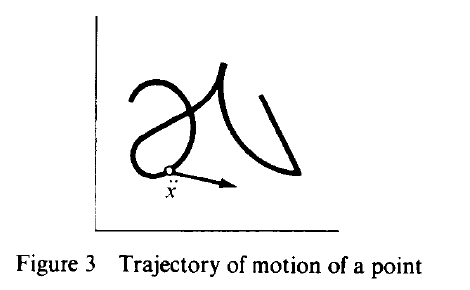
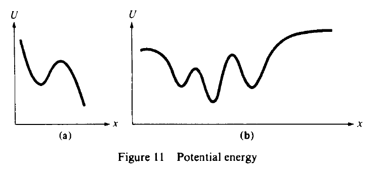
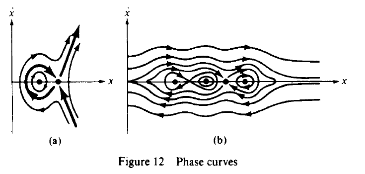
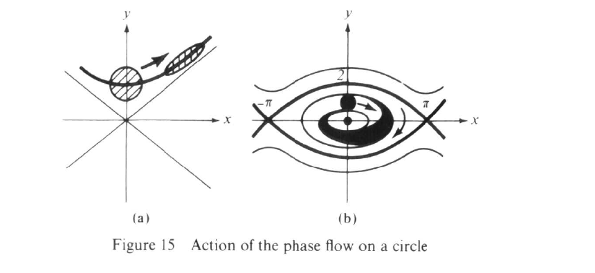
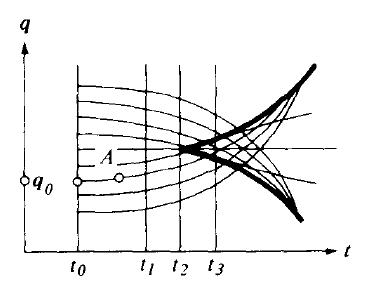
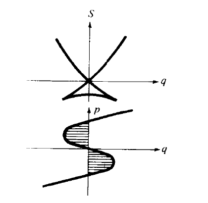
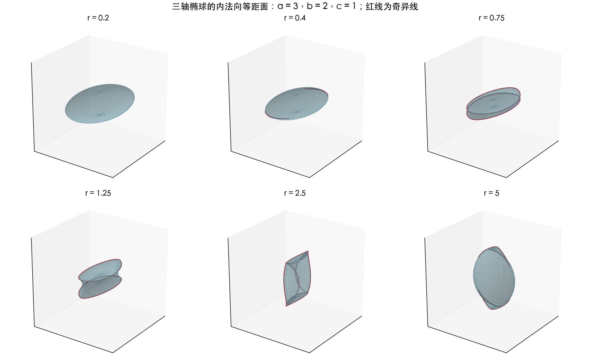
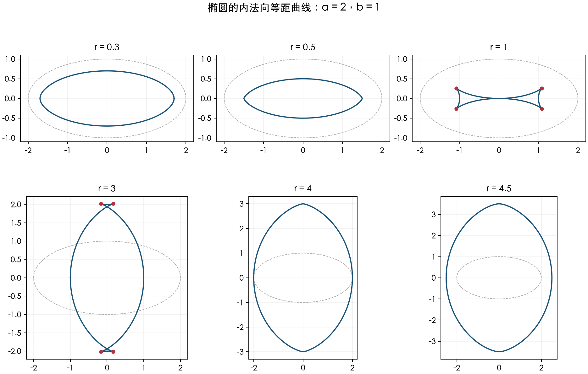

# 辛几何与数学物理 习题与简解

**版本日期。** 2026-10-09。

**范围与状态。** 全书内容整理版，教师审核与平台试导入未执行。

当前数据含10章、16个附录，232个实质知识节点，330道不同习题。按直接相关知识点重复展示392条；重复展示不增加不同题数。

## 来源与页码

- **主教材A**：V. I. Arnold，*Mathematical Methods of Classical Mechanics*，英文第2版，Springer-Verlag，1989，译者K. Vogtmann与A. Weinstein。项目副本：[教材PDF](资料/Arnold-经典力学的数学方法-英文第2版-1989.pdf)。
- 书页p对应PDF第p+14页。整理范围为正文第1—10章（书页1—300）及附录1—16（书页301—502）。索引与PDF最后的制作说明不计作课程章节。
- 无编号Problem以书页及当页出现次序追踪，项目定位号不是原书题号。所有新拟简解与教材已有答案或提示分开标注。
- **数值补充**：[NASA Earth Fact Sheet](https://nssdc.gsfc.nasa.gov/planetary/factsheet/earthfact.html)，用于地球体积平均半径6371 km，查阅日期2026-10-08。不作为新增教材习题来源。
- **数值补充**：[NASA Moon Fact Sheet](https://nssdc.gsfc.nasa.gov/planetary/factsheet/moonfact.html)，用于月球相对轨道半长轴384400 km、平均远地点405500 km，查阅日期2026-10-08。不作为新增教材习题来源。

## 目录

- [第1章 实验事实](#chapter-01)
- [第2章 运动方程的研究](#chapter-02)
- [第3章 变分原理](#chapter-03)
- [第4章 流形上的Lagrange力学](#chapter-04)
- [第5章 振动](#chapter-05)
- [第6章 刚体](#chapter-06)
- [第7章 微分形式](#chapter-07)
- [第8章 辛流形](#chapter-08)
- [第9章 正则形式体系](#chapter-09)
- [第10章 摄动理论入门](#chapter-10)
- [附录1 Riemann曲率](#appendix-01)
- [附录2 Lie群与理想流体的几何](#appendix-02)
- [附录3 代数流形上的辛结构](#appendix-03)
- [附录4 接触结构](#appendix-04)
- [附录5 具有对称性的动力系统](#appendix-05)
- [附录6 二次Hamilton函数的标准形](#appendix-06)
- [附录7 平衡点及闭轨道附近的标准形](#appendix-07)
- [附录8 条件周期摄动与Kolmogorov定理](#appendix-08)
- [附录9 Poincaré几何定理及其推广](#appendix-09)
- [附录10 特征频率重数与含参椭球](#appendix-10)
- [附录11 短波渐近](#appendix-11)
- [附录12 Lagrange奇点](#appendix-12)
- [附录13 Korteweg–de Vries方程](#appendix-13)
- [附录14 Poisson结构](#appendix-14)
- [附录15 椭圆坐标](#appendix-15)
- [附录16 射线系统的奇点](#appendix-16)

## 课程总览

主线为Newton力学、变分法与Lagrange力学、微分形式、辛流形、Hamilton正则形式、可积系统与摄动理论。附录保留进阶主题；阅读时可先完成正文基础，再选择相关附录。

同一道题在每个直接关联知识点下保留完整题干、简解、难度和来源。难度1—5按高年级本科／研究生入门层次估计。未完成教师审核不妨碍查阅，但不视为平台已发布。

## 第1章 实验事实

[相对性原理与确定性原理](#kp-ch01-relativity)；[Galilei时空结构与变换群](#kp-ch01-galilean-structure)；[运动轨迹速度与加速度](#kp-ch01-kinematics)；[构形空间与Newton初值问题](#kp-ch01-newton-initial-value)；[相对性对运动方程的约束](#kp-ch01-equivariance)；[势能模型与保守质点系统](#kp-ch01-potential-models)；[逆平方引力与逃逸速度](#kp-ch01-escape-velocity)

### 相对性原理与确定性原理

**图谱路径：** 辛几何与数学物理 / 第1章 实验事实 / 相对性原理与确定性原理

**知识内容：** [定义、结论与例子](知识点.md#kp-ch01-relativity)

<!-- source-exercise:p011-2 -->
1. 惯性坐标系的类是否唯一？

   **答案：** 若不事先固定长度单位、时间单位和时间方向，则不唯一。对同一物理模型改变这些单位，或反向选择时间方向，可以得到不同的坐标系类。固定了 Galilei 结构以后，各相容坐标系之间才由保持该结构的 Galilei 变换联系。

   **难度：2/5；出处：** A：§2E，书页11（PDF第25页）。 无编号Problem；按书页及当页出现次序定位；**解答来源：** 据教材本页Answer改写。

### Galilei时空结构与变换群

**图谱路径：** 辛几何与数学物理 / 第1章 实验事实 / Galilei时空结构与变换群

**知识内容：** [定义、结论与例子](知识点.md#kp-ch01-galilean-structure)

<!-- source-exercise:p006-1 -->
1. 证明每个 $\mathbb R\times\mathbb R^3$ 上的 Galilei 变换唯一分解为 $g=g_1\circ g_2\circ g_3$，其中 $g_1(t,x)=(t,x+vt)$、$g_2(t,x)=(t+s,x+b)$、$g_3(t,x)=(t,Rx)$，$R$ 为正交变换，并求群的维数。

   **答案：** 保持时间间隔迫使仿射变换的时间分量为 $t+s$；保持同时事件距离迫使空间线性部分为正交矩阵，所以一般形式是 $(t+s,Rx+vt+a)$。直接复合得到空间分量 $Rx+b+v(t+s)$，故唯一取 $b=a-vs$。$R,v,s,b$ 各有3、3、1、3个连续参数，群维数为10；$O(3)$ 的离散分支不改变维数。

   **难度：2/5；出处：** A：§2B，书页6（PDF第20页）。 无编号Problem；按书页及当页出现次序定位；**解答来源：** 自拟简解。

<!-- source-exercise:p006-2 -->
2. 证明所有 Galilei 空间彼此同构，特别地都同构于坐标模型 $\mathbb R\times\mathbb R^3$。同构须保持时间间隔和同时事件之间的距离。

   **答案：** 取任意事件为原点，取向量 $e_0$ 使 $\tau(e_0)=1$，再在 $\ker\tau$ 中取正交标准基 $e_1,e_2,e_3$。每个事件唯一写作 $o+te_0+\sum x_ie_i$。映射到 $(t,x_1,x_2,x_3)$ 保持仿射结构、时间差及同时事件的距离，故给出所求同构。

   **难度：2/5；出处：** A：§2B，书页6（PDF第20页）。 无编号Problem；按书页及当页出现次序定位；**解答来源：** 自拟简解。

<!-- source-exercise:p010-4 -->
3. 证明对任意由两个质点组成的封闭力学系统及任意初值，总存在一个惯性坐标系，使两个质点的运动都保持在某个固定平面内。

   **答案：** 先作匀速变换，使第一个质点的初速度为零。取由初始相对位置 $r=x_2-x_1$ 与相对速度 $u=\dot x_2-\dot x_1$ 张成的向量子空间，它的维数不超过2。选一个包含它的二维平面，并经过第一个质点的初始位置。两点初始位置和速度均在此仿射平面内；关于它的反射固定初值，由对称性和唯一性，两点以后仍在该平面中。

   **难度：3/5；出处：** A：§2E，书页10（PDF第24页）。 无编号Problem；按书页及当页出现次序定位；**解答来源：** 自拟简解。

<!-- source-exercise:p011-1 -->
4. 在本章经典力学的 Galilei 不变性假设下，证明“镜子中的力学”与原来的力学具有相同的运动规律。

   **答案：** 空间反射是 $O(3)$ 的元素，因而属于本书允许的 Galilei 变换。若 $x_i(t)$ 是解，则 $Rx_i(t)$ 也是对应反射初值的解；反射是可逆的，所以两组运动规律一一对应。

   **难度：1/5；出处：** A：§2E，书页11（PDF第25页）。 无编号Problem；按书页及当页出现次序定位；**解答来源：** 据教材本页Hint改写。

   **整理说明：** 限定在教材的经典力学模型内，不将其外推为所有物理相互作用的宇称不变性。

<!-- source-exercise:p011-2 -->
5. 惯性坐标系的类是否唯一？

   **答案：** 若不事先固定长度单位、时间单位和时间方向，则不唯一。对同一物理模型改变这些单位，或反向选择时间方向，可以得到不同的坐标系类。固定了 Galilei 结构以后，各相容坐标系之间才由保持该结构的 Galilei 变换联系。

   **难度：2/5；出处：** A：§2E，书页11（PDF第25页）。 无编号Problem；按书页及当页出现次序定位；**解答来源：** 据教材本页Answer改写。

### 运动轨迹速度与加速度

**图谱路径：** 辛几何与数学物理 / 第1章 实验事实 / 运动轨迹速度与加速度

**知识内容：** [定义、结论与例子](知识点.md#kp-ch01-kinematics)

<!-- source-exercise:p007-1 -->
1. (1) 光滑平面运动的轨迹能否具有教材图3所示的自交、尖角形状？(2) 在图中标出的平滑弯曲点，加速度能否沿所画箭头指向曲率法线的外侧？

   

   **答案：** (1) 能。自交可以对应不同时刻；在需要转向或经过尖角的时刻使速度及所需阶数的导数为零，可将分段轨迹作光滑参数化。(2) 不能。在该平滑弯曲点，法向加速度为 $\dot s^{\,2}\kappa N$，朝向曲率中心；若速度为零，该法向分量为零，也不能等于图示的向外分量。

   **难度：3/5；出处：** A：§2C，书页7（PDF第21页）。 无编号Problem；按书页及当页出现次序定位；**解答来源：** 教材本页Answer给出“能、不能”；几何论证自拟。

   **整理说明：** 保留原图以免只用文字改变几何条件。

### 构形空间与Newton初值问题

**图谱路径：** 辛几何与数学物理 / 第1章 实验事实 / 构形空间与Newton初值问题

**知识内容：** [定义、结论与例子](知识点.md#kp-ch01-newton-initial-value)

<!-- source-exercise:p010-2 -->
1. 封闭力学系统由两个质点组成，它们在某惯性系的初速度均为零。证明在解存在且唯一的时间区间内，两点始终留在初始连线上。

   **答案：** 绕初始连线的任意旋转都固定两个质点的初始位置和零初速度。旋转后的运动仍满足同一方程和初值，故由唯一性与原运动相同。被这些旋转共同固定的点恰在该直线上，因此两条轨迹均位于其中。

   **难度：2/5；出处：** A：§2E，书页10（PDF第24页）。 无编号Problem；按书页及当页出现次序定位；**解答来源：** 自拟简解。

   **整理说明：** 补显存在唯一性的适用时间区间；初始两点重合时需另按方程定义域讨论，碰撞奇点不在本题光滑系统假设内。

<!-- source-exercise:p010-3 -->
2. 封闭力学系统由三个质点组成，它们在某惯性系的初速度均为零。证明它们始终留在初始三点所在的平面内。

   **答案：** 关于该平面的反射固定三点的初始位置和零初速度。方程对正交变换等变，因此反射后的解与原解有相同初值，唯一性使两者重合，每个质点都固定于该反射，故均在该平面内。若三点共线，可任取包含该直线的平面；结论在解存在唯一的区间成立。

   **难度：2/5；出处：** A：§2E，书页10（PDF第24页）。 无编号Problem；按书页及当页出现次序定位；**解答来源：** 自拟简解。

### 相对性对运动方程的约束

**图谱路径：** 辛几何与数学物理 / 第1章 实验事实 / 相对性对运动方程的约束

**知识内容：** [定义、结论与例子](知识点.md#kp-ch01-equivariance)

<!-- source-exercise:p010-1 -->
1. 设封闭力学系统只有一个质点，并满足 Galilei 相对性原理。证明它在惯性坐标系中的加速度为零。

   **答案：** 时间平移、空间平移和匀速变换不变性分别排除加速度对 $t,x,\dot x$ 的依赖，所以加速度是常向量 $a$。正交变换不变性要求 $Ra=a$ 对任意 $R\in O(3)$ 成立，唯一可能是 $a=0$。

   **难度：2/5；出处：** A：§2E，书页10（PDF第24页）。 无编号Problem；按书页及当页出现次序定位；**解答来源：** 据教材本页Hint补全。

<!-- source-exercise:p010-2 -->
2. 封闭力学系统由两个质点组成，它们在某惯性系的初速度均为零。证明在解存在且唯一的时间区间内，两点始终留在初始连线上。

   **答案：** 绕初始连线的任意旋转都固定两个质点的初始位置和零初速度。旋转后的运动仍满足同一方程和初值，故由唯一性与原运动相同。被这些旋转共同固定的点恰在该直线上，因此两条轨迹均位于其中。

   **难度：2/5；出处：** A：§2E，书页10（PDF第24页）。 无编号Problem；按书页及当页出现次序定位；**解答来源：** 自拟简解。

   **整理说明：** 补显存在唯一性的适用时间区间；初始两点重合时需另按方程定义域讨论，碰撞奇点不在本题光滑系统假设内。

<!-- source-exercise:p010-3 -->
3. 封闭力学系统由三个质点组成，它们在某惯性系的初速度均为零。证明它们始终留在初始三点所在的平面内。

   **答案：** 关于该平面的反射固定三点的初始位置和零初速度。方程对正交变换等变，因此反射后的解与原解有相同初值，唯一性使两者重合，每个质点都固定于该反射，故均在该平面内。若三点共线，可任取包含该直线的平面；结论在解存在唯一的区间成立。

   **难度：2/5；出处：** A：§2E，书页10（PDF第24页）。 无编号Problem；按书页及当页出现次序定位；**解答来源：** 自拟简解。

<!-- source-exercise:p010-4 -->
4. 证明对任意由两个质点组成的封闭力学系统及任意初值，总存在一个惯性坐标系，使两个质点的运动都保持在某个固定平面内。

   **答案：** 先作匀速变换，使第一个质点的初速度为零。取由初始相对位置 $r=x_2-x_1$ 与相对速度 $u=\dot x_2-\dot x_1$ 张成的向量子空间，它的维数不超过2。选一个包含它的二维平面，并经过第一个质点的初始位置。两点初始位置和速度均在此仿射平面内；关于它的反射固定初值，由对称性和唯一性，两点以后仍在该平面中。

   **难度：3/5；出处：** A：§2E，书页10（PDF第24页）。 无编号Problem；按书页及当页出现次序定位；**解答来源：** 自拟简解。

<!-- source-exercise:p011-1 -->
5. 在本章经典力学的 Galilei 不变性假设下，证明“镜子中的力学”与原来的力学具有相同的运动规律。

   **答案：** 空间反射是 $O(3)$ 的元素，因而属于本书允许的 Galilei 变换。若 $x_i(t)$ 是解，则 $Rx_i(t)$ 也是对应反射初值的解；反射是可逆的，所以两组运动规律一一对应。

   **难度：1/5；出处：** A：§2E，书页11（PDF第25页）。 无编号Problem；按书页及当页出现次序定位；**解答来源：** 据教材本页Hint改写。

   **整理说明：** 限定在教材的经典力学模型内，不将其外推为所有物理相互作用的宇称不变性。

### 势能模型与保守质点系统

**图谱路径：** 辛几何与数学物理 / 第1章 实验事实 / 势能模型与保守质点系统

**知识内容：** [定义、结论与例子](知识点.md#kp-ch01-potential-models)

<!-- source-exercise:p012-1 -->
1. 忽略空气阻力及太阳等其他天体的引力，从地球表面沿径向向外抛出石块。设地球半径为 $r_0$、表面重力加速度为 $g$，加速度 满足 $\ddot r=-gr_0^2/r^2$。求石块能运动到任意远处所需的最小初速度。

   **答案：** 单位质量总能量为 $E=\frac12\dot r^2-gr_0^2/r$。到任意远处要求 $E\ge0$，故 $v_0^2/2-gr_0\ge0$，临界速度为 $\sqrt{2gr_0}$。教材给出地球的近似值 $11.2\ {\rm km/s}$，所以要求 $v_0\ge11.2\ {\rm km/s}$；等号对应速度趋于零的临界逃逸。

   **难度：2/5；出处：** A：§3B，书页12（PDF第26页）。 无编号Problem；按书页及当页出现次序定位；**解答来源：** 教材本页Answer提供数值；能量推导自拟。

### 逆平方引力与逃逸速度

**图谱路径：** 辛几何与数学物理 / 第1章 实验事实 / 逆平方引力与逃逸速度

**知识内容：** [定义、结论与例子](知识点.md#kp-ch01-escape-velocity)

<!-- source-exercise:p012-1 -->
1. 忽略空气阻力及太阳等其他天体的引力，从地球表面沿径向向外抛出石块。设地球半径为 $r_0$、表面重力加速度为 $g$，加速度 满足 $\ddot r=-gr_0^2/r^2$。求石块能运动到任意远处所需的最小初速度。

   **答案：** 单位质量总能量为 $E=\frac12\dot r^2-gr_0^2/r$。到任意远处要求 $E\ge0$，故 $v_0^2/2-gr_0\ge0$，临界速度为 $\sqrt{2gr_0}$。教材给出地球的近似值 $11.2\ {\rm km/s}$，所以要求 $v_0\ge11.2\ {\rm km/s}$；等号对应速度趋于零的临界逃逸。

   **难度：2/5；出处：** A：§3B，书页12（PDF第26页）。 无编号Problem；按书页及当页出现次序定位；**解答来源：** 教材本页Answer提供数值；能量推导自拟。

## 第2章 运动方程的研究

[单自由度系统的能量与相曲线](#kp-ch02-phase-curves)；[势阱平衡点与分离曲线](#kp-ch02-potential-stability)；[求积法与摆的相图](#kp-ch02-quadrature-pendulum)；[周期面积公式与等时性](#kp-ch02-period-area)；[相流的群性质与完备性](#kp-ch02-complete-flow)；[双自由度系统与能量曲面](#kp-ch02-two-dof-energy)；[各向同性振子与Hopf映射](#kp-ch02-isotropic-hopf)；[Lissajous曲线与有理频率比](#kp-ch02-lissajous)；[保守力场与路径无关性](#kp-ch02-conservative-work)；[中心力场与径向势能](#kp-ch02-central-field)；[角动量守恒与面积定律](#kp-ch02-angular-momentum)；[中心力约化与有效势能](#kp-ch02-effective-potential)；[拱点角与轨道闭合](#kp-ch02-apsidal-angle)；[闭合轨道与Bertrand定理](#kp-ch02-bertrand)；[Kepler问题与三定律](#kp-ch02-kepler)；[近圆轨道偏差与相对运动](#kp-ch02-orbital-variation)；[高维中心力运动的平面性](#kp-ch02-central-motion-space)；[轴对称场与轴向角动量](#kp-ch02-axial-momentum)；[多质点系统的动量角动量与能量](#kp-ch02-many-body-conservation)；[两体问题与约化质量](#kp-ch02-reduced-mass)；[齐次势的力学相似变换](#kp-ch02-mechanical-similarity)；[尺度分析的天体与生物学例子](#kp-ch02-dimensional-biology)

### 单自由度系统的能量与相曲线

**图谱路径：** 辛几何与数学物理 / 第2章 运动方程的研究 / 单自由度系统的能量与相曲线

**知识内容：** [定义、结论与例子](知识点.md#kp-ch02-phase-curves)

<!-- source-exercise:p016-1 -->
1. 对光滑系统 $\dot x=y,\ \dot y=f(x)$，证明每个相点恰有一条相曲线通过。

   **答案：** 以相点为初值应用自治常微分方程的局部存在唯一性，再延拓成最大解。两个轨道若相交，则把交点对应时间平移到零，它们具有同一初值，由唯一性重合；平衡点对应常值轨道。

   **难度：1/5；出处：** A：§4，书页16（PDF第30页）。 无编号Problem；按书页及当页出现次序定位；**解答来源：** 据教材本页Hint展开。

<!-- source-exercise:p018-2 -->
2. 双势阱系统在局部极大值能量处的分离集呈“8”字，由一个鞍点和两条返回该鞍点的环组成。这一水平集含有多少条相曲线？

   **答案：** 三条：鞍点自身的常值轨道，以及去掉鞍点后的左右两个同宿轨道。两条环不能穿过鞍点连成一条运动轨道。

   **难度：1/5；出处：** A：§4，书页18（PDF第32页）。 无编号Problem；按书页及当页出现次序定位；**解答来源：** 教材本页Answer给出三条；解释自拟。

<!-- source-exercise:p019-1 -->
3. 根据下列教材图11的两种势能曲线，画出 $\ddot x=-U'(x)$ 的相曲线，并标出方向。

   

   **答案：** 对每个能量 $E$ 画 $y=\pm\sqrt{2(E-U(x))}$，只保留 $U(x)\le E$ 的区间；上半平面向右，下半平面向左。极小点是中心，极大点是鞍点；跨越不同峰值时，势阱内闭曲线合并或转为非闭曲线。各临界能量的连接关系见教材给出的图12。

   

   **难度：3/5；出处：** A：§4，书页19（PDF第33页）。 无编号Problem；按书页及当页出现次序定位；**解答来源：** 教材本页Answer为图12；作图步骤自拟。

### 势阱平衡点与分离曲线

**图谱路径：** 辛几何与数学物理 / 第2章 运动方程的研究 / 势阱平衡点与分离曲线

**知识内容：** [定义、结论与例子](知识点.md#kp-ch02-potential-stability)

<!-- source-exercise:p018-1 -->
1. 对图10所示的单自由度光滑势能系统，证明势能的非退化局部极大点对应不稳定平衡，而非退化局部极小点对应稳定平衡。

   **答案：** 极小点附近 $E-U(\xi)=y^2/2+U(x)-U(\xi)$ 为正定函数并守恒，小能量子水平集限制了位置与速度，故稳定。极大点线性化为 $\dot u=y,\ \dot y=-U''(\xi)u$，特征值为 $\pm\sqrt{-U''(\xi)}$，存在离开平衡的方向，故不稳定；也可用能量略高于峰值的解穿出任意小邻域。

   **难度：2/5；出处：** A：§4，书页18（PDF第32页）。 无编号Problem；按书页及当页出现次序定位；**解答来源：** 自拟简解。

   **整理说明：** 原题为“证明这一点”，这里展开图10中的非退化极值情形；不把非严格极小自动视为稳定。

<!-- source-exercise:p018-2 -->
2. 双势阱系统在局部极大值能量处的分离集呈“8”字，由一个鞍点和两条返回该鞍点的环组成。这一水平集含有多少条相曲线？

   **答案：** 三条：鞍点自身的常值轨道，以及去掉鞍点后的左右两个同宿轨道。两条环不能穿过鞍点连成一条运动轨道。

   **难度：1/5；出处：** A：§4，书页18（PDF第32页）。 无编号Problem；按书页及当页出现次序定位；**解答来源：** 教材本页Answer给出三条；解释自拟。

<!-- source-exercise:p018-3 -->
3. 在上述“8”字分离集的任一非平凡同宿支上完成一次运动需要多长时间？

   **答案：** 无限长。若非平凡解在有限时间到达鞍点，它与在鞍点静止的解将有同一初值而不相同，违反唯一性。在非退化情形，鞍点附近求积的被积函数与 $1/|x-\xi|$ 同阶，积分对数发散。

   **难度：2/5；出处：** A：§4，书页18（PDF第32页）。 无编号Problem；按书页及当页出现次序定位；**解答来源：** 据教材本页Answer补充求积解释。

<!-- source-exercise:p019-1 -->
4. 根据下列教材图11的两种势能曲线，画出 $\ddot x=-U'(x)$ 的相曲线，并标出方向。

   

   **答案：** 对每个能量 $E$ 画 $y=\pm\sqrt{2(E-U(x))}$，只保留 $U(x)\le E$ 的区间；上半平面向右，下半平面向左。极小点是中心，极大点是鞍点；跨越不同峰值时，势阱内闭曲线合并或转为非闭曲线。各临界能量的连接关系见教材给出的图12。

   

   **难度：3/5；出处：** A：§4，书页19（PDF第33页）。 无编号Problem；按书页及当页出现次序定位；**解答来源：** 教材本页Answer为图12；作图步骤自拟。

<!-- source-exercise:p019-4 -->
5. 设 $U'(\xi)=0$、$U''(\xi)<0$。求临界水平 $y^2/2+U(x)=U(\xi)$ 在 $(\xi,0)$ 处各分支的切线。

   **答案：** Taylor 展开得 $y^2/2+U''(\xi)(x-\xi)^2/2+o((x-\xi)^2)=0$，故切线为 $y=\pm\sqrt{-U''(\xi)}(x-\xi)$。

   **难度：1/5；出处：** A：§4，书页19—20（PDF第33—34页）。 无编号Problem；按书页及当页出现次序定位；**解答来源：** 教材书页19的Answer；推导自拟。

### 求积法与摆的相图

**图谱路径：** 辛几何与数学物理 / 第2章 运动方程的研究 / 求积法与摆的相图

**知识内容：** [定义、结论与例子](知识点.md#kp-ch02-quadrature-pendulum)

<!-- source-exercise:p018-4 -->
1. 证明沿能量为 $E$ 的单自由度运动，在速度为正的同一单调分支上从 $x_1$ 运动到 $x_2$ 所需时间为 $\displaystyle\int_{x_1}^{x_2}[2(E-U(x))]^{-1/2}dx$。

   **答案：** 能量守恒给出 $\dot x=\sqrt{2(E-U(x))}$，因而 $dt=dx/\sqrt{2(E-U(x))}$。沿该单调段积分即得结果；遇转向点须分段并以相应反常积分理解。

   **难度：1/5；出处：** A：§4，书页18（PDF第32页）。 无编号Problem；按书页及当页出现次序定位；**解答来源：** 自拟简解。

<!-- source-exercise:p019-2 -->
2. 画出理想平面摆 $\ddot x=-\sin x$ 的相曲线，并说明相平面与相圆柱的关系。

   **答案：** 取 $E=y^2/2-\cos x$。$E=-1$ 是稳定平衡 $(2k\pi,0)$；$-1<E<1$ 是各势阱中的闭合摆动曲线；$E=1$ 是鞍点 $(\pi+2k\pi,0)$ 与分离支；$E>1$ 有 $y>0$ 和 $y<0$ 两类旋转支。方向由 $\dot x=y$ 决定。将 $x$ 模 $2\pi$ 识别，即得相圆柱上的轨道。

   **难度：2/5；出处：** A：§4，书页19（PDF第33页）。 无编号Problem；按书页及当页出现次序定位；**解答来源：** 自拟简解。

<!-- source-exercise:p019-3 -->
3. 画出受常转矩的摆 $\ddot x=-\sin x+M$ 的相曲线，讨论参数 $M$ 的不同情形。

   **答案：** 势能为 $U=-\cos x-Mx$，相曲线由 $y^2=2(E+\cos x+Mx)$ 给出。$|M|<1$ 时，满足 $\sin x=M$ 且 $\cos x>0$ 的点为中心，$\cos x<0$ 的点为鞍点；各局部势阱有闭轨道及临界分离支。$|M|=1$ 时中心与鞍点合并为退化平衡；$|M|>1$ 时势能单调，无平衡和势阱内周期轨道。$M$ 改号对应反射 $x\mapsto-x$。在圆柱上向量场仍定义良好，但 $M\ne0$ 时势能本身不是单值的。

   **难度：3/5；出处：** A：§4，书页19（PDF第33页）。 无编号Problem；按书页及当页出现次序定位；**解答来源：** 自拟简解。

<!-- source-exercise:p021-3 -->
4. 画出圆盘 $x^2+(y-1)^2<1/4$ 在下列系统的相流变换下的像：(a) 倒摆线性模型 $\ddot x=x$；(b) 非线性摆 $\ddot x=-\sin x$。

   **答案：** (a) 线性流为 $(x,y)\mapsto(x\cosh t+y\sinh t,\ x\sinh t+y\cosh t)$。圆盘成为以 $(\sinh t,\cosh t)$ 为中心的椭圆，主轴沿 $(1,1)$、$(1,-1)$，半轴为 $e^t/2,e^{-t}/2$。(b) 各点沿各自能量水平运动；周期随能量变化，使圆盘发生非线性剪切和卷绕，面积保持。教材图15给出相应示意：

   

   **难度：3/5；出处：** A：§4，书页21（PDF第35页）。 无编号Problem；按书页及当页出现次序定位；**解答来源：** 教材本页Answer为图15；(a)精确公式与(b)说明自拟。

### 周期面积公式与等时性

**图谱路径：** 辛几何与数学物理 / 第2章 运动方程的研究 / 周期面积公式与等时性

**知识内容：** [定义、结论与例子](知识点.md#kp-ch02-period-area)

<!-- source-exercise:p020-1 -->
1. 设能量为 $E$ 的正则闭合相曲线围成面积 $S(E)$。证明该周期轨道的周期为 $T(E)=dS/dE$。

   **答案：** 设两个转向点为 $x_\pm(E)$。则 $S(E)=2\int_{x_-}^{x_+}\sqrt{2(E-U(x))}\,dx$。求导时端点项因被积函数在端点为零而消失，得 $S'(E)=2\int_{x_-}^{x_+}dx/\sqrt{2(E-U(x))}$，恰为从左端到右端再返回的时间。可先避开端点求导，再取极限。

   **难度：3/5；出处：** A：§4，书页20（PDF第34页）。 无编号Problem；按书页及当页出现次序定位；**解答来源：** 自拟简解。

<!-- source-exercise:p020-2 -->
2. 设势能在 $\xi$ 处有非退化极小值 $E_0=U(\xi)$。求 $\displaystyle T_0=\lim_{E\downarrow E_0}T(E)$。

   **答案：** 令 $u=x-\xi$，则 $U(x)=E_0+\frac12U''(\xi)u^2+o(u^2)$。振幅趋零时方程趋于 $\ddot u+U''(\xi)u=0$；对周期求积作振幅缩放亦得到 $T_0=2\pi/\sqrt{U''(\xi)}$。

   **难度：2/5；出处：** A：§4，书页20（PDF第34页）。 无编号Problem；按书页及当页出现次序定位；**解答来源：** 教材本页Answer；极限理由自拟。

   **整理说明：** 补显非退化条件。

<!-- source-exercise:p020-3 -->
3. 沿某条正则闭合相曲线的周期运动，作为按同一时间比较的解，是否具有 Lyapunov 稳定性？

   **答案：** 一般没有。任意接近的能量若给出不同周期，两解的相位差随时间累积，最终可相差半周，破坏任意小的定时距离控制。若邻近周期对能量局部恒定，则这种相位漂移机制消失，在光滑紧致周期族中运动可以稳定。原书脚注明确保留等时例外。闭轨道作为点集的轨道稳定性是另一问题。

   **难度：3/5；出处：** A：§4，书页20（PDF第34页）。 无编号Problem；按书页及当页出现次序定位；**解答来源：** 据教材本页Answer及脚注13展开。

<!-- source-exercise:p036-1 -->
4. 对势能 $U(r)=r^\alpha$，$-2\le\alpha<\infty$，哪些参数允许非静止圆轨道，并使沿该圆轨道的运动具有按时间比较的 Lyapunov 稳定性？

   **答案：** 圆轨道条件 $M^2=r^3U'(r)=\alpha r^{\alpha+2}$ 要求 $\alpha>0$。其角频率为 $\Omega(r)=\sqrt\alpha\,r^{(\alpha-2)/2}$。若 $\alpha\ne2$，任意邻近半径的圆轨道有不同角频率，长期相位差破坏定时稳定性。$\alpha=2$ 时系统为线性各向同性振子，任意两解之差一致有界地依赖初值，故稳定。答案是 $\alpha=2$；$\alpha\le0$ 根本没有题意中的非静止圆轨道。

   **难度：3/5；出处：** A：§8，书页36（PDF第50页）。 无编号Problem；按书页及当页出现次序定位；**解答来源：** 教材本页Answer给出α=2；存在性与稳定性证明自拟。

   **整理说明：** 补显非静止圆轨道的存在条件，并区分定时稳定性与径向稳定性。

### 相流的群性质与完备性

**图谱路径：** 辛几何与数学物理 / 第2章 运动方程的研究 / 相流的群性质与完备性

**知识内容：** [定义、结论与例子](知识点.md#kp-ch02-complete-flow)

<!-- source-exercise:p021-1 -->
1. 证明势能 $U(x)=-x^4$ 的系统不能在整个相平面上定义全时间相流。

   **答案：** 在零能量层取 $x(0)=a>0,\ \dot x(0)=\sqrt2a^2$。能量式给出 $\dot x=\sqrt2x^2$，解为 $x(t)=a/(1-\sqrt2at)$，在 $t=1/(\sqrt2a)$ 爆破，因此不存在所有时间、所有初值都定义的全局流。

   **难度：2/5；出处：** A：§4，书页21（PDF第35页）。 无编号Problem；按书页及当页出现次序定位；**解答来源：** 自拟简解。

<!-- source-exercise:p021-2 -->
2. 设 $U$ 在 $\mathbb R$ 上光滑且处处为正。证明 $\ddot x=-U'(x)$ 定义全时间相流。

   **答案：** 沿能量 $E$ 的解有 $\dot x^2/2=E-U(x)\le E$，故速度有界。在任何有限时间段上，位置变化也有界，解的相点留在某紧集内。向量场光滑，常微分方程延拓定理排除有限时间终止，正负时间都能无限延拓。

   **难度：2/5；出处：** A：§4，书页21（PDF第35页）。 无编号Problem；按书页及当页出现次序定位；**解答来源：** 据教材本页Hint补全。

<!-- source-exercise:p021-3 -->
3. 画出圆盘 $x^2+(y-1)^2<1/4$ 在下列系统的相流变换下的像：(a) 倒摆线性模型 $\ddot x=x$；(b) 非线性摆 $\ddot x=-\sin x$。

   **答案：** (a) 线性流为 $(x,y)\mapsto(x\cosh t+y\sinh t,\ x\sinh t+y\cosh t)$。圆盘成为以 $(\sinh t,\cosh t)$ 为中心的椭圆，主轴沿 $(1,1)$、$(1,-1)$，半轴为 $e^t/2,e^{-t}/2$。(b) 各点沿各自能量水平运动；周期随能量变化，使圆盘发生非线性剪切和卷绕，面积保持。教材图15给出相应示意：

   

   **难度：3/5；出处：** A：§4，书页21（PDF第35页）。 无编号Problem；按书页及当页出现次序定位；**解答来源：** 教材本页Answer为图15；(a)精确公式与(b)说明自拟。

### 双自由度系统与能量曲面

**图谱路径：** 辛几何与数学物理 / 第2章 运动方程的研究 / 双自由度系统与能量曲面

**知识内容：** [定义、结论与例子](知识点.md#kp-ch02-two-dof-energy)

<!-- source-exercise:p022-1 -->
1. 举出平面上的一个系统 $\ddot x=f(x)$，使其不是保守系统。

   **答案：** 取 $f(x_1,x_2)=(x_2,-x_1)$。若 $f=-\nabla U$，混合偏导应相等，但 $\partial f_1/\partial x_2=1$、$\partial f_2/\partial x_1=-1$，矛盾。也可沿单位圆积分得到非零功 $-2\pi$。

   **难度：1/5；出处：** A：§5B，书页22（PDF第36页）。 无编号Problem；按书页及当页出现次序定位；**解答来源：** 自拟简解。

### 各向同性振子与Hopf映射

**图谱路径：** 辛几何与数学物理 / 第2章 运动方程的研究 / 各向同性振子与Hopf映射

**知识内容：** [定义、结论与例子](知识点.md#kp-ch02-isotropic-hopf)

<!-- source-exercise:p024-1 -->
1. 对 $\ddot x_1=-x_1,\ \ddot x_2=-x_2$，固定正能量 $E$。证明能量三维球面上的相曲线都是大圆。

   **答案：** 令初始相点为 $u=(x_1,x_2,y_1,y_2)$，$Ju=(y_1,y_2,-x_1,-x_2)$。解为 $u\cos t+Ju\sin t$，且 $u\perp Ju$、$\|u\|=\|Ju\|=\sqrt{2E}$。因此轨道就是过原点的二维平面 $\operatorname{span}(u,Ju)$ 与能量球面的交圆。

   **难度：2/5；出处：** A：§5C例1，书页24（PDF第38页）。 无编号Problem；按书页及当页出现次序定位；**解答来源：** 自拟简解。

<!-- source-exercise:p024-2 -->
2. 证明上述正能量面上的相曲线集合构成一个二维球面。说明 $w=(x_1+iy_1)/(x_2+iy_2)$（允许 $w=\infty$）给出的 Hopf 映射为何以相曲线为纤维。

   **答案：** 写 $z_j=x_j+iy_j$，运动使两分量同时乘以 $e^{-it}$，所以比值不变。两点比值相同即相差一个非零复数因子；因它们都在固定半径球面上，因子的模为1，恰对应同一相圆。因此轨道空间为复射影直线 $\mathbb{CP}^1$，由立体投影识别为 $S^2$。在 $z_2=0$ 的纤维上取 $w=\infty$。

   **难度：3/5；出处：** A：§5C例1，书页24（PDF第38页）。 无编号Problem；按书页及当页出现次序定位；**解答来源：** 自拟简解。

<!-- source-exercise:p024-3 -->
3. 求各向同性双振子的相曲线在 $(x_1,x_2)$ 构形平面上的投影，并描述轨道形状。

   **答案：** 解为 $x(t)=a\cos t+b\sin t$，其中 $a,b\in\mathbb R^2$。这是单位圆在以 $a,b$ 为列向量的线性映射下的像：两列独立时为椭圆，相关时为往复运动的线段；零解退化为点。

   **难度：1/5；出处：** A：§5C例1，书页24（PDF第38页）。 无编号Problem；按书页及当页出现次序定位；**解答来源：** 自拟简解。

### Lissajous曲线与有理频率比

**图谱路径：** 辛几何与数学物理 / 第2章 运动方程的研究 / Lissajous曲线与有理频率比

**知识内容：** [定义、结论与例子](知识点.md#kp-ch02-lissajous)

<!-- source-exercise:p025-1 -->
1. 对 $\ddot x_1=-x_1,\ \ddot x_2=-\omega^2x_2$，设各振幅为 $A_1,A_2$，总能量为 $E=(A_1^2+\omega^2A_2^2)/2$。证明振幅矩形 $|x_i|\le A_i$ 内接于势能椭圆区域 $(x_1^2+\omega^2x_2^2)/2\le E$。

   **答案：** 矩形内各项平方不超过其振幅平方，因此整个矩形在椭圆内。四个顶点 $(\pm A_1,\pm A_2)$ 使两项同时达到最大，恰落在椭圆边界，故矩形内接。

   **难度：1/5；出处：** A：§5C例2，书页25（PDF第39页）。 无编号Problem；按书页及当页出现次序定位；**解答来源：** 自拟简解。

<!-- source-exercise:p027-1 -->
2. 当 Lissajous 运动的频率比为2时，证明可以选择相位使轨道成为往复描画的抛物线弧。

   **答案：** 选择 $x_1=A_1\cos t,\ x_2=A_2\cos2t$。由 $\cos2t=2\cos^2t-1$ 消去时间，得到 $x_2=A_2(2x_1^2/A_1^2-1)$，其中 $|x_1|\le A_1$。这是抛物线的一段，每周期往复描画。

   **难度：1/5；出处：** A：§5C例2，书页27（PDF第41页）。 无编号Problem；按书页及当页出现次序定位；**解答来源：** 自拟简解。

<!-- source-exercise:p028-1 -->
3. 对两振幅均非零的 Lissajous 运动，证明：若频率比 $\omega=m/n$ 为有理数，轨道周期闭合并位于代数曲线上；若 $\omega$ 无理，轨道在振幅矩形中稠密。相应的相轨道在什么集合中稠密？

   **答案：** 有理情形可取共同周期 $2\pi n$。令 $\theta=t/n$，各坐标是 $\sin\theta,\cos\theta$ 的多项式，结合 $\sin^2\theta+\cos^2\theta=1$ 消元得到代数关系。无理情形中 $(t+\phi_1,\omega t+\phi_2)\bmod2\pi$ 在二维环面稠密：固定第一角的回归时刻使第二角作无理转动，再结合短时间变化即可逼近任意角对。连续投影 $(A_1\sin\theta_1,A_2\sin\theta_2)$ 的像是整矩形；相轨道则在两部分能量固定的二维环面上稠密。

   **难度：3/5；出处：** A：§5C例2，书页28（PDF第42页）。 无编号Problem；按书页及当页出现次序定位；**解答来源：** 自拟简解。

   **整理说明：** 有理情形可能往复描画弧段，不把闭合参数运动误写成简单闭曲线。

### 保守力场与路径无关性

**图谱路径：** 辛几何与数学物理 / 第2章 运动方程的研究 / 保守力场与路径无关性

**知识内容：** [定义、结论与例子](知识点.md#kp-ch02-conservative-work)

<!-- source-exercise:p022-1 -->
1. 举出平面上的一个系统 $\ddot x=f(x)$，使其不是保守系统。

   **答案：** 取 $f(x_1,x_2)=(x_2,-x_1)$。若 $f=-\nabla U$，混合偏导应相等，但 $\partial f_1/\partial x_2=1$、$\partial f_2/\partial x_1=-1$，矛盾。也可沿单位圆积分得到非零功 $-2\pi$。

   **难度：1/5；出处：** A：§5B，书页22（PDF第36页）。 无编号Problem；按书页及当页出现次序定位；**解答来源：** 自拟简解。

<!-- source-exercise:p029-1 -->
2. 证明平面向量场 $F=(x_2,-x_1)$ 不是保守场。

   **答案：** 沿逆时针单位圆 $x_1=\cos t,\ x_2=\sin t$，有 $F\cdot dx=-dt$，故闭路功为 $-2\pi\ne0$，与全局势能的路径无关性矛盾。

   **难度：1/5；出处：** A：§6B，书页29（PDF第43页）。 无编号Problem；按书页及当页出现次序定位；**解答来源：** 自拟简解。

<!-- source-exercise:p029-2 -->
3. 在穿孔平面上，场 $F=(x_2/(x_1^2+x_2^2),-x_1/(x_1^2+x_2^2))$ 是否保守？并证明：连通区域上的场保守，当且仅当沿任意闭路的功为零。

   **答案：** 该场沿逆时针单位圆的功仍为 $-2\pi$，所以不保守。若 $F=-\nabla U$，任意闭路积分由微积分基本定理为零。反之，固定基点，定义 $U(x)=-\int_{x_0}^xF\cdot dx$；两条路径的差组成闭路，因此定义与路径无关，沿坐标方向求导即得 $F=-\nabla U$。

   **难度：2/5；出处：** A：§6B，书页29（PDF第43页）。 无编号Problem；按书页及当页出现次序定位；**解答来源：** 自拟简解。

### 中心力场与径向势能

**图谱路径：** 辛几何与数学物理 / 第2章 运动方程的研究 / 中心力场与径向势能

**知识内容：** [定义、结论与例子](知识点.md#kp-ch02-central-field)

<!-- source-exercise:p030-1 -->
1. 证明中心力场中的向量都沿通过中心的径向直线，其大小只依赖距中心的距离。采用原书定义：中心场对固定中心的所有欧氏正交变换等变，包括反射。

   **答案：** 在非零位置 $x$，关于直线 $\mathbb Rx$ 的反射固定位置 $x$，所以也必须固定 $F(x)$，这迫使其垂直分量为零。把 $x$ 旋转到同半径的任意点，等变性说明有向径向系数不变，因此 $F(x)=\Phi(|x|)x/|x|$。

   **难度：2/5；出处：** A：§6C，书页30（PDF第44页）。 无编号Problem；按书页及当页出现次序定位；**解答来源：** 自拟简解。

<!-- source-exercise:p030-2 -->
2. 求 Newton 引力场 $F(x)=-kx/|x|^3$ 的势能，其中 $k>0$。

   **答案：** 径向分量是 $\Phi(r)=-k/r^2$，所以 $U'(r)=-\Phi(r)=k/r^2$，积分得 $U(r)=-k/r+C$。

   **难度：1/5；出处：** A：§6C，书页30（PDF第44页）。 无编号Problem；按书页及当页出现次序定位；**解答来源：** 自拟简解。

### 角动量守恒与面积定律

**图谱路径：** 辛几何与数学物理 / 第2章 运动方程的研究 / 角动量守恒与面积定律

**知识内容：** [定义、结论与例子](知识点.md#kp-ch02-angular-momentum)

所给材料中未找到对应习题。

### 中心力约化与有效势能

**图谱路径：** 辛几何与数学物理 / 第2章 运动方程的研究 / 中心力约化与有效势能

**知识内容：** [定义、结论与例子](知识点.md#kp-ch02-effective-potential)

<!-- source-exercise:p036-1 -->
1. 对势能 $U(r)=r^\alpha$，$-2\le\alpha<\infty$，哪些参数允许非静止圆轨道，并使沿该圆轨道的运动具有按时间比较的 Lyapunov 稳定性？

   **答案：** 圆轨道条件 $M^2=r^3U'(r)=\alpha r^{\alpha+2}$ 要求 $\alpha>0$。其角频率为 $\Omega(r)=\sqrt\alpha\,r^{(\alpha-2)/2}$。若 $\alpha\ne2$，任意邻近半径的圆轨道有不同角频率，长期相位差破坏定时稳定性。$\alpha=2$ 时系统为线性各向同性振子，任意两解之差一致有界地依赖初值，故稳定。答案是 $\alpha=2$；$\alpha\le0$ 根本没有题意中的非静止圆轨道。

   **难度：3/5；出处：** A：§8，书页36（PDF第50页）。 无编号Problem；按书页及当页出现次序定位；**解答来源：** 教材本页Answer给出α=2；存在性与稳定性证明自拟。

   **整理说明：** 补显非静止圆轨道的存在条件，并区分定时稳定性与径向稳定性。

<!-- source-exercise:p036-3 -->
2. 设 $M\ne0$，能量等于有效势 $V$ 在非退化局部极大点 $r_0$ 的值。研究相应中心力轨道的形状。

   **答案：** 径向平衡 $r=r_0$ 给出不稳定圆轨道。分离支上 $\dot r^2=2(V(r_0)-V(r))\sim -V''(r_0)(r-r_0)^2$，所以 $r-r_0$ 指数趋近零需无限时间，而 $\dot\phi\to M/r_0^2\ne0$。相应非平凡轨道不断绕转并渐近于该圆；另一端是转向、逃逸或碰撞，取决于有效势在该支上的全局形状。

   **难度：3/5；出处：** A：§8，书页36（PDF第50页）。 无编号Problem；按书页及当页出现次序定位；**解答来源：** 自拟简解。

### 拱点角与轨道闭合

**图谱路径：** 辛几何与数学物理 / 第2章 运动方程的研究 / 拱点角与轨道闭合

**知识内容：** [定义、结论与例子](知识点.md#kp-ch02-apsidal-angle)

<!-- source-exercise:p036-2 -->
1. 在中心势 $U$ 中，求接近半径 $r_0$ 的稳定非退化圆轨道时，相邻近心点与远心点之间的角 $\Phi$ 的极限。

   **答案：** 径向小振动频率为 $\omega_r=\sqrt{V''(r_0)}$，从近心点到远心点所需时间趋于 $\pi/\omega_r$。圆轨道角速度为 $M/r_0^2$，故 $\Phi_{\rm cir}=\pi M/(r_0^2\sqrt{V''})$。代入 $M^2=r_0^3U'(r_0)$，得到 $\pi\sqrt{U'/(3U'+r_0U'')}$。

   **难度：2/5；出处：** A：§8，书页36—37（PDF第50—51页）。 无编号Problem；按书页及当页出现次序定位；**解答来源：** 据教材书页37 Problem 2的Answer展开。

<!-- source-exercise:p037-1 -->
2. 固定 $M>0$，证明近心点至远心点的角 $\Phi$ 等于一维势能 $W(x)=U(M/x)+x^2/2$ 的一次振动半周期。

   **答案：** 在拱点角积分中令 $x=M/r$，有 $dx=-M\,dr/r^2$。交换上下限后 $\Phi=\int_{x_{\min}}^{x_{\max}}dx/\sqrt{2(E-W(x))}$，正是该一维系统在两个转向点之间的时间，即半周期。

   **难度：2/5；出处：** A：§8，书页37（PDF第51页）。 原题号1；**解答来源：** 据教材本题Hint展开。

<!-- source-exercise:p037-2 -->
3. 求半径 $r_0$ 的稳定非退化圆轨道附近的拱点角极限。

   **答案：** 由径向小振动半周期与圆轨道角速度之积，得到 $\Phi_{\rm cir}=\pi M/(r_0^2\sqrt{V''(r_0)})=\pi\sqrt{U'(r_0)/(3U'(r_0)+r_0U''(r_0))}$。分母为正是径向非退化稳定条件。

   **难度：2/5；出处：** A：§8，书页37（PDF第51页）。 原题号2；**解答来源：** 教材本题Answer；推导自拟。

   **整理说明：** 与书页36同主题练习分别保留来源。

<!-- source-exercise:p037-3 -->
4. 在哪些光滑中心势中，稳定非退化圆轨道附近的拱点角 $\Phi_{\rm cir}$ 与圆半径无关？势能加常数视为等价。

   **答案：** 公式要求 $rU''/U'$ 为常数 $c$。积分得 $U'=Kr^c$：若 $c\ne-1$，则 $U=ar^\alpha+b$，$\alpha=c+1$；若 $c=-1$，则 $U=a\log r+b$。圆轨道存在及径向稳定要求幂势 $a\alpha>0,\ \alpha>-2,\ \alpha\ne0$，对数势要求 $a>0$。相应角为 $\pi/\sqrt{\alpha+2}$，对数情形为 $\pi/\sqrt2$。

   **难度：3/5；出处：** A：§8，书页37（PDF第51页）。 原题号3；**解答来源：** 教材本题Answer为幂势或对数势；条件与推导自拟。

   **勘误：** 书页37答案把幂指数范围写到α=-2。该端点的径向频率为零，不是本题使用的小振动非退化情形；这里明确排除。

<!-- source-exercise:p073-1 -->
5. 证明中心势 $U(r)=r^4$ 中的每条轨道或者闭合，或者在两个同心圆之间的环带中稠密。

   **答案：** M非零时有效势两端都趋于无穷，非圆轨道的r在两个转向点间周期振荡。连续两次近心点的方向相差固定角2Φ：若2Φ/(2π)有理，则若干径向周期后闭合；无理则近心点方向稠密，整条基本轨道段的旋转使轨道在环带稠密。圆轨道本身闭合。M=0时运动沿直线，四次势使其为有界周期往复运动。

   **难度：3/5；出处：** A：§16E例1，书页73（PDF第87页）。 无编号Problem；按书页及当页出现次序定位；**解答来源：** 自拟简解。

### 闭合轨道与Bertrand定理

**图谱路径：** 辛几何与数学物理 / 第2章 运动方程的研究 / 闭合轨道与Bertrand定理

**知识内容：** [定义、结论与例子](知识点.md#kp-ch02-bertrand)

<!-- source-exercise:p037-1 -->
1. 固定 $M>0$，证明近心点至远心点的角 $\Phi$ 等于一维势能 $W(x)=U(M/x)+x^2/2$ 的一次振动半周期。

   **答案：** 在拱点角积分中令 $x=M/r$，有 $dx=-M\,dr/r^2$。交换上下限后 $\Phi=\int_{x_{\min}}^{x_{\max}}dx/\sqrt{2(E-W(x))}$，正是该一维系统在两个转向点之间的时间，即半周期。

   **难度：2/5；出处：** A：§8，书页37（PDF第51页）。 原题号1；**解答来源：** 据教材本题Hint展开。

<!-- source-exercise:p037-2 -->
2. 求半径 $r_0$ 的稳定非退化圆轨道附近的拱点角极限。

   **答案：** 由径向小振动半周期与圆轨道角速度之积，得到 $\Phi_{\rm cir}=\pi M/(r_0^2\sqrt{V''(r_0)})=\pi\sqrt{U'(r_0)/(3U'(r_0)+r_0U''(r_0))}$。分母为正是径向非退化稳定条件。

   **难度：2/5；出处：** A：§8，书页37（PDF第51页）。 原题号2；**解答来源：** 教材本题Answer；推导自拟。

   **整理说明：** 与书页36同主题练习分别保留来源。

<!-- source-exercise:p037-3 -->
3. 在哪些光滑中心势中，稳定非退化圆轨道附近的拱点角 $\Phi_{\rm cir}$ 与圆半径无关？势能加常数视为等价。

   **答案：** 公式要求 $rU''/U'$ 为常数 $c$。积分得 $U'=Kr^c$：若 $c\ne-1$，则 $U=ar^\alpha+b$，$\alpha=c+1$；若 $c=-1$，则 $U=a\log r+b$。圆轨道存在及径向稳定要求幂势 $a\alpha>0,\ \alpha>-2,\ \alpha\ne0$，对数势要求 $a>0$。相应角为 $\pi/\sqrt{\alpha+2}$，对数情形为 $\pi/\sqrt2$。

   **难度：3/5；出处：** A：§8，书页37（PDF第51页）。 原题号3；**解答来源：** 教材本题Answer为幂势或对数势；条件与推导自拟。

   **勘误：** 书页37答案把幂指数范围写到α=-2。该端点的径向频率为零，不是本题使用的小振动非退化情形；这里明确排除。

<!-- source-exercise:p037-4 -->
4. 在前题筛选出的正幂势 $U(r)=ar^\alpha$（$a>0,\alpha>0$）中，固定 $M>0$，求 $\displaystyle\lim_{E\to+\infty}\Phi(E,M)$。

   **答案：** 令 $x=M/r$，再以大的转向点 $x_{\max}$ 缩放为 $y=x/x_{\max}$。缩放势为 $W^*(y)=y^2/2+aM^\alpha x_{\max}^{-\alpha-2}y^{-\alpha}$。当 $E\to\infty$，$x_{\max}\to\infty$、$y_{\min}\to0$；把端点附近的小区间单独估计后，积分趋于 $\int_0^1dy/\sqrt{1-y^2}=\pi/2$。

   **难度：4/5；出处：** A：§8，书页37（PDF第51页）。 原题号4；**解答来源：** 据教材本题Answer及Hint补足适用条件。

   **勘误：** 原题只写U(r)→∞，若脱离前题势能族，此条件不足。例如U=r²+c/r²给出极限πM/(2√(M²+2c))。这里按上下文明确限定正幂势。原页Hint还将y_min误印为趋于∞；因0≤y_min≤1，正确应为趋于0。

<!-- source-exercise:p038-1 -->
5. 设 $U(r)=-kr^{-\beta}$，$k>0$、$0<\beta<2$，固定 $M>0$。求束缚能量趋近逃逸阈值时的拱点角极限 $\displaystyle\Phi_0=\lim_{E\uparrow0}\Phi(E,M)$。

   **答案：** 令 $x=M/r$，则 $W=x^2/2-kx^\beta/M^\beta$。在 $E\uparrow0$ 时，小转向点趋于0。用正根 $x_*$ 满足 $x_*^2/2=kx_*^\beta/M^\beta$ 缩放，极限为 $\int_0^1dy/\sqrt{y^\beta-y^2}$。令 $z=y^{(2-\beta)/2}$，得到 $\Phi_0=\frac{2}{2-\beta}\int_0^1dz/\sqrt{1-z^2}=\pi/(2-\beta)$，与 $M$ 无关。

   **难度：4/5；出处：** A：§8，书页38（PDF第52页）。 原题号5；**解答来源：** 保留教材本题积分答案并自拟正确极限推导。

   **勘误：** 书页38原题及后续Solution写E→−∞。固定非零M时，V=M²/(2r²)−kr^(−β)在r→0时趋于+∞，且有有限最小值，因而不存在该能量极限。原页给出的积分对应E↑0，故据此修正。

<!-- source-exercise:p038-2 -->
6. 在本节讨论的光滑吸引中心势和稳定圆轨道族中，求所有使有界非碰撞轨道均闭合的势能。

   **答案：** 闭合性要求 $\Phi/\pi$ 为有理数；它连续依赖轨道参数，在连通轨道族上必须恒定。近圆极限先给出幂势或对数势。正幂势的大能量极限是π/2，与π/√(α+2)比较得α=2；吸引负幂势写α=−β，在E↑0时比较π/(2+α)与π/√(2+α)，得α=−1；对数势给π/√2，不可公度。二次势与Kepler势的有界轨道确为椭圆，故除加常数外只有 $ar^2$、$-k/r$。

   **难度：5/5；出处：** A：§8，书页38（PDF第52页）。 原题号6；**解答来源：** 据教材本题Solution改写，并同步修正Problem 5中的极限。

   **勘误：** 本页Solution引用第5题时的E→−∞一并改为E↑0；分类在教材采用的非退化圆轨道及正则有界轨道范围内理解。

### Kepler问题与三定律

**图谱路径：** 辛几何与数学物理 / 第2章 运动方程的研究 / Kepler问题与三定律

**知识内容：** [定义、结论与例子](知识点.md#kp-ch02-kepler)

<!-- source-exercise:p038-2 -->
1. 在本节讨论的光滑吸引中心势和稳定圆轨道族中，求所有使有界非碰撞轨道均闭合的势能。

   **答案：** 闭合性要求 $\Phi/\pi$ 为有理数；它连续依赖轨道参数，在连通轨道族上必须恒定。近圆极限先给出幂势或对数势。正幂势的大能量极限是π/2，与π/√(α+2)比较得α=2；吸引负幂势写α=−β，在E↑0时比较π/(2+α)与π/√(2+α)，得α=−1；对数势给π/√2，不可公度。二次势与Kepler势的有界轨道确为椭圆，故除加常数外只有 $ar^2$、$-k/r$。

   **难度：5/5；出处：** A：§8，书页38（PDF第52页）。 原题号6；**解答来源：** 据教材本题Solution改写，并同步修正Problem 5中的极限。

   **勘误：** 本页Solution引用第5题时的E→−∞一并改为E↑0；分类在教材采用的非退化圆轨道及正则有界轨道范围内理解。

<!-- source-exercise:p040-1 -->
2. 卫星拟进入距地表300 km的圆轨道。入轨时速率等于计划圆速率，但速度方向向地心偏了1°。近地点高度如何改变？

   **答案：** 记计划半径 $R=R_E+300\,\mathrm{km}$。速率不变使能量不变，因此新椭圆半长轴 $a=R$；角动量为圆轨道值乘以 $\cos1^\circ$，故偏心率 $e=\sin1^\circ$。近地点下降 $Re$，约为110—120 km；采用 $R_E=6371\,\mathrm{km}$ 时为约116 km，高度约184 km。

   **难度：3/5；出处：** A：§8，书页40—41（PDF第54—55页）。 无编号Problem；按书页及当页出现次序定位；**解答来源：** 教材书页40给出约110 km及书页41Hint；精确公式自拟。

   **整理说明：** 数值精度取决于所用地球半径；补充半径取NASA Earth Fact Sheet。

<!-- source-exercise:p041-1 -->
3. 在上一题相同的300 km计划圆轨道处，若速度方向保持切向，但实际速率比计划小1 m/s，近地点高度如何改变？

   **答案：** 记圆速率 $v_c=\sqrt{k/R}$，$s=(1-1\,\mathrm{m\,s^{-1}}/v_c)^2$。此时初始点为远地点，能量式给 $a=R/(2-s)$，所以 $r_p=2a-R=Rs/(2-s)$。一阶近似下降量 $R-r_p\simeq4R(1\,\mathrm{m\,s^{-1}})/v_c$。取 $R\simeq6671\,\mathrm{km}$、$v_c\simeq7.7\,\mathrm{km/s}$，下降约3.5 km。

   **难度：3/5；出处：** A：§8，书页41（PDF第55页）。 无编号Problem；按书页及当页出现次序定位；**解答来源：** 自拟简解。

<!-- source-exercise:p041-2 -->
4. 第一宇宙速度是地球表面附近圆轨道的速率。求它的大小，并证明同一半径的第二宇宙速度是第一宇宙速度的 $\sqrt2$ 倍。

   **答案：** 圆轨道向心加速度给 $v_1^2/r=k/r^2$，故 $v_1=\sqrt{k/r}=\sqrt{gr}$。逃逸临界能量为零，故 $v_2=\sqrt{2k/r}=\sqrt2v_1$。与教材书页12采用的 $v_2\simeq11.2\,\mathrm{km/s}$ 保持一致，可得 $v_1\simeq7.92\,\mathrm{km/s}$，通常取约7.9 km/s。

   **难度：2/5；出处：** A：§8，书页41（PDF第55页）。 无编号Problem；按书页及当页出现次序定位；**解答来源：** 教材本题关系式与书页12数值；推导及数值一致性修正自拟。

   **勘误：** 本页Answer印为8.1 km/s，与本书v₂≈11.2及v₂=√2v₁不一致。这里按同一组近似常数给出11.2/√2≈7.92。

### 近圆轨道偏差与相对运动

**图谱路径：** 辛几何与数学物理 / 第2章 运动方程的研究 / 近圆轨道偏差与相对运动

**知识内容：** [定义、结论与例子](知识点.md#kp-ch02-orbital-variation)

<!-- source-exercise:p040-1 -->
1. 卫星拟进入距地表300 km的圆轨道。入轨时速率等于计划圆速率，但速度方向向地心偏了1°。近地点高度如何改变？

   **答案：** 记计划半径 $R=R_E+300\,\mathrm{km}$。速率不变使能量不变，因此新椭圆半长轴 $a=R$；角动量为圆轨道值乘以 $\cos1^\circ$，故偏心率 $e=\sin1^\circ$。近地点下降 $Re$，约为110—120 km；采用 $R_E=6371\,\mathrm{km}$ 时为约116 km，高度约184 km。

   **难度：3/5；出处：** A：§8，书页40—41（PDF第54—55页）。 无编号Problem；按书页及当页出现次序定位；**解答来源：** 教材书页40给出约110 km及书页41Hint；精确公式自拟。

   **整理说明：** 数值精度取决于所用地球半径；补充半径取NASA Earth Fact Sheet。

<!-- source-exercise:p041-1 -->
2. 在上一题相同的300 km计划圆轨道处，若速度方向保持切向，但实际速率比计划小1 m/s，近地点高度如何改变？

   **答案：** 记圆速率 $v_c=\sqrt{k/R}$，$s=(1-1\,\mathrm{m\,s^{-1}}/v_c)^2$。此时初始点为远地点，能量式给 $a=R/(2-s)$，所以 $r_p=2a-R=Rs/(2-s)$。一阶近似下降量 $R-r_p\simeq4R(1\,\mathrm{m\,s^{-1}})/v_c$。取 $R\simeq6671\,\mathrm{km}$、$v_c\simeq7.7\,\mathrm{km/s}$，下降约3.5 km。

   **难度：3/5；出处：** A：§8，书页41（PDF第55页）。 无编号Problem；按书页及当页出现次序定位；**解答来源：** 自拟简解。

<!-- source-exercise:p041-3 -->
3. 宇航员在近圆轨道的飞船外，把镜头盖以10 m/s的相对速度朝地心扔出。忽略其他扰动，描述镜头盖相对飞船的运动，并采用一阶近圆轨道近似。

   **答案：** 取径向外为 $x$、沿轨方向为 $y$，轨道角速度为 $n$，初值为 $x=y=\dot y=0,\ \dot x=-u$，$u=10\,\mathrm{m/s}$。变分方程解为 $x=-(u/n)\sin nt,\ y=(2u/n)(1-\cos nt)$，因此相对轨道是中心位于飞船前方 $2u/n$ 的椭圆，两个半轴为 $u/n,2u/n$，周期为 $2\pi/n$。按书中近地轨道尺度，长轴约32 km、短轴约16 km，中心前移约16 km。高阶项使一周期后只近似返回，不能断言精确回到原点。

   **难度：4/5；出处：** A：§8，书页41—42（PDF第55—56页）。 无编号Problem；按书页及当页出现次序定位；**解答来源：** 据教材书页41—42 Answer、Hint与变分方程整理。

### 高维中心力运动的平面性

**图谱路径：** 辛几何与数学物理 / 第2章 运动方程的研究 / 高维中心力运动的平面性

**知识内容：** [定义、结论与例子](知识点.md#kp-ch02-central-motion-space)

<!-- source-exercise:p043-1 -->
1. 研究 $n$ 维欧氏空间中的中心力运动，说明是否仍可化为二维问题。

   **答案：** 令 $P=\operatorname{span}\{r(0),\dot r(0)\}$。中心场在任意 $r\in P$ 处仍沿 $r$，故限制在 $P$ 内的方程有同一初值。唯一性使原运动留在 $P$，而 $\dim P\le2$。非退化时应用平面能量、角动量和有效势约化；一维时为径向运动。二向量 $r\wedge\dot r$ 的导数为零。

   **难度：2/5；出处：** A：§9B，书页43（PDF第57页）。 无编号Problem；按书页及当页出现次序定位；**解答来源：** 自拟简解。

<!-- source-exercise:p043-text1 -->
2. 补全中心场轨道平面性证明中角动量 $M=0$ 的情形。

   **答案：** 若初始位置非零，$r_0\times v_0=0$ 表明二者共线。中心力在该直线上仍沿线，唯一性使解始终沿此线。若初始位置为中心且场在中心光滑，则取速度方向所在直线，同样成立；若速度也为零则为平衡。奇异力心不是可用的初值点。

   **难度：2/5；出处：** A：§9B脚注20，书页43（PDF第57页）。 正文练习：脚注20明确留给读者；**解答来源：** 自拟简解。

### 轴对称场与轴向角动量

**图谱路径：** 辛几何与数学物理 / 第2章 运动方程的研究 / 轴对称场与轴向角动量

**知识内容：** [定义、结论与例子](知识点.md#kp-ch02-axial-momentum)

<!-- source-exercise:p043-2 -->
1. 证明轴对称且保守的三维力场，其单值势能可以用柱坐标写为 $U=U(\rho,z)$。

   **答案：** 旋转等变性使 $U(R_\theta x)-U(x)$ 的梯度为零，故在连通域上等于只依赖 $\theta$ 的常数 $c(\theta)$。它满足加法关系且 $2\pi$ 周期，因此连续性迫使 $c=0$。所以 $U$ 对旋转不变，不依赖 $\phi$，只依赖 $\rho,z$。

   **难度：3/5；出处：** A：§9C，书页43（PDF第57页）。 无编号Problem；按书页及当页出现次序定位；**解答来源：** 自拟简解。

   **整理说明：** 使用旋转不变连通区域与单值全局势能；局部多值角函数不适用。

### 多质点系统的动量角动量与能量

**图谱路径：** 辛几何与数学物理 / 第2章 运动方程的研究 / 多质点系统的动量角动量与能量

**知识内容：** [定义、结论与例子](知识点.md#kp-ch02-many-body-conservation)

<!-- source-exercise:p046-1 -->
1. 证明质心 $R=(\sum_i m_ir_i)/(\sum_i m_i)$ 的定义不依赖用于写位置矢量的原点。

   **答案：** 原点平移向量 $a$ 后，新位置矢量为 $r_i'=r_i-a$，于是 $R'=(\sum m_ir_i-\sum m_i\,a)/\sum m_i=R-a$，恰为同一几何点在新原点下的矢量。

   **难度：1/5；出处：** A：§10B，书页46（PDF第60页）。 无编号Problem；按书页及当页出现次序定位；**解答来源：** 自拟简解。

### 两体问题与约化质量

**图谱路径：** 辛几何与数学物理 / 第2章 运动方程的研究 / 两体问题与约化质量

**知识内容：** [定义、结论与例子](知识点.md#kp-ch02-reduced-mass)

<!-- source-exercise:p050-1 -->
1. 月球质量是地球质量的 $1/81$。求地球中心围绕地月共同质心所走椭圆的半长轴，并判断该共同质心在地球内部还是外部。

   **答案：** 地球绕质心的半长轴是相对轨道半长轴的 $1/82$。取月球相对轨道半长轴约384400 km，得 $a_E\approx4688$ km，小于地球半径6371 km。即使用月球平均远地点距离约405500 km，质心到地心的距离也只有约4945 km，仍在地球内部。

   **难度：2/5；出处：** A：§10E，书页50（PDF第64页）。 无编号Problem；按书页及当页出现次序定位；**解答来源：** 自拟简解；距离和半径补充自NASA事实表。

   **整理说明：** 原题提供质量比但未给轨道尺度；本资源明确补充数值来源，未把它们冒称为教材数据。

### 齐次势的力学相似变换

**图谱路径：** 辛几何与数学物理 / 第2章 运动方程的研究 / 齐次势的力学相似变换

**知识内容：** [定义、结论与例子](知识点.md#kp-ch02-mechanical-similarity)

<!-- source-exercise:p051-text1 -->
1. 设中心势满足 $U(\lambda r)=\lambda^\nu U(r)$。证明若曲线 $\gamma$ 是某运动轨道，则位似曲线 $\lambda\gamma$ 也是适当初值下的轨道，求两运动时间尺度之比，并推出二次势振子的等时性和Kepler第三定律。

   **答案：** 由齐次性 $\nabla U(\lambda r)=\lambda^{\nu-1}\nabla U(r)$。设 $\tilde r(t)=\lambda r(t/\tau)$，则 $\ddot{\tilde r}=(\lambda/\tau^2)\ddot r$，与新位置的力相配要求 $\lambda/\tau^2=\lambda^{\nu-1}$，故 $\tau=\lambda^{1-\nu/2}$。$\nu=2$ 时周期不变；$\nu=-1$ 时 $T\propto a^{3/2}$。

   **难度：2/5；出处：** A：§11B A problem，书页51（PDF第65页）。 正文练习：§11B标题为A problem；**解答来源：** 自拟简解。

   **整理说明：** 教材提到pendulum的ν=2情形按谐振子或小振动模型理解。

### 尺度分析的天体与生物学例子

**图谱路径：** 辛几何与数学物理 / 第2章 运动方程的研究 / 尺度分析的天体与生物学例子

**知识内容：** [定义、结论与例子](知识点.md#kp-ch02-dimensional-biology)

<!-- source-exercise:p051-1 -->
1. 某行星半径为地球的 $\alpha$ 倍，质量为地球的 $\beta$ 倍。求其表面重力加速度、第一宇宙速度及第二宇宙速度与地球对应量的比值。

   **答案：** 由 $g=GM/R^2$，加速度比为 $\beta/\alpha^2$；由 $v_1=\sqrt{GM/R}$、$v_2=\sqrt{2GM/R}$，两种速度比均为 $\sqrt{\beta/\alpha}$。代入月球近似 $\alpha=1/3.7,\beta=1/81$，分别约为1/6和1/4.7。

   **难度：1/5；出处：** A：§11B，书页51（PDF第65页）。 无编号Problem；按书页及当页出现次序定位；**解答来源：** 据教材本页Answer整理。

<!-- source-exercise:p051-2 -->
2. 在教材的几何相似尺度模型中，沙漠动物需要在水源之间奔跑。若体长尺度为 $L$，最长连续奔跑时间如何随 $L$ 变化？

   **答案：** 储水量正比体积 $L^3$，蒸发失水率正比体表面积 $L^2$，故可持续时间为两者之比，正比 $L$。

   **难度：1/5；出处：** A：§11B，书页51（PDF第65页）。 无编号Problem；按书页及当页出现次序定位；**解答来源：** 据教材本题Solution整理。

   **整理说明：** 保持储水密度和单位面积蒸发率相同的模型假设。

<!-- source-exercise:p051-3 -->
3. 按教材采用的几何相似、散热限制功率模型，动物在平地和固定坡度上坡时的奔跑速率如何依赖体长 $L$？

   **答案：** 可用功率 $P\propto L^2$。平地若主要克服二次空气阻力，阻力功率正比 $L^2v^3$，平衡得 $v\propto L^0$。固定坡度上坡所需重力功率正比 $mgv\propto L^3v$，平衡得 $v\propto L^{-1}$。

   **难度：2/5；出处：** A：§11B，书页51—52（PDF第65—66页）。 无编号Problem；按书页及当页出现次序定位；**解答来源：** 据教材书页51—52 Answer与Solution整理。

   **整理说明：** 结论依赖教材给出的功率和阻力模型。

<!-- source-exercise:p052-1 -->
4. 在几何相似、肌力按截面积变化且发力行程按体长变化的尺度模型中，动物跳跃高度如何依赖体长 $L$？

   **答案：** 肌力 $F\propto L^2$，发力做功 $FL\propto L^3$；升高 $h$ 的重力势能正比 $L^3h$。两者相等给出 $h\propto L^0$，故该模型预测跳跃高度不随整体尺度改变。

   **难度：1/5；出处：** A：§11B，书页52（PDF第66页）。 无编号Problem；按书页及当页出现次序定位；**解答来源：** 据教材本题Answer与Solution整理。

## 第3章 变分原理

[泛函第一变分与变分基本引理](#kp-ch03-first-variation)；[Euler–Lagrange方程与定端点问题](#kp-ch03-euler-lagrange)；[Hamilton作用量原理](#kp-ch03-hamilton-action)；[广义动量与循环坐标](#kp-ch03-cyclic-coordinate)；[Legendre变换与Young不等式](#kp-ch03-legendre-duality)；[Hamilton方程与Legendre对应](#kp-ch03-hamilton-equations)；[Liouville体积定理与Wronskian公式](#kp-ch03-liouville-volume)；[Hamilton系统不存在渐近吸引子](#kp-ch03-no-attractor)；[Poincaré回复定理](#kp-ch03-recurrence)；[环面线性流与无理旋转](#kp-ch03-torus-dynamics)

### 泛函第一变分与变分基本引理

**图谱路径：** 辛几何与数学物理 / 第3章 变分原理 / 泛函第一变分与变分基本引理

**知识内容：** [定义、结论与例子](知识点.md#kp-ch03-first-variation)

所给材料中未找到对应习题。

### Euler–Lagrange方程与定端点问题

**图谱路径：** 辛几何与数学物理 / 第3章 变分原理 / Euler–Lagrange方程与定端点问题

**知识内容：** [定义、结论与例子](知识点.md#kp-ch03-euler-lagrange)

<!-- source-exercise:p058-1 -->
1. 举例说明：连接给定时空端点的驻曲线可能有许多条，也可能一条都没有。

   **答案：** 取 $L=(\dot q^2-q^2)/2$，方程为 $\ddot q+q=0$。在区间 $[0,\pi]$ 上，端点条件 $q(0)=q(\pi)=0$ 允许所有 $q(t)=a\sin t$，所以有无穷多条。若改为 $q(0)=0,q(\pi)=1$，则任何解都不可能满足，因此无驻曲线。

   **难度：2/5；出处：** A：§12C，书页58（PDF第72页）。 无编号Problem；按书页及当页出现次序定位；**解答来源：** 自拟简解。

<!-- source-exercise:p059-1 -->
2. 在平面极坐标 $(r,\phi)$ 中写出直线族的微分方程。

   **答案：** 长度被积函数为 $v=\sqrt{\dot r^2+r^2\dot\phi^2}$。在 $r>0,v>0$ 的坐标域，Euler–Lagrange方程为 $\frac d{dt}(\dot r/v)-r\dot\phi^2/v=0$、$\frac d{dt}(r^2\dot\phi/v)=0$。选择常速仿射参数后，化为 $\ddot r-r\dot\phi^2=0$、$\frac d{dt}(r^2\dot\phi)=0$。这些正是零欧氏加速度的极坐标表达，包括径向直线。

   **难度：2/5；出处：** A：§12D，书页59（PDF第73页）。 无编号Problem；按书页及当页出现次序定位；**解答来源：** 自拟简解。

### Hamilton作用量原理

**图谱路径：** 辛几何与数学物理 / 第3章 变分原理 / Hamilton作用量原理

**知识内容：** [定义、结论与例子](知识点.md#kp-ch03-hamilton-action)

<!-- source-exercise:p060-1 -->
1. 对自由粒子，证明固定时间和位置端点的动能作用量在匀速直线上取最小值。

   **答案：** 设时间长为 $T$。Cauchy–Schwarz不等式给 $|\Delta q|^2=|\int\dot q\,dt|^2\le T\int|\dot q|^2dt$，所以 $S\ge m|\Delta q|^2/(2T)$。等号当且仅当速度为常向量，即匀速直线运动。

   **难度：1/5；出处：** A：§13B例1，书页60（PDF第74页）。 无编号Problem；按书页及当页出现次序定位；**解答来源：** 自拟简解。

### 广义动量与循环坐标

**图谱路径：** 辛几何与数学物理 / 第3章 变分原理 / 广义动量与循环坐标

**知识内容：** [定义、结论与例子](知识点.md#kp-ch03-cyclic-coordinate)

所给材料中未找到对应习题。

### Legendre变换与Young不等式

**图谱路径：** 辛几何与数学物理 / 第3章 变分原理 / Legendre变换与Young不等式

**知识内容：** [定义、结论与例子](知识点.md#kp-ch03-legendre-duality)

<!-- source-exercise:p062-1 -->
1. 允许一般凸函数，用 $g(p)=\sup_x(px-f(x))$ 的有限值定义域讨论：(1) 当f定义在整条实线上时，构造使g的定义域为单点、闭区间、射线的例子；(2) 证明若f在闭有界区间上连续，则g在整个p轴有限。

   **答案：** 单点：$f(x)=ax$，只有 $p=a$ 时g有限。闭区间：$f(x)=|x|$，有效域为 $[-1,1]$，域内g=0。射线：$f(x)=(\max\{x,0\})^2$，有效域为 $[0,\infty)$，域内 $g=p^2/4$。在紧区间上，连续函数 $px-f(x)$ 对每个固定p都有有限最大值，故有效域为整个实轴。

   **难度：3/5；出处：** A：§14A，书页62（PDF第76页）。 无编号Problem；按书页及当页出现次序定位；**解答来源：** 自拟简解。

   **整理说明：** 原节先以f''>0定义光滑变换，后又讨论凸折线；本题的单点等例子必须采用一般凸函数语境，不能仍强加处处f''>0。

<!-- source-exercise:p064-1 -->
2. 设光滑函数 $f:\mathbb R^n\to\mathbb R$ 的Hessian处处正定，且梯度映射Df取遍对偶空间。证明Legendre公式在整个对偶空间定义一个函数g。

   **答案：** 对任意 $x\ne y$，$(Df(x)-Df(y))\cdot(x-y)=\int_0^1(x-y)^TD^2f(y+s(x-y))(x-y)\,ds>0$，所以Df单射；由所给满射条件，Df双射。Hessian可逆使局部逆光滑，局部逆拼成全局光滑逆x(p)。定义 $g(p)=p\cdot x(p)-f(x(p))$ 即可；凸性保证该点为 $p\cdot x-f(x)$ 的全局最大点。

   **难度：3/5；出处：** A：§14E，书页64（PDF第78页）。 无编号Problem；按书页及当页出现次序定位；**解答来源：** 自拟简解。

   **整理说明：** 正定Hessian是原书本段对convex采用的假设。

<!-- source-exercise:p065-1 -->
3. 设 $f(x)=x^TAx$ 为正定二次型，其中A取对称矩阵。证明其Legendre变换仍为二次型，且在共轭点有 $f(x(p))=g(p)$。

   **答案：** 由 $p=Df(x)=2Ax$ 得 $x=\frac12A^{-1}p$。于是 $g(p)=p^Tx-x^TAx=\frac14p^TA^{-1}p$；代入x也有 $f(x(p))=\frac14p^TA^{-1}p$。等价地由Euler齐次公式 $p\cdot x=2f$ 立即得到g=f。

   **难度：2/5；出处：** A：§14E，书页65（PDF第79页）。 无编号Problem；按书页及当页出现次序定位；**解答来源：** 自拟简解；教材书页66另给齐次性证明。

### Hamilton方程与Legendre对应

**图谱路径：** 辛几何与数学物理 / 第3章 变分原理 / Hamilton方程与Legendre对应

**知识内容：** [定义、结论与例子](知识点.md#kp-ch03-hamilton-equations)

所给材料中未找到对应习题。

### Liouville体积定理与Wronskian公式

**图谱路径：** 辛几何与数学物理 / 第3章 变分原理 / Liouville体积定理与Wronskian公式

**知识内容：** [定义、结论与例子](知识点.md#kp-ch03-liouville-volume)

<!-- source-exercise:p068-1 -->
1. 设自主Hamilton方程的所有解均存在于整个实时间轴。证明其解映射 $\{g^t\}$ 是单参数群。

   **答案：** 零时间映射是恒等映射。先演化s再演化t与直接演化s+t满足同一自主方程且在拼接时刻具有同一初值，唯一性给 $g^{t+s}=g^t\circ g^s$。因此 $g^{-t}$ 为 $g^t$ 的逆，光滑依赖初值使它们为微分同胚。

   **难度：1/5；出处：** A：§16A，书页68（PDF第82页）。 无编号Problem；按书页及当页出现次序定位；**解答来源：** 自拟简解。

<!-- source-exercise:p070-1 -->
2. 证明线性系统 $\dot x=A(t)x$ 的Wronskian行列式满足 $W(t)=W(t_0)\exp\bigl(\int_{t_0}^t\operatorname{tr}A(s)\,ds\bigr)$。

   **答案：** 令解矩阵X满足 $\dot X=AX$。按行列式对各列求导，非对角项对应重复列而消失，对角项之和为 $(\operatorname{tr}A)\det X$，故 $\dot W=(\operatorname{tr}A)W$。解这一标量方程得所求公式，也覆盖 $W(t_0)=0$ 的情形。

   **难度：2/5；出处：** A：§16C，书页70（PDF第84页）。 无编号Problem；按书页及当页出现次序定位；**解答来源：** 自拟简解。

<!-- source-exercise:p070-2 -->
3. 证明Hamilton系统的完整相空间中不可能有渐近稳定平衡点或渐近稳定极限环。

   **答案：** 若有这样的吸引子，可在吸引域中取一个正体积紧小区域K。渐近稳定性给K到吸引子的均匀吸引，故足够长时间后g^tK包含于任意小体积的点邻域或环的管状邻域。但Liouville定理给 $\operatorname{vol}(g^tK)=\operatorname{vol}(K)>0$，矛盾。

   **难度：3/5；出处：** A：§16C，书页70（PDF第84页）。 无编号Problem；按书页及当页出现次序定位；**解答来源：** 自拟简解。

### Hamilton系统不存在渐近吸引子

**图谱路径：** 辛几何与数学物理 / 第3章 变分原理 / Hamilton系统不存在渐近吸引子

**知识内容：** [定义、结论与例子](知识点.md#kp-ch03-no-attractor)

<!-- source-exercise:p070-2 -->
1. 证明Hamilton系统的完整相空间中不可能有渐近稳定平衡点或渐近稳定极限环。

   **答案：** 若有这样的吸引子，可在吸引域中取一个正体积紧小区域K。渐近稳定性给K到吸引子的均匀吸引，故足够长时间后g^tK包含于任意小体积的点邻域或环的管状邻域。但Liouville定理给 $\operatorname{vol}(g^tK)=\operatorname{vol}(K)>0$，矛盾。

   **难度：3/5；出处：** A：§16C，书页70（PDF第84页）。 无编号Problem；按书页及当页出现次序定位；**解答来源：** 自拟简解。

### Poincaré回复定理

**图谱路径：** 辛几何与数学物理 / 第3章 变分原理 / Poincaré回复定理

**知识内容：** [定义、结论与例子](知识点.md#kp-ch03-recurrence)

所给材料中未找到对应习题。

### 环面线性流与无理旋转

**图谱路径：** 辛几何与数学物理 / 第3章 变分原理 / 环面线性流与无理旋转

**知识内容：** [定义、结论与例子](知识点.md#kp-ch03-torus-dynamics)

<!-- source-exercise:p073-1 -->
1. 证明中心势 $U(r)=r^4$ 中的每条轨道或者闭合，或者在两个同心圆之间的环带中稠密。

   **答案：** M非零时有效势两端都趋于无穷，非圆轨道的r在两个转向点间周期振荡。连续两次近心点的方向相差固定角2Φ：若2Φ/(2π)有理，则若干径向周期后闭合；无理则近心点方向稠密，整条基本轨道段的旋转使轨道在环带稠密。圆轨道本身闭合。M=0时运动沿直线，四次势使其为有界周期往复运动。

   **难度：3/5；出处：** A：§16E例1，书页73（PDF第87页）。 无编号Problem；按书页及当页出现次序定位；**解答来源：** 自拟简解。

<!-- source-exercise:p073-2 -->
2. 若ω无理，证明Lissajous曲线 $x=\cos t,\ y=\cos\omega t$ 在正方形 $|x|\le1,|y|\le1$ 中稠密。

   **答案：** 环面线性流 $(t,\omega t)\bmod2\pi$ 因频率比无理而稠密。连续映射 $(\theta_1,\theta_2)\mapsto(\cos\theta_1,\cos\theta_2)$ 的像为整个正方形，所以相应曲线在该正方形稠密。

   **难度：2/5；出处：** A：§16E例2，书页73（PDF第87页）。 无编号Problem；按书页及当页出现次序定位；**解答来源：** 自拟简解。

<!-- source-exercise:p074-1 -->
3. 在角周期为 $2\pi$ 的n维环面上，$g^t(\phi)=\phi+t\alpha$。分别给出(a)连续轨道 $\{g^t\phi:t\in\mathbb R\}$ 和(b)离散轨道 $\{g^k\phi:k\in\mathbb Z\}$ 稠密的充要条件。

   **答案：** (a)对每个非零 $m\in\mathbb Z^n$ 都有 $m\cdot\alpha\ne0$；(b)对每个非零m都有 $m\cdot\alpha\notin2\pi\mathbb Z$。必要性来自字符 $e^{im\cdot\phi}$ 在相应轨道上恒定所造成的障碍。充分性可用Kronecker定理，或利用轨道闭包为闭子群的平移，而每个真闭子群都有非平凡整系数字符在其上恒为1。

   **难度：4/5；出处：** A：§16E例3，书页74（PDF第88页）。 无编号Problem；按书页及当页出现次序定位；**解答来源：** 自拟简解。

<!-- source-exercise:p074-2 -->
4. 观察数列 $2^k$ 的十进制首位数字：(1)7是否出现？(2)7与8哪一个出现得更频繁？频率之比是多少？

   **答案：** 会出现，例如 $2^{46}=70368744177664$。令α=log₁₀2，它无理，否则2与5的唯一分解会矛盾。无理旋转 $\{k\alpha\}$ 等分布：对每个非零整数m，其指数和均值由等比级数公式趋于0。首位为d对应区间 $[\log_{10}d,\log_{10}(d+1))$，频率为log₁₀(1+1/d)。因此7更频繁，频率比为 $\log(8/7)/\log(9/8)\approx1.1337065$。

   **难度：4/5；出处：** A：§16E例4，书页74（PDF第88页）。 无编号Problem；按书页及当页出现次序定位；**解答来源：** 自拟简解；整数与比值已用本地Python复核。

   **整理说明：** 稠密性只足以说明出现，比较频率还需等分布性。

## 第4章 流形上的Lagrange力学

[理想完整约束与构形流形](#kp-ch04-holonomic)；[光滑流形图册与嵌入子流形](#kp-ch04-manifold-atlas)；[典型构形空间与自由度](#kp-ch04-configuration-examples)；[旋转群SO3与实射影空间](#kp-ch04-so3)；[切向量切空间与切丛](#kp-ch04-tangent-bundle)；[光滑映射的微分与链式法则](#kp-ch04-differential)；[Riemann度量与自然Lagrange系统](#kp-ch04-natural-system)；[旋转曲面测地线与Clairaut关系](#kp-ch04-clairaut)；[随时间变化的约束与旋转圆环上的珠子](#kp-ch04-moving-constraints)；[Noether定理与动量型守恒律](#kp-ch04-noether)；[扩展构形空间上的Noether定理](#kp-ch04-extended-noether)；[D'Alembert–Lagrange原理与约束反力](#kp-ch04-dalembert)

### 理想完整约束与构形流形

**图谱路径：** 辛几何与数学物理 / 第4章 流形上的Lagrange力学 / 理想完整约束与构形流形

**知识内容：** [定义、结论与例子](知识点.md#kp-ch04-holonomic)

<!-- source-exercise:p080-1 -->
1. 由k根定长细杆通过铰链首尾连接成闭链。求一般非退化构形下的自由度，分别说明空间闭链与被限制在平面内的闭链；默认整体位置和姿态均不固定。

   **答案：** 以k个铰点的位置作变量，k个边长约束在一般非共线、正则构形处独立。三维中有3k个坐标，故自由度为2k；平面中为2k−k=k。若还把整体刚体运动视为等价，分别再减6和3，得到2k−6与k−3（k≥3且群作用自由）。退化杆长、共线构形或固定支点会改变计数，不能套用同一数字。

   **难度：3/5；出处：** A：§18B例9，书页80（PDF第94页）。 无编号Problem；按书页及当页出现次序定位；**解答来源：** 自拟简解。

   **整理说明：** 原题未明确空间或平面及整体是否固定；这里把两种常用解释分别写出。

### 光滑流形图册与嵌入子流形

**图谱路径：** 辛几何与数学物理 / 第4章 流形上的Lagrange力学 / 光滑流形图册与嵌入子流形

**知识内容：** [定义、结论与例子](知识点.md#kp-ch04-manifold-atlas)

<!-- source-exercise:p080-2 -->
1. 证明 $SO(3)$ 是 $\mathbb R^9$ 中的嵌入子流形，并求其维数。

   **答案：** 定义 $F(A)=A^TA-I$，值域为6维对称矩阵空间。若A正交，$DF_A(H)=A^TH+H^TA$；给定任意对称S，取H=AS/2即可得到S，故微分满秩。正则值定理说明 $O(3)$ 是维数9−6=3的子流形；行列式为1的一支是其中开闭子流形，即SO(3)。

   **难度：3/5；出处：** A：§18B例10，书页80（PDF第94页）。 无编号Problem；按书页及当页出现次序定位；**解答来源：** 自拟简解。

<!-- source-exercise:p080-text1 -->
2. 设M在 $\mathbb R^N$ 中由 $N-k$ 个方程 $f_a=0$ 定义，且这些方程的梯度在某点线性无关。怎样在M上构造该点附近的局部坐标？

   **答案：** 从Jacobian中选一个可逆的 $(N-k)\times(N-k)$ 子式，将相应变量记为v，其余k个变量记为u。隐函数定理把方程局部解成 $v=h(u)$，于是 $u\mapsto(u,h(u))$ 为局部参数化，u就是所需k个坐标。

   **难度：2/5；出处：** A：§18B例10，书页80（PDF第94页）。 正文练习：原文在局部坐标构造后明确问how?；**解答来源：** 自拟简解。

### 典型构形空间与自由度

**图谱路径：** 辛几何与数学物理 / 第4章 流形上的Lagrange力学 / 典型构形空间与自由度

**知识内容：** [定义、结论与例子](知识点.md#kp-ch04-configuration-examples)

<!-- source-exercise:p080-1 -->
1. 由k根定长细杆通过铰链首尾连接成闭链。求一般非退化构形下的自由度，分别说明空间闭链与被限制在平面内的闭链；默认整体位置和姿态均不固定。

   **答案：** 以k个铰点的位置作变量，k个边长约束在一般非共线、正则构形处独立。三维中有3k个坐标，故自由度为2k；平面中为2k−k=k。若还把整体刚体运动视为等价，分别再减6和3，得到2k−6与k−3（k≥3且群作用自由）。退化杆长、共线构形或固定支点会改变计数，不能套用同一数字。

   **难度：3/5；出处：** A：§18B例9，书页80（PDF第94页）。 无编号Problem；按书页及当页出现次序定位；**解答来源：** 自拟简解。

   **整理说明：** 原题未明确空间或平面及整体是否固定；这里把两种常用解释分别写出。

### 旋转群SO3与实射影空间

**图谱路径：** 辛几何与数学物理 / 第4章 流形上的Lagrange力学 / 旋转群SO3与实射影空间

**知识内容：** [定义、结论与例子](知识点.md#kp-ch04-so3)

<!-- source-exercise:p079-1 -->
1. 证明 $SO(3)$ 与三维实射影空间同胚。

   **答案：** 单位四元数构成 $S^3$。其共轭作用 $v\mapsto qvq^{-1}$ 保持纯虚四元数的长度和定向，给出 $S^3\to SO(3)$。轴角表示说明满射，核恰为 $\{\pm1\}$。因此诱导连续双射 $S^3/\{\pm1\}\to SO(3)$；定义域紧且陪域Hausdorff，所以是同胚，而前者就是 $\mathbb{RP}^3$。

   **难度：3/5；出处：** A：§18B，书页79（PDF第93页）。 无编号Problem；按书页及当页出现次序定位；**解答来源：** 自拟简解。

<!-- source-exercise:p080-2 -->
2. 证明 $SO(3)$ 是 $\mathbb R^9$ 中的嵌入子流形，并求其维数。

   **答案：** 定义 $F(A)=A^TA-I$，值域为6维对称矩阵空间。若A正交，$DF_A(H)=A^TH+H^TA$；给定任意对称S，取H=AS/2即可得到S，故微分满秩。正则值定理说明 $O(3)$ 是维数9−6=3的子流形；行列式为1的一支是其中开闭子流形，即SO(3)。

   **难度：3/5；出处：** A：§18B例10，书页80（PDF第94页）。 无编号Problem；按书页及当页出现次序定位；**解答来源：** 自拟简解。

### 切向量切空间与切丛

**图谱路径：** 辛几何与数学物理 / 第4章 流形上的Lagrange力学 / 切向量切空间与切丛

**知识内容：** [定义、结论与例子](知识点.md#kp-ch04-tangent-bundle)

<!-- source-exercise:p081-text1 -->
1. 两条经过同一点的曲线若在一张坐标图中有相同速度，证明在另一张相容坐标图中也有相同速度。

   **答案：** 设坐标变化为Q=Q(q)，两曲线在t=0的q速度分别为v,w且v=w。链式法则给Q速度分别为DQ(q₀)v和DQ(q₀)w，故相同。逆坐标变化给出反向蕴含，所以切向量等价关系与图无关。

   **难度：1/5；出处：** A：§18C，书页81（PDF第95页）。 正文练习：原文明确标注prove this!；**解答来源：** 自拟简解。

<!-- source-exercise:p083-4 -->
2. 证明光滑映射f诱导的总切映射 $df:TM\to TN$ 是光滑映射。

   **答案：** 在切丛坐标中它写为 $(x,v)\mapsto(f(x),Df(x)v)$。因为f光滑，Df也光滑，而矩阵与向量乘法光滑，所以此局部表达光滑；坐标相容性保证它定义全局光滑映射。

   **难度：1/5；出处：** A：§18F，书页83（PDF第97页）。 无编号Problem；按书页及当页出现次序定位；**解答来源：** 自拟简解。

### 光滑映射的微分与链式法则

**图谱路径：** 辛几何与数学物理 / 第4章 流形上的Lagrange力学 / 光滑映射的微分与链式法则

**知识内容：** [定义、结论与例子](知识点.md#kp-ch04-differential)

<!-- source-exercise:p083-1 -->
1. 证明以曲线速度定义的 $df_x(v)$ 不依赖代表v的曲线。

   **答案：** 任一代表曲线γ满足γ(0)=x、坐标速度γ'(0)=v。链式法则给 $(f\circ\gamma)'(0)=Df(x)v$，右端只含x与v，与曲线的高阶部分无关。

   **难度：1/5；出处：** A：§18F，书页83（PDF第97页）。 无编号Problem；按书页及当页出现次序定位；**解答来源：** 自拟简解。

<!-- source-exercise:p083-2 -->
2. 证明 $df_x:T_xM\to T_{f(x)}N$ 是线性映射。

   **答案：** 在坐标中 $df_x(v)=Df(x)v$，因此 $df_x(av+bw)=a\,df_x(v)+b\,df_x(w)$。坐标变化也是线性的Jacobian作用，结论是内在的。

   **难度：1/5；出处：** A：§18F，书页83（PDF第97页）。 无编号Problem；按书页及当页出现次序定位；**解答来源：** 自拟简解。

<!-- source-exercise:p083-3 -->
3. 若v在坐标x中的分量为ξ，$df_x(v)$ 在目标坐标y中的分量为η，证明 $\eta^\alpha=\sum_i(\partial y^\alpha/\partial x^i)\xi^i$。

   **答案：** 取代表曲线x(t)，对 $y^\alpha(t)=f^\alpha(x(t))$ 求导：$\dot y^\alpha(0)=\sum_i(\partial f^\alpha/\partial x^i)(x)\dot x^i(0)$，即所求公式。

   **难度：1/5；出处：** A：§18F，书页83（PDF第97页）。 无编号Problem；按书页及当页出现次序定位；**解答来源：** 自拟简解。

<!-- source-exercise:p083-4 -->
4. 证明光滑映射f诱导的总切映射 $df:TM\to TN$ 是光滑映射。

   **答案：** 在切丛坐标中它写为 $(x,v)\mapsto(f(x),Df(x)v)$。因为f光滑，Df也光滑，而矩阵与向量乘法光滑，所以此局部表达光滑；坐标相容性保证它定义全局光滑映射。

   **难度：1/5；出处：** A：§18F，书页83（PDF第97页）。 无编号Problem；按书页及当页出现次序定位；**解答来源：** 自拟简解。

<!-- source-exercise:p083-5 -->
5. 设 $f:M\to N$、$g:N\to K$ 光滑，证明 $d(g\circ f)_x=dg_{f(x)}\circ df_x$。

   **答案：** 对任意代表v的曲线γ，$d(g\circ f)_xv$ 是 $g\circ f\circ\gamma$ 的速度，先取 $f\circ\gamma$ 的速度得到df_xv，再取g的微分即为右端。坐标中等价于Jacobian矩阵乘法。

   **难度：1/5；出处：** A：§18F，书页83（PDF第97页）。 无编号Problem；按书页及当页出现次序定位；**解答来源：** 自拟简解。

### Riemann度量与自然Lagrange系统

**图谱路径：** 辛几何与数学物理 / 第4章 流形上的Lagrange力学 / Riemann度量与自然Lagrange系统

**知识内容：** [定义、结论与例子](知识点.md#kp-ch04-natural-system)

所给材料中未找到对应习题。

### 旋转曲面测地线与Clairaut关系

**图谱路径：** 辛几何与数学物理 / 第4章 流形上的Lagrange力学 / 旋转曲面测地线与Clairaut关系

**知识内容：** [定义、结论与例子](知识点.md#kp-ch04-clairaut)

<!-- source-exercise:p086-1 -->
1. 对闭的光滑严格凸旋转曲面，利用Clairaut积分说明测地线可分为子午线、闭合测地线、在某纬向带 $r\ge c$ 中稠密的测地线。

   **答案：** 单位速率下c=r sinα守恒。c=0给子午线；最大c给极大半径平行圈。其余情形沿子午方向在r=c的两个纬线之间往返，每次往返方位角增加同一Δφ。若Δφ/(2π)有理则闭合，无理则反复旋转的基本弧段在允许纬向带中稠密。

   **难度：3/5；出处：** A：§19D，书页86（PDF第100页）。 无编号Problem；按书页及当页出现次序定位；**解答来源：** 自拟简解。

   **整理说明：** 为使教材的往返分类完整，补显闭、严格凸的标准卵形面情形；一般非紧凸旋转面不自动满足结论。

<!-- source-exercise:p086-2 -->
2. 研究环面 $(r-R)^2+z^2=\rho^2$（$R>\rho>0$）上的测地线行为。

   **答案：** 令 $r=R+\rho\cos\theta$，度量为 $\rho^2d\theta^2+r^2d\phi^2$。单位速率下 $c=r^2\dot\phi$，且 $\rho^2\dot\theta^2=1-c^2/r^2$。若 $|c|<R-\rho$，θ可完整绕行；若 $R-\rho<|c|<R+\rho$，θ在外侧带中振荡；若 $|c|=R-\rho$，除内侧平行圈外还有渐近它的分离测地线；若 $|c|=R+\rho$，是外侧平行圈。非临界轨道以一次θ周期中的Δφ决定闭合或在允许区域稠密；c=0是闭合子午线。内侧平行圈不稳定，外侧平行圈稳定。

   **难度：4/5；出处：** A：§19D，书页86（PDF第100页）。 无编号Problem；按书页及当页出现次序定位；**解答来源：** 自拟简解。

### 随时间变化的约束与旋转圆环上的珠子

**图谱路径：** 辛几何与数学物理 / 第4章 流形上的Lagrange力学 / 随时间变化的约束与旋转圆环上的珠子

**知识内容：** [定义、结论与例子](知识点.md#kp-ch04-moving-constraints)

所给材料中未找到对应习题。

### Noether定理与动量型守恒律

**图谱路径：** 辛几何与数学物理 / 第4章 流形上的Lagrange力学 / Noether定理与动量型守恒律

**知识内容：** [定义、结论与例子](知识点.md#kp-ch04-noether)

<!-- source-exercise:p090-1 -->
1. 质点在均匀螺线 $x=\cos\phi,\ y=\sin\phi,\ z=c\phi$ 所产生的螺旋对称场中运动。求对应守恒量。

   **答案：** 保持螺线的变换为绕z轴转角s并沿z方向平移cs。其生成元为 $(-y,x,c)$，Noether量为 $p\cdot(-y,x,c)=xp_y-yp_x+cp_z=M_z+cP_z$。

   **难度：2/5；出处：** A：§20C，书页90（PDF第104页）。 原题号1；**解答来源：** 据教材本题Answer展开。

<!-- source-exercise:p090-2 -->
2. 刚体仅依惯性自由运动。证明其质心作匀速直线运动；若质心静止，证明相对于质心的角动量守恒。

   **答案：** 自由刚体的Lagrangian对整体平移不变，三个动量分量守恒，故总质量乘质心速度恒定。若质心静止，以它为固定原点，Lagrangian对空间旋转不变，三个角动量分量由Noether定理守恒。

   **难度：2/5；出处：** A：§20C，书页90（PDF第104页）。 原题号2；**解答来源：** 自拟简解。

<!-- source-exercise:p090-3 -->
3. 重刚体在一点O固定时有哪些由对称性保证的守恒量？若刚体的质量分布又关于经过O的一根轴对称，还多出什么守恒量？

   **答案：** 系统自主，所以能量守恒；重力势对绕空间竖直轴的旋转不变，故相对于O的竖直角动量分量守恒。若刚体关于一根过O的体轴具有轴对称质量分布，Lagrangian还对绕该体轴的右旋转不变，因此角动量沿该体轴的分量也守恒。

   **难度：3/5；出处：** A：§20C，书页90（PDF第104页）。 原题号3；**解答来源：** 自拟简解。

   **整理说明：** 空间固定竖轴与随刚体运动的对称轴须区分。

### 扩展构形空间上的Noether定理

**图谱路径：** 辛几何与数学物理 / 第4章 流形上的Lagrange力学 / 扩展构形空间上的Noether定理

**知识内容：** [定义、结论与例子](知识点.md#kp-ch04-extended-noether)

<!-- source-exercise:p090-4 -->
1. 把Noether定理推广到非自主Lagrange系统，并说明时间平移何时产生能量积分。

   **答案：** 在扩展构形空间M×R中取 $L_e=t'L(q,q'/t',t)$，使 $\int L_e\,d\tau=\int L\,dt$。对保持扩展作用量的群应用Noether定理，扩展动量分别为p和−H，所以生成元(ξ,τ₀)给守恒量 $p\cdot\xi-H\tau_0$。取原时间为参数即回到原系统。只有L不显含t、时间平移确为对称时，才得到−H（等价于H）守恒。

   **难度：4/5；出处：** A：§20C，书页90—91（PDF第104—105页）。 原题号4；**解答来源：** 据教材书页90—91 Hint补全。

   **整理说明：** 使用t'>0的参数域，避免除以零。

### D'Alembert–Lagrange原理与约束反力

**图谱路径：** 辛几何与数学物理 / 第4章 流形上的Lagrange力学 / D'Alembert–Lagrange原理与约束反力

**知识内容：** [定义、结论与例子](知识点.md#kp-ch04-dalembert)

<!-- source-exercise:p097-1 -->
1. 一根重力为P的匀质细杆，初始与水平桌面夹角60°，从静止开始下落。求初瞬间桌面对杆的约束力：(a)桌面绝对光滑，杆下端只受留在桌面上的约束；(b)桌面绝对粗糙，下端固定在一点。

   **答案：** 记m=P/g、杆长l、θ=60°、I_C=ml²/12。(a)水平合力为零，质心竖直加速度为 $(l/2)\ddot\theta\cos\theta$，转动方程 $I_C\ddot\theta=-Nl\cos\theta/2$；联立 $m a_y=N-P$ 得 $N=P/(1+3\cos^2\theta)=4P/7$，力竖直向上。(b)绕下端有 $I_A=ml²/3$，故 $\ddot\theta=-3g\cos\theta/(2l)$。取杆向右倾斜，得到水平分量 $R_x=3\sqrt3P/16$、竖直分量 $R_y=13P/16$，合力大小 $7P/8$。

   **难度：4/5；出处：** A：§21D，书页96—97（PDF第110—111页）。 无编号Problem；按书页及当页出现次序定位；**解答来源：** 自拟简解。

   **整理说明：** 原题仅称rod，数值答案需要质量分布；按常用匀质细杆模型补显。若非匀质，应保留质心位置与转动惯量参数。

## 第5章 振动

[势能极小与平衡稳定性](#kp-ch05-energy-stability)；[平衡附近的线性化与小振动](#kp-ch05-linearization)；[广义特征值与简正模](#kp-ch05-normal-modes)；[耦合摆拍与能量交换](#kp-ch05-coupled-pendulums)；[Rayleigh商与频率单调交错](#kp-ch05-rayleigh)；[对称矩阵特征值的一阶摄动](#kp-ch05-eigenvalue-perturbation)；[周期系统与单周期映射](#kp-ch05-period-map)；[Hill方程的稳定性与强稳定性](#kp-ch05-hill-stability)；[参数共振与失稳舌](#kp-ch05-parametric-resonance)；[快速振动支点对倒摆的稳定作用](#kp-ch05-inverted-pendulum)

### 势能极小与平衡稳定性

**图谱路径：** 辛几何与数学物理 / 第5章 振动 / 势能极小与平衡稳定性

**知识内容：** [定义、结论与例子](知识点.md#kp-ch05-energy-stability)

<!-- source-exercise:p100-1 -->
1. 自然Hamilton系统的平衡点 $(q_0,p=0)$ 能否渐近稳定？

   **答案：** 在完整相空间中不能。Hamilton流保持相体积，而渐近稳定会把某个正体积初值区域最终送入任意小的平衡点邻域，与体积保持矛盾。这里不排除零体积稳定流形上的个别轨道趋近该点。

   **难度：2/5；出处：** A：§22B，书页100（PDF第114页）。 无编号Problem；按书页及当页出现次序定位；**解答来源：** 自拟简解。

<!-- source-exercise:p100-2 -->
2. 证明一自由度解析自然系统中，若平衡位置不是势能的严格局部极小点，则不具Lyapunov稳定性；再构造使此结论失效的C∞势能。

   **答案：** 解析势若局部恒定，任意小非零初速度最终离开邻域；否则看 $U-U(0)$ 的首个非零Taylor项。非严格极小的情形在至少一侧有 $U(x)\le U(0)$，取朝该侧的任意小初速度即能越出固定小邻域。反例取 $U(0)=0$，$U(x)=e^{-1/x^2}\sin^2(1/x)$（x≠0）。它C∞且零点在0聚集，所以0不是严格极小；但任意近处两侧都有正势垒，取能量低于选定势垒即可把位置与速度控制在任意小邻域，故(0,0)稳定。

   **难度：4/5；出处：** A：§22B，书页100（PDF第114页）。 无编号Problem；按书页及当页出现次序定位；**解答来源：** 自拟简解。

### 平衡附近的线性化与小振动

**图谱路径：** 辛几何与数学物理 / 第5章 振动 / 平衡附近的线性化与小振动

**知识内容：** [定义、结论与例子](知识点.md#kp-ch05-linearization)

<!-- source-exercise:p100-3 -->
1. 证明平衡点处向量场的线性化是坐标无关的切空间算子。

   **答案：** 坐标变化y=φ(x)后，向量场为 $D\phi(x)f(x)$。在f(x₀)=0处求导，涉及二阶导数的项因f(x₀)=0消失，故新矩阵为 $D\phi(x_0)A D\phi(x_0)^{-1}$。矩阵虽共轭变化，所表示的内在线性算子相同。

   **难度：2/5；出处：** A：§22C，书页100（PDF第114页）。 无编号Problem；按书页及当页出现次序定位；**解答来源：** 自拟简解。

<!-- source-exercise:p102-1 -->
2. 质量m的珠子沿导线 $y=h(x)$ 在g=1的重力场中运动。设 $h'(x_0)=0,h''(x_0)>0$，求该平衡附近的小振动周期。

   **答案：** $T=\frac m2[1+h'(x)^2]\dot x^2$，势能为mh(x)。在平衡点，动能二次型系数为m，势能Hessian为mh''(x₀)，故 $\omega^2=h''(x_0)$，周期为 $2\pi/\sqrt{h''(x_0)}$，与m无关。

   **难度：2/5；出处：** A：§22E，书页102（PDF第116页）。 无编号Problem；按书页及当页出现次序定位；**解答来源：** 据教材本题Solution整理。

   **整理说明：** 用h表示原文的导线图像U，避免与重力势能重名。

<!-- source-exercise:p103-1 -->
3. 证明导线上的珠子不只在小振动近似下，其任意运动都等价于某个 $L=\dot q^2/2-V(q)$ 的一维系统。

   **答案：** 取沿导线的弧长q，满足 $dq/dx=\sqrt{1+h'(x)^2}$。于是动能为 $m\dot q^2/2$、势能为mg h(x(q))。将整个Lagrangian除以m不改变Euler–Lagrange方程，即得所需形式，$V(q)=g h(x(q))$。

   **难度：2/5；出处：** A：§22E续，书页103（PDF第117页）。 无编号Problem；按书页及当页出现次序定位；**解答来源：** 据教材本题Hint展开。

### 广义特征值与简正模

**图谱路径：** 辛几何与数学物理 / 第5章 振动 / 广义特征值与简正模

**知识内容：** [定义、结论与例子](知识点.md#kp-ch05-normal-modes)

<!-- source-exercise:p103-2 -->
1. 设A、B实对称且A正定。证明B相对于A的特征值满足 $\det(B-\lambda A)=0$，并且所有根均为实数。

   **答案：** 令 $C=A^{-1/2}BA^{-1/2}$，则C实对称，全部特征值实。由 $B-\lambda A=A^{1/2}(C-\lambda I)A^{1/2}$，二者特征方程只差非零因子det A。Cv=λv对应原变量的广义特征向量A^{-1/2}v。

   **难度：2/5；出处：** A：§23A，书页103（PDF第117页）。 无编号Problem；按书页及当页出现次序定位；**解答来源：** 自拟简解。

<!-- source-exercise:p104-1 -->
2. 证明具有正实频率的独立简正振动方向数，等于势能二次型B的最大正定子空间维数。

   **答案：** A正定允许将动能化为单位阵，再把B对角化。每个正对角值给一个实频率振动方向；正对角值的个数由Sylvester惯性定理等于最大正定子空间维数。此处按模式方向计数，不把同一方向的正弦与余弦初相分别计成两个模式。

   **难度：2/5；出处：** A：§23B，书页104（PDF第118页）。 无编号Problem；按书页及当页出现次序定位；**解答来源：** 自拟简解。

<!-- source-exercise:p109-1 -->
3. 研究平面双摆在竖直向下平衡附近的简正振动。两杆长为l₁、l₂，第一铰点与下端质点质量为m₁、m₂，各角均从竖直线量起。

   **答案：** 二次型矩阵为 $A=\begin{pmatrix}(m_1+m_2)l_1^2&m_2l_1l_2\\m_2l_1l_2&m_2l_2^2\end{pmatrix}$、$B=\operatorname{diag}((m_1+m_2)gl_1,m_2gl_2)$。频率平方λ是 $m_1l_1l_2\lambda^2-(m_1+m_2)g(l_1+l_2)\lambda+(m_1+m_2)g^2=0$ 的两个正根，模态由(B−λA)v=0确定。若质量与杆长分别相同，则 $\lambda_\pm=(g/l)(2\pm\sqrt2)$；低频角比为q₂/q₁=√2，高频为−√2。

   **难度：3/5；出处：** A：§23E，书页109（PDF第123页）。 无编号Problem；按书页及当页出现次序定位；**解答来源：** 自拟简解。

<!-- source-exercise:p109-2 -->
4. 质点处于正三角形中心的稳定平衡附近，并由相同弹簧连接到三个顶点。求小振动轨道的形状。

   **答案：** 系统在120°旋转下不变，平衡点处的实对称Hessian必须与该旋转矩阵交换，只能为标量矩阵。动能也各向同性，因此两个小振动频率相同。解为 $x(t)=a\cos\omega t+b\sin\omega t$，轨道是椭圆，允许退化为圆或线段。

   **难度：2/5；出处：** A：§23E，书页109—110（PDF第123—124页）。 无编号Problem；按书页及当页出现次序定位；**解答来源：** 据教材书页110 Solution整理。

   **整理说明：** 采用稳定中心平衡的小振动语境；弹簧自然长度未给定，不能无条件给出具体频率。

### 耦合摆拍与能量交换

**图谱路径：** 辛几何与数学物理 / 第5章 振动 / 耦合摆拍与能量交换

**知识内容：** [定义、结论与例子](知识点.md#kp-ch05-coupled-pendulums)

<!-- source-exercise:p109-1 -->
1. 研究平面双摆在竖直向下平衡附近的简正振动。两杆长为l₁、l₂，第一铰点与下端质点质量为m₁、m₂，各角均从竖直线量起。

   **答案：** 二次型矩阵为 $A=\begin{pmatrix}(m_1+m_2)l_1^2&m_2l_1l_2\\m_2l_1l_2&m_2l_2^2\end{pmatrix}$、$B=\operatorname{diag}((m_1+m_2)gl_1,m_2gl_2)$。频率平方λ是 $m_1l_1l_2\lambda^2-(m_1+m_2)g(l_1+l_2)\lambda+(m_1+m_2)g^2=0$ 的两个正根，模态由(B−λA)v=0确定。若质量与杆长分别相同，则 $\lambda_\pm=(g/l)(2\pm\sqrt2)$；低频角比为q₂/q₁=√2，高频为−√2。

   **难度：3/5；出处：** A：§23E，书页109（PDF第123页）。 无编号Problem；按书页及当页出现次序定位；**解答来源：** 自拟简解。

### Rayleigh商与频率单调交错

**图谱路径：** 辛几何与数学物理 / 第5章 振动 / Rayleigh商与频率单调交错

**知识内容：** [定义、结论与例子](知识点.md#kp-ch05-rayleigh)

<!-- source-exercise:p110-1 -->
1. 在一自由度系统中讨论固定动能而增加刚度时，特征频率如何变化。

   **答案：** 写 $T=a\dot q^2/2$、$U=bq^2/2$，a,b>0。频率为 $\sqrt{b/a}$；固定a并增加b使频率不减，严格增加b则频率严格增加。

   **难度：1/5；出处：** A：§24A，书页110（PDF第124页）。 无编号Problem；按书页及当页出现次序定位；**解答来源：** 自拟简解。

<!-- source-exercise:p113-1 -->
2. 保持势能二次型B不变而增大正定动能二次型A，证明每个有序特征频率不增。

   **答案：** 若A'≥A，则对任意q≠0，$q^TBq/(q^TA'q)\le q^TBq/(q^TAq)$。对各维子空间应用广义特征值的极小极大表征，得到所有有序频率平方均不增，开平方后同样成立。

   **难度：2/5；出处：** A：§24C，书页113（PDF第127页）。 无编号Problem；按书页及当页出现次序定位；**解答来源：** 自拟简解。

   **勘误：** 原书书页113写“增加动能而不减少势能”。这不足以推出结论：取A'=2A、B'=4B，频率反而增大√2倍。结合增大弹簧质量的例子，本题修正为保持势能不变。

<!-- source-exercise:p113-2 -->
3. 证明将中心椭球从一个欧氏子空间正交投影到另一子空间后，按降序排列的各半轴长度不增。

   **答案：** 把椭球写为线性映射D作用于单位球，其半轴是D的奇异值。正交投影P满足 $\|P\|\le1$。奇异值的极小极大公式给 $s_j(PD)\le s_j(D)$，即对应半轴不增；维数下降所丢失的方向可补零。

   **难度：3/5；出处：** A：§24C，书页113（PDF第127页）。 无编号Problem；按书页及当页出现次序定位；**解答来源：** 自拟简解。

<!-- source-exercise:p113-4 -->
4. 钟出现裂纹后，音调通常怎样变化？用小振动理论说明所采用的假设。

   **答案：** 在质量近似不变、裂纹主要削弱弹性刚度的模型中，势能二次型减小，故有序固有频率不增，相关振动模式的音调通常降低。裂纹还可能使简并模分裂或改变阻尼；若某模式在裂纹处无应变，其频率可近似不变。

   **难度：2/5；出处：** A：§24C，书页113（PDF第127页）。 无编号Problem；按书页及当页出现次序定位；**解答来源：** 自拟简解。

### 对称矩阵特征值的一阶摄动

**图谱路径：** 辛几何与数学物理 / 第5章 振动 / 对称矩阵特征值的一阶摄动

**知识内容：** [定义、结论与例子](知识点.md#kp-ch05-eigenvalue-perturbation)

<!-- source-exercise:p113-3 -->
1. 设A(ε)为C¹实对称矩阵族。求简单特征值以及重特征值局部支的一阶导数，并说明按大小排序后可能发生什么。对正特征值对应的频率也给出导数。

   **答案：** 简单情形对Av=λv求导并左乘单位特征向量vᵀ，得到λ'=vᵀA'v。若λ₀的特征空间为E，将一阶特征方程投影到E，得到斜率ν满足 $(P_EA'(0)|_E)w=\nu w$，所以各支斜率是该限制矩阵的特征值，允许局部重标号。排序支在交叉处可有尖点，如diag(ε,−ε)的±|ε|。λ>0时 $\omega'=\lambda'/(2\sqrt\lambda)$。

   **难度：4/5；出处：** A：§24C，书页113（PDF第127页）。 无编号Problem；按书页及当页出现次序定位；**解答来源：** 据教材本题Answer补充支标号与频率平方的区别。

   **整理说明：** 原题答案计算的是特征值；不能把它直接当成频率导数，也不能无条件断言有序支处处可微。

### 周期系统与单周期映射

**图谱路径：** 辛几何与数学物理 / 第5章 振动 / 周期系统与单周期映射

**知识内容：** [定义、结论与例子](知识点.md#kp-ch05-period-map)

<!-- source-exercise:p114-1 -->
1. 设所有解给出全局微分同胚gᵗ。证明从固定初始时刻0定义的解映射族gᵗ构成单参数群，当且仅当方程右端f(x,t)与t无关。

   **答案：** 自主时由唯一性得群法则。反之若gᵗ为光滑单参数群，令 $X(x)=\partial_sg^s(x)|_{s=0}$。由 $g^{t+s}=g^s\circ g^t$ 求导得 $\partial_tg^t(x)=X(g^t(x))$；又等于f(gᵗx,t)。每个gᵗ满射，故f(y,t)=X(y)，不含时间。

   **难度：3/5；出处：** A：§25B，书页114（PDF第128页）。 无编号Problem；按书页及当页出现次序定位；**解答来源：** 自拟简解。

<!-- source-exercise:p114-2 -->
2. 若方程右端具有周期T，证明 $g^{t+T}=g^t\circ g^T$，并推出 $g^{nT}=(g^T)^n$。

   **答案：** 对任一初值，令y(t)=x(t+T)。由周期性，y满足与从时间0开始的方程相同的微分方程，初值为x(T)=gᵀx(0)，所以y(t)=gᵗgᵀx(0)。整数周期关系由归纳及可逆性得到。一般不能把右边的两个因子交换。

   **难度：2/5；出处：** A：§25B，书页114（PDF第128页）。 无编号Problem；按书页及当页出现次序定位；**解答来源：** 自拟简解。

### Hill方程的稳定性与强稳定性

**图谱路径：** 辛几何与数学物理 / 第5章 振动 / Hill方程的稳定性与强稳定性

**知识内容：** [定义、结论与例子](知识点.md#kp-ch05-hill-stability)

<!-- source-exercise:p116-1 -->
1. 证明平面旋转映射稳定，而非平凡双曲旋转不稳定。

   **答案：** 旋转的任意次迭代保持欧氏范数，故初始小偏差始终小。双曲旋转有一对互逆实特征值，其中一个模大于1；沿该特征方向的任意非零小偏差都会指数增长，所以不稳定。

   **难度：1/5；出处：** A：§25B，书页116（PDF第130页）。 无编号Problem；按书页及当页出现次序定位；**解答来源：** 自拟简解。

<!-- source-exercise:p118-1 -->
2. 计算 $\ddot x=-\omega^2x$ 在基(x,ẋ)中、时间T=2π后的映射矩阵，并判断非半整数频率的强稳定性。

   **答案：** 取初值(1,0)和(0,1)的两个解为列，得 $A=\begin{pmatrix}\cos2\pi\omega&\sin2\pi\omega/\omega\\-\omega\sin2\pi\omega&\cos2\pi\omega\end{pmatrix}$。det A=1、tr A=2cos2πω，因此ω>0且ω不为半整数时|tr A|<2，小的Hamilton周期扰动下仍稳定。ω=0的极限矩阵是 $\begin{pmatrix}1&2\pi\\0&1\end{pmatrix}$，须单独处理。

   **难度：2/5；出处：** A：§25D，书页118（PDF第132页）。 无编号Problem；按书页及当页出现次序定位；**解答来源：** 据教材本题Solution及Answer整理。

<!-- source-exercise:p119-1 -->
3. 设 $\ddot x=-f(t)^2x$，其中f在0<t<π为ω+ε，在π<t<2π为ω−ε，并以2π为周期。求(ε,ω)平面中稳定区域的形状。

   **答案：** 设ω₁=ω+ε、ω₂=ω−ε，$C_j=\cos(\pi\omega_j)$、$S_j=\sin(\pi\omega_j)$，两段矩阵 $A_j=\begin{pmatrix}C_j&S_j/\omega_j\\-\omega_jS_j&C_j\end{pmatrix}$。单周期A=A₂A₁，迹为 $2C_1C_2-(\omega_1/\omega_2+\omega_2/\omega_1)S_1S_2$。严格稳定区域是此式绝对值小于2；绝对值大于2为失稳舌，边界须再查Jordan情形。在ε≪ω时，令Δ=2ε²/(ω²−ε²)，边界等价于 $(2+\Delta)\cos2\pi\omega-\Delta\cos2\pi\varepsilon=\pm2$。这给出靠近半整数的O(ε)宽舌和靠近非零整数的O(ε²)窄舌。ω_j=0时取矩阵连续极限。

   **难度：4/5；出处：** A：§25D，书页119—120（PDF第133—134页）。 无编号Problem；按书页及当页出现次序定位；**解答来源：** 据教材书页119—120精确矩阵解法整理。

   **整理说明：** 采用精确边界公式，不以扫描本中的高阶截断系数代替判据。

<!-- source-exercise:p121-1 -->
4. 倒摆通常不稳定的最高平衡位置，能否因支点快速竖直振动而变为稳定？采用教材模型：摆长l、支点振幅a≪l、周期2τ，每半周期支点加速度分别为±c，c=8a/τ²。

   **答案：** 能。令 $\kappa^2=c/l+g/l$、$\Omega^2=c/l-g/l>0$。两段分别为双曲流和振动流，矩阵相乘的迹为 $D=2\cosh(\kappa\tau)\cos(\Omega\tau)+(\kappa/\Omega-\Omega/\kappa)\sinh(\kappa\tau)\sin(\Omega\tau)$。det A=1，所以|D|<2即稳定。取教材的l=0.20 m、a=0.01 m，并取50 Hz，即τ=0.01 s、g=9.8 m/s²，直接算得D≈1.9662493，满足严格稳定判据，故确可稳定。

   **难度：4/5；出处：** A：§25E，书页121—122（PDF第135—136页）。 无编号Problem；按书页及当页出现次序定位；**解答来源：** 据教材书页121—122矩阵方法及50 Hz示例整理；数值自算核对。

   **整理说明：** 本结论是所给线性化模型的稳定性。保留精确迹判据，不把教材的近似充分频率估计当成必要阈值。

### 参数共振与失稳舌

**图谱路径：** 辛几何与数学物理 / 第5章 振动 / 参数共振与失稳舌

**知识内容：** [定义、结论与例子](知识点.md#kp-ch05-parametric-resonance)

<!-- source-exercise:p119-1 -->
1. 设 $\ddot x=-f(t)^2x$，其中f在0<t<π为ω+ε，在π<t<2π为ω−ε，并以2π为周期。求(ε,ω)平面中稳定区域的形状。

   **答案：** 设ω₁=ω+ε、ω₂=ω−ε，$C_j=\cos(\pi\omega_j)$、$S_j=\sin(\pi\omega_j)$，两段矩阵 $A_j=\begin{pmatrix}C_j&S_j/\omega_j\\-\omega_jS_j&C_j\end{pmatrix}$。单周期A=A₂A₁，迹为 $2C_1C_2-(\omega_1/\omega_2+\omega_2/\omega_1)S_1S_2$。严格稳定区域是此式绝对值小于2；绝对值大于2为失稳舌，边界须再查Jordan情形。在ε≪ω时，令Δ=2ε²/(ω²−ε²)，边界等价于 $(2+\Delta)\cos2\pi\omega-\Delta\cos2\pi\varepsilon=\pm2$。这给出靠近半整数的O(ε)宽舌和靠近非零整数的O(ε²)窄舌。ω_j=0时取矩阵连续极限。

   **难度：4/5；出处：** A：§25D，书页119—120（PDF第133—134页）。 无编号Problem；按书页及当页出现次序定位；**解答来源：** 据教材书页119—120精确矩阵解法整理。

   **整理说明：** 采用精确边界公式，不以扫描本中的高阶截断系数代替判据。

### 快速振动支点对倒摆的稳定作用

**图谱路径：** 辛几何与数学物理 / 第5章 振动 / 快速振动支点对倒摆的稳定作用

**知识内容：** [定义、结论与例子](知识点.md#kp-ch05-inverted-pendulum)

<!-- source-exercise:p121-1 -->
1. 倒摆通常不稳定的最高平衡位置，能否因支点快速竖直振动而变为稳定？采用教材模型：摆长l、支点振幅a≪l、周期2τ，每半周期支点加速度分别为±c，c=8a/τ²。

   **答案：** 能。令 $\kappa^2=c/l+g/l$、$\Omega^2=c/l-g/l>0$。两段分别为双曲流和振动流，矩阵相乘的迹为 $D=2\cosh(\kappa\tau)\cos(\Omega\tau)+(\kappa/\Omega-\Omega/\kappa)\sinh(\kappa\tau)\sin(\Omega\tau)$。det A=1，所以|D|<2即稳定。取教材的l=0.20 m、a=0.01 m，并取50 Hz，即τ=0.01 s、g=9.8 m/s²，直接算得D≈1.9662493，满足严格稳定判据，故确可稳定。

   **难度：4/5；出处：** A：§25E，书页121—122（PDF第135—136页）。 无编号Problem；按书页及当页出现次序定位；**解答来源：** 据教材书页121—122矩阵方法及50 Hz示例整理；数值自算核对。

   **整理说明：** 本结论是所给线性化模型的稳定性。保留精确迹判据，不把教材的近似充分频率估计当成必要阈值。

## 第6章 刚体

[运动坐标系与瞬时角速度](#kp-ch06-angular-velocity)；[惯性力Coriolis力与离心力](#kp-ch06-inertial-forces)；[地球自转效应与Foucault摆](#kp-ch06-earth-rotation)；[刚体构形与自由刚体守恒量](#kp-ch06-rigid-configuration)；[惯性算子主轴与转动惯量](#kp-ch06-inertia-tensor)；[惯性椭球与几何对称性](#kp-ch06-inertia-ellipsoid)；[质量增减引起的惯量摄动](#kp-ch06-inertia-perturbation)；[刚体Euler方程与二次积分](#kp-ch06-euler-equations)；[主轴转动与中间轴不稳定性](#kp-ch06-principal-axis-stability)；[Poinsot几何描述与不变平面](#kp-ch06-poinsot)；[自由刚体的不变环面与两个频率](#kp-ch06-rigid-tori)；[自由对称刚体的进动](#kp-ch06-free-symmetric-top)；[Euler角与Lagrange陀螺](#kp-ch06-lagrange-top)；[陀螺的有效势能章动与进动](#kp-ch06-top-effective-potential)；[直立陀螺的稳定性与高速极限](#kp-ch06-sleeping-fast-top)

### 运动坐标系与瞬时角速度

**图谱路径：** 辛几何与数学物理 / 第6章 刚体 / 运动坐标系与瞬时角速度

**知识内容：** [定义、结论与例子](知识点.md#kp-ch06-angular-velocity)

<!-- source-exercise:p128-1 -->
1. 证明刚体的角速度不依赖体坐标系原点在刚体内部的选择。

   **答案：** 把体内原点平移固定向量c，只会把关系 $q=BQ+r$ 中的平移部分改成r+Bc，转动矩阵B不变。因此反对称算子 $\dot BB^{-1}$ 以及由它确定的角速度向量都不变。

   **难度：1/5；出处：** A：§26E，书页128（PDF第142页）。 无编号Problem；按书页及当页出现次序定位；**解答来源：** 自拟简解。

<!-- source-exercise:p128-2 -->
2. 证明任意保持定向的刚体有限位移都是螺旋位移：可分解为绕某轴的旋转与沿该轴的平移。

   **答案：** 写位移为x↦Rx+b。若R≠I，设n为其单位旋转轴，将b分为b∥与b⊥。I−R在n的垂直平面上可逆，取a满足(I−R)a=b⊥，便有x'=a+R(x−a)+b∥。这正是绕a+Rn旋转并沿轴平移。R=I时为纯平移，也属于退化螺旋位移。

   **难度：3/5；出处：** A：§26E，书页128（PDF第142页）。 无编号Problem；按书页及当页出现次序定位；**解答来源：** 自拟简解。

   **整理说明：** 讨论两个姿态之间的位移，不要求整个时变运动共用固定轴。

<!-- source-exercise:p128-3 -->
3. 一只表面向上的钟表平放在水平桌上。分别求时针、分针（若有秒针也包括）的角速度：(a)相对地球；(b)相对惯性系。

   **答案：** 令n为表面向上的单位法向。相对地球，指针顺时针转动，角速度为 $-2\pi n/T$，时针T=43200 s、分针T=3600 s、秒针T=60 s。相对惯性系，把两个向量都表达在空间坐标中相加，得到 $\Omega_{\rm E}e_{\rm axis}-2\pi n/T$，其中地球自转向量沿北极轴。n与轴夹角取决于当地纬度，不能只把两个速率作标量相加。

   **难度：2/5；出处：** A：§26E，书页128—129（PDF第142—143页）。 无编号Problem；按书页及当页出现次序定位；**解答来源：** 据教材书页129 Hint的角速度叠加法整理。

### 惯性力Coriolis力与离心力

**图谱路径：** 辛几何与数学物理 / 第6章 刚体 / 惯性力Coriolis力与离心力

**知识内容：** [定义、结论与例子](知识点.md#kp-ch06-inertial-forces)

所给材料中未找到对应习题。

### 地球自转效应与Foucault摆

**图谱路径：** 辛几何与数学物理 / 第6章 刚体 / 地球自转效应与Foucault摆

**知识内容：** [定义、结论与例子](知识点.md#kp-ch06-earth-rotation)

<!-- source-exercise:p132-1 -->
1. 在列宁格勒约60°纬度处竖直上抛一物体，最高上升1 km。忽略空气阻力等效应，以地球自转角速度的一阶近似求返回发射高度时的水平偏移。

   **答案：** 取东向为x、上向为z，$\ddot x=-2\Omega_{\rm E}\cos\lambda\,\dot z$，$\dot z=u-gt$。积分到T=2u/g得到 $x(T)=-\frac43\Omega_{\rm E}\cos\lambda\,u^3/g^2$。由u=√(2gh)、h=1000 m，取g=9.8、Ω_E≈7.3×10⁻⁵ s⁻¹、cosλ≈1/2，得约−1.4 m，即向西偏移。

   **难度：3/5；出处：** A：§27B，书页132（PDF第146页）。 无编号Problem；按书页及当页出现次序定位；**解答来源：** 自拟简解。

<!-- source-exercise:p133-1 -->
2. 河水以3 km/h流动。河弯的曲率半径多大时，地球自转的水平Coriolis力大于曲流所对应的离心惯性力？说明纬度的作用。

   **答案：** 比较 $2m\Omega_{\rm E}v|\sin\lambda|$ 与 $mv^2/R$，得到 $R>v/(2\Omega_{\rm E}|\sin\lambda|)$。v≈0.833 m/s，在中纬度约为8—10 km量级。赤道处这一水平Coriolis项为零，不能套用同一个数值。

   **难度：2/5；出处：** A：§27B，书页133（PDF第147页）。 无编号Problem；按书页及当页出现次序定位；**解答来源：** 教材本页Answer给出约10 km量级；比较公式自拟。

   **整理说明：** 该质点近似取决于纬度而非河宽；河岸侵蚀不能仅由此比较完全决定。

### 刚体构形与自由刚体守恒量

**图谱路径：** 辛几何与数学物理 / 第6章 刚体 / 刚体构形与自由刚体守恒量

**知识内容：** [定义、结论与例子](知识点.md#kp-ch06-rigid-configuration)

<!-- source-exercise:p134-1 -->
1. 求所有标记质点均位于同一直线上的刚体的构形空间，假定至少有两个不同的质点。

   **答案：** 用一个指定点的位置给出R³坐标，用从一个指定质点指向另一个的单位方向给出S²坐标，其余点由固定有向距离确定。绕该直线自身的旋转不改变构形，所以空间为R³×S²，而非R³×SO(3)。

   **难度：2/5；出处：** A：§28A，书页134（PDF第148页）。 无编号Problem；按书页及当页出现次序定位；**解答来源：** 据教材本页Answer展开。

### 惯性算子主轴与转动惯量

**图谱路径：** 辛几何与数学物理 / 第6章 刚体 / 惯性算子主轴与转动惯量

**知识内容：** [定义、结论与例子](知识点.md#kp-ch06-inertia-tensor)

<!-- source-exercise:p141-1 -->
1. 证明主转动惯量满足 $I_1\le I_2+I_3$ 及循环不等式，并刻画等号情形。

   **答案：** 在主轴坐标中 $I_1=\int(y^2+z^2)\,dm$ 等，故 $I_1+I_2-I_3=2\int z^2dm\ge0$，其余同理。等号成立当且仅当质量分布几乎处处位于z=0平面。该平面必须经过所选参考点O；仅说刚体是平面的而忽略O的位置还不够。

   **难度：2/5；出处：** A：§28E，书页141（PDF第155页）。 无编号Problem；按书页及当页出现次序定位；**解答来源：** 自拟简解。

<!-- source-exercise:p141-2 -->
2. 求质量m、半轴a、b、c的均匀实心椭球相对于中心的主轴和主转动惯量。

   **答案：** 对称性使几何主轴成为惯性主轴。把单位球按a、b、c伸缩，得到 $\int x^2dm=ma^2/5$ 及相应公式，因此 $I_x=m(b^2+c^2)/5$、$I_y=m(a^2+c^2)/5$、$I_z=m(a^2+b^2)/5$。重半轴对应的主轴方向可以不唯一。

   **难度：2/5；出处：** A：§28E，书页141（PDF第155页）。 无编号Problem；按书页及当页出现次序定位；**解答来源：** 据教材本题Hint从球作线性伸缩。

<!-- source-exercise:p141-3 -->
3. 证明Steiner平行轴定理：若一条轴经过质心，另一条轴与其平行且距离d，则 $I=I_0+md^2$。

   **答案：** 设e为轴方向，a⊥e为轴间位移，且质心坐标满足∫r dm=0。展开 $\int|(r-a)\times e|^2dm$；交叉项因质心条件消失，得到 $\int|r\times e|^2dm+m|a|^2=I_0+md^2$。

   **难度：2/5；出处：** A：§28E，书页141（PDF第155页）。 无编号Problem；按书页及当页出现次序定位；**解答来源：** 自拟简解。

<!-- source-exercise:p141-4 -->
4. 求均匀实心四面体相对于各顶点的主轴和主惯量。给出一般顶点公式，并说明正四面体的结果。

   **答案：** 以某顶点为O，其余顶点向量为a,b,c，s=a+b+c。均匀单纯形的二阶矩为 $S=\int rr^Tdm=\frac m{20}(aa^T+bb^T+cc^T+ss^T)$；惯性矩阵为J=tr(S)I−S，对角化即可得到该顶点的主轴与主惯量，其他顶点同法。若为边长l的正四面体，顶点到对面中心的轴为主轴，其惯量为ml²/20；与它正交的任意两轴也是主轴，惯量均为17ml²/40。

   **难度：4/5；出处：** A：§28E，书页141（PDF第155页）。 无编号Problem；按书页及当页出现次序定位；**解答来源：** 自拟简解。

   **整理说明：** 原文uniform表示均匀质量分布，未给一般形状参数，故不能只把任意四面体当成正四面体。

### 惯性椭球与几何对称性

**图谱路径：** 辛几何与数学物理 / 第6章 刚体 / 惯性椭球与几何对称性

**知识内容：** [定义、结论与例子](知识点.md#kp-ch06-inertia-ellipsoid)

<!-- source-exercise:p140-1 -->
1. 在立方体中心画一条直线，使它到各顶点距离的平方和(a)最大，(b)最小。

   **答案：** 所有过中心的直线都同时取最大和最小，因为顶点质量分布的惯性矩阵为标量矩阵。若边长为2a，八顶点为(±a,±a,±a)，对任意单位轴e，平方距离和为Σ(|Q|²−(Q·e)²)=24a²−8a²=16a²，与方向无关。

   **难度：2/5；出处：** A：§28E，书页140（PDF第154页）。 无编号Problem；按书页及当页出现次序定位；**解答来源：** 自拟简解。

<!-- source-exercise:p141-1 -->
2. 证明主转动惯量满足 $I_1\le I_2+I_3$ 及循环不等式，并刻画等号情形。

   **答案：** 在主轴坐标中 $I_1=\int(y^2+z^2)\,dm$ 等，故 $I_1+I_2-I_3=2\int z^2dm\ge0$，其余同理。等号成立当且仅当质量分布几乎处处位于z=0平面。该平面必须经过所选参考点O；仅说刚体是平面的而忽略O的位置还不够。

   **难度：2/5；出处：** A：§28E，书页141（PDF第155页）。 无编号Problem；按书页及当页出现次序定位；**解答来源：** 自拟简解。

<!-- source-exercise:p141-4 -->
3. 求均匀实心四面体相对于各顶点的主轴和主惯量。给出一般顶点公式，并说明正四面体的结果。

   **答案：** 以某顶点为O，其余顶点向量为a,b,c，s=a+b+c。均匀单纯形的二阶矩为 $S=\int rr^Tdm=\frac m{20}(aa^T+bb^T+cc^T+ss^T)$；惯性矩阵为J=tr(S)I−S，对角化即可得到该顶点的主轴与主惯量，其他顶点同法。若为边长l的正四面体，顶点到对面中心的轴为主轴，其惯量为ml²/20；与它正交的任意两轴也是主轴，惯量均为17ml²/40。

   **难度：4/5；出处：** A：§28E，书页141（PDF第155页）。 无编号Problem；按书页及当页出现次序定位；**解答来源：** 自拟简解。

   **整理说明：** 原文uniform表示均匀质量分布，未给一般形状参数，故不能只把任意四面体当成正四面体。

<!-- source-exercise:p141-5 -->
4. 已知刚体惯性椭球和角速度方向Ω，怎样作出角动量M的方向？

   **答案：** 取Ω射线与惯性椭球的交点P。椭球为xᵀJx=1，其法线为2JP；因P与Ω同向，JP与M=JΩ同向，所以M沿该点外法线。大小再由M=JΩ决定，不能仅由一条法线读出。

   **难度：1/5；出处：** A：§28E，书页141（PDF第155页）。 无编号Problem；按书页及当页出现次序定位；**解答来源：** 据教材本题Answer展开。

### 质量增减引起的惯量摄动

**图谱路径：** 辛几何与数学物理 / 第6章 刚体 / 质量增减引起的惯量摄动

**知识内容：** [定义、结论与例子](知识点.md#kp-ch06-inertia-perturbation)

<!-- source-exercise:p142-1 -->
1. 从固定于O的刚体上切去一部分，三个主转动惯量怎样变化？

   **答案：** 被切去部分的惯性矩阵ΔJ满足eᵀΔJe=∫|r×e|²dm≥0，所以新矩阵J−ΔJ≤J。对称矩阵极小极大原理给每个有序主惯量不增。若ΔJ正定则三个都严格减小；退化切除情形可能存在不变的方向。

   **难度：2/5；出处：** A：§28E，书页142（PDF第156页）。 无编号Problem；按书页及当页出现次序定位；**解答来源：** 据教材本页Answer、Hint补显非严格情形。

<!-- source-exercise:p142-2 -->
2. 刚体在旧质心处的主惯量互异，$I_1>I_2>I_3$。在主轴坐标 $Q=x_1e_1+x_2e_2+x_3e_3$ 处增加小质量ε，求I₁和e₁的变化，误差为O(ε²)。

   **答案：** 一阶矩阵增量为ε(|x|²I−xxᵀ)。因此 $I_1(\varepsilon)=I_1+\varepsilon(x_2^2+x_3^2)+O(\varepsilon^2)$，$e_1(\varepsilon)=e_1+\varepsilon[\frac{x_1x_2}{I_2-I_1}e_2+\frac{x_1x_3}{I_3-I_1}e_3]+O(\varepsilon^2)$。新增质量使质心移位O(ε)，按平行轴定理，重新取质心仅改变二阶项。e₁的一阶修正与e₁正交，归一化误差也是二阶。

   **难度：3/5；出处：** A：§28E，书页142（PDF第156页）。 无编号Problem；按书页及当页出现次序定位；**解答来源：** 据教材本题Solution整理。

   **整理说明：** 主惯量互异是分母有意义的必要条件。

### 刚体Euler方程与二次积分

**图谱路径：** 辛几何与数学物理 / 第6章 刚体 / 刚体Euler方程与二次积分

**知识内容：** [定义、结论与例子](知识点.md#kp-ch06-euler-equations)

所给材料中未找到对应习题。

### 主轴转动与中间轴不稳定性

**图谱路径：** 辛几何与数学物理 / 第6章 刚体 / 主轴转动与中间轴不稳定性

**知识内容：** [定义、结论与例子](知识点.md#kp-ch06-principal-axis-stability)

<!-- source-exercise:p145-1 -->
1. 刚体绕最大或最小主惯量轴的定常转动，在完整姿态与角速度组成的状态空间中是否Lyapunov稳定？

   **答案：** 不是。沿同一主轴把初始角速度从ω改为ω+δ，初始状态可任意接近；但两个姿态的转角差为δt，长时间后达到固定大角度。因此完整定时运动不稳定。这不矛盾于Euler方程中角动量方向或约化平衡的稳定性。

   **难度：2/5；出处：** A：§29B，书页145（PDF第159页）。 无编号Problem；按书页及当页出现次序定位；**解答来源：** 据教材本页Answer补全相位论证。

<!-- source-exercise:p154-1 -->
2. 证明绕竖直轴定常自转的“睡眠陀螺”，作为完整刚体的定时运动总是Lyapunov不稳定。

   **答案：** 保持轴竖直，把自转速率改动任意小量δ，得到相邻的另一条定常解。两解轴方向始终相同，但刚体自转相位差为δt，最终变为有限大。因此完整姿态不稳定；教材随后研究的是轴方向能否稳定接近竖直，这是不同问题。

   **难度：2/5；出处：** A：§31A，书页154（PDF第168页）。 无编号Problem；按书页及当页出现次序定位；**解答来源：** 自拟简解。

### Poinsot几何描述与不变平面

**图谱路径：** 辛几何与数学物理 / 第6章 刚体 / Poinsot几何描述与不变平面

**知识内容：** [定义、结论与例子](知识点.md#kp-ch06-poinsot)

<!-- source-exercise:p146-1 -->
1. 证明自由刚体在TSO(3)中固定空间角动量与正能量的正则共同水平集，其连通分支是二维环面，并可选角坐标使运动具有两个常频率。

   **答案：** 四个积分在正则水平独立，给二维紧致可定向流形。正能量使运动向量场无零点，由闭曲面分类及Euler示性数可知每个连通分支为环面。体角动量沿闭曲线周期运动，设周期P，每周期完整刚体额外绕固定m转α。用这一周期相位与绕m的转角构造映射环面，并把周期内非均匀部分吸收到角坐标中，得到角速率2π/P和α/P。

   **难度：4/5；出处：** A：§29C，书页146—147（PDF第160—161页）。 无编号Problem；按书页及当页出现次序定位；**解答来源：** 据教材本题Hint及书页135—136拓扑论证展开。

   **整理说明：** 正则性不可省略；临界能量和分离集不在断言范围内。

### 自由刚体的不变环面与两个频率

**图谱路径：** 辛几何与数学物理 / 第6章 刚体 / 自由刚体的不变环面与两个频率

**知识内容：** [定义、结论与例子](知识点.md#kp-ch06-rigid-tori)

<!-- source-exercise:p146-1 -->
1. 证明自由刚体在TSO(3)中固定空间角动量与正能量的正则共同水平集，其连通分支是二维环面，并可选角坐标使运动具有两个常频率。

   **答案：** 四个积分在正则水平独立，给二维紧致可定向流形。正能量使运动向量场无零点，由闭曲面分类及Euler示性数可知每个连通分支为环面。体角动量沿闭曲线周期运动，设周期P，每周期完整刚体额外绕固定m转α。用这一周期相位与绕m的转角构造映射环面，并把周期内非均匀部分吸收到角坐标中，得到角速率2π/P和α/P。

   **难度：4/5；出处：** A：§29C，书页146—147（PDF第160—161页）。 无编号Problem；按书页及当页出现次序定位；**解答来源：** 据教材本题Hint及书页135—136拓扑论证展开。

   **整理说明：** 正则性不可省略；临界能量和分离集不在断言范围内。

### 自由对称刚体的进动

**图谱路径：** 辛几何与数学物理 / 第6章 刚体 / 自由对称刚体的进动

**知识内容：** [定义、结论与例子](知识点.md#kp-ch06-free-symmetric-top)

<!-- source-exercise:p147-1 -->
1. 求无外力矩的轴对称刚体，其对称轴绕固定空间角动量进动的角速度。

   **答案：** 设横向惯量为I⊥、轴向为I∥。分解 $\omega=m/I_\perp+(1/I_\parallel-1/I_\perp)M_\parallel b$；第二项绕b转动，不改变b的方向，第一项使b绕m以角速度向量m/I⊥转动，故进动速率为|m|/I⊥。在原书I₂=I₃的记号中即M/I₂。

   **难度：2/5；出处：** A：§29C，书页147—148（PDF第161—162页）。 无编号Problem；按书页及当页出现次序定位；**解答来源：** 据教材本题Answer与书页148 Hint整理。

### Euler角与Lagrange陀螺

**图谱路径：** 辛几何与数学物理 / 第6章 刚体 / Euler角与Lagrange陀螺

**知识内容：** [定义、结论与例子](知识点.md#kp-ch06-lagrange-top)

所给材料中未找到对应习题。

### 陀螺的有效势能章动与进动

**图谱路径：** 辛几何与数学物理 / 第6章 刚体 / 陀螺的有效势能章动与进动

**知识内容：** [定义、结论与例子](知识点.md#kp-ch06-top-effective-potential)

<!-- source-exercise:p159-1 -->
1. 在教材“高速释放陀螺”的弱重力表述中，固定自转速率ω₃>0、初始倾角0<θ₀<π及初始轴速度为零，证明
   $$\lim_{g\to0^+}\lim_{t\to\infty}\frac{\phi(t)-\phi(0)}{t\,mg\ell/(C\omega_3)}=1.$$

   **答案：** 对固定小g，章动为周期运动，故进动角速度是周期函数，可写 $\phi(t)-\phi(0)=t\langle\dot\phi\rangle+O(1)$。有效势极小点相对于θ₀的位移为 $x_g=Amg\ell\sin\theta_0/(C^2\omega_3^2)+O(g^2)$。章动在一阶近似中围绕x_g振动，平均位移为x_g；而 $\dot\phi=C\omega_3(\theta-\theta_0)/(A\sin\theta_0)+O((\theta-\theta_0)^2)$。于是平均进动速率为mgℓ/(Cω₃)+O(g²)。先取长期平均再取g→0，即得1。

   **难度：4/5；出处：** A：§31D，书页159（PDF第173页）。 无编号Problem；按书页及当页出现次序定位；**解答来源：** 据教材书页159推导补全迭代极限。

   **整理说明：** 保留原题的取极限顺序，不无条件交换两个极限。

### 直立陀螺的稳定性与高速极限

**图谱路径：** 辛几何与数学物理 / 第6章 刚体 / 直立陀螺的稳定性与高速极限

**知识内容：** [定义、结论与例子](知识点.md#kp-ch06-sleeping-fast-top)

<!-- source-exercise:p154-1 -->
1. 证明绕竖直轴定常自转的“睡眠陀螺”，作为完整刚体的定时运动总是Lyapunov不稳定。

   **答案：** 保持轴竖直，把自转速率改动任意小量δ，得到相邻的另一条定常解。两解轴方向始终相同，但刚体自转相位差为δt，最终变为有限大。因此完整姿态不稳定；教材随后研究的是轴方向能否稳定接近竖直，这是不同问题。

   **难度：2/5；出处：** A：§31A，书页154（PDF第168页）。 无编号Problem；按书页及当页出现次序定位；**解答来源：** 自拟简解。

<!-- source-exercise:p155-1 -->
2. 证明当 $C^2\omega_3^2>4Amg\ell$ 时，直立陀螺的轴对允许改变两个角动量积分值及倾角的充分小扰动仍稳定。

   **答案：** 记基准动量p₀=Cω₃、K=mgℓ。在pφ=pψ=p₀时，θ=0是有效势的严格局部极小，故任取足够小ε>0，U_eff(ε)>K有正间隙。固定ε后，U_eff(ε;pφ,pψ)连续依赖两个积分值，附近参数仍保留一半间隙。扰动初值的约化能量E'=E−pψ²/(2C)连续趋于K，故可取初值足够小使其低于θ=ε的势垒。能量守恒阻止θ越过ε；又由E'=(A/2)|轴速度|²+Kcosθ可同时控制轴速度。

   **难度：4/5；出处：** A：§31A，书页155（PDF第169页）。 无编号Problem；按书页及当页出现次序定位；**解答来源：** 自拟简解。

<!-- source-exercise:p159-1 -->
3. 在教材“高速释放陀螺”的弱重力表述中，固定自转速率ω₃>0、初始倾角0<θ₀<π及初始轴速度为零，证明
   $$\lim_{g\to0^+}\lim_{t\to\infty}\frac{\phi(t)-\phi(0)}{t\,mg\ell/(C\omega_3)}=1.$$

   **答案：** 对固定小g，章动为周期运动，故进动角速度是周期函数，可写 $\phi(t)-\phi(0)=t\langle\dot\phi\rangle+O(1)$。有效势极小点相对于θ₀的位移为 $x_g=Amg\ell\sin\theta_0/(C^2\omega_3^2)+O(g^2)$。章动在一阶近似中围绕x_g振动，平均位移为x_g；而 $\dot\phi=C\omega_3(\theta-\theta_0)/(A\sin\theta_0)+O((\theta-\theta_0)^2)$。于是平均进动速率为mgℓ/(Cω₃)+O(g²)。先取长期平均再取g→0，即得1。

   **难度：4/5；出处：** A：§31D，书页159（PDF第173页）。 无编号Problem；按书页及当页出现次序定位；**解答来源：** 据教材书页159推导补全迭代极限。

   **整理说明：** 保留原题的取极限顺序，不无条件交换两个极限。

## 第7章 微分形式

[外代数形式与交替多线性](#kp-ch07-alternating-forms)；[外形式的基维数与坐标展开](#kp-ch07-exterior-basis)；[外积行列式定义与分次交换律](#kp-ch07-wedge-product)；[标准二形式的外幂与体积](#kp-ch07-symplectic-exterior-power)；[三维向量与一形式二形式的对应](#kp-ch07-three-dimensional-forms)；[线性映射的拉回](#kp-ch07-linear-pullback)；[流形上的微分形式与局部表达](#kp-ch07-differential-form)；[函数微分与非恰当一形式](#kp-ch07-exact-one-forms)；[微分形式求值与基点依赖](#kp-ch07-form-evaluation)；[微分形式的坐标变换与子式](#kp-ch07-coordinate-change)；[正交曲线坐标中的度量与形式](#kp-ch07-orthogonal-coordinates)；[Riemann梯度与单位标架分量](#kp-ch07-gradient)；[光滑映射的微分形式拉回](#kp-ch07-smooth-pullback)；[有向胞腔上的形式积分](#kp-ch07-form-integration)；[链边界与边界的边界](#kp-ch07-chains-boundary)；[环流通量与有向投影面积](#kp-ch07-circulation-flux)；[外微分的局部公式与几何定义](#kp-ch07-exterior-derivative)；[外微分的乘积法则与自然性](#kp-ch07-differential-rules)；[Stokes公式与经典积分定理](#kp-ch07-stokes)；[旋度散度与Laplace算子的形式表达](#kp-ch07-vector-calculus)；[闭形式恰当形式与周期积分](#kp-ch07-closed-exact)；[Poincaré引理与径向同伦算子](#kp-ch07-poincare-lemma)；[内插Lie导数与Cartan公式](#kp-ch07-cartan)；[de Rham上同调同调与Betti数](#kp-ch07-de-rham)

### 外代数形式与交替多线性

**图谱路径：** 辛几何与数学物理 / 第7章 微分形式 / 外代数形式与交替多线性

**知识内容：** [定义、结论与例子](知识点.md#kp-ch07-alternating-forms)

<!-- source-exercise:p165-1 -->
1. 证明实向量空间上的任意二形式ω满足ω(v,v)=0。

   **答案：** 反对称性给ω(v,v)=−ω(v,v)，故2ω(v,v)=0。在实数域中可除以2，得到结论。

   **难度：1/5；出处：** A：§32B，书页165（PDF第179页）。 原题号1；**解答来源：** 据教材本题Solution整理。

### 外形式的基维数与坐标展开

**图谱路径：** 辛几何与数学物理 / 第7章 微分形式 / 外形式的基维数与坐标展开

**知识内容：** [定义、结论与例子](知识点.md#kp-ch07-exterior-basis)

<!-- source-exercise:p165-2 -->
1. 证明n维实向量空间上的二形式空间有限维，并求其维数。

   **答案：** 选基eᵢ，二形式由矩阵aᵢⱼ=ω(eᵢ,eⱼ)唯一决定。反对称性要求对角为零、aⱼᵢ=−aᵢⱼ，其余i<j的系数任意，因此维数为n(n−1)/2。

   **难度：1/5；出处：** A：§32B，书页165（PDF第179页）。 原题号2；**解答来源：** 教材Answer给出维数；线性代数证明自拟。

<!-- source-exercise:p166-1 -->
2. 证明n维空间上的k形式空间有限维，并求维数。

   **答案：** 多线性使形式由基向量k元组上的值决定；交替性使含重复指标的值为零，其余由严格递增指标的值决定。每一组递增指标的值可独立指定并按交替性与多线性延拓，所以维数为 $\binom nk$，k>n时为零。

   **难度：2/5；出处：** A：§32C，书页166（PDF第180页）。 原题号3；**解答来源：** 教材Answer给出二项式系数；证明自拟。

<!-- source-exercise:p167-3 -->
3. 设xᵢ为对偶基。证明所有 $x_i\wedge x_j$（i<j）线性无关。

   **答案：** 若其线性组合为零，在有序基向量对(e_r,e_s)、r<s上求值，只留下对应系数a_rs。因此所有系数为零。

   **难度：1/5；出处：** A：§32D，书页167（PDF第181页）。 原题号6；**解答来源：** 自拟简解。

<!-- source-exercise:p167-4 -->
4. 证明三维空间中的任意二形式唯一表示为 $P\,x_2\wedge x_3+Q\,x_3\wedge x_1+R\,x_1\wedge x_2$。

   **答案：** 取P=ω(e₂,e₃)、Q=ω(e₃,e₁)、R=ω(e₁,e₂)，所给式在各基向量对上与ω一致，故由双线性一致。三基形式线性无关保证唯一。

   **难度：1/5；出处：** A：§32D，书页167（PDF第181页）。 原题号7；**解答来源：** 自拟简解。

<!-- source-exercise:p168-1 -->
5. 证明n维空间中的任意二形式唯一表示为 $\omega=\sum_{i<j}a_{ij}x_i\wedge x_j$。

   **答案：** 令aᵢⱼ=ω(eᵢ,eⱼ)。两侧在所有基向量对上相同，故对任意向量也相同；逐个在(eᵢ,eⱼ)上求值又可恢复系数，故唯一。

   **难度：1/5；出处：** A：§32D，书页168（PDF第182页）。 原题号8；**解答来源：** 据教材本题Hint展开。

<!-- source-exercise:p169-1 -->
6. 证明若指标i₁,…,iₖ有重复，则 $x_{i_1}\wedge\cdots\wedge x_{i_k}=0$。

   **答案：** 相应行列式有两行相同，故在任意k个向量上的值都为零。

   **难度：1/5；出处：** A：§32E，书页169（PDF第183页）。 原题号11；**解答来源：** 自拟简解。

<!-- source-exercise:p169-2 -->
7. 证明 $x_{i_1}\wedge\cdots\wedge x_{i_k}$（i₁<⋯<iₖ）线性无关。

   **答案：** 将一个零线性组合在(e_{j₁},…,e_{jₖ})、j₁<⋯<jₖ上求值。除相同指标集合的一项外，其余行列式均为零；同指标项为1，因此每个系数都为零。

   **难度：1/5；出处：** A：§32E，书页169（PDF第183页）。 原题号12；**解答来源：** 自拟简解。

<!-- source-exercise:p169-3 -->
8. 证明每个k形式唯一展开为 $\omega=\sum_{i_1<\cdots<i_k}a_{i_1\cdots i_k}x_{i_1}\wedge\cdots\wedge x_{i_k}$。

   **答案：** 取系数 $a_{i_1\cdots i_k}=\omega(e_{i_1},\ldots,e_{i_k})$。交替性和多线性保证展开式在全部基向量k元组上与ω一致，从而在所有向量上相同。对有序基元组求值即恢复系数，故唯一。

   **难度：2/5；出处：** A：§32E，书页169（PDF第183页）。 原题号13；**解答来源：** 据教材本题Hint展开。

<!-- source-exercise:p169-4 -->
9. 证明当k>n时，n维空间上的任意k形式都为零。

   **答案：** 任意k个向量线性相关。把一个向量写成其余向量的线性组合，利用多线性展开后，每一项都有重复向量，因交替性为零。

   **难度：1/5；出处：** A：§32E，书页169（PDF第183页）。 原题号14；**解答来源：** 自拟简解。

### 外积行列式定义与分次交换律

**图谱路径：** 辛几何与数学物理 / 第7章 微分形式 / 外积行列式定义与分次交换律

**知识内容：** [定义、结论与例子](知识点.md#kp-ch07-wedge-product)

<!-- source-exercise:p167-1 -->
1. 若α、β为一形式，证明 $(\alpha\wedge\beta)(u,v)=\alpha(u)\beta(v)-\alpha(v)\beta(u)$ 确为二形式。

   **答案：** 每项都分别线性依赖u和v，交换u、v使两项互换并改变符号，所以该函数双线性且反对称。

   **难度：1/5；出处：** A：§32D，书页167（PDF第181页）。 原题号4；**解答来源：** 自拟简解。

<!-- source-exercise:p167-2 -->
2. 证明映射(α,β)↦α∧β对两个一形式双线性，并满足α∧β=−β∧α。

   **答案：** 在任意(u,v)上应用外积的2×2行列式表达。行列式对表示α、β的两列分别线性；交换两列变号，因此相应形式满足所述等式。

   **难度：1/5；出处：** A：§32D，书页167（PDF第181页）。 原题号5；**解答来源：** 据教材本题Hint整理。

<!-- source-exercise:p168-2 -->
3. 证明以行列式定义的α₁∧⋯∧αₖ是k形式。

   **答案：** 把每个输入向量对应到行列式的一列。行列式对每列线性，交换两列变号，所以对输入向量k线性且交替。

   **难度：1/5；出处：** A：§32E，书页168（PDF第182页）。 原题号9；**解答来源：** 自拟简解。

<!-- source-exercise:p168-3 -->
4. 证明(α₁,…,αₖ)↦α₁∧⋯∧αₖ对各一形式多线性且交替。

   **答案：** 此时各一形式对应行列式的各行。对一行线性、交换两行变号，便给出关于αᵢ的多线性与交替性。

   **难度：1/5；出处：** A：§32E，书页168（PDF第182页）。 原题号10；**解答来源：** 自拟简解。

<!-- source-exercise:p169-1 -->
5. 证明若指标i₁,…,iₖ有重复，则 $x_{i_1}\wedge\cdots\wedge x_{i_k}=0$。

   **答案：** 相应行列式有两行相同，故在任意k个向量上的值都为零。

   **难度：1/5；出处：** A：§32E，书页169（PDF第183页）。 原题号11；**解答来源：** 自拟简解。

<!-- source-exercise:p169-5 -->
6. 证明外积单项式的乘法结合，并且k次单项式α与ℓ次单项式β满足 $\alpha\wedge\beta=(-1)^{k\ell}\beta\wedge\alpha$。

   **答案：** 单项式相乘就是把一形式因子按原顺序连接，括号不改变连接顺序，故结合。将β的ℓ个因子依次越过α的k个因子，共发生kℓ次交换，每次变号，得到所述符号。

   **难度：2/5；出处：** A：§32E，书页169（PDF第183页）。 原题号15；**解答来源：** 据教材本题Hint整理。

<!-- source-exercise:p170-1 -->
7. 证明按(k,ℓ)-shuffle带符号求和定义的α∧β是(k+ℓ)形式。

   **答案：** 每项对全部向量分别线性，所以总和多线性。交换任意两个输入向量，相应分组项重新编号，排列符号恰变号；若两向量在同组，则由该组形式的交替性变号。故整个和交替。

   **难度：2/5；出处：** A：§33A，书页170（PDF第184页）。 原题号1；**解答来源：** 自拟简解。

<!-- source-exercise:p171-text1 -->
8. 证明一般k形式α和ℓ形式β的外积满足分次交换律。

   **答案：** 在shuffle求和中交换两个分组，把k元组移过ℓ元组产生符号(−1)^{kℓ}。各项一一对应，得到α∧β=(−1)^{kℓ}β∧α。也可先对一形式外积单项式证明，再由线性展开推广到任意形式。

   **难度：2/5；出处：** A：§33B，书页171（PDF第185页）。 正文练习：原文明确将该证明留给读者；**解答来源：** 自拟简解。

<!-- source-exercise:p172-1 -->
9. 证明奇数次数k的形式α满足α∧α=0，特别是一形式的外平方为零。

   **答案：** 分次交换律给α∧α=(−1)^{k²}α∧α=−α∧α，故在实数域中α∧α=0。

   **难度：1/5；出处：** A：§33B，书页172（PDF第186页）。 原题号2；**解答来源：** 自拟简解。

<!-- source-exercise:p173-7 -->
10. 证明拉回保持外积：$f^*(\alpha\wedge\beta)=f^*\alpha\wedge f^*\beta$。

   **答案：** 把shuffle定义应用于向量f vᵢ，左边每一项都是α在一组f vᵢ上的值乘β在其余f vⱼ上的值，恰等于右边相同分组与符号的项。

   **难度：2/5；出处：** A：§33C，书页173（PDF第187页）。 原题号11；**解答来源：** 自拟简解。

### 标准二形式的外幂与体积

**图谱路径：** 辛几何与数学物理 / 第7章 微分形式 / 标准二形式的外幂与体积

**知识内容：** [定义、结论与例子](知识点.md#kp-ch07-symplectic-exterior-power)

<!-- source-exercise:p172-2 -->
1. 设 $\omega=\sum_{i=1}^n p_i\wedge q_i$，求ω∧ω。

   **答案：** 相同指标项含重复一形式而为零，不同指标的两个次序相同，因为二形式可交换。因此 $\omega\wedge\omega=2\sum_{i<j}p_i\wedge q_i\wedge p_j\wedge q_j=-2\sum_{i<j}p_i\wedge p_j\wedge q_i\wedge q_j$。

   **难度：2/5；出处：** A：§33B例1，书页172（PDF第186页）。 原题号3；**解答来源：** 教材本题Answer；排序符号推导自拟。

<!-- source-exercise:p172-3 -->
2. 对同一标准二形式 $\omega=\sum_i p_i\wedge q_i$，求第k外幂，并说明最高外幂与体积的关系。

   **答案：** 只有互异指标有贡献，同一k元指标集合有k!种次序，而二形式因子可交换。把各q移至所有p之后需k(k−1)/2次交换，故 $\omega^{\wedge k}=(-1)^{k(k-1)/2}k!\sum_{i_1<\cdots<i_k}p_{i_1}\wedge\cdots\wedge p_{i_k}\wedge q_{i_1}\wedge\cdots\wedge q_{i_k}$。k=n时为非零最高次体积形式乘常数，k>n时为零。

   **难度：2/5；出处：** A：§33B例1，书页172（PDF第186页）。 原题号4；**解答来源：** 据教材本题Answer补全明确符号。

### 三维向量与一形式二形式的对应

**图谱路径：** 辛几何与数学物理 / 第7章 微分形式 / 三维向量与一形式二形式的对应

**知识内容：** [定义、结论与例子](知识点.md#kp-ch07-three-dimensional-forms)

<!-- source-exercise:p173-1 -->
1. 在定向Euclidean三维空间中，证明A↦α_A、A↦β_A分别是向量空间到一形式与二形式空间的同构，其中α_A(v)=A·v、β_A(u,v)=A·(u×v)。

   **答案：** 在正交定向基中，α_A的三个系数是A₁,A₂,A₃；β_A在循环基x₂∧x₃,x₃∧x₁,x₁∧x₂中的系数也正是它们。因此两映射线性且双射。第一种依赖内积，第二种还依赖定向。

   **难度：1/5；出处：** A：§33B例2，书页173（PDF第187页）。 原题号5；**解答来源：** 自拟简解。

<!-- source-exercise:p173-2 -->
2. 用上述同构证明α_A∧α_B=β_{A×B}。

   **答案：** 在(u,v)上求值，左边为(A·u)(B·v)−(A·v)(B·u)，由三维叉积恒等式等于(A×B)·(u×v)，即右边。

   **难度：1/5；出处：** A：§33B例2，书页173（PDF第187页）。 原题号6；**解答来源：** 自拟简解。

<!-- source-exercise:p173-3 -->
3. 证明α_A∧β_B=(A·B)x₁∧x₂∧x₃。

   **答案：** 把两形式按标准基展开，只有同指标的Aᵢ与Bᵢ项没有重复一形式，且循环排列均为正号，所以最高次系数为A₁B₁+A₂B₂+A₃B₃。

   **难度：1/5；出处：** A：§33B例2，书页173（PDF第187页）。 原题号7；**解答来源：** 自拟简解。

<!-- source-exercise:p179-2 -->
4. 对正定向正交单位标架(e₁,e₂,e₃)，计算e₁×e₂、e₁·e₂及三重积(e₁,e₂,e₃)。

   **答案：** 结果依次为e₃、0、1。这来自正定向正交单位基的定义。

   **难度：1/5；出处：** A：§34，书页179（PDF第193页）。 原题号14；**解答来源：** 据教材本题Answer整理。

   **整理说明：** 原题此处的方括号表示三维叉积，不是后文向量场的Lie括号。

### 线性映射的拉回

**图谱路径：** 辛几何与数学物理 / 第7章 微分形式 / 线性映射的拉回

**知识内容：** [定义、结论与例子](知识点.md#kp-ch07-linear-pullback)

<!-- source-exercise:p173-4 -->
1. 设f:V→W线性。证明 $(f^*\omega)(v_1,\ldots,v_k)=\omega(fv_1,\ldots,fv_k)$ 是V上的k形式。

   **答案：** f线性保证每个自变量的线性，ω的交替性保证交换任意两个输入后变号，故符合k形式定义。

   **难度：1/5；出处：** A：§33C，书页173（PDF第187页）。 原题号8；**解答来源：** 自拟简解。

<!-- source-exercise:p173-5 -->
2. 证明f*是从W的k形式空间到V的k形式空间的线性算子。

   **答案：** 对任意输入元组，$f^*(a\alpha+b\beta)=a\,\alpha(fv_1,\ldots)+b\,\beta(fv_1,\ldots)=a f^*\alpha+b f^*\beta$。

   **难度：1/5；出处：** A：§33C，书页173（PDF第187页）。 原题号9；**解答来源：** 自拟简解。

<!-- source-exercise:p173-6 -->
3. 设f:V→W、g:W→Z，证明 $(g\circ f)^*=f^*\circ g^*$。

   **答案：** 两边在(v₁,…,vₖ)上的值都是ω(gf v₁,…,gf vₖ)。因此相等，且拉回的复合次序与原映射相反。

   **难度：1/5；出处：** A：§33C，书页173（PDF第187页）。 原题号10；**解答来源：** 自拟简解。

<!-- source-exercise:p173-7 -->
4. 证明拉回保持外积：$f^*(\alpha\wedge\beta)=f^*\alpha\wedge f^*\beta$。

   **答案：** 把shuffle定义应用于向量f vᵢ，左边每一项都是α在一组f vᵢ上的值乘β在其余f vⱼ上的值，恰等于右边相同分组与符号的项。

   **难度：2/5；出处：** A：§33C，书页173（PDF第187页）。 原题号11；**解答来源：** 自拟简解。

### 流形上的微分形式与局部表达

**图谱路径：** 辛几何与数学物理 / 第7章 微分形式 / 流形上的微分形式与局部表达

**知识内容：** [定义、结论与例子](知识点.md#kp-ch07-differential-form)

<!-- source-exercise:p174-1 -->
1. 设ξ为曲线x(t)=cos t、y(t)=sin t在t=0处的速度。求dx(ξ)、dy(ξ)，并指出基点。

   **答案：** 基点为(1,0)，速度为(0,1)，所以dx(ξ)=0、dy(ξ)=1。

   **难度：1/5；出处：** A：§34，书页174（PDF第188页）。 原题号1；**解答来源：** 据教材本题Answer整理。

<!-- source-exercise:p176-2 -->
2. 设x₁,…,xₙ是流形上一坐标域中的局部坐标。证明该域上一形式唯一写成 $\alpha=\sum_i a_i(x)dx_i$。

   **答案：** 每一点的dxᵢ与坐标切基互为对偶基，故逐点唯一展开，且 $a_i(x)=\alpha_x(\partial_{x_i})$。形式和坐标标架光滑，所以系数光滑。

   **难度：1/5；出处：** A：§34，书页176（PDF第190页）。 原题号5；**解答来源：** 自拟简解。

<!-- source-exercise:p176-3 -->
3. 给由同一基点x处的k个切向量(v₁,…,vₖ)组成的集合赋予自然光滑流形结构，并求其维数。

   **答案：** 该集合为纤维积 $TM\times_M\cdots\times_M TM$。若dim M=n，坐标为(x,v₁,…,vₖ)，共(k+1)n个数；换坐标时每个vⱼ都由同一Jacobian线性变换，因此转移映射光滑，给出所求结构。

   **难度：2/5；出处：** A：§34，书页176（PDF第190页）。 原题号6；**解答来源：** 自拟简解。

<!-- source-exercise:p176-4 -->
4. 证明M上的微分k形式构成实向量空间，并说明当M非空、正维且0≤k≤dim M时它无限维。

   **答案：** 逐点相加和数乘保持光滑性与交替多线性，故为向量空间。在一坐标小域取非零紧支撑函数χ，形式 $x_1^j\chi\,dx_1\wedge\cdots\wedge dx_k$（k=0时只取函数）延拓为零后给出无限多个线性无关形式，因为多项式不可能在开集上恒为零而有非零系数。

   **难度：2/5；出处：** A：§34，书页176（PDF第190页）。 原题号7；**解答来源：** 自拟简解。

   **整理说明：** 补显正维与非空条件；一个点上的零形式空间只有一维。

<!-- source-exercise:p178-2 -->
5. 证明坐标域中的微分k形式唯一表示为 $\alpha=\sum_{i_1<\cdots<i_k}a_{i_1\cdots i_k}(x)dx_{i_1}\wedge\cdots\wedge dx_{i_k}$。

   **答案：** 每点的余切空间以dxᵢ为基，其k次外幂以递增指标外积为基。系数是α在相应坐标切向量元组上的值，因此逐点唯一且随x光滑。

   **难度：1/5；出处：** A：§34，书页178（PDF第192页）。 原题号10；**解答来源：** 自拟简解。

### 函数微分与非恰当一形式

**图谱路径：** 辛几何与数学物理 / 第7章 微分形式 / 函数微分与非恰当一形式

**知识内容：** [定义、结论与例子](知识点.md#kp-ch07-exact-one-forms)

<!-- source-exercise:p175-1 -->
1. 证明实直线上的每个光滑一形式都是某个函数的微分。

   **答案：** 任意一形式写成a(x)dx。固定x₀，令 $F(x)=\int_{x_0}^x a(s)\,ds$，微积分基本定理给dF=a(x)dx。

   **难度：1/5；出处：** A：§34，书页175（PDF第189页）。 原题号2；**解答来源：** 自拟简解。

<!-- source-exercise:p175-2 -->
2. 分别在圆和整个平面上给出不是任何单值光滑函数微分的一形式。

   **答案：** 在单位圆上取α=x dy−y dx，沿正向参数(cos t,sin t)的积分为2π。平面上取β=x dy，沿正向单位方形积分为1。若形式是df，任意闭路积分都应为零，因此这两例都非恰当。

   **难度：2/5；出处：** A：§34，书页175（PDF第189页）。 原题号3；**解答来源：** 自拟简解。

### 微分形式求值与基点依赖

**图谱路径：** 辛几何与数学物理 / 第7章 微分形式 / 微分形式求值与基点依赖

**知识内容：** [定义、结论与例子](知识点.md#kp-ch07-form-evaluation)

<!-- source-exercise:p174-1 -->
1. 设ξ为曲线x(t)=cos t、y(t)=sin t在t=0处的速度。求dx(ξ)、dy(ξ)，并指出基点。

   **答案：** 基点为(1,0)，速度为(0,1)，所以dx(ξ)=0、dy(ξ)=1。

   **难度：1/5；出处：** A：§34，书页174（PDF第188页）。 原题号1；**解答来源：** 据教材本题Answer整理。

<!-- source-exercise:p176-1 -->
2. 在平面上取α₁=dx₁、α₂=x₁dx₂、α₃=d(x₁²+x₂²)。教材图142中的三向量为：ξ₁在(0,0)处，分量(0,1)；ξ₂在(2,2)处，分量(−1,−1)；ξ₃在(2,2)处，分量(1,−1)。求三形式在各向量上的值。

   **答案：** 按ξ₁、ξ₂、ξ₃顺序，α₁的值为(0,−1,1)，α₂的值为(0,−2,−2)，α₃的值为(0,−8,0)。计算用α₃=2x₁dx₁+2x₂dx₂，必须取向量尾端的基点坐标。

   **难度：1/5；出处：** A：§34，书页176（PDF第190页）。 原题号4；**解答来源：** 教材本题Answer；逐项计算核对。

   **整理说明：** 将图142完整改写成基点和分量，避免导入时依赖缺失题图。

<!-- source-exercise:p177-1 -->
3. 取α₁=dx₁∧dx₂，α₂=x₁dx₁∧dx₂−x₂dx₂∧dx₁，α₃=r dr∧dφ。教材图143的三组向量分别为：基点(1,1)，ξ₁=(1,0)、η₁=(1,1)；基点(0,1)，ξ₂=(1,−1)、η₂=(0,1)；基点(1,2)，ξ₃=(−1,0)、η₃=(0,1)。求各形式的值。

   **答案：** 三组行列式依次为1、1、−1。因此α₁的值为(1,1,−1)。α₂=(x₁+x₂)dx₁∧dx₂，所以值为(2,1,−3)。α₃=dx₁∧dx₂，故同α₁。

   **难度：2/5；出处：** A：§34，书页177（PDF第191页）。 原题号8；**解答来源：** 教材本题Answer；逐项核对。

   **整理说明：** 已从图143读取全部基点和分量并写入题干。

<!-- source-exercise:p178-1 -->
4. 在x=(2,0,0)处，给ξ=(1,1,1)、η=(1,2,3)。求α₁=dx₂∧dx₃、α₂=x₁dx₃∧dx₂、α₃=dx₃∧d(r²)在(ξ,η)上的值，其中r²=x₁²+x₂²+x₃²。

   **答案：** α₁=1×3−1×2=1；α₂=2(1×2−1×3)=−2；在该基点d(r²)=4dx₁，所以α₃=4(1×1−1×3)=−8。

   **难度：1/5；出处：** A：§34，书页178（PDF第192页）。 原题号9；**解答来源：** 据教材本题Answer核算。

### 微分形式的坐标变换与子式

**图谱路径：** 辛几何与数学物理 / 第7章 微分形式 / 微分形式的坐标变换与子式

**知识内容：** [定义、结论与例子](知识点.md#kp-ch07-coordinate-change)

<!-- source-exercise:p178-3 -->
1. 已知三维二形式 $\beta=X_1dx_2\wedge dx_3+X_2dx_3\wedge dx_1+X_3dx_1\wedge dx_2$ 及可逆坐标变换x=x(y)，求它在y坐标的循环系数Y₁、Y₂、Y₃。

   **答案：** 将每个dxᵢ展开为ΣⱼJᵢⱼdyⱼ。若Cᵢᵣ(J)是J的代数余子式，则 $Y_r=\sum_i C_{ir}(J)X_i(x(y))$，即 $Y=\det(J)J^{-1}X(x(y))$。例如Y₃为 $X_1\partial(x_2,x_3)/\partial(y_1,y_2)+X_2\partial(x_3,x_1)/\partial(y_1,y_2)+X_3\partial(x_1,x_2)/\partial(y_1,y_2)$。

   **难度：3/5；出处：** A：§34，书页178（PDF第192页）。 原题号11；**解答来源：** 据教材本题Solution整理。

### 正交曲线坐标中的度量与形式

**图谱路径：** 辛几何与数学物理 / 第7章 微分形式 / 正交曲线坐标中的度量与形式

**知识内容：** [定义、结论与例子](知识点.md#kp-ch07-orthogonal-coordinates)

<!-- source-exercise:p178-4 -->
1. 求Euclidean三维空间的笛卡儿坐标、柱坐标(r,φ,z)以及纬度球坐标(R,φ,θ)中，度量 $ds^2=E_1dx_1^2+E_2dx_2^2+E_3dx_3^2$ 的各系数。

   **答案：** 笛卡儿坐标为(1,1,1)；柱坐标为(1,r²,1)；球坐标取x=Rcosθcosφ、y=Rcosθsinφ、z=Rsinθ，给(1,R²cos²θ,R²)。这是纬度θ约定。

   **难度：1/5；出处：** A：§34，书页178（PDF第192页）。 原题号12；**解答来源：** 据教材本题Answer整理。

<!-- source-exercise:p179-1 -->
2. 在正交坐标中令eⱼ为坐标方向单位向量，求dxᵢ(eⱼ)，并给出柱坐标和本书球坐标的具体数值。

   **答案：** 因 $e_j=E_j^{-1/2}\partial_{x_j}$，有 $dx_i(e_j)=\delta_{ij}/\sqrt{E_j}$。柱坐标的非零对角值为1、1/r、1；球坐标为1、1/(Rcosθ)、1/R。其他交叉值均为零。

   **难度：1/5；出处：** A：§34，书页179（PDF第193页）。 原题号13；**解答来源：** 据教材本题Answer整理。

<!-- source-exercise:p179-2 -->
3. 对正定向正交单位标架(e₁,e₂,e₃)，计算e₁×e₂、e₁·e₂及三重积(e₁,e₂,e₃)。

   **答案：** 结果依次为e₃、0、1。这来自正定向正交单位基的定义。

   **难度：1/5；出处：** A：§34，书页179（PDF第193页）。 原题号14；**解答来源：** 据教材本题Answer整理。

   **整理说明：** 原题此处的方括号表示三维叉积，不是后文向量场的Lie括号。

<!-- source-exercise:p180-1 -->
4. 在正交坐标中已知单位标架分量 $A=\sum_iA_ie_i$，求对应功形式α_A和流量形式β_A的坐标表达。

   **答案：** 令hᵢ=√Eᵢ。由α_A(eᵢ)=Aᵢ及dxᵢ(eᵢ)=1/hᵢ，得 $\alpha_A=\sum A_i h_i dx_i$。由β_A(e₂,e₃)=A₁及循环式，得 $\beta_A=A_1h_2h_3dx_2\wedge dx_3+A_2h_3h_1dx_3\wedge dx_1+A_3h_1h_2dx_1\wedge dx_2$。

   **难度：2/5；出处：** A：§34，书页180（PDF第194页）。 原题号15；**解答来源：** 据教材本题Solution整理。

### Riemann梯度与单位标架分量

**图谱路径：** 辛几何与数学物理 / 第7章 微分形式 / Riemann梯度与单位标架分量

**知识内容：** [定义、结论与例子](知识点.md#kp-ch07-gradient)

<!-- source-exercise:p180-2 -->
1. 求光滑函数f的梯度在正交单位标架e₁、e₂、e₃中的分量。

   **答案：** 由df(v)=g(grad f,v)，令v=eᵢ得到 $(\operatorname{grad}f)_i=df(e_i)=h_i^{-1}\partial_i f$。所以 $\operatorname{grad}f=\sum_i h_i^{-1}(\partial_i f)e_i$；在坐标基∂ᵢ中的系数则多乘一个hᵢ⁻¹。

   **难度：1/5；出处：** A：§34，书页180（PDF第194页）。 原题号16；**解答来源：** 据教材本题Solution整理。

<!-- source-exercise:p196-1 -->
2. 令Laplace算子Δ=div grad，求其在正交坐标中的表达，并写出柱坐标和本书纬度球坐标形式。

   **答案：** 代入梯度单位分量hᵢ⁻¹∂ᵢf，得 $\Delta f=H^{-1}\sum_i\partial_i(Hh_i^{-2}\partial_i f)$。柱坐标为 $f_{rr}+r^{-1}f_r+r^{-2}f_{\phi\phi}+f_{zz}$。纬度球坐标为 $R^{-2}\partial_R(R^2f_R)+(R^2\cos^2\theta)^{-1}f_{\phi\phi}+(R^2\cos\theta)^{-1}\partial_\theta(\cos\theta f_\theta)$。

   **难度：2/5；出处：** A：§36F，书页196（PDF第210页）。 原题号10；**解答来源：** 据教材本题Answer整理。

### 光滑映射的微分形式拉回

**图谱路径：** 辛几何与数学物理 / 第7章 微分形式 / 光滑映射的微分形式拉回

**知识内容：** [定义、结论与例子](知识点.md#kp-ch07-smooth-pullback)

<!-- source-exercise:p183-1 -->
1. 对光滑f:M→N和N上的k形式α，证明f*α是M上的光滑k形式。

   **答案：** 每个dfₓ线性，故逐点拉回交替k线性；在坐标中系数由α的光滑系数复合f并乘Jacobian子式得到，仍光滑。

   **难度：1/5；出处：** A：§35，书页183（PDF第197页）。 原题号3；**解答来源：** 自拟简解。

<!-- source-exercise:p183-2 -->
2. 证明光滑拉回保持线性组合及外积。

   **答案：** 对每一点的切向量求值，线性组合按定义分配；外积的shuffle求和中，把每个向量都换成其df像，便逐项得到 $f^*(\alpha\wedge\beta)=f^*\alpha\wedge f^*\beta$。

   **难度：2/5；出处：** A：§35，书页183（PDF第197页）。 原题号4；**解答来源：** 自拟简解。

<!-- source-exercise:p183-3 -->
3. 设g:L→M、f:M→N光滑，证明 $(f\circ g)^*=g^*\circ f^*$。

   **答案：** 由 $d(f\circ g)=df\circ dg$，两侧在任意切向量元组上的值都是α在各df(dg(vᵢ))上的值。

   **难度：1/5；出处：** A：§35，书页183（PDF第197页）。 原题号5；**解答来源：** 自拟简解。

<!-- source-exercise:p183-4 -->
4. 设f把紧凸k维多面体D₁的内部保定向微分同胚地映到D₂内部。证明对D₂上的k形式α，有 $\int_{D_1}f^*\alpha=\int_{D_2}\alpha$。

   **答案：** 写α=a(y)dy₁∧⋯∧dyₖ，则 $f^*\alpha=a(f(x))\det Df(x)\,dx_1\wedge\cdots\wedge dx_k$。保定向使Jacobian行列式为正，普通多重积分换元公式即给结果，边界不影响积分。

   **难度：2/5；出处：** A：§35，书页183（PDF第197页）。 原题号6；**解答来源：** 据教材本题Hint展开。

<!-- source-exercise:p192-4 -->
5. 证明任意光滑映射f满足 $f^*(d\alpha)=d(f^*\alpha)$。

   **答案：** 对α=a(y)dy_{i₁}∧⋯∧dy_{iₖ}，拉回是(a∘f)df_{i₁}∧⋯∧df_{iₖ}。求d时由d²fᵢ=0只剩d(a∘f)项，再用链式法则即等于f*的原外微分。线性推广即可。

   **难度：2/5；出处：** A：§36C，书页192（PDF第206页）。 原题号5；**解答来源：** 自拟简解。

### 有向胞腔上的形式积分

**图谱路径：** 辛几何与数学物理 / 第7章 微分形式 / 有向胞腔上的形式积分

**知识内容：** [定义、结论与例子](知识点.md#kp-ch07-form-integration)

<!-- source-exercise:p182-1 -->
1. 证明有向k维多面体D上的最高次形式积分对形式线性。

   **答案：** 把形式写成a(x)dx₁∧⋯∧dxₖ，定义即为系数函数的多重积分。多重积分的线性直接给出结论。

   **难度：1/5；出处：** A：§35，书页182（PDF第196页）。 原题号1；**解答来源：** 自拟简解。

<!-- source-exercise:p182-2 -->
2. 若D被分成内部互不相交、定向相容的两个多面体D₁、D₂，证明 $\int_D\alpha=\int_{D_1}\alpha+\int_{D_2}\alpha$。

   **答案：** 共同边界是零测集，多重积分的区域可加性给出结果，边界的重复计入不改变积分。

   **难度：1/5；出处：** A：§35，书页182（PDF第196页）。 原题号2；**解答来源：** 自拟简解。

<!-- source-exercise:p183-4 -->
3. 设f把紧凸k维多面体D₁的内部保定向微分同胚地映到D₂内部。证明对D₂上的k形式α，有 $\int_{D_1}f^*\alpha=\int_{D_2}\alpha$。

   **答案：** 写α=a(y)dy₁∧⋯∧dyₖ，则 $f^*\alpha=a(f(x))\det Df(x)\,dx_1\wedge\cdots\wedge dx_k$。保定向使Jacobian行列式为正，普通多重积分换元公式即给结果，边界不影响积分。

   **难度：2/5；出处：** A：§35，书页183（PDF第197页）。 原题号6；**解答来源：** 据教材本题Hint展开。

<!-- source-exercise:p184-1 -->
4. 证明固定有向胞腔σ上的积分满足 $\int_\sigma(a\alpha+b\beta)=a\int_\sigma\alpha+b\int_\sigma\beta$。

   **答案：** 按定义先拉回到参数多面体。拉回线性且多重积分线性，复合后仍线性。

   **难度：1/5；出处：** A：§35，书页184（PDF第198页）。 原题号7；**解答来源：** 自拟简解。

<!-- source-exercise:p184-2 -->
5. 证明把胞腔σ的定向反转后，$\int_{-\sigma}\alpha=-\int_\sigma\alpha$。

   **答案：** 用一个反转定向的参数变换表示新定向，最高次形式的Jacobian因子改变符号，故积分反号。

   **难度：1/5；出处：** A：§35，书页184（PDF第198页）。 原题号8；**解答来源：** 自拟简解。

<!-- source-exercise:p186-2 -->
6. 证明固定链c上的积分对形式线性。

   **答案：** 若c=Σmⱼσⱼ，则积分为Σmⱼ∫σⱼα。每一项对α线性，所以总和也线性。

   **难度：1/5；出处：** A：§35，书页186（PDF第200页）。 原题号11；**解答来源：** 自拟简解。

### 链边界与边界的边界

**图谱路径：** 辛几何与数学物理 / 第7章 微分形式 / 链边界与边界的边界

**知识内容：** [定义、结论与例子](知识点.md#kp-ch07-chains-boundary)

<!-- source-exercise:p185-1 -->
1. 证明有限有向k胞腔的整数线性组合，在逐项相加及合并相同胞腔的规则下构成交换群。

   **答案：** 零链为单位元，各系数取负给逆元；结合律和交换律来自整数加法。把所有出现的胞腔放在同一有限列表中比较系数即可核实，给定的识别规则保持这些运算良定义。

   **难度：1/5；出处：** A：§35，书页185（PDF第199页）。 原题号9；**解答来源：** 自拟简解。

<!-- source-exercise:p186-1 -->
2. 证明任意链c满足∂(∂c)=0。

   **答案：** 由线性只需检验一个多面体。每个余维二面恰属于两个余维一面，由“外法向在前”的规则经两条路径诱导的定向相反，所以二次边界中的贡献成对抵消。一般参数胞腔经映射推前仍保持此抵消。

   **难度：2/5；出处：** A：§35，书页186（PDF第200页）。 原题号10；**解答来源：** 据教材本题Hint展开。

<!-- source-exercise:p186-2 -->
3. 证明固定链c上的积分对形式线性。

   **答案：** 若c=Σmⱼσⱼ，则积分为Σmⱼ∫σⱼα。每一项对α线性，所以总和也线性。

   **难度：1/5；出处：** A：§35，书页186（PDF第200页）。 原题号11；**解答来源：** 自拟简解。

<!-- source-exercise:p186-3 -->
4. 证明对固定k形式α，映射 $c\mapsto\int_c\alpha$ 是k链加法群到实数加法群的同态。

   **答案：** 积分按链的整数系数定义，因此合并链时积分相加，零链积分为零，负链积分反号，正是群同态条件。

   **难度：1/5；出处：** A：§35，书页186（PDF第200页）。 原题号12；**解答来源：** 自拟简解。

### 环流通量与有向投影面积

**图谱路径：** 辛几何与数学物理 / 第7章 微分形式 / 环流通量与有向投影面积

**知识内容：** [定义、结论与例子](知识点.md#kp-ch07-circulation-flux)

<!-- source-exercise:p187-1 -->
1. 在R³去掉原点上取 $A=R^{-2}e_R=x/|x|^3$。求它通过单位球面以及椭球 $x^2/a^2+y^2/b^2+z^2=1$（a,b>0）的通量；两曲面在北极的定向均由(eₓ,eᵧ)给出。

   **答案：** 该定向是外向定向。单位球上A与单位外法向相同，所以通量为4π。原点外div A=0，在椭球与其内部一个小同心球之间应用散度定理，两通量相同，故椭球通量也是4π。不能直接对包含原点的实心区域应用div A=0，因为场在原点未定义。

   **难度：2/5；出处：** A：§35，书页187（PDF第201页）。 原题号13；**解答来源：** 据教材Hint所指的闭形式与同调方法展开。

<!-- source-exercise:p187-2 -->
2. 在R²ⁿ的坐标(p₁,…,pₙ,q₁,…,qₙ)中，有向曲面S的边界为l。求 $\int_S\sum_i dp_i\wedge dq_i$ 与 $\int_l\sum_i p_i\,dq_i$ 的几何意义。

   **答案：** 第一积分是S在各(pᵢ,qᵢ)坐标平面上有向投影面积（含重数）的和。因为 $d(\sum p_i\,dq_i)=\sum dp_i\wedge dq_i$，Stokes公式或逐项Green公式说明第二积分等于第一积分。

   **难度：2/5；出处：** A：§35，书页187（PDF第201页）。 原题号14；**解答来源：** 据教材本题Answer补全等式依据。

### 外微分的局部公式与几何定义

**图谱路径：** 辛几何与数学物理 / 第7章 微分形式 / 外微分的局部公式与几何定义

**知识内容：** [定义、结论与例子](知识点.md#kp-ch07-exterior-derivative)

<!-- source-exercise:p189-1 -->
1. 令F(v₁,…,vₖ₊₁)为k形式在这些切向量生成的小曲平行多面体边界上的积分。证明F关于各向量交替。

   **答案：** 交换两个生成边，参数多面体及其像作为集合不变，但定向反转，因此边界定向也反转，积分变号。F通常并不严格多线性；只有最低阶主要项是交替多线性。

   **难度：2/5；出处：** A：§36B，书页189（PDF第203页）。 原题号1；**解答来源：** 自拟简解。

<!-- source-exercise:p191-text1 -->
2. 在一形式外微分的几何定义中，证明改变坐标所形成的两个小曲平行四边形，其边界积分之差比面积尺度高一阶。

   **答案：** 在基点把两坐标变化的一阶部分对齐。边长为O(ε)时，两条对应边的位置及切向差为O(ε²)。将一形式展开为常系数部分、一次系数部分及O(|x|²)余项。常系数部分沿闭路积分为零；一次部分因形状变化造成O(ε³)差，余项本身的边界积分也是O(ε³)。因此二次主要项不变，坐标无关。

   **难度：3/5；出处：** A：§36C，书页191（PDF第205页）。 正文练习：书页191末尾明确要求prove it!；**解答来源：** 自拟简解。

<!-- source-exercise:p192-1 -->
3. 证明一般k形式外微分的几何定义成立，并得到 $d(\sum_Ia_I dx_I)=\sum_I da_I\wedge dx_I$。

   **答案：** 逐项展开系数a_I在基点的Taylor式。常数项在平行多面体相对面上抵消，一次项对每个缺少的坐标方向给出偏导乘对应有向(k+1)体积，其总和正是Σda_I∧dx_I在生成向量上的值。二阶余项乘k维面积仅产生O(ε^{k+2})。换坐标后用链式法则，含坐标二阶导数的对称项与外积交替性抵消，故所求形式内在且唯一。

   **难度：4/5；出处：** A：§36C，书页192（PDF第206页）。 原题号2；**解答来源：** 自拟简解。

### 外微分的乘积法则与自然性

**图谱路径：** 辛几何与数学物理 / 第7章 微分形式 / 外微分的乘积法则与自然性

**知识内容：** [定义、结论与例子](知识点.md#kp-ch07-differential-rules)

<!-- source-exercise:p192-2 -->
1. 证明d对和线性，并证明对k形式α有 $d(\alpha\wedge\beta)=d\alpha\wedge\beta+(-1)^k\alpha\wedge d\beta$。

   **答案：** 按坐标单项式α=a dx_I、β=b dx_J检查即可。d(ab)=b da+a db；第一项直接给dα∧β，第二项把db越过k个dx因子产生(−1)^k。由线性展开推广到任意形式。

   **难度：2/5；出处：** A：§36C，书页192（PDF第206页）。 原题号3；**解答来源：** 自拟简解。

<!-- source-exercise:p192-3 -->
2. 证明d²=0。

   **答案：** 对a dx_I，二次微分给Σ_{j,l}∂_l∂_j a dx_l∧dx_j∧dx_I。混合偏导在j,l间对称，外积反对称，故两两抵消，对角项本身为零。

   **难度：1/5；出处：** A：§36C，书页192（PDF第206页）。 原题号4；**解答来源：** 自拟简解。

<!-- source-exercise:p192-4 -->
3. 证明任意光滑映射f满足 $f^*(d\alpha)=d(f^*\alpha)$。

   **答案：** 对α=a(y)dy_{i₁}∧⋯∧dy_{iₖ}，拉回是(a∘f)df_{i₁}∧⋯∧df_{iₖ}。求d时由d²fᵢ=0只剩d(a∘f)项，再用链式法则即等于f*的原外微分。线性推广即可。

   **难度：2/5；出处：** A：§36C，书页192（PDF第206页）。 原题号5；**解答来源：** 自拟简解。

<!-- source-exercise:p194-2 -->
4. 证明curl grad f=0、div curl A=0。

   **答案：** 分别对df与dα_A再次求d，利用d²=0及grad、curl、div的形式定义，得到两个恒等式。

   **难度：1/5；出处：** A：§36E，书页194（PDF第208页）。 原题号6；**解答来源：** 据教材本题Hint整理。

### Stokes公式与经典积分定理

**图谱路径：** 辛几何与数学物理 / 第7章 微分形式 / Stokes公式与经典积分定理

**知识内容：** [定义、结论与例子](知识点.md#kp-ch07-stokes)

所给材料中未找到对应习题。

### 旋度散度与Laplace算子的形式表达

**图谱路径：** 辛几何与数学物理 / 第7章 微分形式 / 旋度散度与Laplace算子的形式表达

**知识内容：** [定义、结论与例子](知识点.md#kp-ch07-vector-calculus)

<!-- source-exercise:p194-1 -->
1. 证明三维向量分析恒等式：div(A×B)=curl A·B−curl B·A；curl(aA)=grad a×A+a curl A；div(aA)=grad a·A+a div A。

   **答案：** 分别把A对应到功形式α_A和流量形式β_A。对α_A∧α_B应用分次Leibniz法则给第一式；对aα_A求d给第二式；对aβ_A求d给第三式。也可逐分量求导，所有式中的叉积顺序与外积顺序一致。

   **难度：2/5；出处：** A：§36E，书页194（PDF第208页）。 原题号5；**解答来源：** 据教材本题Hint展开。

   **整理说明：** 原书在§36C及§36E各有一题编号5；本资源保留原号，以页码和小节区分。

<!-- source-exercise:p194-2 -->
2. 证明curl grad f=0、div curl A=0。

   **答案：** 分别对df与dα_A再次求d，利用d²=0及grad、curl、div的形式定义，得到两个恒等式。

   **难度：1/5；出处：** A：§36E，书页194（PDF第208页）。 原题号6；**解答来源：** 据教材本题Hint整理。

<!-- source-exercise:p195-1 -->
3. 在正定向三重正交坐标中，已知单位标架分量Aᵢ和尺度因子hᵢ=√Eᵢ，求curl A的分量。

   **答案：** 由α_A=ΣAᵢhᵢdxᵢ计算dα_A，并与β_{curl A}比较，得 $(\operatorname{curl}A)_1=[\partial_2(h_3A_3)-\partial_3(h_2A_2)]/(h_2h_3)$，其余两分量按(1,2,3)循环。代入柱坐标h=(1,r,1)即得 $r^{-1}\partial_\phi A_z-\partial_zA_\phi$、$\partial_zA_r-\partial_rA_z$、$r^{-1}[\partial_r(rA_\phi)-\partial_\phi A_r]$。

   **难度：2/5；出处：** A：§36F，书页195（PDF第209页）。 原题号7；**解答来源：** 据教材本题Solution整理。

<!-- source-exercise:p195-2 -->
4. 在同一正交坐标中求div A。

   **答案：** 对流量形式β_A求d，并除以体积系数H=h₁h₂h₃，得到 $\operatorname{div}A=H^{-1}\sum_i\partial_i(HA_i/h_i)$。柱坐标为 $r^{-1}\partial_r(rA_r)+r^{-1}\partial_\phi A_\phi+\partial_zA_z$；纬度球坐标为 $R^{-2}\partial_R(R^2A_R)+(R\cos\theta)^{-1}\partial_\phi A_\phi+(R\cos\theta)^{-1}\partial_\theta(\cos\theta A_\theta)$。

   **难度：2/5；出处：** A：§36F，书页195（PDF第209页）。 原题号9；**解答来源：** 据教材本题Solution整理。

   **整理说明：** 原书此处从编号7跳到9，未臆造编号8的题目。

<!-- source-exercise:p196-1 -->
5. 令Laplace算子Δ=div grad，求其在正交坐标中的表达，并写出柱坐标和本书纬度球坐标形式。

   **答案：** 代入梯度单位分量hᵢ⁻¹∂ᵢf，得 $\Delta f=H^{-1}\sum_i\partial_i(Hh_i^{-2}\partial_i f)$。柱坐标为 $f_{rr}+r^{-1}f_r+r^{-2}f_{\phi\phi}+f_{zz}$。纬度球坐标为 $R^{-2}\partial_R(R^2f_R)+(R^2\cos^2\theta)^{-1}f_{\phi\phi}+(R^2\cos\theta)^{-1}\partial_\theta(\cos\theta f_\theta)$。

   **难度：2/5；出处：** A：§36F，书页196（PDF第210页）。 原题号10；**解答来源：** 据教材本题Answer整理。

<!-- source-exercise:p198-3 -->
6. 证明 $\operatorname{curl}(a\times b)=\{a,b\}_A+a\,\operatorname{div}b-b\,\operatorname{div}a$，其中采用Arnold的向量场括号 $\{a,b\}_A=(b\cdot\nabla)a-(a\cdot\nabla)b$。

   **答案：** 在正交直角坐标中用两个Levi-Civita符号相乘，curl(a×b)的第i分量为 $\sum_j\partial_j(a_i b_j-a_j b_i)$。展开即得(b·∇)a−(a·∇)b+a divb−b diva。Riemann情形在任一点取正定向正规坐标，同一张量恒等式仍成立。

   **难度：3/5；出处：** A：§36G，书页198（PDF第212页）。 无编号Problem；按书页及当页出现次序定位；**解答来源：** 自拟简解；与教材本题Hint的形式法一致。

   **整理说明：** 常用Lie括号[a,b]与此处{a,b}_A相反，所以若换用常用记号，右边括号项必须带负号。

### 闭形式恰当形式与周期积分

**图谱路径：** 辛几何与数学物理 / 第7章 微分形式 / 闭形式恰当形式与周期积分

**知识内容：** [定义、结论与例子](知识点.md#kp-ch07-closed-exact)

<!-- source-exercise:p196-2 -->
1. 证明任意形式的外微分都是闭形式。

   **答案：** 若β=dα，则dβ=d²α=0，正是闭形式定义。

   **难度：1/5；出处：** A：§36G，书页196（PDF第210页）。 原题号11；**解答来源：** 自拟简解。

<!-- source-exercise:p197-2 -->
2. 证明在向量空间中，正次数闭形式在任意同维闭链上的积分为零。

   **答案：** 将闭链c锥到原点，记所得(k+1)链为Pc。正次数下∂Pc=c−P∂c=c，因此由Stokes公式 $\int_c\alpha=\int_{Pc}d\alpha=0$。

   **难度：2/5；出处：** A：§36G，书页197—198（PDF第211—212页）。 原题号13；**解答来源：** 据教材本题Hint展开。

   **整理说明：** 须限定正次数；常数零形式1在单点零链上的积分为1，零链情形不能使用未减基点的锥公式。

### Poincaré引理与径向同伦算子

**图谱路径：** 辛几何与数学物理 / 第7章 微分形式 / Poincaré引理与径向同伦算子

**知识内容：** [定义、结论与例子](知识点.md#kp-ch07-poincare-lemma)

<!-- source-exercise:p197-1 -->
1. 证明Rⁿ上闭一形式的Poincaré引理。

   **答案：** 写α=Σaᵢdxᵢ且∂ⱼaᵢ=∂ᵢaⱼ，定义 $F(x)=\int_0^1\sum_i a_i(tx)x_i\,dt$。求偏导并用闭性，将被积式化为 $\frac d{dt}[t a_j(tx)]$，故∂ⱼF=aⱼ(x)，即dF=α。

   **难度：3/5；出处：** A：§36G，书页197（PDF第211页）。 原题号12；**解答来源：** 据教材本题沿径向积分Hint展开。

<!-- source-exercise:p197-2 -->
2. 证明在向量空间中，正次数闭形式在任意同维闭链上的积分为零。

   **答案：** 将闭链c锥到原点，记所得(k+1)链为Pc。正次数下∂Pc=c−P∂c=c，因此由Stokes公式 $\int_c\alpha=\int_{Pc}d\alpha=0$。

   **难度：2/5；出处：** A：§36G，书页197—198（PDF第211—212页）。 原题号13；**解答来源：** 据教材本题Hint展开。

   **整理说明：** 须限定正次数；常数零形式1在单点零链上的积分为1，零链情形不能使用未减基点的锥公式。

<!-- source-exercise:p198-1 -->
3. 证明向量空间上的任意正次数闭形式都是外微分。给出一个显式原始形式。

   **答案：** 对k≥1定义 $H\alpha_x(v_1,\ldots,v_{k-1})=\int_0^1t^{k-1}\alpha_{tx}(x,v_1,\ldots,v_{k-1})dt$。对径向缩放F_t(x)=tx求导并积分，得到dH+Hd=id−F₀*。正次数时F₀*=0，若dα=0便有α=d(Hα)。

   **难度：3/5；出处：** A：§36G，书页198（PDF第212页）。 无编号Problem；按书页及当页出现次序定位；**解答来源：** 据教材本题co-cone Hint整理。

   **整理说明：** 原书同伦恒等式在正次数使用；零次应保留F₀*项。

### 内插Lie导数与Cartan公式

**图谱路径：** 辛几何与数学物理 / 第7章 微分形式 / 内插Lie导数与Cartan公式

**知识内容：** [定义、结论与例子](知识点.md#kp-ch07-cartan)

<!-- source-exercise:p198-2 -->
1. 对向量场X定义内插 $(\iota_X\alpha)(v_1,\ldots)=\alpha(X,v_1,\ldots)$。证明Cartan公式 $\mathcal L_X=d\iota_X+\iota_Xd$，其中Lie导数作用于微分形式。

   **答案：** 两边都是外代数上次数0的导子。对函数f，右边为ι_Xdf=Xf，与Lie导数一致；对df，右边为d(Xf)，而拉回与d交换也给L_Xdf=d(L_Xf)。任意形式局部由函数和坐标微分的外积组成，故由导子规则推出一般公式。

   **难度：3/5；出处：** A：§36G，书页198（PDF第212页）。 无编号Problem；按书页及当页出现次序定位；**解答来源：** 自拟简解；教材另给链同伦Hint。

<!-- source-exercise:p198-3 -->
2. 证明 $\operatorname{curl}(a\times b)=\{a,b\}_A+a\,\operatorname{div}b-b\,\operatorname{div}a$，其中采用Arnold的向量场括号 $\{a,b\}_A=(b\cdot\nabla)a-(a\cdot\nabla)b$。

   **答案：** 在正交直角坐标中用两个Levi-Civita符号相乘，curl(a×b)的第i分量为 $\sum_j\partial_j(a_i b_j-a_j b_i)$。展开即得(b·∇)a−(a·∇)b+a divb−b diva。Riemann情形在任一点取正定向正规坐标，同一张量恒等式仍成立。

   **难度：3/5；出处：** A：§36G，书页198（PDF第212页）。 无编号Problem；按书页及当页出现次序定位；**解答来源：** 自拟简解；与教材本题Hint的形式法一致。

   **整理说明：** 常用Lie括号[a,b]与此处{a,b}_A相反，所以若换用常用记号，右边括号项必须带负号。

### de Rham上同调同调与Betti数

**图谱路径：** 辛几何与数学物理 / 第7章 微分形式 / de Rham上同调同调与Betti数

**知识内容：** [定义、结论与例子](知识点.md#kp-ch07-de-rham)

<!-- source-exercise:p199-1 -->
1. 证明 $H^1_{\rm dR}(S^1)\cong\mathbb R$。

   **答案：** 将一形式拉到角变量θ，写成2π周期函数a(θ)dθ。取平均c=(2π)⁻¹∫₀²πa，则(a−c)dθ有周期原函数，所以每个类都是c[dθ]。dθ绕圆积分2π而非零，不恰当；故类由一个实参数唯一决定。

   **难度：2/5；出处：** A：§36H，书页199（PDF第213页）。 原题号14；**解答来源：** 自拟简解。

<!-- source-exercise:p199-2 -->
2. 求二维环面T²=S¹×S¹的第一Betti数。

   **答案：** 两个角形式dθ₁、dθ₂的周期分别检测两个基本圆，故类线性无关。任意闭一形式减去具有相同两周期的常系数角形式后，在R²覆盖空间有原函数，且两个周期均为零保证该原函数对格点平移不变，从而下降为环面上的函数。因此H¹由这两类生成，第一Betti数为2。

   **难度：3/5；出处：** A：§36H，书页199（PDF第213页）。 原题号15；**解答来源：** 自拟简解。

## 第8章 辛流形

[辛流形的定义](#kp-ch08-symplectic-definition)；[标准辛向量空间](#kp-ch08-standard-symplectic)；[余切空间与余切丛](#kp-ch08-cotangent-bundle)；[余切丛的典范一形式](#kp-ch08-canonical-oneform)；[余切丛的自然辛结构](#kp-ch08-cotangent-symplectic)；[广义动量的余切解释](#kp-ch08-momentum-covector)；[Legendre变换的坐标无关性](#kp-ch08-legendre-invariance)；[辛形式诱导的切余切同构](#kp-ch08-tangent-cotangent)；[切余切同构的标准坐标矩阵](#kp-ch08-standard-matrix)；[Hamilton向量场](#kp-ch08-hamiltonian-field)；[Hamilton正则方程](#kp-ch08-hamiltonian-equations)；[Hamilton流保辛与能量守恒](#kp-ch08-hamiltonian-flow)；[绝对积分不变量与正则映射](#kp-ch08-integral-invariants)；[辛体积与高阶积分不变量](#kp-ch08-symplectic-volume)；[相对积分不变量及拓扑障碍](#kp-ch08-relative-invariant)；[同伦扫掠链与保辛证明的符号](#kp-ch08-swept-chain)；[向量场局部流与函数导子](#kp-ch08-vector-derivations)；[向量场Lie代数与Arnold符号约定](#kp-ch08-vector-lie-bracket)；[Lie群切代数与右不变场](#kp-ch08-lie-groups)；[Hamilton函数的Poisson括号](#kp-ch08-poisson-functions)；[正则坐标的Poisson判据](#kp-ch08-poisson-canonical)；[Jacobi恒等式与第一积分的Lie代数](#kp-ch08-integrals-poisson)；[线动量角动量的Poisson关系](#kp-ch08-euclidean-poisson)；[局部Hamilton场与全局上同调障碍](#kp-ch08-locally-hamiltonian)；[辛向量空间辛正交补与辛基](#kp-ch08-symplectic-basis)；[辛群与保辛矩阵](#kp-ch08-symplectic-group)；[各向同性与Lagrangian子空间](#kp-ch08-lagrangian-planes)；[辛空间中子空间的等价分类](#kp-ch08-symplectic-plane-types)；[相容复结构与酉群](#kp-ch08-compatible-complex)；[辛矩阵谱的对称性与稳定性](#kp-ch08-symplectic-spectrum)；[Krein符号与强稳定性](#kp-ch08-krein-sign)；[辛图册与Darboux定理](#kp-ch08-darboux)；[用Hamilton流归纳构造辛坐标](#kp-ch08-darboux-construction)

### 辛流形的定义

**图谱路径：** 辛几何与数学物理 / 第8章 辛流形 / 辛流形的定义

**知识内容：** [定义、结论与例子](知识点.md#kp-ch08-symplectic-definition)

<!-- source-exercise:p202-1 -->
1. 在 $\mathbb R^{2n}$ 上取坐标 $(p_1,\ldots,p_n,q_1,\ldots,q_n)$，令 $\omega=\sum_{i=1}^n dp_i\wedge dq_i$。验证 $(\mathbb R^{2n},\omega)$ 是辛流形。当 $n=1$ 时，这就是平面及其有向面积形式。

   **答案：** 由于每个 $dp_i,dq_i$ 都是恰当一形式，$d\omega=0$。设 $\xi=\sum_i(a_i\partial_{p_i}+b_i\partial_{q_i})$。若对所有 $\eta$ 都有 $\omega(\xi,\eta)=0$，分别取 $\eta=\partial_{q_j}$ 与 $\eta=\partial_{p_j}$，得到 $a_j=0$ 与 $b_j=0$。因此 $\xi=0$，$\omega$ 非退化，故所给空间是辛流形。$n=1$ 时 $\omega=dp\wedge dq$，为坐标 $(p,q)$ 的有向面积形式。

   **难度：1/5；出处：** A：§37A，书页202（PDF第216页）。 无编号Problem；按书页及当页出现次序定位；**解答来源：** 自拟简解。

   **整理说明：** 补写紧邻 Example 中的坐标和二形式，未删改数学条件。

<!-- source-exercise:p203-2 -->
2. 设 $(M^{2n},\omega)$ 为辛流形，$x\in M$。对 $\xi\in T_xM$ 定义 $B_x(\xi)\in T_x^*M$，使 $B_x(\xi)(\eta)=\omega_x(\eta,\xi)$。证明 $B_x:T_xM\to T_x^*M$ 是线性同构。

   **答案：** $\omega_x$ 的双线性保证 $B_x$ 是线性映射。若 $B_x(\xi)=0$，则对所有 $\eta$ 都有 $\omega_x(\eta,\xi)=0$。由反对称性，亦有 $\omega_x(\xi,\eta)=0$；非退化性遂给出 $\xi=0$。所以 $B_x$ 单射。定义域与陪域均为 $2n$ 维，因此 $B_x$ 也是满射，故为同构。

   **难度：1/5；出处：** A：§37C，书页203（PDF第217页）。 无编号Problem；按书页及当页出现次序定位；**解答来源：** 自拟简解。

   **整理说明：** 补写紧邻 Definition 中的定义域、值域及映射公式；以 B 表示原书对应映射。

### 标准辛向量空间

**图谱路径：** 辛几何与数学物理 / 第8章 辛流形 / 标准辛向量空间

**知识内容：** [定义、结论与例子](知识点.md#kp-ch08-standard-symplectic)

<!-- source-exercise:p202-1 -->
1. 在 $\mathbb R^{2n}$ 上取坐标 $(p_1,\ldots,p_n,q_1,\ldots,q_n)$，令 $\omega=\sum_{i=1}^n dp_i\wedge dq_i$。验证 $(\mathbb R^{2n},\omega)$ 是辛流形。当 $n=1$ 时，这就是平面及其有向面积形式。

   **答案：** 由于每个 $dp_i,dq_i$ 都是恰当一形式，$d\omega=0$。设 $\xi=\sum_i(a_i\partial_{p_i}+b_i\partial_{q_i})$。若对所有 $\eta$ 都有 $\omega(\xi,\eta)=0$，分别取 $\eta=\partial_{q_j}$ 与 $\eta=\partial_{p_j}$，得到 $a_j=0$ 与 $b_j=0$。因此 $\xi=0$，$\omega$ 非退化，故所给空间是辛流形。$n=1$ 时 $\omega=dp\wedge dq$，为坐标 $(p,q)$ 的有向面积形式。

   **难度：1/5；出处：** A：§37A，书页202（PDF第216页）。 无编号Problem；按书页及当页出现次序定位；**解答来源：** 自拟简解。

   **整理说明：** 补写紧邻 Example 中的坐标和二形式，未删改数学条件。

<!-- source-exercise:p203-3 -->
2. 在 $\mathbb R^{2n}$ 的坐标 $(p_1,\ldots,p_n,q_1,\ldots,q_n)$ 下，令 $\omega=\sum_i dp_i\wedge dq_i$，并定义 $B(\xi)(\eta)=\omega(\eta,\xi)$。用标准欧氏内积识别向量与协向量，求 $B$ 在按 $(p,q)$ 排序的标准基下的矩阵。

   **答案：** 写 $\xi=(a,b)$、$\eta=(u,v)$，其中各分量属于 $\mathbb R^n$。则 $\omega(\eta,\xi)=u\cdot b-a\cdot v$，故 $B(\xi)$ 的欧氏系数向量为 $(b,-a)$。因此 $[B]=\begin{pmatrix}0&I_n\\-I_n&0\end{pmatrix}$，其中 $I_n$ 是 $n$ 阶单位矩阵，与原书答案一致。

   **难度：2/5；出处：** A：§37C，书页203（PDF第217页）。 无编号Problem；按书页及当页出现次序定位；**解答来源：** 据教材本页Answer补充推导。

   **整理说明：** 展开原题 this transformation 与 basis p,q 所指的定义及坐标顺序。

### 余切空间与余切丛

**图谱路径：** 辛几何与数学物理 / 第8章 辛流形 / 余切空间与余切丛

**知识内容：** [定义、结论与例子](知识点.md#kp-ch08-cotangent-bundle)

<!-- source-exercise:p203-1 -->
1. 设 $V$ 为光滑流形，$L:TV\to\mathbb R$ 为光滑函数。证明纤维 Legendre 映射 $\mathbb FL(q,v)=D_vL(q,v)\in T_q^*V$ 不依赖坐标选择。在该映射为微分同胚的区域上，以 $p=\mathbb FL(q,v)$ 定义 $H(q,p)=\langle p,v\rangle-L(q,v)$，证明 $H$ 也不依赖坐标。

   **答案：** 对 $w\in T_qV$，定义 $p(w)=\left.\frac{d}{dt}\right|_{t=0}L(q,v+tw)$。这是纤维向量空间上的微分，线性作用于 $w$，所以 $p$ 是内在定义的余切向量。在另一组坐标 $Q$ 中，速度满足 $V^\alpha=\sum_i(\partial Q^\alpha/\partial q^i)v^i$，链式法则给出 $P_\alpha=\sum_i p_i(\partial q^i/\partial Q^\alpha)$，因此 $\sum_\alpha P_\alpha V^\alpha=\sum_i p_iv^i$。$L$ 的函数值同样不变。在纤维导数为微分同胚的区域内，$v$ 由 $(q,p)$ 确定，故 $H=\langle p,v\rangle-L$ 与坐标无关。

   **难度：3/5；出处：** A：§37B 后，书页203（PDF第217页）。 无编号Problem；按书页及当页出现次序定位；**解答来源：** 自拟简解。

   **整理说明：** 将原题依赖的 Legendre 变换定义写入题干，并补显可逆区域条件。此版本是待确认的独立陈述，原题转录另存。

### 余切丛的典范一形式

**图谱路径：** 辛几何与数学物理 / 第8章 辛流形 / 余切丛的典范一形式

**知识内容：** [定义、结论与例子](知识点.md#kp-ch08-canonical-oneform)

所给材料中未找到对应习题。

### 余切丛的自然辛结构

**图谱路径：** 辛几何与数学物理 / 第8章 辛流形 / 余切丛的自然辛结构

**知识内容：** [定义、结论与例子](知识点.md#kp-ch08-cotangent-symplectic)

所给材料中未找到对应习题。

### 广义动量的余切解释

**图谱路径：** 辛几何与数学物理 / 第8章 辛流形 / 广义动量的余切解释

**知识内容：** [定义、结论与例子](知识点.md#kp-ch08-momentum-covector)

<!-- source-exercise:p203-1 -->
1. 设 $V$ 为光滑流形，$L:TV\to\mathbb R$ 为光滑函数。证明纤维 Legendre 映射 $\mathbb FL(q,v)=D_vL(q,v)\in T_q^*V$ 不依赖坐标选择。在该映射为微分同胚的区域上，以 $p=\mathbb FL(q,v)$ 定义 $H(q,p)=\langle p,v\rangle-L(q,v)$，证明 $H$ 也不依赖坐标。

   **答案：** 对 $w\in T_qV$，定义 $p(w)=\left.\frac{d}{dt}\right|_{t=0}L(q,v+tw)$。这是纤维向量空间上的微分，线性作用于 $w$，所以 $p$ 是内在定义的余切向量。在另一组坐标 $Q$ 中，速度满足 $V^\alpha=\sum_i(\partial Q^\alpha/\partial q^i)v^i$，链式法则给出 $P_\alpha=\sum_i p_i(\partial q^i/\partial Q^\alpha)$，因此 $\sum_\alpha P_\alpha V^\alpha=\sum_i p_iv^i$。$L$ 的函数值同样不变。在纤维导数为微分同胚的区域内，$v$ 由 $(q,p)$ 确定，故 $H=\langle p,v\rangle-L$ 与坐标无关。

   **难度：3/5；出处：** A：§37B 后，书页203（PDF第217页）。 无编号Problem；按书页及当页出现次序定位；**解答来源：** 自拟简解。

   **整理说明：** 将原题依赖的 Legendre 变换定义写入题干，并补显可逆区域条件。此版本是待确认的独立陈述，原题转录另存。

### Legendre变换的坐标无关性

**图谱路径：** 辛几何与数学物理 / 第8章 辛流形 / Legendre变换的坐标无关性

**知识内容：** [定义、结论与例子](知识点.md#kp-ch08-legendre-invariance)

<!-- source-exercise:p203-1 -->
1. 设 $V$ 为光滑流形，$L:TV\to\mathbb R$ 为光滑函数。证明纤维 Legendre 映射 $\mathbb FL(q,v)=D_vL(q,v)\in T_q^*V$ 不依赖坐标选择。在该映射为微分同胚的区域上，以 $p=\mathbb FL(q,v)$ 定义 $H(q,p)=\langle p,v\rangle-L(q,v)$，证明 $H$ 也不依赖坐标。

   **答案：** 对 $w\in T_qV$，定义 $p(w)=\left.\frac{d}{dt}\right|_{t=0}L(q,v+tw)$。这是纤维向量空间上的微分，线性作用于 $w$，所以 $p$ 是内在定义的余切向量。在另一组坐标 $Q$ 中，速度满足 $V^\alpha=\sum_i(\partial Q^\alpha/\partial q^i)v^i$，链式法则给出 $P_\alpha=\sum_i p_i(\partial q^i/\partial Q^\alpha)$，因此 $\sum_\alpha P_\alpha V^\alpha=\sum_i p_iv^i$。$L$ 的函数值同样不变。在纤维导数为微分同胚的区域内，$v$ 由 $(q,p)$ 确定，故 $H=\langle p,v\rangle-L$ 与坐标无关。

   **难度：3/5；出处：** A：§37B 后，书页203（PDF第217页）。 无编号Problem；按书页及当页出现次序定位；**解答来源：** 自拟简解。

   **整理说明：** 将原题依赖的 Legendre 变换定义写入题干，并补显可逆区域条件。此版本是待确认的独立陈述，原题转录另存。

### 辛形式诱导的切余切同构

**图谱路径：** 辛几何与数学物理 / 第8章 辛流形 / 辛形式诱导的切余切同构

**知识内容：** [定义、结论与例子](知识点.md#kp-ch08-tangent-cotangent)

<!-- source-exercise:p203-2 -->
1. 设 $(M^{2n},\omega)$ 为辛流形，$x\in M$。对 $\xi\in T_xM$ 定义 $B_x(\xi)\in T_x^*M$，使 $B_x(\xi)(\eta)=\omega_x(\eta,\xi)$。证明 $B_x:T_xM\to T_x^*M$ 是线性同构。

   **答案：** $\omega_x$ 的双线性保证 $B_x$ 是线性映射。若 $B_x(\xi)=0$，则对所有 $\eta$ 都有 $\omega_x(\eta,\xi)=0$。由反对称性，亦有 $\omega_x(\xi,\eta)=0$；非退化性遂给出 $\xi=0$。所以 $B_x$ 单射。定义域与陪域均为 $2n$ 维，因此 $B_x$ 也是满射，故为同构。

   **难度：1/5；出处：** A：§37C，书页203（PDF第217页）。 无编号Problem；按书页及当页出现次序定位；**解答来源：** 自拟简解。

   **整理说明：** 补写紧邻 Definition 中的定义域、值域及映射公式；以 B 表示原书对应映射。

<!-- source-exercise:p203-3 -->
2. 在 $\mathbb R^{2n}$ 的坐标 $(p_1,\ldots,p_n,q_1,\ldots,q_n)$ 下，令 $\omega=\sum_i dp_i\wedge dq_i$，并定义 $B(\xi)(\eta)=\omega(\eta,\xi)$。用标准欧氏内积识别向量与协向量，求 $B$ 在按 $(p,q)$ 排序的标准基下的矩阵。

   **答案：** 写 $\xi=(a,b)$、$\eta=(u,v)$，其中各分量属于 $\mathbb R^n$。则 $\omega(\eta,\xi)=u\cdot b-a\cdot v$，故 $B(\xi)$ 的欧氏系数向量为 $(b,-a)$。因此 $[B]=\begin{pmatrix}0&I_n\\-I_n&0\end{pmatrix}$，其中 $I_n$ 是 $n$ 阶单位矩阵，与原书答案一致。

   **难度：2/5；出处：** A：§37C，书页203（PDF第217页）。 无编号Problem；按书页及当页出现次序定位；**解答来源：** 据教材本页Answer补充推导。

   **整理说明：** 展开原题 this transformation 与 basis p,q 所指的定义及坐标顺序。

### 切余切同构的标准坐标矩阵

**图谱路径：** 辛几何与数学物理 / 第8章 辛流形 / 切余切同构的标准坐标矩阵

**知识内容：** [定义、结论与例子](知识点.md#kp-ch08-standard-matrix)

<!-- source-exercise:p203-3 -->
1. 在 $\mathbb R^{2n}$ 的坐标 $(p_1,\ldots,p_n,q_1,\ldots,q_n)$ 下，令 $\omega=\sum_i dp_i\wedge dq_i$，并定义 $B(\xi)(\eta)=\omega(\eta,\xi)$。用标准欧氏内积识别向量与协向量，求 $B$ 在按 $(p,q)$ 排序的标准基下的矩阵。

   **答案：** 写 $\xi=(a,b)$、$\eta=(u,v)$，其中各分量属于 $\mathbb R^n$。则 $\omega(\eta,\xi)=u\cdot b-a\cdot v$，故 $B(\xi)$ 的欧氏系数向量为 $(b,-a)$。因此 $[B]=\begin{pmatrix}0&I_n\\-I_n&0\end{pmatrix}$，其中 $I_n$ 是 $n$ 阶单位矩阵，与原书答案一致。

   **难度：2/5；出处：** A：§37C，书页203（PDF第217页）。 无编号Problem；按书页及当页出现次序定位；**解答来源：** 据教材本页Answer补充推导。

   **整理说明：** 展开原题 this transformation 与 basis p,q 所指的定义及坐标顺序。

### Hamilton向量场

**图谱路径：** 辛几何与数学物理 / 第8章 辛流形 / Hamilton向量场

**知识内容：** [定义、结论与例子](知识点.md#kp-ch08-hamiltonian-field)

所给材料中未找到对应习题。

### Hamilton正则方程

**图谱路径：** 辛几何与数学物理 / 第8章 辛流形 / Hamilton正则方程

**知识内容：** [定义、结论与例子](知识点.md#kp-ch08-hamiltonian-equations)

所给材料中未找到对应习题。

### Hamilton流保辛与能量守恒

**图谱路径：** 辛几何与数学物理 / 第8章 辛流形 / Hamilton流保辛与能量守恒

**知识内容：** [定义、结论与例子](知识点.md#kp-ch08-hamiltonian-flow)

<!-- source-exercise:p205-1 -->
1. 每个保持辛结构的单参数微分同胚群，是否都是某个全局单值Hamilton函数的相流？

   **答案：** 不是。在余切圆柱M=R×S¹上取ω=dp∧dq，考虑平移流gᵗ(p,q)=(p+t,q)。其生成元X=∂ₚ保持ω，但ι_Xω=dq。若X=X_H，则dH=−dq，沿圆积分会得0=−2π，矛盾。因此它局部Hamilton而非全局Hamilton。

   **难度：3/5；出处：** A：§38，书页205（PDF第219页）。 无编号Problem；按书页及当页出现次序定位；**解答来源：** 自拟简解；对应教材Hint所指的局部Hamilton区别。

<!-- source-exercise:p207-2 -->
2. 证明一形式dH是以H为Hamilton函数的自主相流的积分不变量。

   **答案：** H沿其相流守恒，所以(gᵗ)*H=H。对两边求d，并用拉回与外微分交换，得到(gᵗ)*dH=dH。

   **难度：1/5；出处：** A：§38，书页207（PDF第221页）。 无编号Problem；按书页及当页出现次序定位；**解答来源：** 自拟简解。

### 绝对积分不变量与正则映射

**图谱路径：** 辛几何与数学物理 / 第8章 辛流形 / 绝对积分不变量与正则映射

**知识内容：** [定义、结论与例子](知识点.md#kp-ch08-integral-invariants)

<!-- source-exercise:p206-1 -->
1. 证明形式α是映射g的积分不变量，当且仅当g*α=α。

   **答案：** 若拉回相等，由换元定义即有所有链积分相等。反之，令β=g*α−α，则它在任意小参数胞腔上的积分为零。缩小胞腔并除以其尺度的k次幂，可恢复β在基点任意k个切向量上的值，故β处处为零。

   **难度：2/5；出处：** A：§38，书页206（PDF第220页）。 无编号Problem；按书页及当页出现次序定位；**解答来源：** 自拟简解。

<!-- source-exercise:p206-2 -->
2. 若α、β都是g的积分不变量，证明α∧β也是。

   **答案：** 由g*α=α、g*β=β及拉回保持外积，$g^*(\alpha\wedge\beta)=g^*\alpha\wedge g^*\beta=\alpha\wedge\beta$。

   **难度：1/5；出处：** A：§38，书页206（PDF第220页）。 无编号Problem；按书页及当页出现次序定位；**解答来源：** 自拟简解。

### 辛体积与高阶积分不变量

**图谱路径：** 辛几何与数学物理 / 第8章 辛流形 / 辛体积与高阶积分不变量

**知识内容：** [定义、结论与例子](知识点.md#kp-ch08-symplectic-volume)

<!-- source-exercise:p206-3 -->
1. 设(M,ω)为2n维辛流形。证明k>n时ω的第k外幂为零，而第n外幂为处处非零的2n形式。

   **答案：** k>n时次数2k超过维数，故为零。对非退化ω，逐次选取配对向量eᵢ,fᵢ使ω(eᵢ,fⱼ)=δᵢⱼ，并在其辛正交补中继续，得到辛基。最高外幂在(e₁,f₁,…,eₙ,fₙ)上的值为n!，因而处处非零。

   **难度：2/5；出处：** A：§38，书页206（PDF第220页）。 无编号Problem；按书页及当页出现次序定位；**解答来源：** 自拟简解。

### 相对积分不变量及拓扑障碍

**图谱路径：** 辛几何与数学物理 / 第8章 辛流形 / 相对积分不变量及拓扑障碍

**知识内容：** [定义、结论与例子](知识点.md#kp-ch08-relative-invariant)

<!-- source-exercise:p207-1 -->
1. 若dα是g的绝对积分不变量，是否必然推出α是相对积分不变量？

   **答案：** 不必。在R×S¹上取α=p dq、g(p,q)=(p+c,q)，c≠0。dα=dp∧dq被保持，但g*α−α=c dq，沿固定p的圆周积分为2πc，不为零。因此α不是相对积分不变量。

   **难度：2/5；出处：** A：§38，书页207（PDF第221页）。 无编号Problem；按书页及当页出现次序定位；**解答来源：** 据教材本题Answer给出的拓扑障碍构造反例。

### 同伦扫掠链与保辛证明的符号

**图谱路径：** 辛几何与数学物理 / 第8章 辛流形 / 同伦扫掠链与保辛证明的符号

**知识内容：** [定义、结论与例子](知识点.md#kp-ch08-swept-chain)

所给材料中未找到对应习题。

### 向量场局部流与函数导子

**图谱路径：** 辛几何与数学物理 / 第8章 辛流形 / 向量场局部流与函数导子

**知识内容：** [定义、结论与例子](知识点.md#kp-ch08-vector-derivations)

<!-- source-exercise:p209-1 -->
1. 证明沿向量场A的微分算子L_A线性，并满足 $L_A(fg)=fL_Ag+gL_Af$。

   **答案：** 在坐标中L_A=ΣAᵢ∂ᵢ，各偏导对函数线性且满足普通乘积法则；乘Aᵢ后求和即得两条性质。

   **难度：1/5；出处：** A：§39B，书页209（PDF第223页）。 无编号Problem；按书页及当页出现次序定位；**解答来源：** 自拟简解。

<!-- source-exercise:p209-2 -->
2. 说明光滑向量场A、它的局部流Aᵗ以及作用于光滑函数的导子L_A之间为何一一对应。

   **答案：** 从A由常微分方程存在唯一性构造局部流；从流对t在0求导恢复A。从A求方向导数给L_A；反过来在局部坐标中取Aᵢ=L_Axᵢ，Leibniz法则和函数的一阶展开保证L_Af=ΣAᵢ∂ᵢf，故恢复同一向量场。

   **难度：3/5；出处：** A：§39B，书页209（PDF第223页）。 无编号Problem；按书页及当页出现次序定位；**解答来源：** 自拟简解。

   **整理说明：** 一般用局部流；完备性未给时不能要求全时间全局流。

### 向量场Lie代数与Arnold符号约定

**图谱路径：** 辛几何与数学物理 / 第8章 辛流形 / 向量场Lie代数与Arnold符号约定

**知识内容：** [定义、结论与例子](知识点.md#kp-ch08-vector-lie-bracket)

<!-- source-exercise:p209-3 -->
1. 举出两个不交换的光滑向量场流。

   **答案：** 在平面取A=∂ₓ、B=x∂ᵧ，则Aᵗ(x,y)=(x+t,y)、Bˢ(x,y)=(x,y+sx)。AᵗBˢ(x,y)=(x+t,y+sx)，而BˢAᵗ(x,y)=(x+t,y+s(x+t))，两者相差(0,st)，故不交换。

   **难度：1/5；出处：** A：§39C，书页209（PDF第223页）。 无编号Problem；按书页及当页出现次序定位；**解答来源：** 据教材本题Solution展开。

<!-- source-exercise:p211-1 -->
2. 已知向量场A、B在坐标xᵢ中的分量，按 $L_{\{A,B\}_A}=L_BL_A-L_AL_B$ 求括号分量。

   **答案：** 展开两次方向导数，二阶偏导项互相抵消，剩下 $\{A,B\}_A^j=\sum_i(B^i\partial_iA^j-A^i\partial_iB^j)$。

   **难度：1/5；出处：** A：§39C，书页211（PDF第225页）。 无编号Problem；按书页及当页出现次序定位；**解答来源：** 据教材本题Solution整理。

<!-- source-exercise:p211-2 -->
3. 令A₁(x)=ω₁×x、A₂(x)=ω₂×x为两刚体转动速度场。求它们的Arnold向量场括号。

   **答案：** 记反对称矩阵为 $\widehat\omega_i$，则括号为 $(\widehat\omega_1\widehat\omega_2-\widehat\omega_2\widehat\omega_1)x=(\omega_1\times\omega_2)\times x$。所以仍是转动速度场，角速度为ω₁×ω₂。

   **难度：2/5；出处：** A：§39C，书页211（PDF第225页）。 无编号Problem；按书页及当页出现次序定位；**解答来源：** 自拟简解。

### Lie群切代数与右不变场

**图谱路径：** 辛几何与数学物理 / 第8章 辛流形 / Lie群切代数与右不变场

**知识内容：** [定义、结论与例子](知识点.md#kp-ch08-lie-groups)

<!-- source-exercise:p208-1 -->
1. 证明n×n实矩阵以[A,B]=AB−BA为括号构成Lie代数。

   **答案：** 双线性与反对称性直接来自矩阵乘法。展开[[A,B],C]及两个循环项，共12个三重乘积，每项都与反号项抵消，因此满足Jacobi恒等式。

   **难度：1/5；出处：** A：§39A，书页208（PDF第222页）。 无编号Problem；按书页及当页出现次序定位；**解答来源：** 自拟简解。

<!-- source-exercise:p211-2 -->
2. 令A₁(x)=ω₁×x、A₂(x)=ω₂×x为两刚体转动速度场。求它们的Arnold向量场括号。

   **答案：** 记反对称矩阵为 $\widehat\omega_i$，则括号为 $(\widehat\omega_1\widehat\omega_2-\widehat\omega_2\widehat\omega_1)x=(\omega_1\times\omega_2)\times x$。所以仍是转动速度场，角速度为ω₁×ω₂。

   **难度：2/5；出处：** A：§39C，书页211（PDF第225页）。 无编号Problem；按书页及当页出现次序定位；**解答来源：** 自拟简解。

<!-- source-exercise:p213-1 -->
3. 计算SO(3)的Lie代数括号，并用三维向量表示。

   **答案：** 切代数为反对称矩阵，括号为矩阵交换子。识别 $\widehat a\,x=a\times x$ 后，$[\widehat a,\widehat b]=\widehat{a\times b}$，因此对应的三维向量括号是叉积。

   **难度：2/5；出处：** A：§39F，书页213（PDF第227页）。 无编号Problem；按书页及当页出现次序定位；**解答来源：** 自拟简解。

<!-- source-exercise:p214-1 -->
4. 证明Lie群上两个右不变向量场的Arnold括号仍右不变，且单位元处的值等于原切向量的群Lie括号。

   **答案：** 右平移保持两个场，括号由微分或局部流内在定义，故也被右平移保持。右不变场由单位元值唯一决定。比较两个右不变场的流所给的群交换子，在单位元处的ts项正是群的Lie括号；矩阵群中场为g↦Ag、g↦Bg，计算直接得g↦(AB−BA)g。

   **难度：3/5；出处：** A：§39F，书页214（PDF第228页）。 无编号Problem；按书页及当页出现次序定位；**解答来源：** 自拟简解。

### Hamilton函数的Poisson括号

**图谱路径：** 辛几何与数学物理 / 第8章 辛流形 / Hamilton函数的Poisson括号

**知识内容：** [定义、结论与例子](知识点.md#kp-ch08-poisson-functions)

<!-- source-exercise:p215-1 -->
1. 在(p,q)坐标且ω=Σdpᵢ∧dqᵢ的空间中，计算两函数F、H的Poisson括号，定义为F沿H相流的导数。

   **答案：** Hamilton场是 $X_H=\sum_i(-H_{q_i}\partial_{p_i}+H_{p_i}\partial_{q_i})$，因此 $\{F,H\}=X_HF=\sum_i(F_{q_i}H_{p_i}-F_{p_i}H_{q_i})$。

   **难度：1/5；出处：** A：§40A，书页215（PDF第229页）。 原题号1；**解答来源：** 据教材本题Solution整理。

<!-- source-exercise:p215-2 -->
2. 计算正则坐标函数pᵢ、qⱼ之间的全部基本Poisson括号。

   **答案：** 由坐标偏导，$\{p_i,p_j\}=0$、$\{q_i,q_j\}=0$、$\{q_i,p_j\}=\delta_{ij}$、$\{p_i,q_j\}=-\delta_{ij}$。

   **难度：1/5；出处：** A：§40A，书页215（PDF第229页）。 原题号2；**解答来源：** 据教材本题Solution整理。

<!-- source-exercise:p216-2 -->
3. 证明Poisson括号的Leibniz法则 $\{F_1F_2,H\}=F_1\{F_2,H\}+F_2\{F_1,H\}$。

   **答案：** 括号是沿X_H的方向导数，对乘积应用普通Leibniz法则即得。由反对称性也得到第二个变量中的乘积法则。

   **难度：1/5；出处：** A：§40A，书页216（PDF第230页）。 原题号4；**解答来源：** 据教材本题Hint整理。

### 正则坐标的Poisson判据

**图谱路径：** 辛几何与数学物理 / 第8章 辛流形 / 正则坐标的Poisson判据

**知识内容：** [定义、结论与例子](知识点.md#kp-ch08-poisson-canonical)

<!-- source-exercise:p216-1 -->
1. 证明g:(p,q)↦(P,Q)正则，当且仅当对任意目标空间函数F、H都有 $\{F\circ g,H\circ g\}_{p,q}=\{F,H\}_{P,Q}\circ g$。把这一条件化为P、Q的基本括号关系。

   **答案：** 正则时辛形式不变，内在定义的Poisson括号也不变。反向只需取F、H为目标坐标，得到{Pᵢ,Pⱼ}=0、{Qᵢ,Qⱼ}=0、{Qᵢ,Pⱼ}=δᵢⱼ。链式法则说明这些等价于Jacobian保持Poisson矩阵；其非退化性迫使Jacobian可逆，并等价于g*ΣdPᵢ∧dQᵢ=Σdpᵢ∧dqᵢ。再用链式法则即可推广到所有函数。

   **难度：3/5；出处：** A：§40A，书页216（PDF第230页）。 原题号3；**解答来源：** 据教材本题Solution整理。

### Jacobi恒等式与第一积分的Lie代数

**图谱路径：** 辛几何与数学物理 / 第8章 辛流形 / Jacobi恒等式与第一积分的Lie代数

**知识内容：** [定义、结论与例子](知识点.md#kp-ch08-integrals-poisson)

<!-- source-exercise:p216-3 -->
1. 在N质点三维正则相空间中，令P=Σpᵢ、M=Σqᵢ×pᵢ。计算P₁、P₂、P₃、M₁、M₂、M₃之间的Poisson括号。

   **答案：** 不同质点的变量互不贡献，逐个使用{qᵢₐ,pⱼᵦ}=δᵢⱼδₐᵦ，得到 $\{P_a,P_b\}=0$、$\{M_a,P_b\}=\epsilon_{abc}P_c$、$\{M_a,M_b\}=\epsilon_{abc}M_c$。例如{M₁,M₂}=M₃、{M₁,P₂}=P₃、{M₁,P₃}=−P₂、{M₁,P₁}=0。

   **难度：2/5；出处：** A：§40B，书页216（PDF第230页）。 无编号Problem；按书页及当页出现次序定位；**解答来源：** 据教材本题Answer补全统一公式。

<!-- source-exercise:p219-2 -->
2. 证明局部Hamilton场构成Lie子代数，并证明任意两个这样的场X、Y的Arnold括号实际上全局Hamilton。给出自然选取的Hamilton函数，进而说明Hamilton场构成理想。

   **答案：** 因为L_Xω=L_Yω=0，且ι_Yω闭，标准场括号满足 $\iota_{[X,Y]_{\rm std}}\omega=L_X(\iota_Y\omega)=d(\iota_X\iota_Y\omega)=-d[\omega(X,Y)]$。Arnold括号为其负，故 $\iota_{\{X,Y\}_A}\omega=d[\omega(X,Y)]=-d[\omega(Y,X)]$。因此可取h=ω(Y,X)，它是全局函数。括号全局Hamilton当然仍局部Hamilton，并推出所述理想性质。

   **难度：3/5；出处：** A：§40D，书页219（PDF第233页）。 无编号Problem；按书页及当页出现次序定位；**解答来源：** 自拟简解，按§37及§39的符号一致化。

   **整理说明：** 自然指定的代表函数不排除另加常数仍生成同一场。

   **勘误：** 原页写H=ω(X,Y)。按本题采用的Arnold括号顺序{X,Y}_A和ι_XHω=−dH，应改为ω(Y,X)；原式生成反序括号。检验X=∂p、Y=p∂q：其括号为−∂q，对应H=−p，而ω(X,Y)=p会生成相反方向。

### 线动量角动量的Poisson关系

**图谱路径：** 辛几何与数学物理 / 第8章 辛流形 / 线动量角动量的Poisson关系

**知识内容：** [定义、结论与例子](知识点.md#kp-ch08-euclidean-poisson)

<!-- source-exercise:p216-3 -->
1. 在N质点三维正则相空间中，令P=Σpᵢ、M=Σqᵢ×pᵢ。计算P₁、P₂、P₃、M₁、M₂、M₃之间的Poisson括号。

   **答案：** 不同质点的变量互不贡献，逐个使用{qᵢₐ,pⱼᵦ}=δᵢⱼδₐᵦ，得到 $\{P_a,P_b\}=0$、$\{M_a,P_b\}=\epsilon_{abc}P_c$、$\{M_a,M_b\}=\epsilon_{abc}M_c$。例如{M₁,M₂}=M₃、{M₁,P₂}=P₃、{M₁,P₃}=−P₂、{M₁,P₁}=0。

   **难度：2/5；出处：** A：§40B，书页216（PDF第230页）。 无编号Problem；按书页及当页出现次序定位；**解答来源：** 据教材本题Answer补全统一公式。

### 局部Hamilton场与全局上同调障碍

**图谱路径：** 辛几何与数学物理 / 第8章 辛流形 / 局部Hamilton场与全局上同调障碍

**知识内容：** [定义、结论与例子](知识点.md#kp-ch08-locally-hamiltonian)

<!-- source-exercise:p218-1 -->
1. 证明辛流形上的单参数微分同胚群保持辛形式，当且仅当它的生成场是局部Hamilton场。

   **答案：** 生成场为X时，流保辛等价于L_Xω=0。由dω=0和Cartan公式，L_Xω=d(ι_Xω)，所以等价于ι_Xω闭。局部Poincaré引理给ι_Xω=−dH，从而X局部Hamilton；反向同理。

   **难度：2/5；出处：** A：§40D，书页218（PDF第232页）。 无编号Problem；按书页及当页出现次序定位；**解答来源：** 据教材本题Hint所指的保辛证明展开。

<!-- source-exercise:p219-1 -->
2. 证明标准辛空间R²ⁿ上每个保辛的单参数微分同胚群都是某个全局Hamilton函数的相流。

   **答案：** 其生成场X满足ι_Xω闭。R²ⁿ上一形式的Poincaré引理给全局函数H，使dH=−ι_Xω。由非退化性，X=X_H，因此原群是H的流。

   **难度：2/5；出处：** A：§40D，书页219（PDF第233页）。 无编号Problem；按书页及当页出现次序定位；**解答来源：** 据教材本题Hint整理。

<!-- source-exercise:p219-2 -->
3. 证明局部Hamilton场构成Lie子代数，并证明任意两个这样的场X、Y的Arnold括号实际上全局Hamilton。给出自然选取的Hamilton函数，进而说明Hamilton场构成理想。

   **答案：** 因为L_Xω=L_Yω=0，且ι_Yω闭，标准场括号满足 $\iota_{[X,Y]_{\rm std}}\omega=L_X(\iota_Y\omega)=d(\iota_X\iota_Y\omega)=-d[\omega(X,Y)]$。Arnold括号为其负，故 $\iota_{\{X,Y\}_A}\omega=d[\omega(X,Y)]=-d[\omega(Y,X)]$。因此可取h=ω(Y,X)，它是全局函数。括号全局Hamilton当然仍局部Hamilton，并推出所述理想性质。

   **难度：3/5；出处：** A：§40D，书页219（PDF第233页）。 无编号Problem；按书页及当页出现次序定位；**解答来源：** 自拟简解，按§37及§39的符号一致化。

   **整理说明：** 自然指定的代表函数不排除另加常数仍生成同一场。

   **勘误：** 原页写H=ω(X,Y)。按本题采用的Arnold括号顺序{X,Y}_A和ι_XHω=−dH，应改为ω(Y,X)；原式生成反序括号。检验X=∂p、Y=p∂q：其括号为−∂q，对应H=−p，而ω(X,Y)=p会生成相反方向。

### 辛向量空间辛正交补与辛基

**图谱路径：** 辛几何与数学物理 / 第8章 辛流形 / 辛向量空间辛正交补与辛基

**知识内容：** [定义、结论与例子](知识点.md#kp-ch08-symplectic-basis)

<!-- source-exercise:p219-3 -->
1. 证明辛空间中的每个向量都与自身辛正交。

   **答案：** 由反对称性ω(v,v)=−ω(v,v)，实数域中便有ω(v,v)=0。

   **难度：1/5；出处：** A：§41A，书页219（PDF第233页）。 无编号Problem；按书页及当页出现次序定位；**解答来源：** 自拟简解。

<!-- source-exercise:p220-1 -->
2. 设η≠0。证明其辛正交补η^ω是包含η的(2n−1)维超平面。

   **答案：** 线性泛函v↦ω(v,η)由非退化性不是零泛函，故其核为余维一超平面。ω(η,η)=0说明η在该核中。

   **难度：1/5；出处：** A：§41A，书页220（PDF第234页）。 无编号Problem；按书页及当页出现次序定位；**解答来源：** 据教材本题Hint展开。

   **整理说明：** 必须有η≠0；η=0时正交补是整个空间。

<!-- source-exercise:p220-2 -->
3. 在标准形式ω=Σpᵢ∧qᵢ下，求坐标基向量e_{pᵢ}、e_{qⱼ}的全部辛内积。

   **答案：** ω(e_{pᵢ},e_{pⱼ})=0、ω(e_{qᵢ},e_{qⱼ})=0、ω(e_{pᵢ},e_{qⱼ})=δᵢⱼ，反向配对为−δᵢⱼ。

   **难度：1/5；出处：** A：§41B，书页220（PDF第234页）。 无编号Problem；按书页及当页出现次序定位；**解答来源：** 据教材本题Solution整理。

<!-- source-exercise:p222-1 -->
4. 证明任意两个非零向量都可由某个辛线性变换互相映到。

   **答案：** 分别把两非零向量作为首向量延拓成辛基，再取将第一组基逐项映到第二组基的线性映射。它保持基向量间全部辛配对，因此保辛。

   **难度：1/5；出处：** A：§41D，书页222（PDF第236页）。 无编号Problem；按书页及当页出现次序定位；**解答来源：** 自拟简解。

### 辛群与保辛矩阵

**图谱路径：** 辛几何与数学物理 / 第8章 辛流形 / 辛群与保辛矩阵

**知识内容：** [定义、结论与例子](知识点.md#kp-ch08-symplectic-group)

<!-- source-exercise:p221-1 -->
1. 证明Sp(2,R)=SL(2,R)，并证明它与三维实心环面的内部同胚。

   **答案：** 二维中S保持面积形式等价于det S=1。对S∈SL(2,R)作极分解S=QP，Q∈SO(2)，P为正定对称且det P=1，分解唯一并连续。P=exp K，其中K为迹零对称2×2矩阵，这一空间是R²。因此SL(2,R)同胚于S¹×R²，也同胚于S¹×开圆盘，即实心环面的内部。

   **难度：3/5；出处：** A：§41C，书页221（PDF第235页）。 无编号Problem；按书页及当页出现次序定位；**解答来源：** 自拟简解。

### 各向同性与Lagrangian子空间

**图谱路径：** 辛几何与数学物理 / 第8章 辛流形 / 各向同性与Lagrangian子空间

**知识内容：** [定义、结论与例子](知识点.md#kp-ch08-lagrangian-planes)

<!-- source-exercise:p222-text1 -->
1. 证明标准辛空间中的坐标平面span(e_{p₁},…,e_{pₖ})（k≤n）各向同性。

   **答案：** 其任意两个向量都是p方向的线性组合，而所有p方向之间的ω配对均为零，故ω在此平面上恒为零。

   **难度：1/5；出处：** A：§41D例子，书页222（PDF第236页）。 正文练习：例子后明确标注Prove it!；**解答来源：** 自拟简解。

<!-- source-exercise:p223-3 -->
2. 证明2n个正则坐标方向张成的n维坐标平面中，恰有2ⁿ个Lagrangian平面。

   **答案：** 若同时选入某一对pᵢ和qᵢ，其配对为1，便不是各向同性。选n个方向而不选完整配对，必须恰从每一对中选一个；每对有两种选择，共2ⁿ个，且这些平面显然各向同性。

   **难度：1/5；出处：** A：§41D，书页223（PDF第237页）。 无编号Problem；按书页及当页出现次序定位；**解答来源：** 自拟简解。

### 辛空间中子空间的等价分类

**图谱路径：** 辛几何与数学物理 / 第8章 辛流形 / 辛空间中子空间的等价分类

**知识内容：** [定义、结论与例子](知识点.md#kp-ch08-symplectic-plane-types)

<!-- source-exercise:p222-2 -->
1. 证明当n≥2时，并非任意两个二维子空间都可由辛变换互相映到。

   **答案：** span(e_{p₁},e_{p₂})上ω恒为零，而span(e_{p₁},e_{q₁})上ω非退化。辛变换保持限制形式的秩，所以两者不能相互映到。

   **难度：1/5；出处：** A：§41D，书页222（PDF第236页）。 无编号Problem；按书页及当页出现次序定位；**解答来源：** 据教材本题Hint整理。

   **整理说明：** 补显n≥2；二维全空间中没有这两种不同类型的二维子空间。

<!-- source-exercise:p222-3 -->
2. 证明任意两个非各向同性的二维子空间都可由辛变换互相映到。

   **答案：** 二维上的非零交替形式必非退化。分别在两个平面中取e,f使ω(e,f)=1，再把它们扩展为全空间辛基。逐项映射两组辛基即给所求辛变换。

   **难度：2/5；出处：** A：§41D，书页222（PDF第236页）。 无编号Problem；按书页及当页出现次序定位；**解答来源：** 自拟简解。

<!-- source-exercise:p224-1 -->
3. 两个k维子空间是否总能由辛变换互相映到？求2n维辛空间中k维子空间的辛等价类数。

   **答案：** 完整不变量为限制二形式的秩2r。每个子空间可化为r个辛配对加k−2r个零方向；将此基扩展后，秩相同者互相等价。需有max(0,k−n)≤r≤⌊k/2⌋，每个值都可实现，故类数为 $\lfloor\min(k,2n-k)/2\rfloor+1$。只有这一数为1的维数才总能相互映到。

   **难度：3/5；出处：** A：§41D，书页224（PDF第238页）。 无编号Problem；按书页及当页出现次序定位；**解答来源：** 据教材本题Answer补全分类理由。

### 相容复结构与酉群

**图谱路径：** 辛几何与数学物理 / 第8章 辛流形 / 相容复结构与酉群

**知识内容：** [定义、结论与例子](知识点.md#kp-ch08-compatible-complex)

<!-- source-exercise:p223-1 -->
1. 把一组辛基同时取为Euclidean正交单位基。由ω(ξ,η)=g(Jξ,η)定义J，求其在(p,q)排序下的矩阵。

   **答案：** 由标准配对可知J e_{pᵢ}=e_{qᵢ}、J e_{qᵢ}=−e_{pᵢ}，故 $J=\begin{pmatrix}0&-I_n\\I_n&0\end{pmatrix}$。

   **难度：1/5；出处：** A：§41D，书页223（PDF第237页）。 无编号Problem；按书页及当页出现次序定位；**解答来源：** 据教材本题Answer整理。

<!-- source-exercise:p223-2 -->
2. 证明上述J满足J²=−I，且J是辛变换。

   **答案：** 直接计算分块矩阵得J²=−I、Jᵀ=−J，因而JᵀJ J=J，即满足辛矩阵条件；等价地逐个检查标准辛基配对被J保持。

   **难度：1/5；出处：** A：§41D，书页223（PDF第237页）。 无编号Problem；按书页及当页出现次序定位；**解答来源：** 自拟简解。

<!-- source-exercise:p225-1 -->
3. 证明对相容的Euclidean、辛和复结构，线性变换保持其中任意两种就保持第三种，从而三组两两交均为U(n)。

   **答案：** 保度量为SᵀS=I，保辛为SᵀJS=J，复线性为SJ=JS。任取其中两式即可代数推出第三式。例如前两式推出JS=SJ；后两式推出SᵀS J=J，故SᵀS=I。三者共同保持Hermitian形式g+iω，即为酉群。

   **难度：2/5；出处：** A：§41E，书页225（PDF第239页）。 无编号Problem；按书页及当页出现次序定位；**解答来源：** 自拟简解。

### 辛矩阵谱的对称性与稳定性

**图谱路径：** 辛几何与数学物理 / 第8章 辛流形 / 辛矩阵谱的对称性与稳定性

**知识内容：** [定义、结论与例子](知识点.md#kp-ch08-symplectic-spectrum)

<!-- source-exercise:p227-1 -->
1. 证明辛矩阵只要有一个特征值不在单位圆上，其迭代就不稳定。

   **答案：** 谱的互逆对称性保证至少有一个根λ满足|λ|>1。其对应实不变子空间（实根为直线，非实根为实二维空间）含指数增长轨道，任意小非零初值最终离开固定邻域，故不稳定。

   **难度：2/5；出处：** A：§42C，书页227（PDF第241页）。 无编号Problem；按书页及当页出现次序定位；**解答来源：** 据教材本题Hint展开。

<!-- source-exercise:p227-2 -->
2. 证明若一个线性变换的全部特征值互异且在单位圆上，则其迭代稳定。

   **答案：** 在复特征基中S=V diag(λᵢ)V⁻¹，且|λᵢ|=1，所以所有正整数N满足∥Sᴺ∥≤∥V∥∥V⁻¹∥。统一有界性给Lyapunov稳定；回到实空间不改变结论。

   **难度：2/5；出处：** A：§42C，书页227（PDF第241页）。 无编号Problem；按书页及当页出现次序定位；**解答来源：** 据教材本题Hint展开。

### Krein符号与强稳定性

**图谱路径：** 辛几何与数学物理 / 第8章 辛流形 / Krein符号与强稳定性

**知识内容：** [定义、结论与例子](知识点.md#kp-ch08-krein-sign)

<!-- source-exercise:p229-1 -->
1. 设λ、λ̄为实辛矩阵的简单非实特征值，|λ|=1。证明它们对应的实二维不变平面不是各向同性的。

   **答案：** 取复特征向量z。泛函ℓ(v)=ω(z,v)非零，且由辛性有ℓ(Sv)=λ⁻¹ℓ(v)=λ̄ℓ(v)，故它消去range(S−λ̄I)。因λ̄为代数简单根，复空间是其特征线与该像空间的直和，因此ℓ不能还消去λ̄的特征线，得到ω(z,z̄)≠0。于是Re z与Im z的辛配对非零，实平面非各向同性。

   **难度：4/5；出处：** A：§42C，书页229（PDF第243页）。 无编号Problem；按书页及当页出现次序定位；**解答来源：** 据教材本题Hint补全简单根论证。

<!-- source-exercise:p229-2 -->
2. 在上述非实简单特征值对应的实二维平面上，证明以Q(ξ)=ω(Sξ,ξ)的正负定义Krein符号，与非零ξ的选择无关。

   **答案：** 若Q(ξ)=0，在非退化二维平面内Sξ与ξ必须共线，于是产生实特征向量，与特征值非实矛盾。因此Q在去掉原点的平面上从不为零。该集合连通，Q连续，所以符号处处相同。

   **难度：2/5；出处：** A：§42C，书页229（PDF第243页）。 无编号Problem；按书页及当页出现次序定位；**解答来源：** 据教材本题Hint展开。

<!-- source-exercise:p229-3 -->
3. 证明实辛矩阵强稳定，当且仅当其全部特征值在单位圆，并且每个共轭特征值簇对应实不变子空间上的Q(ξ)=ω(Sξ,ξ)定号。

   **答案：** 充分性：Q被S保持。每个谱簇上定号的±Q给正定内积，使限制变换为正交型；小辛扰动的谱投影及Q连续变化，定号性保留，故各簇仍稳定。必要性：离圆根或非平凡Jordan块已使S不稳定；±1的半单块可用任意小双曲辛扰动使根离圈。若一个非实单位根簇含相反符号，在一对正负型复方向中，保持diag(1,−1)的双曲矩阵 $\begin{pmatrix}\cosh\varepsilon&\sinh\varepsilon\\\sinh\varepsilon&\cosh\varepsilon\end{pmatrix}$ 给任意小保辛混合，乘子变为λe^{±ε}及共轭根，产生失稳，故不能强稳定。

   **难度：5/5；出处：** A：§42C，书页229（PDF第243页）。 无编号Problem；按书页及当页出现次序定位；**解答来源：** 教材仅给Q不变的Hint；此简解补充谱分解与异号扰动机制。

   **整理说明：** 进阶题。定号条件同时排除Jordan退化，不能只检查所有根的模。

### 辛图册与Darboux定理

**图谱路径：** 辛几何与数学物理 / 第8章 辛流形 / 辛图册与Darboux定理

**知识内容：** [定义、结论与例子](知识点.md#kp-ch08-darboux)

<!-- source-exercise:p229-4 -->
1. 证明一个辛图册在整个2n维流形上定义辛结构。

   **答案：** 在每张图中取标准形式Σdpᵢ∧dqᵢ并移回流形。重叠处坐标转移保辛，所以局部形式彼此一致，可以唯一粘合成全局光滑二形式。它在每张图中闭且非退化，这两个局部性质因此全局成立。

   **难度：2/5；出处：** A：§43A，书页229（PDF第243页）。 无编号Problem；按书页及当页出现次序定位；**解答来源：** 自拟简解。

### 用Hamilton流归纳构造辛坐标

**图谱路径：** 辛几何与数学物理 / 第8章 辛流形 / 用Hamilton流归纳构造辛坐标

**知识内容：** [定义、结论与例子](知识点.md#kp-ch08-darboux-construction)

所给材料中未找到对应习题。

## 第9章 正则形式体系

[最大秩二形式与特征方向](#kp-ch09-characteristics)；[Poincaré–Cartan形式与Hamilton运动](#kp-ch09-poincare-cartan)；[正则变换、恰当性与全局周期障碍](#kp-ch09-exact-canonical)；[随时间变化的正则坐标与新Hamilton函数](#kp-ch09-time-canonical)；[能量降阶与两种作用量原理](#kp-ch09-energy-reduction)；[Jacobi度量、测地线与周期轨道](#kp-ch09-jacobi-metric)；[Huygens原理与射线](#kp-ch09-huygens)；[作用函数与Hamilton–Jacobi方程](#kp-ch09-hamilton-jacobi)；[自由正则变换与第一类生成函数](#kp-ch09-free-generating)；[变量分离与双固定中心问题](#kp-ch09-separation)；[椭球测地线与共焦曲面](#kp-ch09-ellipsoid-geodesics)；[混合生成函数与2ⁿ种局部类型](#kp-ch09-mixed-generating)；[无穷小正则变换与Hamilton生成元](#kp-ch09-infinitesimal)

### 最大秩二形式与特征方向

**图谱路径：** 辛几何与数学物理 / 第9章 正则形式体系 / 最大秩二形式与特征方向

**知识内容：** [定义、结论与例子](知识点.md#kp-ch09-characteristics)

<!-- source-exercise:p235-1 -->
1. 证明 $\omega=\sum_{i=1}^n dp_i\wedge dq_i$ 在 $\mathbb R^{2n}$ 上非退化。

   **答案：** 若 $v=(a,b)$ 满足 $\iota_v\omega=\sum(a_i\,dq_i-b_i\,dp_i)=0$，各坐标一形式独立，故 $a=b=0$。

   **难度：1/5；出处：** A：§44B，书页235（PDF第249页）。 无编号Problem；按书页及当页出现次序定位；**解答来源：** 自拟简解。

<!-- source-exercise:p235-2 -->
2. 在坐标 $(p,q,t)$ 的 $\mathbb R^{2n+1}$ 上，任取一形式 $\alpha$，证明 $\beta=\sum dp_i\wedge dq_i-\alpha\wedge dt$ 最大秩。

   **答案：** 写 $\alpha=a\cdot dp+b\cdot dq+c\,dt$。解 $\iota_v\beta=0$ 得 $v=s(-b,a,1)$，故核恰一维、秩为 $2n$。也可把 $\beta$ 限制于 $dt=0$ 的切片，它就是非退化标准辛形式。

   **难度：2/5；出处：** A：§44B，书页235（PDF第249页）。 无编号Problem；按书页及当页出现次序定位；**解答来源：** 自拟简解。

   **整理说明：** 教材在奇数维也使用nonsingular一词；这里译成最大秩以避免与核为零混淆。

### Poincaré–Cartan形式与Hamilton运动

**图谱路径：** 辛几何与数学物理 / 第9章 正则形式体系 / Poincaré–Cartan形式与Hamilton运动

**知识内容：** [定义、结论与例子](知识点.md#kp-ch09-poincare-cartan)

<!-- source-exercise:p237-text1 -->
1. 令 $\lambda=p\,dq-H\,dt$。教材要求验证：(1) 按 $d\lambda(u,v)=(Au,v)$ 写出矩阵 $A$；(2) 求 $d\lambda$ 的全部零向量。

   **答案：** 在 $(p,q,t)$ 顺序下，
   $$A=\begin{pmatrix}0&-I&H_p\\ I&0&H_q\\-H_p^T&-H_q^T&0\end{pmatrix}.$$
   直接乘得 $A(-H_q,H_p,1)^T=0$；前两组方程强迫任一零向量为其倍数。注意此处用 $(Au,v)$，若改写为 $u^TWv$，矩阵是 $W=-A$。

   **难度：2/5；出处：** A：§44C，书页237（PDF第251页）。 正文两处验证任务，合并为两个小问；**解答来源：** 自拟简解。

### 正则变换、恰当性与全局周期障碍

**图谱路径：** 辛几何与数学物理 / 第9章 正则形式体系 / 正则变换、恰当性与全局周期障碍

**知识内容：** [定义、结论与例子](知识点.md#kp-ch09-exact-canonical)

<!-- source-exercise:p239-1 -->
1. 比较三种条件：(1) 保持辛形式；(2) 保持所有二维链上的辛面积积分；(3) 保持所有闭曲线上的 $\oint p\,dq$。证明一般有 $(3)\Rightarrow(2)\Leftrightarrow(1)$，在单连通区域三者等价。

   **答案：** (1)与(2)由拉回积分及局部小面片测试等价；(3)应用Stokes于小面片边界推出(2)。若(1)成立，则 $p\,dq-P\,dQ$ 闭，单连通性使其恰当，推出(3)。一般区域可取穿孔平面的极坐标变换 $(r,\phi)\mapsto(\sqrt{r^2+c},\phi)$，$c>0$：它保持 $r\,dr\wedge d\phi$，但半径为r的圆上 $\oint p\,dq=\pi r^2$ 增加 $\pi c$，所以(1)未必推出(3)。

   **难度：3/5；出处：** A：§44D，书页238—239（PDF第252—253页）。 无编号Problem；按书页及当页出现次序定位；**解答来源：** 自拟简解。

<!-- source-exercise:p258-1 -->
2. 证明：若变换满足 $p\,dq-P\,dQ=dS$，则它是正则变换。

   **答案：** 取外微分，$d^2S=0$，所以 $\sum dp_i\wedge dq_i=\sum dP_i\wedge dQ_i$。非退化性还保证该映射的微分可逆，从而局部正则；若已知是全局微分同胚，则得到全局正则变换。

   **难度：1/5；出处：** A：§47A，书页258（PDF第272页）。 无编号Problem；按书页及当页出现次序定位；**解答来源：** 自拟简解。

### 随时间变化的正则坐标与新Hamilton函数

**图谱路径：** 辛几何与数学物理 / 第9章 正则形式体系 / 随时间变化的正则坐标与新Hamilton函数

**知识内容：** [定义、结论与例子](知识点.md#kp-ch09-time-canonical)

<!-- source-exercise:p242-1 -->
1. 设 $g_t:(p,q)\mapsto(P(p,q,t),Q(p,q,t))$ 对每个t正则，固定t时取 $d_{p,q}S=p\,dq-P\,d_{p,q}Q$。证明新Hamilton函数是 $K=H+S_t+P\cdot Q_t$，其中时间偏导保持旧坐标不变。

   **答案：** 把固定t的等式恢复为全微分：
   $$dS=p\,dq-P\,dQ+(S_t+P\cdot Q_t)\,dt.$$
   移项得 $p\,dq-Hdt=P\,dQ-Kdt+dS$，外微分后特征线不变，故在新变量中满足K的Hamilton方程。

   **难度：2/5；出处：** A：§45A，书页242（PDF第256页）。 无编号Problem；按书页及当页出现次序定位；**解答来源：** 自拟简解。

### 能量降阶与两种作用量原理

**图谱路径：** 辛几何与数学物理 / 第9章 正则形式体系 / 能量降阶与两种作用量原理

**知识内容：** [定义、结论与例子](知识点.md#kp-ch09-energy-reduction)

<!-- source-exercise:p243-1 -->
1. 自治系统的能量面 $M=\{H=h\}$ 上，设 $H_{p_1}\ne0$，解出 $p_1=K$，取 $T=-q_1$、$P=(p_2,\ldots,p_n)$、$Q=(q_2,\ldots,q_n)$。证明原轨迹的投影是 $p\,dq=P\,dQ-KdT$ 的特征线。

   **答案：** 沿原Hamilton场 $X_H$，对能量面的任意切向量w有 $\omega(X_H,w)=-dH(w)=0$，故其方向是 $\omega|_M$ 的核。能量面正则时此核一维；而 $d(p\,dq)|_M=\omega|_M$，所以投影是所述特征线。以T为参数即满足降阶Hamilton方程。

   **难度：3/5；出处：** A：§45B，书页242—243（PDF第256—257页）。 无编号Problem；按书页及当页出现次序定位；**解答来源：** 据教材Hint展开。

### Jacobi度量、测地线与周期轨道

**图谱路径：** 辛几何与数学物理 / 第9章 正则形式体系 / Jacobi度量、测地线与周期轨道

**知识内容：** [定义、结论与例子](知识点.md#kp-ch09-jacobi-metric)

所给材料中未找到对应习题。

### Huygens原理与射线

**图谱路径：** 辛几何与数学物理 / 第9章 正则形式体系 / Huygens原理与射线

**知识内容：** [定义、结论与例子](知识点.md#kp-ch09-huygens)

<!-- source-exercise:p257-3 -->
1. 对教材图201所示的一般特征族，在 $t=t_3$ 时定性画出多值“函数” $S(q)$ 与 $p(q)$。
   

   **答案：** 特征族投影折叠后，同一个q可以对应三个特征分支，因此p(q)有折叠，S(q)相应出现多分支尖点结构；每个光滑分支满足 $dS/dq=p$。教材给出的典型图形如下。
   
   两个S分支等值可用p图中相应有向面积相等判定。这是定性作图，图201没有指定足以确定唯一数值曲线的初始函数。

   **难度：3/5；出处：** A：§46E，书页256—257（PDF第270—271页）。 无编号Problem；按书页及当页出现次序定位；**解答来源：** 据教材Answer图203并补充导数解释。

   **整理说明：** 本题独立于上一题的二次初值；二次初值在向前时间不会产生图示折叠。

### 作用函数与Hamilton–Jacobi方程

**图谱路径：** 辛几何与数学物理 / 第9章 正则形式体系 / 作用函数与Hamilton–Jacobi方程

**知识内容：** [定义、结论与例子](知识点.md#kp-ch09-hamilton-jacobi)

<!-- source-exercise:p253-1 -->
1. 教材用短时间端点映射建立中心极值场。证明这一结论对很长时间间隔未必成立；提示：考虑 $\ddot q=-q$。

   **答案：** 从 $q(0)=q_0$ 出发的解为 $q(t)=q_0\cos t+v_0\sin t$。端点对初速度的导数为 $\sin t$，在 $t=\pi$ 为零，所有初速度都到达 $-q_0$，无法用端点唯一反解初速度。因此中心极值场只保证局部短时间存在。

   **难度：2/5；出处：** A：§46C脚注80，书页253（PDF第267页）。 脚注80中的无编号Problem；**解答来源：** 据教材脚注80 Hint展开。

<!-- source-exercise:p257-1 -->
2. 证明Hamilton–Jacobi初值问题 $S_t+H(S_q,q,t)=0$、$S(q,t_0)=S_0(q)$ 的光滑解在特征投影可逆的区域唯一。

   **答案：** 设光滑解存在，沿其图像 $p=S_q$ 微分HJ方程，得到Hamilton特征方程。初值是 $(S_{0,q}(q_0),q_0)$，由ODE唯一性确定特征；沿特征 $\frac{dS}{dt}=p\cdot H_p-H$。积分并使用初值S0唯一确定S；投影可逆允许把它写成(q,t)的单值函数。

   **难度：3/5；出处：** A：§46E，书页256—257（PDF第270—271页）。 无编号Problem；按书页及当页出现次序定位；**解答来源：** 据教材Hint展开。

<!-- source-exercise:p257-2 -->
3. 求解 $S_t+\frac12(S_q)^2=0$，初值 $S(q,0)=q^2/2$。

   **答案：** 初始点记a，则 $p(0)=a$，特征为 $p=a,q=a(1+t)$，沿线作用量为 $\frac12a^2(1+t)$。所以
   $$S(q,t)=\frac{q^2}{2(1+t)},\qquad p=\frac q{1+t}.$$
   含初始时刻的经典解区域为 $t>-1$；代回可核验PDE。向前时间没有折叠焦散。

   **难度：2/5；出处：** A：§46E，书页257（PDF第271页）。 无编号Problem；按书页及当页出现次序定位；**解答来源：** 自拟简解。

<!-- source-exercise:p257-3 -->
4. 对教材图201所示的一般特征族，在 $t=t_3$ 时定性画出多值“函数” $S(q)$ 与 $p(q)$。
   

   **答案：** 特征族投影折叠后，同一个q可以对应三个特征分支，因此p(q)有折叠，S(q)相应出现多分支尖点结构；每个光滑分支满足 $dS/dq=p$。教材给出的典型图形如下。
   
   两个S分支等值可用p图中相应有向面积相等判定。这是定性作图，图201没有指定足以确定唯一数值曲线的初始函数。

   **难度：3/5；出处：** A：§46E，书页256—257（PDF第270—271页）。 无编号Problem；按书页及当页出现次序定位；**解答来源：** 据教材Answer图203并补充导数解释。

   **整理说明：** 本题独立于上一题的二次初值；二次初值在向前时间不会产生图示折叠。

### 自由正则变换与第一类生成函数

**图谱路径：** 辛几何与数学物理 / 第9章 正则形式体系 / 自由正则变换与第一类生成函数

**知识内容：** [定义、结论与例子](知识点.md#kp-ch09-free-generating)

<!-- source-exercise:p258-1 -->
1. 证明：若变换满足 $p\,dq-P\,dQ=dS$，则它是正则变换。

   **答案：** 取外微分，$d^2S=0$，所以 $\sum dp_i\wedge dq_i=\sum dP_i\wedge dQ_i$。非退化性还保证该映射的微分可逆，从而局部正则；若已知是全局微分同胚，则得到全局正则变换。

   **难度：1/5；出处：** A：§47A，书页258（PDF第272页）。 无编号Problem；按书页及当页出现次序定位；**解答来源：** 自拟简解。

### 变量分离与双固定中心问题

**图谱路径：** 辛几何与数学物理 / 第9章 正则形式体系 / 变量分离与双固定中心问题

**知识内容：** [定义、结论与例子](知识点.md#kp-ch09-separation)

<!-- source-exercise:p262-1 -->
1. 单位质量粒子受两固定中心 $(\pm c,0)$ 的相等引力作用，势能为 $-k/r_1-k/r_2$。用椭圆坐标 $\xi=r_1+r_2$、$\eta=r_1-r_2$ 表示Hamilton函数。

   **答案：** 两族坐标曲线正交，欧氏度量为
   $$ds^2=\frac{\xi^2-\eta^2}{4(\xi^2-4c^2)}d\xi^2+\frac{\xi^2-\eta^2}{4(4c^2-\eta^2)}d\eta^2.$$
   动能Hamilton函数是逆度量的二次型的一半；又 $U=-4k\xi/(\xi^2-\eta^2)$，所以
   $$H=\frac{2(\xi^2-4c^2)p_\xi^2+2(4c^2-\eta^2)p_\eta^2-4k\xi}{\xi^2-\eta^2}.$$
   此式在 $\xi>2c,|\eta|<2c$ 的坐标域内使用。

   **难度：3/5；出处：** A：§47C，书页261—262（PDF第275—276页）。 无编号Problem；按书页及当页出现次序定位；**解答来源：** 据教材Solution整理。

### 椭球测地线与共焦曲面

**图谱路径：** 辛几何与数学物理 / 第9章 正则形式体系 / 椭球测地线与共焦曲面

**知识内容：** [定义、结论与例子](知识点.md#kp-ch09-ellipsoid-geodesics)

所给材料中未找到对应习题。

### 混合生成函数与2ⁿ种局部类型

**图谱路径：** 辛几何与数学物理 / 第9章 正则形式体系 / 混合生成函数与2ⁿ种局部类型

**知识内容：** [定义、结论与例子](知识点.md#kp-ch09-mixed-generating)

<!-- source-exercise:p267-1 -->
1. 求恒等变换 P=p、Q=q 的第二类生成函数。

   **答案：** 取 $S_2(P,q)=P\cdot q+C$，则 $p=S_{2,q}=P$、$Q=S_{2,P}=q$。

   **难度：1/5；出处：** A：§48A，书页267（PDF第281页）。 无编号Problem；按书页及当页出现次序定位；**解答来源：** 据教材Answer整理。

<!-- source-exercise:p267-text1 -->
2. 证明：若 $\det S_{2,Pq}\ne0$，关系 $p=S_{2,q}$、$Q=S_{2,P}$ 局部定义正则变换。

   **答案：** 第一组关系由隐函数定理可解P=P(p,q)，再由第二组得Q。由于 $dS_2=p\,dq+Q\,dP$，取 $S=S_2-PQ$ 得 $dS=p\,dq-P\,dQ$；再外微分即证正则。

   **难度：2/5；出处：** A：§48A，书页267（PDF第281页）。 正文prove this验证任务；**解答来源：** 自拟简解。

<!-- source-exercise:p269-1 -->
3. 证明固定旧q的 $2^n$ 种混合生成函数类型组成最小系统：对每一种选择，都存在正则变换，仅相应的混合坐标Jacobian非零。

   **答案：** 指定分割I、J。对i∈I取恒等变换 $P_i=p_i,Q_i=q_i$；对j∈J取四分之一转动 $P_j=-q_j,Q_j=p_j$。各二维块均正则。只有选择 $(P_I,Q_J)$ 时对旧p的Jacobian为单位阵；若任一指标改选另一变量，就出现对p全零的一行，行列式为零。

   **难度：3/5；出处：** A：§48B，书页269（PDF第283页）。 无编号Problem；按书页及当页出现次序定位；**解答来源：** 自拟简解。

### 无穷小正则变换与Hamilton生成元

**图谱路径：** 辛几何与数学物理 / 第9章 正则形式体系 / 无穷小正则变换与Hamilton生成元

**知识内容：** [定义、结论与例子](知识点.md#kp-ch09-infinitesimal)

<!-- source-exercise:p270-1 -->
1. 设正则族 $g_\varepsilon$ 在0为恒等，其无穷小生成元为 $X_H$。从x到y的曲线被它扫成窄带 $\sigma(\varepsilon)$，按时间在前定向。证明 $\lim_{\varepsilon\to0}\varepsilon^{-1}\int_{\sigma(\varepsilon)}\omega=H(x)-H(y)$，且只依赖无穷小变换。

   **答案：** 参数化带为 $F(s,u)=g_s(\gamma(u))$。被积函数在s=0为 $\omega(X_H,\dot\gamma)=-dH(\dot\gamma)$，故除以ε并取极限得到 $-\int_\gamma dH=H(x)-H(y)$。结果仅含 $\partial_\varepsilon g_\varepsilon|_0$，与代表族的高阶项无关。

   **难度：3/5；出处：** A：§48C，书页269—270（PDF第283—284页）。 无编号Problem；按书页及当页出现次序定位；**解答来源：** 自拟简解。

## 第10章 摄动理论入门

[Liouville可积性与不变Lagrange环面](#kp-ch10-liouville)；[交换流、离散稳定子与环面](#kp-ch10-lattice)；[作用量角变量及其构造](#kp-ch10-actions)；[环面线性流、等分布与平均值](#kp-ch10-torus-averages)；[共振格、轨道闭包与非退化性](#kp-ch10-resonance)；[单频平均定理及近恒等变换](#kp-ch10-averaging)；[绝热不变量与缓变系统](#kp-ch10-adiabatic)

### Liouville可积性与不变Lagrange环面

**图谱路径：** 辛几何与数学物理 / 第10章 摄动理论入门 / Liouville可积性与不变Lagrange环面

**知识内容：** [定义、结论与例子](知识点.md#kp-ch10-liouville)

<!-- source-exercise:p278-2 -->
1. 设稳定子 $\Gamma=\sum_{i=1}^k\mathbb Ze_i$。线性同构A把角坐标方向的 $2\pi$ 单位向量送到eᵢ，证明诱导映射 $T^k\times\mathbb R^{n-k}\to M$ 为微分同胚。

   **答案：** 两个Rⁿ参数给出相同作用点，当且仅当它们相差Γ。A把标准周期格双射到Γ，因此下降成双射；轨道映射及A均局部微分同胚，所降双射也局部微分同胚，故全局微分同胚。紧致性进一步要求k=n。

   **难度：3/5；出处：** A：§49D，书页278（PDF第292页）。 原题号10；**解答来源：** 自拟简解。

<!-- source-exercise:p278-3 -->
2. 证明上述构造的角变量沿H的相流匀速变化。

   **答案：** Rⁿ作用参数中H流是某个固定方向的平移；用固定线性同构A⁻¹转成角参数后，仍是常向量平移，故φ(t)=φ(0)+ωt。ω可随选定水平集而变，在该环面上不变。

   **难度：2/5；出处：** A：§49D，书页278（PDF第292页）。 原题号11；**解答来源：** 据教材Hint整理。

### 交换流、离散稳定子与环面

**图谱路径：** 辛几何与数学物理 / 第10章 摄动理论入门 / 交换流、离散稳定子与环面

**知识内容：** [定义、结论与例子](知识点.md#kp-ch10-lattice)

<!-- source-exercise:p274-1 -->
1. 设紧致连通n维流形M上有n个处处独立的交换光滑场，组合流为 $g^t$，固定 $x_0$，记 $g(t)=g^tx_0$。证明g在0的小邻域上给出x0附近的坐标图。

   **答案：** Dg(0)的列就是n个独立场在x0处的值，因此可逆；逆函数定理给出局部微分同胚。

   **难度：2/5；出处：** A：§49C，书页274（PDF第288页）。 原题号1；**解答来源：** 据教材Hint展开。

<!-- source-exercise:p274-2 -->
2. 设紧致连通n维流形M上有n个处处独立的交换光滑场，组合流为 $g^t$，固定 $x_0$，记 $g(t)=g^tx_0$。证明g满射。

   **答案：** 每个作用轨道都因场的独立性而开放；轨道分拆M，某一轨道的补集也是开集。M连通，故仅有一个轨道。等价地可沿连接x0与任一点的路径分段使用局部流坐标。

   **难度：2/5；出处：** A：§49C，书页274—275（PDF第288—289页）。 原题号2；**解答来源：** 据教材Hint整理。

<!-- source-exercise:p275-1 -->
3. 设紧致连通n维流形M上有n个处处独立的交换光滑场，组合流为 $g^t$，固定 $x_0$，记 $g(t)=g^tx_0$。证明 $\Gamma=\{t:g^tx_0=x_0\}$ 是 $\mathbb R^n$ 的子群，且与x0无关。

   **答案：** 0属于Γ，若s,t属于Γ，则g^(s−t)x0=x0，故对子群运算封闭。若x=g^ux0，利用交换性可知g^tx=x当且仅当g^tx0=x0。

   **难度：2/5；出处：** A：§49C，书页275（PDF第289页）。 原题号3；**解答来源：** 据教材Solution整理。

<!-- source-exercise:p275-2 -->
4. 设紧致连通n维流形M上有n个处处独立的交换光滑场，组合流为 $g^t$，固定 $x_0$，记 $g(t)=g^tx_0$。证明稳定子Γ在0的某个邻域内只有0。

   **答案：** g在0的小邻域内单射，而g(0)=x0，故该邻域内不再有其他x0的原像。

   **难度：1/5；出处：** A：§49C，书页275（PDF第289页）。 原题号4；**解答来源：** 据教材Hint整理。

<!-- source-exercise:p275-3 -->
5. 设紧致连通n维流形M上有n个处处独立的交换光滑场，组合流为 $g^t$，固定 $x_0$，记 $g(t)=g^tx_0$。设V∩Γ={0}，证明任意t∈Γ都有(t+V)∩Γ={t}。

   **答案：** 若s∈Γ且s∈t+V，则s−t既在Γ又在V，所以s=t。

   **难度：1/5；出处：** A：§49C，书页275（PDF第289页）。 原题号5；**解答来源：** 自拟简解。

<!-- source-exercise:p277-1 -->
6. 设 $\Gamma\subset\mathbb R^n$ 为离散子群，$e_1$ 生成其与某一直线的交；在横向取一个非零格点的距离作半径，并把沿直线投影限制在长度 $|e_1|$ 的基本区间，取所得有限柱体中离直线最近的格点 $e_2$。证明e2在所有不属于Re1的格点中离该直线最近。

   **答案：** 任何更近的格点都可减去某个整数倍e1，把投影移入基本区间；横向距离不变，因此落在选取e2的柱体内，与最小性矛盾。

   **难度：2/5；出处：** A：§49D，书页276—277（PDF第290—291页）。 原题号6；**解答来源：** 据教材Hint整理。

<!-- source-exercise:p277-2 -->
7. 设 $\Gamma\subset\mathbb R^n$ 为离散子群，$e_1$ 生成其与某一直线的交；在横向取一个非零格点的距离作半径，并把沿直线投影限制在长度 $|e_1|$ 的基本区间，取所得有限柱体中离直线最近的格点 $e_2$。证明Γ与span(e1,e2)的交恰为Ze1+Ze2。

   **答案：** 将格点减去整数倍e1、e2移入半开基本平行四边形。若e2系数严格介于0与1，则离Re1更近，矛盾；若该系数为0，则由e1生成直线交群知剩余点也为0。

   **难度：3/5；出处：** A：§49D，书页277（PDF第291页）。 原题号7；**解答来源：** 据教材Hint补全边界情形。

<!-- source-exercise:p277-3 -->
8. 沿离散子群基的归纳构造，设 $\Gamma\cap V$ 已由 $e_1,\ldots,e_j$ 生成。若还有格点不属于V，证明离V最近的外部格点存在。

   **答案：** 选一个外部格点距离R，把所有候选点的V方向投影用已知格平移到有界基本平行多面体。距离≤R的候选因而在紧致柱体内；离散子群在紧集中只有有限个点，非空候选集的正距离取得最小值。

   **难度：3/5；出处：** A：§49D，书页277（PDF第291页）。 原题号8；**解答来源：** 据教材Hint展开。

<!-- source-exercise:p278-1 -->
9. 证明逐次选取最近外部格点的构造最终给出Γ的一组整数生成元。

   **答案：** 每添一向量，张成空间维数增1，至多n步。归纳用基本平行多面体约化可证明当前空间内没有非整数线性组合的格点；若空间外还有格点，就可以继续选择。构造停止时已穷尽Γ。

   **难度：3/5；出处：** A：§49D，书页278（PDF第292页）。 原题号9；**解答来源：** 据教材Hint整理。

<!-- source-exercise:p278-2 -->
10. 设稳定子 $\Gamma=\sum_{i=1}^k\mathbb Ze_i$。线性同构A把角坐标方向的 $2\pi$ 单位向量送到eᵢ，证明诱导映射 $T^k\times\mathbb R^{n-k}\to M$ 为微分同胚。

   **答案：** 两个Rⁿ参数给出相同作用点，当且仅当它们相差Γ。A把标准周期格双射到Γ，因此下降成双射；轨道映射及A均局部微分同胚，所降双射也局部微分同胚，故全局微分同胚。紧致性进一步要求k=n。

   **难度：3/5；出处：** A：§49D，书页278（PDF第292页）。 原题号10；**解答来源：** 自拟简解。

<!-- source-exercise:p278-3 -->
11. 证明上述构造的角变量沿H的相流匀速变化。

   **答案：** Rⁿ作用参数中H流是某个固定方向的平移；用固定线性同构A⁻¹转成角参数后，仍是常向量平移，故φ(t)=φ(0)+ωt。ω可随选定水平集而变，在该环面上不变。

   **难度：2/5；出处：** A：§49D，书页278（PDF第292页）。 原题号11；**解答来源：** 据教材Hint整理。

### 作用量角变量及其构造

**图谱路径：** 辛几何与数学物理 / 第10章 摄动理论入门 / 作用量角变量及其构造

**知识内容：** [定义、结论与例子](知识点.md#kp-ch10-actions)

<!-- source-exercise:p279-1 -->
1. 证明正则紧致连通Liouville环面 $M_f$ 有一个微分同胚于 $T^n\times D^n$ 的邻域。

   **答案：** 在环面上选横向场Yᵢ，使dFⱼ(Yᵢ)=δᵢⱼ，并在附近光滑延拓。依次施加这些横向流，得到Tⁿ×小圆盘到邻域的映射。紧致性使流存在区间和局部可逆半径可统一缩小；F值区分不同横向纤维，进一步缩小后即得管状平凡化。

   **难度：3/5；出处：** A：§50A，书页279（PDF第293页）。 无编号Problem；按书页及当页出现次序定位；**解答来源：** 据教材Hint补充横向角坐标的延拓步骤。

<!-- source-exercise:p280-1 -->
2. 作用量角坐标中的方程 $\dot I=0,\dot\phi=\omega(I)$ 可以有任意频率函数吗？

   **答案：** 对Hamilton系统须ω=∂H/∂I，因此∂ωᵢ/∂Iⱼ=∂ωⱼ/∂Iᵢ。在单连通作用量域内该闭性条件也充分；n=1时任意光滑ω都局部可积为H。

   **难度：2/5；出处：** A：§50A，书页280（PDF第294页）。 无编号Problem；按书页及当页出现次序定位；**解答来源：** 据教材Solution整理。

<!-- source-exercise:p280-2 -->
3. 求 $H=(p^2+q^2)/2$ 的作用量角变量。

   **答案：** 取 $p=\sqrt{2I}\cos\phi,q=\sqrt{2I}\sin\phi$，则 $dp\wedge dq=dI\wedge d\phi$，$I=H$，$\dot\phi=1$。原点为奇异纤维，角变量不在那里定义。

   **难度：1/5；出处：** A：§50B，书页280（PDF第294页）。 无编号Problem；按书页及当页出现次序定位；**解答来源：** 据教材Solution补充角坐标。

<!-- source-exercise:p282-1 -->
4. 对 $H=a^2p^2/2+b^2q^2/2$，$a,b>0$，求作用量I及生成函数S。

   **答案：** 频率 $\omega=ab$，能量椭圆面积为 $2\pi h/(ab)$，故 $I=h/(ab)$。在p正支可取
   $$S(I,q)=\int_{q_0}^{q}\frac1a\sqrt{2abI-b^2x^2}\,dx.$$
   令 $A=\sqrt{2abI}/b$，一个原函数为 $\frac b{2a}[q\sqrt{A^2-q^2}+A^2\arcsin(q/A)]$，其负支取相反号并按轨道续接。$\phi=S_I$ 给出相位。

   **难度：2/5；出处：** A：§50B，书页282（PDF第296页）。 无编号Problem；按书页及当页出现次序定位；**解答来源：** 教材Answer给I；自拟补全S的求积及原函数。

<!-- source-exercise:p282-2 -->
5. 证明单自由度正则闭能量曲线的周期 $T(h)$ 等于其所围面积 $\Pi(h)$ 对能量的导数。

   **答案：** $I=\Pi/(2\pi)$ 且 $\dot\phi=dh/dI$，所以 $T=2\pi/(dh/dI)=d\Pi/dh$。这里取绕运动方向的正作用量，并在所讨论的闭曲线族中保持一致。

   **难度：2/5；出处：** A：§50B，书页282（PDF第296页）。 无编号Problem；按书页及当页出现次序定位；**解答来源：** 据教材Solution整理。

<!-- source-exercise:p283-1 -->
6. 证明作用量积分不依赖代表给定环面一维同调类的具体曲线。

   **答案：** 若 $\gamma-\gamma'=\partial\Sigma$ 且Σ位于Lagrange环面，则 $\oint_\gamma p\,dq-\oint_{\gamma'}p\,dq=\int_\Sigma\omega=0$。

   **难度：1/5；出处：** A：§50C，书页283（PDF第297页）。 无编号Problem；按书页及当页出现次序定位；**解答来源：** 据教材Hint整理。

### 环面线性流、等分布与平均值

**图谱路径：** 辛几何与数学物理 / 第10章 摄动理论入门 / 环面线性流、等分布与平均值

**知识内容：** [定义、结论与例子](知识点.md#kp-ch10-torus-averages)

<!-- source-exercise:p287-1 -->
1. 证明频率有理相关时，时间平均可以不同于整个环面的空间平均。

   **答案：** 取非零整数向量k满足 $k\cdot\omega=0$，令 $f(\phi)=\cos(k\cdot\phi)$。它的空间平均为0，而沿任一轨道为常数 $\cos(k\cdot\phi_0)$；例如φ0=0时其时间平均为1。

   **难度：2/5；出处：** A：§51B，书页287（PDF第301页）。 无编号Problem；按书页及当页出现次序定位；**解答来源：** 自拟简解。

<!-- source-exercise:p289-1 -->
2. 二维振子的 $T=(\dot x^2+\dot y^2)/2$、$U=x^2/2+y^2$，两个振幅均为1。求动能的时间平均。

   **答案：** $x=\cos(t+\alpha),y=\cos(\sqrt2\,t+\beta)$，故 $\overline T=\frac12(\frac12+2\cdot\frac12)=\frac34$。也可用每个谐振模的平均动能等于该模总能量的一半。

   **难度：2/5；出处：** A：§51C，书页289（PDF第303页）。 无编号Problem；按书页及当页出现次序定位；**解答来源：** 自拟简解。

<!-- source-exercise:p289-2 -->
3. 设 $\omega_1,\omega_2,\omega_3$ 有理无关，$a_i>0$。研究 $z(t)=\sum_{i=1}^3a_i e^{i\omega_it}$ 的平均辐角速度 $\lim_{t\to\infty}\arg z(t)/t$，其中arg指沿曲线连续展开的辐角。

   **答案：** 教材Answer针对a₁,a₂,a₃能组成非退化三角形的情况，设其对边角为αᵢ，给出
   $$\Omega=\frac{\omega_1\alpha_1+\omega_2\alpha_2+\omega_3\alpha_3}{\pi}.$$
   解释：固定另两个相位，让第i个相位转一圈，圆包含原点的比例为αᵢ/π；按环面等分布平均三个方向的绕数贡献。严格控制靠近z=0时的辐角需使用教材脚注所指的平均运动论证，不能直接套用有界连续函数的平均定理。若 $a_j>\sum_{i\ne j}a_i$，则 $z=e^{i\omega_jt}(a_j+w(t))$，括号始终在不含0的圆盘内，辐角有界，故平均为ωⱼ。退化三角形以相应极限解释。若轨道实际经过0，原题的连续arg本身未定义，需另定绕零规则。

   **难度：5/5；出处：** A：§51C及脚注90，书页289（PDF第303页）。 无编号Problem；按书页及当页出现次序定位；**解答来源：** 据教材Answer及脚注90，补充适用条件和主导边情形。

   **整理说明：** 作为研究生提高题；平均绕数的奇点估计超出本章基础证明。

   **勘误：** 原题只写aᵢ>0，但Answer默认三边能构成三角形；另须说明arg为连续展开而非主值，并处理z=0。

### 共振格、轨道闭包与非退化性

**图谱路径：** 辛几何与数学物理 / 第10章 摄动理论入门 / 共振格、轨道闭包与非退化性

**知识内容：** [定义、结论与例子](知识点.md#kp-ch10-resonance)

<!-- source-exercise:p289-3 -->
1. 证明 $\Gamma_\omega=\{k\in\mathbb Z^n:k\cdot\omega=0\}$ 是 $\mathbb Z^n$ 的子群。

   **答案：** 0在其中；若k,l在其中，则(k−l)·ω=0，所以对子群运算封闭。

   **难度：1/5；出处：** A：§51D，书页289（PDF第303页）。 无编号Problem；按书页及当页出现次序定位；**解答来源：** 自拟简解。

<!-- source-exercise:p289-text1 -->
2. 证明共振格独立生成元的个数r与格基选择无关。

   **答案：** 任一整数格基也是Γ在Q上张成空间的一组Q基；将两组格基相互表示，得到可逆整数变换，故维数及基向量个数相同。

   **难度：2/5；出处：** A：§51D脚注91，书页289（PDF第303页）。 正文或脚注中的明确习题任务；**解答来源：** 自拟简解。

<!-- source-exercise:p290-1 -->
3. 若频率之间有r个独立整数关系，证明 $\phi_0+\omega t$ 的轨道闭包是 $n-r$ 维平移子环面，其上的流有 $n-r$ 个独立频率。

   **答案：** 共振格是饱和子格：mk∈Γ且m非零推出k∈Γ。用整数可逆坐标变化把它化为前r个坐标方向，使相应r个角保持常值；其余频率无整数关系，否则会产生额外共振。由等分布定理，剩余角的轨道稠密，故闭包是所述子环面。

   **难度：4/5；出处：** A：§51D，书页290（PDF第304页）。 无编号Problem；按书页及当页出现次序定位；**解答来源：** 自拟简解。

<!-- source-exercise:p290-2 -->
4. 证明非退化可积系统任意正则点的任意邻域中，都有恰好k个独立频率的运动，1≤k≤n。

   **答案：** 频率映射因Hessian可逆而局部微分同胚。在频率空间先用有理向量逼近给定向量，再沿k个有理独立的有理向量方向加入任意小、Q上线性无关的系数，可以得到Q秩恰为k的频率向量。对k=n也可直接避开可数个共振超平面。用局部逆映回I即可。

   **难度：4/5；出处：** A：§51D，书页290（PDF第304页）。 无编号Problem；按书页及当页出现次序定位；**解答来源：** 据教材Hint展开。

   **整理说明：** k=0仅对应ω=0，不在任意邻域内；教材措辞应理解为正整数频率数。

<!-- source-exercise:p290-3 -->
5. 证明非退化可积系统中共振作用量集合的Lebesgue测度为零。

   **答案：** 频率空间的共振集合是 $\bigcup_{0\ne k\in\mathbb Z^n}\{\omega:k\cdot\omega=0\}$，是可数个零测超平面的并。频率映射局部为光滑微分同胚，其逆在紧致小邻域Lipschitz，保持零测性；可数覆盖得结论。

   **难度：3/5；出处：** A：§51D，书页290（PDF第304页）。 无编号Problem；按书页及当页出现次序定位；**解答来源：** 据教材Hint展开。

### 单频平均定理及近恒等变换

**图谱路径：** 辛几何与数学物理 / 第10章 摄动理论入门 / 单频平均定理及近恒等变换

**知识内容：** [定义、结论与例子](知识点.md#kp-ch10-averaging)

<!-- source-exercise:p292-1 -->
1. 设 $\dot\phi=\omega\ne0$、$\dot I=\varepsilon g(\phi)$，g为光滑周期函数。令 $J=I(0)+\varepsilon\bar g\,t$，证明 $|I(t)-J(t)|\le C\varepsilon$，特别在 $0\le t\le1/\varepsilon$ 成立。

   **答案：** 取周期原函数 $h'(\phi)=g(\phi)-\bar g$，则 $I-J=\frac{\varepsilon}{\omega}[h(\phi_0+\omega t)-h(\phi_0)]$，绝对值至多 $2\varepsilon\|h\|_\infty/|\omega|$，实际上对所有t成立。

   **难度：2/5；出处：** A：§52B，书页292（PDF第306页）。 无编号Problem；按书页及当页出现次序定位；**解答来源：** 据教材Solution整理。

### 绝热不变量与缓变系统

**图谱路径：** 辛几何与数学物理 / 第10章 摄动理论入门 / 绝热不变量与缓变系统

**知识内容：** [定义、结论与例子](知识点.md#kp-ch10-adiabatic)

<!-- source-exercise:p299-1 -->
1. 作用量角变换的生成函数 $S(I,q;\lambda)$ 是多值的。证明固定I求参数导数 $S_\lambda$ 却是单值函数。

   **答案：** 沿闭相曲线延拓一周，S改变 $2\pi I$；此单值差与λ无关，因此固定I求λ导数后差为0。一般延拓改变整数倍 $2\pi I$，结论同样成立。

   **难度：2/5；出处：** A：§52F，书页299（PDF第313页）。 无编号Problem；按书页及当页出现次序定位；**解答来源：** 据教材Hint整理。

<!-- source-exercise:p300-1 -->
2. 小振幅单摆的长度按 $l(t)=l_0(1+\varepsilon t)$ 缓慢加倍，$0\le t\le1/\varepsilon$。求角振幅如何变化。

   **答案：** 保持首阶绝热作用量 $I=\frac12\sqrt g\,l^{3/2}\theta_{\max}^2$，得到 $\theta_{\max}(t)\simeq\theta_{\max}(0)[l_0/l(t)]^{3/4}$。最终振幅约为初值的 $2^{-3/4}$。这是小角度、缓变极限下的首阶式。

   **难度：2/5；出处：** A：§52E–F，书页300（PDF第314页）。 无编号Problem；按书页及当页出现次序定位；**解答来源：** 据教材Solution整理。

<!-- source-exercise:p300-text1 -->
3. 证明一个完全弹性小球在缓慢改变间距的两硬壁间运动时，速率v与壁间距l的乘积为绝热不变量。说明为何不能直接引用本节的光滑系统定理。

   **答案：** 令左壁固定、右壁速度 $u=\dot l=O(\varepsilon)$，$l$ 有正下界且 $\ddot l=O(\varepsilon^2)$，小球速率远大于壁速。与右壁碰撞使下一段往返速率改变 $-2u$；一次往返时间为 $2l/v+O(\varepsilon)$。因此一个往返中 $\Delta v=-2u+O(\varepsilon^2)$、$\Delta l=2ul/v+O(\varepsilon^2)$，从而 $\Delta(vl)=O(\varepsilon^2)$。在 $O(1/\varepsilon)$ 时间的 $O(1/\varepsilon)$ 次碰撞中累计仅 $O(\varepsilon)$，任意时刻与邻近碰撞时刻的差也为 $O(\varepsilon)$。硬壁反射使速度跳变，光滑Hamilton定理的假设不成立，故需这种碰撞估计。

   **难度：4/5；出处：** A：§52F脚注95，书页300（PDF第314页）。 正文或脚注中的明确习题任务；**解答来源：** 据教材脚注95命题自拟简解。

## 附录1 Riemann曲率

[平行移动与曲面整体转角](#kp-app01-parallel)；[内蕴曲率与Gauss公式](#kp-app01-gauss)；[Levi-Civita联络与曲率张量](#kp-app01-connection)；[Jacobi场与测地线偏离](#kp-app01-jacobi)；[负曲率、Anosov流与结构稳定性](#kp-app01-negative)；[散射台球与确定性混沌的模型](#kp-app01-billiards)

### 平行移动与曲面整体转角

**图谱路径：** 辛几何与数学物理 / 附录1 Riemann曲率 / 平行移动与曲面整体转角

**知识内容：** [定义、结论与例子](知识点.md#kp-app01-parallel)

<!-- source-exercise:p302-1 -->
1. 将球面上一向量沿三个角均为直角的球面三角形边界平行移动一周，求最终转角。

   **答案：** 三角形面积为球面积的1/8，即 $\pi R^2/2$；乘K=R⁻²得到转角π/2，符号随绕行定向而定。也可沿三条大圆逐次保持与切线夹角计算。

   **难度：2/5；出处：** A：附录1A，书页302（PDF第316页）。 无编号Problem；按书页及当页出现次序定位；**解答来源：** 据教材Answer补充面积推导。

<!-- source-exercise:p302-2 -->
2. 从北纬60°处出发，将指北向量沿该纬线向东平行移动一周。求回到起点时的方向变化。

   **答案：** 北极帽面积为 $2\pi R^2(1-\sin60^\circ)$，转角为 $2\pi(1-\sin60^\circ)\approx48.23^\circ$，相对指北方向向西转。亦可展开与纬圈相切的圆锥求得相同角度。

   **难度：3/5；出处：** A：附录1A，书页302（PDF第316页）。 无编号Problem；按书页及当页出现次序定位；**解答来源：** 据教材Answer及Hint校正公式。

   **勘误：** 原Answer写2π(1−cosλ)，但λ明确定义为纬度60°且文字约50°；应为sinλ，或把λ重新定义为余纬30°。

<!-- source-exercise:p303-1 -->
3. 在双曲上半平面 $ds^2=(dx^2+dy^2)/y^2$ 中，将z=i处沿正y轴的向量沿水平线搬到z=τ+i。求平行移动后的向量。

   **答案：** 沿y=1有 $V_x'-V_y=0,V_y'+V_x=0$，初值(0,1)，故 $V=(\sin\tau,\cos\tau)$。因此从正y方向向正x方向转τ弧度；若原长非1整体乘相应常数。

   **难度：2/5；出处：** A：附录1A，书页303（PDF第317页）。 无编号Problem；按书页及当页出现次序定位；**解答来源：** 据教材Answer补充联络方程。

<!-- source-exercise:p304-1 -->
4. 求平面、半径R的球面、双曲平面的曲率形式。

   **答案：** 分别为 $0,R^{-2}dA,-dA$。由常曲率K和定义Ω=K dA即得。

   **难度：1/5；出处：** A：附录1B，书页304（PDF第318页）。 无编号Problem；按书页及当页出现次序定位；**解答来源：** 据教材Answer整理。

<!-- source-exercise:p304-2 -->
5. 证明小平行四边形的平行移动转角除以边长比例ε的平方，在ε→0时定义坐标无关的二形式Ω，并证明边界转角由区域积分给出。

   **答案：** 局部取定向正交标架，令a为平行移动角速度的一形式，则闭路转角为 $\oint a$（选择连续实数提升）。Stokes给 $\oint_{\partial D}a=\int_D da$。标架旋转χ使a改变一个全微分，da不变。小平行四边形积分为 $\varepsilon^2 da(X,Y)+o(\varepsilon^2)$，所以Ω=da是坐标无关二形式。较大区域可分块，内边界抵消；实际旋转按模2π理解。

   **难度：4/5；出处：** A：附录1B，书页304（PDF第318页）。 无编号Problem；按书页及当页出现次序定位；**解答来源：** 自拟简解。

<!-- source-exercise:p306-1 -->
6. 证明沿固定曲线的平行移动为两个端点切空间之间的等距线性同构。

   **答案：** 平行方程D_tV=0是线性ODE，解依初值线性且唯一；反向路径给逆。度量相容性给d⟨V,W⟩/dt=0，因此内积、长度保持。

   **难度：2/5；出处：** A：附录1D，书页306（PDF第320页）。 无编号Problem；按书页及当页出现次序定位；**解答来源：** 自拟简解。

<!-- source-exercise:p306-2 -->
7. 在 $ds^2=(dx_1^2+dx_2^2+dy^2)/y^2$ 的三维双曲空间中，将任意向量沿 $(x_1,x_2,y)=(t,0,1)$，$0\le t\le\tau$ 平行移动。

   **答案：** 若初向量为(a,b,c)，则末向量为 $(a\cos\tau+c\sin\tau,\ b,\ c\cos\tau-a\sin\tau)$。x₂分量不变，(x₁,y)平面内从y向x₁方向转τ。

   **难度：2/5；出处：** A：附录1D，书页306（PDF第320页）。 无编号Problem；按书页及当页出现次序定位；**解答来源：** 据教材Answer整理。

### 内蕴曲率与Gauss公式

**图谱路径：** 辛几何与数学物理 / 附录1 Riemann曲率 / 内蕴曲率与Gauss公式

**知识内容：** [定义、结论与例子](知识点.md#kp-app01-gauss)

<!-- source-exercise:p304-1 -->
1. 求平面、半径R的球面、双曲平面的曲率形式。

   **答案：** 分别为 $0,R^{-2}dA,-dA$。由常曲率K和定义Ω=K dA即得。

   **难度：1/5；出处：** A：附录1B，书页304（PDF第318页）。 无编号Problem；按书页及当页出现次序定位；**解答来源：** 据教材Answer整理。

<!-- source-exercise:p304-3 -->
2. 证明光滑闭凸曲面在三维欧氏空间中的总曲率为 $4\pi$。

   **答案：** Gauss映射将外法向送到单位球，拉回球面面积形式为K dA。严格凸情形Gauss映射为一次覆盖，积分为球面积4π；一般光滑闭凸情形由次数或光滑逼近得到。

   **难度：3/5；出处：** A：附录1B，书页304（PDF第318页）。 无编号Problem；按书页及当页出现次序定位；**解答来源：** 自拟简解。

   **勘误：** 原题“any convex surface”须补足闭曲面条件；非闭曲面片的总曲率未必4π。

<!-- source-exercise:p304-4 -->
3. 求欧氏平面、半径R的球面、双曲平面的Riemann曲率。

   **答案：** 分别为0、R⁻²、−1。

   **难度：1/5；出处：** A：附录1C，书页304—305（PDF第318—319页）。 无编号Problem；按书页及当页出现次序定位；**解答来源：** 据教材Answer整理。

<!-- source-exercise:p305-1 -->
4. 证明曲面曲率K不依赖定向。

   **答案：** 反转定向时转角正方向及有向面积同时反转，即Ω和dA同时变号；比值K保持不变。

   **难度：1/5；出处：** A：附录1C，书页305（PDF第319页）。 无编号Problem；按书页及当页出现次序定位；**解答来源：** 据教材Hint整理。

<!-- source-exercise:p305-2 -->
5. 证明欧氏三维空间中曲面的内蕴曲率等于两个有符号主曲率的乘积。

   **答案：** 在主方向正交标架中第二基本形式对角化为diag(k1,k2)。把环境平坦联络分解为切向联络和法向第二基本形式，交换两次协变导数的切向部分，Gauss方程给K=k1k2。主曲率中心位于两侧时乘积为负。

   **难度：4/5；出处：** A：附录1C，书页305（PDF第319页）。 无编号Problem；按书页及当页出现次序定位；**解答来源：** 自拟简解。

### Levi-Civita联络与曲率张量

**图谱路径：** 辛几何与数学物理 / 附录1 Riemann曲率 / Levi-Civita联络与曲率张量

**知识内容：** [定义、结论与例子](知识点.md#kp-app01-connection)

<!-- source-exercise:p304-2 -->
1. 证明小平行四边形的平行移动转角除以边长比例ε的平方，在ε→0时定义坐标无关的二形式Ω，并证明边界转角由区域积分给出。

   **答案：** 局部取定向正交标架，令a为平行移动角速度的一形式，则闭路转角为 $\oint a$（选择连续实数提升）。Stokes给 $\oint_{\partial D}a=\int_D da$。标架旋转χ使a改变一个全微分，da不变。小平行四边形积分为 $\varepsilon^2 da(X,Y)+o(\varepsilon^2)$，所以Ω=da是坐标无关二形式。较大区域可分块，内边界抵消；实际旋转按模2π理解。

   **难度：4/5；出处：** A：附录1B，书页304（PDF第318页）。 无编号Problem；按书页及当页出现次序定位；**解答来源：** 自拟简解。

<!-- source-exercise:p306-1 -->
2. 证明沿固定曲线的平行移动为两个端点切空间之间的等距线性同构。

   **答案：** 平行方程D_tV=0是线性ODE，解依初值线性且唯一；反向路径给逆。度量相容性给d⟨V,W⟩/dt=0，因此内积、长度保持。

   **难度：2/5；出处：** A：附录1D，书页306（PDF第320页）。 无编号Problem；按书页及当页出现次序定位；**解答来源：** 自拟简解。

<!-- source-exercise:p307-1 -->
3. 对教材采用的平面旋转矩阵 $A=\begin{pmatrix}\cos\phi&\sin\phi\\-\sin\phi&\cos\phi\end{pmatrix}$，求靠近0的斜对称矩阵Φ使A=e^Φ。

   **答案：** $\Phi=\begin{pmatrix}0&\phi\\-\phi&0\end{pmatrix}$。利用Φ²=−φ²I展开指数，偶次、奇次分别给cosφ和sinφ。

   **难度：1/5；出处：** A：附录1E，书页307（PDF第321页）。 无编号Problem；按书页及当页出现次序定位；**解答来源：** 据教材Answer整理。

<!-- source-exercise:p307-2 -->
4. 证明小闭路平行移动算子(Aε−I)/ε²的极限给出坐标无关、取斜自伴算子值的微分二形式。

   **答案：** 在局部正交标架中平行方程的系数为斜对称连接矩阵；沿四边展开至二阶，一阶项抵消，剩下连接矩阵的外微分与交换子组合，且对两边向量双线性反对称。换标架时该组合共轭变换，故是内在End(TM)值形式；由Aε等距，二阶系数斜自伴。

   **难度：4/5；出处：** A：附录1E，书页307（PDF第321页）。 无编号Problem；按书页及当页出现次序定位；**解答来源：** 自拟简解。

<!-- source-exercise:p308-1 -->
5. 求半径R的三维球面及三维双曲空间在所有二维切方向上的截面曲率。

   **答案：** 分别恒为R⁻²和−1。空间的各向同性使同一点所有截面曲率相同；限制到通过该点的全测地二维球面或双曲平面即得值。

   **难度：2/5；出处：** A：附录1F，书页308（PDF第322页）。 无编号Problem；按书页及当页出现次序定位；**解答来源：** 据教材Answer补充解释。

<!-- source-exercise:p309-1 -->
6. 证明协变导数四条性质：(1)实双线性且方向变量张量性；(2)$\nabla_X(fY)=X(f)Y+f\nabla_XY$；(3)$X\langle Y,Z\rangle=\langle\nabla_XY,Z\rangle+\langle Y,\nabla_XZ\rangle$；(4)$\nabla_XY-\nabla_YX=[X,Y]_{\rm std}=\{Y,X\}_A$。

   **答案：** 前两条来自平行移动的线性和普通求导乘积法则；第三条对平行搬回后的内积求导，并用等距性。第四条可在Riemann法坐标的中心计算：Γ=0，两边均为 $X^i\partial_iY-Y^i\partial_iX$；其差为张量，所以处处成立。

   **难度：3/5；出处：** A：附录1G，书页309（PDF第323页）。 原题号1；**解答来源：** 自拟简解。

<!-- source-exercise:p309-2 -->
7. 证明 $\Omega(X,Y)Z=-\nabla_X\nabla_YZ+\nabla_Y\nabla_XZ+\nabla_{[X,Y]_{\rm std}}Z$。

   **答案：** 沿由X、Y构造的微小闭路把Z依次平移，比较XY与YX两次求导；闭合误差由场交换子补偿。四边二阶项正是右式。也可先在坐标场上展开平行ODE，得 $-\partial_i\Gamma_j+\partial_j\Gamma_i-\Gamma_i\Gamma_j+\Gamma_j\Gamma_i$，再由张量性推广。Arnold括号写法的末项是 $-\nabla_{\{X,Y\}_A}Z$。

   **难度：4/5；出处：** A：附录1G，书页309（PDF第323页）。 原题号2；**解答来源：** 自拟简解。

<!-- source-exercise:p309-3 -->
8. 证明曲率满足 $\Omega(X,Y)Z+\Omega(Y,Z)X+\Omega(Z,X)Y=0$，以及 $\langle\Omega(X,Y)Z,W\rangle=\langle\Omega(Z,W)X,Y\rangle$。

   **答案：** 在法坐标中心代入上一题的连接表达，Γ本身为0而 $\Gamma^k_{ij}=\Gamma^k_{ji}$，循环和中的一阶偏导两两抵消，得到第一Bianchi恒等式。度量相容给末两槽反对称，定义给前两槽反对称；把Bianchi分别用于(X,Y,Z)、(X,Y,W)，配合这些反对称性移项，得到成对交换对称性。

   **难度：4/5；出处：** A：附录1G，书页309（PDF第323页）。 原题号3；**解答来源：** 自拟简解。

<!-- source-exercise:p309-4 -->
9. 给定 $ds^2=g_{ij}dx^idx^j$，推导 $\nabla_{\partial_i}\partial_j=\Gamma^k_{ij}\partial_k$ 的Christoffel系数公式。

   **答案：** 度量相容给 $\partial_i g_{j\ell}=\Gamma^m_{ij}g_{m\ell}+\Gamma^m_{i\ell}g_{jm}$。将i、j交换所得式相加，再减去ℓ方向的式，用无挠性消去交叉项：
   $$2g_{\ell k}\Gamma^k_{ij}=\partial_i g_{j\ell}+\partial_jg_{i\ell}-\partial_\ell g_{ij}.$$
   乘逆矩阵得到所求公式。

   **难度：3/5；出处：** A：附录1G，书页309（PDF第323页）。 原题号4；**解答来源：** 教材给出公式；自拟推导。

### Jacobi场与测地线偏离

**图谱路径：** 辛几何与数学物理 / 附录1 Riemann曲率 / Jacobi场与测地线偏离

**知识内容：** [定义、结论与例子](知识点.md#kp-app01-jacobi)

<!-- source-exercise:p310-1 -->
1. 证明测地线变分场满足 $D_t^2J=-\Omega(v,J)v$，并证明其逆命题。

   **答案：** 在二参数测地线族上 $\nabla_vv=0$，无挠性给 $\nabla_vJ=\nabla_Jv$。交换协变导数并使用Ω的约定即得 $D_t^2J=-\Omega(v,J)v$。反向给定任意初始J及D_tJ，选择相应初始点和速度的一参数变化，产生测地线族；其变分场与给定解有相同初值，由线性ODE唯一性相等。

   **难度：4/5；出处：** A：附录1H，书页310（PDF第324页）。 无编号Problem；按书页及当页出现次序定位；**解答来源：** 自拟简解。

<!-- source-exercise:p310-2 -->
2. 设曲面上v为单位速测地线速度，J的有符号法向分量为y。证明 $y''=-K(t)y$。

   **答案：** 取沿曲线平行的单位法向N，写 $J_\perp=yN$。将Jacobi方程投影到N，利用 $\langle\Omega(v,N)v,N\rangle=K$，得所述标量方程。

   **难度：2/5；出处：** A：附录1H，书页310（PDF第324页）。 无编号Problem；按书页及当页出现次序定位；**解答来源：** 自拟简解。

   **勘误：** 原题用magnitude一词。该线性方程要求有符号分量y；绝对值|y|在过零点处未必可微。

<!-- source-exercise:p310-3 -->
3. 利用法向Jacobi方程比较球面与双曲平面上相邻测地线的行为。

   **答案：** 球面 $y=A\cos(t/R)+B\sin(t/R)$，出现周期性聚焦；双曲平面 $y=Ae^t+Be^{-t}$，一般正向有指数增长，同时存在特殊的正向衰减分支。不能把所有偏离都说成在同一时间方向增长。

   **难度：2/5；出处：** A：附录1H，书页310（PDF第324页）。 无编号Problem；按书页及当页出现次序定位；**解答来源：** 自拟简解。

### 负曲率、Anosov流与结构稳定性

**图谱路径：** 辛几何与数学物理 / 附录1 Riemann曲率 / 负曲率、Anosov流与结构稳定性

**知识内容：** [定义、结论与例子](知识点.md#kp-app01-negative)

<!-- source-exercise:p310-3 -->
1. 利用法向Jacobi方程比较球面与双曲平面上相邻测地线的行为。

   **答案：** 球面 $y=A\cos(t/R)+B\sin(t/R)$，出现周期性聚焦；双曲平面 $y=Ae^t+Be^{-t}$，一般正向有指数增长，同时存在特殊的正向衰减分支。不能把所有偏离都说成在同一时间方向增长。

   **难度：2/5；出处：** A：附录1H，书页310（PDF第324页）。 无编号Problem；按书页及当页出现次序定位；**解答来源：** 自拟简解。

### 散射台球与确定性混沌的模型

**图谱路径：** 辛几何与数学物理 / 附录1 Riemann曲率 / 散射台球与确定性混沌的模型

**知识内容：** [定义、结论与例子](知识点.md#kp-app01-billiards)

所给材料中未找到对应习题。

## 附录2 Lie群与理想流体的几何

[伴随、余伴随与Kirillov轨道](#kp-app02-coadjoint)；[不变度量、惯性算子与Euler方程](#kp-app02-euler)；[定常转动与受限能量稳定性](#kp-app02-stability)；[不变度量的联络与曲率公式](#kp-app02-curvature)；[体积保持微分同胚群与流体Euler方程](#kp-app02-fluid)；[等涡量轨道、Kelvin定理与二维Casimir量](#kp-app02-vorticity)；[Arnold能量方法与平面定常流](#kp-app02-fluid-stability)；[流体群曲率、拉格朗日不稳定与预报模型](#kp-app02-fluid-curvature)

### 伴随、余伴随与Kirillov轨道

**图谱路径：** 辛几何与数学物理 / 附录2 Lie群与理想流体的几何 / 伴随、余伴随与Kirillov轨道

**知识内容：** [定义、结论与例子](知识点.md#kp-app02-coadjoint)

所给材料中未找到对应习题。

### 不变度量、惯性算子与Euler方程

**图谱路径：** 辛几何与数学物理 / 附录2 Lie群与理想流体的几何 / 不变度量、惯性算子与Euler方程

**知识内容：** [定义、结论与例子](知识点.md#kp-app02-euler)

所给材料中未找到对应习题。

### 定常转动与受限能量稳定性

**图谱路径：** 辛几何与数学物理 / 附录2 Lie群与理想流体的几何 / 定常转动与受限能量稳定性

**知识内容：** [定义、结论与例子](知识点.md#kp-app02-stability)

所给材料中未找到对应习题。

### 不变度量的联络与曲率公式

**图谱路径：** 辛几何与数学物理 / 附录2 Lie群与理想流体的几何 / 不变度量的联络与曲率公式

**知识内容：** [定义、结论与例子](知识点.md#kp-app02-curvature)

所给材料中未找到对应习题。

### 体积保持微分同胚群与流体Euler方程

**图谱路径：** 辛几何与数学物理 / 附录2 Lie群与理想流体的几何 / 体积保持微分同胚群与流体Euler方程

**知识内容：** [定义、结论与例子](知识点.md#kp-app02-fluid)

所给材料中未找到对应习题。

### 等涡量轨道、Kelvin定理与二维Casimir量

**图谱路径：** 辛几何与数学物理 / 附录2 Lie群与理想流体的几何 / 等涡量轨道、Kelvin定理与二维Casimir量

**知识内容：** [定义、结论与例子](知识点.md#kp-app02-vorticity)

所给材料中未找到对应习题。

### Arnold能量方法与平面定常流

**图谱路径：** 辛几何与数学物理 / 附录2 Lie群与理想流体的几何 / Arnold能量方法与平面定常流

**知识内容：** [定义、结论与例子](知识点.md#kp-app02-fluid-stability)

所给材料中未找到对应习题。

### 流体群曲率、拉格朗日不稳定与预报模型

**图谱路径：** 辛几何与数学物理 / 附录2 Lie群与理想流体的几何 / 流体群曲率、拉格朗日不稳定与预报模型

**知识内容：** [定义、结论与例子](知识点.md#kp-app02-fluid-curvature)

所给材料中未找到对应习题。

## 附录3 代数流形上的辛结构

[复射影空间的Hermitian与Fubini–Study结构](#kp-app03-projective)；[复子流形与Kähler结构](#kp-app03-kahler)；[Fubini–Study局部势与归一化](#kp-app03-potential)

### 复射影空间的Hermitian与Fubini–Study结构

**图谱路径：** 辛几何与数学物理 / 附录3 代数流形上的辛结构 / 复射影空间的Hermitian与Fubini–Study结构

**知识内容：** [定义、结论与例子](知识点.md#kp-app03-projective)

<!-- source-exercise:p347-1 -->
1. 在 $\mathbb{CP}^1$ 的仿射坐标w=z₁/z₀=x+iy中计算本书归一化辛形式，并验证全射影直线积分为1。

   **答案：** 代入水平Hermitian形式得 $\Omega=dx\wedge dy/[\pi(1+x^2+y^2)^2]$。极坐标积分为 $\frac1\pi\int_0^{2\pi}\int_0^\infty r(1+r^2)^{-2}drd\theta=1$；无穷远一个点不影响积分。

   **难度：3/5；出处：** A：附录3C，书页347（PDF第361页）。 原题号1；**解答来源：** 据教材Answer补全积分。

### 复子流形与Kähler结构

**图谱路径：** 辛几何与数学物理 / 附录3 代数流形上的辛结构 / 复子流形与Kähler结构

**知识内容：** [定义、结论与例子](知识点.md#kp-app03-kahler)

所给材料中未找到对应习题。

### Fubini–Study局部势与归一化

**图谱路径：** 辛几何与数学物理 / 附录3 代数流形上的辛结构 / Fubini–Study局部势与归一化

**知识内容：** [定义、结论与例子](知识点.md#kp-app03-potential)

<!-- source-exercise:p347-1 -->
1. 在 $\mathbb{CP}^1$ 的仿射坐标w=z₁/z₀=x+iy中计算本书归一化辛形式，并验证全射影直线积分为1。

   **答案：** 代入水平Hermitian形式得 $\Omega=dx\wedge dy/[\pi(1+x^2+y^2)^2]$。极坐标积分为 $\frac1\pi\int_0^{2\pi}\int_0^\infty r(1+r^2)^{-2}drd\theta=1$；无穷远一个点不影响积分。

   **难度：3/5；出处：** A：附录3C，书页347（PDF第361页）。 原题号1；**解答来源：** 据教材Answer补全积分。

<!-- source-exercise:p347-2 -->
2. 令w₀=1，证明 $\mathbb{CP}^n$ 的仿射辛形式为
   $$\Omega=\frac{i}{2\pi}\frac{\sum_{0\le k<\ell\le n}(w_kdw_\ell-w_\ell dw_k)\wedge(\bar w_kd\bar w_\ell-\bar w_\ell d\bar w_k)}{(\sum_{k=0}^n|w_k|^2)^2}.$$

   **答案：** 展开分子，得到 $A\sum_jdw_j\wedge d\bar w_j-(\sum_j\bar w_jdw_j)\wedge(\sum_kw_kd\bar w_k)$。这正是由射影Hermitian形式取 $-\operatorname{Im}/\pi$ 后的矩阵表达，故等式成立。

   **难度：3/5；出处：** A：附录3C，书页347（PDF第361页）。 原题号2；**解答来源：** 自拟简解。

<!-- source-exercise:p348-1 -->
3. 证明 $\Omega=(i/2\pi)\partial\bar\partial\log(1+\sum_{k=1}^n|w_k|^2)$。

   **答案：** 先求 $\bar\partial\log A=A^{-1}\sum_kw_kd\bar w_k$，再求∂，得到 $A^{-1}\sum_kdw_k\wedge d\bar w_k-A^{-2}(\sum_j\bar w_jdw_j)\wedge(\sum_kw_kd\bar w_k)$。与上一题分子展开比较即得。

   **难度：3/5；出处：** A：附录3C，书页348（PDF第362页）。 原题号3；**解答来源：** 自拟简解。

## 附录4 接触结构

[Frobenius可积性与接触条件](#kp-app04-frobenius)；[接触元素空间与余定向](#kp-app04-elements)；[辛化、接触变换与Darboux定理](#kp-app04-symplectization)；[接触Hamilton函数与Jacobi括号](#kp-app04-hamiltonian)；[Legendrian子流形与生成函数](#kp-app04-legendrian)；[波前、等距面与Legendrian奇点](#kp-app04-front)；[接触化与一阶偏微分方程](#kp-app04-contactification)

### Frobenius可积性与接触条件

**图谱路径：** 辛几何与数学物理 / 附录4 接触结构 / Frobenius可积性与接触条件

**知识内容：** [定义、结论与例子](知识点.md#kp-app04-frobenius)

所给材料中未找到对应习题。

### 接触元素空间与余定向

**图谱路径：** 辛几何与数学物理 / 附录4 接触结构 / 接触元素空间与余定向

**知识内容：** [定义、结论与例子](知识点.md#kp-app04-elements)

<!-- source-exercise:p355-1 -->
1. n维流形的接触元素空间中的自然接触分布，是否存在维数高于n−1的积分子流形？

   **答案：** 不存在。若L积分，则α|L=0，故dα|TL=0；TL是2n−2维辛接触超平面中的各向同性子空间，维数最多n−1。

   **难度：2/5；出处：** A：附录4D，书页355（PDF第369页）。 无编号Problem；按书页及当页出现次序定位；**解答来源：** 据教材Answer补充线性代数理由。

<!-- source-exercise:p355-2 -->
2. 能否在所有未余定向接触元素构成的空间上，用一个全局处处非零微分一形式定义自然接触分布？以欧氏n维空间为例。

   **答案：** n≥2时不能。限制到一个余切纤维的射影空间RP^(n−1)，分布的零化子线丛与该射影空间的典范线丛同构；后者非平凡，不能选连续非零截面。余定向双覆盖可消除此障碍，配度量后单位余切丛上的典范一形式可全局定义。

   **难度：4/5；出处：** A：附录4D，书页355（PDF第369页）。 无编号Problem；按书页及当页出现次序定位；**解答来源：** 据教材Answer补充线丛解释。

   **整理说明：** 一维底流形是例外，原题关于不存在的表述用于通常n≥2的接触元素空间。

### 辛化、接触变换与Darboux定理

**图谱路径：** 辛几何与数学物理 / 附录4 接触结构 / 辛化、接触变换与Darboux定理

**知识内容：** [定义、结论与例子](知识点.md#kp-app04-symplectization)

所给材料中未找到对应习题。

### 接触Hamilton函数与Jacobi括号

**图谱路径：** 辛几何与数学物理 / 附录4 接触结构 / 接触Hamilton函数与Jacobi括号

**知识内容：** [定义、结论与例子](知识点.md#kp-app04-hamiltonian)

<!-- source-exercise:p364-1 -->
1. 在 $\alpha=dz+\sum x_i\,dy_i$ 中，求接触Hamilton函数K所对应的接触场分量。

   **答案：** 令X=(a,b,c)，$\alpha(X)=x\cdot b+c=K$。由 $L_X\alpha=\iota_Xd\alpha+dK=f\alpha$ 比较dx、dy、dz项，得 $b=K_x,f=K_z,a=-K_y+xK_z,c=K-x\cdot K_x$。

   **难度：2/5；出处：** A：附录4J，书页364—365（PDF第378—379页）。 无编号Problem；按书页及当页出现次序定位；**解答来源：** 据教材Solution改写为Cartan公式推导。

<!-- source-exercise:p365-1 -->
2. 求接触Hamilton函数为K、L的两个接触场的Arnold括号所对应的函数。

   **答案：** 辛化取 $p_0=r,p=rx,q=y,q_0=z$，齐次函数 $H=rK(p/r,q,q_0)$。在r=1，$H_p=K_x,H_{p_0}=K-xK_x,H_q=K_y,H_{q_0}=K_z$。对H与相应的L齐次化求标准函数Poisson括号，得到
   $$K_yL_x-K_xL_y+K_z(L-xL_x)-L_z(K-xK_x).$$

   **难度：3/5；出处：** A：附录4J，书页365（PDF第379页）。 无编号Problem；按书页及当页出现次序定位；**解答来源：** 据教材Solution整理。

### Legendrian子流形与生成函数

**图谱路径：** 辛几何与数学物理 / 附录4 接触结构 / Legendrian子流形与生成函数

**知识内容：** [定义、结论与例子](知识点.md#kp-app04-legendrian)

<!-- source-exercise:p355-1 -->
1. n维流形的接触元素空间中的自然接触分布，是否存在维数高于n−1的积分子流形？

   **答案：** 不存在。若L积分，则α|L=0，故dα|TL=0；TL是2n−2维辛接触超平面中的各向同性子空间，维数最多n−1。

   **难度：2/5；出处：** A：附录4D，书页355（PDF第369页）。 无编号Problem；按书页及当页出现次序定位；**解答来源：** 据教材Answer补充线性代数理由。

<!-- source-exercise:p368-2 -->
2. 对三轴椭球做同样的内法向等距面构造，研究所得曲面的奇点及r变化时的转变。

   **答案：** 写 $x=(a\sin u\cos v,b\sin u\sin v,c\cos u)$，$a>b>c>0$，令D=diag(a⁻²,b⁻²,c⁻²)、$N=Dx/|Dx|$。所求等距面为 $F_r=x-rN$。在切平面上 $S=dN=(I-NN^T)D/|Dx|$；以k₁,k₂记其主曲率，则奇异集合精确由
   $$(1-rk_1)(1-rk_2)=0$$
   给出。这两族曲率半径的像构成焦面，随r的水平切片控制转变。
   在非脐点的秩1奇点，若核方向横截奇异曲线，出现尖边；若核方向与奇异曲线一阶相切且下一阶非退化，出现燕尾。更高切触以及脐点k₁=k₂给孤立的高阶转变，需在所给半轴值下检查这些导数条件，不能把所有奇点都叫尖边。数值作图可用
   $$\operatorname{tr}S=\frac{\operatorname{tr}D-N^TDN}{|Dx|},\quad
   k_1k_2=\frac{N^T\operatorname{cof}(D)N}{|Dx|^2}$$
   先求两个特征根，再描出r=1/kᵢ的等值线并代入Fᵣ。
   
   这是包含全部局部奇点判别条件的计算简解；图只展示选定参数切片，表面自交与投影遮挡不等于新的局部奇点。

   **难度：5/5；出处：** A：附录4K，书页368（PDF第382页）。 原题号2；**解答来源：** 自拟简解。

### 波前、等距面与Legendrian奇点

**图谱路径：** 辛几何与数学物理 / 附录4 接触结构 / 波前、等距面与Legendrian奇点

**知识内容：** [定义、结论与例子](知识点.md#kp-app04-front)

<!-- source-exercise:p368-1 -->
1. 在椭圆每一点的内法向上截取长度r。画出端点曲线，研究其奇点及随r的转变。

   **答案：** 令椭圆为 $\gamma(\theta)=(a\cos\theta,b\sin\theta)$，$a>b>0$，外单位法向 $N=(\cos\theta/a,\sin\theta/b)/\sqrt{\cos^2\theta/a^2+\sin^2\theta/b^2}$，所求为 $F_r=\gamma-rN$。
   曲率半径 $\rho(\theta)=(a^2\sin^2\theta+b^2\cos^2\theta)^{3/2}/(ab)$，故 $F'_r=0$ 当且仅当r=ρ。若 $r<b^2/a$ 或 $r>a^2/b$，没有局部奇点；在两阈值之间有四个普通尖点。阈值处曲率极值使尖点两两产生或消失，局部首项等价于 $(s^3,s^4)$。不同参数点的相交还可形成自交，应与微分降秩的尖点区分。
   
   图示按同一参数公式计算；r=0.5及4为两阈值。

   **难度：4/5；出处：** A：附录4K，书页368（PDF第382页）。 原题号1；**解答来源：** 自拟简解。

<!-- source-exercise:p368-2 -->
2. 对三轴椭球做同样的内法向等距面构造，研究所得曲面的奇点及r变化时的转变。

   **答案：** 写 $x=(a\sin u\cos v,b\sin u\sin v,c\cos u)$，$a>b>c>0$，令D=diag(a⁻²,b⁻²,c⁻²)、$N=Dx/|Dx|$。所求等距面为 $F_r=x-rN$。在切平面上 $S=dN=(I-NN^T)D/|Dx|$；以k₁,k₂记其主曲率，则奇异集合精确由
   $$(1-rk_1)(1-rk_2)=0$$
   给出。这两族曲率半径的像构成焦面，随r的水平切片控制转变。
   在非脐点的秩1奇点，若核方向横截奇异曲线，出现尖边；若核方向与奇异曲线一阶相切且下一阶非退化，出现燕尾。更高切触以及脐点k₁=k₂给孤立的高阶转变，需在所给半轴值下检查这些导数条件，不能把所有奇点都叫尖边。数值作图可用
   $$\operatorname{tr}S=\frac{\operatorname{tr}D-N^TDN}{|Dx|},\quad
   k_1k_2=\frac{N^T\operatorname{cof}(D)N}{|Dx|^2}$$
   先求两个特征根，再描出r=1/kᵢ的等值线并代入Fᵣ。
   
   这是包含全部局部奇点判别条件的计算简解；图只展示选定参数切片，表面自交与投影遮挡不等于新的局部奇点。

   **难度：5/5；出处：** A：附录4K，书页368（PDF第382页）。 原题号2；**解答来源：** 自拟简解。

### 接触化与一阶偏微分方程

**图谱路径：** 辛几何与数学物理 / 附录4 接触结构 / 接触化与一阶偏微分方程

**知识内容：** [定义、结论与例子](知识点.md#kp-app04-contactification)

所给材料中未找到对应习题。

## 附录5 具有对称性的动力系统

[Hamilton群作用、余循环与动量映射](#kp-app05-momentum)；[Marsden–Weinstein辛约化](#kp-app05-reduction)；[射影空间、余伴随轨道与磁性余切丛](#kp-app05-examples)；[相对平衡与能量–动量分岔](#kp-app05-relative)

### Hamilton群作用、余循环与动量映射

**图谱路径：** 辛几何与数学物理 / 附录5 具有对称性的动力系统 / Hamilton群作用、余循环与动量映射

**知识内容：** [定义、结论与例子](知识点.md#kp-app05-momentum)

所给材料中未找到对应习题。

### Marsden–Weinstein辛约化

**图谱路径：** 辛几何与数学物理 / 附录5 具有对称性的动力系统 / Marsden–Weinstein辛约化

**知识内容：** [定义、结论与例子](知识点.md#kp-app05-reduction)

所给材料中未找到对应习题。

### 射影空间、余伴随轨道与磁性余切丛

**图谱路径：** 辛几何与数学物理 / 附录5 具有对称性的动力系统 / 射影空间、余伴随轨道与磁性余切丛

**知识内容：** [定义、结论与例子](知识点.md#kp-app05-examples)

所给材料中未找到对应习题。

### 相对平衡与能量–动量分岔

**图谱路径：** 辛几何与数学物理 / 附录5 具有对称性的动力系统 / 相对平衡与能量–动量分岔

**知识内容：** [定义、结论与例子](知识点.md#kp-app05-relative)

<!-- source-exercise:p379-text1 -->
1. 以刚体正交标架e₁,e₂,e₃相对于空间竖直单位向量k的分量γᵢ=eᵢ·k定义Poisson向量。证明：(1)|γ|=1；(2)γ决定原标架，差别仅为绕空间竖直轴的转动。

   **答案：** (1)k在正交标架中的坐标为γ，Parseval等式给Σγᵢ²=|k|²=1。(2)把标架写为旋转矩阵R，则γ=Rᵀk。若R₁ᵀk=R₂ᵀk，便有R₂R₁ᵀk=k，所以R₂R₁ᵀ属于固定k的SO(2)子群；反向直接成立。

   **难度：2/5；出处：** A：附录5C正文两处why，书页379（PDF第393页）。 正文两个why验证问题，保留为两个小问；**解答来源：** 自拟简解。

## 附录6 二次Hamilton函数的标准形

[Hamilton矩阵的谱对称与辛分类](#kp-app06-spectrum)；[实谱、复四元组与幂零块](#kp-app06-real-blocks)；[纯虚谱的奇、偶阶Jordan块](#kp-app06-imaginary-blocks)；[Galin余维与参数族中的不可消除退化](#kp-app06-codimension)

### Hamilton矩阵的谱对称与辛分类

**图谱路径：** 辛几何与数学物理 / 附录6 二次Hamilton函数的标准形 / Hamilton矩阵的谱对称与辛分类

**知识内容：** [定义、结论与例子](知识点.md#kp-app06-spectrum)

所给材料中未找到对应习题。

### 实谱、复四元组与幂零块

**图谱路径：** 辛几何与数学物理 / 附录6 二次Hamilton函数的标准形 / 实谱、复四元组与幂零块

**知识内容：** [定义、结论与例子](知识点.md#kp-app06-real-blocks)

所给材料中未找到对应习题。

### 纯虚谱的奇、偶阶Jordan块

**图谱路径：** 辛几何与数学物理 / 附录6 二次Hamilton函数的标准形 / 纯虚谱的奇、偶阶Jordan块

**知识内容：** [定义、结论与例子](知识点.md#kp-app06-imaginary-blocks)

所给材料中未找到对应习题。

### Galin余维与参数族中的不可消除退化

**图谱路径：** 辛几何与数学物理 / 附录6 二次Hamilton函数的标准形 / Galin余维与参数族中的不可消除退化

**知识内容：** [定义、结论与例子](知识点.md#kp-app06-codimension)

所给材料中未找到对应习题。

## 附录7 平衡点及闭轨道附近的标准形

[Birkhoff标准形与同调方程](#kp-app07-birkhoff)；[椭圆正则映射、周期系统与返回映射](#kp-app07-maps)；[共振标准形与3∶1共振](#kp-app07-resonant)；[分离曲线分裂与形式级数的局限](#kp-app07-splitting)；[高阶共振、相位岛与四阶例外](#kp-app07-higher)

### Birkhoff标准形与同调方程

**图谱路径：** 辛几何与数学物理 / 附录7 平衡点及闭轨道附近的标准形 / Birkhoff标准形与同调方程

**知识内容：** [定义、结论与例子](知识点.md#kp-app07-birkhoff)

所给材料中未找到对应习题。

### 椭圆正则映射、周期系统与返回映射

**图谱路径：** 辛几何与数学物理 / 附录7 平衡点及闭轨道附近的标准形 / 椭圆正则映射、周期系统与返回映射

**知识内容：** [定义、结论与例子](知识点.md#kp-app07-maps)

所给材料中未找到对应习题。

### 共振标准形与3∶1共振

**图谱路径：** 辛几何与数学物理 / 附录7 平衡点及闭轨道附近的标准形 / 共振标准形与3∶1共振

**知识内容：** [定义、结论与例子](知识点.md#kp-app07-resonant)

所给材料中未找到对应习题。

### 分离曲线分裂与形式级数的局限

**图谱路径：** 辛几何与数学物理 / 附录7 平衡点及闭轨道附近的标准形 / 分离曲线分裂与形式级数的局限

**知识内容：** [定义、结论与例子](知识点.md#kp-app07-splitting)

所给材料中未找到对应习题。

### 高阶共振、相位岛与四阶例外

**图谱路径：** 辛几何与数学物理 / 附录7 平衡点及闭轨道附近的标准形 / 高阶共振、相位岛与四阶例外

**知识内容：** [定义、结论与例子](知识点.md#kp-app07-higher)

所给材料中未找到对应习题。

## 附录8 条件周期摄动与Kolmogorov定理

[小除数与Diophantine频率](#kp-app08-small-divisors)；[Kolmogorov不变环面定理](#kp-app08-kam)；[等能非退化与各种KAM版本](#kp-app08-isoenergetic)；[二维屏障、Arnold扩散与长时间稳定](#kp-app08-diffusion)；[振子、测地线与高速刚体的KAM应用](#kp-app08-applications)；[行星型拟周期运动与受限三体问题](#kp-app08-celestial)

### 小除数与Diophantine频率

**图谱路径：** 辛几何与数学物理 / 附录8 条件周期摄动与Kolmogorov定理 / 小除数与Diophantine频率

**知识内容：** [定义、结论与例子](知识点.md#kp-app08-small-divisors)

所给材料中未找到对应习题。

### Kolmogorov不变环面定理

**图谱路径：** 辛几何与数学物理 / 附录8 条件周期摄动与Kolmogorov定理 / Kolmogorov不变环面定理

**知识内容：** [定义、结论与例子](知识点.md#kp-app08-kam)

所给材料中未找到对应习题。

### 等能非退化与各种KAM版本

**图谱路径：** 辛几何与数学物理 / 附录8 条件周期摄动与Kolmogorov定理 / 等能非退化与各种KAM版本

**知识内容：** [定义、结论与例子](知识点.md#kp-app08-isoenergetic)

所给材料中未找到对应习题。

### 二维屏障、Arnold扩散与长时间稳定

**图谱路径：** 辛几何与数学物理 / 附录8 条件周期摄动与Kolmogorov定理 / 二维屏障、Arnold扩散与长时间稳定

**知识内容：** [定义、结论与例子](知识点.md#kp-app08-diffusion)

所给材料中未找到对应习题。

### 振子、测地线与高速刚体的KAM应用

**图谱路径：** 辛几何与数学物理 / 附录8 条件周期摄动与Kolmogorov定理 / 振子、测地线与高速刚体的KAM应用

**知识内容：** [定义、结论与例子](知识点.md#kp-app08-applications)

所给材料中未找到对应习题。

### 行星型拟周期运动与受限三体问题

**图谱路径：** 辛几何与数学物理 / 附录8 条件周期摄动与Kolmogorov定理 / 行星型拟周期运动与受限三体问题

**知识内容：** [定义、结论与例子](知识点.md#kp-app08-celestial)

所给材料中未找到对应习题。

## 附录9 Poincaré几何定理及其推广

[Poincaré–Birkhoff环域定理](#kp-app09-twist)；[生成函数临界点与Hamilton不动点](#kp-app09-fixed-critical)；[Lagrange交点与零截面模型](#kp-app09-lagrangian-intersection)；[共振环面破裂后的周期解](#kp-app09-periodic)；[固定点附近生成函数的等价不变量](#kp-app09-invariance)

### Poincaré–Birkhoff环域定理

**图谱路径：** 辛几何与数学物理 / 附录9 Poincaré几何定理及其推广 / Poincaré–Birkhoff环域定理

**知识内容：** [定义、结论与例子](知识点.md#kp-app09-twist)

所给材料中未找到对应习题。

### 生成函数临界点与Hamilton不动点

**图谱路径：** 辛几何与数学物理 / 附录9 Poincaré几何定理及其推广 / 生成函数临界点与Hamilton不动点

**知识内容：** [定义、结论与例子](知识点.md#kp-app09-fixed-critical)

所给材料中未找到对应习题。

### Lagrange交点与零截面模型

**图谱路径：** 辛几何与数学物理 / 附录9 Poincaré几何定理及其推广 / Lagrange交点与零截面模型

**知识内容：** [定义、结论与例子](知识点.md#kp-app09-lagrangian-intersection)

所给材料中未找到对应习题。

### 共振环面破裂后的周期解

**图谱路径：** 辛几何与数学物理 / 附录9 Poincaré几何定理及其推广 / 共振环面破裂后的周期解

**知识内容：** [定义、结论与例子](知识点.md#kp-app09-periodic)

所给材料中未找到对应习题。

### 固定点附近生成函数的等价不变量

**图谱路径：** 辛几何与数学物理 / 附录9 Poincaré几何定理及其推广 / 固定点附近生成函数的等价不变量

**知识内容：** [定义、结论与例子](知识点.md#kp-app09-invariance)

所给材料中未找到对应习题。

## 附录10 特征频率重数与含参椭球

[对称矩阵的谱碰撞余维](#kp-app10-codimension)；[对称性、不可约表示与频率简并](#kp-app10-symmetry)；[连续介质、谱流与准模](#kp-app10-quasimodes)

### 对称矩阵的谱碰撞余维

**图谱路径：** 辛几何与数学物理 / 附录10 特征频率重数与含参椭球 / 对称矩阵的谱碰撞余维

**知识内容：** [定义、结论与例子](知识点.md#kp-app10-codimension)

<!-- source-exercise:p427-text1 -->
1. 完成教材留给读者的参数计数：证明具有νᵢ个i重特征值的实对称矩阵谱型层的余维为 $\sum_i(i-1)(i+2)\nu_i/2$。

   **答案：** 设互异特征值重数为m₁,…,mᵣ，总和n。正交分解特征空间的参数维数是 $\dim O(n)-\sum\dim O(m_j)$，再加r个不同特征值。用总维数n(n+1)/2相减，得 $\sum_j[m_j(m_j+1)/2-1]=\sum_i(i-1)(i+2)\nu_i/2$。

   **难度：3/5；出处：** A：附录10A，书页426—427（PDF第440—441页）。 正文交给读者的计算；**解答来源：** 自拟简解。

### 对称性、不可约表示与频率简并

**图谱路径：** 辛几何与数学物理 / 附录10 特征频率重数与含参椭球 / 对称性、不可约表示与频率简并

**知识内容：** [定义、结论与例子](知识点.md#kp-app10-symmetry)

<!-- source-exercise:p434-1 -->
1. 把具有等边三角形全部对称性（包括120°转动和关于高的反射）的系统的特征振动分类。

   **答案：** 群为D₃≅S₃，有三种实不可约型：A₁（转动、反射均为+1）、A₂（转动为+1、反射为−1）、E（二维标准表示）。一般对称振动算子的模分别为单、单、双重，具体各型出现次数取决于构形表示。对前文三个顶点质点的六维平面位移，字符在单位元、120°转动、反射上分别为6、0、0；与三种不可约字符作内积得到 $A_1\oplus A_2\oplus2E$，即一般有两个单频、两个双频。

   **难度：4/5；出处：** A：附录10C，书页434（PDF第448页）。 无编号Problem；按书页及当页出现次序定位；**解答来源：** 自拟简解。

<!-- source-exercise:p434-2 -->
2. 把对称群为正方体24个保定向转动的系统的特征振动分类。

   **答案：** 该群作用于四条体对角线，同构S₄。五种实不可约表示维数为1、1、2、3、3，分别可取平凡表示、符号表示、通过S₄→S₃得到的二维标准表示、R⁴置换表示去掉常值线的三维标准表示、及其符号扭曲。平方和 $1+1+4+9+9=24$，穷尽不可约类型。故一般对称系统有A₁、A₂、E、T₁、T₂五型；各型内的保护简并分别为1、1、2、3、3。某一系统出现几份，需知道其构形表示；偶然同频可使更大空间简并。

   **难度：4/5；出处：** A：附录10C，书页434（PDF第448页）。 无编号Problem；按书页及当页出现次序定位；**解答来源：** 教材Answer确认五型；维数错误，经表示分解自拟校正。

   **勘误：** 原Answer称旋转产生8、6、4、2、1个独立振动。这不能作为24阶立方体转动群的不可约模维数：其平方和远超24；正确的五型维数为1、1、2、3、3。

### 连续介质、谱流与准模

**图谱路径：** 辛几何与数学物理 / 附录10 特征频率重数与含参椭球 / 连续介质、谱流与准模

**知识内容：** [定义、结论与例子](知识点.md#kp-app10-quasimodes)

所给材料中未找到对应习题。

## 附录11 短波渐近

[Schrödinger方程的短波展开](#kp-app11-wkb)；[Morse指数、焦点与Maslov指数](#kp-app11-indices)；[Lagrange Grassmannian与量子化条件](#kp-app11-quantization)

### Schrödinger方程的短波展开

**图谱路径：** 辛几何与数学物理 / 附录11 短波渐近 / Schrödinger方程的短波展开

**知识内容：** [定义、结论与例子](知识点.md#kp-app11-wkb)

所给材料中未找到对应习题。

### Morse指数、焦点与Maslov指数

**图谱路径：** 辛几何与数学物理 / 附录11 短波渐近 / Morse指数、焦点与Maslov指数

**知识内容：** [定义、结论与例子](知识点.md#kp-app11-indices)

<!-- source-exercise:p443-1 -->
1. 按参数t从0到2π的方向，求相平面Lagrange圆 $p=\cos t,q=\sin t$ 的Maslov指数。

   **答案：** 复坐标z=p+iq下，切向量为 $ie^{it}$，将实线转到切线可取 $U(t)=e^{i(t+\pi/2)}$。其行列式平方为 $e^{i(2t+\pi)}$，绕原点正向两周，因此指数为+2。

   **难度：2/5；出处：** A：附录11B，书页443—445（PDF第457—459页）。 无编号Problem；按书页及当页出现次序定位；**解答来源：** 据教材Answer及C节方法补充计算。

### Lagrange Grassmannian与量子化条件

**图谱路径：** 辛几何与数学物理 / 附录11 短波渐近 / Lagrange Grassmannian与量子化条件

**知识内容：** [定义、结论与例子](知识点.md#kp-app11-quantization)

<!-- source-exercise:p443-1 -->
1. 按参数t从0到2π的方向，求相平面Lagrange圆 $p=\cos t,q=\sin t$ 的Maslov指数。

   **答案：** 复坐标z=p+iq下，切向量为 $ie^{it}$，将实线转到切线可取 $U(t)=e^{i(t+\pi/2)}$。其行列式平方为 $e^{i(2t+\pi)}$，绕原点正向两周，因此指数为+2。

   **难度：2/5；出处：** A：附录11B，书页443—445（PDF第457—459页）。 无编号Problem；按书页及当页出现次序定位；**解答来源：** 据教材Answer及C节方法补充计算。

## 附录12 Lagrange奇点

[光滑映射的折叠与尖点](#kp-app12-fold-cusp)；[Lagrange投影与等价关系](#kp-app12-lagrangian)；[A–D–E生成函数标准形](#kp-app12-ade)

### 光滑映射的折叠与尖点

**图谱路径：** 辛几何与数学物理 / 附录12 Lagrange奇点 / 光滑映射的折叠与尖点

**知识内容：** [定义、结论与例子](知识点.md#kp-app12-fold-cusp)

所给材料中未找到对应习题。

### Lagrange投影与等价关系

**图谱路径：** 辛几何与数学物理 / 附录12 Lagrange奇点 / Lagrange投影与等价关系

**知识内容：** [定义、结论与例子](知识点.md#kp-app12-lagrangian)

所给材料中未找到对应习题。

### A–D–E生成函数标准形

**图谱路径：** 辛几何与数学物理 / 附录12 Lagrange奇点 / A–D–E生成函数标准形

**知识内容：** [定义、结论与例子](知识点.md#kp-app12-ade)

所给材料中未找到对应习题。

## 附录13 Korteweg–de Vries方程

[KdV方程、孤子与守恒量](#kp-app13-soliton)；[Lax对与等谱演化](#kp-app13-lax)；[Hamilton结构、KdV层级与有限带约化](#kp-app13-hierarchy)

### KdV方程、孤子与守恒量

**图谱路径：** 辛几何与数学物理 / 附录13 Korteweg–de Vries方程 / KdV方程、孤子与守恒量

**知识内容：** [定义、结论与例子](知识点.md#kp-app13-soliton)

所给材料中未找到对应习题。

### Lax对与等谱演化

**图谱路径：** 辛几何与数学物理 / 附录13 Korteweg–de Vries方程 / Lax对与等谱演化

**知识内容：** [定义、结论与例子](知识点.md#kp-app13-lax)

所给材料中未找到对应习题。

### Hamilton结构、KdV层级与有限带约化

**图谱路径：** 辛几何与数学物理 / 附录13 Korteweg–de Vries方程 / Hamilton结构、KdV层级与有限带约化

**知识内容：** [定义、结论与例子](知识点.md#kp-app13-hierarchy)

所给材料中未找到对应习题。

## 附录14 Poisson结构

[Poisson流形、Lie–Poisson结构与辛叶](#kp-app14-definition)；[Poisson映射、Casimir与局部分裂](#kp-app14-splitting)；[二维Poisson奇点与模参数](#kp-app14-plane)；[体积形式幂、拟齐次权重与共振](#kp-app14-weights)；[Varchenko模数与局部代数](#kp-app14-varchenko)；[周期映射、交形式与Poisson结构](#kp-app14-periods)

### Poisson流形、Lie–Poisson结构与辛叶

**图谱路径：** 辛几何与数学物理 / 附录14 Poisson结构 / Poisson流形、Lie–Poisson结构与辛叶

**知识内容：** [定义、结论与例子](知识点.md#kp-app14-definition)

所给材料中未找到对应习题。

### Poisson映射、Casimir与局部分裂

**图谱路径：** 辛几何与数学物理 / 附录14 Poisson结构 / Poisson映射、Casimir与局部分裂

**知识内容：** [定义、结论与例子](知识点.md#kp-app14-splitting)

所给材料中未找到对应习题。

### 二维Poisson奇点与模参数

**图谱路径：** 辛几何与数学物理 / 附录14 Poisson结构 / 二维Poisson奇点与模参数

**知识内容：** [定义、结论与例子](知识点.md#kp-app14-plane)

所给材料中未找到对应习题。

### 体积形式幂、拟齐次权重与共振

**图谱路径：** 辛几何与数学物理 / 附录14 Poisson结构 / 体积形式幂、拟齐次权重与共振

**知识内容：** [定义、结论与例子](知识点.md#kp-app14-weights)

所给材料中未找到对应习题。

### Varchenko模数与局部代数

**图谱路径：** 辛几何与数学物理 / 附录14 Poisson结构 / Varchenko模数与局部代数

**知识内容：** [定义、结论与例子](知识点.md#kp-app14-varchenko)

所给材料中未找到对应习题。

### 周期映射、交形式与Poisson结构

**图谱路径：** 辛几何与数学物理 / 附录14 Poisson结构 / 周期映射、交形式与Poisson结构

**知识内容：** [定义、结论与例子](知识点.md#kp-app14-periods)

所给材料中未找到对应习题。

## 附录15 椭圆坐标

[二次型束、预解式与共焦坐标](#kp-app15-confocal)；[Chasles定理与椭球测地线可积性](#kp-app15-chasles)；[约束曲面与特征商的交换关系](#kp-app15-reduction)；[Newton–Ivory定理与同心相似薄层](#kp-app15-potential)；[双曲面电流与调和形式的磁类比](#kp-app15-magnetic)

### 二次型束、预解式与共焦坐标

**图谱路径：** 辛几何与数学物理 / 附录15 椭圆坐标 / 二次型束、预解式与共焦坐标

**知识内容：** [定义、结论与例子](知识点.md#kp-app15-confocal)

所给材料中未找到对应习题。

### Chasles定理与椭球测地线可积性

**图谱路径：** 辛几何与数学物理 / 附录15 椭圆坐标 / Chasles定理与椭球测地线可积性

**知识内容：** [定义、结论与例子](知识点.md#kp-app15-chasles)

所给材料中未找到对应习题。

### 约束曲面与特征商的交换关系

**图谱路径：** 辛几何与数学物理 / 附录15 椭圆坐标 / 约束曲面与特征商的交换关系

**知识内容：** [定义、结论与例子](知识点.md#kp-app15-reduction)

所给材料中未找到对应习题。

### Newton–Ivory定理与同心相似薄层

**图谱路径：** 辛几何与数学物理 / 附录15 椭圆坐标 / Newton–Ivory定理与同心相似薄层

**知识内容：** [定义、结论与例子](知识点.md#kp-app15-potential)

所给材料中未找到对应习题。

### 双曲面电流与调和形式的磁类比

**图谱路径：** 辛几何与数学物理 / 附录15 椭圆坐标 / 双曲面电流与调和形式的磁类比

**知识内容：** [定义、结论与例子](知识点.md#kp-app15-magnetic)

所给材料中未找到对应习题。

## 附录16 射线系统的奇点

[有向射线空间与多项式空间的辛结构](#kp-app16-ray-space)；[辛子流形芽、Lagrange系统与焦散](#kp-app16-submanifold)；[Legendrian波前与反射群](#kp-app16-fronts)；[波前演化、时间函数与周期交形式](#kp-app16-metamorphoses)；[切向奇点与曲面投影的14种局部型](#kp-app16-tangency)；[两超曲面、折叠对合与台球映射](#kp-app16-billiard)；[障碍问题、展开燕尾与辛三元组](#kp-app16-obstacle)；[边界奇点与B、C、F、H反射群](#kp-app16-boundary-groups)

### 有向射线空间与多项式空间的辛结构

**图谱路径：** 辛几何与数学物理 / 附录16 射线系统的奇点 / 有向射线空间与多项式空间的辛结构

**知识内容：** [定义、结论与例子](知识点.md#kp-app16-ray-space)

所给材料中未找到对应习题。

### 辛子流形芽、Lagrange系统与焦散

**图谱路径：** 辛几何与数学物理 / 附录16 射线系统的奇点 / 辛子流形芽、Lagrange系统与焦散

**知识内容：** [定义、结论与例子](知识点.md#kp-app16-submanifold)

所给材料中未找到对应习题。

### Legendrian波前与反射群

**图谱路径：** 辛几何与数学物理 / 附录16 射线系统的奇点 / Legendrian波前与反射群

**知识内容：** [定义、结论与例子](知识点.md#kp-app16-fronts)

所给材料中未找到对应习题。

### 波前演化、时间函数与周期交形式

**图谱路径：** 辛几何与数学物理 / 附录16 射线系统的奇点 / 波前演化、时间函数与周期交形式

**知识内容：** [定义、结论与例子](知识点.md#kp-app16-metamorphoses)

所给材料中未找到对应习题。

### 切向奇点与曲面投影的14种局部型

**图谱路径：** 辛几何与数学物理 / 附录16 射线系统的奇点 / 切向奇点与曲面投影的14种局部型

**知识内容：** [定义、结论与例子](知识点.md#kp-app16-tangency)

所给材料中未找到对应习题。

### 两超曲面、折叠对合与台球映射

**图谱路径：** 辛几何与数学物理 / 附录16 射线系统的奇点 / 两超曲面、折叠对合与台球映射

**知识内容：** [定义、结论与例子](知识点.md#kp-app16-billiard)

所给材料中未找到对应习题。

### 障碍问题、展开燕尾与辛三元组

**图谱路径：** 辛几何与数学物理 / 附录16 射线系统的奇点 / 障碍问题、展开燕尾与辛三元组

**知识内容：** [定义、结论与例子](知识点.md#kp-app16-obstacle)

所给材料中未找到对应习题。

### 边界奇点与B、C、F、H反射群

**图谱路径：** 辛几何与数学物理 / 附录16 射线系统的奇点 / 边界奇点与B、C、F、H反射群

**知识内容：** [定义、结论与例子](知识点.md#kp-app16-boundary-groups)

所给材料中未找到对应习题。

